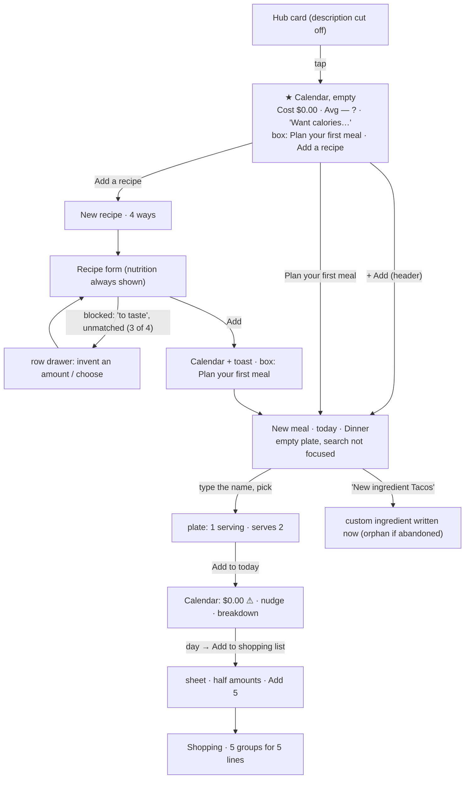
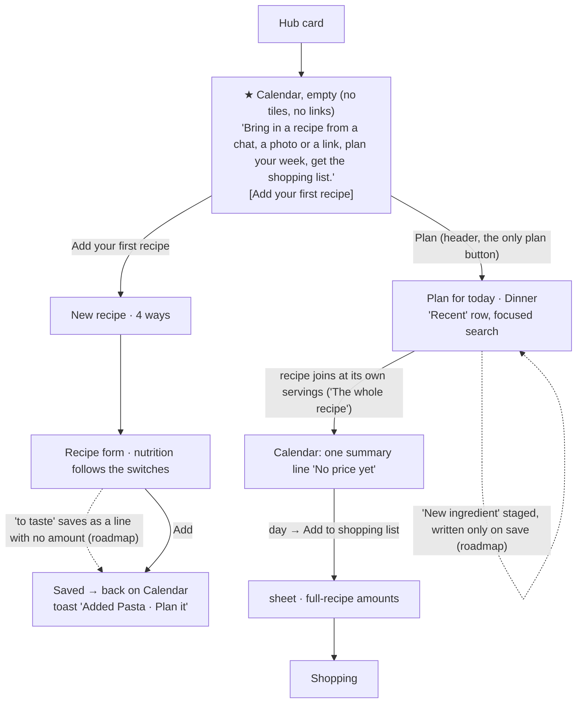
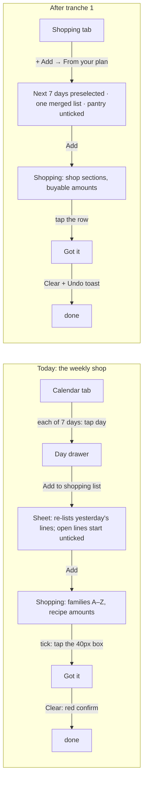
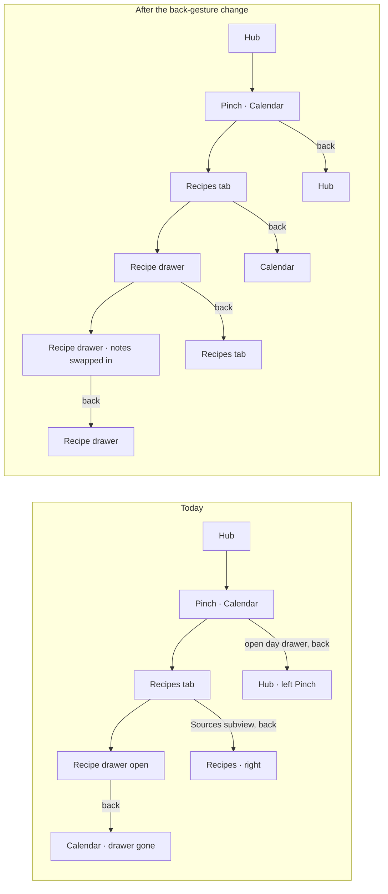

# Pinch: user goals, journeys and flows

How Pinch looks from the person using it: what they are trying to get done, what the app makes them do today, where that is awkward, and what should change, with every change justified and every keeper named. It was produced by ten independent audits that walked the app in a real browser (390×844 first, then 1280×900, America/Los_Angeles) as the seeded returning user (Alex), the empty first-time user (Jamie) and the oversized scale kitchen (Taylor). The raw reports, with every tap count, screenshot reference, finding id and proposal id, are in [`journeys/`](journeys/README.md). This file is the synthesis and the record of decisions.

**Read this first:** [§1](#1-the-short-version) is the whole argument on one page. [§7](#7-decisions-what-changes-what-stays-what-waits) is what was decided. [§8](#8-questions-for-the-owner) is what is yours to decide.

Contents: [1 Short version](#1-the-short-version) · [2 People and moments](#2-the-people-and-their-moments) · [3 Goals and outcomes](#3-goals-and-outcomes) · [4 The app today](#4-the-app-today-facts) · [5 Journeys](#5-journeys-as-walked-and-what-changes) · [6 Findings](#6-findings) · [7 Decisions](#7-decisions-what-changes-what-stays-what-waits) · [8 Questions](#8-questions-for-the-owner) · [9 Rules](#9-rules-this-adds) · [10 Keeping it true](#10-keeping-this-true)

## 1. The short version

Pinch has a strong spine and a loud surface. The spine is the weekly loop: **plan the week, shop for it, cook it, eat the leftovers.** Every daily path that sits on that spine is already 1 to 4 taps. What is wrong is not missing features, it is that each of 30-odd PRs added its feature to every screen that touches it, so the app now volunteers far more than anyone acts on and offers many doors to what is done rarely, while the thing people do all the time (look at a recipe) has two.

What the audits measured:

- **About 120 surfaces** (4 tabs, 8 kinds of subview, 7 drawers, 16 form sheets, 13 in-place "‹ Back" views, 10 help tips, 20 confirm dialogs, 22 toasts) and **about 50 doors for 12 features.** Planning a meal can start from 7 places, creating an ingredient from 6, adding to the shopping list from 5, the add-prices nudge sits on 5 surfaces; opening a recipe works from 2, though 5 surfaces name a recipe and can't open it.
- **The same fact on many screens.** An unpriced ingredient is announced on 14 surfaces (only 5 can fix it) with five different counts (13, 15, 10, 9, 5). Stock in the fridge shows on 10, "eat soon" on 9. Cooking tonight's dinner volunteers **29 items, 4 of which help the decision.** A first run volunteers four numbers about nothing.
- **Honesty and trust problems, not just clutter.** A partial price total reads as a real total ("Cost $5.20" for a month with 5 of 19 ingredients priced). A recipe planned from its drawer defaulted to one serving of a recipe that serves two, so the first shopping list, the stove and the leftovers all came out at half. The phone's back gesture closes none of the app's drawers (7 of 7 tested): it changes tab or leaves the app.
- **Weekly batch work is where taps pile up**: a week of shopping from the plan is 21 taps, 13 prices about 53, calories on two lists 11, cooking a recipe to the end 7.
- **Four words do two to five jobs each**: "meal" (4 meanings), "list" (5), "note" (4), "Got it" (3).

What was decided (details in §7):

1. **Quiet by default, deep on demand.** One explicit insight budget per screen type (§9), and a review check that counts what a screen volunteers.
2. **One home per feature; a door needs a moment.** Extra entry points stay only where a named journey needs them in context; the rest go.
3. **Fix the honesty problems first**: partial totals say "so far", a recipe joins a plan at its own servings, back closes the top layer.
4. **Plan, shop, cook and eat leftovers as one loop**: the calendar opens on today, "From your plan" fills the week's list, cooking opens at the recipe as written and records itself, the fridge list is one place with one name.
5. **Everything that needs a data change or an owner decision waits** on the roadmap with a recommendation, rather than being decided silently in code.

## 2. The people and their moments

| Who                                                                                              | When                                                                                   | What is on their mind                                                                                                                                 |
| ------------------------------------------------------------------------------------------------ | -------------------------------------------------------------------------------------- | ----------------------------------------------------------------------------------------------------------------------------------------------------- |
| **Jamie**, day one                                                                               | Sofa, phone, a recipe from a chat or a screenshot; will give the app about ten minutes | "Will this make me type prices? Do I have to enter everything before it's useful? Where do I start?" Knows no "products", "families" or "saved meals" |
| **Alex**, returning (seeded kitchen: recipes, plans, cooks, notes, containers, shopping)         | Four moods below                                                                       | Not losing their place. The phone's back gesture is the most-used control they have                                                                   |
| **Taylor**, scale ("Big Kitchen": 200 recipes, 100+ meals planned, 300 boxes, 80 shopping lines) | Same, with a bigger kitchen                                                            | Flags that stay rare so a flag still means "look at this"                                                                                             |

Moments, in the order a week goes:

- **Sunday, sofa:** plan the week roughly, see roughly what it costs, make the list. Hops between Calendar, Recipes and Shopping a dozen times in ten minutes.
- **A weekday, 6 pm, counter, phone propped:** "what's tonight, and how do I make it?" One or two taps to land on today; wet hands.
- **At the stove:** one step at a time, timers, last time's advice, then "what do I do with the rest?"
- **At the fridge, a Tuesday:** "what's already cooked, what's in the freezer?"
- **In the shop, bad signal:** list in one hand, basket in the other: tick things, add the thing you forgot.
- **Rarely:** price things, look back, switch calories on, retire a recipe.

They forgive a missing number. They don't forgive being nagged about it on every screen, and the same person sees the same first screen several times a day: anything shown there is seen thirty times a week.

## 3. Goals and outcomes

Thirteen job stories cover everything the audits found people doing. "Taps now" are counted in the browser at 390×844 from the Calendar tab (Alex); "target" is what the decisions below aim at. Where a goal is served is in §5.

| #   | Job story                                                                                                                                                                                    | Outcome that means success                                        | How often         | Matters         | Taps now → target                                     | Without the app                    |
| --- | -------------------------------------------------------------------------------------------------------------------------------------------------------------------------------------------- | ----------------------------------------------------------------- | ----------------- | --------------- | ----------------------------------------------------- | ---------------------------------- |
| G1  | When it's dinner time, I want to see tonight's plan and anything that needs me today, so I can start                                                                                         | Tonight named in one look, at most one "do this"                  | daily             | core            | 1 → **0** (Week opens on today)                       | memory, a note on the fridge       |
| G2  | When I find a recipe in a chat, a screenshot or a link, I want it in my library without retyping, so I can plan with it                                                                      | A saved, reviewed recipe in under a minute, with no invented data | weekly to monthly | core            | 6–10 (blocked in 3 of 4 real readings) → 4            | screenshots, bookmarks             |
| G3  | When I'm choosing what to cook, I want the one or two facts that change my choice (leftovers to use up, last time's note, roughly what it costs), so I can pick without opening five screens | Those facts on the row or the drawer's first screen, nothing else | daily             | core            | 3 + typing, title search only → 3                     | the fridge door, asking the family |
| G4  | When I plan the week, I want meals on days quickly, so I know what to buy                                                                                                                    | 5–7 dinners planned at the right amount                           | weekly            | core            | five dinners 21 taps + 5 typed names → ≈16, no typing | a whiteboard                       |
| G5  | When the plan is set, I want its ingredients on one list, so I can shop once                                                                                                                 | The week's list in a few taps, amounts a person would pick up     | weekly            | core            | 21 (3 per day) → **3–5**                              | copying by hand                    |
| G6  | When I'm in the shop, I want to tick things off and add what I forgot, with bad signal                                                                                                       | One tap per item, list in shop order, adds that work offline      | weekly            | core            | tick 2; add one thing 3 (fails offline)               | a paper list, Notes                |
| G7  | When I cook, I want the recipe step by step with timers and the right amounts, hands full                                                                                                    | Amounts next to their steps, scaled as I cook, one calm finish    | daily to weekly   | core            | tonight to cooking 4 → 3                              | a browser tab, a cookbook          |
| G8  | When I've cooked a batch or have leftovers, I want to eat them in time                                                                                                                       | Boxes with eat-by dates, offered where dinner is decided          | weekly            | supporting      | upkeep ≈43 taps over ≈9 visits a week                 | masking tape on the box            |
| G9  | When I wonder what the week costs, I want a number I trust that is honest about gaps                                                                                                         | A total that says "so far" and is fixable in a few taps           | weekly            | supporting      | see it 1; fix 13 prices ≈53 → ≈25                     | receipts                           |
| G10 | When I cooked something, I want to remember what to change, so next time is better                                                                                                           | The note where next time starts                                   | monthly           | supporting      | note 5 + a 1,300 px scroll                            | scribbles in the margin            |
| G11 | When I want calories or protein, I want to switch them on once, where I'm looking                                                                                                            | One place, on the screen I'm on                                   | once              | rare            | 10–11 across 2 tabs → 3–4                             | a tracking app                     |
| G12 | When I open the app for the first time, I want to know what it does and where to start, without homework                                                                                     | Zero volunteered numbers before there is data; one first step     | once              | core (adoption) | 4 noise items on the first screen → 0                 | the store listing                  |
| G13 | When I peek at something, I want back to undo exactly one step, and each tab as I left it                                                                                                    | One back, one layer; no lost place                                | every session     | core            | back from a drawer: not possible → 1                  | —                                  |

## 4. The app today (facts)

All counts are in [`journeys/I1-inventory.md`](journeys/I1-inventory.md) (surface map, entry-point matrix, insight inventory, concept list, 30 timed tasks) and [`journeys/N2-insights.md`](journeys/N2-insights.md) (the budget).

### 4.1 Where doors are

Doors cluster on **starting and logging**; **looking things up** is starved.

| Feature                     | Doors today                                                                                        | Distinct moments they serve                                                                                                                   | Verdict                                                                                                        |
| --------------------------- | -------------------------------------------------------------------------------------------------- | --------------------------------------------------------------------------------------------------------------------------------------------- | -------------------------------------------------------------------------------------------------------------- |
| Plan a meal                 | 7 (header Add, empty-box button, Week "+", Day view, day drawer, recipe drawer, saved-meal drawer) | 5 (any day, this day, this recipe, this saved meal; "this day" twice)                                                                         | the empty-box button and Day view repeat the header on one screen; 7 labels for one act                        |
| Add to shopping list        | 5 (recipe, saved meal, planned meal, day drawer, Shopping "+ Add")                                 | 3 (cooking off-plan, the day, one thing); the planned meal sits one "‹ Back" from its day's row; a saved meal is planned before it is shopped | and the one that matters, "the week", has none                                                                 |
| Create an ingredient        | 6 (Kitchen, plan builder, saved-meal builder, recipe form, Shopping add, reading review)           | 1 home; the rest write at pick time                                                                                                           | an abandoned plan leaves an orphan ingredient                                                                  |
| Enter a price               | 7 (5 nudges, ingredient drawer, Products "+")                                                      | 2 (this recipe; the batch)                                                                                                                    | 14 surfaces report the gap, 5 can fix it                                                                       |
| Nutrition display           | 5 controls (Calendar gear, two list eyes, basis pills, ingredient drawer)                          | 1 wish                                                                                                                                        | 10–11 taps across 2 tabs                                                                                       |
| Mark cooked, note, put away | 4 each                                                                                             | one moment each (the cook)                                                                                                                    | three doors for "I cooked it tonight" writing two kinds of record                                              |
| Open a recipe               | 2 (Recipes row, idea "Open")                                                                       | the moment is "cook tonight's plan"                                                                                                           | planned meal, day drawer row, saved meal plate, container sheet, cooking history all name it and can't open it |
| Cooking mode                | 2 (recipe, planned meal)                                                                           | 2                                                                                                                                             | keep                                                                                                           |

### 4.2 What each screen volunteers (first view, 390×844, Alex)

Items are anything on screen the person didn't type and that isn't the screen's subject (tiles, count chips, badges, caveat phrases, status lines, nudges, help icons, explanatory subtitles, toasts), each classed **D**ecision, **S**tatus, **R**eference or **N**oise.

| Screen                                                              | Volunteered today                                                                                  | Budget (N2)    | Mostly from                                                       |
| ------------------------------------------------------------------- | -------------------------------------------------------------------------------------------------- | -------------- | ----------------------------------------------------------------- |
| Calendar Month (Alex / Taylor / Jamie)                              | 7 / 10 / **4 (all noise)**                                                                         | 1–2 / 1–2 / 0  | cost tile, Avg per meal ⓘ, nutrition link, nudge, breakdown link  |
| Kitchen                                                             | 16–17                                                                                              | about 7        | entry chips with numbers, row "No price yet" × N                  |
| Recipes list                                                        | 11–13                                                                                              | about 6        | "leaves out N", "Cooked 4×", stock lines, Sources chip            |
| Recipe drawer (Adobo)                                               | 8, ingredients start at 80% of the screen; the cook's own latest note is last, about 1,400 px down | 4              | facts, cooked line, cost tile, nudge, stock                       |
| Meal drawer / Day drawer (today, past) / Planned meal (past dinner) | 9 / 8, 6 / 9                                                                                       | 4 / 5, 3 / 3–4 | nudge on every drawer, "Fixed when the day passed" said four ways |
| Prepared meals / container sheet                                    | 8 / 12                                                                                             | 8 / 7          | four counts in two units; six subtitles under six actions         |
| Shopping                                                            | 6                                                                                                  | 5              | "4 to buy" three times                                            |
| Ideas                                                               | 1                                                                                                  | 1              | the calm reference everything else should match                   |

Journey totals: "what's tonight, then cook it" meets 29 items (4 decisions); "what's in the fridge?" 41 (4 decisions); the price backlog three times in the first two taps, none of them about tonight.

### 4.3 Words

About 45 nouns before everything can be used. Four do several jobs on screens that sit next to each other: **meal** (a saved plate, a planned slot, a meal type, a box in the fridge: "Prepared meals" holds "Chicken stock"), **list** (shopping list, the fridge boxes, the store catalogue, the ingredient catalogue, pickers), **note** (the recipe journal, the price nudge's ✕ "Hide this note", an idea's note, an ingredient line's note), **Got it** (the Shopping half, a help tip's dismiss button 40 px away, a tick's name). "Not priced" has twelve phrasings. Six lines of copy tell the person to go to another screen instead of opening it ("Turn them on from the Calendar's gear").

### 4.4 Sitemap today (phone)

Solid edges: the feature's home. Dashed edges: in-context shortcuts. ⟲ marks a drawer or sheet whose back gesture leaves the tab instead of closing.

```mermaid
flowchart TD
    HUB["Hub card · Pinch"] --> CAL
    subgraph NAV["Bottom pill (phone) · rail (lg)"]
        CAL["Calendar"]
        REC["Recipes"]
        KIT["Kitchen · 'Your ingredients.'"]
        SHOP["Shopping list · badge"]
    end
    CAL -->|gear| SET["Settings ⟲ · nutrition switches, About"]
    CAL -->|Month · Week · Day| CV["three views; Day repeats the day drawer"]
    CAL -->|tap a day| DD["Day drawer ⟲"]
    DD -->|Open dinner| PM["Planned meal · swap"]
    PM -->|Start cooking| WH["Which one? · swap"] --> COOK["Cooking subview"]
    PM -.->|Eat from fridge| EAT["Eat from stock · swap"]
    PM -.->|Shopping list chip| ASS["Add-to-list sheet ⟲"]
    DD -.->|Add to shopping list| ASS
    DD -->|+ Add to this day| PLAN["Plan subview"]
    CAL -->|+ Add · Week + · empty state| PLAN
    PM -->|Modify| PLAN
    CAL -.->|nudge| FILL["Fill-in sheet ⟲"]
    DD -.->|nudge| FILL
    PM -.->|nudge| FILL
    REC -->|pills| RV["Recipes · Meals · Ideas"]
    REC -->|Sources chip| SRC["Sources subview · rows only rename"]
    REC -->|+ New| START["Ways to start ⟲"] --> RFORM["Recipe subview"]
    RV -->|a recipe| RD["Recipe drawer ⟲ · 9 exits, 0 returns"]
    RD -.->|Start cooking| COOK
    RD -.->|Shopping list| ASS
    RD -.->|Put some away| CF["Container form ⟲"]
    RD -.->|History| HIST["Cooking history ⟲"]
    RD -.->|stock line| PREP
    RD -.->|Add to calendar| PLAN
    RD -->|Modify| RFORM
    RD -.->|nudge| FILL
    RV -->|a saved meal| MD["Meal drawer ⟲"]
    MD -.-> ASS
    MD -.-> CF
    MD -.-> PREP
    MD -.-> PLAN
    RV -->|an idea| IDD["Idea drawer ⟲"] -.->|Turn it into a recipe| START
    RV -->|+ New idea| IADD["New idea sheet ⟲ · a second picker"]
    KIT -->|chip| PREP["Prepared meals subview · Fridge · Freezer · Finished"]
    KIT -->|chip| STO["Stores subview · rows edit name/logo"]
    KIT -->|chip| PRO["Products subview · grouped by store"]
    KIT -->|a row| ING["Ingredient drawer ⟲"] --> PF["Product sheet"]
    PREP --> CS["Container sheet"]
    COOK -.->|Finish| PUT["Put away, in the panel"]
    SHOP --> SADD["+ Add sheet ⟲"]
    ASS -.->|toast View| SHOP
```

## 5. Journeys as walked, and what changes

Each journey below names the goals it serves (§3), what the person does today with the taps counted, what the app volunteers on the way, the decisions that change it (ids point into the reports) and the result it aims at. "Tranche 1" is what this PR stack implements; "Roadmap" waits for the owner or for a data change (§7).

### 5.1 First ten minutes (G12, G2, G4; report [J1](journeys/J1-first-run.md))

Jamie opens Pinch from the hub card, whose description is cut off mid-clause and leads with bookkeeping.

| Step                   | Today                                                                                                                                                                                                                                                                                                   | Taps                 | What the app volunteers                                                             |
| ---------------------- | ------------------------------------------------------------------------------------------------------------------------------------------------------------------------------------------------------------------------------------------------------------------------------------------------------- | -------------------- | ----------------------------------------------------------------------------------- |
| Land                   | Calendar: a month of empty cells under **Cost $0.00**, **Avg per meal —** with a ⓘ explaining an average of no meals, "Want calories or protein here?", and a box whose "Plan your first meal" duplicates the header's Add. The README's Story, "bring a recipe in from any chat", is the second button | 1                    | 4 noise items                                                                       |
| Get a recipe in        | Add a recipe → From text → paste → Fill in → review → Add. **Blocked at Save in 3 of 4 real readings** by an amount the person must invent ("salt to taste", "handful of parsley") or an unmatched name ("shredded lettuce" when the catalog has Romaine)                                               | 6 best, 6–10 typical | the form shows 🔥 530 · 💪 18 g with every nutrition switch off                     |
| Plan it                | Plan your first meal → type the name of the one recipe you own → Add. The plate starts at **1 serving of a recipe that serves 2**                                                                                                                                                                       | 4 + typing           | "No prices yet"                                                                     |
| Make the list          | day → Add to shopping list → Add 5                                                                                                                                                                                                                                                                      | 12 from landing      | **half amounts** (Spaghetti 100 g, Parmesan 0.13 cup), five dividers for five lines |
| First "this is useful" | Cooking mode on the first recipe: one step, a timer taken from the text                                                                                                                                                                                                                                 | 7 + a paste          | — (keep it)                                                                         |

The first ten minutes also leave junk behind (tapping "New ingredient 'Tacos'" writes a custom ingredient at pick time, so abandoning the plan leaves an orphan), report the price gap on 12 surfaces on 7 screens, and need 8–10 taps across two tabs to switch calories on.

**Decisions.** Tranche 1: the empty calendar is one line and one button with no tiles, links or duplicate buttons (J1-P1, N2-P12); a recipe joins a plate at its own servings and says "The whole recipe" (J1-P5, already committed); a total with gaps says "so far" and nothing priced says "No price yet", never "$0.00" (J1-P10, J7-P1); the builder opens focused and starts with "Recent" (J1-P6, J1-P16); the recipe form shows only the nutrition that is switched on (J1-P8). Roadmap: a recipe line may have no amount (J1-P3, data model, Q3), a staged "New ingredient" that is written with the record that names it (J1-P4), "before the first price exists, cost is one invitation" (J1-P9, Q1), Kitchen and Recipes day-one surfaces appear with their data (J1-P12, P13: Kitchen's chips already do), the outcome-first hub description (J1-P15).

Proposed first run (tranche 1; the roadmap items are dashed):

### 5.2 Tonight, and choosing what to cook (G1, G3; reports [J3](journeys/J3-planning.md), [J2](journeys/J2-recipes.md), [N2](journeys/N2-insights.md) journey A)

**Today.** The Calendar opens as a cost report sitting on a planner the phone can't read: 6 to 9 volunteered surfaces and 49–57% of the screen come before the plan, the Month default shows anonymous 18 px emoji, Week starts on Sunday with today under the nav pill, and Day view repeats the day drawer with two different gap counts for one day. Tonight is 1 tap (the Month cell), then the planned meal (a drawer with seven jobs, whose one primary is "Save as a meal" whatever the phase), and the recipe names on it are not tappable: to read tonight's notes or "Keeping it" the person leaves for Recipes and searches. In Recipes the search matches titles only ("garlic" finds nothing), the list is A to Z only, and the recipe drawer (1,951 px) puts the cook's own advice last. The planned meal's name is dropped: "Taco night" shows as "Cilantro lime rice +1".

**Decisions (tranche 1).** The stats row becomes **one summary line** that opens a **Week summary** (absorbing the Breakdown, whose rows now open their day) (J3-P1, N2-P2). The phone **opens on Week starting today**, Month one pill away (J3-P2); **Day view goes** (J3-P9); Month chips put dinner first (J3-P14). The planned meal shows its **name** everywhere (J3-P3). The planned meal's **primary follows its phase** (today: Start cooking; ahead, cooked, past: none) and chips are filtered by phase: no Start cooking after Cooked ✓, no "Eat from fridge" for the boxes that dinner made, no repeated shop and reprice rows (J3-P4, J4-P11, I1-P3). The price nudge leaves the day, planned meal and meal drawers and a past day says "Not priced" once (J7-P3, N2-P3, N2-P5). The recipe drawer reads in the cook's order, with last time's note near the top and the cost beside the ingredients (J2-P6, N2-P8, J5-P7). **Roadmap:** a recipe opens in place wherever it is named (N1-P9, I1-P1), search over ingredients/source with an order (J2-P5, needs the View-options design in Q), "eat soon" as one Calendar line only when due (N2-P7, reverses a written rule, Q).

| Task                                             | Now                          | After tranche 1              |
| ------------------------------------------------ | ---------------------------- | ---------------------------- |
| See tonight's dinner on opening                  | 1                            | **0**                        |
| Cook tonight's dinner (two recipes) from opening | 4, and the second dish is +4 | 3 (+2 with the hub, roadmap) |
| Calendar's first view, Alex Month                | 7 items                      | 1–2                          |
| Recipe drawer's front matter before ingredients  | 8 items                      | ≤ 4                          |

### 5.3 Plan the week (G4; report [J3](journeys/J3-planning.md))

**Today.** Every plan starts on a blank search with no recent recipes; at scale saved meals sit in a second search box ("Search start from a saved meal"); the day defaults to today and changing it means a native date box and the OS picker; the meal type is always Dinner, even for a second dinner on the same day; nothing repeats or copies a meal; planning from a recipe never shows where it landed (the toast has no View). Five dinners: **21 taps and 5 typed names**; from recipe drawers ≈40. A repeat: 7 taps and a made-up saved-meal name. Offline, planning locks the screen and even Cancel (the builder waits for the server).

**Decisions (tranche 1).** The plate opens with a captioned **Recent** row (saved meals and recently planned or cooked recipes) and one search over all three (J3-P5, J1-P6); **a strip of day pills** (Today, Tomorrow, next five weekdays, "Other day…") and a meal type that defaults to the first free one near the time of day (J3-P7); the builder's "Save as a meal" switch goes (J3-P8, saving lives on the planned meal and in Meals); distinct builder titles ("Dinner · Wed, Oct 14" vs "Saved meal") (J1-P17); **one verb**, "Plan" (J3-P13); the plan toast says where it landed with **View** (J3-P12). **Roadmap:** offline-safe planning (J3-P10, a write-ack change on five thunks), "Plan again…" (J3-P11), a staged "New ingredient" (J1-P4).

### 5.4 Shop for it (G5, G6; report [J4](journeys/J4-shopping.md))

**Today.** The list's home can't pull from the plan: four drawers push, the tab's "+ Add" finds single ingredients. Three days cost 25–34 taps and a judgement on every row; a week is roughly double (21 taps from the Calendar alone). The list is ordered alphabetically by 41 cooking families (Baking, Beans, Beef… Vegetables, Vinegar, Yogurt): produce sits in 10 families between B and V, 6 dividers for 7 lines. It speaks in recipe amounts ("Salt 0.13 tsp", "2.5 lemons", two rows for one bag of Doritos in oz and g). Pantry staples start ticked, so people untick the same 15 of 35 lines every time. A tap on a row opens a sheet (the 40×40 box does the common action). Adds and Clear are transactions that fail offline after about 10 seconds, in the one place signal drops. The list doesn't remember why a line is there, so an open line starts unticked on the next add (the week under-buys).

**Decisions (tranche 1).** **"From your plan" on the Shopping tab's "+ Add"**: a range calendar with the next seven days preselected, one merged list for every planned meal from today on, summed per ingredient (J4-P1, J3-P6): 21 taps become 3–5, and the day drawer's row and a later "Add this week" button open the same sheet. **Shop sections** in walk order instead of families (J4-P2); **buyable amounts** ("each" rounds up, sub-tablespoon pantry lines show the name only, one row per ingredient) (J4-P3); **pantry starts unticked** under "Usually at home: tick what you're out of" (J4-P4); **a tap on the row ticks it**, a chevron opens the sheet (J4-P6); **removal and Clear get Undo instead of a red confirm** (J4-P15, J4-P7); the cost line says what it covers (J4-P16); catalog search ranks what people type ("milk" finds Whole milk first; "pasta" lists the pasta family) (J4-P13, J1-P14). The saved-meal and planned-meal shopping chips go: entry points 5 → 3, each naming its moment (J4-P11). **Roadmap:** the list remembers what filled it (J4-P5, a new field), plain lines and notes so it is the person's one list (J4-P8, data model, Q), offline adds (J4-P9, trades the "never lose an amount" transaction, Q), store pills (J4-P10), and a "What did you pay?" step in Got it for prices at the till (J4-P7's second half).

### 5.5 Cook it (G7, G10; report [J5](journeys/J5-cooking.md))

**Today.** Cooking mode is the best-made part of the app: one step in 24 px type, 56 px Back/Next, swipe, timers taken from the step text, "Stop timers and leave?" with Stay as the safe answer, and "Your latest note" at the right moment. Around it: it opens at the **plan's** servings (a recipe planned from its drawer defaulted to 1, so the chili opened at "0.17 lb ground beef", the cook was recorded as 1 serving and the leftovers question never appeared); the amounts live on the other tab (a step says "marinate in the soy sauce, vinegar and garlic" with no amounts); scaled amounts print as 0.31 cup and 7.5 each; stepping servings from 1 to 6 takes 10 taps; the finish is three stages ("Mark it as cooked?", "Marked as cooked" + toast, put-away question, saved line + toast, note, Done) that say each thing twice; a dinner is a plate (adobo and rice) but cooking holds one recipe, so switching ends every timer. Two ways to say "cooked" don't know about each other (one dinner became "Cooked 2 times"); cook history and notes are two lists of the same evenings; a note's value is "next time", and next time it is last in the drawer.

**Decisions (tranche 1).** Cooking opens at **the recipe's own servings**, whole-serving steps, with "You planned 1 for tonight · the rest can be put away" (J5-P1); **each step lists the ingredients it names**, scaled (J5-P2); **kitchen measures** (¼ ⅓ ½, tbsp under ¼ cup, "about 8 cloves") (J5-P3); **Finish records the cook** in one calm panel with Undo until Done, no question stage and no stacked toasts (J5-P9, N2-P11); no "Timer done" toast inside cooking mode and timers named by their step's words (J5-P10); the note block shows the latest _note_, not a tweak (J5-P7); "Apply to the recipe" sits on the note itself (J5-P8); two columns from `lg` (J5-P14). The recipe drawer's primary is **Start cooking** when the recipe is on today's plan (J5-P12). **Roadmap:** **cook the plate** (one session holding every recipe of a dinner, J5-P4, L), **one plan-aware "cooked" act** (J5-P5), **one journal** per recipe instead of a history sheet (J5-P6), leaving cooking returns to the drawer it opened from (N1-P5).

### 5.6 Leftovers: the fridge and freezer (G8; report [J6](journeys/J6-prepared-meals.md))

**Today.** Keeping the list true costs more than it pays: eating one serving is 5 taps from anywhere, a toss 5, a thaw 6; only putting away is cheap (3 taps in cooking mode). A realistic week is about 43 taps over about 9 visits, 30 of them at the open fridge, where the person already sees the truth; Taylor's first screen is 13 rows of "Past its date" and clearing 18 costs 56 taps. The plan and the fridge don't know each other: after "Eat from your freezer → Ate 1" the planned meal still offers Start cooking, Mark as cooked and Add to shopping list, and "Eat from your fridge" shows on a dinner already marked cooked, offering the boxes that dinner made. Leftovers aren't offered where the eat-or-cook decision is made (the plan builder). Stock appears on 10 surfaces, 7 for one box, in three wordings, with "servings" mixing plates and parts ("Adobo and rice · 10 servings" is 2 plates + 5 Adobo + 3 rice). "Eat soon" covers three of a box's four days, so the tint stops meaning "act now" (Taylor has 50). The container sheet is a seven-action menu for a one-action moment. Eating, tossing and moving fail offline; the rarest act works.

**Decisions.** Tranche 1 (planned meal side): "Eat from…" is offered only today or yesterday, never after Cooked ✓, never for a box that dinner's own cook made (J6-P1's UI-only half, in the planned-meal workstream). Tranche 2 (this PR stack, second wave): the container sheet asks two things ("Ate one" closes it; "It's gone"), a batch is one row, "eat soon" means today or tomorrow, the list is renamed **"Fridge & freezer"**, Finished becomes a quiet link with "Put it back", one count per fact (J6-P4, P5, P6, P10, P11, P13, N2-P6). **Kept as the owner asked:** the whole-place "Clear out" with confirm and Undo (J6-P12 would scope it to past-dated boxes; recommendation is to keep both). **Roadmap:** eating from the plan _closes_ the plan (a field on the planned meal, J6-P1), "From your fridge" on the plan builder's empty plate (J6-P2, L, reverses a written rule), eating works offline (J6-P7), an opt-in, answerable morning nudge (J6-P8, Q), "Put some away" asked after every "I cooked this" (J6-P9, with J5-P5).

### 5.7 What it costs, and nutrition (G9, G11; report [J7](journeys/J7-costs-nutrition.md))

**Today.** Partial totals are presented as totals everywhere: with 5 of 19 used ingredients priced the Calendar says "Cost $5.20" and "Avg per meal $0.29" for a month, a rice serving is "$0.08", a dinner "$0.15", and the only caveat is a 16 px ⚠ that opens a modal. One backlog appears as nine numbers and five nudges. The ✕ on the Calendar's nudge silently dismisses all 13 open gaps for every recipe, meal and day, permanently, with no Undo and no way back. Every ingredient counts the same, so salt sits in the same backlog as chicken and trust never arrives. The cheapest moment to know a price, the shop, has no way in (about 11 taps and 2 tab switches to price one thing). The fill-in sheet starts every size at lb (a saffron "2 lb"), asks the store 13 times for 13 rows bought at one shop, and doesn't say what a row is used in. The price freeze preserves holes: most past days read "Wasn't priced" until each is repriced by hand. Nutrition visibility is three layers in two places (four switches behind the Calendar's unlabeled gear, a second default-off switch per list, a basis switch), and the recipe form shows nutrition tiles with every metric off.

**Decisions (tranche 1).** A partial total **says so in its figure** ("$5.20 so far", rows "$0.08+", "No price yet", past "Not priced") across the summary line, drawers and rows (J7-P1, N2-P14); **the nudge lives in its homes** (the recipe drawer, the Week summary) and not on every sub-drawer, names the biggest gap ("Chicken thigh and 4 more need a price") and its ✕ becomes "Not now" for this view only; `NudgeCountNote` is deleted (J7-P3, N2-P3); the recipe drawer **marks unpriced lines** (J7-P13); the **fill-in sheet** carries the store over, starts the unit from the recipe amount's dimension and shows what each row is used in, biggest first (J7-P4, J1-P11); the recipe form's nutrition follows the switches (J1-P8). Second wave: one place for nutrition (the eye) and Settings leaving the Calendar (N1-P6, J7-P8), "Stores & prices" as one list (N1-P4, J7-P14), "price" instead of "product" in the words (J7-P10), unit prices beside each place (J7-P11), Kitchen's "Needs a price" gets "Add prices · N" (J7-P6). **Roadmap:** price it in the shop (J7-P2, J4-P7 prefers the till), "Don't count this" per ingredient (J7-P5), freeze prices not holes (J7-P7, changes a product rule, Q), and estimated starting prices (J7 Q3: not now).

### 5.8 Where things live, and getting back (G13, G11; report [N1](journeys/N1-navigation.md))

**Today.** Four tabs in the order of the loop is right (rejected alternatives in §7). But: **the back gesture closes none of the app's drawers** (recipe drawer on Recipes → Calendar; day drawer on Calendar → Kitchen; a fresh entry → the hub; 7 of 7 surfaces over a tab) because only `Subview` registers a history entry; each tab switch pushes a history entry (four backs to leave Pinch after one round); every tab shares one window scroll (Recipes opens 4,000 px down after Kitchen) and the Recipes pill and the Calendar's period reset on every switch while the Calendar's view is kept; **Kitchen is two things under a name and icon that describe neither** (a reference catalogue and the live fridge list; its subtitle is "Your ingredients." and its tab icon is the shopping basket that every "Shopping list" action uses); the same kind of content ("another list in this tab") uses three containers (a switch in Recipes, a subview behind a chip in Kitchen, subviews whose rows only rename for Sources and Stores); drawers are dead ends (the recipe drawer has 9 exits and none returns); Settings lives on the Calendar and governs Recipes and Kitchen.

**Decisions.** Second wave of this PR stack: **back closes the top layer**, everywhere (a `DetailSheet`/`FormSheet` takes a history entry while open, a swap-in-place step steps back first), done once in the shared components with a cross-app regression pass (N1-P1); **Calendar-first back** (a switch from Calendar pushes, switches between other tabs replace) (N1-P2); **each tab owns its scroll and its state** and re-tapping the active tab scrolls to the top (N1-P7); headers name the tab and icons mean one destination (N1-P8); the eye replaces the Calendar's gear and the nutrition switches live in View options on every tab (N1-P6); Sources stops being a destination and "Stores" and "Products" become one "Stores & prices" (J2-P8, N1-P4); the fridge list is named "Fridge & freezer" in Kitchen's words (N1-P3 smaller version). **Roadmap:** Fridge & freezer as a _view_ of Kitchen rather than a subview (N1-P3 larger version, Q), a drawer is a hub (what it opens returns to it, N1-P5), a record named in a drawer opens in place (N1-P9).

### 5.9 Everything the app says (G3, G12; report [N2](journeys/N2-insights.md))

The insight budget is the umbrella for §5.1–5.8: a rule that each screen type has a number of volunteered items it may carry, that NOISE is always zero, that a fact has one home per moment, that a caveat shared by most rows is said once, and that quiet is the default with depth opt-in. It is in §9 and in the review checklists. The proposals that bring each screen under budget are spread through the journeys above; the ones that _move_ an item to where the decision is made rather than cutting it are "eat soon" on the Calendar only when due, the latest note in the recipe drawer and "✅ cooked" on past meals.

## 6. Findings

### 6.1 The high-arching ones

Each is one root cause seen from several journeys. The id points to where the evidence is.

| #   | Finding                                                                                                                                                                                                                                                                                                                                                     | Evidence                    | Goals hurt     | Resolved by                                                                                                            |
| --- | ----------------------------------------------------------------------------------------------------------------------------------------------------------------------------------------------------------------------------------------------------------------------------------------------------------------------------------------------------------- | --------------------------- | -------------- | ---------------------------------------------------------------------------------------------------------------------- |
| H1  | **Doors cluster on starting and logging; looking things up is starved.** A recipe, the noun everything hangs off, opens from 2 places; 5 surfaces name one and can't open it                                                                                                                                                                                | I1-H1, N1-H5, J2-H10        | G3, G7         | Roadmap: a record named in a drawer opens in place (N1-P9). Partly tranche 1: fewer start doors (J3-P9, J4-P11, J2-P8) |
| H2  | **The same fact is volunteered on 9 to 17 surfaces, with different numbers**, because each written rule attached a fact to every surface that touches it ("a total says what it leaves out wherever it appears", "stock shows as StockLine on a row and StockRows in its drawer"). Each rule is right about one surface; together they guarantee repetition | N2-H2, I1-H2, J7-H2, J6-H4  | G3, G9         | The insight budget (§9); one home per fact; the rules are rewritten to say _where_                                     |
| H3  | **The Calendar's first screen is a cost report sitting on a planner**, and on day one it reports nothing                                                                                                                                                                                                                                                    | J3-F1, J1-F4, N2-H4, N1-H8  | G1, G12        | One summary line + Week summary; empty period silent (tranche 1)                                                       |
| H4  | **Partial totals are presented as totals** (blocker)                                                                                                                                                                                                                                                                                                        | J7-H1                       | G9             | "so far" in the figure (tranche 1)                                                                                     |
| H5  | **Back doesn't close drawers; tabs share scroll and keep no state**                                                                                                                                                                                                                                                                                         | N1-H1, N1-H2                | G13            | N1-P1, P2, P7 (second wave)                                                                                            |
| H6  | **A planned serving silently decides the shopping list, the stove, the record and whether leftovers exist**; a recipe from its drawer defaulted to 1 serving of a recipe that serves 2                                                                                                                                                                      | J1-F2, J5-H1, J6            | G4, G5, G7, G8 | A recipe joins a plate at its own servings (done); cooking opens at the recipe as written (tranche 1)                  |
| H7  | **A recipe line needs an amount**, so 3 of 4 first readings couldn't be saved                                                                                                                                                                                                                                                                               | J1-F3                       | G2, G12        | Roadmap, data model (Q3)                                                                                               |
| H8  | **A search picker writes at pick time**: "New ingredient 'Tacos'" leaves an orphan if the plan is abandoned                                                                                                                                                                                                                                                 | J1-F1                       | G12, G4        | Roadmap: stage it, write in the same batch (J1-P4)                                                                     |
| H9  | **The weekly shop has no action**; the list is alphabetical by families and speaks in recipe amounts                                                                                                                                                                                                                                                        | J4-H1, H2, H3               | G5, G6         | "From your plan", shop sections, buyable amounts (tranche 1)                                                           |
| H10 | **The planned meal carries seven jobs, its one primary is "Save as a meal" whatever the phase, and the name the person gave it is dropped**                                                                                                                                                                                                                 | J3-F2, F4                   | G1, G3         | Name everywhere, phase-aware primary (tranche 1)                                                                       |
| H11 | **Keeping the fridge list true costs more than it pays, and Kitchen is two things under one name**                                                                                                                                                                                                                                                          | J6-H1, N1-H3                | G8             | "Ate one", rename, batch rows (second wave); eating closes the plan, plan-from-fridge (roadmap)                        |
| H12 | **A dinner is a plate but cooking holds one recipe; two "cooked" acts don't know each other; history and notes are two lists of the same evenings**                                                                                                                                                                                                         | J5-H2, H3, H4               | G7, G10        | Roadmap (cook the plate, one cooked act, one journal)                                                                  |
| H13 | **Four words do two to five jobs each** (meal, list, note, Got it)                                                                                                                                                                                                                                                                                          | I1-H4                       | all (concepts) | Glossary in the Pinch rules; renames in tranche 1 and second wave                                                      |
| H14 | **Offline: planning locks the screen, eating, tossing and adds fail after 9–10 seconds, while the rarest act works**                                                                                                                                                                                                                                        | J3-F8, J6-H8, J4-H6, J2-S17 | G6, G8         | Roadmap (each needs a write-shape or ack change; Q)                                                                    |
| H15 | **Capture forks before the person knows which fork they want**; a photo idea can't become a read recipe; a recipe forgets the page it came from; search is by title only; the drawer is in the order it was built                                                                                                                                           | J2-H1…H5                    | G2, G3         | Drawer order + small trims (tranche 1); one capture flow and the rest on the roadmap                                   |
| H16 | **Price entry has no home near the moment**; every ingredient counts the same; ✕ is a hidden bulk action; the freeze preserves holes; nutrition is three layers                                                                                                                                                                                             | J7-H3…H7                    | G9, G11        | ✕ → "Not now", fill-in sheet, one nutrition control (tranche 1 and second wave); the rest on the roadmap               |

### 6.2 The small ones

About 190 small findings (copy, labels, alignment, dead taps, inconsistent names, a missing state), numbered per report: J1 20, J2 19, J3 16, J4 18, J5 22, J6 18, J7 26, N1 16, N2 20, I1 18. Each has evidence and a file reference in its report. A few of them show the kind of thing the review should have caught:

- A drawer's search never gets the cursor after it opens (`autoFocus` loses to the drawer taking focus; CLAUDE.md already says so) in the recipe form's ingredient drawer and the plan builder (J1-S1, S2).
- The Day view stacks two empty boxes; three buttons plan the same meal on one screen (J1-S3, S4).
- The Breakdown's rows look tappable and lead nowhere (J7-10).
- "Hide this note" is the accessible name of the price nudge's ✕, above a Notes section (I1-S4).
- The Kitchen tab's icon is the shopping basket that every "Shopping list" action uses (N1-S2).
- The oz and g rows of one bag of Doritos, "Lemons 2.5 each" (J4-10, J4-11).
- A toast covers a cooking screen's back button while the same screen's strip beeps (J5-S4, S5).
- Offline, "Finished" says "Nothing is finished yet" while three exist (N1-S13).
- Six places where copy says "go to another screen" (I1-H5).

## 7. Decisions: what changes, what stays, what waits

### 7.1 How decisions were made

A change was taken into **this PR stack** only if all of these hold: at least two audits, or one audit with a measured number, agree; it needs **no data-model, Firestore-rules, index or Cloud-Function change**; and it doesn't reverse something the owner explicitly asked for in an earlier round (the Fridge/Freezer/Finished switch and "Clear out", the To buy / Got it switch, the "Show what's in stock" View option, search-first lists, the framed put-away panel and the drawer chip row all stay). Everything else is on the roadmap with a recommendation, so the owner decides rather than the code. Each implemented item is its own commit named `Pinch audit <ID>: …` so any single decision can be reverted. The owner asked for some things earlier that the audits now suggest dropping (the Day view, the household daily nutrition average, the Calendar's gear); where that happened, the change is still its own commit and §8 asks.

### 7.2 Tranche 1: implemented in this stack

Workstreams ran in parallel on their own branches and were merged into the tranche branch; the second wave started from the merged first wave. The numbers in "Result" are measured in the browser (390×844) unless marked; they are filled in from each workstream's hand-back.

| Workstream                                    | What changes for the person                                                                                                                                                                                                                                                              | Audit ids                                                                                 | Goal        | Result               |
| --------------------------------------------- | ---------------------------------------------------------------------------------------------------------------------------------------------------------------------------------------------------------------------------------------------------------------------------------------- | ----------------------------------------------------------------------------------------- | ----------- | -------------------- |
| Calendar front                                | Empty period is one line and one button; the stats row becomes one summary line + Week summary (absorbs the Breakdown, rows open their day); phone opens on Week from today; Day view gone; Month chips dinner first; ✅ on past Week rows; the phone Week's day header opens its drawer | J1-P1, J1-P10, J3-P1, J3-P2, J3-P9, J3-P14, J3-P16, J3-S7, N2-P2, N2-P12                  | G1, G12, G9 | _filled in at merge_ |
| Plan builder                                  | "Recent" row and one search; a day-pill strip and meal-type default; no Save-as-a-meal switch; distinct titles; focused search; one verb "Plan"; plan toast with View                                                                                                                    | J3-P5, P7, P8, P12, P13, J1-P6, P16, P17                                                  | G4          | _filled in at merge_ |
| Day drawer and planned meal                   | Name everywhere; primary follows the phase and chips are filtered by phase; no nudge on day/planned meal; "Not priced" once; shop and reprice at the day level only; chevron on meal rows; ✅ on past rows                                                                               | J3-P3, P4, J1-P7, J7-P3, N2-P3, P5, J4-P11, I1-P3, J6-H2 (UI half)                        | G1, G3, G8  | _filled in at merge_ |
| Recipe drawer and cost honesty                | Cook's order; "so far" totals; unpriced lines marked; the nudge only in its homes, names the biggest gap, ✕ = "Not now"; `NudgeCountNote` deleted; fill-in sheet carries store and unit over; Start cooking when on today's plan; nutrition follows the switches                         | J2-P6, N2-P8, J5-P7, P12, J7-P1, P3, P4, P13, J1-P11, J1-P8, N2-P9                        | G3, G9      | _filled in at merge_ |
| Shopping                                      | "From your plan"; shop sections; buyable amounts; pantry unticked; tap row ticks; Undo for removal and Clear; one count; cost line says what it covers; catalog ranking; shopping chips leave the saved-meal and planned-meal drawers                                                    | J4-P1, P2, P3, P4, P6, P7 (Clear), P11, P12, P13, P15, P16, J3-P6, J1-P14                 | G5, G6      | _filled in at merge_ |
| Cooking                                       | Opens at the recipe's own servings; amounts next to their steps; kitchen measures; Finish records the cook in one panel; no timer toast; latest note not tweak; Apply-to-recipe on the note; two columns on wide                                                                         | J5-P1, P2, P3, P9, P10, P7, P8, P14, P15, P16, N2-P11                                     | G7, G10     | _filled in at merge_ |
| Recipes list, capture and forms (second wave) | search over ingredients/source; Sources not a destination; "Saved meals"; Meals/Ideas pills appear with data; "Plan it" toast; offline idea save; delete confirm names what goes; form order                                                                                             | J2-P5 (search), P8, P11, P13, P14, P15, J1-P13, J2-P7, J2-P9 (naming)                     | G2, G3      | _second wave_        |
| Navigation (second wave)                      | Back closes the top layer; Calendar-first back; each tab owns scroll and state; headers and icons; View options replace the gear                                                                                                                                                         | N1-P1, P2, P6, P7, P8, P12, P13                                                           | G13, G11    | _second wave_        |
| Kitchen and fridge & freezer (second wave)    | "Fridge & freezer"; Stores & prices as one list; "Ate one"; batch rows; eat soon = today/tomorrow; one number once; Kitchen's words                                                                                                                                                      | J6-P4, P5, P6, P10, P11, P13, P14, N1-P3 (small), P4, J7-P6, P9, P10, P11, P14, N2-P6, P9 | G8, G9      | _second wave_        |

### 7.3 What stays, and why

The audits looked hard at what earns its place. Don't touch these by accident (each is a KEEP in a report):

- **No setup wizard, no required choices; each empty state is one warm line with the CTA in the header** (J1-K1, K2). Settings is small and calm.
- **Capture:** the four ways and their screens, "Take a look before you save", the disclosure line before anything is sent, pulling a link out of a chat message, a link idea becoming a recipe with nothing sent until the tap (J1-K3, J2-K1…K3).
- **Cooking mode's core** (one step at a time, big Back/Next, swipe, timers from the text, "Stop timers and leave?" defaulting to Stay, the latest-note block, "no numbers at the stove"), and the Finish panel's leftovers line (J5-K1, K2, N2-K4, K10).
- **Undo toasts** on cook, put away, eat, toss, clear, with the double-tap guard; the shopping toast's View; the tab badge (J6-K4, N2-K7, K8).
- **The 1.2 s tick hold, offline ticks, one line per ingredient and unit merged on add, "On your list · 2 lb" in the sheets, the recipe sheet's servings stepper starting at the recipe's own, the stock sentence in the add sheet, the list as a snapshot, search from 8 lines and lazy groups** (J4-K1…K8).
- **Each day has its own copy of a meal; "Start from a saved meal" pills; stock in the plan builder's search results; remove-from-day's confirm; the day drawer as the day's home; planning onto a past day; the 1280 layouts** (J3-K1…K8).
- **One document per physical box; thaw resets the date and never claims food is safe; eat-by from "Keeping it"; the In stock filter; no fifth tab for the fridge** (J6-K2…K8).
- **The ⚠ beside a total (one per total), the reprice confirm's Before/After, the Shopping help's "amounts, not packages" honesty, the fill-in's step-through shape, label-basis nutrition in the ingredient form, recipes naming only the ingredient** (J7-P15…P18, N2-K6).
- **Four tabs in the order of the loop, a floating pill on phones and a rail from `lg`; subviews with their own history entry; never an overlay on an overlay; Home in the site header; `?tab=` and `?view=` in the URL** (N1-K1…K8).
- **Ideas as the calm reference**: no prices, counts or nudges (N2-K1). **Saved meals as a concept** (J2-K8): the fix is the name.

### 7.4 Roadmap: what waits, in the order recommended

Each needs a data change, a rules change, an owner decision, or is simply larger than a first tranche. Sizes: S a label or a line, M a screen or component, L a flow or concept. Question numbers are in §8.

| Order | Item                                                                                                                                                                                                                | Why it matters                                                                                      | Needs                                                                             | Size        |
| ----- | ------------------------------------------------------------------------------------------------------------------------------------------------------------------------------------------------------------------- | --------------------------------------------------------------------------------------------------- | --------------------------------------------------------------------------------- | ----------- |
| 1     | **A recipe line may have no amount** ("to taste", "a handful"); the reader keeps the note and splits "salt and pepper" (J1-P3)                                                                                      | The single biggest blocker to a first saved recipe (3 of 4)                                         | `amount: number \| null`, rules, cost/nutrition/shopping math, legacy-safe; Q3    | L           |
| 2     | **"New ingredient" is staged, written in the same batch as the record that names it** (J1-P4)                                                                                                                       | No orphans from abandoned forms; already a repo rule                                                | three callers' thunks gain an optional draft                                      | M           |
| 3     | **The list remembers what filled it** (`sources` on shopping items) so defaults are right in both directions, the day says "On your list ✓", and a row says what it is for (J4-P5)                                  | The week under-buys today                                                                           | new field, rules `get('sources', [])`, merge transaction                          | M–L         |
| 4     | **Eating from the plan closes the plan** (J6-P1) and **"From your fridge" on the plan builder's empty plate** (J6-P2)                                                                                               | The one change that turns the stored list into a decision and stops the list buying for cooked food | planned-item flag, rules; challenges "no Calendar surface"; Q                     | M / L       |
| 5     | **Cook the plate; one plan-aware "cooked" act; one journal per recipe** (J5-P4, P5, P6)                                                                                                                             | Matches how dinner is cooked and how it is remembered                                               | session state, cook lookup; Q                                                     | L / M / M–L |
| 6     | **A recipe keeps its page address; an idea that became a recipe is done** (J2-P3) and **one capture flow with "Save as an idea" as an ending** (J2-P1) and **a photo idea is read from the photo it holds** (J2-P2) | "Where it came from" becomes a way back                                                             | `Recipe.sourceUrl`, rules; reader accepts a stored image; Q                       | M each      |
| 7     | **Plain lines and notes on the shopping list; offline adds and Clear; store pills; "What did you pay?" in Got it** (J4-P8, P9, P10, P7)                                                                             | The list becomes the person's one list; works where signal drops                                    | `ingredientId`/`amount` nullable, drops the "never lose an amount" transaction; Q | M each      |
| 8     | **Offline-safe planning, eating and tossing** (J3-P10, J6-P7)                                                                                                                                                       | The most frequent writes work in a flaky kitchen                                                    | write-ack changes, history cap care                                               | M each      |
| 9     | **A drawer is a hub** (what it opens returns to it) and **a record named in a drawer opens in place** (N1-P5, P9, J2-P10)                                                                                           | Folds J4-P14, J5-P13, J6-S12 into one rule                                                          | an "opener" in the overlay context                                                | M each      |
| 10    | **Fridge & freezer as a view of Kitchen** instead of a subview (N1-P3, larger version)                                                                                                                              | Same kind of content, same container                                                                | Q                                                                                 | M–L         |
| 11    | **"Don't count this" per ingredient; freeze prices, not holes; price at the till** (J7-P5, P7, J7-P2/J4-P7)                                                                                                         | The number becomes trusted                                                                          | settings document use; a product rule; Q                                          | M each      |
| 12    | **Sort in View options for Recipes** (J2-P5) and **retire knowingly** ("Hide it, keep its history", J2-P9)                                                                                                          | Finding and retiring at 200 recipes                                                                 | a rule change to the SortControl bullet; Q                                        | M each      |
| 13    | **An opt-in, answerable eat-by nudge** (J6-P8)                                                                                                                                                                      | The reminder _is_ the upkeep                                                                        | `scheduleReminder` + `link`, a push; Q                                            | M           |

### 7.5 Considered and rejected

- **A "Tonight" tab:** duplicates Calendar's today; the fix is the Calendar's first screen leading with today (N1).
- **A fifth "Fridge" tab:** upkeep is weekly and its value is in context; a view of Kitchen instead (N1, J6-K5).
- **Shopping inside Kitchen:** the shop is the one-handed, bad-signal moment; one level down costs a tap every time (N1).
- **Recipes inside Calendar; reordering the tabs:** browsing the library is its own moment; the order follows the loop and existing users have the habit (N1).
- **Estimated starting prices, waste tracking, a shared shopping list:** not now (J7-Q3, J6-Q3, J4-Q7); each is a product bet that should follow measuring how fast real prices fill in and whether people keep the list true.

## 8. Questions for the owner

Each has a recommendation. The ones marked **blocks** stop a roadmap item above; **in this PR** means the recommendation is implemented here and is its own commit if you disagree.

| #   | Question                                                                                                                                                                                                                                                                           | Recommendation                                                                                                                                                                                                          | Unlocks / status                                                                                            |
| --- | ---------------------------------------------------------------------------------------------------------------------------------------------------------------------------------------------------------------------------------------------------------------------------------- | ----------------------------------------------------------------------------------------------------------------------------------------------------------------------------------------------------------------------- | ----------------------------------------------------------------------------------------------------------- |
| Q1  | Is cost on from the first minute, or from the first price? (README says "always on".)                                                                                                                                                                                              | From the first price; before that one invitation in the recipe drawer (J1-P9, P10)                                                                                                                                      | the quiet-first-run roadmap item; tranche 1 only removes "$0.00" and the empty-period tiles                 |
| Q2  | What is a planned serving: what we cook, or what one person eats?                                                                                                                                                                                                                  | What we cook (a recipe defaults to its own servings); add "how many eat" later if per-person nutrition matters                                                                                                          | **in this PR** (builder, cooking). Also decides the daily-nutrition question below                          |
| Q3  | May a recipe line have no amount?                                                                                                                                                                                                                                                  | Yes (J1-P3)                                                                                                                                                                                                             | **blocks** roadmap 1                                                                                        |
| Q4  | Day view: drop? Phone Week-from-today? One summary line + Week summary?                                                                                                                                                                                                            | Yes to all three (J3-Q1…Q3)                                                                                                                                                                                             | **in this PR**, each its own commit                                                                         |
| Q5  | Keep the Calendar's household "daily nutrition average"?                                                                                                                                                                                                                           | Not on the front; keep it as a reference line in the Week summary until there is a per-person basis; then decide (J3-P15, N2-P15)                                                                                       | in the summary sheet for now                                                                                |
| Q6  | A week-level "Add to shopping list" (and drop the saved-meal and planned-meal shopping chips)?                                                                                                                                                                                     | Yes: entry points 5 → 3, each with a named moment (J4-P1, P11)                                                                                                                                                          | **in this PR**                                                                                              |
| Q7  | Is the shopping list the person's one list (plain lines, notes, no amount), and may adds work offline at the cost of the "never lose an amount" transaction?                                                                                                                       | Yes to both; say the rare two-device race plainly in TECHNICAL.md (J4-Q1, Q4)                                                                                                                                           | **blocks** roadmap 7                                                                                        |
| Q8  | Should the list remember what filled it?                                                                                                                                                                                                                                           | Yes (J4-P5)                                                                                                                                                                                                             | **blocks** roadmap 3                                                                                        |
| Q9  | Cooking mode: the plan's servings or the recipe's? Should Finish record without asking? Keep cook records as a feature or as a by-product?                                                                                                                                         | The recipe's; yes, with Undo until Done; keep the record but stop promoting it (J5-Q1, Q3, Q4)                                                                                                                          | **in this PR** (servings, Finish)                                                                           |
| Q10 | Should a planned plate cook as one session?                                                                                                                                                                                                                                        | Yes; it is the gap between how Pinch models dinner and how people cook it                                                                                                                                               | **blocks** roadmap 5                                                                                        |
| Q11 | Should Pinch nudge about eat-by dates (opt-in, once a day, answerable)? Is "plan from the fridge" a real kind of planned item? Is waste tracking a goal?                                                                                                                           | Yes (after the list is trustworthy); yes (the largest change); no, not now (J6-Q1…Q3)                                                                                                                                   | **blocks** roadmap 4 and 13                                                                                 |
| Q12 | Should "Clear out" be scoped to past-dated boxes and logged as cleared?                                                                                                                                                                                                            | Keep the whole-place clear-out you asked for with Undo, and add "only what's past its date" beside it later (J6-P12 differs)                                                                                            | kept                                                                                                        |
| Q13 | Should a partial total show a number at all? Freeze holes or fill them? Is the store required on a price? Does the Breakdown stay?                                                                                                                                                 | "$5.20 so far" always, and "Not enough prices yet" below half coverage; fill holes automatically, freeze recorded prices; keep the store but prefill the last one; the Breakdown folds into the Week summary (J7-Q1…Q5) | "so far" **in this PR**; fill holes **blocks** roadmap 11                                                   |
| Q14 | One "New" with "Save as an idea" as an ending? When an idea becomes a recipe, does it disappear? Store the page address? "Hide it, keep its history"? Sort inside View options? Rename Meals to "Saved meals"?                                                                     | Yes, yes, yes (https only), yes, yes, yes (J2-Q1…Q6)                                                                                                                                                                    | "Saved meals" in the second wave; the rest **block** roadmap 6, 12                                          |
| Q15 | Fridge & freezer: a view of Kitchen (a switch) or a subview behind a chip? Back across tabs: Calendar-first? Drop the gear for an eye that holds the nutrition switches on every tab? Stores and Products as one list?                                                             | A view (after the smaller rename ships); Calendar-first; yes; yes (N1-Q1…Q4)                                                                                                                                            | rename, Calendar-first back, the eye and Stores & prices in the second wave; the view **blocks** roadmap 10 |
| Q16 | The central drawer change reaches every mini-app. Do it once in `DetailSheet`/`FormSheet` for all apps, or Pinch-only first?                                                                                                                                                       | Central, with a cross-app regression pass (Waypoint and A-List drawers have the same back-gesture gap)                                                                                                                  | second wave                                                                                                 |
| Q17 | Make the insight budget a hard rule with a review check? Allow one "eat soon" line on the Calendar, against the current Pinch rule? Does a list default to showing stock only when due (known fix 6 stays as a switch)? Drop the numbers on entry chips and short section headers? | Yes; yes, only when something is due, and remove the row pills and the Kitchen dot in exchange; yes by default, keep the switch; yes (N2-Q1…Q6)                                                                         | the budget **is in this PR** (§9); the Calendar line and stock-when-due wait on your answer                 |
| Q18 | Which concept keeps the word "meal", and where does Settings live?                                                                                                                                                                                                                 | The slot on a day keeps "meal"; the pill is "Saved meals", the fridge list "Fridge & freezer"; the nutrition switches live in View options on every tab, About on the last line (I1-Q2, Q3)                             | **in this PR** (glossary)                                                                                   |
| Q19 | Should other apps' reminders toast two at a time over Pinch's header?                                                                                                                                                                                                              | One at a time, as CLAUDE.md already says for toasts with an action. Flag it to whoever owns the reminder shell (a hub decision)                                                                                         | not Pinch's                                                                                                 |

## 9. Rules this adds

The lessons are written into the places that agents and reviewers read, so the next feature meets them before it is built. Each links a finding to where the rule now lives.

| Rule                                                                                                                                                                                                                                                                                    | Why (finding) | Where                                                                             |
| --------------------------------------------------------------------------------------------------------------------------------------------------------------------------------------------------------------------------------------------------------------------------------------- | ------------- | --------------------------------------------------------------------------------- |
| **An insight budget per screen type** (first run 0; a tab's front ≤ 2 plus its badge; a drawer ≤ 4 before its subject; a row ≤ 1 detail + 1 decision flag; NOISE always 0), counted at 390 for Alex, Jamie and Taylor                                                                   | H2, H3, N2    | `CLAUDE.md` Design & UX; review checklists                                        |
| **One fact, one home per moment**; before adding a number, flag or nudge, list where it already shows; a caveat shared by most rows is said once                                                                                                                                        | H2            | `CLAUDE.md` Design & UX; Pinch rules (replaces the "wherever it appears" reading) |
| **A door needs a moment**: a feature has one home, each extra entry point names the journey that needs it in context, a PR adding a door lists the feature's doors, a "look-up" has at least as many doors as surfaces that name the thing                                              | H1, N1        | `CLAUDE.md` Design & UX; product review checklist                                 |
| **A first run volunteers nothing about data the person doesn't have**; one empty state, no button repeats the header's action                                                                                                                                                           | H3, J1        | `CLAUDE.md` Design & UX                                                           |
| **A partial total says so in its figure**; "No price yet", "so far", "+", "Not priced"; one vocabulary; the nudge sits only where the gap is owned                                                                                                                                      | H4, J7        | `CLAUDE.md` Product; Pinch rules                                                  |
| **Back closes the top layer, everywhere**; a tab owns its scroll and state                                                                                                                                                                                                              | H5            | `CLAUDE.md` Design & UX                                                           |
| **A count the person cooks with starts at the recipe as written**; an action on a recipe defaults to the whole recipe                                                                                                                                                                   | H6            | Pinch rules                                                                       |
| **A picker never writes** (a "New X" is staged and written with the record that names it)                                                                                                                                                                                               | H8            | `CLAUDE.md` State, data, and performance                                          |
| **A list a person shops from speaks in things to buy and is ordered the way the place is walked**                                                                                                                                                                                       | H9            | Pinch rules; `CLAUDE.md` Design & UX                                              |
| **A record's one primary follows its phase; a name the person gave stays on the thing everywhere**                                                                                                                                                                                      | H10           | `CLAUDE.md` Design & UX / Product                                                 |
| **A record the person must keep true is updated where the truth is already in their hands**; the frequent action works offline like the one that created it                                                                                                                             | H11, H14      | `CLAUDE.md` Product                                                               |
| **One act, one record, one name; "Undo" means instant reversal**; one confirmation per act                                                                                                                                                                                              | H12, N2       | `CLAUDE.md` Design & UX                                                           |
| **One word, one concept**: a short glossary (meal, saved meal, Fridge & freezer, note, Got it)                                                                                                                                                                                          | H13           | Pinch rules                                                                       |
| **Copy that says "go to X" is a missing door**                                                                                                                                                                                                                                          | I1-H5         | `CLAUDE.md` Design & UX                                                           |
| **Review as Jamie, and review the weekly loop**: open every new surface on an empty kitchen, count what a screen volunteers at 390 for the seeded, empty and scale fixtures, walk the weekly shop, cook a planned two-recipe dinner end to end, review the back gesture as a phone user | all           | `.claude/skills/pr-wrap-up/references/review-agents.md`, `SKILL.md`               |
| **A PR that adds or moves a door updates the sitemap in `UX.md` and this file's entry-point table in the same PR**                                                                                                                                                                      | I1            | `CLAUDE.md` Validation; this file §10                                             |

## 10. Keeping this true

This document is a snapshot of an audit, and the app keeps changing. It stays honest if:

- A PR that adds, removes or moves a door, a screen or a recurring insight updates the sitemap in `UX.md` and the relevant row here (§4.1, §4.2) in the same PR, and says in its body which journey the new door serves.
- A PR that adds or changes a tab, drawer or row type records its first-view insight count at 390×844 for Alex and Jamie, before and after, in its body.
- The review agents (technical, product, design) run the new checks in `.claude/skills/pr-wrap-up/references/review-agents.md`: count what a screen volunteers, walk the weekly loop, review as Jamie, review the back gesture.
- Roadmap items (§7.4) move into a tranche only with the owner's answer to their question in §8, and the report that proposed them stays the source of the evidence.
