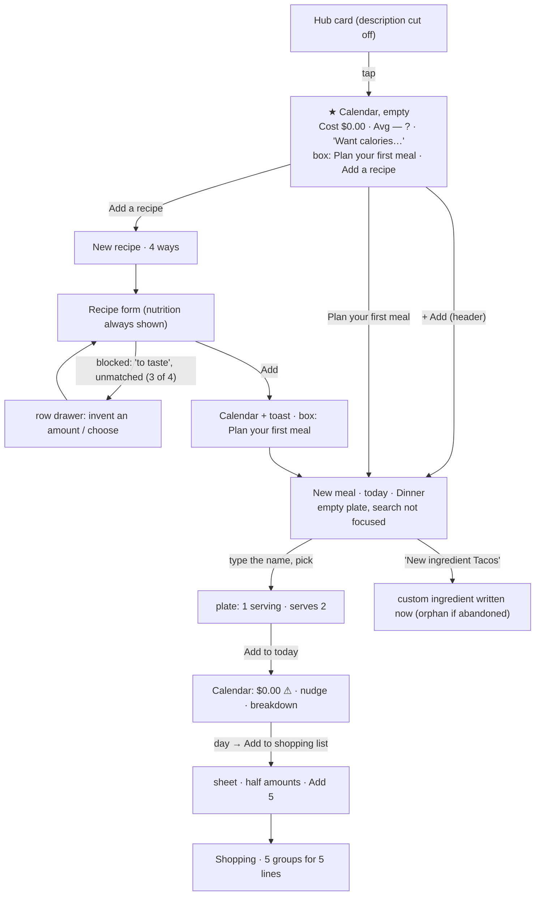
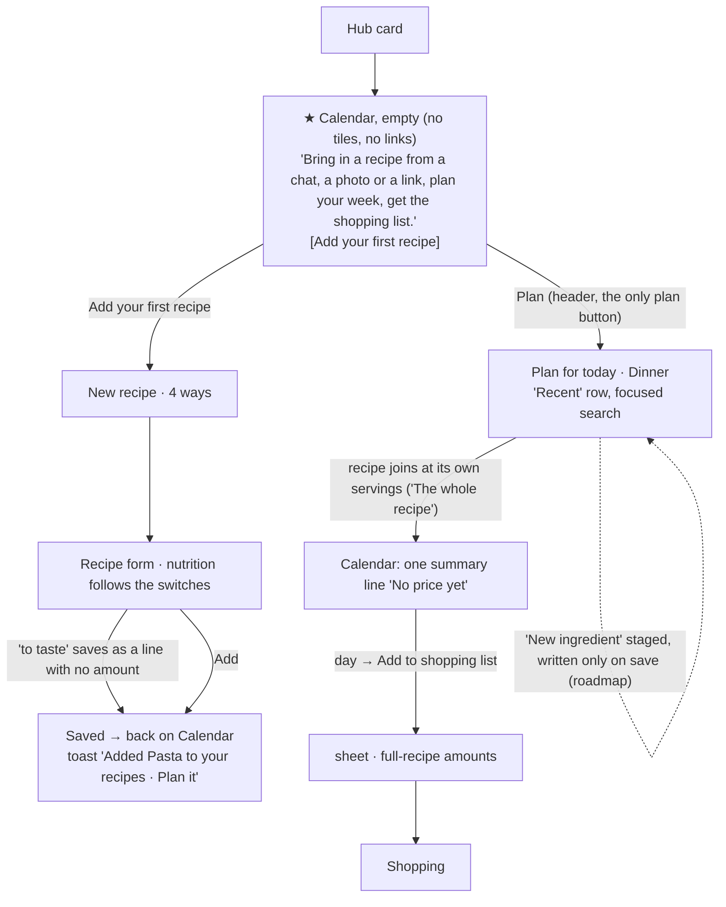
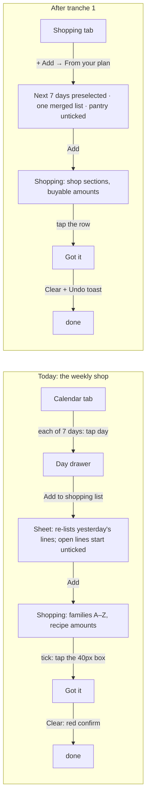
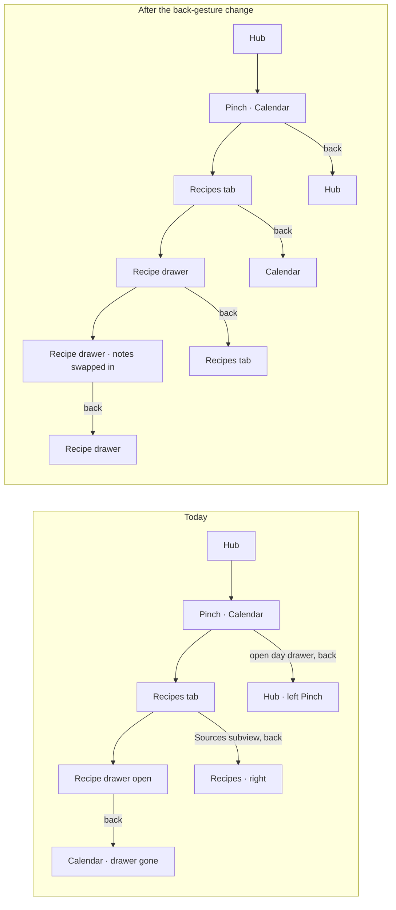

# Pinch: user goals, journeys and flows

How Pinch looks from the person using it: what they are trying to get done, what the app makes them do today, where that is awkward, and what should change, with every change justified and every keeper named. It was produced by ten independent audits that walked the app in a real browser (390×844 first, then 1280×900, America/Los_Angeles) as the seeded returning user (Alex), the empty first-time user (Jamie) and the oversized scale kitchen (Taylor). The raw reports, with every tap count, screenshot reference, finding id and proposal id, are in [`journeys/`](journeys/README.md). This file is the synthesis and the record of decisions.

**Read this first:** [§1](#1-the-short-version) is the whole argument on one page. [§7](#7-decisions-what-changes-what-stays-what-waits) is what was decided. [§8](#8-questions-for-the-owner) is what is yours to decide.

**Status:** both waves of tranche 1 and the owner's round 6 (three roadmap items on your yes, and four corrections to what the review missed) are implemented in this PR stack. [§7.2](#72-tranche-1-and-round-6-implemented-in-this-stack) has what each measured and skipped, and §7.4 what is next. §4's first columns and the "Today" paragraphs of §5 describe the app as audited, before the stack; the "Now" columns in §4.1 and §4.2 bring the counts up to date.

Contents: [1 Short version](#1-the-short-version) · [2 People and moments](#2-the-people-and-their-moments) · [3 Goals and outcomes](#3-goals-and-outcomes) · [4 The app today](#4-the-app-today-facts) · [5 Journeys](#5-journeys-as-walked-and-what-changes) · [6 Findings](#6-findings) · [7 Decisions](#7-decisions-what-changes-what-stays-what-waits) · [8 Questions](#8-questions-for-the-owner) · [9 Rules](#9-rules-this-adds) · [10 Keeping it true](#10-keeping-this-true)

## 1. The short version

Pinch has a strong spine and a loud surface. The spine is the weekly loop: **plan the week, shop for it, cook it, eat the leftovers.** Every daily path that sits on that spine is already 1 to 4 taps. What is wrong is not missing features, it is that each of 30-odd PRs added its feature to every screen that touches it, so the app now volunteers far more than anyone acts on and offers many doors to what is done rarely, while the thing people do all the time (look at a recipe) has two.

What the audits measured:

- **About 120 surfaces** (4 tabs, 8 kinds of subview, 7 drawers, 16 form sheets, 13 in-place "‹ Back" views, 10 help tips, 20 confirm dialogs, 22 toasts) and **about 50 doors for 12 features.** Planning a meal can start from 7 places, creating an ingredient from 6, adding to the shopping list from 5, the add-prices nudge sits on 5 surfaces; opening a recipe works from 2, though 5 surfaces name a recipe and can't open it.
- **The same fact on many screens.** An unpriced ingredient is announced on 14 surfaces (only 5 can fix it) with five different counts (13, 15, 10, 9, 5). Stock in the fridge shows on 10, "eat soon" on 9. Cooking tonight's dinner volunteers **29 items, 4 of which help the decision.** A first run volunteers four numbers about nothing.
- **Honesty and trust problems, not just clutter.** A partial price total reads as a real total ("Cost $5.20" for a month with 5 of 19 ingredients priced). A recipe planned from its drawer defaulted to one serving of a recipe that serves two, so the first shopping list, the stove and the leftovers all came out at half. The phone's back gesture closes none of the app's drawers (7 of 7 tested): it changes tab or leaves the app.
- **Weekly batch work is where taps pile up**: a week of shopping from the plan is 21 taps, 13 prices about 53, calories on two lists 11, cooking a recipe to the end 7.
- **Four words do two to five jobs each**: "meal" (4 meanings), "list" (5), "note" (4), "Got it" (3).

What was decided (details in §7):

1. **Quiet by default, deep on demand.** One explicit insight budget per screen type (§9), and a review check that counts what a screen volunteers.
2. **One home per feature; a door needs a moment.** Extra entry points stay only where a named journey needs them in context; the rest go.
3. **Fix the honesty problems first**: partial totals say "so far", a recipe joins a plan at its own servings, back closes the top layer.
4. **Plan, shop, cook and eat leftovers as one loop**: the calendar opens on today, "From your plan" fills the week's list and the list remembers what filled it, cooking opens at the recipe as written (a plate as one session) and records itself, the fridge list is one place with one name.
5. **Everything that needs a data change or an owner decision waited** on the roadmap with a recommendation, rather than being decided silently in code. The owner's yes to three of those questions moved a line with no amount, the list remembering what filled it and cooking the plate into round 6; the rest is still there (§7.4).

## 2. The people and their moments

| Who | When | What is on their mind |
| --- | --- | --- |
| **Jamie**, day one | Sofa, phone, a recipe from a chat or a screenshot; will give the app about ten minutes | "Will this make me type prices? Do I have to enter everything before it's useful? Where do I start?" Knows no "products", "families" or "saved meals" |
| **Alex**, returning (seeded kitchen: recipes, plans, cooks, notes, containers, shopping) | Four moods below | Not losing their place. The phone's back gesture is the most-used control they have |
| **Taylor**, scale ("Big Kitchen": 200 recipes, 100+ meals planned, 300 boxes, 80 shopping lines) | Same, with a bigger kitchen | Flags that stay rare so a flag still means "look at this" |

Moments, in the order a week goes:

- **Sunday, sofa:** plan the week roughly, see roughly what it costs, make the list. Hops between Calendar, Recipes and Shopping a dozen times in ten minutes.
- **A weekday, 6 pm, counter, phone propped:** "what's tonight, and how do I make it?" One or two taps to land on today; wet hands.
- **At the stove:** one step at a time, timers, last time's advice, then "what do I do with the rest?"
- **At the fridge, a Tuesday:** "what's already cooked, what's in the freezer?"
- **In the shop, bad signal:** list in one hand, basket in the other: tick things, add the thing you forgot.
- **Rarely:** price things, look back, switch calories on, retire a recipe.

They forgive a missing number. They don't forgive being nagged about it on every screen, and the same person sees the same first screen several times a day: anything shown there is seen thirty times a week.

## 3. Goals and outcomes

Thirteen job stories cover everything the audits found people doing. "Taps now" are counted in the browser at 390×844 from the Calendar tab (Alex); "target" is what the decisions below aim at. Where a goal is served is in §5.

| # | Job story | Outcome that means success | How often | Matters | Taps now → target | Without the app |
| --- | --- | --- | --- | --- | --- | --- |
| G1 | When it's dinner time, I want to see tonight's plan and anything that needs me today, so I can start | Tonight named in one look, at most one "do this" | daily | core | 1 → **0** (Week opens on today) | memory, a note on the fridge |
| G2 | When I find a recipe in a chat, a screenshot or a link, I want it in my library without retyping, so I can plan with it | A saved, reviewed recipe in under a minute, with no invented data | weekly to monthly | core | 6–10 (blocked in 3 of 4 real readings) → 4 | screenshots, bookmarks |
| G3 | When I'm choosing what to cook, I want the one or two facts that change my choice (leftovers to use up, last time's note, roughly what it costs), so I can pick without opening five screens | Those facts on the row or the drawer's first screen, nothing else | daily | core | 3 + typing, title search only → 3 | the fridge door, asking the family |
| G4 | When I plan the week, I want meals on days quickly, so I know what to buy | 5–7 dinners planned at the right amount | weekly | core | five dinners 21 taps + 5 typed names → ≈16, no typing | a whiteboard |
| G5 | When the plan is set, I want its ingredients on one list, so I can shop once | The week's list in a few taps, amounts a person would pick up | weekly | core | 21 (3 per day) → **3–5** | copying by hand |
| G6 | When I'm in the shop, I want to tick things off and add what I forgot, with bad signal | One tap per item, list in shop order, adds that work offline | weekly | core | tick 2; add one thing 3 (fails offline) | a paper list, Notes |
| G7 | When I cook, I want the recipe step by step with timers and the right amounts, hands full | Amounts next to their steps, scaled as I cook, one calm finish | daily to weekly | core | tonight to cooking 4 → 3 | a browser tab, a cookbook |
| G8 | When I've cooked a batch or have leftovers, I want to eat them in time | Boxes with eat-by dates, offered where dinner is decided | weekly | supporting | upkeep ≈43 taps over ≈9 visits a week | masking tape on the box |
| G9 | When I wonder what the week costs, I want a number I trust that is honest about gaps | A total that says "so far" and is fixable in a few taps | weekly | supporting | see it 1; fix 13 prices ≈53 → ≈25 | receipts |
| G10 | When I cooked something, I want to remember what to change, so next time is better | The note where next time starts | monthly | supporting | note 5 + a 1,300 px scroll | scribbles in the margin |
| G11 | When I want calories or protein, I want to switch them on once, where I'm looking | One place, on the screen I'm on | once | rare | 10–11 across 2 tabs → 3–4 | a tracking app |
| G12 | When I open the app for the first time, I want to know what it does and where to start, without homework | Zero volunteered numbers before there is data; one first step | once | core (adoption) | 4 noise items on the first screen → 0 | the store listing |
| G13 | When I peek at something, I want back to undo exactly one step, and each tab as I left it | One back, one layer; no lost place | every session | core | back from a drawer: not possible → 1 | — |

## 4. The app today (facts)

All counts are in [`journeys/I1-inventory.md`](journeys/I1-inventory.md) (surface map, entry-point matrix, insight inventory, concept list, 30 timed tasks) and [`journeys/N2-insights.md`](journeys/N2-insights.md) (the budget). The first columns of the two tables below are the audit's counts; the last column is the app after this stack, each from the workstream's own count at 390×844, so compare within a row.

### 4.1 Where doors are

Doors cluster on **starting and logging**; **looking things up** is starved.

| Feature | Doors today | Distinct moments they serve | Verdict | Now |
| --- | --- | --- | --- | --- |
| Plan a meal | 7 (header Add, empty-box button, Week "+", Day view, day drawer, recipe drawer, saved-meal drawer) | 5 (any day, this day, this recipe, this saved meal; "this day" twice) | the empty-box button and Day view repeat the header on one screen; 7 labels for one act | 5, plus a toast: header Plan, Week "+", day drawer, recipe drawer ("Plan it"), saved-meal drawer. The empty box's button and Day view are gone, and "Added X to your recipes" carries a "Plan it" |
| Add to shopping list | 5 (recipe, saved meal, planned meal, day drawer, Shopping "+ Add") | 3 (cooking off-plan, the day, one thing); the planned meal sits one "‹ Back" from its day's row; a saved meal is planned before it is shopped | and the one that matters, "the week", has none | 5, and the week has two: Shopping "+ Add" (One thing, From your plan), recipe drawer, saved-meal drawer, day drawer, Week summary. The planned meal's chip is gone; the saved meal's stayed. Round 7: the recipe's and saved meal's are rows in their drawer's ⋯ More, no longer chips on the front |
| Create an ingredient | 6 (Kitchen, plan builder, saved-meal builder, recipe form, Shopping add, reading review) | 1 home; the rest write at pick time | an abandoned plan leaves an orphan ingredient | 6 (staging it waits, §7.4); a new one now ends at its drawer |
| Enter a price | 7 (5 nudges, ingredient drawer, Products "+") | 2 (this recipe; the batch) | 14 surfaces report the gap, 5 can fix it | 5: the nudge in the recipe drawer and the Week summary, "Add prices" in Kitchen's Needs a price filter, the ingredient drawer, Stores & prices "+ Add" |
| Nutrition display | 5 controls (Calendar gear, two list eyes, basis pills, ingredient drawer) | 1 wish | 10–11 taps across 2 tabs | 1 sheet: the eye on Calendar, Recipes and Kitchen (calories on from Kitchen is 3 taps); the drawer's basis switch is the same setting |
| Mark cooked, note, put away | 4 each | one moment each (the cook) | three doors for "I cooked it tonight" writing two kinds of record | cooked 3 (drawer row, planned row, Finish: the planned row and Finish share one cook id, and a plate's Finish writes every recipe's cook at once; the drawer's row does not know the plan yet, §7.4); notes and put away unchanged in number. Round 7: the drawer's "Mark as cooked" and "Put some away" moved from chips under the facts into ⋯ More, and its notes (with the cooking history) from the bottom of the recipe and a front row into the 🕘 Notes and history view |
| See where a recipe came from, and the others from there | none (round 6 added the drawer's "From X" line) | 1 (this recipe's source) | a door, not a line of front matter (owner, round 7) | 3: the Recipes header's 📖 Sources icon beside "+ New recipe" (once a source exists; the owner asked for it on the Recipes screen itself, not inside a recipe), whose screen lists each source with its recipe count and shows that source's recipes on a tap, and the Recipes filter's Source question for a quick facet. Round 7 first put a 📖 icon on the recipe drawer's title line; its review took it out, so the drawer had no source door, and the owner's third note asked for the source back in the drawer, as a pill: a soft pill under the title ("From Mom's recipe cards ›", only with a source) that closes the drawer and shows the Recipes list narrowed to that source, the same chip as the Sources screen's row leaves. It is the third door at its own moment: reading one recipe and asking "what else is from here?", where the header icon answers "which sources do I have?" and the filter is a facet while browsing; it never opens the Sources screen. The filter's "Edit sources" link is gone: it served the same moment as the icon, one back press apart |
| Open a recipe | 2 (Recipes row, idea "Open") | the moment is "cook tonight's plan" | planned meal, day drawer row, saved meal plate, container sheet, cooking history all name it and can't open it | 2 (unchanged; opening it where it is named is §7.4) |
| Cooking mode | 2 (recipe, planned meal) | 2 | keep | 2: a plate's session opens every recipe of the dinner at once, and "Which one are you cooking?" is gone. Round 7: the recipe drawer's is its primary while the recipe is on today's plan, else a row in ⋯ More (2 taps, was 1 chip); the planned meal's is its primary tonight, else a row in its ⋯ More (a day ahead, or while a due box is the primary; 2 taps, was 1 chip) |
| See what the list is for; stop shopping for a meal (round 7) | 0 (a row named one meal or counted "3 meals"; stopping meant removing lines one by one) | 1 (the plan changed, or the person is deciding what this shop is for) | a list that remembers what filled it should say so and let a meal go | 1: the "Meals on your list" tile under Shopping's search, only once a meal put something there; its sheet names every meal with what is left to buy and "Remove" takes that meal's share off with an Undo. Each row also names its meals and its sheet lists them with their share (a look-up, not a door). The meal names don't open the meal: the plan is a tab away and a drawer over the sheet would be an overlay on an overlay (with "Open a recipe" on the roadmap) |

### 4.2 What each screen volunteers (first view, 390×844, Alex)

Items are anything on screen the person didn't type and that isn't the screen's subject (tiles, count chips, badges, caveat phrases, status lines, nudges, help icons, explanatory subtitles, toasts), each classed **D**ecision, **S**tatus, **R**eference or **N**oise.

| Screen | Volunteered today | Budget (N2) | Mostly from | Now |
| --- | --- | --- | --- | --- |
| Calendar Month (Alex / Taylor / Jamie) | 7 / 10 / **4 (all noise)** | 1–2 / 1–2 / 0 | cost tile, Avg per meal ⓘ, nutrition link, nudge, breakdown link | 1 / 1 / 0 (one summary line); round 7: the owner asked for the averages back and then, after seeing the line, for **tiles he can turn on**, so the front is **1 / 1 / 0** again (one summary line, the plan at y 299 for Alex and Taylor, was 313 and 345 with the averages line) and View options' **Show stats** (off to start) adds a tile row under it: Alex 1 reference item (Total with its ⚠; the average waits for three fully priced meals and Alex has two), Taylor 3 plus the daily nutrition he switched on (Avg per fully priced meal, Per g protein, fully priced; 🔥 💪), counted as **references** the person asked for. The line stops saying the total while its tile is drawn (one fact, one home) and says it again when the tile isn't (nothing priced). The plan starts 71px lower for Alex at 390 (299 → 370; 86px at 320 where a label takes a second line) and 192px for Taylor with the nutrition row (299 → 491; 205px at 320); the Month grid 296 → 367 / 486 |
| Kitchen | 16–17 | about 7 | entry chips with numbers, row "No price yet" × N | Alex 6, Taylor 3, Jamie 0 (17 → 7 and 15 → 4 before the doors dropped their caption) |
| Recipes list | 11–13 | about 6 | "leaves out N", "Cooked 4×", stock lines, Sources chip | 7, none noise (Alex); Jamie 4 controls → 1. Round 7 fix: the header gains the 📖 Sources icon for Alex and Taylor (a door, not a volunteered item: the first row stays at y 248 at 390×844 because it sits on the title's line) and has none for Jamie, while the filter's "Edit sources" link is gone from the panel |
| Recipe drawer (Adobo) | 8, ingredients start at 80% of the screen; the cook's own latest note is last, about 1,400 px down | 4 | facts, cooked line, cost tile, nudge, stock | 5 before the ingredients (noise 2 → 0), which start at y 543 (was 677); the latest note is a row of the "Your kitchen" block; 9 items on the wider count of the three-group front matter (was 11). Round 7: 1 before the ingredients (the facts line; the cost and its warning only once priced), which start 108px under the title (424 in round 6: y 251, was 567); the first screen adds only the price note under the list, its home (2 items, 0 noise); the stock, the cooked row, the latest note and the four chips are behind 🕘 and ⋯ More; two looks between title and subject (was 3, plus the chips). Round 7 review: the price note moved from between the ingredients and the steps to under the Cost tile after the steps (alone in the tile's place while nothing is priced), so the steps follow the ingredients with nothing between them and the first screen is 1 item (the facts line); 🕘 is the title line's one door (📖 left the drawer). Round 7, third note: the source pill is one more item, a reference (3 before the ingredients: the pill, the description, the facts line; the ingredients start 140px under the title for Adobo at 390 and 320 (was 108), 96 for Cilantro lime rice (was 64), and a recipe with no source is unchanged); three looks between the title and the subject, four with a cover photo |
| Meal drawer / Day drawer (today, past) / Planned meal (past dinner) | 9 / 8, 6 / 9 | 4 / 5, 3 / 3–4 | nudge on every drawer, "Fixed when the day passed" said four ways | 5 / 5 today and 4 past / 3 past dinner. Round 7, the saved meal: 1 before the plate (its cost line and warning), which starts 64px under the title (was 246); the stock row and the two chips are behind ⋯ More. Round 7 review: 0 before the plate, which starts 24px under the title (390 and 320), the cost a tile after it in the planned meal's words, so the two plate views share one anatomy. Round 7, the planned meal: 0 before the plate (was 4: two chips, the Cost tile and its warning), whose first row starts 44px under the meal's name (was 157) and 140px under the day's title (was 265; 168 at 320×568, where the name wraps, was 313); the Cost tile and warning follow the plate, 0 noise; Start cooking (when not the primary), Eat from…, Save to Saved meals and Remove from this day are rows of ⋯ More; tonight's dinner shows 7 controls (was 9) |
| Prepared meals / container sheet | 8 / 12 | 8 / 7 | four counts in two units; six subtitles under six actions | now Fridge & freezer and its box sheet: 5 / 5 |
| Shopping | 6 | 5 | "4 to buy" three times | 5 (the count once, not three times); round 7: Alex 5 → 6 (the "Meals on your list" door's line, a reference; each row's "for …" now names its meals instead of counting past two), Taylor's list from before sources 2 → 2 (no door), Jamie 0 → 0 |
| Cooking, a timer running (Adobo, step 1; round 7 timer view) | 5 around a 24px clock: the note line (R), the step counter (S), the step itself and its "For this step" block of four amounts (R, both no longer needed while waiting), the wake-lock line (S), plus the strip once a second timer runs | 2 | the step screen kept on while waiting | Running **3, noise 0**: "Step 1 of 3 · Show this step" (S, and the way back to the step), "Up next" (D: get ready for it), the keep-screen-open line at its foot (S); paused 3; "Time's up" 2 plus "Rang 2 min ago" folded into the card (S, the one fact the card lacked: how long it has waited; no keep-screen-open line); each other timer adds its row (D: pause it or bring it forward), counted as one "Other timers" item; on a plate one "Meanwhile" line (D: start the other dish while this one waits, shown only while a step is left there and "Up next" doesn't already say it); a step's other times are one collapsed line (D) instead of rows. The step screen with timers in the background: the note line, the counter, the amounts and the pill row (4, as before; the standing caveat and a started time's card are gone) |
| Ideas | 1 | 1 | the calm reference everything else should match | 1 |

Journey totals as audited: "what's tonight, then cook it" meets 29 items (4 decisions); "what's in the fridge?" 41 (4 decisions); the price backlog three times in the first two taps, none of them about tonight.

### 4.3 Words

About 45 nouns before everything can be used. Four do several jobs on screens that sit next to each other: **meal** (a saved plate, a planned slot, a meal type, a box in the fridge: "Prepared meals" holds "Chicken stock"), **list** (shopping list, the fridge boxes, the store catalogue, the ingredient catalogue, pickers), **note** (the recipe journal, the price nudge's ✕ "Hide this note", an idea's note, an ingredient line's note), **Got it** (the Shopping half, a help tip's dismiss button 40 px away, a tick's name). "Not priced" has twelve phrasings. Six lines of copy tell the person to go to another screen instead of opening it ("Turn them on from the Calendar's gear"). The glossary in the Pinch rules settles them (a saved meal, Fridge & freezer, a box, a price, "Not now", Shopping's own "Got it" half), and the second wave and round 6 renamed the app to it.

### 4.4 Sitemap today (phone)

As audited; `UX.md` has the current sitemap. Solid edges: the feature's home. Dashed edges: in-context shortcuts. ⟲ marks a drawer or sheet whose back gesture leaves the tab instead of closing.

```mermaid
flowchart TD
    HUB["Hub card · Pinch"] --> CAL
    subgraph NAV["Bottom pill (phone) · rail (lg)"]
        CAL["Calendar"]
        REC["Recipes"]
        KIT["Kitchen · 'Your ingredients.'"]
        SHOP["Shopping list · badge"]
    end
    CAL -->|gear| SET["Settings ⟲ · nutrition switches, About"]
    CAL -->|Month · Week · Day| CV["three views; Day repeats the day drawer"]
    CAL -->|tap a day| DD["Day drawer ⟲"]
    DD -->|Open dinner| PM["Planned meal · swap"]
    PM -->|Start cooking| WH["Which one? · swap"] --> COOK["Cooking subview"]
    PM -.->|Eat from fridge| EAT["Eat from stock · swap"]
    PM -.->|Shopping list chip| ASS["Add-to-list sheet ⟲"]
    DD -.->|Add to shopping list| ASS
    DD -->|+ Add to this day| PLAN["Plan subview"]
    CAL -->|+ Add · Week + · empty state| PLAN
    PM -->|Modify| PLAN
    CAL -.->|nudge| FILL["Fill-in sheet ⟲"]
    DD -.->|nudge| FILL
    PM -.->|nudge| FILL
    REC -->|pills| RV["Recipes · Meals · Ideas"]
    REC -->|Sources chip| SRC["Sources subview · rows only rename"]
    REC -->|+ New| START["Ways to start ⟲"] --> RFORM["Recipe subview"]
    RV -->|a recipe| RD["Recipe drawer ⟲ · 9 exits, 0 returns"]
    RD -.->|Start cooking| COOK
    RD -.->|Shopping list| ASS
    RD -.->|Put some away| CF["Container form ⟲"]
    RD -.->|History| HIST["Cooking history ⟲"]
    RD -.->|stock line| PREP
    RD -.->|Add to calendar| PLAN
    RD -->|Modify| RFORM
    RD -.->|nudge| FILL
    RV -->|a saved meal| MD["Meal drawer ⟲"]
    MD -.-> ASS
    MD -.-> CF
    MD -.-> PREP
    MD -.-> PLAN
    RV -->|an idea| IDD["Idea drawer ⟲"] -.->|Turn it into a recipe| START
    RV -->|+ New idea| IADD["New idea sheet ⟲ · a second picker"]
    KIT -->|chip| PREP["Prepared meals subview · Fridge · Freezer · Finished"]
    KIT -->|chip| STO["Stores subview · rows edit name/logo"]
    KIT -->|chip| PRO["Products subview · grouped by store"]
    KIT -->|a row| ING["Ingredient drawer ⟲"] --> PF["Product sheet"]
    PREP --> CS["Container sheet"]
    COOK -.->|Finish| PUT["Put away, in the panel"]
    SHOP --> SADD["+ Add sheet ⟲"]
    ASS -.->|toast View| SHOP
```

## 5. Journeys as walked, and what changes

Each journey below names the goals it serves (§3), what the person does today with the taps counted, what the app volunteers on the way, the decisions that change it (ids point into the reports) and the result it aims at. "Tranche 1" is what this PR stack implements; "Roadmap" waits for the owner or for a data change (§7).

### 5.1 First ten minutes (G12, G2, G4; report [J1](journeys/J1-first-run.md))

Jamie opens Pinch from the hub card, whose description is cut off mid-clause and leads with bookkeeping.

| Step | Today | Taps | What the app volunteers |
| --- | --- | --- | --- |
| Land | Calendar: a month of empty cells under **Cost $0.00**, **Avg per meal —** with a ⓘ explaining an average of no meals, "Want calories or protein here?", and a box whose "Plan your first meal" duplicates the header's Add. The README's Story, "bring a recipe in from any chat", is the second button | 1 | 4 noise items |
| Get a recipe in | Add a recipe → From text → paste → Fill in → review → Add. **Blocked at Save in 3 of 4 real readings** by an amount the person must invent ("salt to taste", "handful of parsley") or an unmatched name ("shredded lettuce" when the catalog has Romaine) | 6 best, 6–10 typical | the form shows 🔥 530 · 💪 18 g with every nutrition switch off |
| Plan it | Plan your first meal → type the name of the one recipe you own → Add. The plate starts at **1 serving of a recipe that serves 2** | 4 + typing | "No prices yet" |
| Make the list | day → Add to shopping list → Add 5 | 12 from landing | **half amounts** (Spaghetti 100 g, Parmesan 0.13 cup), five dividers for five lines |
| First "this is useful" | Cooking mode on the first recipe: one step, a timer taken from the text | 7 + a paste | — (keep it) |

The first ten minutes also leave junk behind (tapping "New ingredient 'Tacos'" writes a custom ingredient at pick time, so abandoning the plan leaves an orphan), report the price gap on 12 surfaces on 7 screens, and need 8–10 taps across two tabs to switch calories on.

**Decisions.** Tranche 1: the empty calendar is one line and one button with no tiles, links or duplicate buttons (J1-P1, N2-P12); a recipe joins a plate at its own servings and says "The whole recipe" (J1-P5, already committed); a total with gaps says "so far" and nothing priced says "No price yet", never "$0.00" (J1-P10, J7-P1); the builder opens focused and starts with "Recent" (J1-P6, J1-P16); the recipe form shows only the nutrition that is switched on (J1-P8). **Round 6 (your yes to Q3):** a recipe line may have no amount (J1-P3): "to taste" saves as just a name, the reader keeps the words as the note and splits "salt and pepper", and an unmatched name offers its nearest ingredients in one tap (J1-P3b); a pasted shakshuka went from 12 taps and 2 invented numbers to 5 taps and none. **Second wave:** Kitchen and Recipes day-one surfaces appear with their data (J1-P12, P13), the outcome-first hub description (J1-P15; the hub reads its description from the Admin dashboard first, so it is edited there), and until something is priced the recipe drawer says "See what it costs" with one "Add prices" line (J1-P9, Q1). **Roadmap:** a staged "New ingredient" that is written with the record that names it (J1-P4).

First run after tranche 1 and round 6 (the one roadmap item is dashed):

### 5.2 Tonight, and choosing what to cook (G1, G3; reports [J3](journeys/J3-planning.md), [J2](journeys/J2-recipes.md), [N2](journeys/N2-insights.md) journey A)

**Today.** The Calendar opens as a cost report sitting on a planner the phone can't read: 6 to 9 volunteered surfaces and 49–57% of the screen come before the plan, the Month default shows anonymous 18 px emoji, Week starts on Sunday with today under the nav pill, and Day view repeats the day drawer with two different gap counts for one day. Tonight is 1 tap (the Month cell), then the planned meal (a drawer with seven jobs, whose one primary is "Save as a meal" whatever the phase), and the recipe names on it are not tappable: to read tonight's notes or "Keeping it" the person leaves for Recipes and searches. In Recipes the search matches titles only ("garlic" finds nothing), the list is A to Z only, and the recipe drawer (1,951 px) puts the cook's own advice last. The planned meal's name is dropped: "Taco night" shows as "Cilantro lime rice +1".

**Decisions (tranche 1).** The stats row becomes **one summary line** that opens a **Week summary** (absorbing the Breakdown, whose rows now open their day) (J3-P1, N2-P2). The phone **opens on Week starting today**, Month one pill away (J3-P2); **Day view goes** (J3-P9); Month chips put dinner first (J3-P14). The planned meal shows its **name** everywhere (J3-P3). The planned meal's **primary follows its phase** (today: Start cooking; ahead, cooked, past: none) and chips are filtered by phase: no Start cooking after Cooked ✓, no "Eat from fridge" for the boxes that dinner made, no repeated shop and reprice rows (J3-P4, J4-P11, I1-P3). The price nudge leaves the day, planned meal and meal drawers and a past day says "Not priced" once (J7-P3, N2-P3, N2-P5). The recipe drawer reads in the cook's order, with last time's note near the top and the cost beside the ingredients (J2-P6, N2-P8, J5-P7). **Roadmap:** a recipe opens in place wherever it is named (N1-P9, I1-P1), a sort for Recipes (J2-P5, needs the View-options design in Q; the search over ingredients and source shipped in the second wave), "eat soon" as one Calendar line only when due (N2-P7, reverses a written rule, Q).

| Task | Now | After tranche 1 |
| --- | --- | --- |
| See tonight's dinner on opening | 1 | **0** |
| Cook tonight's dinner (two recipes) from opening | 4, and the second dish is +4 | 3 (+2 with the hub, roadmap) |
| Calendar's first view, Alex Month | 7 items | 1–2 |
| Recipe drawer's front matter before ingredients | 8 items | ≤ 4 |

### 5.3 Plan the week (G4; report [J3](journeys/J3-planning.md))

**Today.** Every plan starts on a blank search with no recent recipes; at scale saved meals sit in a second search box ("Search start from a saved meal"); the day defaults to today and changing it means a native date box and the OS picker; the meal type is always Dinner, even for a second dinner on the same day; nothing repeats or copies a meal; planning from a recipe never shows where it landed (the toast has no View). Five dinners: **21 taps and 5 typed names**; from recipe drawers ≈40. A repeat: 7 taps and a made-up saved-meal name. Offline, planning locks the screen and even Cancel (the builder waits for the server).

**Decisions (tranche 1).** The plate opens with a captioned **Recent** row (saved meals and recently planned or cooked recipes) and one search over all three (J3-P5, J1-P6); **a strip of day pills** (Today, Tomorrow, next five weekdays, "Other day…") and a meal type that defaults to the first free one near the time of day (J3-P7); the builder's "Save as a meal" switch goes (J3-P8, saving lives on the planned meal, as "Save to Saved meals", and in Saved meals); distinct builder titles ("Dinner · Wed, Oct 14" vs "Saved meal") (J1-P17); **one verb**, "Plan" (J3-P13); the plan toast says where it landed with **View** (J3-P12). **Roadmap:** offline-safe planning (J3-P10, a write-ack change on five thunks), "Plan again…" (J3-P11), a staged "New ingredient" (J1-P4).

### 5.4 Shop for it (G5, G6; report [J4](journeys/J4-shopping.md))

**Today.** The list's home can't pull from the plan: four drawers push, the tab's "+ Add" finds single ingredients. Three days cost 25–34 taps and a judgement on every row; a week is roughly double (21 taps from the Calendar alone). The list is ordered alphabetically by 41 cooking families (Baking, Beans, Beef… Vegetables, Vinegar, Yogurt): produce sits in 10 families between B and V, 6 dividers for 7 lines. It speaks in recipe amounts ("Salt 0.13 tsp", "2.5 lemons", two rows for one bag of Doritos in oz and g). Pantry staples start ticked, so people untick the same 15 of 35 lines every time. A tap on a row opens a sheet (the 40×40 box does the common action). Adds and Clear are transactions that fail offline after about 10 seconds, in the one place signal drops. The list doesn't remember why a line is there, so an open line starts unticked on the next add (the week under-buys).

**Decisions (tranche 1).** **"From your plan" on the Shopping tab's "+ Add"**: a range calendar with the next seven days preselected, one merged list for every planned meal from today on, summed per ingredient (J4-P1, J3-P6): 21 taps become 3–5, and the day drawer's row and a later "Add this week" button open the same sheet. **Shop sections** in walk order instead of families (J4-P2); **buyable amounts** ("each" rounds up, sub-tablespoon pantry lines show the name only, one row per ingredient) (J4-P3); **pantry starts unticked** under "Usually at home: tick what you're out of" (J4-P4); **a tap on the row ticks it**, a chevron opens the sheet (J4-P6); **removal and Clear get Undo instead of a red confirm** (J4-P15, J4-P7); the cost line says what it covers (J4-P16); catalog search ranks what people type ("milk" finds Whole milk first; "pasta" lists the pasta family) (J4-P13, J1-P14). The planned meal's shopping chip goes and the week gets its doors (the tab's "From your plan", the Week summary's row), so the entry points stay five, each naming its moment (J4-P11); the saved meal's chip stayed, since it serves buying for a meal that isn't planned, which leaves J4-P11's second half undone (§8 Q6). **Round 6 (your yes to Q8):** the list remembers what filled it (J4-P5): every add records which planned meal, recipe or saved meal put each line there, so a sheet starts a row unticked only when that same source already did, adds only the missing share of a shared line, the day drawer says "On your list ✓" and a row says what it is for ("For Adobo chicken (Thu)"); the weekly shop with Sunday already added went from about 31 taps to the right amounts to 7 taps and no wrong default. **Roadmap:** plain lines and notes so it is the person's one list (J4-P8; a line may already have no amount since round 6, but not yet no ingredient; Q), offline adds (J4-P9, trades the "never lose an amount" transaction, Q), store pills (J4-P10), and a "What did you pay?" step in Got it for prices at the till (J4-P7's second half).

### 5.5 Cook it (G7, G10; report [J5](journeys/J5-cooking.md))

**Today.** Cooking mode is the best-made part of the app: one step in 24 px type, 56 px Back/Next, swipe, timers taken from the step text, "Stop timers and leave?" with Stay as the safe answer, and "Your latest note" at the right moment. Around it: it opens at the **plan's** servings (a recipe planned from its drawer defaulted to 1, so the chili opened at "0.17 lb ground beef", the cook was recorded as 1 serving and the leftovers question never appeared); the amounts live on the other tab (a step says "marinate in the soy sauce, vinegar and garlic" with no amounts); scaled amounts print as 0.31 cup and 7.5 each; stepping servings from 1 to 6 takes 10 taps; the finish is three stages ("Mark it as cooked?", "Marked as cooked" + toast, put-away question, saved line + toast, note, Done) that say each thing twice; a dinner is a plate (adobo and rice) but cooking holds one recipe, so switching ends every timer. Two ways to say "cooked" don't know about each other (one dinner became "Cooked 2 times"); cook history and notes are two lists of the same evenings; a note's value is "next time", and next time it is last in the drawer.

**Decisions (tranche 1).** Cooking opens at **the recipe's own servings**, whole-serving steps, with "You planned 1 for tonight · the rest can be put away" (J5-P1); **each step lists the ingredients it names**, scaled (J5-P2); **kitchen measures** (¼ ⅓ ½, tbsp under ¼ cup, "about 8 cloves") (J5-P3); **Finish records the cook** in one calm panel with Undo until Done, no question stage and no stacked toasts (J5-P9, N2-P11); no "Timer done" toast inside cooking mode and timers named by their step's words (J5-P10); the note block shows the latest *note*, not a tweak (J5-P7); "Apply to the recipe" sits on the note itself (J5-P8); two columns from `lg` (J5-P14). The recipe drawer's primary is **Start cooking** when the recipe is on today's plan (J5-P12). **Round 6 (your yes to Q10): cook the plate** (J5-P4): a dinner with two recipes opens them as one session, as pills under the header, each keeping its own step, ticks and servings, with one timer strip that names each timer's recipe and step; Finish writes every recipe's cook in one transaction and one Undo takes them all back; "Which one are you cooking?" is gone. **Roadmap:** **one plan-aware "cooked" act** (J5-P5: cooking mode, the planned row and "Not cooked" share one cook id, but the drawer's "Mark as cooked" does not know the plan), **one journal** per recipe instead of a history sheet (J5-P6), leaving cooking returns to the drawer it opened from (N1-P5).

### 5.6 Leftovers: the fridge and freezer (G8; report [J6](journeys/J6-prepared-meals.md))

**Today.** Keeping the list true costs more than it pays: eating one serving is 5 taps from anywhere, a toss 5, a thaw 6; only putting away is cheap (3 taps in cooking mode). A realistic week is about 43 taps over about 9 visits, 30 of them at the open fridge, where the person already sees the truth; Taylor's first screen is 13 rows of "Past its date" and clearing 18 costs 56 taps. The plan and the fridge don't know each other: after "Eat from your freezer → Ate 1" the planned meal still offers Start cooking, Mark as cooked and Add to shopping list, and "Eat from your fridge" shows on a dinner already marked cooked, offering the boxes that dinner made. Leftovers aren't offered where the eat-or-cook decision is made (the plan builder). Stock appears on 10 surfaces, 7 for one box, in three wordings, with "servings" mixing plates and parts ("Adobo and rice · 10 servings" is 2 plates + 5 Adobo + 3 rice). "Eat soon" covers three of a box's four days, so the tint stops meaning "act now" (Taylor has 50). The container sheet is a seven-action menu for a one-action moment. Eating, tossing and moving fail offline; the rarest act works.

**Decisions.** Tranche 1 (planned meal side): "Eat from…" is offered only today or yesterday, never after Cooked ✓, never for a box that dinner's own cook made (J6-P1's UI-only half, in the planned-meal workstream). Tranche 2 (this PR stack, second wave): the container sheet asks two things ("Ate one" closes it; "It's gone"), a batch is one row, "eat soon" means today or tomorrow, the list is renamed **"Fridge & freezer"**, Finished becomes a quiet link with "Put it back", one count per fact (J6-P4, P5, P6, P10, P11, P13, N2-P6). **Kept as the owner asked:** the whole-place "Clear out" with confirm and Undo (J6-P12 would scope it to past-dated boxes; recommendation is to keep both). **Roadmap:** eating from the plan *closes* the plan (a field on the planned meal, J6-P1), "From your fridge" on the plan builder's empty plate (J6-P2, L, reverses a written rule), eating works offline (J6-P7), an opt-in, answerable morning nudge (J6-P8, Q), "Put some away" asked after every "Mark as cooked" (J6-P9, with J5-P5).

### 5.7 What it costs, and nutrition (G9, G11; report [J7](journeys/J7-costs-nutrition.md))

**Today.** Partial totals are presented as totals everywhere: with 5 of 19 used ingredients priced the Calendar says "Cost $5.20" and "Avg per meal $0.29" for a month, a rice serving is "$0.08", a dinner "$0.15", and the only caveat is a 16 px ⚠ that opens a modal. One backlog appears as nine numbers and five nudges. The ✕ on the Calendar's nudge silently dismisses all 13 open gaps for every recipe, meal and day, permanently, with no Undo and no way back. Every ingredient counts the same, so salt sits in the same backlog as chicken and trust never arrives. The cheapest moment to know a price, the shop, has no way in (about 11 taps and 2 tab switches to price one thing). The fill-in sheet starts every size at lb (a saffron "2 lb"), asks the store 13 times for 13 rows bought at one shop, and doesn't say what a row is used in. The price freeze preserves holes: most past days read "Wasn't priced" until each is repriced by hand. Nutrition visibility is three layers in two places (four switches behind the Calendar's unlabeled gear, a second default-off switch per list, a basis switch), and the recipe form shows nutrition tiles with every metric off.

**Decisions (tranche 1).** A partial total **says so in its figure** ("$5.20 so far", rows "$0.08+", "No price yet", past "Not priced") across the summary line, drawers and rows (J7-P1, N2-P14); **the nudge lives in its homes** (the recipe drawer, the Week summary) and not on every sub-drawer, names the biggest gap ("Chicken thigh and 4 more need a price") and its ✕ becomes "Not now" for this view only; `NudgeCountNote` is deleted (J7-P3, N2-P3); the recipe drawer **marks unpriced lines** (J7-P13); the **fill-in sheet** carries the store over, starts the unit from the recipe amount's dimension and shows what each row is used in, biggest first (J7-P4, J1-P11); the recipe form's nutrition follows the switches (J1-P8). Second wave: one place for nutrition (the eye) and Settings leaving the Calendar (N1-P6, J7-P8), "Stores & prices" as one list (N1-P4, J7-P14), "price" instead of "product" in the words (J7-P10), unit prices beside each place (J7-P11), "Add prices" in Kitchen's "Needs a price" filter (J7-P6). **Roadmap:** price it in the shop (J7-P2, J4-P7 prefers the till), "Don't count this" per ingredient (J7-P5), freeze prices not holes (J7-P7, changes a product rule, Q), and estimated starting prices (J7 Q3: not now).

### 5.8 Where things live, and getting back (G13, G11; report [N1](journeys/N1-navigation.md))

**Today.** Four tabs in the order of the loop is right (rejected alternatives in §7). But: **the back gesture closes none of the app's drawers** (recipe drawer on Recipes → Calendar; day drawer on Calendar → Kitchen; a fresh entry → the hub; 7 of 7 surfaces over a tab) because only `Subview` registers a history entry; each tab switch pushes a history entry (four backs to leave Pinch after one round); every tab shares one window scroll (Recipes opens 4,000 px down after Kitchen) and the Recipes pill and the Calendar's period reset on every switch while the Calendar's view is kept; **Kitchen is two things under a name and icon that describe neither** (a reference catalogue and the live fridge list; its subtitle is "Your ingredients." and its tab icon is the shopping basket that every "Shopping list" action uses); the same kind of content ("another list in this tab") uses three containers (a switch in Recipes, a subview behind a chip in Kitchen, subviews whose rows only rename for Sources and Stores); drawers are dead ends (the recipe drawer has 9 exits and none returns); Settings lives on the Calendar and governs Recipes and Kitchen.

**Decisions.** Second wave of this PR stack: **back closes the top layer**, everywhere (a `DetailSheet`/`FormSheet` takes a history entry while open, a swap-in-place step steps back first), done once in the shared components with a cross-app regression pass (N1-P1); **Calendar-first back** (a switch from Calendar pushes, switches between other tabs replace) (N1-P2); **each tab owns its scroll and its state** and re-tapping the active tab scrolls to the top (N1-P7); headers name the tab and icons mean one destination (N1-P8); the eye replaces the Calendar's gear and the nutrition switches live in View options on every tab (N1-P6); Sources stops being a destination and "Stores" and "Products" become one "Stores & prices" (J2-P8, N1-P4); the fridge list is named "Fridge & freezer" in Kitchen's words (N1-P3 smaller version). **Roadmap:** Fridge & freezer as a *view* of Kitchen rather than a subview (N1-P3 larger version, Q), a drawer is a hub (what it opens returns to it, N1-P5), a record named in a drawer opens in place (N1-P9).

### 5.9 Everything the app says (G3, G12; report [N2](journeys/N2-insights.md))

The insight budget is the umbrella for §5.1–5.8: a rule that each screen type has a number of volunteered items it may carry, that NOISE is always zero, that a fact has one home per moment, that a caveat shared by most rows is said once, and that quiet is the default with depth opt-in. It is in §9 and in the review checklists. The proposals that bring each screen under budget are spread through the journeys above; the ones that *move* an item to where the decision is made rather than cutting it are "eat soon" on the Calendar only when due, the latest note in the recipe drawer and "✅ cooked" on past meals.

## 6. Findings

### 6.1 The high-arching ones

Each is one root cause seen from several journeys. The id points to where the evidence is.

| # | Finding | Evidence | Goals hurt | Resolved by |
| --- | --- | --- | --- | --- |
| H1 | **Doors cluster on starting and logging; looking things up is starved.** A recipe, the noun everything hangs off, opens from 2 places; 5 surfaces name one and can't open it | I1-H1, N1-H5, J2-H10 | G3, G7 | Roadmap: a record named in a drawer opens in place (N1-P9). Partly tranche 1: fewer start doors (J3-P9, J4-P11, J2-P8) |
| H2 | **The same fact is volunteered on 9 to 17 surfaces, with different numbers**, because each written rule attached a fact to every surface that touches it ("a total says what it leaves out wherever it appears", "stock shows as StockLine on a row and StockRows in its drawer"). Each rule is right about one surface; together they guarantee repetition | N2-H2, I1-H2, J7-H2, J6-H4 | G3, G9 | The insight budget (§9); one home per fact; the rules are rewritten to say *where* |
| H3 | **The Calendar's first screen is a cost report sitting on a planner**, and on day one it reports nothing | J3-F1, J1-F4, N2-H4, N1-H8 | G1, G12 | One summary line + Week summary; empty period silent (tranche 1) |
| H4 | **Partial totals are presented as totals** (blocker) | J7-H1 | G9 | "so far" in the figure (tranche 1) |
| H5 | **Back doesn't close drawers; tabs share scroll and keep no state** | N1-H1, N1-H2 | G13 | N1-P1, P2, P7 (second wave) |
| H6 | **A planned serving silently decides the shopping list, the stove, the record and whether leftovers exist**; a recipe from its drawer defaulted to 1 serving of a recipe that serves 2 | J1-F2, J5-H1, J6 | G4, G5, G7, G8 | A recipe joins a plate at its own servings (done); cooking opens at the recipe as written (tranche 1) |
| H7 | **A recipe line needs an amount**, so 3 of 4 first readings couldn't be saved | J1-F3 | G2, G12 | A line may have no amount (round 6, Q3) |
| H8 | **A search picker writes at pick time**: "New ingredient 'Tacos'" leaves an orphan if the plan is abandoned | J1-F1 | G12, G4 | Roadmap: stage it, write in the same batch (J1-P4) |
| H9 | **The weekly shop has no action**; the list is alphabetical by families and speaks in recipe amounts | J4-H1, H2, H3 | G5, G6 | "From your plan", shop sections, buyable amounts (tranche 1); the list remembers what filled it (round 6, Q8) |
| H10 | **The planned meal carries seven jobs, its one primary is "Save as a meal" whatever the phase, and the name the person gave it is dropped** | J3-F2, F4 | G1, G3 | Name everywhere, phase-aware primary (tranche 1) |
| H11 | **Keeping the fridge list true costs more than it pays, and Kitchen is two things under one name** | J6-H1, N1-H3 | G8 | "Ate one", rename, batch rows (second wave); eating closes the plan, plan-from-fridge (roadmap) |
| H12 | **A dinner is a plate but cooking holds one recipe; two "cooked" acts don't know each other; history and notes are two lists of the same evenings** | J5-H2, H3, H4 | G7, G10 | Cook the plate (round 6, Q10); one cooked act and one journal on the roadmap |
| H13 | **Four words do two to five jobs each** (meal, list, note, Got it) | I1-H4 | all (concepts) | Glossary in the Pinch rules; renames in tranche 1 and second wave |
| H14 | **Offline: planning locks the screen, eating, tossing and adds fail after 9–10 seconds, while the rarest act works** | J3-F8, J6-H8, J4-H6, J2-S17 | G6, G8 | An idea's save works offline (second wave); the rest on the roadmap (each needs a write-shape or ack change; Q) |
| H15 | **Capture forks before the person knows which fork they want**; a photo idea can't become a read recipe; a recipe forgets the page it came from; search is by title only; the drawer is in the order it was built | J2-H1…H5 | G2, G3 | Drawer order + small trims (tranche 1); search over ingredients and source, the source opening its list and a "Save as an idea" ending on the text and link screens (second wave); the rest on the roadmap |
| H16 | **Price entry has no home near the moment**; every ingredient counts the same; ✕ is a hidden bulk action; the freeze preserves holes; nutrition is three layers | J7-H3…H7 | G9, G11 | ✕ → "Not now", fill-in sheet, one nutrition control (tranche 1 and second wave); the rest on the roadmap |

### 6.2 The small ones

About 190 small findings (copy, labels, alignment, dead taps, inconsistent names, a missing state), numbered per report: J1 20, J2 19, J3 16, J4 18, J5 22, J6 18, J7 26, N1 16, N2 20, I1 18. Each has evidence and a file reference in its report. A few of them show the kind of thing the review should have caught:

- A drawer's search never gets the cursor after it opens (`autoFocus` loses to the drawer taking focus; CLAUDE.md already says so) in the recipe form's ingredient drawer and the plan builder (J1-S1, S2).
- The Day view stacks two empty boxes; three buttons plan the same meal on one screen (J1-S3, S4).
- The Breakdown's rows look tappable and lead nowhere (J7-10).
- "Hide this note" is the accessible name of the price nudge's ✕, above a Notes section (I1-S4).
- The Kitchen tab's icon is the shopping basket that every "Shopping list" action uses (N1-S2).
- The oz and g rows of one bag of Doritos, "Lemons 2.5 each" (J4-10, J4-11).
- A toast covers a cooking screen's back button while the same screen's strip beeps (J5-S4, S5).
- Offline, "Finished" says "Nothing is finished yet" while three exist (N1-S13).
- Six places where copy says "go to another screen" (I1-H5).

## 7. Decisions: what changes, what stays, what waits

### 7.1 How decisions were made

A change was taken into **this PR stack** only if all of these hold: at least two audits, or one audit with a measured number, agree; it needs **no data-model, Firestore-rules, index or Cloud-Function change**; and it doesn't reverse something the owner explicitly asked for in an earlier round (the Fridge/Freezer/Finished switch and "Clear out", the To buy / Got it switch, the "Show what's in stock" View option, search-first lists, the framed put-away panel and the drawer chip row all stay; round 7 moved the chips behind ⋯ More because the owner asked for the actions to leave the drawer's front). Everything else is on the roadmap with a recommendation, so the owner decides rather than the code. Each implemented item is its own commit named `Pinch audit <ID>: …` so any single decision can be reverted. The owner asked for some things earlier that the audits now suggest dropping (the Day view, the household daily nutrition average, the Calendar's gear); where that happened, the change is still its own commit and §8 asks. Round 6 is the one exception to the data-model condition, and only on the owner's yes: a line with no amount, the list remembering what filled it and cooking the plate shipped with a rules change (a shopping line's `amount` may be null, and after the tranche review only in EACH, and it may carry up to 60 `sources`) and no index or Function change. Rules deploy on merge, so the preview channel (or a stale tab) running the new client against the old rules has every shopping add and Undo denied until the rules are live. Round 6 also holds four corrections to what the review should have caught (below); those commits are named `Pinch design: …`, since they have no audit id. Round 7 is the owner's review of round 6 (commits named `Pinch round 7: …`): its one data change, a recipe line's `group` (`string | null`, a line saved before it reads as null), needed no rules, index or Function change.

### 7.2 Tranche 1, round 6 and round 7: implemented in this stack

Workstreams ran in parallel on their own branches and were merged into the tranche branch; the second wave started from the merged first wave, and round 6 followed the owner's review of both; the tranche's own technical, product and design reviews then fixed what was real; round 7 (the last six rows) followed the owner's review of all of it. "Result" is what each workstream measured in the browser at 390×844 (Alex unless named; taps counted from where the person starts; items counted as in §4.2, by that workstream, so compare within a row; times are Taylor's kitchen at 4× CPU). "Not done" is what a workstream skipped and why; what each one noticed and left is in §7.4.

| Workstream | What changes for the person | Audit ids | Goal | Result |
| --- | --- | --- | --- | --- |
| Calendar front | Empty period is one line and one button; the stats row becomes one summary line + Week summary (absorbs the Breakdown, rows open their day); phone opens on Week from today; Day view gone; Month chips dinner first; ✅ on past Week rows; the phone Week's day header opens its drawer | J1-P1, J1-P10, J3-P1, J3-P2, J3-P9, J3-P14, J3-P16, J3-S7, N2-P2, N2-P12, I1-H8, J5-P11 | G1, G12, G9 | Jamie's first screen: 4 noise items and a two-button box → 0 and one button. Alex's Month 6 items → 1 line (Taylor 8 → 1); the plan starts at y 415 → 296 (Taylor 481 → 296). Today's Week row y 832 → 340 (Taylor 2,205 → 340), so tonight's dinner is on screen at opening: 1 tap → 0. Cost by day 2 taps → 1, and its rows open their day; an empty Week day was unreachable, now 1 tap. Month ↔ Week 582–834 → 296–522 ms, the summary 704 → 500 ms. **Not done:** the planned-meals load-error state (it can't be forced) |
| Plan builder | "Recent" row and one search; a day-pill strip and meal-type default; no Save-as-a-meal switch; distinct titles; focused search; one verb "Plan"; plan toast with View | J3-P5, P7, P8, P12, P13, J1-P6, P16, P17, N1-P11 | G4 | Tonight from a known recipe 4 taps and typing → 3 taps, no typing; five dinners from the Week "+" 21 taps and 5 typed names → 16 taps, no typing; Thursday from a recipe drawer ≈8 → 5; showing the plan after planning from a recipe 4+ taps → 1 (View). First view Alex 2 items → 1, Taylor 3 → 1 (two search boxes → one), Jamie 1 → 0. The builder opens in 405–528 ms (was 664–769). **Not done:** offline planning (J3-P10: Modify is a transaction that can't be queued, and checking it offline was out of bounds); the Recent row stops at 12 pills (past that the pill row would add its own search, bringing the second box back); the saved-meal builder has no Recent row |
| Day drawer and planned meal | Name everywhere; primary follows the phase and chips are filtered by phase; no nudge on day/planned meal; "Not priced" once; shop and reprice at the day level only; chevron on meal rows; ✅ on past rows; "Not cooked" for a cooked dish's undo; eat-from rows say "Thawed" or "Made Oct 12" | J3-P3, P4, P13, P16, S12, J1-P7, J7-P3, N2-P3, P5, J4-P11 (the planned meal's half), I1-P3, J5-S13, J6-S3, J6-H2 (UI half) | G1, G3, G8 | First view, Alex: day drawer today 8 → 5 items, past 6 → 4; planned meal today 7 → 5, today cooked 9 → 5, ahead 5 → 3, past cooked 9 → 3. Tappable actions on a cooked dinner today 9 → 4, past 6 → 2; "Eat from" no longer offers a box that dinner's own cook made. A 12-meal day opens in 334–537 ms (was 369–689). **Not done:** "Plan again…" (J3-P11: it needs the plan builder's day strip and touches four files, better after the merge); a past meal's item rows show "$0.15" without "+", because stored snapshots keep no per-item gaps |
| Recipe drawer and cost honesty | Cook's order; "so far" totals; unpriced lines marked; the nudge only in its homes, names the biggest gap, ✕ = "Not now"; `NudgeCountNote` deleted; fill-in sheet carries store and unit over; Start cooking when on today's plan; nutrition follows the switches | J2-P6, N2-P8, J5-P7, P12, J7-P1, P3, P4, P13, J1-P11, J1-P8, J1-P9, N2-P9, J3-P13 | G3, G9 | Where the ingredients start: Adobo y 677 → 558, Rice 583 → 480, Nachos 499 → 363, Taylor's Cozy chili 1,711 → 504. Items before them: Adobo 8 → 5 (noise 2 → 0), Rice 8 → 5, Nachos 3 → 2, Taylor 11 → 5 (the budget of 4 is missed by one: Adobo keeps both stock rows and gains the note line). Pricing Adobo's 5 rows ≈15–20 taps → 6, the Calendar's 13 rows ≈26–52 → 14 (typing unchanged); the recipe form's nutrition 4 tiles → 1 line. **Not done:** returning to the drawer after the fill-in's last row (it needs the drawer-as-hub work, §7.4); the delete confirm (J2-P15, J5-P15: it lives in the recipe form, so the recipes row did it) |
| Shopping | "From your plan"; shop sections; buyable amounts; pantry unticked; tap row ticks; Undo for removal and Clear; one count; cost line says what it covers; catalog ranking; the sheet stays open after a pick; the planned meal's shopping chip goes | J4-P1, P2, P3, P4, P6, P7 (Clear), P11 (the planned meal's half), P12, P13, P15, P16, J4-2, J3-P6, J1-P14, N2-P6 | G5, G6 | A week of shopping from the plan 21 → 4 taps; three days 25–34 → 8. Dividers Alex 3 → 0, Taylor 20 → 1; the Saturday sheet 11 → 10 rows with 11 → 8 ticked by default; the tick target 40×40 → 314×56; Remove 3 → 2 taps, Clear 2 → 1; five run-out items 15 → 7 taps. First view Alex 6 → 5 items (noise 1 → 0: the count once, not three times), Taylor 6 → 5, Jamie 0. The cost help 4 → 2 sentences. Tab switch 409–734 → 485–615 ms (a first version was slower; rows now load in chunks). **Not done:** the saved meal's chip (J4-P11's second half: no workstream was given it, §8 Q6); package-size defaults for buyable amounts (the catalog has no package sizes); a unit picker in the sheet (J4-14) |
| Cooking | Opens at the recipe's own servings; amounts next to their steps; kitchen measures; Finish records the cook in one panel; no timer toast; latest note not tweak; Apply-to-recipe on the note; two columns on wide | J5-P1, P2, P3, P9, P10, P7, P8, P14, P16, N2-P11, J5-S6, S14–S17, J6-S6 | G7, G10 | Tonight's adobo (planned for 2) opens at 4 servings, not 2, with "You planned 2 for tonight. The rest can be put away." under it; 1 → 6 servings 10 taps → 5. Finish: Recipe → Done 8 → 7 taps, a planned batch put away 12 → 10; the Finish screen's two stages of 3 then 6 items (1 noise, 1 toast) → one stage of 3, no noise, no toast. Each step lists the ingredients it first names (the Steps ↔ Ingredients round trip, 2 taps, is gone); Apply-to-recipe 7 → 6 taps and visible on the note. A 40-line, 25-step recipe opens in 340 ms, Next takes 179 ms. **Behaviour to approve (Q9):** Finish writes without asking, timers keep running until Done asks "Stop timers and leave?", a saved note keeps the panel open with "Note saved." **Not done:** the recipe delete confirm (J5-P15, done in the recipes row); leaving returning to where cooking opened (J5-P13: it needs the opener memory of §7.4) |
| Recipes list, capture and forms (second wave) | Search over ingredients, source and description; Sources not a destination; "Saved meals"; Meals/Ideas pills appear with data; "Plan it" toast; offline idea save; delete confirm names what goes; form order; "Save as an idea" ending; the hub says what Pinch does | J2-P5 (search), P8, P11, P13, P14, P15, J1-P13, J1-P15, J2-P7, J2-P9 (naming), J2-P1 (text and link screens) | G2, G3 | "garlic" and "chicken thigh" now find Adobo (title, ingredients, source and description, titles first; impossible → 3 taps), and an empty result says where the match is; 100–145 ms a keystroke once results narrow; the switch to Recipes 589–1,140 → 471–704 ms. The drawer's "From X" line opened the list filtered to it: ≈5 taps → 1 (renaming a source 3 → 4); round 7 moved that way in to the Recipes header's 📖 Sources icon, where a source's row shows its recipes (2 taps). Jamie's Recipes screen 4 controls → 1; Alex's first view 10 items → 7, none noise ("$0.08+" on rows instead of "· leaves out 4"). A new recipe's toast offers "Plan it": 2–3 taps → 1. A link or text idea saved with no network closes in 151 ms (before: still open after 6 s, Cancel disabled). The form's ingredients start at y 660 → 460 (editing) and 588 → 436 (new). **Not done:** hide-instead-of-delete (J2-P9: a three-button confirm and "Bring back" in the drawer, outside its scope); "Save as an idea" on the file screen and merging the Ideas pill's own picker (J2-P1 is half done; a text idea's note is capped at 1,000 characters, a data question); the live hub description needs an edit in the Admin dashboard |
| Navigation (second wave) | Back closes the top layer; Calendar-first back; each tab owns scroll and state; headers and icons; View options replace the gear | N1-P1, P2, P6, P7, P8, P12, J2-P12, J7-P8, I1-P5 | G13, G11 | Back on a layer over a tab: impossible → 1 press, on all 13 surfaces tested (22 Pinch scenarios, and Waypoint, A-List and Nine Lives re-driven for the shared change: A-List's Sort drawer no longer also switches its tab). Backs to leave Pinch after four tabs 4 → 2; a round trip ending on Calendar 5 → 1. Taylor's Recipes after Kitchen opens at scroll 4,000 px → 0; tab switches 489–1,160 → 394–655 ms. Calories on from Kitchen 10 → 3 taps; Kitchen's sheet 3 items, one pointing to another tab → 9, all controls or one-line consequences. **Not done:** the recipe form's "Calories and macros are off." stays plain text (an eye there would put a drawer over an overlay subview); Shopping gets no eye (it shows no USDA values or logos); raw Dreamer UI drawers in A-List, Nine Lives and `SummaryEditor` aren't layers, so their back is as before |
| Kitchen (second wave) | Kitchen says what it holds; the fridge door says what is due in words; Stores & prices as one list; "price" not "product"; unit prices beside each place; "Add prices" in the Needs a price filter; a new ingredient ends at its drawer; quiet rows | N1-P3 (small), P4, J6-P10 (entry side), J7-P6, P9, P10, P11, P14, J1-P12, N2-P9 | G9, G8 | First view Alex 17 → 7 items (9 noise → 0), Taylor 15 → 4, Jamie 0; at 320 Alex 11 → 5. The list starts lower (Alex y 332 → 402 at 390; both kitchens 380 → 438 at 320): the price of saying in words what the dot said. Pricing 14 ingredients ≈56–84 taps → ≈18–32; a new ingredient and its first price 8 taps, a typed search and a silent close → 7 taps ending on its drawer. Kitchen tab switch ≈1 s before and after (617–1,188 → 635–1,126 ms); Stores & prices 892–968 ms (Products 793–1,015). **Changed from the brief:** the doors stayed under the search (your layout), and "Add prices" has no count (the line beside it already says "14 of 19"). **Not done:** the family picker's "1 selected" (the shared `PickOrCreate`, which needs a cross-app check) |
| Fridge & freezer (second wave) | One name; the box sheet asks two things ("Ate one", "It's gone"); a batch is one row; eat soon is today or tomorrow; one number once; Finished is a quiet link with "Put it back"; freezer rows say when frozen | J6-P4, P5, P6, P10, P11, P13, P14, N2-P6, N1-P13 | G8 | The box sheet no longer scrolls (742 → 391 px of 844; at 320×568 742 → 391) and its first view drops 12 items → 5; "Ate one" 5 → 4 taps, thaw 6 → 5, toss 5; a batch is one row (checked at 5, 50 and 300 boxes). The eat-soon count Taylor 52 → 37, Alex 2 → 1. Alex's list front 8 items → 5, Taylor's header 4 counts → 2. Getting back a mis-tapped box after the toast: impossible → 5 taps. Everything under 1 s at 4×. **Not done:** J6-S12 (leaving returns to the drawer: it depends on the drawer-as-hub work); the thawed-box exception to the eat-soon count (it would make "to eat by tomorrow" untrue). Known limit: at 320 the two switch pills wrap onto two lines |
| A line with no amount (round 6, Q3) | "to taste" saves as a name; the form has a quiet "No amount"; the reader keeps the words as the note and splits "salt and pepper"; an unmatched name offers its nearest ingredients | J1-P3, J1-P3b | G2, G12 | A pasted shakshuka (Jamie): 12 taps to save, 2 invented numbers and a junk "salt and pepper" ingredient → 5 taps, none; flags blocking Save 3 → 0; an unmatched lettuce 3 taps and typing → 1 tap; the price nudge counts the 6 lines with an amount, not 9 or 10. One rules change (a shopping line's `amount` may be null, after the review only in EACH, which a name-only line always is); the recipe line needed none (20 emulator cases as expected). "A and B" splits only on a signal (a to-taste tail, or salt and pepper kinds), so "macaroni and cheese" stays whole. **Not done:** near matches don't catch typos ("parmisan"); the save itself was driven on Alex's kitchen, not Jamie's |
| The list remembers what filled it (round 6, Q8) | Each line keeps what put it there; defaults follow it in both directions; the day says "On your list ✓"; a row says what it is for | J4-P5 | G5, G6 | Weekly shop with Sunday already added, then Sun–Mon from the plan: 7 taps either way, but before 6 rows started wrong and ticking one re-added Sunday's share (1.5 lb chicken instead of 0.5), about 31 taps to right amounts → 7 taps, 0 wrong defaults (2 → 3 → 3.5 lb, nothing doubled). "6 of 11 already on your list" → "On your list ✓". A line from before sources existed keeps the old guard (starts unticked), or every old list would flip and double-add once. 15 emulator cases as expected (60 sources allowed, 61 and a stranger denied); the review then ran 23 cases as the owner, another signed-in user and a signed-out visitor on both the base and the branch rules (hot-swapped on one emulator): only the intended widenings differ (a line with `sources`, a name-only EACH line, ticking or editing one) and every denial is identical. Calendar → Shopping 473–736 → 490–660 ms. **Not done:** a saved-meal add was covered by checks, not driven |
| Cook the plate (round 6, Q10) | A dinner's recipes cook as one session: dish cards under the header that say each one's step (pills until round 7, when they read as a second row of answers beside Steps / Ingredients), one timer strip, one Finish, one Undo | J5-P4 | G7 | Tonight's adobo and rice: first dish 3 → 2 taps; both dishes 8 taps with the timer lost → 3 with it kept; two Finish panels → one (6 items → 4). A plate session opens in 609 ms, switching recipes 127–185 ms. One Undo takes back everything the screen wrote, all or none, and it is hidden once a box was put away or a note saved from the panel (those have their own Undo). Changed: a race no longer toasts "Already marked" (the panel says "Already in your cooking history"), and a plate's non-bulk recipes get no put-away card (it stays on their drawer). **Not done:** J5-P5 and P6 (§7.4) |
| The owner's four corrections (round 6) | Kitchen's doors are two tiles; a recipe's or saved meal's front matter is three groups; every tick is round; the shopping switch has All | none: they are the owner's | G3, G6 | Where Kitchen's list starts 382 → 378 at 390, 418 → 398 at 320 dark, 334 → 330 at 1280. Ingredients start (from the title) Adobo 415 → 400 px, saved meal 265 → 222 (320 dark 373 → 294); Adobo first view 11 items and 5 chips → 9 and 4, in 3 styles instead of 6. Tick radius 4 → 9999 px, 20×20 inside a 40×40 target, checked in four places in light and dark. All fits one line at 320 with Taylor's 64 / 16 / 80. Kitchen tab 832 / 662 ms (1,226 / 851 before), All 559 ms, a drawer 594 ms |
| Tranche review fixes (technical, product, design) | Back closes a help note and survives a reload; a name-only line hands its sources to the amount that absorbs it, so "Salt" is one add-sheet row and a day with "Parsley" and "Parsley 30 g" reads as on the list; the Got it count is rows; Shopping's cost line shows only with a figure, under the search; the stock note names at most three recipes; Plan and the eye wait for a recipe or a saved meal; Show prices for the Week's rows; the fold says "Earlier, Oct 11–14"; a fixed past day reads "$0.15+" and an average says "so far" while partial; "& 1 more", "Save to Saved meals", "New saved meal", "Put away", "Detail", boxes and "5 servings in the fridge"; the fridge opens on what is due; a 40×40 tick | none: found by the three reviews | G1, G3, G6, G13 | At 375×667 and 320×568 the Week summary's and the add sheet's lists show about three rows instead of 0–34px (the drawer body may scroll a little there). The Kitchen tile's "1 to eat by tomorrow, 1 past its date" now lands on the box it counts. Back on a tab with a help note open closes the note (it left the tab before), and a reload with layers open costs no extra press. **Not done:** what the reviews found and left is in §7.4 |
| Cooking mode (round 7) | A step's times are ready timer cards right under it (one tap starts one, nothing starts on its own, and a running timer shows on its card or in the strip, never both); a plate's dishes are cards that say each one's step; Steps / Ingredients is one "Ingredients" button beside the step counter (back steps out of the list first); the step is the largest type and its amounts a quieter tinted block further away; the latest note is one line | none: the owner's | G7 | Step text 24 → 28px (30 at 1280); the step's top 222 → 182 (one recipe) and 262 → 254 (a plate: dish cards are 56px where pills were 32, but one pill row and a note line are gone); step → amounts 16px → 32px, or 145px with a timer card between; the first timer a 26px dashed chip at y 542, under the amounts → a 76px card at y 315, under the step (start 1 tap); the note 70 → 44px. No `PillGroup` left in cooking mode (the put-away answers stay pills: they answer a question). Every target 40px or more but the shared `Subview` back button. Review fixes: the strip of other steps' timers is one 40px row (two timers took 96px of it at 320 wide), and Start, Back, Next and Ingredients are each the element at their own centre at 320×568, 390×560, 375×667, 390×844 and 844×390 (Start was under the strip at three of them; the scroll that fixed it hid a plate's dish cards and Ingredients under the header at 320×568 and 844×390, so the second review replaced it with nothing: the screen's controls stay on screen and a card that doesn't fit is one scroll away); a running timer has only Pause; the digits are a size below the step (30 → 24px beside a 28px step); the note is a plain line (44 → 20px); a plate's step 254 → 296px at 320×568 (its title now names both dishes on two lines and a long dish name wraps); the wake-lock caveat shows only under a card that holds a timer (noise on every step → 0). **Not done:** a time past a step's fourth gets no card and nothing says so; Tab leaves the overlay (§7.4); no performance pass (no list changed) |
| Recipe and saved-meal drawers (round 7) | Between the title and the ingredients only the description (a cover as a 64px thumbnail) and the facts line; 🕘 Notes and history is the icon door on the title's line (the 📖 "Where it's from" door this round first added moved to the Recipes header in the review fixes below); the stock row and the chips are rows of ⋯ More, beside Modify and the primary in the footer; the Cost and macro tiles follow Keeping it; Escape steps back one view; the three "New" buttons share one shape and name what they make. Doors: + 🕘, ⋯ More, the photo; − the "From X" line, the kitchen block, the chip rows, the Notes section at the bottom | none: the owner's | G3, G10, G13 | Adobo's drawer body 1,862 → 908px (2,002 → 1,008 at 320×568); the ingredients 316 → 20px under the facts line and 424 → 108px under the title; at 320×568 the first ingredient row ends at 609 under a footer at 512 → 293, above it. Saved meal: the plate 246 → 64px under its title, body 431 → 249. Taylor's Cozy chili: ingredients at y 504 → 207. Looks between title and subject 5 → 2; before the ingredients 1 item (the facts line), first screen 2 (with the price note, in its home), 0 noise. Doors 40×40; Start cooking stays one line at 320. A stale view could show "New saved meal" over Recipes: fixed. **Costs:** Start cooking off today's plan, Mark as cooked, Add to shopping list and Put some away 1 → 2 taps. **Changed from the brief:** the stock row is in ⋯ More, not Notes and history (present state you act on). **Not done:** the other tabs' header buttons (§7.4) |
| Ingredient groups (round 7) | A line can sit under a heading the person names ("For the sauce"): ungrouped lines first, then each group in the order it appears, under a divider in the drawer, the form and cooking; the same ingredient may be in several groups; a regroup records no tweak; the reader keeps the recipe's own headings | none: the owner's | G2, G7 | A recipe with no groups looks as before (first row 8px under INGREDIENTS, rows 41px). Headings 40px and rows on one left edge at every size; 30 lines in 8 groups at 320: the longest heading (39 characters) 264×40, the Group pills two rows with "Show all 8", no horizontal scroll. Regrouping a line of a cooked recipe: tweaks 2 → 2 (a first build wrote "Ingredients reordered"; fixed). Soy sauce in two groups is one shopping row. One data change, `RecipeIngredient.group`, and no rules change: per-line checks refused a legitimate recipe at 30 to 60 lines ("maximum of 1000 expressions"), so the 40-character cap is the client's; owner, another user and signed out behave the same on the base and branch rules. **Not done:** a live AI reading (§7.4) |
| The list names its meals (round 7) | A row names its meals instead of counting them ("2 lb · for Thu dinner and Adobo chicken") and its sheet lists each with its share; a "Meals on your list" tile under the search opens every meal on the list with what is left to buy, and Remove takes one meal's share off with an Undo. Door: + Meals on your list | none: the owner's (J4-P5's second half) | G5, G6 | The tile is 58px tall (74 at 320) and adds 74px above the first row (90 at 320, inside the 110 rule); the meals sheet's list is the one scroller, 532px at 390×844 and 279 at 320×568 (223 for Taylor's 77 meals). Rows 56 / 72 / 88px with one, two or three detail lines. Taking a meal off: line by line → 2 taps and an Undo; a double tap removes one meal, and the removed row stays struck through in place; Undo restored all 12 items exactly. At 4× (Taylor): tab switch 769 → 788 ms, the row sheet 262 → about 420 ms (it works out every meal's share), the meals sheet 420–610 ms. First view Alex 5 → 6 (the tile, a reference), Taylor 2 → 2, Jamie 0. No rules change (base and branch identical). **After review:** a recipe's source keeps the servings each add picked (`recipe:<id>:<servings>`, read by key), so a recipe added at 6 servings onto the seeded list comes off whole (it used to leave 3 lb of thigh and five more lines untagged and say "7 things went down; something else on your list still needs them"); the toast counts rows as drawn ("3 things came off", not 4 items) and says "something else still needs it" only when a line keeps another source; Remove, Undo, Remove shows the meal once; the row sheet's shares add up to the amount (0.13 + 0.12 cup over 0.25). Names over three tab switches at 4× on Taylor's now-sourced list: 42 → 13 ms self time. **Not done:** a deleted planned meal's lines (§7.4); meal names don't open the meal (an overlay on an overlay) |
| Round ticks and the Calendar's averages (round 7) | The square "checkboxes" were the ✅ emoji (every real checkbox was already round): the cooked mark is now the round `TickMark` in four places; the period's averages came back under the summary line (a muted line, hideable; replaced after review by the Show stats tile row, below); a passed week reads "$1,805+" like its averages | none: the owner's | G9, G1 | Census: 4 checkbox controls, all round already; 4 ✅ marks (Week row, day drawer, planned meal, the recipe's Cooked row) → round ticks; ticked fill 11.0–16.5:1 on the surface, tick 14.8–15.7:1 on the fill; Waypoint's square checkbox unchanged. The summary button 40 → 54px with one averages line (70 for Taylor's two, 104 at 320 with every metric); today's Week row y 350 → 364 (Taylor 380); five-figure values fit at 320. First view 1 → 2 (one reference line), Jamie 0 |
| The planned meal view (round 7) | The meal's name, then its plate, then its Cost tile and macros; Start cooking (when not the primary), Eat from fridge or freezer, Save to Saved meals and Remove from this day (last, red) are rows of ⋯ More beside Modify and the primary; Mark as cooked stays on each recipe's row; Back returns focus to what opened a view. Doors: + ⋯ More; the chips and Remove move into it | none: the owner's | G1, G3 | Tonight's dinner: the first plate row 157 → 44px under the meal's name and 265 → 140 under the day's title (313 → 168 at 320×568), body 582 → 482; items before the plate 4 → 0; controls 9 → 7. Click to visible at 4× 297–444 → 246–394 ms. **Costs:** Remove from this day and Start cooking a day ahead 1 → 2 taps. **Not done:** a yesterday meal with boxes was covered by checks only |
| Round 7 review fixes: drawers, plates, averages (MISC) | The recipe drawer reads straight from ingredients to steps (the price note sits under the Cost tile after them); the drawer has one title-line door, 🕘 (📖 moved to the Recipes screen at the owner's word); "Mark as cooked" is the one name for recording a cook; a plate is named by its items ("Adobo chicken & Cilantro lime rice", past three "A, B and 2 more", "N more" never split); "Avg per priced meal" while some meal has no price, and the averages live in one place at a time (the front, or the summary sheet while the stats tiles are off); the saved meal puts its cost after the plate like the planned meal; a phase-less planned meal's Modify stays an outline; one box to eat from makes "Ate 2" the footer's filled button; repeated cooked marks are a soft round tick; the ingredient editors say "Need it in two groups? Add the line again under the other." and remove with a framed red row; the drawer's close button sits 12px clear of its doors | review findings, none new | G3, G9, G10 | Adobo: ingredients→steps gap holds nothing (was the 60px nudge); nudge y 1,140 after Keeping it (958) at 390; ✕ to 🕘 12px vertical (was 4) at 390, 320 and 390×560, Close 12px after 🕘 at 1280 (was 4); "last Oct 13" on its own line at 320; saved meal plate 64 → 24px under the title, one scroller (294/294); planned heading "& 1 / more" gone at 320 (two names on two lines); Taylor's three-item plates named in full, the heading 3 lines at 320, never cut; averages line 203px at 320, one line; with the averages on the front the sheet shows none (was the dl below the fold), with them off it shows "Avg per priced meal so far $0.30"; soft tick 12.7:1 tick on fill (light), 11:1 (dark), 14px, round |
| Roomy ⋯ More views (round 7, after the fixes) | The recipe, saved-meal and planned-meal More views own the whole drawer, so they use the roomy variant of the shared rows instead of the compact block made for the old front matter: a caption per section ("In your fridge and freezer", "What would you like to do?"), a row per place with its eat-by badge on that row, and a row per action with a 40px round peach icon chip, a 16px title, a 14px line and a chevron where it opens something; Stores & prices' "What are you adding?" (a sheet that is only its two rows) uses it too, and the compact rows stay where rows sit beside other content (Notes and history, the day drawer, the box sheet, the Week summary, the editors). A drawer's freezer row opens Fridge & freezer on the freezer | none: the owner's | G3, G8 | Action rows 56–57 → 68–69px (88–89 where the line wraps), lines 12 → 14px, icons 16px in a 20px column → 20px in a 40px chip; the stock's one 84px row with two places → two rows of 73 and 68px, the badge under its place's words. Caption, frame, Back and heading on one edge (x 24), every chip at x 37 and title at x 89, chevrons 12px from the frame and centred on the chip; every row full width and 64px or taller. At 390×844 the recipe's More (stock and four actions) shows every row above the footer (only its 40px bottom padding is past the fold); the saved meal and planned meal don't scroll. At 320×568 the recipe's scrolls 340px (was 123), the saved meal's 222 (5), the planned meal's 85 (0): titles and lines wrap at a 166px text column. The freezer row landed on the fridge (the place due first) → the freezer. Keyboard focus on a row was clipped to its bottom edge, reading as a divider → a 2px ring inside the row, in both sizes. A captioned block with no rows draws nothing (Fri breakfast's More shows only Remove). Every row driven: Plan it, Mark as cooked then Undo (back to 4 cooks), Add to shopping list, Put some away, both stock rows, Start cooking, Eat from freezer and Back, Save to Saved meals and Cancel (Taylor), Remove up to its confirm; Escape and back close one layer and focus returns to the opener. Second review: the actions come first and the stock rows after, in the recipe and saved-meal More alike (at 320×568 the recipe's first three actions end at y 488 of a scroller that ends at 496; they started at 460 behind the footer, after two stock rows of 97 and 72px), a saved meal counts whole plates ("5 plates in the fridge", was "10 servings": 2 + 5 + 3) and its breakdown line is gone, and a source on no recipe lost its row trash, so the Source sheet's footer trash is the one delete |
| The Calendar's stats tiles (round 7, after the fixes) | "Show stats" in the Calendar's View options (off to start) replaces "Show averages" and brings back the tile style: a row under the summary line, in Week and Month, of Total ("so far" or "+" in its caption, the one ⚠ saying what it leaves out), Avg per priced meal (re-based and renamed in the next row), Per g protein while protein is on, and under a "Daily average" caption the nutrition he switched on. The line stops saying the total while its tile is drawn; a tile with nothing to say isn't drawn (with nothing priced the line keeps "No price yet"); the summary sheet lists the averages only while the tiles are off. A tap on the tiles opens the same sheet as the line (no new door). Turning a nutrition switch on from the eye no longer turns another option on, and round 7's stored `showAverages` is ignored, so everyone starts quiet | none: the owner's | G9, G1 | Front with Show stats off: 1 item, the plan at y 299 for Alex and Taylor (was 313 and 345 with the averages line). On, Alex's week 2 tiles: the plan 299 → 370 at 390 (385 at 320, where "Avg per priced meal so far" takes a second line), Taylor's three tiles and the nutrition row 299 → 489 (504 at 320); Month 296 → 367 (Alex), 486 (Taylor); at 1280 the week grid 270 → 346 / 412. Three tiles share one height (63.5, 78.5 or 93.5), no number under the ⚠ and no label past its tile at 390, 375, 320 and 1280 in light and dark, down to "$7,925 so far" and the frozen "$1,805+" (numbers step down together: 18 → 14 → 12 → 10px by the longest, at least 4px clear of the ⚠ even for "$12,345+"); a single priced meal is one half-width tile, a week with nothing priced shows none; the four-metric nutrition row fits at 320 with "1600.6g"; the whole block is one pointer target (the ⚠ still opens its own note), Tab reaches the line then the ⚠; one back press closes the sheet or the note, never both; Reset turns it off. Stored objects with `showAverages` true or false, no key, a non-boolean or garbage all read as off |
| The Calendar's averages stay honest (round 7, second review) | The Avg tile averages only the meals with nothing left out and says so ("Avg per fully priced meal"), from three of them; Per g protein takes the same base ("Per g protein, fully priced"); the summary sheet's total has the front tile's name and figure ("$5.20" over "Total so far"); the sheet's reference lines sit under that total instead of last in the list that scrolls; a five-figure total keeps 12px or takes its own row | review 7b: product 1, design 3, 7, 12 | G9 | Alex's week: tiles were "$5.20 Total so far, $0.29 Avg per priced meal so far, $0.01 Per g protein so far" (most meals counted as priced on one ingredient), now "$5.20 Total so far" alone; Taylor's week "$26.37 · $0.47" → "$13.27 · $1.66" over fully priced meals; the sheet's reference lines were 21px under the fold of a 190px list at 390×844 (dl top 753, scroller bottom 732), now above the days and above the footer at 390×844, 375×667, 320×568, 390×560, 844×390 and 1280×900; "$220,320" at 320 was 10px, now 18px on its own row, "$22,032" 12px |
| A running timer is the screen (round 7, the owner's note on the timer) | Start on a step's timer card swaps the step for the timer view: the time left in large digits with a progress bar, its name, the other timers as rows, "Up next" with the next step's first sentence, and the step one tap away ("Show this step"); Pause, Resume or Dismiss is the one wide button and Next leaves it running as a pill above Back and Next, where a tap brings it back; a finished timer comes to the front by itself; the step screen shows a card only for a time with no timer yet and no standing caveat. Doors: none added (the pills replace the strip, one tap each) | none: the owner's | G7 | The running timer's digits 24 → 88px at 390×844 (20 → 72px at 320×568, 144px from `lg`; "1:30:00" 64px and 246px wide in a 248px card at 320); what is on screen while it runs 15 text blocks → 8 (the note line, the step, the "For this step" block and its four rows, the Ingredients button and the card's caption gone; "Up next" and Next added); Pause from a 48px-tall button on the card to the footer's wide 234 × 56 (164 × 56 at 320); a second timer's Pause from a 40px icon in a scrolling strip to its row in the timer view, or one tap on its pill; Pause, Resume, Reset, Dismiss, Next, "Show this step", every row's control, every pill, Start, Back, Next and Ingredients are each the element at their own centre in every state (running, paused, the step shown, two on one step, an hour long, four live, "Time's up", the last step, a plate) at 320×568, 390×560, 375×667, 390×844 and 844×390 (289 of 290; the miss is the plate's second dish card under the sticky header at 844×390 before any timer starts, from the existing scroll that shows the step's card). **Not done:** at the four-timer cap on a 568px phone the timer view scrolls (its footer and every row's control are reached); no screen reader was used |
| The timer view, second review fixes (round 7) | A Time's up that has waited longest stays in front when a later one rings (it said "first to finish" but picked the first started, and Dismiss ended a timer nobody had seen), says "Rang 2 min ago" and rings again about once a minute, five times at most, until dismissed; the other timers are plain text while it is in front (a tap on a row did nothing); "Up next" and the secondary (now "Next", the step footer's word) show only while the next step is ahead of the person, a peek from a later step offers "Back to step 3" and a Time's up over a later step offers only Dismiss; on a plate "Meanwhile: Cilantro lime rice · Step 1 of 2" starts the other dish while one waits; Pause and a Time's up's Dismiss ignore a tap for 0.6 s (a thumb heading for Next paused the timer); "Show this step" opens under the card; pausing moves nothing (the Reset row is reserved and the keep-open line stays while paused); pills and rows lead with the length when two timers share a step and a pill is as wide as its words; a step's other times are one collapsed line; a dismissed timer's step reads "Done · 30 min" with "Start again"; the screen's own controls are never scrolled under the header. Doors: one added, Meanwhile (a plate's other dish while this one waits); none removed | none: the second review's | G7 | Reproduced first, then gone, with Playwright's clock: two Time's ups in the opposite order to their start (the later-started 10 min rang first and now stays in front through the 30 min's finish, 21 min later, "Rang 21 min ago"); the alert repeats once a minute and stops after five (9 buzzes for two Time's ups, 12 allowed); a tap on a plain row does nothing because no row is a button, and rows are controls again once it is dismissed; focus stays on Stay while a timer finishes behind "Stop timers and leave?" and lands on Dismiss after Stay (before: on the button behind the dialog), its text reading "Your timer has finished."; right after Next with the clock paused the pill reads 24:59 (before: 30:00); a tap at Next's old slot 250 ms after Start does nothing and works 700 ms after (Dismiss the same after a Time's up); with the step shown the digits sit at 190-286 against a footer at 763 (390×844) and 157-237 against 487 (320×568, before: under it), and pausing keeps the card at 202 px (178 at 320, was 150 → 226) with the digits at the same top; a plate's dish cards, the note line, the counter row and Ingredients are each the element at their own centre at 320×568, 390×560, 375×667, 390×844 and 844×390 on a plate's timed step with a pill row and on a 414-character step, scrollTop 0 (before: scrollTop 44 at 320×568 and 60 at 844×390 with the dish cards under the header), Start reached by scrolling to the end where it sits under the footer (long step at 320×568: centre 541 against a footer at 487); "Meanwhile" is a 40px line (358 × 40 at 390, 288 × 40 at 320) and opens the other dish on its own step; two ready times are one 40px line and "Up next" ends at 699 against a footer at 763 (390) and 456 against 487 (320, where the sandbox's two-line wake-lock caveat below it still scrolls the view 29 px); pills lead with the length and are 270-283 px wide (a whole name, never a fragment); the footer's content and its Pause are 576 and 489 px inside the 576 px column at 1280×900 (before: 992 and about 870). **Not done:** a 112-character "Up next" sentence is still cut at three lines at 320×568 and 844×390 (it needs four); two pills no longer share a phone row (the row scrolls); no real device buzzed or beeped. |

**What round 6 corrects.** The owner's review of the first two waves found four things the design review should have caught: the pills under Kitchen's search "don't stand out as buttons that'd take you elsewhere. They look like filter options" (and wrap oddly on a phone); a recipe's or meal's front matter is "much too much. It's clutter and unorganized"; "I want round checkboxes"; the shopping list "needs an 'all'". Each is now a measured check in `CLAUDE.md` Design & UX and in the design reviewers' checklists (§9).

**What round 7 corrects.** The owner's review of round 6 said four times that the design review should have caught it: a plate's recipes as "two separate rows of pills which have different functions" in cooking mode; "+ New" buttons inconsistent across the three Recipes views; "still too much front matter … between the description and ingredients, along with CTAs"; and past notes and history on the main surface when they are content a person "is not guaranteed to need … but should be available on demand". It also asked for the instruction to stand out from its ingredients, timers ready on the step (and, in a later note, a running timer as "the main view, not just this thin strip with all this other information that's no longer helpful": the timer view row), an entry for a recipe's source, ingredient groups, the meals behind the shopping list by name with a way to take one off, every checkbox round and the weekly average back on the Calendar. The misses are now checks in the design reviewers' lists (control rows that look alike, siblings compared side by side, the front matter inventory), with two more from the asks (the text being followed is the largest, a census of any shape the owner asks to unify), and rules in `CLAUDE.md` (§9).

### 7.3 What stays, and why

The audits looked hard at what earns its place. Don't touch these by accident (each is a KEEP in a report):

- **No setup wizard, no required choices; each empty state is one warm line with the CTA in the header** (J1-K1, K2). The eye's sheet is small and calm.
- **Capture:** the four ways and their screens, "Take a look before you save", the disclosure line before anything is sent, pulling a link out of a chat message, a link idea becoming a recipe with nothing sent until the tap (J1-K3, J2-K1…K3).
- **Cooking mode's core** (one step at a time, big Back/Next, swipe, timers from the text, "Stop timers and leave?" defaulting to Stay, the latest-note block, "no numbers at the stove"), and the Finish panel's leftovers question, now the put-away pills (J5-K1, K2, N2-K4, K10).
- **Undo** on cook (inside the Finish panel, until Done), put away, eat, toss, clear and a shopping line's Remove and Clear, with the double-tap guard; the shopping toast's View; the tab badge (J6-K4, N2-K7, K8).
- **The 1.2 s tick hold, offline ticks, one line per ingredient and unit merged on add, "On your list · 2 lb" in the sheets, the recipe sheet's servings stepper starting at the recipe's own, the stock sentence in the add sheet, the list as a snapshot, search from 8 lines and lazy groups** (J4-K1…K8).
- **Each day has its own copy of a meal; "Start from a saved meal" pills; stock in the plan builder's search results; remove-from-day's confirm; the day drawer as the day's home; planning onto a past day; the 1280 layouts** (J3-K1…K8).
- **One document per physical box; thaw resets the date and never claims food is safe; eat-by from "Keeping it"; the In stock filter; no fifth tab for the fridge** (J6-K2…K8).
- **The ⚠ beside a total (one per total), the reprice confirm's Before/After, the Shopping help's "amounts, not packages" honesty, the fill-in's step-through shape, label-basis nutrition in the ingredient form, recipes naming only the ingredient** (J7-P15…P18, N2-K6).
- **Four tabs in the order of the loop, a floating pill on phones and a rail from `lg`; subviews with their own history entry; never an overlay on an overlay; Home in the site header; `?tab=` and `?view=` in the URL** (N1-K1…K8).
- **Ideas as the calm reference**: no prices, counts or nudges (N2-K1). **Saved meals as a concept** (J2-K8): the fix is the name.

### 7.4 Roadmap: what waits, in the order recommended

Each needs a data change, a rules change, an owner decision, or is simply larger than a first tranche. Sizes: S a label or a line, M a screen or component, L a flow or concept. Question numbers are in §8. Round 6 shipped three items from this table's first version on the owner's yes (§7.2): a recipe line may have no amount, the list remembers what filled it, and a planned plate cooks as one session. What is left keeps its order, renumbered from 1, with the tranche review's larger findings first.

| Order | Item | Why it matters | Needs | Size |
| --- | --- | --- | --- | --- |
| 1 | **One wording and one home for the price gap in the recipe drawer** | The drawer says the gap up to 7 times in 400px ("$0.08+ per serving ⚠", "No price yet" under each unpriced line, "$0.30 so far", the nudge naming the same lines), and the no-price state has six wordings across screens | a pass over `RecipeDrawer`, `LeftOutTip`, `GapNudge` and the glossary; no data | M |
| 2 | ~~A saved meal's stock says what it holds, in one unit~~ | Done in round 7's second review: a saved meal counts whole plates per place (the boxes put away as that meal plus the dish with the least in that place: "5 plates in the fridge", was "10 servings" = 2 + 5 + 3) and the breakdown line is gone | none left | done |
| 3 | **Cooking a plate is not all-or-nothing** | There is no way to leave one recipe out (the rice eaten from the fridge), and Finish needs every recipe on its last step | an "included" flag per recipe in the session; Finish's rule | M |
| 4 | **The cooking screen at 320×568** | (The planned-meal view's half is done in round 7: its first plate row is 168px under the day's title at 320×568, nothing between the meal's name and its plate.) (The pinned stack is done in the round 7 review fixes: other steps' timers are one 40px row that scrolls sideways, beside Back and Next on a phone held sideways, and a step scrolls to the nearest block that shows its own timer card.) What is left: on a plate at 320×568 and 390×560 a timed step scrolls the dish cards under the header to show its card | layout only | M |
| 5 | **"New ingredient" is staged, written in the same batch as the record that names it** (J1-P4) | No orphans from abandoned forms; already a repo rule. The picker still writes at pick time, and offers "New ingredient 'milk'" beside the real matches | three callers' thunks gain an optional draft | M |
| 6 | **Eating from the plan closes the plan** (J6-P1) and **"From your fridge" on the plan builder's empty plate** (J6-P2) | The one change that turns the stored list into a decision and stops the list buying for cooked food | planned-item flag, rules; challenges "no Calendar surface"; Q | M / L |
| 7 | **One plan-aware "cooked" act; one journal per recipe** (J5-P5, P6) | The drawer's "Mark as cooked" never passes `plannedMealId`, so it can still double a dinner that cooking mode or the planned row already recorded (those two share one cook id); history and notes are still two lists of the same evenings (since round 7 one view, 🕘 Notes and history, holds the Cooked row and the notes) | a today's-plan lookup for the drawer's "Mark as cooked" row; the history re-homed into the drawer; Q9 | M / M–L |
| 8 | **A recipe keeps its page address; an idea that became a recipe is done** (J2-P3), **one capture flow with "Save as an idea" as an ending** (J2-P1: the text and link screens already end that way) and **a photo idea is read from the photo it holds** (J2-P2) | "Where it came from" becomes a way back | `Recipe.sourceUrl`, rules; reader accepts a stored image; Q | M each |
| 9 | **Plain lines and notes on the shopping list; offline adds and Clear; store pills; "What did you pay?" in Got it** (J4-P8, P9, P10, P7) | The list becomes the person's one list; works where signal drops | `ingredientId` nullable (a line may already have no amount, from round 6), drops the "never lose an amount" transaction (which now also merges `sources`); Q7 | M each |
| 10 | **Offline-safe planning, eating and tossing** (J3-P10, J6-P7) | The most frequent writes work in a flaky kitchen | write-ack changes (Modify is a transaction that can't be queued), history cap care | M each |
| 11 | **A drawer is a hub** (what it opens returns to it) and **a record named in a drawer opens in place** (N1-P5, P9, J2-P10), which also returns cooking and the fill-in sheet to their drawer (J5-P13, J7-P4) | Folds J4-P14, J5-P13, J6-S12 into one rule | an "opener" in the overlay context | M each |
| 12 | **Fridge & freezer as a view of Kitchen** instead of a subview (N1-P3, larger version) | Same kind of content, same container | Q | M–L |
| 13 | **"Don't count this" per ingredient; freeze prices, not holes; price at the till** (J7-P5, P7, J7-P2/J4-P7) | The number becomes trusted | settings document use; a product rule; Q | M each |
| 14 | **Sort in View options for Recipes** (J2-P5) and **retire knowingly** ("Hide it, keep its history", J2-P9) | Finding and retiring at 200 recipes | a rule change to the SortControl bullet; a three-button confirm and "Bring back"; Q | M each |
| 15 | **An opt-in, answerable eat-by nudge** (J6-P8) | The reminder *is* the upkeep | `scheduleReminder` + `link`, a push; Q | M |

**Found by the tranche review and left** (S unless said; each with its evidence). It was not re-checked against the tip.

- The saved meal's "Shopping list" chip is the fifth shopping door (§8 Q6): with the Week summary's row the list has five doors where the audit asked for three. Since round 7 it is a row of the drawer's ⋯ More, as is the recipe's.
- Kitchen's `EntryTile` is 122px tall at 320 and its status wraps to three lines ("2 to eat by tomorrow, 1 past its date").
- The Got it row's "for" line cuts mid-word on a phone ("for 2 meals", past one source); in All the divider reads "Got it  Clear what you got" as one phrase, and at 1280 it is wider than its rows.
- The Recipes / Saved meals / Ideas switch has no counts.
- Polish: "Not cooked" beside "Cooked" on a past cooked meal reads as two states; "Past its date" is a red pill on each of 20+ fridge rows (Q12); What you finished has no search from 8 rows and no bulk end; Amount and Unit differ by 4px in the ingredient drawer; View options' left edges differ between "Nutrition, everywhere" and "On this list"; the plate Finish panel at 1280 pins a 992px timer strip under a 448px column.
- Pre-existing and the same on the base, both in shared components (so a cross-app check): `Subview`'s back button is 28×28 with no hit-area pseudo-element, and an unselected `Pill`'s keyboard focus ring is cream on a cream page.
- Seeds: cook times are written at noon UTC and show as 5:00 AM in Los Angeles; one store with no prices (KITA's request) would show "No prices yet" without a write.
- The near-match suggestions don't catch typos ("parmisan").
- **Owner actions, not code:** edit the live hub description in the Admin dashboard (the hub reads Firestore first); decide Q6 (the saved meal's shopping door, now a ⋯ More row) and Q12 (the red "Past its date" pill, and scoping Clear out).

**Left over from the workstreams.** What each one noticed and did not take; they reported it, and it was not re-checked against the tip unless it says so.

- **Small and local:** the Week summary's coverage line ("2 of 16 priced") and the nudge's count ("13 need a price") count different things; a single unpriced meal says "No price yet" on both the line and its row; picking a day in Month and switching to Week anchors the week on it, so the fold doesn't show; "On the plate" rows say "No price yet" for a partly priced recipe; the tab badge counts stored items, so a combined row counts 2 there and 1 in "To buy"; merging rounds at every add (0.125 + 0.125 cup reads 0.26); the partial hint wraps to two lines on every shared row at 320; a planned meal outside the loaded months is missing from "For …" until the calendar loads; the cook view's servings stepper still moves in halves; a legacy recipe's Save is enabled with nothing changed; on recipe rows the due pill wraps at 320, one line more than the list's height estimate; unit prices also show on single-place rows (they could show only where an ingredient has two places).
- **Not driven or not compared:** the planned-meals load-error state, the Fridge & freezer tile when its list fails to load, "No prices yet" at Taylor's scale, Stores & prices in dark at 390, a saved meal's add submit, and a Jamie save of an amount-less recipe.
- **Outside Pinch:** the shell's "Failed to load app catalog" console error; a React `Fragment` className warning when a filter drawer opens or back leaves Stores & prices (also on Waypoint's trip list, before the stack); Dreamer UI's Calendar calls `onRangeSelect` inside its own state update, which logs a React warning (A-List's share form probably does too).
- **Performance:** the first Calendar → Recipes switch at Taylor's scale measured 1.1–1.6 s at 4× in three hand-backs, before and after, Kitchen's about 1 s, and 0.5–0.7 s in the recipes workstream's own run; CLAUDE.md calls over a second a bug. It does not come from this stack, and the stack did not fix it.

**Left from round 7.** What the six workstreams reported and did not take (S unless said), not re-checked against the tip.

- **Taps that moved behind ⋯ More:** Start cooking takes 2 taps wherever it isn't the primary (a recipe off today's plan, tonight's plate while a due box is its primary; it was 1 chip), and so do the recipe drawer's Mark as cooked, Add to shopping list and Put some away; Remove from this day takes 2 taps and its confirm, and a fixed past day's More often holds only Remove. A recipe opened from an idea's "Open the recipe" sees its stock only behind ⋯. Watch whether people miss them; the planned meal's Start cooking a day ahead could go (`getPlannedMealOffer`).
- **Header actions:** Shopping, Stores & prices and Fridge & freezer ("+ Add") and the Calendar ("+ Plan") are 28px tall with no 40px hit area; only Recipes' "New …" has one now.
- **Cooking overlay:** Tab leaves it for the page underneath after the footer (the shared `Subview overlay` has no focus trap), on top of the 28×28 back button listed above; a time past a step's fourth gets no card and nothing says so, and four running cards on one step are loud.
- **The shopping list's meals:** a deleted planned meal's lines can't be taken off (it no longer resolves; deleting a planned meal could offer to take its share off), and a planned or saved meal added a second time on purpose holds two shares under one tag, so Remove takes one off (a recipe keeps the servings each add picked, so it comes off whole, round 7 fixes). Both are in TECHNICAL §5b "What can drift". M
- **Ingredient groups:** the AI reader's group handling was tested with hand-written answers only (no outside network); a recipe line's `group` is validated by the client only (the rules can't afford a per-line check); "Used in Adobo chicken" drops its amount when the ingredient has two lines in that recipe; at 320 the remove-group Undo bar wraps to two lines.
- **Drawers:** the doors are icons whose name shows only on hover or to a screen reader; the sheet never shrinks between views, so a short view (a meal opened after a tall day) leaves blank space under it.
- **From the roomy More views:** at 320×568 the recipe's More scrolls 340px and the saved meal's 222 (the rows' consequence lines wrap at that width; shorter lines such as "Choose what you need" would save a line a row, a wording call left to the owner); `bg-card` generates no style anywhere (`--color-card` is set only on Pinch's theme class, not in an `@theme`), so `EntryTile`, `StatTile`, `MethodPicker` and `DateChip` draw no fill, and the roomy frame leaves it out on purpose; compact rows have no chevrons, so the box sheet's "It's gone" and "Move to the freezer" don't say they open a step; A-List's `ViewingDrawer` keeps its own copy of the row (a cross-app move onto the shared `ActionRow`).
- **From the round 7 review (MISC):** the Eat view keeps a quiet "Ate N" per row when two or more boxes match (the choice is which box, so there is no single filled action); a Week row's three-name plate title can take three lines at 320 (the row's `line-clamp-2` loses to its `block`, so it wraps rather than cuts, as the owner asked of headings); the old journey reports in `journeys/` keep "I cooked this" as they were walked.

### 7.5 Considered and rejected

- **A "Tonight" tab:** duplicates Calendar's today; the fix is the Calendar's first screen leading with today (N1).
- **A fifth "Fridge" tab:** upkeep is weekly and its value is in context; a view of Kitchen instead (N1, J6-K5).
- **Shopping inside Kitchen:** the shop is the one-handed, bad-signal moment; one level down costs a tap every time (N1).
- **Recipes inside Calendar; reordering the tabs:** browsing the library is its own moment; the order follows the loop and existing users have the habit (N1).
- **Estimated starting prices, waste tracking, a shared shopping list:** not now (J7-Q3, J6-Q3, J4-Q7); each is a product bet that should follow measuring how fast real prices fill in and whether people keep the list true.

## 8. Questions for the owner

Each has a recommendation. The ones marked **blocks** stop a roadmap item above; **in this PR** means the recommendation is implemented here and is its own commit if you disagree; **answered** is your yes, shipped in round 6.

| # | Question | Recommendation | Unlocks / status |
| --- | --- | --- | --- |
| Q1 | Is cost on from the first minute, or from the first price? (README says "always on".) | From the first price; before that one invitation in the recipe drawer (J1-P9, P10) | tranche 1 removed "$0.00" and the empty-period tiles, and the recipe drawer says "See what it costs" with one "Add prices" line until something is priced (second wave); the README's "always on" wording is unchanged |
| Q2 | What is a planned serving: what we cook, or what one person eats? | What we cook (a recipe defaults to its own servings); add "how many eat" later if per-person nutrition matters | **in this PR** (builder, cooking). Also decides the daily-nutrition question below |
| Q3 | May a recipe line have no amount? | Yes (J1-P3) | **Answered yes, round 6.** A recipe line and a shopping line may have `amount: number \| null`: "to taste" saves as just a name, never scales, adds nothing to cost or nutrition and is never a gap; the reader keeps the words as the note and splits "salt and pepper"; the form never makes anyone type a number to save |
| Q4 | Day view: drop? Phone Week-from-today? One summary line + Week summary? | Yes to all three (J3-Q1…Q3) | **in this PR**, each its own commit |
| Q5 | Keep the Calendar's household "daily nutrition average"? | Not on the front; keep it as a reference line in the Week summary until there is a per-person basis; then decide (J3-P15, N2-P15) | in the summary sheet for now |
| Q6 | A week-level "Add to shopping list" (and drop the saved-meal and planned-meal shopping chips)? | Yes: entry points 5 → 3, each with a named moment (J4-P1, P11) | **in this PR** for the week (the tab and the Week summary) and the planned meal; the saved meal's chip stayed (it serves a meal that isn't planned), so entry points are 5, not 3, and the tranche review counts it as the fifth door: say if it goes (since round 7 it is a row of the saved meal's ⋯ More, off the drawer's front) |
| Q7 | Is the shopping list the person's one list (plain lines, notes, no amount), and may adds work offline at the cost of the "never lose an amount" transaction? | Yes to both; say the rare two-device race plainly in TECHNICAL.md (J4-Q1, Q4) | **blocks** roadmap 9 (a line may already have no amount, from Q3; plain lines and offline adds still wait) |
| Q8 | Should the list remember what filled it? | Yes (J4-P5) | **Answered yes, round 6.** Each shopping line keeps `sources` (a planned meal id, `recipe:<id>:<servings>` (an older `recipe:<id>` reads as the recipe's own servings) or `meal:<id>`; at most 60, the oldest dropped); a sheet starts a row unticked only when this same source already put it there, a shared line adds only the missing share, the day says "On your list ✓", a row says what it is for; a line from before sources existed keeps the old guard (unticked), so no old list flips |
| Q9 | Cooking mode: the plan's servings or the recipe's? Should Finish record without asking? Keep cook records as a feature or as a by-product? | The recipe's; yes, with Undo until Done; keep the record but stop promoting it (J5-Q1, Q3, Q4) | **in this PR** (servings, Finish): cooking opens at the recipe's servings (the plan's only when it asks for more), Finish writes at once with an Undo inside the panel, timers run until Done asks "Stop timers and leave?", a saved note keeps the panel open |
| Q10 | Should a planned plate cook as one session? | Yes; it is the gap between how Pinch models dinner and how people cook it | **Answered yes, round 6.** One session holds an entry per recipe (its own step, ticks and servings), one timer strip (four in all, each named by recipe and step), one Finish that writes every cook in one transaction and one Undo; "Which one are you cooking?" is gone |
| Q11 | Should Pinch nudge about eat-by dates (opt-in, once a day, answerable)? Is "plan from the fridge" a real kind of planned item? Is waste tracking a goal? | Yes (after the list is trustworthy); yes (the largest change); no, not now (J6-Q1…Q3) | **blocks** roadmap 6 and 15 |
| Q12 | Should "Clear out" be scoped to past-dated boxes and logged as cleared? | Keep the whole-place clear-out you asked for with Undo, and add "only what's past its date" beside it later (J6-P12 differs) | kept; the tranche review also asks whether "Past its date" stays a red pill on each of 20+ rows (Taylor), which waits on this |
| Q13 | Should a partial total show a number at all? Freeze holes or fill them? Is the store required on a price? Does the Breakdown stay? | "$5.20 so far" always, and "Not enough prices yet" below half coverage; fill holes automatically, freeze recorded prices; keep the store but prefill the last one; the Breakdown folds into the Week summary (J7-Q1…Q5) | "so far" **in this PR** (the Calendar, drawers and rows); Shopping's cost line shows only when it has a figure, so it says nothing below half priced instead of "Not enough prices yet"; fill holes **blocks** roadmap 13 |
| Q14 | One "New" with "Save as an idea" as an ending? When an idea becomes a recipe, does it disappear? Store the page address? "Hide it, keep its history"? Sort inside View options? Rename Meals to "Saved meals"? | Yes, yes, yes (https only), yes, yes, yes (J2-Q1…Q6) | "Saved meals" and the "Save as an idea" ending on the text and link screens shipped in the second wave; the rest **block** roadmap 8, 14 |
| Q15 | Fridge & freezer: a view of Kitchen (a switch) or a subview behind a chip? Back across tabs: Calendar-first? Drop the gear for an eye that holds the nutrition switches on every tab? Stores and Products as one list? | A view (after the smaller rename ships); Calendar-first; yes; yes (N1-Q1…Q4) | rename, Calendar-first back, the eye and Stores & prices **in this PR** (second wave); the view **blocks** roadmap 12 |
| Q16 | The central drawer change reaches every mini-app. Do it once in `DetailSheet`/`FormSheet` for all apps, or Pinch-only first? | Central, with a cross-app regression pass (Waypoint and A-List drawers have the same back-gesture gap) | **in this PR**, central: one history stack for `DetailSheet`, `FormSheet` and the phone drawers of View options, filters and sort; Waypoint, A-List and Nine Lives re-driven with no conflict |
| Q17 | Make the insight budget a hard rule with a review check? Allow one "eat soon" line on the Calendar, against the current Pinch rule? Does a list default to showing stock only when due (known fix 6 stays as a switch)? Drop the numbers on entry chips and short section headers? | Yes; yes, only when something is due, and remove the row pills and the Kitchen dot in exchange; yes by default, keep the switch; yes (N2-Q1…Q6) | the budget **is in this PR** (§9); numbers off tiles and short headers and the Kitchen dot as words are done (second wave); the Calendar line and stock-when-due wait on your answer |
| Q18 | Which concept keeps the word "meal", and where does Settings live? | The slot on a day keeps "meal"; the pill is "Saved meals", the fridge list "Fridge & freezer"; the nutrition switches live in View options on every tab, About on the last line (I1-Q2, Q3) | **in this PR** (glossary) |
| Q19 | Should other apps' reminders toast two at a time over Pinch's header? | One at a time, as CLAUDE.md already says for toasts with an action. Flag it to whoever owns the reminder shell (a hub decision) | not Pinch's |

## 9. Rules this adds

The lessons are written into the places that agents and reviewers read, so the next feature meets them before it is built. Each links a finding to where the rule now lives.

| Rule | Why (finding) | Where |
| --- | --- | --- |
| **An insight budget per screen type, and per moment of a task** (what served an earlier moment is noise now, owner round 7; first run 0; a tab's front ≤ 2 plus its badge; a drawer nothing before its subject but its facts line, since round 7 (it was ≤ 4); a row ≤ 1 detail + 1 decision flag; NOISE always 0), counted at 390 for Alex, Jamie and Taylor | H2, H3, N2, owner round 7 | `CLAUDE.md` Design & UX; review checklists |
| **One fact, one home per moment**; before adding a number, flag or nudge, list where it already shows; a caveat shared by most rows is said once; an opt-in tile row takes over the figure its line said (round 7, Show stats) | H2 | `CLAUDE.md` Design & UX; Pinch rules (replaces the "wherever it appears" reading) |
| **A door needs a moment**: a feature has one home, each extra entry point names the journey that needs it in context, a PR adding a door lists the feature's doors, a "look-up" has at least as many doors as surfaces that name the thing | H1, N1 | `CLAUDE.md` Design & UX; product review checklist |
| **A first run volunteers nothing about data the person doesn't have**; one empty state, no button repeats the header's action, and a header action that needs data waits for it | H3, J1 | `CLAUDE.md` Design & UX |
| **A door looks like a place to go, never like a filter**: a tile (icon chip, name, what needs a look in words, chevron) under the search, never pills beside the scope pills, and its status counts what the landing shows first; measured at 390 and 320 | owner round 6 (Kitchen's pills), N1-H3 | `CLAUDE.md` Design & UX; design review checklists |
| **A details drawer's main surface is its subject** (round 7, replacing round 6's three groups, "Your kitchen" block and chip row): only the description and one facts line before the subject; history and notes are a door that opens in place, every action but Modify and the primary is a row of ⋯ More (the destructive one last and red), figures that don't change the next step sit after the steps with the prompt that completes them, and a view swapped into a drawer follows the same anatomy; the design review lists what sits before the subject and classes each item | owner rounds 6 and 7, H2 | `CLAUDE.md` Design & UX; Pinch rules; design review checklists |
| **A door to a whole collection sits on the screen that lists it**, beside its primary, once something is behind it, never in a record's drawer (the Recipes header's Sources icon) | owner round 7 | `CLAUDE.md` Design & UX ("A door needs a moment"); Pinch rules; product review checklist |
| **A compact layout lasts only as long as the cramp that forced it**: a view that owns its surface (a ⋯ More) uses the roomy one | owner round 7 | `CLAUDE.md` Design & UX; design review checklist ("Roomy where there is room") |
| **Nothing pinned covers what the content offers**: each primary control is the element at its centre with every pinned layer showing, at five phone sizes | round 7 review (a timer strip over Start) | `CLAUDE.md` Design & UX; design review checklist ("Reach") |
| **Inside a drawer, a swapped-in view behaves like a layer**: Escape steps back like the back gesture, the open door is tinted, focus returns to what opened it, and the sheet never shrinks and keeps each view's scroll | owner round 7, H5 | `CLAUDE.md` Design & UX; Pinch rules |
| **Two controls with different jobs never share a look** (a switch of which thing is cards that say their state, a switch of which view is one labelled button) | owner round 7 (cooking mode's two pill rows) | `CLAUDE.md` Design & UX; Pinch rules; design review checklists |
| **The text being followed is the largest and nearest, and a wait takes the screen** (at the stove the step is the largest type, reference content smaller, tinted and ≥ 24px away; a timer the step names is a ready card that never starts itself; once started the timer is the screen, the time left largest and sized to its container, with what it is for, what's next and one way back, the step behind "Show this step"; background timers are one-tap pills; Time's up gives the screen back; progress is a bar that shrinks) | owner round 7 | `CLAUDE.md` Design & UX; Pinch rules; design review checklists |
| **Siblings share one pattern and one wording**: a header add button names what it makes in every view of its screen ("New recipe", "New saved meal", "New idea"), compared side by side at 320 | owner round 7 (the "New" buttons) | `CLAUDE.md` Code style; Pinch rules; design review checklists |
| **Every control takes the app's shape language, ticks included**: Pinch's ticks are round, set once in its stylesheet, and every done mark is the round `TickMark`, never ✅; a request to unify a shape is answered by a census that counts emoji and icons too | owner rounds 6 and 7 | `CLAUDE.md` Designing a mini-app's look; Pinch rules; design review checklists |
| **A list that remembers what filled it names every source** (a planned meal by its slot, three in full then two and "and N more") **and lets one be taken back off**, subtracting what it added (a recipe's servings kept in its tag), with an Undo and the drift stated | owner round 7, J4-P5 | `CLAUDE.md` Product; Pinch rules; design review checklists |
| **Groups the person makes have one ordering helper** (ungrouped first, no heading); reorganizing records no tweak; a line away from its heading names its group only when it would be ambiguous | owner round 7 | `CLAUDE.md` Code style; Pinch rules |
| **Moving an action behind ⋯ More is counted**: its taps before and after for each moment that uses it | round 7 (Start cooking and Remove from this day, 1 → 2) | product review checklist |
| **A switch between two groups that can both grow adds "All · n"** when the person needs both at once; every count is in the unit of the rows beneath it | owner round 6, J4 | `CLAUDE.md` Design & UX; Pinch rules; design review checklists |
| **A value the source doesn't give is kept as its words, never invented**; every total leaves it out without calling it a gap | J1-F3, H7 | `CLAUDE.md` Product; Pinch rules |
| **A default that guards against a repeat reads what was done, not what is there** (a line starts unticked only when this source already put it there) | J4-P5 | `CLAUDE.md` Product |
| **A task done to several things at once happens in one session with a switch** (a plate cooks as one) | H12 | `CLAUDE.md` Design & UX; Pinch rules |
| **A partial total says so in its figure**; "No price yet", "so far", "+", "Not priced"; one vocabulary, and an average or ratio derived from it takes the same qualifier from one helper ("so far" only while a gap can still be priced, "+" once every gap is fixed, round 7); the nudge sits only where the gap is owned | H4, J7 | `CLAUDE.md` Product; Pinch rules |
| **Back closes the top layer, everywhere**, and every dialog that can open on a tab (a help note, a confirm) is a layer; a tab owns its scroll and state | H5 | `CLAUDE.md` Design & UX |
| **A count the person cooks with starts at the recipe as written**; an action on a recipe defaults to the whole recipe | H6 | Pinch rules |
| **A picker never writes** (a "New X" is staged and written with the record that names it) | H8 | `CLAUDE.md` State, data, and performance |
| **A list a person shops from speaks in things to buy and is ordered the way the place is walked** | H9 | Pinch rules; `CLAUDE.md` Design & UX |
| **A record's one primary follows its phase; a name the person gave stays on the thing everywhere** | H10 | `CLAUDE.md` Design & UX / Product |
| **A record the person must keep true is updated where the truth is already in their hands**; the frequent action works offline like the one that created it | H11, H14 | `CLAUDE.md` Product |
| **One act, one record, one name; "Undo" means instant reversal**; one confirmation per act | H12, N2 | `CLAUDE.md` Design & UX |
| **One word, one concept**: a short glossary (meal, saved meal, Fridge & freezer, note, Got it) | H13 | Pinch rules |
| **Copy that says "go to X" is a missing door** | I1-H5 | `CLAUDE.md` Design & UX |
| **Review as Jamie, and review the weekly loop**: open every new surface on an empty kitchen, count what a screen volunteers at 390 for the seeded, empty and scale fixtures, walk the weekly shop, cook a planned two-recipe dinner end to end, review the back gesture as a phone user | all | `.claude/skills/pr-wrap-up/references/review-agents.md`, `SKILL.md` |
| **A PR that adds or moves a door updates the sitemap in `UX.md` and this file's entry-point table in the same PR** | I1 | `CLAUDE.md` Validation; this file §10 |

## 10. Keeping this true

This document is a snapshot of an audit, and the app keeps changing. It stays honest if:

- A PR that adds, removes or moves a door, a screen or a recurring insight updates the sitemap in `UX.md` and the relevant row here (§4.1, §4.2) in the same PR, and says in its body which journey the new door serves.
- A PR that adds or changes a tab, drawer or row type records its first-view insight count at 390×844 for Alex and Jamie, before and after, in its body.
- The review agents (technical, product, design) run the new checks in `.claude/skills/pr-wrap-up/references/review-agents.md`: count what a screen volunteers, walk the weekly loop, review as Jamie, review the back gesture, measure doors, ticks and the All of a two-group switch, list what sits before a drawer's subject, compare control rows that look alike and sibling views side by side, measure the text being followed, take a census of any shape the owner asks to unify, and count the taps of anything moved behind ⋯ More.
- Roadmap items (§7.4) move into a tranche only with the owner's answer to their question in §8, and the report that proposed them stays the source of the evidence.
