# Pinch — UX & Interaction Design

*All names, dates and dollar amounts in the diagrams are illustrative.*

## Design Principles

| Principle | Means |
|---|---|
| One border, not nested ones | a card gets a single bordered shell with a flat interior — never border-in-a-border; groups inside a screen are separated with `SectionDivider` or spacing |
| Phone first | one narrow column with a floating pill at the bottom — Calendar · **Recipes** · Kitchen, as wide as its three tabs; from `lg` up the same tabs stand in a rail on the left edge, and the rest reflows with no parallel desktop layout |
| The counter, not a form | Pinch asks for a name and little else. A price, a package size or a nutrition value is invited by a quiet line exactly where it changes a number, and always optional |
| Drawers for looking and quick edits, subviews for building | an ingredient, a day, a planned meal and a recipe's detail open in `DetailSheet` drawers; a recipe, a meal and the stores and products lists are page-sized and open as `Subview`s; short forms (ingredient, product, store, settings) are `FormSheet`s |
| Never overlay on overlay | whatever continues inside an open drawer swaps its content in place with a "‹ Back" link; a drawer whose action opens a form or another container closes first. Only a destructive confirm may sit on top |
| Numbers explain themselves | a cost with gaps carries a warning icon (`HelpTip variant='warning'`) that says what the total leaves out; a stat that isn't self-evident carries a `HelpTip`; past days are labelled as frozen |
| Nothing leaves without saying what | an AI reads what the person hands it (pasted text, a photo or PDF, or a recipe page's data and text) and says so, and that nothing is saved; a link goes to our server, which fetches the page, and nothing else leaves the app |
| Dreamer UI first | `Calendar` (with `renderCell`), `Form`, `Drawer`, `Popover`, `Tabs`, `Badge` — custom only where the catalog has nothing: the day cell and the store logo tile |
| Honest AI | an AI reads a pasted recipe, photo, PDF or web link and fills the real form; it names what it couldn't read; nothing is saved until the person confirms |


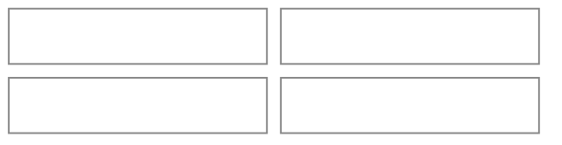
*Honest caveats: (1) Dreamer UI's `Calendar` hands `renderCell` only the date (a local-midnight `Date`) and no month-change callback, so each cell's meal chips come from a day-keyed lookup built up front, not a per-cell query. (2) A cell that holds up to three chips or pills plus a "+N" is taller than Dreamer UI's default square; like A-List's poster cells it needs `cellClassName` and `monthGridClassName` overrides. (3) Store logos come from a third-party logo service and can be missing, so every logo tile has a letter fallback.*

## Sitemap

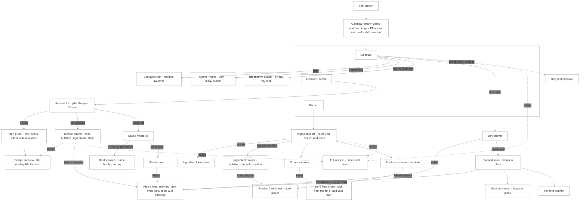
*A nudge is a line, not a destination: wherever a number leaves something out, the line offers the same short fill-in sheet, and closing the line keeps it away for that ingredient. Every gap lives only in the screen where it changes a number.*

## Screens

*The persistent shell, shown once and left out of the screens below:*

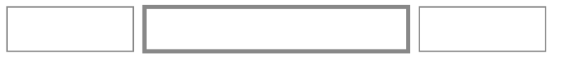
*Navigation is a floating pill at the bottom of a phone, as wide as its three tabs (never stretched edge to edge), and a rail on the left from `lg` up. The app opens to Calendar, the left tab; the active tab gets a soft peach fill and orange on its icon, the only orange in the bar. Later Kitchen entries (stock, prepared servings, shopping list) join the Kitchen tab and do not add a fourth tab.*

*From `lg` up the screens use the width: the month's cells become Google-Calendar-style pills that name each meal (its first item, `+N` for more) where a phone shows emoji chips, Week is seven columns where a phone has a vertical agenda, and Recipes and Kitchen run in two columns. The phone layout is unchanged.*

**First launch — Calendar, empty** (no setup steps: Pinch is usable the moment it opens)

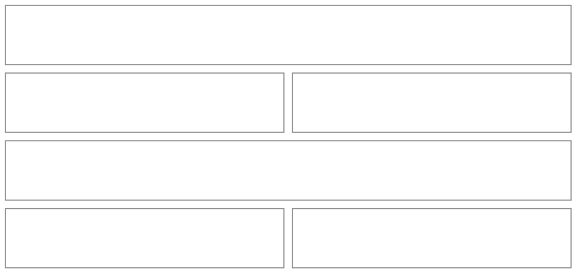
*Two nudges and nothing else: no setup modal, no required choices. Nutrition stays off until the person turns it on in settings; the stats row's help link ("Want calories or protein here?") opens the same settings sheet.*

**Calendar** (home tab)

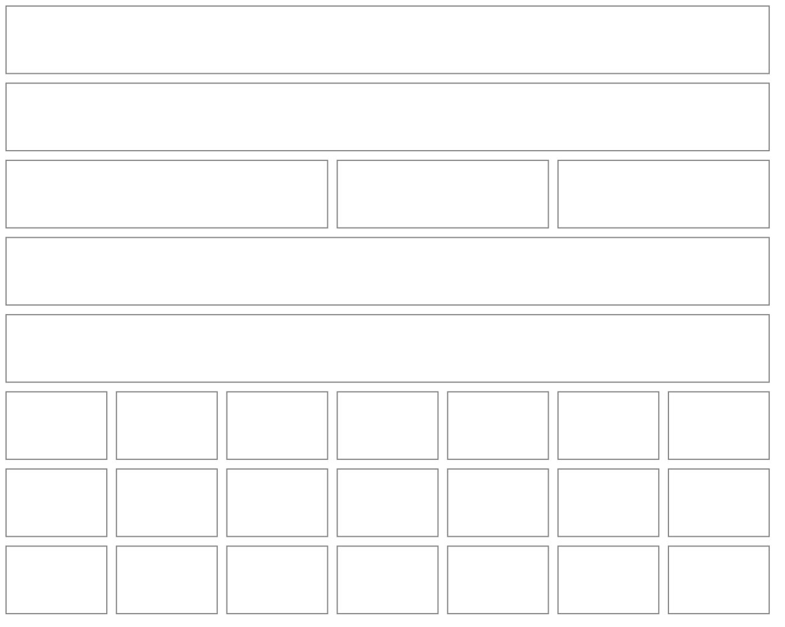
*Month view, the default (`?view=week|day` switches). The grid starts on Sunday because Dreamer UI's `Calendar` can't start a week on Monday, and the week view starts on Sunday to match. Under the header's gear and Add, the period row above the grid is Pinch's own (the Calendar's own header is hidden): arrows that step by the view's unit, the period's title, a thin Month / Week / Day switch, and a **Today** button that appears only while today is outside the period shown. Each planned meal is a chip on a soft tint of its meal-type colour (🍳 breakfast, 🥪 lunch, 🍝 dinner, 🍿 snack, 🍰 dessert, 🥤 drink); a phone's cell shows meal emoji chips, with a fourth meal becoming "+N", and from `lg` the chips become Google-Calendar-style pills with the meal's truncated title (its first item, "+N" for more). Today takes the orange dot on its number and the selected day a ring. Past days read exactly as they were that day. The stats row sits above the grid and describes the period shown ("Spent this week" in Week): Spent (with a warning icon in place of a "leaves out" line), Avg per meal and, when protein is on, Per g protein, then the calories and macros switched on as small emoji tiles labelled "Daily average this month" ("this week"; "Nutrition that day" in Day), at most one quiet nudge line ("2 ingredients need a price · Add prices"), and a "See the breakdown" link that opens the drawer. Tapping a day opens its drawer; on a computer, hovering a day opens a peek popover with the same content.*

| View | Phone (below `lg`) | From `lg` |
|---|---|---|
| Month | emoji chips on a soft tint, 3 at most, a fourth becomes "+N" | pills with the meal's truncated title (first item, "+N"), 3 at most then "+N more" |
| Week | a vertical agenda of 7 days, 6 meal rows a day then "Show N more" | 7 columns, 5 meals a day then "+N more" |
| Day | the day's meals grouped in meal order, each as a row | the same |

| Month cell contents | What `renderCell` draws |
|---|---|
| no meals | the date number only |
| 1–3 meals | one chip (or pill) per meal in meal-type order |
| 4+ meals | the first chips and a small "+N" |
| past day with a meal that was never marked made | shown the same; marking made arrives with stock tracking |

**Week** (phone agenda)

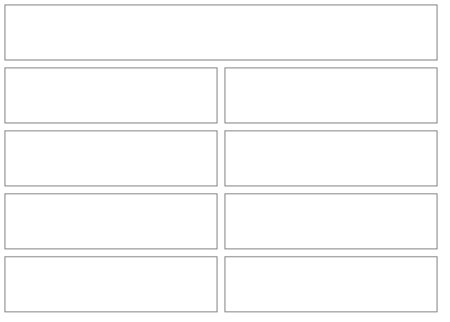
*A day with meals lists them as rows (the meal's emoji and title); a day with none is a quiet dash that still opens its drawer. Switching views keeps you on the selected day (or today), and Day shows that one day's meals with its own totals.*

**Day drawer** (tap a day; swaps in place to a planned meal)

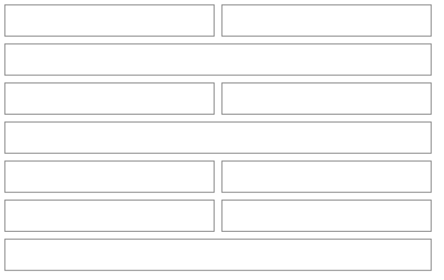
*Meals are grouped by meal type, each group under its emoji; a meal with several items lists them as flat rows beneath one heading, so a meal never looks like several separate meals. A day with no meals says so in one muted line with "+ Add to this day" in the header. A past day shows a muted "Prices as they were that day" line under the title. A past meal opened from it has no Modify: a muted line says the day has passed and to remove the meal and add it again.*

**Planned meal** (tap a meal in the day drawer; swaps in place with "‹ Back")

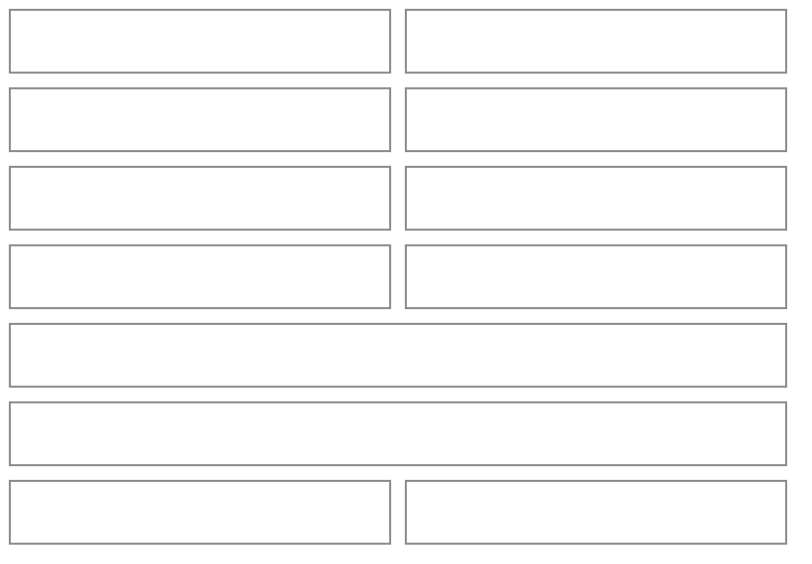
*A Cost tile (its warning icon says what the total leaves out) and, when nutrition is on, the plate's calories and macros as emoji tiles sit above the items. The footer holds Modify (secondary, left) beside the one primary, "Save as a meal"; Modify closes the drawer and opens the Plan a meal subview, and is absent on a past day. "Remove from this day" is the red row at the end of the body, with a confirm. Saving as a meal swaps the drawer in place to a single name field and a Save button.*

**Plan a meal** (subview; also the editor for an already planned meal)

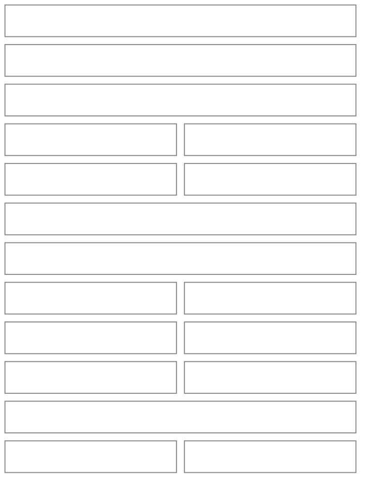
*Opens on the day and meal type it came from (pills under "Change"). "Start from a saved meal" is a captioned row of pills shown while the plate is empty (nothing preselected); picking one copies its items onto the day. The search finds recipes and ingredients in one list with a small kind label on each result; a picked one joins the plate with one serving. Each row has its name on its own line (it wraps, never truncates) and, beneath it, a compact `Stepper` for servings (halves allowed) with what one serving is ("servings · 1 serving = 28 g", "Recipe serves 4") and a remove control. The header carries the meal's name, or the first item and "+N" while a plate is being planned, and a tinted summary at the end shows the cost, a warning icon that says what it leaves out (a tooltip, never a sheet) and the plate's emoji macros when nutrition is on. The footer says "Add to today" when the day is today. When the meal has two or more items a "Save as a meal" switch appears above the footer and reveals a name field. Adding a one-item meal is the same screen with one row.*

**Recipes tab**

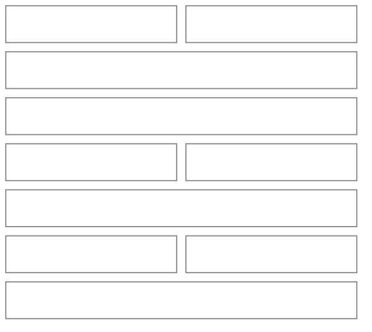
*Two thin pills switch between Recipes and Meals (saved meals). A recipe row shows its cover (or a tinted emoji tile), title, cost per serving, and a muted line of servings and time, with calories and macros per serving, as emoji figures, when they are on. A recipe with an unpriced ingredient shows the cost it can stand behind with a small warning icon beside it that says what it leaves out. A meal row shows its items as a comma line and the total.*

**New recipe — how to start** (subview; a new recipe opens here, editing one skips it)

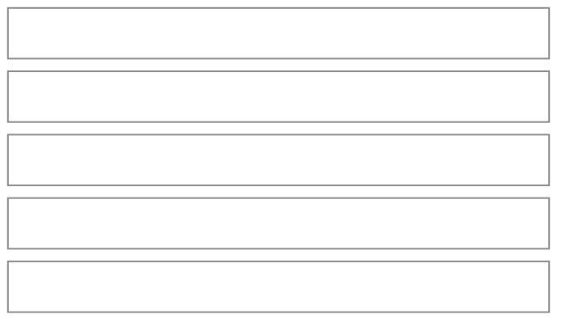
*Four ways in, in this order, with writing it yourself last and quieter (dashed). Text and link open their input in place under the row, one at a time; a photo opens the file picker straight away. Each AI reading fills the real form and says so ("Filled in from {source}. Take a look before you save." plus "We couldn't read: …"); nothing is saved until the form is. Link reading opens the page on our server (never the person's device) and sends its recipe data and text to the reader. The header names the recipe as it is typed ("New recipe" until then).*

| Reading state | What you see |
|---|---|
| reading | "Reading {source}…" with the rows disabled |
| failed | one warm sentence under the rows ("We couldn't open that link. Try again, or paste the recipe's text instead."), details logged, never the service's message |
| too big | "That file is too big to read. Try a photo or a PDF under 10 MB." |
| no recipe found | "We couldn't find a recipe in that. Try a clearer photo or paste the text." |

**Recipe** (subview — create and edit)

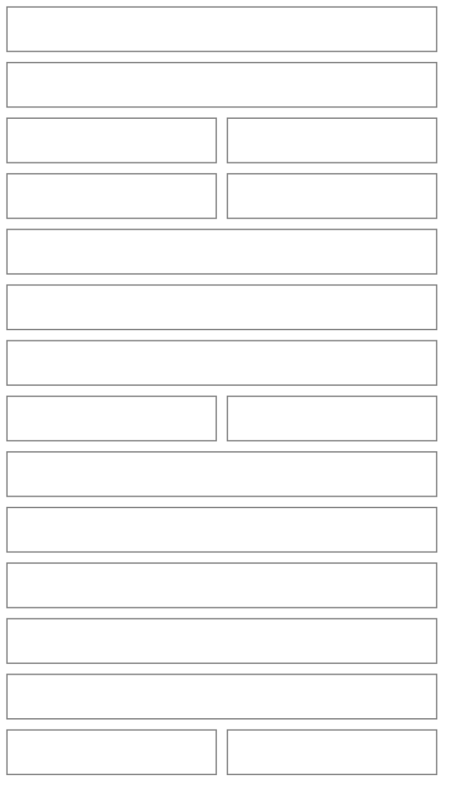
*A recipe needs a title and at least one ingredient. Everything a recipe normally has is part of the flow, not a button at the bottom: servings and times, a photo, a description, the ingredients, the steps and the nutrition. Ingredients and steps are one-line summaries; the one being edited is the only one open. On a phone adding an ingredient and editing its details happen in a drawer that never leaves the form (search, then amount, unit and a note, then "Add another" or Done, and "Remove from this recipe" for an existing one); from `sm` up a row opens its fields in place. A name the reader found that no ingredient matches arrives as "Add as new ingredient" / "Choose another". Nutrition shows what we added up from the ingredients as small emoji tiles, per serving, with a warning icon when some ingredients have no nutrition info; Edit turns the four tiles into inputs holding those numbers, any number changed becomes the person's own and "Reset to what we calculated" brings back the calculated ones. This is a page-sized form, so it is a Subview; the drawer on top of it is the one allowed exception to "no overlay on a subview" because it is the form's own row editor, one level deep.*

**Recipe details** (drawer — tap a recipe in the list)

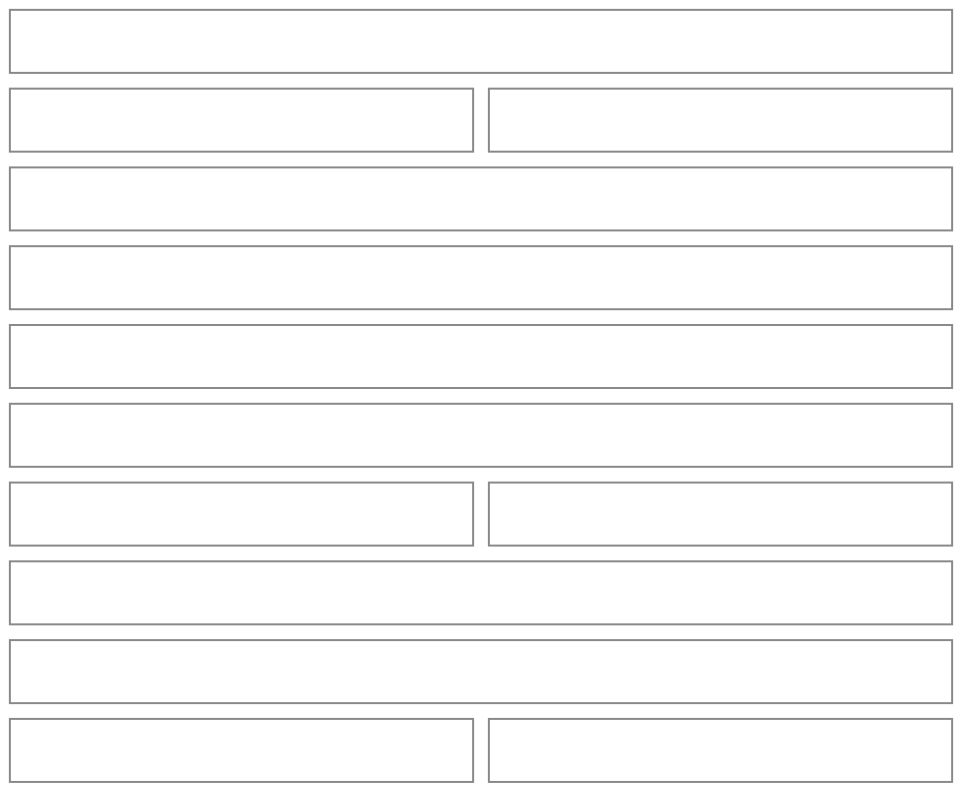
*The front matter is built to be seen: soft peach chips for servings and times, a Cost tile whose warning icon says what the total leaves out (it opens like the help icon), calories and macros as emoji tiles per serving when they are switched on, and the nudge line where a gap meets a number (✕ closes it for these ingredients). The footer holds both actions together: Modify beside the one primary, "Add to calendar", which is the widest control and closes the drawer to open Plan a meal with this recipe on the plate. Delete is the trash in the recipe form's footer, and removing a recipe that planned days use takes it off the lists, not out of those days, and says so in the confirm.*

**Saved meals** (the Meals pill) and **Meal details** (drawer) share the recipe patterns: a list of meal rows, and a drawer with a Cost tile (warning icon when it leaves something out), the plate's calories and macros as emoji tiles when on, the items with servings and cost, and in the footer Modify beside the one primary "Plan it", which closes the drawer and opens Plan a meal on a chosen day. Modify opens the same Meal subview used for planning, without a day. The builder's header carries the meal's name (or the plate's first item while planning), its rows are a title with a compact servings stepper beneath (40px hit areas from a pseudo-element), and a tinted summary shows the cost, its warning icon and the plate's emoji macros. Adding stays the search field in the form.

**Kitchen tab**

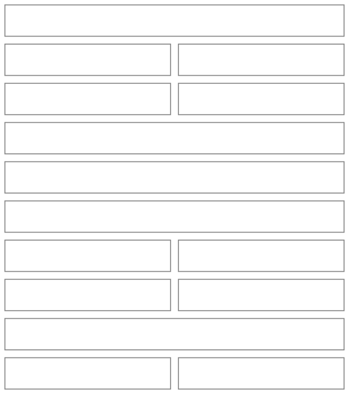
*The screen is titled Kitchen; Stores and Products are entry rows that open subviews (later Kitchen entries, Stock, Prepared servings and Shopping list, join them), then an "Ingredients" eyebrow with its count and **+ New** beside it. The Yours / All pills stay visible beside the search and a filter icon (a count badge when filters are on); on a phone the filters open in a drawer and from `sm` in a popover, and each active filter also shows as a dismissible chip with "Clear". The filters are Price (Any / Needs a price / Has a price), Show only (Missing nutrition, Custom only) and Family. Yours is the default and holds the ingredients you added, the ones with a product, and the ones your recipes, saved meals and planned days that aren't frozen yet use; All is the full catalog. Families are `SectionDivider` groups. A row shows the name, its calories and macros as emoji figures per 100 g when nutrition is on, and the default product's store, price and size, or a muted "No product yet". Rows carry no icon. When the filters hide everything the empty state names the filters that are hiding things and offers "Clear filters" and "Look through everything".*

**Ingredient details** (drawer)

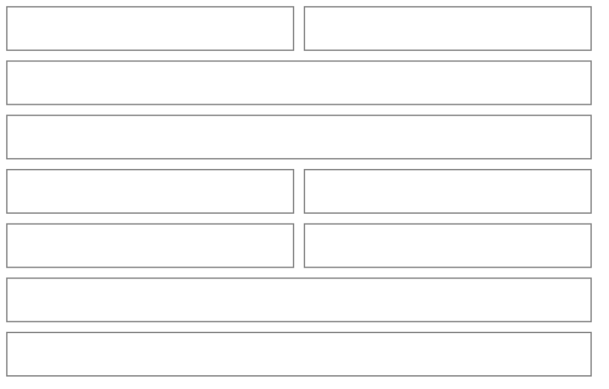
*"Add a product" closes the drawer and opens the product form sheet already tied to this ingredient. Tapping the star changes the default product (a quiet icon action; there is no hidden gesture). Nutrition is shown per 100 g as emoji `MacroStats` and can be adjusted in Modify. There is no "Used in" line in the drawer yet. Removing a custom ingredient that is in use takes it off the lists and the confirm says what still uses it; a catalog ingredient can only be reset to its built-in values. The default-product star has no label of its own yet.*

**Product** (form sheet)

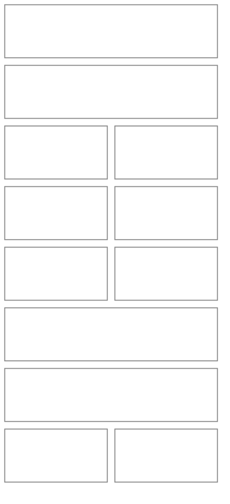
*The sheet's title names what it is about ("{Ingredient} · {store or label}", "{Ingredient} · new product"), so there is no separate "For" block. The store question comes first because the price and size are about that shop. The store row is a `PickOrCreate`: a dashed "New store" pill first, then your stores as logo pills, with "Show all" opening the well-known list inside the same row (capped height, a search past 12). A well-known store joins "your stores" the first time a product uses it. Price and size are two short fields side by side; the size field takes an amount and a unit. Label ("Great Value") and a link are "+ Add X" chips. The first product on an ingredient is made the default without asking, and "Make this the default" appears from the second.*

**Stores** (subview) and **Store** (form sheet)

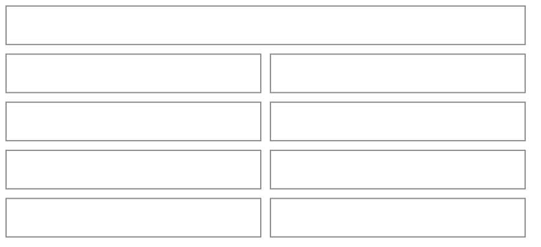
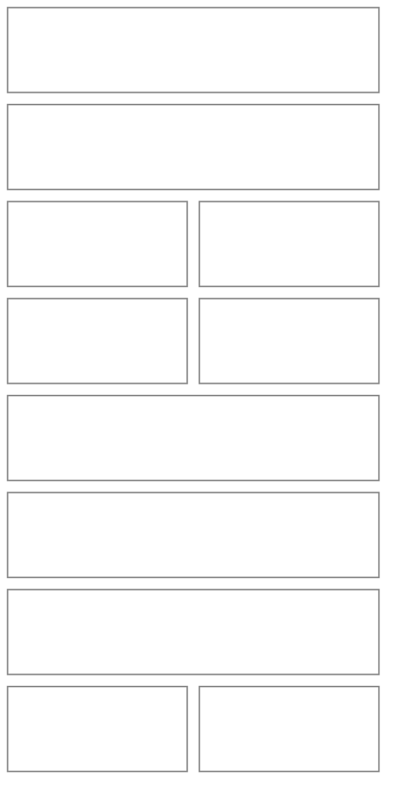
*The list shows each store's logo in a round tile with a letter tile as the fallback. A well-known store is picked from the list; "Can't find it? Add your own" reveals a name and an image field (`PhotoPicker`), and a store with no image gets a letter tile in a soft tint. Removing a store that has products asks first and keeps those products, with their store shown as "Removed store". The Products subview lists every product with its ingredient, price and size and has **+ New product** beside its title (pick the ingredient first, then the product sheet). From 8 products it shows a search and the filter and sort controls: filters are Store, Family and Default only / Not the default; sort is by store (grouped, the default), ingredient, price or date added. Rows are capped at 60 with "Show 60 more", and an ingredient's default star shows only when it has several products.*

**Nudge and fill-in** (the quiet line, and the sheet it opens)

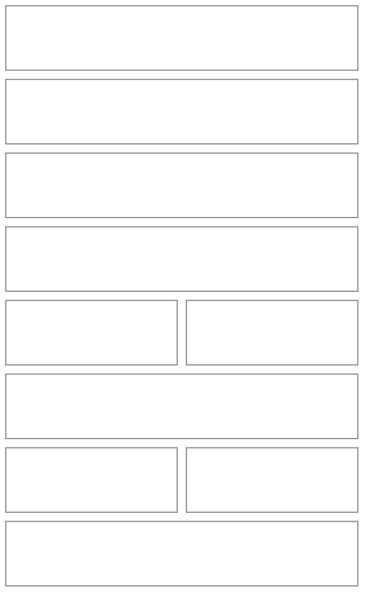
*One sheet handles every kind of gap: a price, a package size, a nutrition value, or a missing conversion, one row per ingredient, with just the fields that gap needs. Rows left blank stay as they were, "Skip" moves on without saving, "Save" turns on once the row is filled in, and ✕ on the nudge hides that line for those ingredients. The same line appears in the recipe, saved meal, day and planned-meal views and the calendar stats row. The meal builder is a full-screen subview, so it states the cost and what it leaves out in text and opens nothing over itself; a frozen day has no line, since a new price can't change it.*

| Where the gap shows | Nudge wording | What the fill-in sheet asks |
|---|---|---|
| a recipe, meal or day cost | "2 ingredients need a price · Add prices" | price and package size for each |
| a cost that can't be compared | "Rice vinegar can't be compared with its package size · Add a size" | the package size in a comparable unit, for the ingredient's default product |
| a nutrition metric that is on | "3 ingredients have no protein · Add values" | the missing metric for each |
| the stats row | a warning icon on Spent that names what it leaves out, and the nudge line under the tiles | the same sheet, covering the period shown |

**Settings** (form sheet from the Calendar gear)

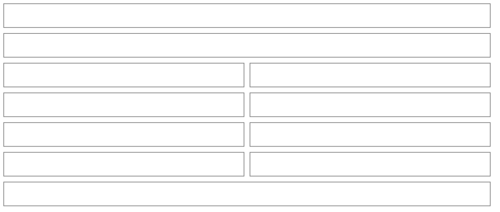
*Switches take effect immediately, so they are `AppToggle`s, not checkboxes. Nutrition is always stored; the switches only choose what is shown.*

**Breakdown** (drawer from the calendar stats row)

```mermaid
%%{init: {'theme': 'base', 'themeVariables': {'primaryColor': 'transparent', 'primaryBorderColor': '#888888', 'primaryTextColor': '#333333', 'lineColor': '#888888'}}}%%
block-beta
  columns 2
  BK1["October · $412.60"]:2
  BK2["[ By day ]   By meal"]:2
  BK3["Tue 13"]:1
  BK4["$18.40"]:1
  BK5["Wed 14"]:1
  BK6["$7.20"]:1
  BK7["Thu 15"]:1
  BK8["—"]:1
  style BK1 fill:transparent,stroke:#888888,stroke-width:1px;
  style BK2 fill:transparent,stroke:#888888,stroke-width:1px;
  style BK3 fill:transparent,stroke:#888888,stroke-width:1px;
  style BK4 fill:transparent,stroke:#888888,stroke-width:1px;
  style BK5 fill:transparent,stroke:#888888,stroke-width:1px;
  style BK6 fill:transparent,stroke:#888888,stroke-width:1px;
  style BK7 fill:transparent,stroke:#888888,stroke-width:1px;
  style BK8 fill:transparent,stroke:#888888,stroke-width:1px;
```
*The title names the period shown (a month, a week or a day). The two thin pills switch between days and meal types; rows show spend and, for each nutrition metric that is on, its total. It is a single scrolling list under a fixed header.*

## Reusable Components

| Component | Used in | Purpose |
|---|---|---|
| MealBarCell | Calendar `renderCell` | up to three thin meal-type bars with emoji and a "+N"; date number, today accent, selected ring |
| StatsRow | Calendar | spend, average per meal, price per gram of protein when protein is on, and a compact line of nutrition averages; tap opens the breakdown; carries the nudge |
| GapNudge | recipe, meal, day and planned-meal drawers, stats row | the one quiet line (muted text + link + ✕) that offers the fill-in sheet; renders only when there is a gap |
| FillInSheet | behind every nudge | a `FormSheet` with one row per ingredient and only the fields that gap needs |
| DayDrawer / DayPeek | Calendar | the same content as a `DetailSheet` on phones and a hover `Popover` from `sm` up (`max-sm:hidden`) |
| PlannedMealView | Day drawer | items with servings, totals, grouped actions, swapped in place |
| MealBuilder | Plan a meal, Meal subview | day and type pills, a pill row of saved meals while the plate is empty, one item search, per-item serving steppers, a cost line that states what it leaves out (no nudge: the fill-in sheet never opens over this subview), Save-as-meal switch |
| ItemSearch | MealBuilder, Recipe form | one search over recipes, meals and ingredients with kind labels; also offers "New ingredient" |
| ServingStepper | MealBuilder, Recipe form | half-step stepper, 40px targets |
| RecipeForm | Recipe subview | title, servings, ingredient rows, chips; hosts `RecipeAutofill` |
| RecipeAutofill | Recipe form | the "Have a recipe?" and "Copied one?" rows, built on the repo's `UploadAutofill` pattern for the states and the 10 MB cap |
| RecipeRow, MealRow | Recipes tab | cover or emoji tile, title, cost per serving, muted details |
| IngredientRow, FamilyGroup | Kitchen | icon, name, default product line; `SectionDivider` groups |
| IngredientIcon | rows, drawers, pickers | the vendored emoji SVG matched by ingredient, with a generic jar fallback |
| NutritionLine | rows, drawers | the metrics that are switched on, per serving; renders nothing when all are off |
| ProductForm, ProductRow | Ingredient drawer, Products subview | store question first, price and size side by side, chips for label and link |
| StorePicker | Product form | `PickOrCreate` of your stores plus "Show all" for the well-known list |
| StoreLogo | pickers, rows, subview | the logo tile with a letter fallback; app-aware, so it stays in the app |
| StoreForm | Stores subview | search of well-known stores, or name plus `PhotoPicker` image |
| CopySheet | every copy action | preview, what's included, `CopyButton` |
| CoverImage | recipe rows and drawer | `FallbackImage` with a tinted emoji tile as its `fallback` |
| `SectionHeader`, `Subview`, `FormSheet`, `DetailSheet`, `ModalFooterActions`, `DeleteIconButton`, `PillGroup`, `PickOrCreate`, `SearchInput`, `SectionDivider`, `MoneyInput`, `AppToggle`, `StatTile` | everywhere | the shared pieces in `src/components` and `src/ui`; Pinch builds only what is app-specific |
| Empty state | every list and the empty Calendar | an icon, one muted line, and the call to action in the header |

## User Journeys

**First launch: plan something**

```mermaid
%%{init: {'theme': 'base', 'themeVariables': {'primaryColor': 'transparent', 'clusterBkg': 'transparent', 'primaryBorderColor': '#888888', 'clusterBorder': '#888888', 'lineColor': '#888888', 'primaryTextColor': '#333333'}}}%%
flowchart LR
    A[Open Pinch] --> B["Calendar, empty"] --> C{"What now?"}
    C -->|Plan your first meal| D["Plan a meal subview"] --> E["Search 'chicken breast'"] --> F["Pick an ingredient from the catalog"] --> G["Add to today"] --> H["Calendar shows a bar for it; cost line says 'No price yet'"]
    C -->|Add a recipe| I["Recipe subview"]
```

**Add a recipe from a photo**

```mermaid
%%{init: {'theme': 'base', 'themeVariables': {'primaryColor': 'transparent', 'clusterBkg': 'transparent', 'primaryBorderColor': '#888888', 'clusterBorder': '#888888', 'lineColor': '#888888', 'primaryTextColor': '#333333'}}}%%
flowchart LR
    A[Recipes] --> B[+ New] --> C["Upload a photo or PDF"] --> D["Reading…"] --> E["Form filled in; 'We couldn't read: cook time'"]
    E --> F{"Unknown ingredient?"}
    F -->|Yes| G["'Add as new ingredient' on its row"] --> H[Review and edit]
    F -->|No| H
    H --> I[Save] --> J["Recipe drawer with its cost and a price nudge"]
```

**Plan a meal, tweak a day, keep it**

```mermaid
%%{init: {'theme': 'base', 'themeVariables': {'primaryColor': 'transparent', 'clusterBkg': 'transparent', 'primaryBorderColor': '#888888', 'clusterBorder': '#888888', 'lineColor': '#888888', 'primaryTextColor': '#333333'}}}%%
flowchart LR
    A[Tap a day] --> B[+ Add] --> C["Pick 'Taco night' from Start from a saved meal"] --> D["Items copied onto this day"]
    D --> E["Skip the peppers, double the rice"] --> F[Add to today]
    F --> G["Calendar bar appears"] --> H["Open it: Save as a meal"] --> I["Saved with a new name; Taco night is unchanged"]
```

**Add a product with a store**

```mermaid
%%{init: {'theme': 'base', 'themeVariables': {'primaryColor': 'transparent', 'clusterBkg': 'transparent', 'primaryBorderColor': '#888888', 'clusterBorder': '#888888', 'lineColor': '#888888', 'primaryTextColor': '#333333'}}}%%
flowchart LR
    A[Kitchen] --> B[Tap Chicken breast] --> C[Add a product] --> D{"Where do you buy it?"}
    D -->|Pick a logo pill| G[Price and size]
    D -->|Show all| E["Search well-known stores"] --> G
    D -->|New store| F["Name and optional image"] --> G
    G --> H[Save] --> I["Ingredient shows the product; recipe costs update"]
```

**Fill in what's missing, in context**

```mermaid
%%{init: {'theme': 'base', 'themeVariables': {'primaryColor': 'transparent', 'clusterBkg': 'transparent', 'primaryBorderColor': '#888888', 'clusterBorder': '#888888', 'lineColor': '#888888', 'primaryTextColor': '#333333'}}}%%
flowchart LR
    A["Recipe drawer: '2 ingredients need a price'"] --> B[Add prices] --> C["Fill-in sheet: one row each"] --> D{"Fill them all?"}
    D -->|Some| E[Save] --> F["Cost updates; line now says 'leaves out 1'"]
    D -->|None| G[Skip for now] --> H["Line stays; ✕ hides it for these ingredients"]
```

**Take it to a chat and bring a recipe back**

```mermaid
%%{init: {'theme': 'base', 'themeVariables': {'primaryColor': 'transparent', 'clusterBkg': 'transparent', 'primaryBorderColor': '#888888', 'clusterBorder': '#888888', 'lineColor': '#888888', 'primaryTextColor': '#333333'}}}%%
flowchart LR
    A[Kitchen 📋] --> B["Copy sheet: names only"] --> C[Copy] --> D[Paste into any AI chat]
    D --> E[Copy the recipe it suggests] --> F[Recipes + New → Paste] --> G["Form filled in for review"] --> H[Save]
```

## Form Field Organization

*"Grouping: none" means one flat form — still Dreamer UI's `Form`, just without a `Disclosure` or steps wrapper.*

| Entity | Initial (create) | Later (edit only) | Later-set entry point | Grouping | "Other" option? |
|---|---|---|---|---|---|
| Recipe | title, servings, ingredients (ingredient + amount + unit) | description, times, cover photo, steps, own nutrition | "+ Add X" chips on the form; the recipe drawer's Modify | none; chips for extras | none |
| Ingredient | name, family (`PickOrCreate`: existing family, new family, or none) | icon, nutrition per 100 g, unit conversions (Next Steps) | the ingredient drawer's Modify; the fill-in sheet for a missing nutrition value | none; chips for icon and nutrition | family: "New family" is the dashed first pill |
| Product | store (`PickOrCreate`), price, package size | label, link, default flag | the ingredient drawer's product rows; the fill-in sheet for a missing price or size | none | store: "New store" is the dashed first pill |
| Store | pick from the well-known list, or name | image | the Stores subview row | none | "Can't find it? Add your own" reveals the name and image fields |
| Meal (saved) | name, items (recipe or ingredient + servings) | — | Meal subview's Modify; "Save as a meal" on a planned meal | none | none |
| Planned meal | day and meal type (prefilled from where it started), items with servings | — | the planned meal's "Change items or servings" | none | none |
| Settings | four nutrition switches (all off) | — | the Calendar gear; the stats row's help link | none | none |

**Flagged for the TDD** (none of these change the screens above, but each shapes the data):
- **Copy-on-plan** — a planned meal stores its own item list and a `sourceMealId`; editing the saved meal later leaves planned days alone, and the id leaves room for a future "update N upcoming days?" prompt.
- **Live recipes, frozen past** — planned items point at recipes, so edits reach upcoming days; once a day has passed its cost and nutrition are snapshotted so history never moves.
- **Archive, don't delete, what is in use** — a recipe, custom ingredient or store that planned days, saved meals, recipes or products depend on is archived and hidden from pickers, never removed.
- **Comparable amounts** — a recipe's amount and a product's package size must share a dimension (mass, volume, count) or have a catalog-known conversion; anything else is excluded from the total and named in a nudge.
- **Nudge dismissals** — "✕ hides it for those ingredients" needs a small per-gap dismissal record on the user's settings document.
- **Unknown stock vs zero stock** — when stock tracking arrives, "not tracked" is its own state, separate from 0.
- **Store logos** — the well-known list is a constant of names and domains, logos load in the browser from a logo service, and a letter tile covers every failure; the service and its terms are to be settled.
- **Week** — Monday to Sunday; a week copy covers those seven days.
- **Money** — integer cents everywhere; nutrition per 100 g with servings computed from the recipe's own amounts.
- **A well-known store joins "your stores" on first use** — so a product always points at a store document of the person's own.
