# Pinch — UX & Interaction Design

*All names, dates and dollar amounts in the diagrams are illustrative.*

## Design Principles

| Principle | Means |
|---|---|
| One border, not nested ones | a card gets a single bordered shell with a flat interior — never border-in-a-border; groups inside a screen are separated with `SectionDivider` or spacing |
| Phone first | one narrow column with a floating pill at the bottom — Calendar · **Recipes** · Kitchen, as wide as its three tabs; from `lg` up the same tabs stand in a rail on the left edge, and the rest reflows with no parallel desktop layout |
| The counter, not a form | Pinch asks for a name and little else. A price, a package size or a nutrition value is invited by a quiet line exactly where it changes a number, and always optional |
| Drawers for looking and quick edits, subviews for building | an ingredient, a day, a planned meal and a recipe's detail open in `DetailSheet` drawers; a recipe, a meal and the stores and products lists are page-sized and open as `Subview`s; short forms (ingredient, product, store, settings) are `FormSheet`s |
| Never overlay on overlay | whatever continues inside an open drawer swaps its content in place with a "‹ Back" link; a drawer whose action opens a form or another container closes first. Only a destructive confirm may sit on top |
| Numbers explain themselves | a cost with gaps carries a warning icon (`HelpTip variant='warning'`) that says what the total leaves out, as a small modal on a phone or any touch screen and a tooltip with a mouse; a stat that isn't self-evident carries a `HelpTip`; past days are labelled as frozen |
| Rows show what you choose | an eye button on Kitchen and Recipes hides prices or calories and macros on the rows and picks the nutrition basis of ingredient rows; it is remembered on the device, and no total or drawer changes |
| Nothing leaves without saying what | an AI reads what the person hands it (pasted text, a photo, screenshot or PDF, or a recipe page's text and recipe data) and says so, and nothing is saved until the person saves the form; a link goes to our server, which fetches the page, and nothing else leaves the app |
| Dreamer UI first | `Calendar` (with `renderCell`), `Form`, `Drawer`, `Popover`, `Tabs`, `Badge` — custom only where the catalog has nothing: the day cell and the store logo tile |
| Honest AI | an AI reads a pasted recipe, photo, PDF or web link and fills the real form; it names what it couldn't read; nothing is saved until the person confirms |


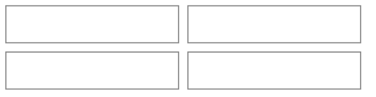
*Honest caveats: (1) Dreamer UI's `Calendar` hands `renderCell` only the date (a local-midnight `Date`) and no month-change callback, so each cell's meal chips come from a day-keyed lookup built up front, not a per-cell query. (2) A cell that holds up to three chips or pills plus a "+N" is taller than Dreamer UI's default square; like A-List's poster cells it needs `cellClassName` and `monthGridClassName` overrides. (3) Store logos come from a third-party logo service and can be missing, so every logo tile has a letter fallback.*

## Sitemap

```mermaid
%%{init: {'theme': 'base', 'themeVariables': {'primaryColor': 'transparent', 'clusterBkg': 'transparent', 'primaryBorderColor': '#888888', 'clusterBorder': '#888888', 'lineColor': '#888888', 'primaryTextColor': '#333333'}}}%%
flowchart TD
    A[First launch] --> D["Calendar, empty: zeros and two nudges 'Plan your first meal' · 'Add a recipe'"]
    subgraph Bar["Bottom bar"]
        D2["Calendar"]
        R["Recipes · centre"]
        K["Kitchen"]
    end
    D --> D2
    D2 ~~~ R ~~~ K
    D2 -->|gear| SET["Settings sheet · nutrition switches"]
    D2 -->|switch view| VW["Month · Week · Day · Today button"]
    D2 -->|tap the stats row| BRK["Breakdown drawer · by day / by meal"]
    D2 -->|tap a day| DD["Day drawer"]
    D2 -.->|hover a day, desktop| PK["Day peek popover"]
    DD -->|+ Add| PM["Plan a meal subview · day, meal type, items with servings"]
    DD -->|tap a meal| PMD["Planned meal · swaps in place"]
    PMD -->|Change items or servings| PM
    PMD --> SAV["Save as a meal · swaps in place"]
    PMD --> RM["Remove confirm"]
    R --> RL["Recipes list · pills: Recipes / Meals"]
    RL -->|+ New| RS["Ways to start · a drawer on a phone, the subview's first page from sm · text, file, link or write it yourself"]
    D -->|Add a recipe| RS
    RS -->|text, file or link| RR["Reading screen · its own view, one way at a time"]
    RR -->|the reading fills the form| RF["Recipe subview · the form"]
    RR -->|Write it yourself instead| RF
    RS -->|write it yourself| RF
    RL -->|eye button| VO["View options · hide prices or calories and macros on rows"]
    RL -->|tap a recipe| RD["Recipe drawer · cost, nutrition, ingredients, steps"]
    RD -->|Modify| RF
    RD -->|Add to calendar| PM
    RL -->|Meals pill| ML["Saved meals list"]
    ML -->|+ New or tap Modify| MF["Meal subview · same builder, no day"]
    ML -->|tap a meal| MD["Meal drawer"]
    MD -->|Plan it| PM
    K --> KL["Ingredients list · Yours / All · search and filters"]
    KL -->|eye button| VO
    KL -->|+ New| IF["Ingredient form sheet · nutrition typed as the label prints it"]
    KL -->|tap an ingredient| ID["Ingredient drawer · nutrition per serving or per 100 g, products"]
    ID -->|Add a product| PF["Product form sheet · store picker"]
    KL --> ST["Stores subview"]
    ST -->|+ Add| SF["Store form sheet · pick from the list or add your own"]
    KL --> PR["Products subview · by store"]
    PR -->|+ New product| PF
    RD -.->|nudge| FI["Fill-in sheet · prices and sizes"]
    KL -.->|nudge| FI
    D2 -.->|nudge| FI
    style Bar fill:transparent,stroke:#888888,stroke-width:1px;
```
*A nudge is a line, not a destination: wherever a number leaves something out, the line offers the same short fill-in sheet, and closing the line keeps it away for that ingredient. Every gap lives only in the screen where it changes a number.*

## Screens

*The persistent shell, shown once and left out of the screens below:*

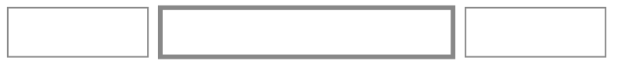
*Navigation is a floating pill at the bottom of a phone, as wide as its three tabs (never stretched edge to edge), and a rail on the left from `lg` up. The app opens to Calendar, the left tab; the active tab gets a soft peach fill and orange on its icon, the only orange in the bar. Later Kitchen entries (stock, prepared servings, shopping list) join the Kitchen tab and do not add a fourth tab.*

*From `lg` up the screens use the width: the month's cells become Google-Calendar-style pills that name each meal (its first item, `+N` for more) where a phone shows emoji chips, Week is seven columns where a phone has a vertical agenda, and Recipes and Kitchen run in two columns. The phone layout is unchanged.*

**First launch — Calendar, empty** (no setup steps: Pinch is usable the moment it opens)

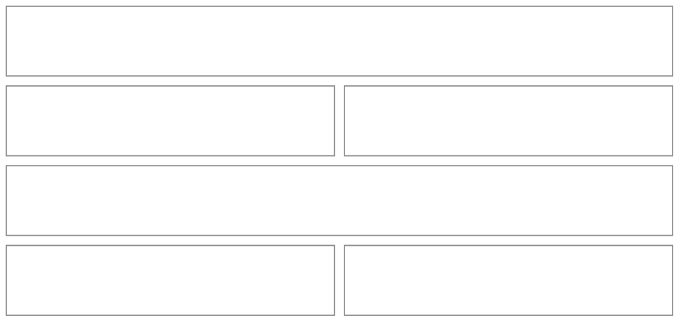
*Two nudges and nothing else: no setup modal, no required choices. "Add a recipe" opens the same list of ways to start as the Recipes tab's New (a drawer on a phone, the recipe subview's first page from `sm`). Nutrition stays off until the person turns it on in settings; the stats row's help link ("Want calories or protein here?") opens the same settings sheet.*

**Calendar** (home tab)

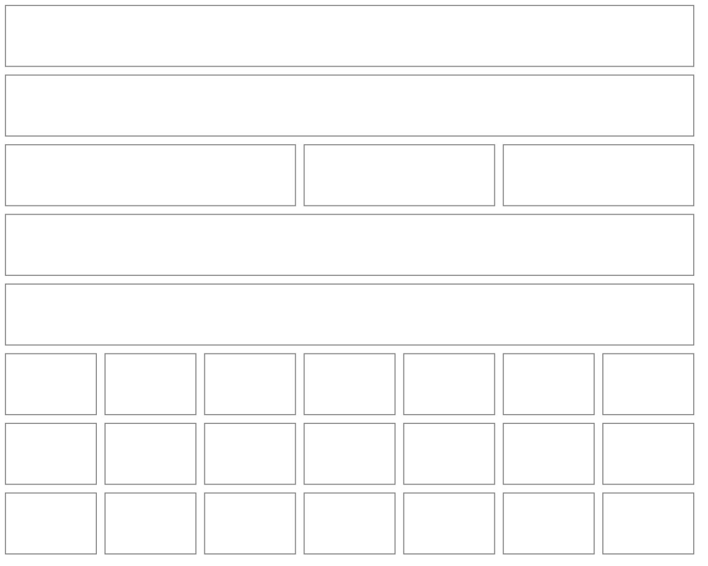
*Month view, the default (`?view=week|day` switches). The grid starts on Sunday because Dreamer UI's `Calendar` can't start a week on Monday, and the week view starts on Sunday to match. Under the header's gear and Add, the period row above the grid is Pinch's own (the Calendar's own header is hidden): arrows that step by the view's unit, the period's title, a thin Month / Week / Day switch, and a **Today** button that appears only while today is outside the period shown. Each planned meal is a chip on a soft tint of its meal-type colour (🍳 breakfast, 🥪 lunch, 🍝 dinner, 🍿 snack, 🍰 dessert, 🥤 drink); a phone's cell shows meal emoji chips, with a fourth meal becoming "+N", and from `lg` the chips become Google-Calendar-style pills with the meal's truncated title (its first item, "+N" for more). Today takes the orange dot on its number and the selected day a ring. Past days read exactly as they were that day. The stats row sits above the grid and describes the period shown ("Spent this week" in Week): Spent (with a warning icon in place of a "leaves out" line), Avg per meal and, when protein is on, Per g protein, then the calories and macros switched on as small emoji tiles labelled "Daily average this month" ("this week"; "Nutrition that day" in Day), at most one quiet nudge line ("2 ingredients need a price · Add prices"), and a "See the breakdown" link that opens the drawer. Tapping a day opens its drawer; on a computer, hovering a day opens a peek popover with the same content.*

| View | Phone (below `lg`) | From `lg` |
|---|---|---|
| Month | emoji chips on a soft tint, 3 at most, a fourth becomes "+N" | pills with the meal's truncated title (first item, "+N"), 3 at most then "+N more" |
| Week | a vertical agenda of 7 days, 6 meal rows a day then "Show N more" | 7 columns, 5 meals a day then "+N more" |
| Day | the day's meals grouped in meal order, each as a row | the same |

| Month cell contents | What `renderCell` draws |
|---|---|
| no meals | the date number only |
| 1–3 meals | one chip (or pill) per meal in meal-type order |
| 4+ meals | the first chips and a small "+N" |
| past day with a meal that was never marked made | shown the same; marking made arrives with stock tracking |

**Week** (phone agenda)

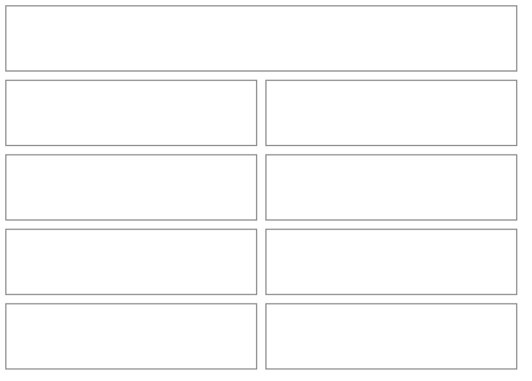
*A day with meals lists them as rows (the meal's emoji and title); a day with none is a quiet dash that still opens its drawer. Switching views keeps you on the selected day (or today), and Day shows that one day's meals with its own totals.*

**Day drawer** (tap a day; swaps in place to a planned meal)

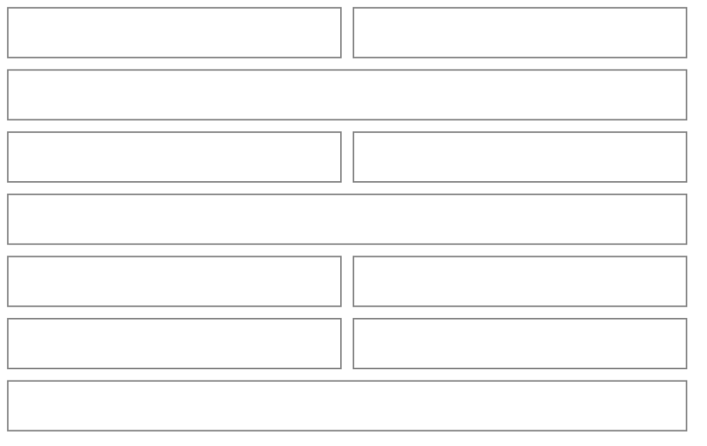
*Meals are grouped by meal type, each group under its emoji; a meal with several items lists them as flat rows beneath one heading, so a meal never looks like several separate meals. A day with no meals says so in one muted line with "+ Add to this day" in the header. On a past day the Cost tile carries "Fixed when the day passed" (and reads "Wasn't priced" when nothing was priced), and its warning adds that a price you add now counts from today on. A past meal opened from it has no Modify: a muted line says its meals keep the prices and numbers they had, and that removing one and adding it again uses today's; an item with no price reads "Wasn't priced" there.*

**Planned meal** (tap a meal in the day drawer; swaps in place with "‹ Back")

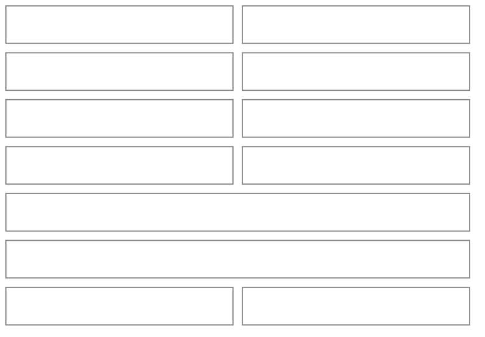
*A Cost tile (its warning icon says what the total leaves out) and, when nutrition is on, the plate's calories and macros as emoji tiles sit above the items. The footer holds Modify (secondary, left) beside the one primary, "Save as a meal"; Modify closes the drawer and opens the Plan a meal subview, and is absent on a past day. "Remove from this day" is the red row at the end of the body, with a confirm. Saving as a meal swaps the drawer in place to a single name field and a Save button.*

**Plan a meal** (subview; also the editor for an already planned meal)

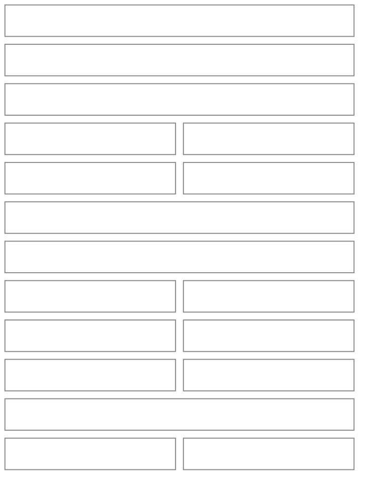
*Opens on the day and meal type it came from (pills under "Change"). "Start from a saved meal" is a captioned row of pills shown while the plate is empty (nothing preselected); picking one copies its items onto the day. The search finds recipes and ingredients in one list with a small kind label on each result; a picked one joins the plate with one serving. Each row has its name on its own line (it wraps, never truncates) and, beneath it, a compact `Stepper` for servings (halves allowed) with what one serving is ("servings · 1 serving = 28 g", "Recipe serves 4") and a remove control. The header carries the meal's name, or the first item and "+N" while a plate is being planned, and a tinted summary at the end shows the cost, a warning icon that says what it leaves out (a small help modal on a phone or touch screen, a tooltip with a mouse, never a fill-in sheet) and the plate's emoji macros when nutrition is on. The footer says "Add to today" when the day is today. When the meal has two or more items a "Save as a meal" switch appears above the footer and reveals a name field. Adding a one-item meal is the same screen with one row.*

**Recipes tab**

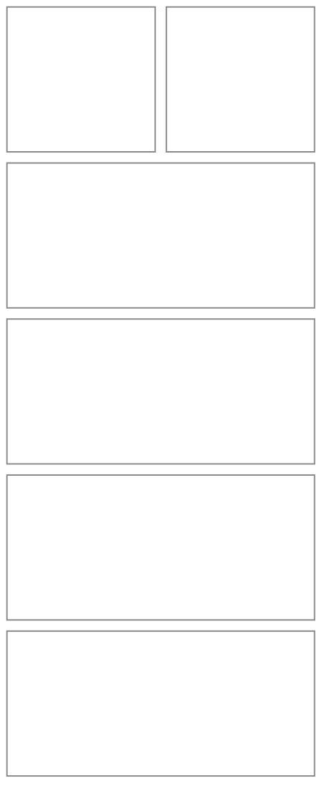
*Two thin pills switch between Recipes and Meals (saved meals), with the View options eye button at the end of that row (it appears once the shown list has something in it, so an empty Recipes or Meals list has no eye). A recipe row shows its cover (or a tinted emoji tile), its title, a muted line of servings and time, then a cost per serving line and calories and macros per serving as emoji figures, the last two only while shown (View options) and, for macros, switched on. A recipe with an unpriced ingredient shows the cost it can stand behind and says "leaves out 1" in the same line; one with no price at all says "No price yet". A meal row shows its item count, total (the same "leaves out" or "No price yet" wording), macros when shown, and its items as a comma line. In every row the cover or tile and the text share a top edge, and the chevron sits on the first line.*

**View options** (the eye button: a drawer on a phone, a popover from `sm`; Kitchen's ingredient list has the same one)

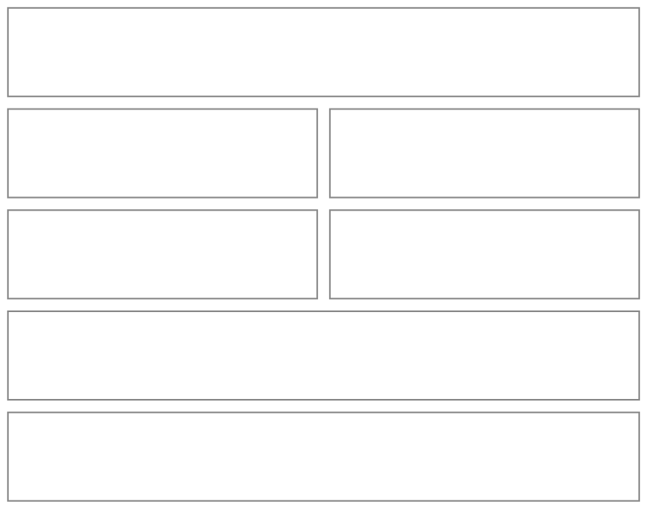
*The switches are `AppToggle`s and take effect at once: "Show prices" hides the cost on recipe and meal rows and the store, price and size line on ingredient rows, and "Show calories and macros" hides the emoji figures. "Show calories and macros" reads off and is disabled, with "Calories and macros are off. Turn them on from the Calendar's gear and they'll show here." under it, while no metric is on in Settings; the "Nutrition numbers" pills (Per serving / Per 100 g, for ingredient rows only) appear only when one is. Defaults are prices on, macros on and per 100 g. Once a choice differs from its default the eye button takes a soft tint and "Reset" appears (in the phone drawer's footer beside Done, at the bottom of the popover). Each list's choice is remembered for this person on this device (`pinch:{uid}:view:{recipes|ingredients}`; Recipes and Meals share one), so it is not on another device. A hidden line is simply not drawn: a total, a drawer and a fill-in sheet are the same with or without it.*

**New recipe — how to start** (a drawer on a phone, the recipe subview's first page from `sm`; editing a recipe skips it)

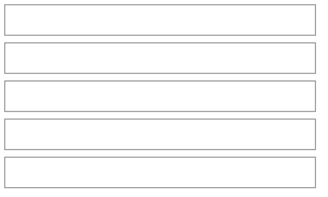
*Four ways in, in this order, with writing it yourself last and quieter (dashed), under "Start from something you already have, or write it yourself. You'll look it over before anything is saved." The list is rows only: picking one only picks. On a phone, the Recipes tab's New and the Calendar's "Add a recipe" open it in a drawer titled "New recipe" (one drawer, kept at the top of the app, so a way's back button can raise it again); picking a way closes the drawer and opens the recipe subview already on that way's screen. From `sm` up it is the subview's first page, with the header's back button closing the subview. Each way finishes on its own screen, never revealed under the list (below), and the header names it ("From text", "From a file", "From a link"). Back (the header's button, Escape or the phone's back gesture) raises the drawer again when the way was picked in it, and returns to the list when the subview opened on it. Each AI reading fills the real form and says so ("Filled in from {your text, the file's name or the page's website}. Take a look before you save." plus "We couldn't read: …"); nothing is saved until the form is. Link reading opens the page on our server (never the person's device) and sends its text and any recipe data to the reader. The form's header names the recipe as it is typed ("New recipe" until then).*

**From a file** (one of the three reading screens; the text and link screens have the same shape)

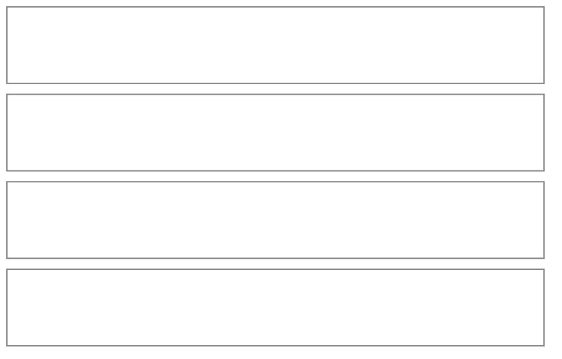
*Each screen has one plain line saying what will happen, above its input (the paste box, the address field, the file box) so it is read before anything is sent, and always ends with a link to "Write it yourself instead" (disabled while a reading runs). **From text** is "An AI reads it and fills in the form. It isn't saved.", a paste box (up to 20,000 characters) and a "Fill in the recipe" button. **From a link** is "We open the page and an AI reads the recipe from it.", an address field and "Fill in the recipe" (Enter does it too); an address with no `https://` gets one. **From a file** takes a photo, screenshot or PDF by "Choose a file", or dropped on the box (the "or drop it here" hint is hidden on a phone).*

| Reading state | What you see |
|---|---|
| reading | "Reading {your text, the file's name or the page's website}…" under the input, with the button busy |
| failed | one warm sentence under the input ("We couldn't open that link. Check the address, or paste the recipe's text instead."), details logged, never the service's message |
| not a link | "That doesn't look like a web link. Check it and try again." before anything is sent |
| too big | "That file is too big to read. Try a photo or a PDF under 10 MB." |
| no recipe found | "We couldn't find a recipe in that. Try a clearer photo or paste the text." |

**Recipe** (subview — create and edit)

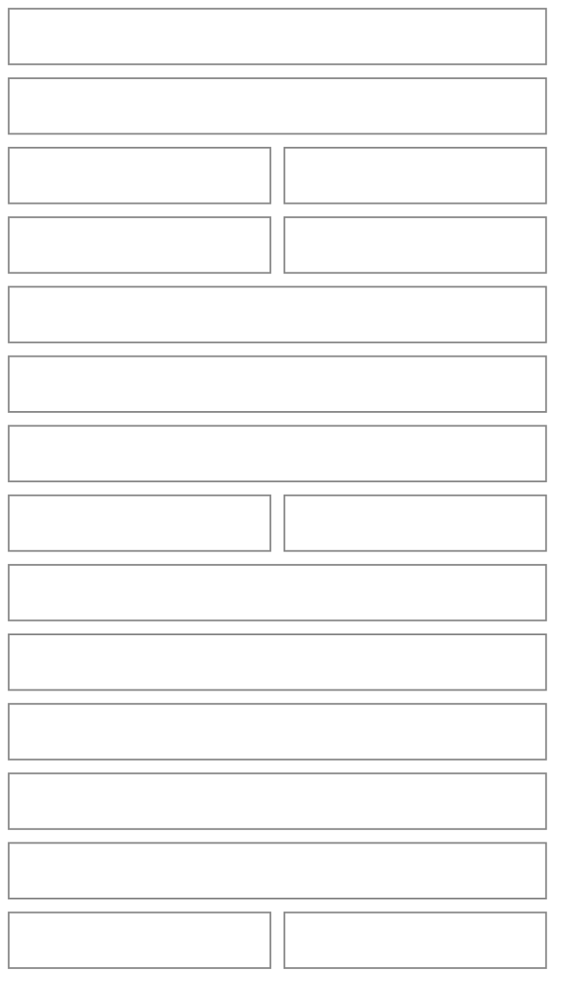
*A recipe needs a title and at least one ingredient. Everything a recipe normally has is part of the flow, not a button at the bottom: servings and times, a photo, a description, the ingredients, the steps and the nutrition. Ingredients and steps are one-line summaries; the one being edited is the only one open. On a phone each row editor is a drawer that never leaves the form: an ingredient (search, then amount, unit and a note, then "Add another" or Done, and "Remove from this recipe" for an existing one), a step (one text box titled "Step 3", which takes the cursor about a third of a second after the drawer opens, once it has slid in; Done, "Add another" only while adding, "Remove step" for an existing one, and a step left blank is dropped when the drawer closes) and the nutrition numbers (four compact fields, Done, and "Reset to what we calculated", which refills the fields and keeps the drawer open). From `sm` up a row opens its fields in place. A name the reader found that no ingredient matches arrives as "Add as new ingredient" / "Choose another". Nutrition shows what we added up from the ingredients as small emoji tiles, per serving, with a warning icon when some ingredients have no nutrition info (a small modal on a phone or touch screen, a tooltip with a mouse); Edit opens the four numbers (the drawer on a phone, inputs in place with Done from `sm`), any number changed becomes the person's own and "Reset to what we calculated" brings back the calculated ones. This is a page-sized form, so it is a Subview; the drawers on top of it are the allowed exception to "no overlay on a subview" because they are the form's own row editors, one level deep. Leaving the form while it holds typed or read-in work (the header's back, Cancel, Escape or the phone's back gesture) asks "Discard this recipe?" with "Keep editing" and "Discard" (a destructive confirm); an untouched form closes at once, and saving never asks.*

**Recipe details** (drawer — tap a recipe in the list)

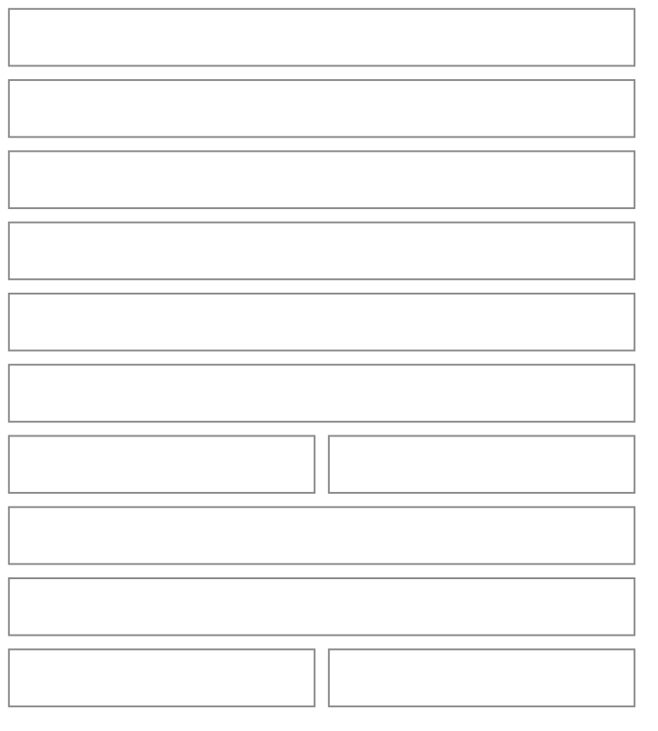
*The front matter is one plain line of emoji and text for servings and times (never chips or pills), then a Cost tile whose warning icon says what the total leaves out (a small modal on a phone or touch screen, a tooltip with a mouse), calories and macros as emoji tiles per serving when they are switched on, and the nudge line where a gap meets a number (✕ closes it for these ingredients). The footer holds both actions together: Modify beside the one primary, "Add to calendar", which is the widest control and closes the drawer to open Plan a meal with this recipe on the plate. Delete is the trash in the recipe form's footer, and removing a recipe that planned days use takes it off the lists, not out of those days, and says so in the confirm.*

**Saved meals** (the Meals pill) and **Meal details** (drawer) share the recipe patterns: a list of meal rows, and a drawer with a Cost tile (warning icon when it leaves something out), the plate's calories and macros as emoji tiles when on, the items with servings and cost, and in the footer Modify beside the one primary "Plan it", which closes the drawer and opens Plan a meal on a chosen day. Modify opens the same Meal subview used for planning, without a day. The builder's header carries the meal's name (or the plate's first item while planning), its rows are a title with a compact servings stepper beneath (40px hit areas from a pseudo-element), and a tinted summary shows the cost, its warning icon and the plate's emoji macros. Adding stays the search field in the form.

**Kitchen tab**

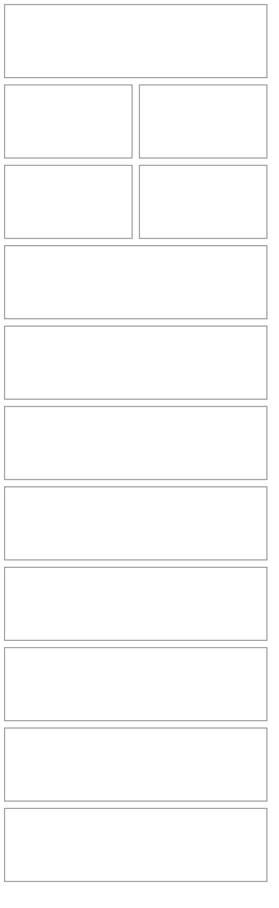
*The screen is titled Kitchen, with the subtitle "Your ingredients, products and stores."; Stores and Products are entry rows that open subviews (later Kitchen entries, Stock, Prepared servings and Shopping list, join them), then an "Ingredients" eyebrow with its count and **+ New** beside it. The search field ("Search" on a phone, "Search ingredients" from `sm`) has the filter icon (a count badge when filters are on) and the View options eye button at its end, with the Yours / All pills under it; on a phone the filters open in a drawer, whose button shows the count ("Show 12 ingredients", shortened to "Show 12" at 360px and under), and from `sm` in a popover, and each active filter also shows as a dismissible chip with "Clear" (the price one reads "Needs a price · in Yours"). The filters are Price (Any / Needs a price / Has a price), Show only (Missing nutrition, Custom only) and Family. Yours is the default and holds the ingredients you added, the ones with a product, and the ones your recipes, saved meals and planned days that aren't frozen yet use; All is the full catalog. **Both price filters only ever look through Yours**, even with All picked, and the Price section says so under its pills; while one is on, the count beside "Ingredients" reads "N of M" with M counting Yours. Families are `SectionDivider` groups. A row is its name and then, each on its own line, the default product's store, price and size (a muted "No price yet" for an ingredient something uses but that has no product) and, when nutrition is on, its calories and macros as emoji figures with what they are per ("per 100 g", or "per serving (5 oz)" when the list's View options say so and the serving can be weighed). Prices and macros hide independently, rows carry no icon, and the chevron sits on the name's line however many lines follow (a product row in the Products subview keeps its price there too). When the filters hide everything the empty state names the filters that are hiding things and offers "Clear filters" and, only when All would find something, "Look through everything"; "Needs a price" alone with nothing left says "Nothing is waiting on a price."*

**Ingredient details** (drawer)

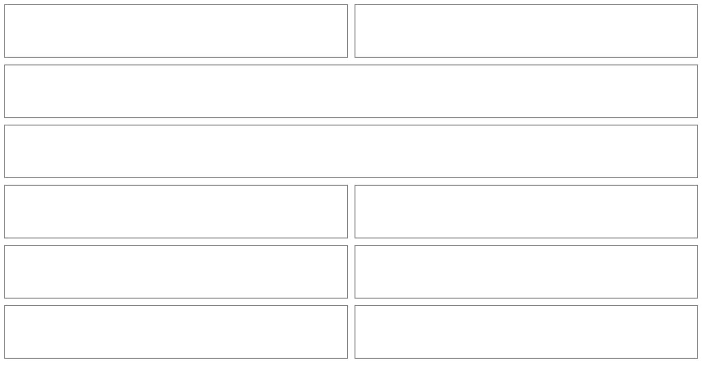
*The front matter is one plain line (the family's name in medium weight, then "✏️ One you added" or "✏️ Adjusted by you" and "🍽️ 1 serving = 5 oz"), never chips, and the footer holds Adjust (Modify for your own ingredient) beside the primary "+ Add a product", which closes the drawer and opens the product form sheet already tied to this ingredient. Tapping the star changes the default product (a quiet icon action; there is no hidden gesture). When a metric is switched on, nutrition shows as emoji `MacroStats` tiles, per 100 g to start and per serving ("Per 1 serving (5 oz)") once that is picked, with a thin Per serving / Per 100 g switch beside the caption; the switch is left out, and the numbers are per 100 g, when one serving is exactly 100 g or can't be weighed. The switch is the same setting as the "Nutrition numbers" pills in the Kitchen list's View options, not a copy of it, so a row and its drawer always agree and a change in one shows in the other. Numbers are adjusted in Adjust / Modify. There is no "Used in" line in the drawer yet. Removing a custom ingredient that is in use takes it off the lists and the confirm says what still uses it; a catalog ingredient can only be reset to its built-in values. The default-product star has no label of its own yet.*

**Ingredient** (form sheet)

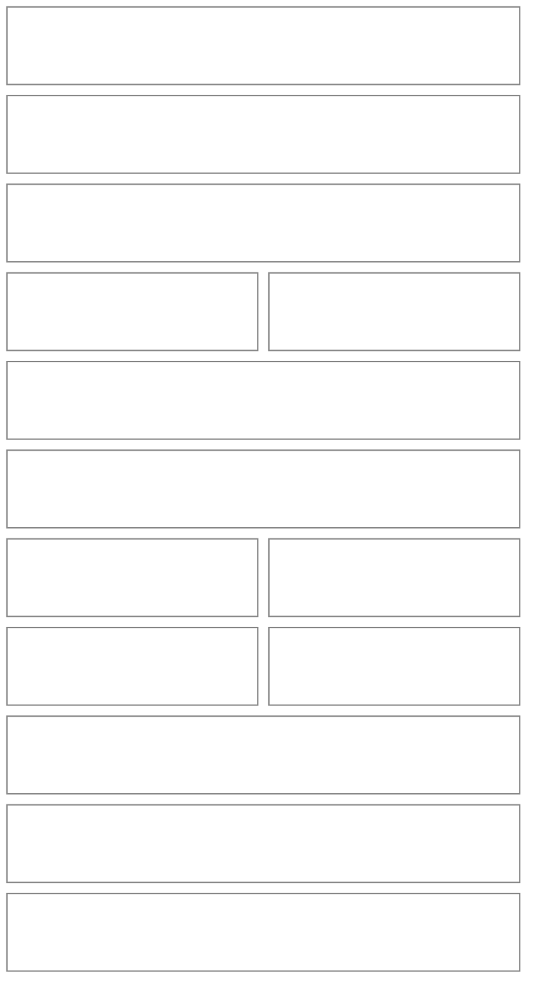
*Name and family are the essentials ("Not sure? Skip it and the ingredient stands on its own."); a serving size and nutrition are "+ Add X" chips on a new ingredient, and a built-in ingredient opens with both showing under "Built in. Change what you like and it stays yours." Nutrition is typed the way the label prints it: "Per [amount] [g | oz | serving]" sits above four compact fields, starting at 100 g, and the section's heading follows ("Nutrition per 28 g"). Pinch stores it per 100 g and shows what it saved ("Saved as per 100 g: …") whenever the basis isn't exactly 100 g. The serving pill is disabled until the serving size converts to grams, with "To type it per serving, set the serving size in grams or ounces first." and an "Add serving size" link (or "…set one serving in grams or ounces above." when the size is on but can't be weighed, say a cup of something with no density). A blank amount ("Add the amount these numbers are for.") or a number over 100,000 per 100 g ("Those numbers look too big. Check them against the label.") shows one line in red and keeps Save off. Picking g, oz or serving before any number has been typed converts the numbers already there to that unit (the per 100 g value stays the same); once something has been typed, picking another unit only changes what the typed numbers are for, and "Saved as per 100 g" shows the result. An existing ingredient reopens in per 100 g, since that is what it holds. The footer has Cancel and the primary, with the trash beside them when there is something to delete (or, for a built-in ingredient, to reset to its built-in values).*

**Product** (form sheet)

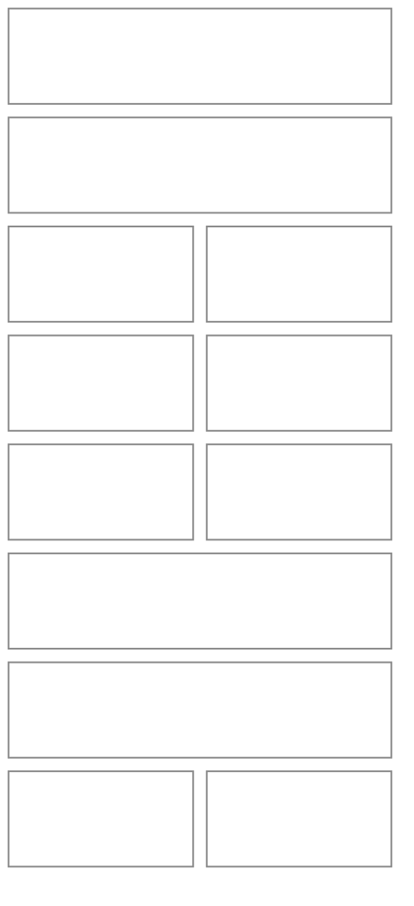
*The sheet's title names what it is about ("{Ingredient} · {store or label}", "{Ingredient} · new product"), so there is no separate "For" block. The store question comes first because the price and size are about that shop. The store row is a `PickOrCreate`: a dashed "New store" pill first, then your stores as logo pills, with "Show all" opening the well-known list inside the same row (capped height, a search past 12). A well-known store joins "your stores" the first time a product uses it. Price and size are two short fields side by side; the size field takes an amount and a unit. Label ("Great Value") and a link are "+ Add X" chips. The first product on an ingredient is made the default without asking, and "Make this the default" appears from the second.*

**Stores** (subview) and **Store** (form sheet)

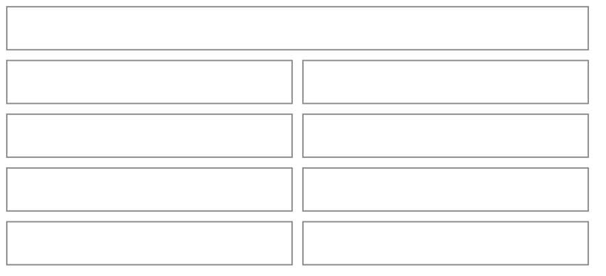
```mermaid
%%{init: {'theme': 'base', 'themeVariables': {'primaryColor': 'transparent', 'primaryBorderColor': '#888888', 'primaryTextColor': '#333333', 'lineColor': '#888888'}}}%%
block-beta
  columns 2
  SF1["Store"]:2
  SF2["🔍 Search well-known stores"]:2
  SF3["[W] Walmart"]:1
  SF4["[T] Trader Joe's"]:1
  SF5["[K] Kroger"]:1
  SF6["[A] Aldi"]:1
  SF7["Can't find it? Add your own"]:2
  SF8["Name<br/>Green Market"]:2
  SF9["Image: Upload or take a photo"]:2
  SF10["🗑"]:1
  SF11["Cancel  ·  Save"]:1
  style SF1 fill:transparent,stroke:#888888,stroke-width:1px;
  style SF2 fill:transparent,stroke:#888888,stroke-width:1px;
  style SF3 fill:transparent,stroke:#888888,stroke-width:1px;
  style SF4 fill:transparent,stroke:#888888,stroke-width:1px;
  style SF5 fill:transparent,stroke:#888888,stroke-width:1px;
  style SF6 fill:transparent,stroke:#888888,stroke-width:1px;
  style SF7 fill:transparent,stroke:#888888,stroke-width:1px;
  style SF8 fill:transparent,stroke:#888888,stroke-width:1px;
  style SF9 fill:transparent,stroke:#888888,stroke-width:1px;
  style SF10 fill:transparent,stroke:#888888,stroke-width:1px;
  style SF11 fill:transparent,stroke:#888888,stroke-width:1px;
```
*The list shows each store's logo in a round tile with a letter tile as the fallback. A well-known store is picked from the list; "Can't find it? Add your own" reveals a name and an image field (`PhotoPicker`), and a store with no image gets a letter tile in a soft tint. Removing a store that has products asks first and keeps those products, with their store shown as "Removed store". The Products subview lists every product with its ingredient, price and size and has **+ New product** beside its title (pick the ingredient first, then the product sheet). From 8 products it shows a search and the filter and sort controls: filters are Store, Family and Default only / Not the default; sort is by store (grouped, the default), ingredient, price or date added. Rows are capped at 60 with "Show 60 more", and an ingredient's default star shows only when it has several products.*

**Nudge and fill-in** (the quiet line, and the sheet it opens)

```mermaid
%%{init: {'theme': 'base', 'themeVariables': {'primaryColor': 'transparent', 'primaryBorderColor': '#888888', 'primaryTextColor': '#333333', 'lineColor': '#888888'}}}%%
block-beta
  columns 2
  G1["$12.80 total · $3.20 / serving"]:2
  G2["2 ingredients need a price · Add prices   ✕"]:2
  G3["Add prices"]:2
  G4["Soy sauce · where do you buy it?"]:2
  G5["Price<br/>$3.49"]:1
  G6["Size<br/>15 fl oz"]:1
  G7["Rice vinegar · where do you buy it?"]:2
  G8["Price<br/>—"]:1
  G9["Size<br/>—"]:1
  G10["Skip for now  ·  Save"]:2
  style G1 fill:transparent,stroke:#888888,stroke-width:1px;
  style G2 fill:transparent,stroke:#888888,stroke-width:1px;
  style G3 fill:transparent,stroke:#888888,stroke-width:1px;
  style G4 fill:transparent,stroke:#888888,stroke-width:1px;
  style G5 fill:transparent,stroke:#888888,stroke-width:1px;
  style G6 fill:transparent,stroke:#888888,stroke-width:1px;
  style G7 fill:transparent,stroke:#888888,stroke-width:1px;
  style G8 fill:transparent,stroke:#888888,stroke-width:1px;
  style G9 fill:transparent,stroke:#888888,stroke-width:1px;
  style G10 fill:transparent,stroke:#888888,stroke-width:1px;
```
*One sheet handles every kind of gap: a price, a package size, a nutrition value, or a missing conversion, one row per ingredient, with just the fields that gap needs. Rows left blank stay as they were, "Skip" moves on without saving, "Save" turns on once the row is filled in, and ✕ on the nudge hides that line for those ingredients. The same line appears in the recipe, saved meal, day and planned-meal views and the calendar stats row. The meal builder is a full-screen subview, so it states the cost and what it leaves out in text and opens nothing over itself; a frozen day has no line, since a new price can't change it.*

| Where the gap shows | Nudge wording | What the fill-in sheet asks |
|---|---|---|
| a recipe, meal or day cost | "2 ingredients need a price · Add prices" | price and package size for each |
| a cost that can't be compared | "Rice vinegar can't be compared with its package size · Add a size" | the package size in a comparable unit, for the ingredient's default product |
| a nutrition metric that is on | "3 ingredients have no protein · Add values" | the missing metric for each |
| the stats row | a warning icon on Spent that names what it leaves out, and the nudge line under the tiles | the same sheet, covering the period shown |

**Settings** (form sheet from the Calendar gear)

```mermaid
%%{init: {'theme': 'base', 'themeVariables': {'primaryColor': 'transparent', 'primaryBorderColor': '#888888', 'primaryTextColor': '#333333', 'lineColor': '#888888'}}}%%
block-beta
  columns 2
  ST1["Settings"]:2
  ST2["Show nutrition"]:2
  ST3["Calories"]:1
  ST4["◯ off"]:1
  ST5["Protein"]:1
  ST6["◯ off"]:1
  ST7["Carbs"]:1
  ST8["◯ off"]:1
  ST9["Fat"]:1
  ST10["◯ off"]:1
  ST11["Each switch applies at once. Turning on protein also shows your price per gram of protein."]:2
  style ST1 fill:transparent,stroke:#888888,stroke-width:1px;
  style ST2 fill:transparent,stroke:#888888,stroke-width:1px;
  style ST3 fill:transparent,stroke:#888888,stroke-width:1px;
  style ST4 fill:transparent,stroke:#888888,stroke-width:1px;
  style ST5 fill:transparent,stroke:#888888,stroke-width:1px;
  style ST6 fill:transparent,stroke:#888888,stroke-width:1px;
  style ST7 fill:transparent,stroke:#888888,stroke-width:1px;
  style ST8 fill:transparent,stroke:#888888,stroke-width:1px;
  style ST9 fill:transparent,stroke:#888888,stroke-width:1px;
  style ST10 fill:transparent,stroke:#888888,stroke-width:1px;
  style ST11 fill:transparent,stroke:#888888,stroke-width:1px;
```
*Switches take effect immediately, so they are `AppToggle`s, not checkboxes. Nutrition is always stored; the switches only choose what is shown.*

**Breakdown** (drawer from the calendar stats row)

```mermaid
%%{init: {'theme': 'base', 'themeVariables': {'primaryColor': 'transparent', 'primaryBorderColor': '#888888', 'primaryTextColor': '#333333', 'lineColor': '#888888'}}}%%
block-beta
  columns 2
  BK1["October · $412.60"]:2
  BK2["[ By day ]   By meal"]:2
  BK3["Tue 13"]:1
  BK4["$18.40"]:1
  BK5["Wed 14"]:1
  BK6["$7.20"]:1
  BK7["Thu 15"]:1
  BK8["—"]:1
  style BK1 fill:transparent,stroke:#888888,stroke-width:1px;
  style BK2 fill:transparent,stroke:#888888,stroke-width:1px;
  style BK3 fill:transparent,stroke:#888888,stroke-width:1px;
  style BK4 fill:transparent,stroke:#888888,stroke-width:1px;
  style BK5 fill:transparent,stroke:#888888,stroke-width:1px;
  style BK6 fill:transparent,stroke:#888888,stroke-width:1px;
  style BK7 fill:transparent,stroke:#888888,stroke-width:1px;
  style BK8 fill:transparent,stroke:#888888,stroke-width:1px;
```
*The title names the period shown (a month, a week or a day). The two thin pills switch between days and meal types; rows show spend and, for each nutrition metric that is on, its total. It is a single scrolling list under a fixed header.*

## Reusable Components

| Component | Used in | Purpose |
|---|---|---|
| DayCell | Month view's `renderCell` | up to three meal chips (a soft tint of the meal's colour, its emoji) on a phone or pills with the truncated title from `lg`, and a "+N"; date number, today dot, selected ring |
| MonthView, WeekView, DayView, MealRow, MealChip | Calendar | the three views: the grid, a 7-day agenda (7 columns from `lg`) and one day's meals grouped in meal order |
| PeriodSwitcher | Calendar (shared) | arrows by the view's unit, the period title, a thin view switch and a Today button shown only while today is out of sight |
| StatsRow | Calendar | the shown period's Spent (warning icon), Avg per meal, Per g protein when on, then calories and macros as small `MacroStats` tiles; one nudge line; "See the breakdown" opens the drawer. A tile's number steps down a size on a phone as it gets longer (and again at 360px and under), and the tile keeps room for its help icon, so a long total never runs under it |
| MacroStats | rows and summaries everywhere (shared) | 🔥 calories (whole numbers), 💪 protein, 🌾 carbs, 🥑 fat in grams for the metrics switched on: inline in a row, tiles in a summary |
| GapNudge | recipe, meal, day and planned-meal drawers, stats row | the one quiet line (muted text + link + ✕) that offers the fill-in sheet; renders only when there is a gap |
| FillInSheet | behind every nudge | a `FormSheet` with one row per ingredient and only the fields that gap needs |
| DayDrawer / DayPeek | Calendar | the same content as a `DetailSheet` on phones and a hover `Popover` from `sm` up (`max-sm:hidden`) |
| PlannedMealView | Day drawer | items with servings, totals, grouped actions, swapped in place |
| MealBuilder | Plan a meal, Meal subview (renders its own `Subview`) | day and type pills, a pill row of saved meals while the plate is empty, one item search, rows with a compact `Stepper` for servings, a tinted summary with cost, warning icon and emoji macros (no nudge: the fill-in sheet never opens over this subview), Save-as-meal switch |
| ItemSearch | MealBuilder, Recipe form | one search over recipes, meals and ingredients with kind labels; also offers "New ingredient" |
| Stepper | MealBuilder, Recipe form (shared) | half-step stepper, `isCompact` for rows, 40px targets |
| RecipeStart, RecipeStartDrawer | Recipes tab and Calendar (phone drawer, rendered once at the top of Pinch and raised by New, "Add a recipe" and a way's back button), Recipe subview (first page from `sm`) | the four ways to begin a recipe as rows through the shared `MethodPicker` (rows only; each way's `onPick` opens its own screen) |
| RecipeReader | Recipe subview | the text, file and link screens of a way in: its own disclosure line above its input, a "Fill in the recipe" button (text and link), a reading state and failure line, and "Write it yourself instead"; link reading calls `fetchPageContent` through `recipePageQueryOptions` |
| RecipeForm | Recipe subview | all sections visible via `FormSection` and `Field`: servings and times, photo, description, `RecipeIngredients`, `RecipeSteps` and `NutritionReview` (each a drawer on a phone, rows open in place from `sm`) |
| RecipeRow, MealRow | Recipes tab | cover or emoji tile, title, muted details, then the cost and macro lines when shown; the tile and text share a top edge and the chevron sits on the first line |
| IngredientRow, FamilyGroup | Kitchen | name, a price line and a macro line (each can be hidden), the chevron on the name's line; `SectionDivider` groups |
| FilterBar | Kitchen ingredients, Products (shared) | search plus a filter icon with a count badge (a drawer on phones, a popover from `sm`) and an optional trailing button (Kitchen's eye), dismissible chips and "Clear"; the drawer's button shows the count and can take a shorter label for 360px and under ("Show 12 ingredients" / "Show 12") |
| ViewOptions, ListViewControls | Kitchen filter bar, beside the Recipes / Meals pills (only while that list has rows) | the eye button (a drawer on a phone, a popover from `sm`, tinted once something differs, with Reset): Show prices, Show calories and macros (reads off, with a line saying where to turn them on, while no metric is on) and, for ingredients, the nutrition basis, which the ingredient drawer's switch shares; `ViewOptions` is shared, `ListViewControls` is Pinch's contents; kept per person and list on the device (`useListViewOptions`) |
| HelpTip | cost warnings, stats help (shared) | a help or warning icon: a small modal (with a hairline border) on a phone or any touch screen, whatever its width; with a mouse a tooltip that opens on hover or keyboard focus, stays open on a click, places itself above or below and inside the screen (and re-measures while a drawer is still sliding in), its arrow on the icon. Escape closes a tooltip and still reaches a drawer under it; in a modal it closes only the modal |
| Subview | Recipe, Meal, Stores and Products screens (shared) | the round "Back" button and title; the header's back, Escape (overlay subviews) and the phone's back gesture all do the same thing: the screen's own step back (the recipe's reading screens, its "Discard this recipe?" question) or, without one, close; a drawer or modal opened above it takes Escape and the gesture first and the subview stays |
| PillGroup | everywhere options are picked (shared) | choosing never reorders visible options: a chosen option that was hidden behind "Show all" takes the last visible slot, and the fully open list keeps its original order; a pick-one group shows no "1 selected" count |
| AddFieldChips | Ingredient and Product forms (shared) | rounded "+ Add X" chips for optional fields, at least 36px tall, a long label wraps instead of clipping |
| ProductForm, ProductRow | Ingredient drawer, Products subview | titled by ingredient and store, store question first, price and size side by side, chips for label and link |
| StorePicker | Product form | `PickOrCreate` of your stores plus "Show all" for the well-known list |
| StoreLogo | pickers, rows, subview | the logo tile with a letter fallback; app-aware, so it stays in the app |
| StoreForm | Stores subview | search of well-known stores, or name plus `PhotoPicker` image |
| CoverImage | recipe rows and drawer | `FallbackImage` with a tinted emoji tile as its `fallback` |
| `SectionHeader`, `Subview`, `FormSheet`, `DetailSheet`, `ModalFooterActions`, `DeleteIconButton`, `PickOrCreate`, `SearchInput`, `SectionDivider`, `MoneyInput`, `AppToggle`, `StatTile`, `MethodPicker`, `FormSection`, `Field` | everywhere | the shared pieces in `src/components` and `src/ui`; Pinch builds only what is app-specific. `Field` has an `isCompact` form for a grid of short fields (small captions, a 40px input whose typed text stays 16px) and wraps its control in a native label, so no `Select` goes inside one |
| Empty state | every list and the empty Calendar | an icon, one muted line, and the call to action in the header |

## User Journeys

**First launch: plan something**

```mermaid
%%{init: {'theme': 'base', 'themeVariables': {'primaryColor': 'transparent', 'clusterBkg': 'transparent', 'primaryBorderColor': '#888888', 'clusterBorder': '#888888', 'lineColor': '#888888', 'primaryTextColor': '#333333'}}}%%
flowchart LR
    A[Open Pinch] --> B["Calendar, empty"] --> C{"What now?"}
    C -->|Plan your first meal| D["Plan a meal subview"] --> E["Search 'chicken breast'"] --> F["Pick an ingredient from the catalog"] --> G["Add to today"] --> H["Calendar shows a chip for it; cost line says 'No price yet'"]
    C -->|Add a recipe| I["Ways to start a recipe"]
```

**Add a recipe from a photo or PDF**

```mermaid
%%{init: {'theme': 'base', 'themeVariables': {'primaryColor': 'transparent', 'clusterBkg': 'transparent', 'primaryBorderColor': '#888888', 'clusterBorder': '#888888', 'lineColor': '#888888', 'primaryTextColor': '#333333'}}}%%
flowchart LR
    A[Recipes] --> B[+ New] --> C["Ways to start: From a file"] --> C2["File screen: Choose a file"] --> D["Reading…"] --> E["Form filled in; 'We couldn't read: cook time'"]
    E --> F{"Unknown ingredient?"}
    F -->|Yes| G["'Add as new ingredient' on its row"] --> H[Review and edit]
    F -->|No| H
    H --> I[Save] --> J["Recipe drawer with its cost and a price nudge"]
```

**Plan a meal, tweak a day, keep it**

```mermaid
%%{init: {'theme': 'base', 'themeVariables': {'primaryColor': 'transparent', 'clusterBkg': 'transparent', 'primaryBorderColor': '#888888', 'clusterBorder': '#888888', 'lineColor': '#888888', 'primaryTextColor': '#333333'}}}%%
flowchart LR
    A[Tap a day] --> B[+ Add] --> C["Pick 'Taco night' from Start from a saved meal"] --> D["Items copied onto this day"]
    D --> E["Skip the peppers, double the rice"] --> F[Add to today]
    F --> G["Calendar chip appears"] --> H["Open it: Save as a meal"] --> I["Saved with a new name; Taco night is unchanged"]
```

**Add a product with a store**

```mermaid
%%{init: {'theme': 'base', 'themeVariables': {'primaryColor': 'transparent', 'clusterBkg': 'transparent', 'primaryBorderColor': '#888888', 'clusterBorder': '#888888', 'lineColor': '#888888', 'primaryTextColor': '#333333'}}}%%
flowchart LR
    A[Kitchen] --> B[Tap Chicken breast] --> C[Add a product] --> D{"Where do you buy it?"}
    D -->|Pick a logo pill| G[Price and size]
    D -->|Show all| E["Search well-known stores"] --> G
    D -->|New store| F["Name and optional image"] --> G
    G --> H[Save] --> I["Ingredient shows the product; recipe costs update"]
```

**Fill in what's missing, in context**

```mermaid
%%{init: {'theme': 'base', 'themeVariables': {'primaryColor': 'transparent', 'clusterBkg': 'transparent', 'primaryBorderColor': '#888888', 'clusterBorder': '#888888', 'lineColor': '#888888', 'primaryTextColor': '#333333'}}}%%
flowchart LR
    A["Recipe drawer: '2 ingredients need a price'"] --> B[Add prices] --> C["Fill-in sheet: one row each"] --> D{"Fill them all?"}
    D -->|Some| E[Save] --> F["Cost updates; its warning icon now says it leaves out 1"]
    D -->|None| G[Skip for now] --> H["Line stays; ✕ hides it for these ingredients"]
```

**Bring a recipe in from a chat or a web page**

```mermaid
%%{init: {'theme': 'base', 'themeVariables': {'primaryColor': 'transparent', 'clusterBkg': 'transparent', 'primaryBorderColor': '#888888', 'clusterBorder': '#888888', 'lineColor': '#888888', 'primaryTextColor': '#333333'}}}%%
flowchart LR
    A[Copy a recipe from any AI chat] --> B[Recipes + New] --> C{"How to start?"}
    C -->|From text| D["Text screen: paste it, Fill in the recipe"]
    C -->|From a link| E["Link screen: paste the page's address, Fill in the recipe"]
    D --> F["Form filled in for review"]
    E --> F
    F --> G[Save]
```

**Type nutrition off a label**

```mermaid
%%{init: {'theme': 'base', 'themeVariables': {'primaryColor': 'transparent', 'clusterBkg': 'transparent', 'primaryBorderColor': '#888888', 'clusterBorder': '#888888', 'lineColor': '#888888', 'primaryTextColor': '#333333'}}}%%
flowchart LR
    A[Kitchen + New] --> B["Name it; pick a family or skip"] --> C["+ Nutrition"] --> D{"What does the label say?"}
    D -->|Per 28 g| E["Per 28 g, then the four numbers"]
    D -->|Per serving| F["Add the serving size first, then Per serving"]
    E --> G["'Saved as per 100 g: 🔥 464 …'"]
    F --> G
    G --> H[Add] --> I["Drawer shows the numbers; with a serving size set, per serving and per 100 g are one tap apart"]
```

## Form Field Organization

*"Grouping: none" means one flat form — still Dreamer UI's `Form`, just without a `Disclosure` or steps wrapper.*

| Entity | Initial (create) | Later (edit only) | Later-set entry point | Grouping | "Other" option? |
|---|---|---|---|---|---|
| Recipe | how to start (text, file, link or by hand; each way its own screen), then title and ingredients (ingredient + amount + unit) | everything else is a visible section of the same form: servings, times, photo, description, steps, own nutrition | the recipe drawer's Modify | none; `FormSection`s, no chips | none |
| Ingredient | name, family (`PickOrCreate`: existing family, new family, or none) | serving size and nutrition (typed per an amount of g, oz or servings as the label prints it, stored per 100 g), unit conversions (Next Steps) | the ingredient drawer's Modify; the fill-in sheet for a missing nutrition value | none; chips for serving size and nutrition | family: "New family" is the dashed first pill |
| Product | store (`PickOrCreate`), price, package size | label, link, default flag | the ingredient drawer's product rows; the fill-in sheet for a missing price or size | none | store: "New store" is the dashed first pill |
| Store | pick from the well-known list, or name | image | the Stores subview row | none | "Can't find it? Add your own" reveals the name and image fields |
| Meal (saved) | name, items (recipe or ingredient + servings) | — | Meal subview's Modify; "Save as a meal" on a planned meal | none | none |
| Planned meal | day and meal type (prefilled from where it started), items with servings | — | the planned meal's "Change items or servings" | none | none |
| Settings | four nutrition switches (all off) | — | the Calendar gear; the stats row's help link | none | none |

**Flagged for the TDD** (none of these change the screens above, but each shapes the data):
- **Copy-on-plan** — a planned meal stores its own item list and a `sourceMealId`; editing the saved meal later leaves planned days alone, and the id leaves room for a future "update N upcoming days?" prompt.
- **Live recipes, frozen past** — planned items point at recipes, so edits reach upcoming days; once a day has passed its cost and nutrition are snapshotted so history never moves.
- **Archive, don't delete, what is in use** — a recipe, custom ingredient or store that planned days, saved meals, recipes or products depend on is archived and hidden from pickers, never removed.
- **Comparable amounts** — a recipe's amount and a product's package size must share a dimension (mass, volume, count) or have a catalog-known conversion; anything else is excluded from the total and named in a nudge.
- **Nudge dismissals** — "✕ hides it for those ingredients" needs a small per-gap dismissal record on the user's settings document.
- **Unknown stock vs zero stock** — when stock tracking arrives, "not tracked" is its own state, separate from 0.
- **Recipe from a link** — a server function fetches the page (signed-in only, public http/https only), so the person's device never contacts the site; its text and any recipe data go to the AI reader, which writes the draft for the form to review.
- **Store logos** — the well-known list is a constant of names and domains, logos load in the browser from a logo service, and a letter tile covers every failure; the service and its terms are to be settled.
- **Week** — Sunday to Saturday, to match the month grid; the week view shows those seven days and its stats describe them.
- **Money** — integer cents everywhere; nutrition stored per 100 g (typed on a label's basis and converted on save, shown per serving only as a display) with servings computed from the recipe's own amounts.
- **View options** — which lines a list's rows show is a per-person, per-device choice in the browser, not a field, so no rule or listener is involved and nothing syncs.
- **A well-known store joins "your stores" on first use** — so a product always points at a store document of the person's own.
