# Pinch — UX & Interaction Design

*All names, dates and dollar amounts in the diagrams are illustrative.*

## Design Principles

| Principle | Means |
|---|---|
| One border, not nested ones | a card gets a single bordered shell with a flat interior — never border-in-a-border; groups inside a screen are separated with `SectionDivider` or spacing |
| Phone first | one narrow column with a floating pill at the bottom — Calendar · Recipes · Kitchen · Shopping · Settings, as wide as its five tabs; from `lg` up the same tabs stand in a rail on the left edge, and the rest reflows with no parallel desktop layout |
| The counter, not a form | Pinch asks for a name and little else. A price, a package size or a nutrition value is invited by a quiet line exactly where it changes a number, and always optional |
| Drawers for looking and quick edits, subviews for building | an ingredient, a day, a planned meal and a recipe's detail open in `DetailSheet` drawers; a recipe, a meal, the fridge and freezer list and the Stores & prices list are page-sized and open as `Subview`s; short forms (ingredient, price, store) are `FormSheet`s; the phone's back gesture (and Escape, for a swapped-in step) closes the top drawer, sheet or swapped-in step before anything under it |
| Never overlay on overlay | whatever continues inside an open drawer swaps its content in place, led by a hairline Back chip (`BackLink`); a drawer whose action opens a form or another container closes first. Only a destructive confirm may sit on top |
| Numbers explain themselves | a cost with gaps says so in its figure ("$5.20 so far", "$0.08+") and carries a warning icon (`HelpTip variant='warning'`) that says what the total leaves out, as a small modal on a phone or any touch screen and a tooltip with a mouse; a stat that isn't self-evident carries a `HelpTip`; past days are labelled as frozen, and say when the person had one priced again |
| Rows show what you choose | the Settings tab holds the four nutrition switches the whole app follows (all off to start), and the Calendar's own View options hold its stat tiles (off to start, saved with your account); the eye (View options) on Recipes and Kitchen turns prices or calories and macros on or off on the rows (calories and macros start off, and the sheet ends with a door to Settings) and picks the nutrition basis of ingredient rows; on the Calendar it turns the Week's prices on or off and points to Settings for the stats. The rows' choices are remembered on the device, and no total or drawer changes |
| Nothing leaves without saying what | an AI reads what the person hands it (pasted text, a photo, screenshot or PDF, or a recipe page's text and recipe data) and says so, and nothing is saved until the person saves the form; a link goes to our server, which fetches the page; a reminder is a push to the person's own devices that names dishes, and the Settings row says so; a new recipe's Photo drawer searches the web with the recipe's title, the line under its heading says so, and Settings and a Turn off chip stop it; a recipe or saved meal leaves only as a link the person makes, and the Share view says what the copy holds and what it leaves out before the link exists; nothing else leaves the app; an idea's link is fetched for its title, site and picture only, and says exactly that before it is pasted |
| Dreamer UI first | `Calendar` (with `renderCell`), `Form`, `Drawer`, `Popover`, `Tabs`, `Badge` — custom only where the catalog has nothing: the day cell and the store logo tile |
| Honest AI | an AI reads a pasted recipe, photo, PDF or web link and fills the real form; it names what it couldn't read; nothing is saved until the person confirms |
| Quiet by default | a screen volunteers only what changes the next thing the person does, once: the Calendar opens on one summary line (the period's total, average per fully priced meal and daily nutrition come back as a row of tiles when the Calendar's View options have "Show stats" on, and are off to start), a total says "so far" in its figure instead of a caveat on every row, a nudge lives only where its gap is owned, and a first run shows nothing about data that doesn't exist. The counts per screen and the doors per feature are in `JOURNEYS.md` |
| Back closes one layer | on a phone the back gesture closes the open drawer, sheet or swapped-in step, one per press; from any tab it returns to the Calendar, and each tab keeps its scroll, pill, search and period while Pinch is open |
| The same kind of control looks the same | a tick is a circle (a ring until ticked, then filled with the ink), and a way into another screen is a rounded tile with a chevron, never a pill: pills answer a question or filter a list |


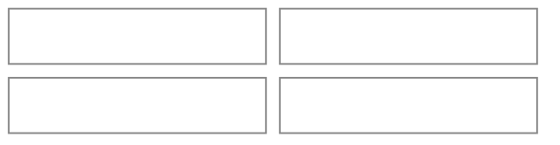
*Honest caveats: (1) Dreamer UI's `Calendar` hands `renderCell` only the date (a local-midnight `Date`) and no month-change callback, so each cell's meal chips come from a day-keyed lookup built up front, not a per-cell query. (2) A cell that holds up to three chips or pills plus a "+N" is taller than Dreamer UI's default square; like A-List's poster cells it needs `cellClassName` and `monthGridClassName` overrides. (3) Store logos come from a third-party logo service and can be missing, so every logo tile has a letter fallback.*

## Sitemap

```mermaid
%%{init: {'theme': 'base', 'themeVariables': {'primaryColor': 'transparent', 'clusterBkg': 'transparent', 'primaryBorderColor': '#888888', 'clusterBorder': '#888888', 'lineColor': '#888888', 'primaryTextColor': '#333333'}}}%%
flowchart TD
    A[First launch] --> D["Calendar, empty: one line saying what Pinch does · 'Add your first recipe'"]
    subgraph Bar["Bottom bar"]
        D2["Calendar"]
        R["Recipes"]
        K["Kitchen"]
        SH["Shopping · count left to buy"]
        ST["Settings"]
    end
    D --> D2
    D2 ~~~ R ~~~ K ~~~ SH ~~~ ST
    D2 -->|eye| VOC["View options · Show stats (saved with the account) · Show prices on the Week's meals · a door row to Settings: Calories and macros / Your numbers"]
    VOC -->|door row| SET
    D2 -->|a cook saved on this device, after a reload or a tab the browser threw away; the row tops every tab| PU["Pick up cooking · one 48px tinted row, never an overlay: Pick up step 3? · Timer 12:30 left · Adobo chicken · the row is the Keep cooking button (chevron) · ✕ Not now"]
    PU -->|Keep cooking| CK
    D2 -->|switch view| VW["Month · Week (below lg it opens on Week from today) · Today button"]
    D2 -->|tap the summary line| BRK["Summary sheet · cost and how much is priced · days · reference figures · Add to shopping list"]
    BRK -->|tap a day| DD
    BRK -.->|Add to shopping list| AS
    D2 -->|tap a day, or a day's label in Week| DD["Day drawer"]
    D2 -.->|hover a day, desktop| PK["Day peek popover"]
    D2 -->|Plan| PM["Plan a meal subview · a When row, one search, the plate, recent recipes and saved meals as rows"]
    DD -->|Plan on this day| PM
    DD -->|Stats for this day, while Show stats is off and the day has cost averages| DS["The day's cost averages · swaps in place"]
    DD -->|tap a meal| PMD["Planned meal · swaps in place"]
    PMD -->|tap a plate row that is a recipe| PRV["That recipe, read in place · its front, ‹ Back, no footer"]
    DD -->|Add to shopping list| AS
    PMD -->|Modify| PM
    PM -->|the When row| PWE["Day and meal editor · drawer on a phone, popover from sm · day pills, Other day…, meal pills, Done"]
    PMD -->|⋯| PMM["More · swaps in place · the actions that aren't the primary, Remove from this day last"]
    PMM -->|Save to Saved meals, 2+ items not yet saved| SAV["Name this meal · swaps in place"]
    PMM -->|Remove from this day| RM["Remove confirm"]
    R --> RL["Recipes list · pills: Recipes / Saved meals / Ideas, each shown once it has something"]
    RL -->|+ New recipe| RS["Ways to start · a drawer on a phone, the subview's first page from sm · text, file, link or write it yourself"]
    D -->|Add your first recipe| RS
    RS -->|Keep it as an idea, the last quiet row| NI["New idea sheet over the screen · toast Saved X to your ideas"]
    RS -->|text, file or link| RR["Reading screen · its own view, one way at a time"]
    RR -->|the reading fills the form| RF["Recipe subview · the form"]
    RR -->|Write it yourself, the quiet dashed row · asks first when a link or text is typed| RF
    RR -->|Paste its text instead, a dashed row only after a link that would not open or read · asks first, as Back does| RRT["Text reading screen, empty · the link is let go"]
    RR -->|Save as an idea chip, text and link| IV["Idea view in place · back returns to the reading"]
    RS -->|write it yourself| RF
    RL -->|eye button| VO["View options · this list's rows (prices on, calories and macros off to start); while every number is off, a door row to Settings replaces the macros switch"]
    VO -->|door row| SET
    RL -->|filter button, once a source exists or something is put away| SFL["Filter · Source: Any, each used source with its count, No source · In stock"]
    RL -->|📖 icon beside + New recipe, once a source exists| SO["Sources subview · each source with its recipe count, or Not on any recipe · every row has a chevron and opens its source"]
    SO -->|tap any row| SOF["Source sheet · a roomy row that shows its recipes (only with recipes), name, delete"]
    SOF -->|Show the N recipes from X, the sheet and the screen close| RL
    RL -->|Collections question, once a collection exists| CFL["Collections · Any, each collection that holds a recipe with its count, No collection · n · a pencil on the title line"]
    CFL -->|pencil, the filter closes first| CSH["Collections sheet · each collection with its recipes · a row swaps its name and trash in place, ‹ Back · Done"]
    CSH -->|a row's trash| CSD2["Delete confirm · how many recipes, they stay"]
    RF -->|Collections row| CED["Collections editor · a drawer on a phone, a popover from sm · every collection as a pill, a dashed New collection first, Suggested for this recipe · Done"]
    RD -->|a collection pill, when the collection holds other recipes; the drawer closes| RL
    ML -->|star on a row| STR["Starred · first in the list, and in the plan builder's recents"]
    RL -->|star on a recipe row| RSTR["Starred · first in Recipes · filter: Favorites · n, from eight recipes"]
    RL -->|Select icon, from two recipes| RSEL["Select mode · title says 3 selected · a tick on each row, All shown · pinned footer: Add to a collection"]
    RSEL -->|Add to a collection| RAC["Collections picker · drawer on a phone, modal from sm · every collection as a pill, a dashed New collection first · Cancel, Add 12 recipes"]
    RAC -->|Add, then a toast with Undo| RL
    MD -->|star on the title line| STR
    ML -->|filter button, from eight saved meals once one is starred| MFL["Filter · Favorites · n"]
    RL -->|tap a recipe| RD["Recipe drawer · a star and a door on the title line, a source pill when it has one, description, one facts line, ingredients, steps, keeping it, cost and the price note, then the how-to video and other links (with nothing priced, the links first and the note last) · a door on the title line and one in the footer, each opening in place with ‹ Back"]
    RD -->|🕘 icon| RNH["Notes and history · in place · Cooked N times row, the notes with Add a note"]
    RD -->|⋯ More| RMO["More · in place · what's in the fridge and freezer, then Start cooking or Plan it, Mark as cooked, Add to shopping list, Put some away"]
    RD -->|Modify| RF
    RD -->|source pill, when the source holds other recipes; the drawer closes| RL
    RF -->|Keeping it row| KE["Keeping it editor · a drawer on a phone, a popover from sm · fridge and freezer days, reheat, tip · Done"]
    RF -->|Photo row| PHE["Photo editor · a drawer on a phone, a popover from sm · preview, choose, take on a touch screen, remove · Done · a new recipe also lists Photos from the web (a 3×2 grid, a line saying what is sent, Turn off)"]
    RF -->|Where it's from row| SRE["Where it's from editor · same container · the source pills, New source, Remove source · Done"]
    RF -->|Links row| LKE["Links editor · same container · the how-to video, other links one open at a time, Add a link · Done"]
    RD -->|a link row, a new tab| EXT["The other site"]
    RR -.->|a source that says how long it keeps| KE
    RD -->|Plan it, or Start cooking when it is on today's plan| PM
    RMO -->|Add to shopping list| AS["Shopping list sheet · servings, tick what you need"]
    AS -.->|toast View, unless a subview is open| SH
    RMO -->|Mark as cooked| CT["Cook added · Undo (a toast from the drawer, the panel in cooking mode)"]
    RNH -->|Cooked row, once cooked| CH["Cooking history sheet · newest first, + Add an earlier cook"]
    CH -->|tap a cook, or + Add| CE["Cook view · day, time, servings, note, trash · swaps in place, ‹ Back"]
    CE -->|trash| CD["Delete confirm · names the day"]
    RNH -->|Add a note, or Edit on an entry| NS["Note sheet · a drawer on a phone, a modal from sm · your words, which cook it follows, trash"]
    CH -->|Add a note under a cook that has none| NS
    CE -->|Add a note, on a cook that has none| NS
    RNH -->|Apply to the recipe, on a note| RF
    CK -->|Apply to the recipe, on an open note| RF
    NS -->|trash| ND["Delete confirm"]
    PMD -->|Mark as cooked, today or a past day| CP["(✓) Cooked · Not cooked · in the row"]
    RL -->|Ideas pill| IL["Ideas list · still to try, then made into recipes"]
    IL -->|+ New idea| IA["Add sheet · a drawer on a phone, a modal from sm · link, photo or jot it down, each in the sheet's own view with a Back chip"]
    IA -.->|a link already saved| ID2
    IL -->|tap an idea| ID2["Idea drawer · picture, title, note, Open site, Made into recipe"]
    ID2 -->|Modify| IE["Idea sheet · title, link or photo, note, delete"]
    ID2 -->|Turn it into a recipe, a link idea| RR
    ID2 -->|Turn it into a recipe, a photo or a few words| RF
    ID2 -->|Open the recipe, once made| RD
    RD -->|Start cooking, on today's plan; or More's Start cooking| CK["Cooking mode subview · the plate's recipes on one slim line, the step first with its ready timer cards (a started timer takes the screen), the amounts it names in a tray above Back and Next, a note card on the first step, an Ingredients button"]
    CK -->|Finish: the cook is recorded, Undo until Done| CT
    CK -->|Finish, then Add a note, typed in place| CKN["Note on the last screen · Save note, then Note saved. and Done"]
    CK -->|Finish, started from a planned meal| CP
    PMD -->|Start cooking, one recipe to cook| CK
    PMD -->|Start cooking, several recipes to cook| CK
    CK -->|a dish on the slim line, or Next on a recipe's last step| CK
    CK -->|the mic, the first time, or after a stop it explains| CKV["Voice control · two sentences (Last time: why it stopped) · Tap to talk / Say “Hey Pinch” rows · How it works ▾ · Not now / Turn on (a modal, the one allowed over the screen)"]
    CKV -->|Turn on| CKL["Listening · a ten-second command window: the mic lit and filled, a chip that empties, a line over the buttons: a hint, Heard “next”, or the answer"]
    CK -->|the mic, once Turn on was chosen| CKL
    CKL -->|the state chip, in any state| CKH["Voice control · How it listens: Tap to talk, Say “Hey Pinch”, Keep listening 15 min; Read steps aloud · What to say: five commands, More commands ▾ · Done (a modal at every size)"]
    CKL -->|Hey Pinch mode: the window runs out or the mic is tapped| CKW["Waiting · the mic tinted with a dot, chip Waiting, Say “Hey Pinch”"]
    CKW -->|“Hey Pinch”, alone or with a command| CKL
    CKH -->|Keep listening for 15 minutes| CKK["Kept open · chip with the time left, a ring round the mic, no phrase needed"]
    CKL -->|tap to talk: 10 s with no command, the mic again, stop listening, leaving, Finish, a refused microphone| CK
    CKW -->|10 quiet minutes (not while a timer runs), the mic, stop listening, leaving, Finish| CK
    CKK -->|15 minutes, the mic, stop listening, leaving, Finish| CK
    RL -->|Saved meals pill| ML["Saved meals list"]
    ML -->|+ New saved meal or tap Modify| MF["Meal subview · same builder, a Name row in place of When"]
    ML -->|tap a meal| MD["Meal drawer"]
    MD -->|tap a plate row that is a recipe| PRV2["That recipe, read in place · its front, ‹ Back, no footer"]
    MD -->|Plan it| PM
    MD -->|⋯ More: Add to shopping list| AS
    K --> PE["Fridge & freezer tile · beside Pantry in one row under the search, only once something is put away · what wants a look in words"]
    PE --> PL["Fridge & freezer subview · opens on the place with more boxes that want a look · Fridge / Freezer switch counted in servings, soonest eat-by first, a batch as one row · header: 🕘 What you finished, Select, Clear out, Add · one past-its-date row for both places"]
    PL -->|Select icon| PS["Select mode · title says 3 selected · a tick on each row, All past their date (both places) / All in the fridge in the header row · pinned footer: Toss, Put in the freezer or Thaw (only when every tick is in one place), Ate it all"]
    PL -->|+ Add| CF["Fridge & freezer sheet · what is it, servings, where, how many boxes, eat by"]
    PL -->|tap a row| CS["Box sheet · titled with the dish · Ate one (Toss it once past its date) · It's gone · Thaw or freeze · How many are left? · date line to change it"]
    CS --> CSV["It's gone → Ate it / Tossed · Put in the freezer / Thaw in the fridge · Change the eat-by date · How many are left? · History (a batch: Each box) · swap in place, ‹ Back"]
    CS -->|trash| CSD["Delete confirm · says the history goes too"]
    PL -.->|What you finished| PF["What you finished · its own step, back returns to the list · a box's sheet offers Put it back"]
    RMO -->|Put some away| CF
    RMO -.->|fridge and freezer row, scoped to the recipe| PL
    MD -->|⋯ More: Put some away| CF
    RMO -->|Share| SHV["Share view · in place, ‹ Back to More, the primary pinned in its own footer · not shared: what the link shows and leaves out, Create link · shared: the link, Copy link, Send, Update the shared copy, Get a new link, Stop sharing"]
    MD -->|⋯ More: Share| SHV
    SHV -->|at 30 links, the Your shared links chip: the drawer closes first| SHL
    SHV -->|Get a new link, Stop sharing| SHC["Confirm · who loses access, and that Stop can't be undone"]
    MD -.->|⋯ More: a fridge or freezer row, scoped to the meal, on that place| PL
    CK -->|Finish, then Putting any away? or Put some away| CKP2["Box details · in place on the last screen · Skip, Save"]
    PMD -->|Eat from fridge or freezer, today or yesterday: the primary when a box is due, else in ⋯ More| EF["Eat from stock · swaps in place · one box: Ate 2 as the footer's filled button · ‹ Back"]
    K --> PNE["Pantry tile · beside Fridge & freezer in one row under the search, only once a package is in it · what to use first, in words"]
    PNE --> PNL["Pantry subview · All / Pantry / Fridge / Freezer switch, only while two places are in use · search from 8 ingredients · past-its-date row · one row per ingredient, soonest date first · Select icon · + Add"]
    PNL -->|Select icon| PNS["Select mode · title says 3 selected · a tick on each package, an ingredient's tick takes its shown packages · All past their date / All shown · pinned footer: Toss, Move, Used it up"]
    PNS -->|Move| PNM["Move sheet · where it goes, each package keeps its date · Cancel, Move N"]
    PNL -->|+ Add| PFM["Package sheet · what it is (three things bought lately offered before any typing), how much, where, use by · Add another as a second submit · Cancel, Add"]
    PNL -->|tap a row| PSH["An ingredient's packages · one row per package, soonest first · Add another"]
    PSH -->|tap a package| PSD["Package sheet · Use it up or Toss it · Used some or all · Move it · History · swap in place, ‹ Back · Modify opens the form (the date is changed there, or while moving it)"]
    PSD -->|Use it up, a package due soon| PNR["Recipes that use it · ones that also use something due soon first · nothing is written · opens the recipe"]
    PSD -->|Modify| PFM
    ID -->|In your kitchen, once the ingredient has a package, a pantry exists or a recipe uses it| PSH
    ID -->|Add a package| PFM
    SL -->|Add to pantry, under Got it| SLP["Add to pantry · one ticked line at a time, 1 of 2 · Skip, Save and next"]
    CK -->|Finish: Take it out of your pantry?| CKT["Take it out · a tick per ingredient it can compare · Take out, then Took 2 things out with an Undo until Done"]
    MN["Morning note, ingredients on"] -.->|opens| PNL
    RD -.->|You have it, Not in your pantry or Past its date on a line: a mark, not a door| RD
    SET -->|Sharing: Shared links, once a link exists| SHL["Shared links subview · each link with its date and a flag · a search from 8 · ‹ Back to Settings, or to the screen it was opened from"]
    SHL -->|tap a link| SHS["Link sheet · the same Share view, without Create link · Stop sharing closes it"]
    ST --> SET["Settings · Numbers: calories, protein, carbs, fat · Reminders (all on to start): food to eat soon and ingredients about to expire (days ahead, hour), timers when the screen is off (a switch on asks the browser for notifications on that tap) · How long things keep: fridge and freezer days · Photos: suggest photos for new recipes · Sharing: Shared links, once a link exists · About the numbers, the last line"]
    K --> KL["Ingredients list · Yours / All · search and filters"]
    KL -->|eye button| VO
    KL -->|+ New| IF["Ingredient form sheet · nutrition typed as the label prints it"]
    IF -->|Add| ID
    KL -->|tap an ingredient| ID["Ingredient drawer · where it's used, nutrition, where you buy it with unit prices"]
    ID -->|Add a price| PF2["Price sheet · store picker · reads the price back in the recipes' unit"]
    PF2 -->|Save or Cancel| ID
    K -->|storefront icon in the header, once a store or a price exists| PR["Stores & prices subview · prices under their store · stores with none say No prices yet"]
    PR -->|store heading| SF["Store sheet · name and logo, or the well-known store"]
    PR -->|+ Add · A store| SF
    PR -->|+ Add · A price · pick the ingredient, three that still need a price first| PF2
    KL -->|Needs a price · Add prices| FI
    SH --> SL["Shopping list · To buy / Got it / All switch, in shop sections · search from 8 things"]
    SL -->|+ Add| SLA["Add sheet · One thing (search, three from your list and cooking before any typing, stays open) / From your plan (next 7 days, Change opens a range calendar)"]
    SL -->|tap a row| SLT["Tick it (1.2 s hold, then Got it)"]
    SL -->|chevron| SLR["Row sheet · how much and which unit, remove (Undo toast)"]
    SL -->|Clear what you got| SLC["Cleared · Undo toast"]
    SL -->|Meals on your list tile| SLM["Meals on your list · what the list is for, soonest first · Remove takes one meal's share off (Undo on the row)"]
    SL -->|help icon by the cost line| SLH["What the cost covers · amounts only, not packages"]
    LNK["Shared link page · /pinch/shared/:shareId · no sign-in, outside the shell · header, cover and title, one slot, the recipe, the snapshot line"]
    LNK -->|the owner| LKO["Slot · Your shared recipe · Open in Pinch"]
    LNK -->|signed in| LKV["Slot · Want this in your recipes? · Add to my recipes or saved meals"]
    LNK -->|signed out| LKS["Slot · Keep this recipe · Sign in with Google · a framed two-line list under it, captioned "With an account""]
    LKO -->|Open in Pinch| RL
    LKV -->|Add| LKA["Added · Undo · See it in Pinch"]
    LKA -->|See it in Pinch| RL
    LKS -->|Sign in, the page flips in place| LKV
    LNK -->|a saved meal: a dish| LKD["That recipe, read in place · ‹ Back"]
    LNK -.->|stopped, mistyped or never made| LKN["The Pinch row and a card · This link isn't available · Open Pinch · one answer"]
    LNK -.->|the lookup failed| LKF["The Pinch row and a card · We couldn't open this link · Try again · Open Pinch"]
    LKN -->|Open Pinch| D2
    LKF -->|Open Pinch| D2
    RD -.->|price note under the Cost tile, after the steps| FI["Fill-in sheet · prices and sizes, biggest first"]
    BRK -.->|nudge| FI
```
*A nudge is a line, not a destination: where a gap is owned (a recipe, the period on the Calendar) the line names the ingredient that weighs most ("Chicken thigh and 4 more need a price · Add prices") and offers the same short fill-in sheet. "Not now" quiets that line until the page reloads; it never hides it anywhere else. Every gap lives only in the screen where it changes a number.*

## Screens

*The persistent shell, shown once and left out of the screens below:*

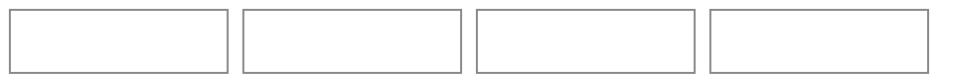
*Navigation is a floating pill at the bottom of a phone, as wide as its five tabs (never stretched edge to edge; each tab has a 51px minimum, 4px of side padding and a 55px height, so all five fit 320px on one line in a 298px pill), and a rail on the left from `lg` up (the content starts 24px clear of it). The app opens to Calendar, the first tab; the active tab gets a soft peach fill and orange on its icon, the only orange in the bar. The tabs' icons are a calendar, a chef's hat, a fridge (Kitchen), a basket (Shopping, the same basket every "Shopping list" action uses) and a gear (Settings, the right-most, so on `lg` the bottom of the rail); each tab button is named "Calendar tab", "Recipes tab" and so on. The Shopping tab (`?tab=shopping`) shows what is left to buy as a small dark badge on its icon, only above zero and as "99+" past 99. A later feature joins the tab it belongs to (stock and the fridge and freezer to Kitchen). Leaving the Calendar for another tab adds one history entry and moving between the other tabs replaces it, so back from any tab returns to the Calendar and back from the Calendar leaves Pinch (two backs at most). Each tab opens where it was left (the top on a first visit), never at the scroll of the tab before; Recipes keeps its pill, search and filters, Kitchen its Yours / All switch, search and filters, and the Calendar the period on screen for as long as Pinch is open. Tapping the tab you are on scrolls it to the top, and tapping it again at the top starts it fresh.*

*From `lg` up the screens use the width: the month's cells become Google-Calendar-style pills that name each meal (its name, else its items: "Adobo chicken & Cilantro lime rice", past three two and "and 2 more") where a phone shows emoji chips, Week is seven columns where a phone has a vertical agenda, and Recipes, Kitchen and the Shopping list run in two columns. The phone layout is unchanged.*

**First launch — Calendar, empty** (no setup steps: Pinch is usable the moment it opens)

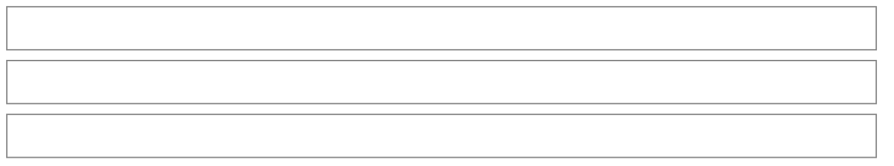
*One tinted card (`EmptyCard`: a 📅 chip, one sentence, one 40px chip) and nothing else: no cost, no average, no help icon, no nutrition prompt, no setup modal, no Month / Week switch and no week arrows (they appear with the first recipe or planned meal, since there is nothing to move through), and nothing in the header either: Plan and the eye (View options) appear with the first recipe or saved meal, since there is nothing to plan or to show until then. "Add your first recipe" opens the same list of ways to start as the Recipes tab's New (a drawer on a phone, the recipe subview's first page from `sm`), and saving the recipe returns to the calendar with a toast that says what was added ("Added Cucumber salad to your recipes", with a Plan it button), since the calendar shows no new row. Once there is a recipe the box is just the line "Nothing planned yet. Tap Plan to put a recipe on a day.": the header's Plan is the one plan action, so the box never repeats it. An empty Week shows the box alone, never seven "Nothing planned" rows. The summary line appears with the first planned meal of the period shown (the box, 112px, gives way to the 40px line). Nutrition stays off until the person turns it on from the eye (View options).*

**Calendar** (home tab)

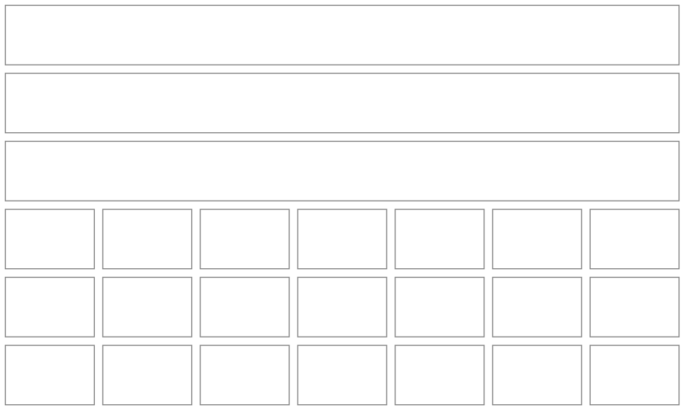
*Below `lg` the calendar opens on Week, starting today (below); from `lg` it opens on Month. The view picked last is remembered on this device for this person (`pinch:{uid}:calendar-view`), and a `?view=week|month` link wins over it (an old `?view=day` opens Week). The grid starts on Sunday because Dreamer UI's `Calendar` can't start a week on Monday, and the wide week's columns start on Sunday to match. Under the header's eye (View options) and Plan, the period row is Pinch's own (the Calendar's own header is hidden): arrows that step by the view's unit, the period's title, a thin Month / Week switch, and a **Today** button that appears only while today is outside the period shown. Each planned meal is a chip on a soft tint of its meal-type colour (🍳 breakfast, 🥪 lunch, 🍝 dinner, 🍿 snack, 🍰 dessert, 🥤 drink), dinner first in a cell (then lunch, breakfast and the rest), so a busy day never hides its dinner behind "+N"; a phone's cell shows emoji chips, with a fourth meal becoming "+N", and from `lg` the chips become Google-Calendar-style pills with the meal's title (its name when it has one, else its first item and "& N more"). Today takes the orange dot on its number and the selected day a ring. Past days read exactly as they were that day. Above the plan sits one summary line for the period shown: "This month · 23 meals · $412.60 so far ⚠ ›" ("This week" for a wide week holding today, "Next 7 days" for a phone's week from today, no period word for another period, whose title already names it; "$412.60" when everything is priced, "so far" and ⚠ while ingredients are left out, "No price yet" while nothing is, "Not priced" for a period that has passed). It adds up every planned meal of the period, ahead of today as well as behind it, so it is a cost and never "Spent", and it is absent while nothing is planned in the period; once every left-out ingredient sits on a day that has passed it reads "$1,805+" instead of "so far". With "Show stats" on in the Calendar's View options (off to start, saved with your account), a row of tiles sits under the line for the period shown, Week and Month alike, and the line stops saying the total so that it is said once: it keeps "This week · 23 meals" and its chevron. The tiles are `StatTile`s: **Total** ("$412.60" over "Total so far" while a left-out ingredient can still be priced, "$1,805+" over "Total" once every gap is on a day that has passed, with a warning icon that says what it leaves out, once), **Avg per fully priced meal** (what the meals with nothing left out cost, over their count, so it never says "so far" or "+"; from three such meals, and under that it is not drawn, since an average of meals that are each a floor reads as a real price) and **Per g protein, fully priced** (while protein is on and three fully priced meals have a protein figure; the same base), worded by the same helpers as the line and the summary sheet so they never disagree. Below them, under a "Daily average" caption, the nutrition switched on shows as `MacroStats` tiles (🔥 1850 · 💪 92g; a phone's are the taller emoji, number and name tiles, which hold five-figure values at 320px). A tile that has nothing to say is not drawn: with nothing priced there is no Total tile and the line says "No price yet" itself, one priced meal draws the Total tile alone, and a period with no meals has no line and no tiles. Three tiles share one height and sit three across down to 320px, a long label wrapping under its number and the numbers stepping down together as the longest grows (never under the caption's 12px; a row of one or two tiles is wide enough for two more characters at full size, and a phrase such as "No price yet" counts for none, since no icon sits beside it), so none runs under the warning icon; at 320px, where a three-across tile holds seven characters at 12px, a total of eight or more ("$12,345+") takes the whole row and the other two tiles share the next (seven or more in a day's drawer, whose tiles are 6px narrower: Taylor's busiest day, "$440.23", has its Total on a row of its own there). Tapping the line or anywhere on the tiles opens the summary sheet (the tiles are one pointer target behind them, so the warning icon still opens its own explanation); a keyboard reaches the line, then the warning icon. Tapping a day opens its drawer; on a computer, hovering a day opens a peek popover with the same content in meal-time order.*

| View | Phone (below `lg`) | From `lg` |
|---|---|---|
| Month | emoji chips on a soft tint, 3 at most, a fourth becomes "+N" | pills with the meal's truncated title (its items, "A & B", past three "A, B and 2 more"), 3 at most then "+N more" |
| Week | an agenda of 7 days starting today ("Today", "Tomorrow", then "Sat, Oct 17"), this week's passed days folded under "Earlier, Oct 11–14 · 3 meals" (only when they hold meals), each day's label opening its drawer, 6 meal rows a day then "N more meals ›" (a row that opens the day) | 7 columns Sunday to Saturday, 5 meals a day then "+N more" |

| Month cell contents | What `renderCell` draws |
|---|---|
| no meals | the date number only |
| 1–3 meals | one chip (or pill) per meal, dinner first, then lunch, breakfast and the rest |
| 4+ meals | the first chips and a small "+N" |
| past day with a cooked meal | shown the same in the cell; the Week row says "Cooked" after a round tick |

**Week** (agenda below `lg`, from today)

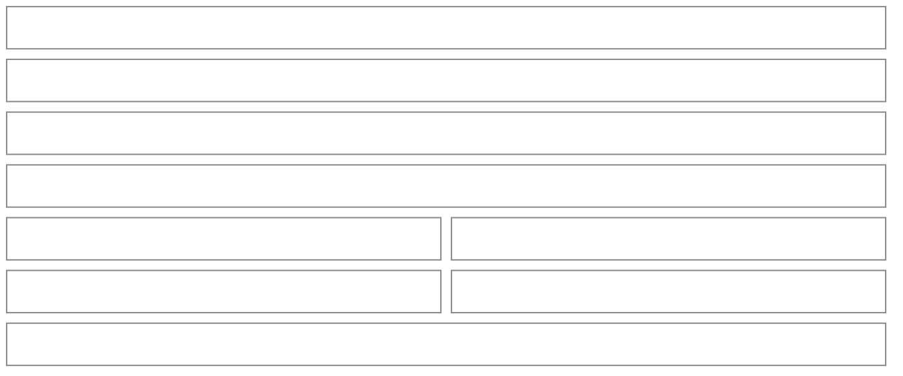
*The week starts today, so tonight is the first thing under the summary line; the arrows step seven days and Today brings it back. This week's days already gone fold under one "Earlier, Oct 11–14" row (the dates of the days it holds, so it never reads as the whole week; collapsed; shown only when they hold meals). Each day's label is a 40px button with a chevron that opens the day's drawer (an empty day's too), centred on the day's hairline with nothing beside it, and today's is an orange "Today" pill. There is no "+" per day (round 7, third note: an icon-only add beside the labelled one a tap away, floating at the far end of the line): planning on a day is the drawer's "Plan on this day", one tap after its label, which opens the plan builder on that day (a passed day and an empty one too), and an empty day is one door over its whole block: the label with its chevron and the muted "Nothing planned" line under it are the one button (its hit area stretched over the 64px block, one tab stop, announced "Open Tue, Oct 20, nothing planned"), so tapping the line opens the day like tapping its name, with no icon or second door beside it (round 7, fourth review). From `lg` a column's weekday and number open the drawer the same way, and an empty column is that button stretched over its whole height. A meal row shows the meal's emoji, its name, its type, "Cooked" after a round tick (the ink circle of a ticked checkbox, never the square ✅) once a recipe on it was marked cooked (today or a passed day), and its cost: "$0.15", "$0.15+" while it leaves something out, "No price yet", and nothing on a passed day with no price (the day's drawer says "Not priced" once). Switching views keeps you on the selected day (or today).*

**Week with Calendar stats on** (the Calendar's View options, off to start and saved with your account; the same row sits under Month's summary line; each tile is its own tap, and the gaps between them do nothing)

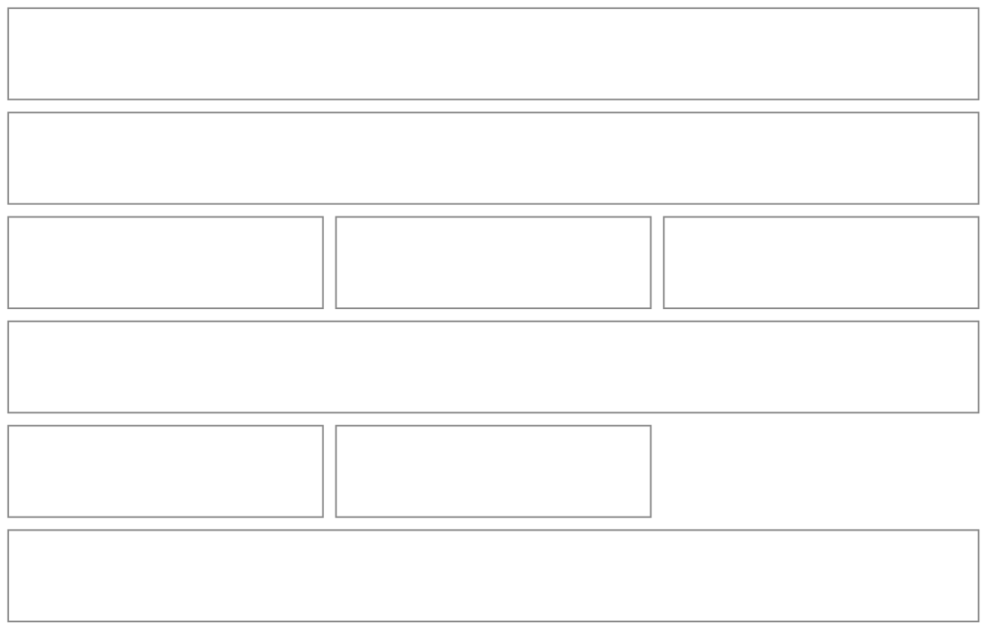
*Per g protein and the daily average show only for the nutrition that is on and known, and the averages only from three fully priced meals, so with every number off the row is Total, and Avg per fully priced meal once three meals are priced in full. The tiles push the plan down by one tile row (about 65px for the Total alone, 80px for three tiles at 390px, 94px at 320px where the longest label takes three lines, and 150px at 320px for a five-figure total that takes its own row) and by the daily nutrition when it shows (about 105px on a phone, where its tiles stack the emoji, number and name); with Calendar stats off the plan starts where the summary line leaves it.*

**Nutrition summary** (tap a calories or macro tile; a drawer on a phone, a modal from `sm`)

*Titled "Nutrition". It opens on the period's daily average in the tiles' own words ("Oct 15 – 21 · daily average"), then the nudge when a figure leaves something out, then one row per day that has meals (Today, Tomorrow or the date, its figures as emoji and numbers, a chevron), each opening that day's drawer. Done is the one footer button, and only the list of days scrolls. A cost tile opens the price summary instead, and the gaps between tiles open nothing.*

**Day drawer** (tap a day; swaps in place to a planned meal)

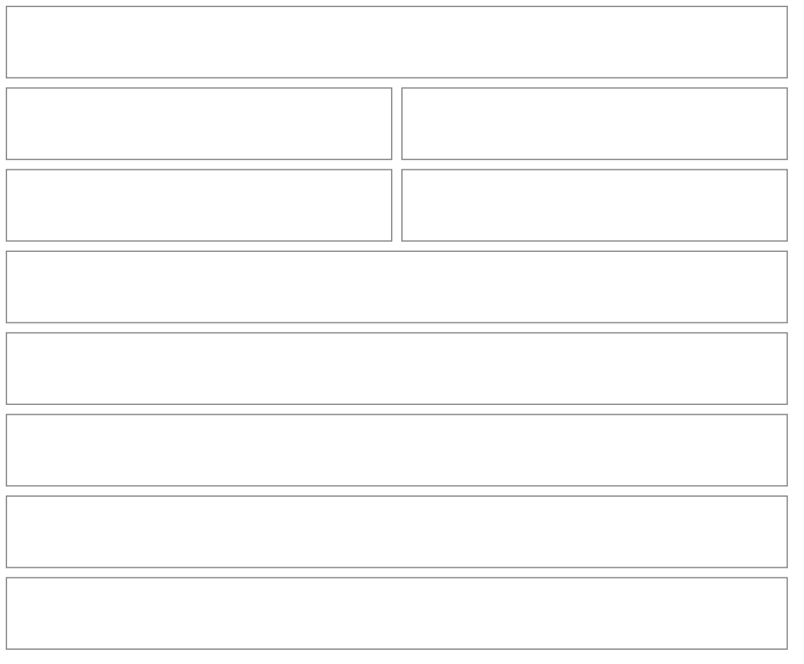
*The title is the weekday and date, led by "Today ·" on today (the hover card a computer shows over a month cell says the same). The meals come first, the subject of the drawer, as one list in meal order (breakfast to drink) built like the Week's rows: the meal's tinted emoji chip, the name it was planned with (two lines at most; "Taco night"; a meal that came from no saved meal is named by its items, "Adobo chicken & Cilantro lime rice", past three "A, B and 2 more"), one muted line under it with the meal ("Dinner") and what is on the plate ("Dinner · Adobo chicken, Cilantro lime rice" under a name, "Dinner · With Banana, Salsa" for the items a counted title leaves out, the servings of a single item, the meal alone when the title names every item), its price and a chevron on the title line. There are no group headings: the chip and the word on the second line say the meal, and the headings and the gaps between groups are gone. A meal on today or a day behind you whose recipes are all marked as cooked ends that line with the round tick and "Cooked". A row's price says "$9.10+" when it leaves an ingredient out and a quiet dash when nothing is priced. A day with no meals says so in one muted line ("Nothing planned yet. Plan a recipe, a saved meal or a single ingredient.", "Nothing was planned on this day." for a passed day), and the footer's one button is "Plan on this day". After the meals come the day's figures: the Total tile is the Calendar's own tile for one day (`getPeriodTotal` of that day alone, so its figure is the one the week's summary sheet lists for it): "$18.40" over "Total so far" while ingredients are still unpriced (its warning says what it leaves out, in the Calendar's words), "No price yet" over "Total" when nothing is priced, and on a past day "Not priced" with "Fixed when the day passed" under it ("Priced with today's prices on Oct 14" once the day has been priced again; "Some meals priced with today's prices on Oct 14" when only some of its meals were, such as one planned onto the day later); a past day's partial total reads "$0.15+" over "Total" like its rows, never "so far", since it can't be priced by itself. **The day's other stats** (round 7, third note) follow the Calendar's "Show stats". On, the Calendar's tile row sits under the meals for that day in place of the lone tile (Total, then Avg per fully priced meal and Per g protein, fully priced from three such meals, which a day of a few meals usually lacks, then the nutrition switched on as `MacroStats` tiles under "That day"), with the fixed-day note as a muted line under it, and the drawer says nothing more about the day's numbers. Off (the default), the figures are the Total tile and, when a nutrition switch is on and the day knows that number, the nutrition under it as the same `MacroStats` tiles under "That day", so Settings' numbers hold on a day's front without a tap (round 7, fourth review: they had moved behind a row, a regression from the front the day had before round 7); only when the day also has cost averages (enough fully priced meals for an average) a "Stats for this day" row follows in the day's one framed block of actions, whose subtitle says "Cost averages". It swaps the cost tiles in place with a "‹ Back" chip (Total, Avg per fully priced meal, Per g protein, fully priced; the nutrition stays on the front and is not repeated; Back, Escape and the back gesture each step out one layer, focus returns to the row). Never both at once, and a day with nothing planned draws none of it; the footer keeps "Plan on this day" in every one of these views. The day and its meals carry no "need a price" line: the backlog lives where prices are fixed. In that block, only when today's prices would change what the day shows, a "Price this day with today's prices" row ("Redoes this day's cost and nutrition from today") is described under *Pricing a past day again* below; it has no help icon, since its confirm shows the before and after. From today on, a row of that block reads "Add to shopping list" with how many of the day's lines are already on the list for this day ("3 of 13 already on your list", or "Already on your list": the rows its sheet would start unticked), and nothing under it when none is; once every planned meal of the day has put a line there it reads "On your list ✓" with "Add anything that's missing". Either way it closes the drawer and opens the day's sheet. Clearing a line or taking it off the list forgets it. A day that has passed has no shopping row. The block is one hairline frame with its rows divided, drawn only when one of them is, and the day drawer is the one place a day is shopped for and priced again: its meals don't repeat either.*


**Planned meal** (tap a meal in the day drawer; swaps in place with "‹ Back")

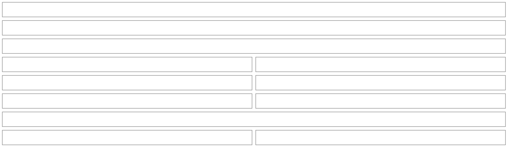
*The view is the meal: "‹ Back" to the day, the name it was planned with as its heading ("🍝 Dinner · Taco night"; a tweaked day keeps the name; a plate that came from no saved meal is named by its items: "Adobo chicken & Cilantro lime rice", three in a list, past three two and "and 2 more", a name over 30 characters counted instead, and "N more" never split across lines, so the heading wraps before it), then "On the plate" as one framed block of rows with each item, its servings and its price ("$0.08+" when it leaves something out, a dash when it has none), and nothing between the name and the plate. A recipe that still exists is a row with a chevron that opens that recipe in place, under the same heading with its own "‹ Back" (the recipe's front: source, description and facts, ingredients, steps, keeping it, cost and macros, with no footer, since its actions live on its own drawer); an ingredient, or a recipe that was removed, is a plain row. Each recipe item carries its own "Mark as cooked" on today or a past day (below), under its row. Under the plate come the Cost tile (its warning icon says what the total leaves out and where to add the prices: from the plate's recipes, or in Kitchen for a plain ingredient; a frozen day's says a price added now counts from today on) and, when nutrition is on, the plate's calories and macros as emoji tiles: figures that don't change what you do on opening the meal. The footer is Modify (secondary), ⋯ More and the one primary, which is the next step for today: "Eat from fridge" when a box of the meal is due today or tomorrow and nothing is cooked yet, otherwise "Start cooking". A day ahead, a cooked dinner and a past one have no primary, so Modify fills the row beside ⋯ and stays an outline (a filled Modify would read as the next step when there is none); a past day has no Modify either (its meal is fixed), so the footer is one wide "⋯ More". ⋯ More swaps the view in place (‹ Back, the meal's name as the same heading, then "What would you like to do?" over one framed block of the recipe More's roomy rows, each with its chip, a chevron and a line under it, filtered by the meal's day by `getPlannedMealOffer`; the caption and block are left out when no row applies): "Start cooking" ("Steps one at a time, with a timer"; a recipe with steps not yet cooked for this meal, today or a day ahead, and only when it isn't the primary), "Eat from fridge" / "Eat from freezer" ("2 boxes match this meal"; today or yesterday only, never for a recipe already cooked for this meal, never a box this meal's own cook made, a saved meal's box only while nothing is cooked, and not the place the primary already offers) and "Save to Saved meals" ("Keep this plate to plan again"; only for a plate of two or more items that no saved meal already holds, so it goes once saved); then, on its own and in red (its own frame, a soft red chip, no chevron), "Remove from this day" ("Your recipes stay as they are"), always there, behind a confirm. The ⋯ is tinted while More is open and a second tap closes it; Back, Escape and the back gesture step back one view at a time (naming or eating opened from More → More → the meal → the day → closed), and Back puts focus on what opened the view. Saving as a meal swaps More in place for a single name field with Cancel and Save in the footer, and lands back on the meal with a toast; eating from a place swaps in its list of boxes and lands back on the meal once eaten. The planned meal has no shopping or re-price action: both live on its day, one Back away. Start cooking closes the drawer and opens Cooking mode: with one recipe still to cook it opens that recipe at its own servings (the plan's count rides along as "You planned 2 for tonight"); with two or more (recipes with steps that aren't marked cooked for this meal yet) it opens one session holding all of them, in plate order, each at its own servings with its own "You planned 2 for tonight".*

*Cooked: on today or a day that has passed, each recipe in the meal has a "Mark as cooked" chip on its own row of the plate. Tapping it records the cook at the planned servings: now for today, noon of that day for a day that has passed (a passed day is when a person remembers). Then the item reads "(✓) Cooked" (with the servings when the cook's differ) and a small hairline "Not cooked" pill that asks first ("Not cooked after all?", naming the recipe and when it was cooked), because it takes that cook out of the history and can be tapped weeks later. A meal that lists one recipe twice has one row with the servings added up (and cooking either copy finishes into that row's cook), an ingredient has no row, a day still ahead has none, and marking a meal that is already marked says "Already marked" and changes nothing.*

*Pricing a past day again: on a day that has passed, a tinted "Price this day with today's prices" row ("Redoes this day's cost and nutrition from today", true whether or not the day had prices) is in the day drawer, under the meals. It is there only when pricing the day from today's prices would change something: a total, a line, or what it leaves out; a day with nothing planned, one with nothing priced then or now, one already priced again with nothing new, today and every day ahead never show it, and neither does a kitchen that is still loading or whose data failed to load. The row has no help icon: its confirm previews the result. (Pricing again reads today's recipes as well as today's prices, so the row can appear on a day that used a recipe edited since, even when no price changed.) Tapping the row asks first, on top of the drawer (a destructive confirm is the one thing allowed there): "Use today's prices for Oct 12?", which shows the result before anything is written: two lines, "Before" (the day's cost as its tile reads it: "$10.66" or "Not priced") and "After" ("about $0.66", or "Still no price"), each figure on one line and never broken, a line "2 ingredients still have no price" only when that is above zero, and "This redoes Oct 12's cost and nutrition from today's prices and recipes. You can't undo it. Your meals stay on the day." The figures are worked out from the loaded kitchen when the row is tapped, with the function the write uses, and read "about" because the write reads the meals again. The buttons are "Cancel" and "Use today's prices". Cancel changes nothing. Confirming re-prices every meal of that day in one go, with no Undo (the old numbers are replaced), the row is disabled until the write settles, the drawer stays open on the day so its tile and rows change in front of the person, and a toast says "Oct 12 now uses today's prices" ("Oct 12 already uses today's prices" when another device had just done it). A failure reads as one plain sentence in red under the row, which stays ("Check your connection and try again." when offline, or that the day changed while it was being priced and nothing was changed); it never shows a Firebase error. Meals, their cooks ("(✓) Cooked"), the shopping list and notes are untouched, and the day is not touched again by the app's own freeze.*

**Plan a meal** (subview; also the editor for an already planned meal)

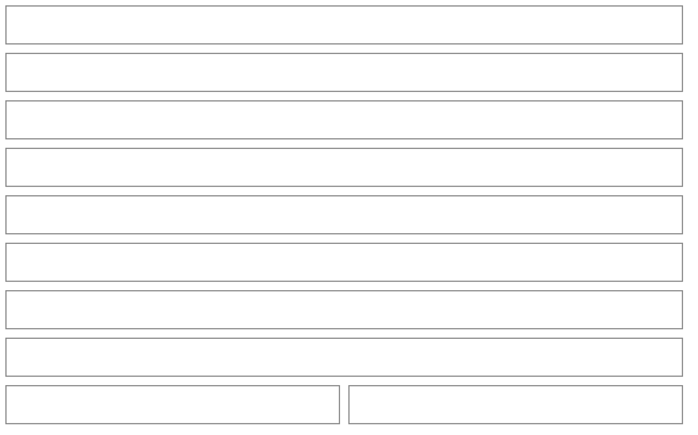
*The header names the thing, as typed: "Plan a meal" until the plate has something, then the plate's name (the saved meal's name, else its items, "Adobo chicken & Cilantro lime rice"). A name the person gave (a saved meal's, or a saved meal's typed name) wraps onto a second line instead of being cut; a name made from the items stays on one line and is cut short, because every dish is named in the plate right under it, so adding a second dish never lengthens the header and moves the recents more than the new plate row (89px, not 121). It no longer carries the slot ("Dinner · Thu, Oct 15"): the first thing under it is one framed **When** row (a 📅 chip, the caption "When", "Today · 🍝 Dinner" and a chevron), the same row in the same place in every state: a new plate, a named plate, planning from a recipe or a saved meal (the day defaults to today and the row says so; nothing opens by itself), and Modify on a planned meal (the primary then says "Save"). Tapping it opens the day and meal editor (`SummaryEditor`: a drawer on a phone or a short screen, a popover under the row from `sm`, each ending in Done; Escape and the back gesture close only the editor): the day as pills (Today, Tomorrow, then the next five weekday names, and "Other day…", which reveals the date box) and the meal type as pills. The row reads "Today", "Tomorrow" or "Sat, Oct 24", then the meal. Clearing the date box leaves the row at "Pick a day" with "A meal needs a day to go on." under it, and the footer says why the primary is off. A new plan starts on the meal the clock suggests today (breakfast before 10, lunch before 3 pm, else dinner) and on dinner for any other day. If the day already has that meal, it moves to the nearest main meal the day doesn't have yet. A meal type that was passed in, or that the person picked, stays put. Under "What's on the plate?" comes the one search, then the plate, then the Cost tile, then **the person's own things** as one framed block of roomy rows (at least 64px): "Your recent recipes and saved meals" (the caption names only the kinds it shows) lists the most recently planned, cooked or added first, each with the recipe's cover or a tinted 🍽️ chip, its name, one line of facts (servings, time and cost per serving; a saved meal says "Saved meal", its item count and total) and what is in the fridge or freezer, and a "+" on the right. The prices and the stock line follow the Recipes list's View options. Nothing is preselected: a recipe joins the plate, and a saved meal's items are copied onto it. Six rows show; "Show N more" unfolds up to twelve only when folding would hide more than three, counted when the screen opens: that fold stays through picks until nothing is tucked away (picking one of ten leaves "Show 3 more", never rows 7 to 9 appearing at once), and an unfolded list stays unfolded while something is typed and cleared. The rows stay after the first pick (a recipe already on the plate, and a saved meal whose items all are, drop out of them) and are there when a planned meal or a saved meal is edited, so adding a second dish never means clearing the search; they hide while something is typed. With fewer than five things to offer, an empty plate also gets one tinted line under them that says what to do ("Tap one above, or search for a recipe, a saved meal or a single ingredient. It goes on the plate."), so a small kitchen's screen isn't a void. A plan started from the calendar puts the cursor in the search once the screen has settled, but only on a device with a mouse and keyboard; on a touch screen the keyboard stays down, so the recents and the footer are in view when it opens. A saved meal's Name row still opens by itself, since the name is that screen's question. The one search finds saved meals (🍽️, "Saved meal"), recipes (🍲, with what is in the fridge or freezer under the title) and ingredients, each with a small kind label, in one framed block. A search with no match is one framed block too: a line ("Nothing called “zzz” yet. You can add it as a new ingredient.") over the "New ingredient" row. A saved meal picked onto a plate that already has items adds its items, skipping ones already there, up to the 10-item cap. A picked recipe joins the plate at its own servings (the caption says "The whole recipe" until the count is lowered, then "Recipe serves 4"), and an ingredient joins with one serving. The plate is one framed block of rows: a leading chip (the recipe's cover or 🍲, 🥕 for an ingredient), the name on the first line (it wraps, never truncates) with the remove control beside it, and beneath it a compact `Stepper` for servings (halves allowed) with what one serving is ("servings · 1 serving = 28 g", "Recipe serves 4"; "serving" when the count is 1). A tinted summary with a hairline edge (so it holds its shape in dark) under it shows the cost, a warning icon that says what it leaves out (a small help modal on a phone or touch screen, a tooltip with a mouse, never a fill-in sheet) and the plate's emoji macros when nutrition is on. The pinned footer says why the primary is off, above the buttons: "Add something for the plate", "Pick a day first" or both together (under 450px of height, a landscape phone, the note is not drawn and the disabled primary says it itself, so the footer is 65px instead of 89 and more of the recents shows above it). The primary says "Plan for today", "Plan for tomorrow", "Plan for Thu" in the coming week and "Plan for Tue, Nov 3" further out; Modify says "Save". After planning, the builder closes and the toast says where the meal landed: "Planned Taco night for Thu · View" ("Saved … for Thu · View" after Modify). View opens the Calendar's week on that day, except while a full-page screen or a drawer is open. Leaving (the header's back, Cancel, Escape, the back gesture) closes at once when nothing was changed (a new plate with nothing on it, an edit left as it opened) and otherwise asks "Discard this meal?" ("Discard your changes?" for an edit) with "Keep editing" and a red "Discard": a plate, a saved meal's typed name, or a planned meal's moved day or meal counts as work; an open When or Name editor takes the first press, and a second press while the question is up only dismisses it. Adding a one-item meal is the same screen with one row.*

**Recipes tab**

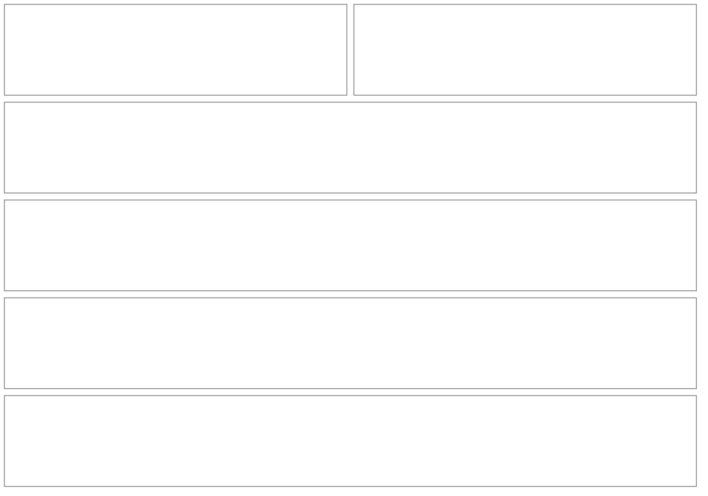
*Up to three thin pills switch between Recipes, Saved meals and Ideas, and each arrives with its data: Saved meals once there is a saved meal or a second recipe, Ideas once there is an idea (or when ideas couldn't load, so the reason shows), and with only Recipes there is no pill row at all. The header stays "Recipes" whatever the pill shows and its button follows the pill and names what it makes, in one shape with one icon ("+ New recipe", "+ New saved meal", "+ New idea"; the longest fits beside the title on one line at 320px, so no label drops to an icon); the eye button belongs to Recipes and Saved meals only. Beside "+ New recipe" sits a quiet 📖 icon button named "Sources" (a hover title says so too), the same 40px circle the Calendar header pairs with Plan: it is the way into the Sources screen, so it shows only in the Recipes view and only once a source exists (none on a first run, in Saved meals or in Ideas, where the New button keeps its place at the right edge). The pills are one 24px row on all three and never carry the eye. Until a source exists or something is put away to filter by, the View options eye sits in the header cluster (the 28px icon between Select and New) whatever pills are shown, so neither a pill row nor one recipe ever draws a row for a lone eye (it appears once the shown list has something in it, so an empty Recipes or Saved meals list has no eye); the search field shows from 8 recipes. Once any source exists, or something is in the fridge or freezer, Recipes gains a search field with a filter button and the same eye beside it. Saved meals show a search from 8 saved meals (and the In stock filter once something is put away). The search looks at each recipe's title, its ingredients (and their other names), its source and its description, titles that say it first, so "garlic" finds the adobo. With nothing in the chosen scope it says where the match is instead of "nothing": "Nothing from Serious Eats matches “garlic”, but 2 other recipes do." with Clear filter, or "No recipe matches “lemon bars”, but 2 ideas do." with Show ideas (Show saved meals and Show recipes likewise); only a search nothing matches anywhere says "Nothing matches “…” yet." A recipe row shows its cover (or a tinted emoji tile), its title, a muted line of servings and time, then a cost per serving line and calories and macros per serving as emoji figures, the last two only while shown (View options) and, for macros, switched on. A recipe with an unpriced ingredient shows the cost it can stand behind with a plus ("$1.35+ per serving"); one with no price at all says "No price yet". A saved meal row shows its item count and total in the same words ("2 items · $0.15+"), macros when shown, and its items as a comma line. A recipe row no longer says how often it was cooked; the drawer does. In every row the cover or tile and the text share a top edge, and the chevron sits on the first line.*

**View options** (the eye button: a drawer on a phone, a popover from `sm`; Kitchen's ingredient list has the same one, and the Calendar's header has one with "On the calendar" ("Show prices") and the door to Settings, drawn as the shared 28px header icon 12px from Plan; Recipes draws the same icon in its header cluster, between Select and New, whenever no filter button sits beside a search field; with one, the eye is the 48px round beside the field, matching the filter button)

```mermaid
%%{init: {'theme': 'base', 'themeVariables': {'primaryColor': 'transparent', 'primaryBorderColor': '#888888', 'primaryTextColor': '#333333', 'lineColor': '#888888'}}}%%
block-beta
  columns 2
  V1["View options"]:2
  V1h["ON THIS LIST (ON THE CALENDAR on the Calendar)"]:2
  V2["Show prices (on the Calendar: each Week meal row)"]:1
  V3["◉ on"]:1
  V4["Show calories and macros (only while a number is on)"]:1
  V5["◯ off"]:1
  V5b["Show what's in stock (Recipes and Saved meals only)"]:1
  V5c["◉ on"]:1
  V6["Nutrition numbers (Kitchen only, once a number is on)<br/>Per serving   [ Per 100 g ]"]:2
  V6c["🔥 Calories and macros · Switch them on in Settings  ›<br/>(the last row: in place of the switch above while every number is off, 🔥 Your numbers · Choose which in Settings  › once one is on; on the Calendar the same door, after its "Show stats" and "Show prices" switches)"]:2
  V7["Reset  ·  Done"]:2
  style V1 fill:transparent,stroke:#888888,stroke-width:1px;
  style V2 fill:transparent,stroke:#888888,stroke-width:1px;
  style V3 fill:transparent,stroke:#888888,stroke-width:1px;
  style V4 fill:transparent,stroke:#888888,stroke-width:1px;
  style V5 fill:transparent,stroke:#888888,stroke-width:1px;
  style V6 fill:transparent,stroke:#888888,stroke-width:1px;
  style V6c fill:transparent,stroke:#888888,stroke-width:1px;
  style V7 fill:transparent,stroke:#888888,stroke-width:1px;
```
*The switches are `AppToggle`s and take effect at once. The four nutrition switches every screen follows (calories, protein, carbs, fat; all off to start, saved to the person's kitchen document, so they follow them to other devices) are in the Settings tab's Numbers group, not here: a list's sheet ends with a tinted door row, "Calories and macros · Switch them on in Settings" in place of the macros switch while every number is off and "Your numbers · Choose which in Settings" once one is on, which closes the sheet the way a back gesture does and then opens the Settings tab as a tap on it would (back from Settings goes to the Calendar, like from any tab) and puts focus on the Settings screen; every door is one line at 320px and in a 286px popover, and on a landscape phone under 600px tall View options is a drawer with Done pinned, as on a portrait phone, its rows in two columns so the door never falls under Done. The first number switched on in Settings also turns the Recipes and Kitchen lists' "Show calories and macros" on, so turning calories on from Kitchen is the eye, the door and Calories (the number shows in the Calendar's stats tiles while "Show stats" is on, in the summary sheet either way, and in a day's drawer on its front under "That day", with the stats on or off). Under "On this list", "Show prices" hides the cost on recipe and saved-meal rows and the store, price and size line on ingredient rows, and "Show calories and macros" hides the emoji figures; it is drawn only while a number is on. On Recipes and Saved meals "Show what's in stock" (on to start, with "The fridge and freezer line under a recipe or meal" under it) hides the stock line on every row without touching the In stock filter or the drawers. The "Nutrition numbers" pills (Per serving / Per 100 g, for ingredient rows only) appear only while a number is on. "About the numbers" (USDA FoodData Central, Logo.dev) is the last line of Settings' Numbers group. Defaults are prices on, macros off and per 100 g, so a list starts short. A row is only as tall as the lines it shows: an ingredient with just its name is about 44px, with a price line about 60px, and recipe and saved-meal rows are as tall as their cover or tile (about 72px) until a price or macro line makes them taller. Once a choice on the list differs from its default the eye button takes a soft tint and "Reset" appears (in the phone drawer's footer beside Done, at the bottom of the popover). The rows' choices are remembered for this person on this device (`pinch:{uid}:view:{recipes|ingredients}`; Recipes and Saved meals share one), so they are not on another device. A hidden line is simply not drawn: a total, a drawer and a fill-in sheet are the same with or without it. On the Calendar the section is "On the calendar" and holds two switches. "Show stats" ("The total, averages and daily nutrition, as tiles"; off to start, saved with the account so it follows the person to another device) draws the tile row under the summary line and in a day's drawer (off, the drawer's front keeps the Total and the nutrition and a "Stats for this day" row holds the cost averages) and hands the summary sheet's reference rows to it, so the averages show in one place at a time; it is drawn only while the settings document has loaded. "Show prices" ("On each meal in the Week view") hides the price on each Week meal row and nothing else (the summary line, the Week summary and the day drawer keep theirs). A door row ends the section ("Calories and macros · Switch them on in Settings" while every number is off, "Your numbers · Choose which in Settings" once one is on). "Show prices" ("On each meal in the Week view. Kept on this device.") is remembered on this device under `pinch:{uid}:view:calendar`; the Calendar's Reset restores it and leaves "Show stats", which is saved with the account and so never changes because of a button pressed on another device, to its own switch; the eye takes its soft tint only for the prices. The round 7 "Show averages" switch (on to start) is gone: a stored `showAverages` or `showStats` is ignored, so the Calendar starts quiet for everyone and the person turns the tiles on once, and the next time the device options are saved the old keys are dropped.*

**Sources and the Source filter** (the Sources screen is reached from the 📖 icon in the Recipes header, which shows once a source exists; the filter shows once a source exists too)

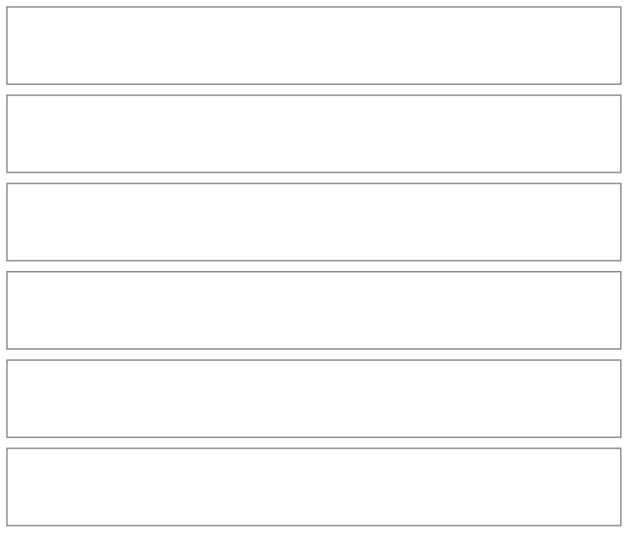
*A source is just a name for where a recipe came from, made where it is used: in the recipe form's "Where it's from". The 📖 "Sources" icon in the Recipes header opens the Sources subview (a `Subview`), which opens with a tinted card ("Where your recipes come from. Rename one and every recipe from it follows.", while there are fewer than eight sources; a long list starts with its rows) and lists the sources A to Z, each row with how many of the listed recipes it has and the first two titles ("2 recipes · Adobo chicken, Nachos", "3 recipes · Adobo chicken, Nachos and 1 more", one line, cut at the end), and a search from 8 sources. Every row is one tap target ending in a chevron, a source on no recipe included, and opens the Source sheet (a drawer on a phone, a modal from `sm`, titled "Source"); there is no pencil: the row itself is the way in, and focus returns to it when the sheet closes. The sheet starts, for a source that has recipes, with a roomy row with a 📖 chip, "Show the 3 recipes from Serious Eats" ("Show the recipe from Serious Eats" for one) and a chevron: it closes the sheet and the subview and leaves the Recipes list on the Recipes pill with the search and the In stock filter cleared and the Source filter on that source (the chip "From Serious Eats" names it and clears it; one back press from there leaves the tab as usual). A source on no recipe has no such row and says "Not on any recipe" there (the one delete is the trash in the sheet's footer, a destructive confirm: "Delete “NYT Cooking”? It isn't on any recipe, and this can't be undone."). A source left behind when a recipe moves to another one shows up the same way. Then one Name field, the trash at the bottom left, Cancel and Save. A name another source already has, ignoring case, disables Save and says so in the pinned footer ("You already have a source called “Serious Eats”."). Deleting asks first, over the sheet (a destructive confirm): "Serious Eats" is on 2 recipes. They stay, and only lose this label. When no recipe has it the confirm says "It isn't on any recipe, and this can't be undone." The Recipes tab's filter appears once any source exists (or something is put away): a filter button beside the search field opens a drawer on a phone and a popover from `sm` with the Source question as pills, or the line "None of your recipes has a source right now." while no recipe uses one: "Any", each source that at least one recipe has with its count ("Serious Eats · 3"), and "No source · n" only when some recipe has none (a search is added past 12 pills). The question has no link to the Sources screen: that is the header's icon, one door for the one moment. A picked source shows as a chip under the search field ("From Serious Eats", with its ✕ and Clear); with nothing to show the list says "No recipes from Serious Eats yet." or "Nothing from Serious Eats matches “nachos” yet." with a "Clear filter" button. The way to the sources lives on the Recipes screen, not inside a recipe's drawer (the owner's call): the drawer has no door to the Sources screen. What the drawer does carry is the recipe's own source, as a soft pill under its title ("From Serious Eats ›"; the owner's third round-7 note); a tap closes the drawer and leaves the Recipes list on the Recipes pill with the search and the In stock filter cleared, the Source filter on that source and the page scrolled to the top so the chip is in view, whichever pill the drawer was opened from (Ideas' "Open the recipe" too). A source with only this recipe gives a list of one, like its row on the Sources screen. A recipe with no source draws nothing, and Modify's "Where it's from" still changes it. The header icon and the Source question leave when no source exists, and saved meals are never filtered by source.*

**Collections and Favorites** (a recipe's Collections row, Recipes' Collections question and sheet, the drawer's chips, the star on a recipe and on a saved meal, and Select with "Add to a collection")

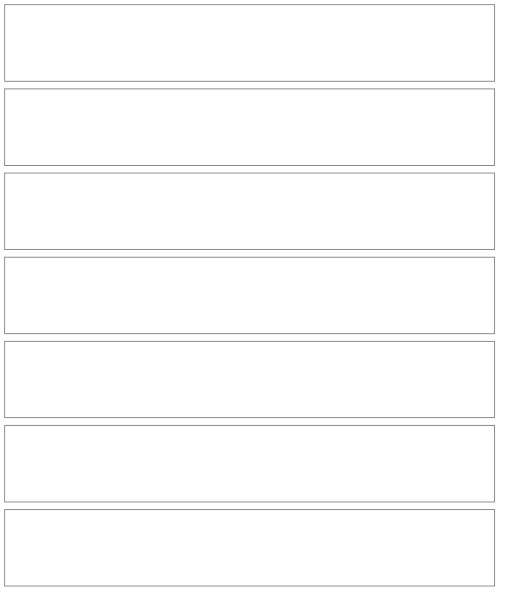
*A collection is a name the person makes for a set of recipes ("Bulk", "High-protein", "Weeknight"), and a recipe can be in many. The word is "collection" because "group" already means a heading on an ingredient list; it comes from two constants, so renaming it is one edit.*

*In the recipe form it is one summary row after "Where it's from" ("Collections", then "High-protein, Weeknight" or "Add to a collection"), on every recipe, new or old. It opens a drawer on a phone and a popover from `sm` with no field focused (so no keyboard covers the pills): every collection as a pill (a search and "Show all 50" past a dozen, the same rules as every pill row), a dashed "+ New collection" first that reveals a name field and an Add button (Enter adds, and never closes the editor or saves the recipe), and Done. With no collection yet the editor says what one is in a line and shows the name field at once. Under the pills, "Suggested for this recipe" lists dashed chips, only for a recipe whose own numbers say so and that isn't in it already: High-protein (25 g of protein a serving, shown in whole grams, from the person's typed number or from a sum in which every ingredient's protein is known), Quick (prep plus cook of 30 minutes or less, both given) and Freezer-friendly (its storage notes say it freezes). A tap puts the recipe in that collection (making it, in the recipe's own save, if there isn't one of that name yet), nothing is ever added on its own, and while the recipe is in none the closed row reads "Suggested: High-protein, Quick" in place of "Add to a collection". A name typed that matches a collection that exists (ignoring case, spaces and hyphens) picks that one; a recipe can be in 20 and a person can have 50, and the editor says so at the cap.*

*On Recipes, a Collections question joins the filter once any collection exists: a pick-one pill row (each collection that holds a recipe, with its count; "No collection · n" only while some recipe is in none), a chip "In High-protein" when it is on (the way to take it off), and a pencil on the question's title line. The pencil closes the filter and opens the Collections sheet: a drawer on a phone and a modal from `sm`, a tinted card ("Sets of recipes you make yourself. Rename one and every recipe in it follows. Deleting one never deletes a recipe.", under eight collections; a search from eight), then a framed list (a leading 40px chip, the name, a line of whole recipe names on up to two lines, never cut mid-name: "2 recipes · Adobo chicken and Cilantro lime rice", "3 recipes · A, B and C", "5 recipes · A, B and 3 more", or "Not on any recipe", and a chevron; a row is 88px at 390×844 with two lines, the same anatomy as the drawer's collections view) that scrolls on its own, and Done in the pinned footer. A row swaps its name field and a trash into the sheet in place with ‹ Back; the delete is a destructive confirm that says how many recipes it is on and that they stay, and a toast says how many it came off. Collections are not made here, only where they are used, in the recipe form.*

*A recipe's drawer puts where it is from and its collections on one pill row, never two (Adobo's ingredients start 142px under the title at 390 and 320, where a source and two collections wrapped to two rows and put them 176px under it): the source pill first, then one collection pill. A recipe in one collection shows it by name (a door, with a chevron, only while the collection holds other recipes: it closes the drawer and shows the Recipes list filtered to it; alone it is a plain label); a recipe in several shows "In 2 collections ›", which swaps the drawer in place to a short list of their names, A to Z, as roomy rows under "‹ Back" (a 🗂️ chip, the name and one line: "With Chili and Soup", "With A, B and 3 more" or "Only this recipe"; a row is a door to the filtered list while its collection holds other recipes; one holding only this recipe is a quiet state row with no chevron, since its list would be a list of one, and so is every row where the drawer has no list under it, as the Pantry's drawer). The source's name is cut in the middle before the row can wrap.  The drawer has no fourth group and says no fact twice.*

*Recipes and saved meals carry a star. A 40px icon-only star sits on each row, beside the chevron on the title's line (and on the drawer's title line, for a recipe and a saved meal alike); it fills in orange when on, keeps one button, `aria-pressed`, and a tap writes only the star. Starred meals list first (the Recipes list, the plan builder's search, the container form, anything that lists saved meals), each group in its own order, and the plan builder's recent rows lead with them; starred recipes list first on Recipes within the current order (alphabetical). With eight or more recipes (or saved meals; the list's own search rule, since fewer already show the starred ones first and have nothing to narrow), a starred one also brings the filter button with a Favorites question (one "★ Favorites · 2" pill and a chip "Favorites" when on).*

*Select on Recipes files many recipes at once. A 28px round Select icon (accessible name "Select recipes", 40px tap area, 12px from its neighbours at 320) sits in the header beside the 📖 Sources icon once there are two recipes in the list; the Saved meals and Ideas views have none, and "+ New recipe" drops to its icon under 360px so the header stays one line. In the mode the title reads "Select recipes" and then "3 selected", the view pills step aside, one thin pill, "All shown" ("Select all shown" from `sm`), ticks whatever the search and filters show (so narrowing first, to "Chicken" or to one source, is how a hundred recipes are picked; under 500px tall and from 420px wide, a landscape phone, the pill moves to the title row beside Cancel and, while nothing is typed or filtered, the search row steps aside, so one full row sits above the footer at 844×390 where none did), every row carries a round tick and a tap ticks it, Cancel, the header's gesture and Escape each leave the mode one layer at a time, and a pinned footer (taking the phone's tab bar's place) holds one filled button, "Add to a collection", off with "Tap the recipes you want to add." until something is ticked. It opens the Collections picker in a drawer on a phone and a modal from `sm`: "12 recipes selected. Pick the collections they go into, or name a new one.", the same pills and dashed "New collection" as the recipe form (no suggestions), and a footer "Add 12 recipes", off with "Pick a collection first." until one is picked. A recipe is written only with what it lacks, up to the 20 collections a recipe can be in; the toast names the count it really wrote ("Added 10 recipes to Bulk and Weeknight") and, in one line, what it left alone ("3 were already in it. 2 are in 20 collections, the most a recipe can be in."), with an Undo for six seconds that takes off only what this act added (and deletes a collection it created once no recipe is in it) and says how many it could not when a recipe changed since. When nothing was written the picker stays open and says why in itself ("Nothing was added. 4 were already in it."), and a failure shows there too. Back over the picker closes it only, and the next press leaves Select.*

**Ideas** (the third pill on the Recipes tab)

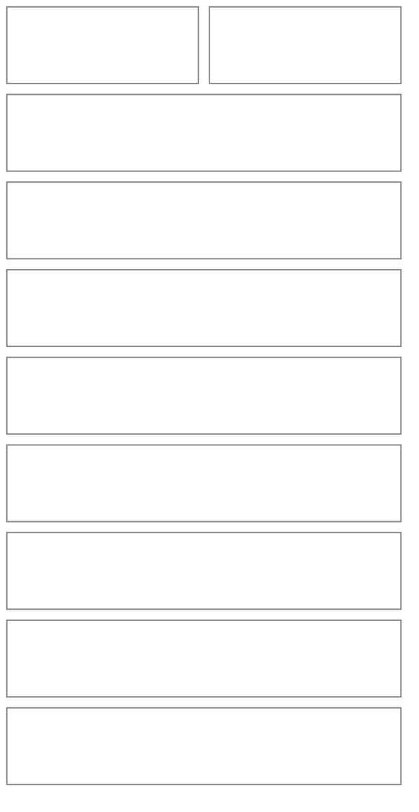
*An idea is something you'd like to make someday: a link, a photo, or a few words. The list is newest first. Once any idea has become a recipe, a hairline divider labelled "Still to try" separates the two groups, and "Made into recipes" (ideas whose recipe is still on your lists; a deleted or archived recipe puts the idea back among the ones still to try) comes after. A row is a 56px picture (a link's own picture, a photo, or a soft tile with 🔗, 📷 or 📝), a title of up to three lines, and one muted line: the site of a link, otherwise the first line of the note (never one that only repeats the title, as a link saved with its host as the title would); the picture and the title share a top edge and the chevron sits on the first line, and a row is as tall as its lines, never shorter than its picture. From `lg` the rows run in two columns. An empty list is one warm line: "Saw something you'd like to cook someday? Keep it here." A search (title, site, note) shows from 8 ideas, with "Nothing matches “…” yet." when nothing does. At 200 ideas "+ New idea" gives way to "Your list holds up to 200 ideas. Delete one to add another." While the ideas load the list says "Loading your ideas…" and "+ New idea" is dimmed; if they can't be read, the list says "We couldn't load your ideas just now. Check your connection and try again." and the button stays dimmed; Recipes, Saved meals and Kitchen carry on. An idea whose save hasn't reached the server after a moment (no signal) says "Saves when you're back online" in place of its muted line, until it goes through.*

**New idea** (a drawer on a phone, a modal from `sm`: one sheet whose view changes in place)

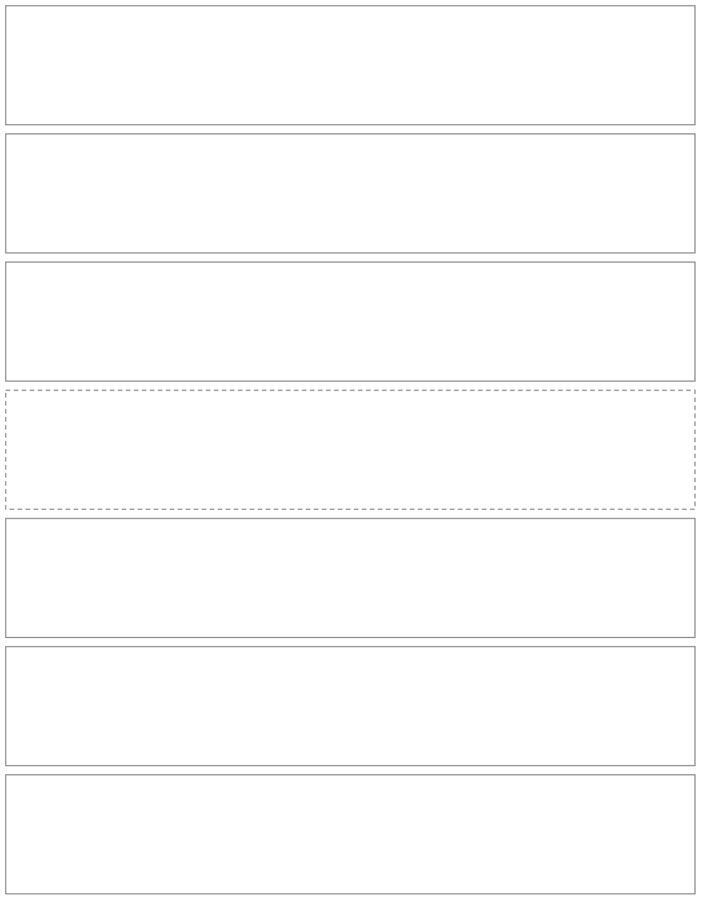
*The list of ways only picks (the shared `MethodPicker`, rows only, the manual way last and quieter); a way's own view takes its place in the same sheet with a "‹ Back" chip to the list, so there is never a second overlay. Each way is titled "Idea", asks its one question, ends in Cancel and "Save idea" (disabled until valid), and has no required-field asterisks. **From a link**: one field (a web link; stray spaces are dropped, `https://` is added when missing, and anything that isn't an http or https address says "That doesn't look like a web link. Paste the address from your browser."; a paste with words around one link gives the link, and two links say "That looks like more than one link. Paste one at a time."). After a short pause the page is looked up ("Looking up the page…" while it runs, six seconds at most) and a preview appears: the page's picture, a "Looks like" title the person can change, and the site name. If the page can't be read or is slow, the title field is empty with the site's address as its placeholder and "Couldn't read that page. You can type your own title." (a page that answers with no title gets the same field and "That page didn't give a title. You can type your own."). "Save idea" is off, with "Looking up the page. You can save in a moment." in the pinned footer, until the lookup has settled (a result, a failure or the six-second limit), so a link is named after its page or the person is asked; a title left blank after a failed lookup keeps the site's address, and a typed title is never replaced by a late result. A link already on the list (however it was spelled: with or without `www.`, a trailing slash or tracking parameters) shows a tinted "That one's already in your ideas" with an "Open it" button, which opens that idea instead, and Save is off. **From a photo**: a 96px picture tile with "Choose a picture" (then "Choose another" and "Remove"; images only, up to 5 MB, resized before it is kept), a "Title" field that starts empty with "What is it?", and the footer says "Give it a title to save." once a picture is picked. A picture the browser can't read keeps the form and says "That picture couldn't be read. Try a JPG, PNG or WebP photo." and nothing is uploaded; a failed upload keeps the form and says why in plain words (a lost connection says to check it and try again). Any save failure, in a way or in the edit sheet, is one red line in the pinned footer beside the buttons, and it goes away as soon as anything in the form is changed. **Jot it down**: a title ("Something like Mom's lemon bars") and a note box shown from the start. On the link and photo ways the note is a quiet "+ Add a note" link that opens the box (focused) with a "Remove note" link under it. On a phone the link or title box is focused as the view opens. A link or a few words close the sheet as soon as the idea is checked and written on the phone (it never waits for the server; a refusal that arrives later says "That idea didn't save" in a toast), and the new idea is the top row. A photo uploads first: while it does, the footer says "Uploading the picture. You can close this; it finishes on its own." and Cancel reads Close. The same sheet also opens over any screen from the New recipe list's "Keep it as an idea" row; there it confirms with a toast ("Saved Lemon bars to your ideas", adding "It's on this phone and saves when you're back online." offline), and a link already saved says so without an "Open it" button.*

**Idea details** (drawer on a phone, modal from `sm`) and **Idea** (form sheet)

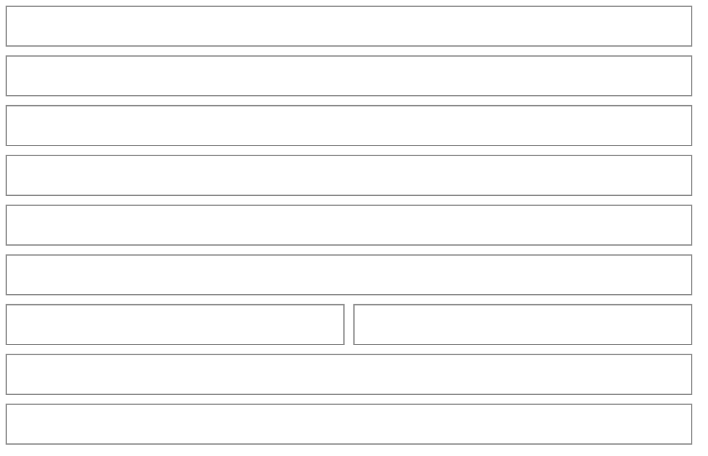
*The drawer shows the idea whole: the picture (a link's own picture, or the photo; an idea with neither, or one whose picture can't load, shows nothing in its place), the title, the note with its line breaks, for a link idea a quiet "Open <site>" row that opens the page in a new tab straight from the tap (with "Opens in a new tab" beneath), and, for an idea that became a recipe, a tinted "Made into <recipe>" row that opens the recipe's own drawer. The footer is Modify (secondary, left) beside the one primary, which takes the leftover width: "Turn it into a recipe", or "Open the recipe" once made. Modify closes the drawer and opens the Idea sheet (a drawer on a phone, a modal from `sm`): Title, the Link for a link idea (a changed link to another page drops the old picture and takes the new site's name; the same page spelled differently keeps both; another idea's page is refused with "That one's already in your ideas."), the picture with "Replace photo" for a photo idea (there is no way to remove it), and the Note. The footer is the trash at the bottom left, Cancel and Save. Deleting asks "Delete this idea?" over the sheet and names it; for an idea that became a recipe it adds "The recipe you made from it, Adobo chicken, stays."*

**From an idea to a recipe** (the Recipe subview, opened by "Turn it into a recipe": on "From a link" for a link idea, on the form for a photo or a few words)

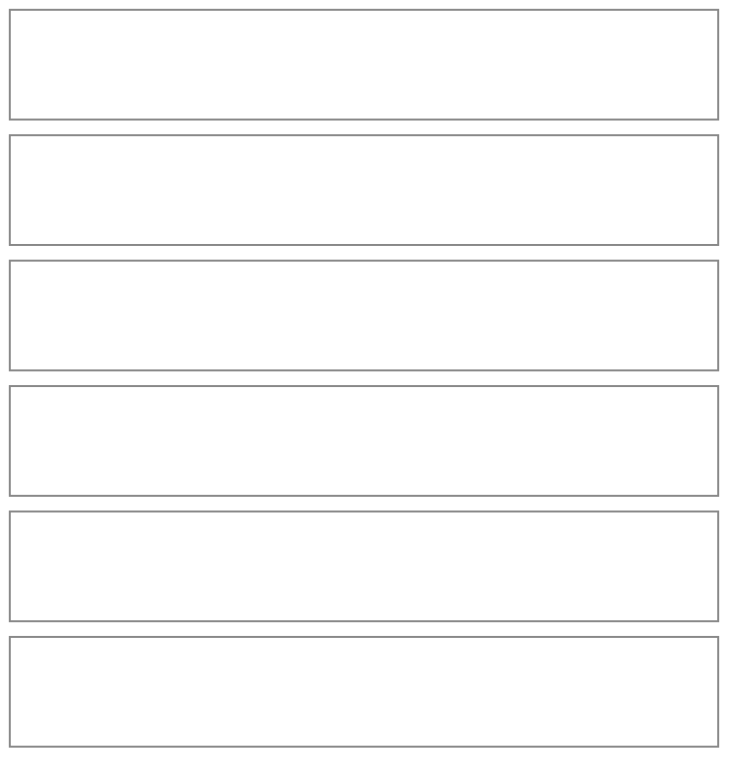
*The primary closes the drawer and opens the recipe subview itself (not the list of ways). For a link idea it opens the link way ("From a link") with the idea's address already in the field, under the card at the top, which opens "From your idea: …" and says "We open its link, and an AI reads the page and fills in the form. You look it over first. Nothing is saved until you save it."; nothing is sent until the person taps "Fill in the recipe", and the reading fills the real form for review (the idea's own title and note are kept, a title that is only the site's name gives way to the recipe's, the website is "Where it's from"). A failed reading names the link and, since the text way isn't one tap away from here, offers only "Write it yourself" (the dashed row); that, and a photo idea or a few words, open the form with what the idea knows: its title, its note as the description and, for a link, the link's website as "Where it's from" (the source already named for its address, such as "seriouseats.com", or "New source" with that address, which is created with the recipe). Back, Escape and the phone's back gesture on the link way return to the Ideas list. The form's header and title row carry the idea's title, so no extra line repeats it; only a photo idea has one muted line, saying its photo stays with the idea and pointing to "From a file". Nothing is saved until the person adds ingredients and saves, and leaving the form changes nothing (an untouched form closes without asking; one with typing asks Keep editing / Discard, like any new recipe). Saving creates the recipe, then marks the idea made in a write of its own, and the idea moves to "Made into recipes". The toast says "Added Crispy smashed potatoes to your recipes" with a Plan it button, and the screen lands on the Recipes pill with search and filters cleared and the new row scrolled into view. If the idea was deleted in the meantime (or can't be updated) the recipe still saves.*

**New recipe — how to start** (a drawer on a phone, the recipe subview's first page from `sm`; editing a recipe skips it)

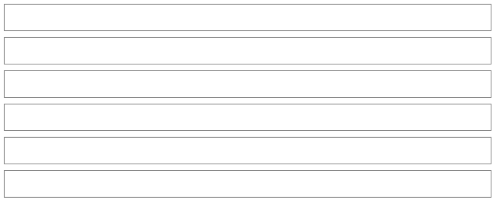
*Four ways in, in this order, with writing it yourself quieter (dashed) and keeping it as an idea last, as a second dashed row, under "Start from something you already have, or write it yourself. You'll look it over before anything is saved." The list is rows only: picking one only picks. On a phone, the Recipes tab's New and the Calendar's "Add your first recipe" open it in a drawer titled "New recipe" (one drawer, kept at the top of the app, so a way's back button can raise it again); picking a way closes the drawer and opens the recipe subview already on that way's screen. From `sm` up it is the subview's first page, with the header's back button closing the subview. Each way finishes on its own screen, never revealed under the list (below), and the header names it ("From text", "From a file", "From a link"). Back (the header's button, Escape or the phone's back gesture) raises the drawer again when the way was picked in it, and returns to the list when the subview opened on it. The last row, "Keep it as an idea" (💡, "Save a link, a photo or a few words for later"), closes the list (or the subview from `sm`) and opens the New idea sheet over the screen, so a person with no ideas yet (no Ideas pill) can still keep one; it is a row like the others, never an underlined link. Each AI reading fills the real form and says so ("Filled in from {your text, the file's name or the page's website}. Take a look before you save." plus "We couldn't read: …"); nothing is saved until the form is. Link reading opens the page on our server (never the person's device) and sends its text and any recipe data to the reader. The form's header names the recipe as it is typed ("New recipe" until then).*

**From a file** (one of the three reading screens; the text and link screens have the same shape)

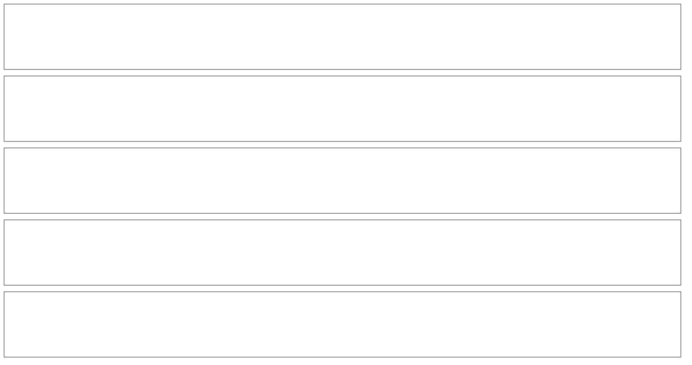
*Every reading screen has the same four parts, top to bottom: a tinted "what happens" card (`IntroCard`: the method's emoji and one paragraph, a plain sentence about what an AI does with it ("An AI reads the page / your text / the file and fills in the form.") and a quieter "You look it over before anything is saved." after it, 66px tall at 390 and 86px at 320, so the input starts 22% and 34% down the screen), so it is read before anything is sent or the file picker opens; each fact is said once (the card says what the AI does, the hint how to get the input, the footer note why the button is off), and the words between the card and the primary at 390×844 are 32 on the link screen (it was 60), 30 on text (42) and 44 on file (49), counting the card, the hint and the dashed row; the input in one framed card under a small caption ("Recipe link", "Recipe text", "Recipe file") with a hairline and one line under it (a hint, or the reading state, or why it failed); the dashed "Write it yourself" row from the list of ways (disabled while a reading runs); and a pinned footer with Back on the left (the header's step) and the primary on the right, whose disabled state says why in a note ("Paste a link first", "Paste the recipe first"). **From text** is a paste box (up to 20,000 characters, said in the hint) and "Fill in the recipe". **From a link** is an address field, a multi-line box that grows on a phone and wraps a long address (Enter does it too, and never types a line break; the hint is one line, "Copy the address from your browser."; an address with no `https://` gets one) and "Fill in the recipe". **From a file** takes a photo, screenshot or PDF: the card is the empty slot, whose title is its action ("Tap to choose a file", with an upload icon, the screen's only paperclip being the card's at the top) over one line of what it takes ("Photo, screenshot or PDF · up to 10 MB", then "or drop it here" from `sm` up); tap it or the footer's "Choose a file", or drop a file on it. Once a file is picked it shows the file's name and size, with the reading state or the failure under it, "Choose another file" as the primary after a failed reading and a "Try this file again" chip (a refresh arrow: the reset arrow means Reset on the other screens). A picked and a dropped file go through one check (`isReadableFile`: a photo or PDF by its type, or by its extension when the browser left the type empty, as HEIC often does), so a wrong type is refused the same way from either, with the slot left empty and nothing sent. The text and link screens carry a quiet "Save as an idea" chip under the card (no AI call; disabled while the field is empty or a reading runs). It swaps the screen in place for the idea's own view, titled "Idea": for a link, New idea's link view with the address already in it (the page lookup, the title preview, "Couldn't read that page…" and the duplicate check as usual, without "Open it"); for text, a title taken from the first line and the text as the note, with one line saying so ("Kept as an idea, with your text as its note. Nothing is read or sent to an AI.", or "…with the first 1,000 characters of your text…" when it is longer). Back, Cancel, Escape and the back gesture return to the reading screen with what was typed; Save idea closes the subview and says "Saved … to your ideas". The chip isn't offered on a screen opened from an idea, or on the file screen (which reads a file as soon as it is picked). On a pointer-and-keyboard screen the field takes focus when the screen opens; on a phone it doesn't, so the keyboard never hides the card. Going back (the header, Back, Escape or the phone's gesture) from a link or text that was typed or pasted asks "Discard this link?" / "Discard this text?" (Keep editing / Discard), since nothing has been read or saved; an address that came with an idea doesn't ask. Leaving by any other door asks the same question, in the same dialog: the dashed "Write it yourself" row ("If you start a blank recipe now, the link is lost") and "Paste its text instead" ("…if you paste its text instead…"). Typed words are not carried into the blank form, because a link has nothing to carry and a pasted recipe is far too long for a description; "Save as an idea" is the way to keep them. With nothing typed (and on the file screen, where a picked file is simply picked again) they go at once, and only one question is ever open: a second door tapped or pressed while it is up does nothing. Keep editing puts focus back on the control the question came from. A reading that finishes after the person went back is dropped, so it never carries them on to the form. **On the link screen** (a new recipe, not one opened from an idea) a fifth part follows the "Save as an idea" chip: "Links from your ideas", the links saved as ideas in one hairline frame of idea rows (three, then "Show N more" past six, ten at most), each a door that puts its address in the box (nothing is read until Fill in the recipe); with no saved link yet there is no part at all (no dashed line about ideas on a first run), and the framed address field grows to the height a phone has left instead. **On the file screen** the dashed box grows the same way. Empty share at 390×844: link 24% to 3% (no ideas) or 4% to 1% (Alex), file 36% to 3%.*

| Reading state | What you see |
|---|---|
| reading | "Reading {your text, the file or the page's website}…" in the card's hint line, with the primary busy |
| the connection or the reader | "We couldn't reach the reader. Check your connection and try again." Offline, the function failing or timing out, or the AI not answering: never a sentence about the link, the text or the file, and no "Paste its text instead" row (pasting would hit the same wall) |
| the reader is busy, or refuses | "The reader is busy right now. Give it a minute and try again." (a 429 or a 5xx from the AI, or the function out of quota); "The recipe reader isn't available right now. Try again later." (a refusal) |
| the link would not open | "We couldn't open that link. Check the address and try again." (the function says the address is bad, the page is missing, or it couldn't load it) with a dashed "Paste its text instead" row between the footer and "Write it yourself" |
| nothing readable | link: "We couldn't read a recipe from that page." (and the row); text: "We couldn't read that text right now. Try again."; file: "We couldn't read that file right now. Try a clearer photo or a PDF." |
| not a link | "That doesn't look like a web link. Check it and try again." before anything is sent |
| too big | "That file is too big to read. Try a photo or a PDF under 10 MB." |
| not a photo or PDF | "That file isn't a photo or a PDF." The slot stays empty and no request is made |
| no recipe found | link: "We couldn't find a recipe on that page." (and the row); text: "We couldn't find a recipe in that text. Try pasting the whole recipe."; file: "We couldn't find a recipe in that file. Try a clearer photo." |

*Every failure is one sentence in the card's hint line, in red, with what was typed or picked kept; details are logged, never the service's message. A failure never points to a screen that isn't there: the two doors it can need ("Paste its text instead" and "Write it yourself") are rows right under it, so no sentence names them. The cause is read from the error (`classifyReadFailure`): offline is always the connection, and a function error is the link only when it says the page could not be opened, otherwise the reader.*

**Recipe** (subview — create and edit)

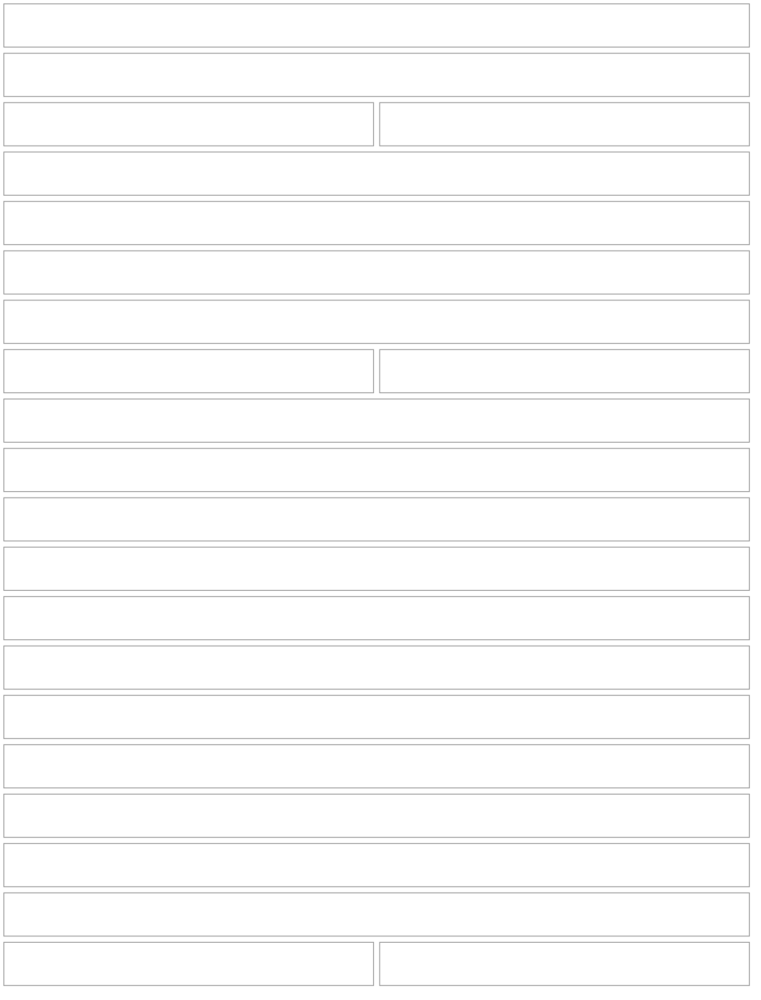
*A recipe needs a title and at least one ingredient. Everything a recipe normally has is part of the flow, not a button at the bottom, in this order: title, servings and times, a description, a photo, the ingredients, the steps and the nutrition, then one framed card of where it's from, collections, how to keep it, links and, on a recipe you have cooked, what changed and why (an icon chip and a chevron on each row, hairlines between, the card's corners following the rows' so it is one object), so the section every recipe needs starts on the first screen (y 460 at 390 when editing the adobo, 436 for a new one). The basics are summary rows, not boxes: Title, Prep and cook and Description each show a small caption, the value (the description cut off after two lines; "Add a title", "Add prep and cook time" and "Add a line about this dish" in muted text while empty) and a chevron, and Servings stays the stepper. Tapping a row opens its editor: on a phone (or a screen under 600px tall) a drawer over the form titled with the plain noun ("Title", "Prep and cook", "Description"), one text box or two ("Prep time" and "Cook time", each with a visible "min"), the cursor in the first, ending in a full-width Done; from `sm` up a popover under the row with the same fields and Done. Enter in a one-line field closes the editor and never saves the recipe, and Escape or the back gesture closes only the editor. A bad value (minutes that aren't whole, text over its limit) shows in red under the row's summary and in the editor, and the footer note says what to fix (a blank new recipe says "Add a title and an ingredient to save."). When an ingredient is what blocks saving, a "Choose" chip has a dashed edge where a "New" chip is plain, since only the first blocks saving; the footer's note is a 28px hairline chip with an up arrow and a 40px hit area (taller where its words wrap at 320px): "Choose the ingredient marked “Choose” to save." (or "Check the ingredient amounts to save.", "Add an ingredient to save.") that scrolls the form to that row (or to Add ingredient) and puts focus on it. A recipe written from scratch opens its title editor by itself once, so typing starts at once; a recipe filled in from a reading, and any existing recipe, opens with every row closed. Photo and "Where it's from" are summary rows too, so the form opens with fewer boxes (a hand-written recipe shows no photo control and no pills until they are asked for). Photo shows a 48px thumbnail (the pot tile while there is no cover), the caption, and "Photo added" or "Add a photo"; its editor (the same drawer on a phone and popover from `sm`, titled "Photo", ending in Done) holds a wide preview, "Choose a photo" ("Choose another" once there is one), "Take a photo" beside it on a touch screen only (the camera; a mouse never sees it), a red "Remove photo" chip while one is set and one line saying a photo under 5 MB is shrunk to fit and saved with the recipe (or, for a photo from the web, where it is from). A new recipe's editor also lists photos found on the web under those buttons: see Photo editor of a new recipe below. A file that isn't an image, or is over 5 MB, shows its sentence in red under the row and in the editor; a photo that fails to upload when the recipe is saved keeps the form and says why in the pinned footer, and a source typed in the same form is not left behind. "Where it's from" is optional and sits after the steps; the row shows the source's name ("Mom's recipe cards") or "Add where it's from", and its editor (titled "Where it's from") holds the sources that are on a recipe as pills (a source no recipe uses is left out, though typing its name reuses it) with a dashed "New source" first (nothing preselected for a hand-written recipe; a typed new name is added together with the recipe when it is saved, and a name that matches a source already there, ignoring case, reuses it; a "Remove source" chip shows while one is chosen), a plain text field in their place until the first source exists, and the line "It shows on the recipe, and you can filter by it." A recipe read from a link starts on its site's source (the one already named for the site, with or without its "www.") or on "New source" with the site's name filled in, which the person can change like any answer; text and files start with none. While the sources couldn't be loaded the section is left out and the recipe keeps the source it had. Ingredients and steps are one-line summaries; the one being edited is the only one open. Ingredients can sit under group headings ("For the chicken", "For the sauce"), each a hairline with the name and a small pencil in the middle (`SectionDivider`): the lines with no group come first with no heading, then each group in the order it first appears, and a recipe with no groups has no heading at all. An ingredient's editor ends with "Group": the recipe's groups as pills after a dashed "New group", nothing preselected and "No group" to take it out, or, in a recipe with no groups yet, a dashed "Put it in a group" chip (`RevealChip`) that opens one text field ("For the sauce") with "Lines with the same group show together under its name." Once the recipe has a group, that line under the pills says how to put one ingredient in two: "Need it in two groups? Add the line again under the other." A line moved to a group goes to the end of it and a new group comes last; a typed name applies as it is typed, since the list is hidden behind the editor. A new ingredient starts in the last group (the one just above Add ingredient) and "Add another" keeps the group of the line before; the search says so ("It goes under “For the sauce”, and you can move it.") and offers an ingredient already in another group, since one ingredient can be in several (soy sauce for the chicken and for the sauce). Tapping a heading opens "Group" (a drawer on a phone, a popover under it from `sm`): its name, which renames every line in it when the editor closes (Done, Enter, a tap outside, Escape or back; a name another group already has makes the two one, which a line says first), and "Remove the group" (a red framed row, `ActionRow` `isDestructive`, its subtitle "Its 5 ingredients stay, with no group."), which takes the heading away at once with "Removed the group “For the sauce” · Undo · 6"; focus comes back to the heading. Removing an ingredient or a step (the same ✕ on both kinds of row, or the red "Remove" in its drawer, which keeps its trash) takes it out at once and shows "Removed Salt" (or "Removed step 3") with "Undo · 6" counting down to 1 above the pinned footer; Undo puts it back in its place, a second removal replaces the first, and the removal stands when the count ends. On a phone each row editor is a drawer that never leaves the form: an ingredient (search, then amount, unit and a "Detail" line, then "Add another" or Done, and "Remove from this recipe", a red framed row like the drawers' other destructive rows, for an existing one; under the amount a dashed "No amount (to taste, a handful…)" chip clears the number, hides the unit and leaves the note to say how much, and an "Add an amount" chip brings the amount back in the ingredient's usual unit), a step (one text box titled "Step 3", which takes the cursor about a third of a second after the drawer opens, once it has slid in; Done, "Add another" only while adding, "Remove step" for an existing one, and a step left blank is dropped when the drawer closes) and the nutrition numbers (four compact fields, Done, and "Reset to what we calculated", which refills the fields and keeps the drawer open). From `sm` up the same sheet is a modal (a screen 599px tall or less keeps the drawer): a row and "Add ingredient" open it, the search results are capped so the field and footer stay on screen, and its footer is Done (with "Add another" while adding) on one row, since an editor in the list blended into the rows around it. A name the reader found is first matched to an ingredient the person has or the catalog lists: the exact name or an alias first; then the same name once descriptive words (fresh, chopped, ground) drop, when only one ingredient is that; then one misspelled word of six letters or more with the same first letter, when one ingredient is clearly the closest; and its prep words ("bone-in, skinless chicken thighs" is Chicken thigh, with "bone-in, skinless" moved to the line's note). "Goat milk" is never "Oat milk", "1% milk" never "2% milk", "coconut milk" never "milk", and words in another order are not assumed to be one product. A name nothing fits and nothing is close to is staged up front as a New ingredient (a small "New" chip, cased like the app's own names, "Gochujang paste", made when the recipe is saved). A name with close ingredients ("shredded lettuce": Iceberg lettuce, Romaine lettuce) waits behind a small "Choose" chip, and its drawer opens on the name (editable), then "Did you mean one of these?" as framed rows (one tap each, keeping the amount), then "Pick from your ingredients", with "Add as new ingredient" as the drawer's one filled button. A New line keeps its chip until the recipe is saved and its drawer still opens on the name: an ingredient made in this form exists only in the form, so it is renamed there (when the new spelling is one the person already has, "Already in your ingredients · Use Olive oil" swaps it), and typing a new name into the "Add ingredient" picker stages one the same way instead of writing it at once. A line the recipe gives no amount ("salt to taste", "a handful of parsley") arrives with no amount and its words as the note, reads "Salt · to taste" (or just "Parsley") on its row, and never blocks Add; a blank amount the person didn't choose reads "Add an amount" and the footer says "Add the missing amounts, or choose “No amount”, to save." Nutrition shows what we added up from the ingredients as small emoji tiles, per serving, for the metrics switched on (with every metric off the form draws no Nutrition section at all, and View options turns them on), with a warning icon when some ingredients have no nutrition info (a small modal on a phone or touch screen, a tooltip with a mouse); Edit opens the numbers that are shown (the drawer on a phone, inputs in place with Done from `sm`), any number changed becomes the person's own and a "Reset to what we calculated" chip brings back the calculated ones. This is a page-sized form, so it is a Subview; the drawers on top of it (and the ingredient modal from `sm`) are the allowed exception to "no overlay on a subview" because they are the form's own row editors, one level deep. Leaving the form while it holds typed or read-in work (the header's back, Cancel, Escape or the phone's back gesture) asks "Discard this recipe?" with "Keep editing" and "Discard" (a destructive confirm); an untouched form closes at once, and saving never asks.*

**Photo editor of a new recipe** (the Photo row's drawer; a popover from `sm`)

```mermaid
%%{init: {'theme': 'base', 'themeVariables': {'primaryColor': 'transparent', 'primaryBorderColor': '#888888', 'primaryTextColor': '#333333', 'lineColor': '#888888'}}}%%
block-beta
  columns 2
  P1["Photo                                   ✕"]:2
  P2["wide preview of the chosen picture (the pot while there is none)"]:2
  P3["[ Choose another ]"] P4["[ Take a photo ]  (touch screens)"]
  P5["( 🗑 Remove photo )"]:2
  P6["From cooking.example.org. Kept as a web link, not a copy, so it can disappear."]:2
  P7["PHOTOS FROM THE WEB                        ( Turn off )"]:2
  P8["Searches the web with this title. Nothing else is sent."]:2
  P9["▢ ▣✓ ▢<br/>▢  ▢  ▢     (3 × 2 thumbnails, 4:3)"]:2
  P10["[ Done ]"]:2
  style P1 fill:transparent,stroke:#888888,stroke-width:1px;
  style P2 fill:transparent,stroke:#888888,stroke-width:1px;
  style P3 fill:transparent,stroke:#888888,stroke-width:1px;
  style P4 fill:transparent,stroke:#888888,stroke-width:1px;
  style P5 fill:transparent,stroke:#888888,stroke-width:1px;
  style P6 fill:transparent,stroke:#888888,stroke-width:1px;
  style P7 fill:transparent,stroke:#888888,stroke-width:1px;
  style P8 fill:transparent,stroke:#888888,stroke-width:1px;
  style P9 fill:transparent,stroke:#888888,stroke-width:1px;
  style P10 fill:transparent,stroke:#888888,stroke-width:1px;
```
*The block exists only for a new recipe whose title has three letters, and only while Settings' "Suggest photos for new recipes" is on. Its heading line carries the one quiet "Turn off" chip (a 40px target; the recipe form is a subview holding typed work, so it cannot open Settings; the toast it raises says "Photo suggestions are off" with an Undo). The line under it says what is sent before anything is: the title and nothing else. The request goes out once the title has stopped changing, so the line is on screen first. While it runs the grid is six empty tiles with "Searching…"; then six thumbnails (fewer when the search finds fewer), each a 40px-plus toggle whose chosen state is a 3px inner border and a check, never a colour alone. A tap loads the full picture once before choosing it: one that can't be reached dims its tile and says "That photo can't be reached right now. Try another one." and is not chosen. When nothing turns up the grid is one line, "Nothing turned up for this title. You can still choose your own photo above."; when the search fails, "We couldn't look up photos just now. You can still choose your own above." (the recipe still saves and the upload is untouched). The preview, the "From <site>" line under the buttons and the Photo row's thumbnail follow the chosen photo; uploading replaces it, choosing another replaces an upload, Remove goes back to none. Tapping the chosen tile again does nothing. At 390×844 the picked state fits with no scrolling; at 375×667 and 320×568 the first row shows and the second peeks (the preview is smaller, and hidden under 600px of height); on a landscape phone the buttons and the grid sit in two columns and, at 500px high or less, the tiles are 56px tall so both rows clear the footer; from `sm` it is in the popover, which scrolls inside itself.*


*Keeping it: the third row of the extras card that ends the form, a summary row like Description. Its caption is "Keeping it" and its value reads "Add how to keep it" in muted text while empty and, once something is filled in, "Fridge 3 days, freezer 3 months, reheating, tip" (days show as weeks or months when they fit exactly; the parts are joined with commas, so a wrap never leaves a dot at the end of a line). The editor is a drawer on a phone or a short screen and a popover from `sm`, titled "Keeping it" and ending in Done: "Fridge" and "Freezer" side by side, each a small caption over a 40px number field with a visible "days" suffix, a line saying "Whole days. A month is 30, so 90 shows as 3 months.", a "Reheat" box and a "Tip" box (two lines, three on a phone, each up to 300 characters), with the cursor in Fridge. Every part is optional, and a recipe whose four parts are all blank is saved with no storage notes. Days that aren't whole numbers from 1 to 365 show in red under the row and in the editor, and the footer says "Check the fridge and freezer days to save."; Enter in a days field closes the editor and never saves the recipe (in Reheat and Tip it adds a line break), and Escape or the back gesture closes only the editor. A reading (text, photo or link) fills the row in when its source says how long the dish keeps or how to reheat it, and leaves it quiet when it doesn't; like everything a reading finds, it is for review. Saving a change to this row never adds a tweak note, even on a recipe you've cooked, so the "changed" date doesn't move.*

*Links: the row after Keeping it in the same card, one more summary row. A link is removed from its own open row in the editor (a red "Remove" chip under that link's fields, two taps from the row with the form's Undo); no trash sits beside its chevron. Its caption is "Links" and its value reads "Add a how-to video or a link" in muted text while empty and "How-to video + 2 links" (or "3 links", "How-to video") once something is filled in; a bad address shows "Check the link addresses" in red under it and the footer says "Fix or take out the link that is not a web address to save." The editor is a drawer on a phone and a popover from `sm` (sized to its content, so the page scrolls and the popover never does), titled "Links" and ending in Done. It starts with the how-to video's own slot under a "How-to video" heading: one address field ("Paste a YouTube or other video link", with a line that a YouTube or Vimeo link plays at the bottom of the recipe and any other link opens its site), then "Other links" as a framed column of one-line summaries ("Article · seriouseats.com", "Add the address" or "Not a web address" in red when there is a problem) each with a 40px trash, one row open at a time in place (never a second drawer): the address first, then the label as pills (Article, Original recipe, Technique, a dashed "Your own label" that reveals a text box of up to 40 characters, and a "Use plain “Link”" chip while one is chosen; nothing is preselected, and a link with no label is just "Link"). A dashed "Add a link" chip adds a row and opens it with the cursor in its address; it hides while a row is still waiting for its address, and at eight links in all (the how-to counts) the editor says "A recipe holds up to 8 links." Removing a link takes it out at once and floats "Removed Article · Undo · 6" above the drawer's Done, counting down; a blank row goes without one. A pasted address is trimmed, the one link among words is taken, several links are refused ("That looks like more than one link. Paste one at a time.") and a link wrapped over lines is joined; the cursor starts in the how-to field only while there are no links yet, and Enter in a field closes the editor without saving the recipe. Saving a change to links never adds a tweak note, like storage advice: it isn't a change to the dish.*

*Changing a recipe you've cooked records the change: below Nutrition a one-line "What changed and why?" row (value "Add a reason"; its editor is a text box with the placeholder "Less vinegar, it was too sharp"; Enter closes the editor and doesn't save the recipe) says that saving adds a note with today's date and what changed, and the save writes that Tweak note in the same step as the recipe, so a note exists exactly when the recipe changed. The line is there only while the recipe has a cook and its notes have room (at 300 notes it says this change won't be noted and to delete an older one); a recipe you haven't cooked, a new recipe and a save that changes nothing you could see (a new cover picture, or only its storage notes) add no note, and nothing about notes shows if they couldn't load. Opened from a note's "Apply to the recipe", the form starts with that note quoted in a tinted block above the title ("Updating from your note", four lines and "More") and the line already holds the note's words; the note itself is never changed.*

**Recipe details** (drawer — tap a recipe in the list)

```mermaid
%%{init: {'theme': 'base', 'themeVariables': {'primaryColor': 'transparent', 'primaryBorderColor': '#888888', 'primaryTextColor': '#333333', 'lineColor': '#888888'}}}%%
block-beta
  columns 2
  T1["Adobo chicken"]:1
  T1a["🕘  (a 40px icon on the title's line: Notes and history)"]:1
  T1p["From Mom's recipe cards ›  (a soft pill, only with a source: shows the recipes from it)"]:2
  T1b["🖼️ (a 64px photo, only with a cover; opens it in place)  Sticky, tangy chicken thighs braised in soy and vinegar. (two lines, More)"]:2
  T2["4 servings · 45 min · $3.20+ per serving ⚠  (the cost only once something is priced)"]:2
  T7["INGREDIENTS (a count only past ten)"]:2
  T7b["— For the chicken — (group headings, only when the recipe has groups)"]:2
  T8["Chicken thighs<br/>No price yet (only in a partly priced recipe)"]:1
  T9["2 lb"]:1
  T10["STEPS"]:2
  T11["1. Marinate the chicken…"]:2
  C1["KEEPING IT (only when there is something to say)"]:2
  C2["🧊 Keeps 3 days in the fridge · ❄️ Keeps 3 months in the freezer · ♨️ Reheat… · 💡 the tip"]:2
  T4["$12.80 so far · Cost · For 4 servings (no tile while nothing is priced)"]:2
  T6["Lime juice and 3 more need a price · Add prices   Not now"]:2
  T5["Per serving 🔥 495 · 💪 61g (when on)"]:2
  T12["Modify  ⋯"]:1
  T13["Plan it (Start cooking when it is on today's plan)"]:1
  style T1 fill:transparent,stroke:#888888,stroke-width:1px;
  style T1a fill:transparent,stroke:#888888,stroke-width:1px;
  style T1p fill:transparent,stroke:#888888,stroke-width:1px;
  style T1b fill:transparent,stroke:#888888,stroke-width:1px;
  style T2 fill:transparent,stroke:#888888,stroke-width:1px;
  style T4 fill:transparent,stroke:#888888,stroke-width:1px;
  style T5 fill:transparent,stroke:#888888,stroke-width:1px;
  style T6 fill:transparent,stroke:#888888,stroke-width:1px;
  style T7 fill:transparent,stroke:#888888,stroke-width:1px;
  style T7b fill:transparent,stroke:#888888,stroke-width:1px;
  style T8 fill:transparent,stroke:#888888,stroke-width:1px;
  style T9 fill:transparent,stroke:#888888,stroke-width:1px;
  style T10 fill:transparent,stroke:#888888,stroke-width:1px;
  style T11 fill:transparent,stroke:#888888,stroke-width:1px;
  style C1 fill:transparent,stroke:#888888,stroke-width:1px;
  style C2 fill:transparent,stroke:#888888,stroke-width:1px;
  style T12 fill:transparent,stroke:#888888,stroke-width:1px;
  style T13 fill:transparent,stroke:#888888,stroke-width:1px;
```
*The drawer is the recipe. Between the title and the ingredients there are three things, each with one look: a soft peach pill with where the recipe is from ("From Mom's recipe cards", only when it has a source, one 24px line; a long name is cut in the middle ("From The big spiral-bound … church fair") before it can widen the drawer; while other recipes share the source the pill ends in a › and is a button with a 40px tap area and the accessible name "From Mom's recipe cards: show its recipes", and while the source holds only this recipe it is the same pill as a plain label with no chevron, no button and no door, since its list would be the recipe already open), the description in two lines with More (beside a 64px photo when the recipe has a cover; the photo opens full width in place), and one muted facts line (`FactsLine`) of servings, total time (prep and cook added; the split lives in the form) and, once something is priced, the cost per serving with its warning icon at the end ("4 servings · 45 min · $0.81+ per serving ⚠"); it wraps between facts and never leaves a dot at a line's end. No tinted block or chip row sits between them and the ingredients (Adobo's ingredients start 142px under the title at 390 and 320 with its one pill row, source and collection, 108px without one, where they started 424px under it). The pill is the one thing that tells where the recipe came from; when it is a door, it is a door only to the Recipes list narrowed to that source (the same chip "From Mom's recipe cards ✕" the Sources screen leaves), never to the Sources screen, whose icon stays on the Recipes header. The ingredient list shows a line with no amount as its note where the amount goes ("to taste") and, in a recipe with groups, the lines under the same centered headings as the form, the ones with no group first; each line without a price says "No price yet" in quiet text in a partly priced recipe ("Can't compare with the package size" for a size that doesn't match). The steps follow the ingredients with nothing between them, then "Keeping it", and last the figures that don't change what the person does on opening the recipe: the Cost tile ("$12.80 so far" while ingredients are left out, "For 4 servings" beneath, not drawn while nothing is priced), the price note right under it ("Lime juice and 3 more need a price · Add prices · Not now", with the figure it would complete; while nothing is priced the note alone invites, in the tile's place and as the last thing in the body, after the macros and the links: "See what it costs: Chicken thigh and 4 more need a price · Add prices") and, when switched on, calories and macros per serving as emoji tiles. The recipe's links come after the figures and only when it has any, except while nothing is priced, when they come before them so the note ends the body (nothing is drawn for a recipe with none, and a recipe from before links reads the same): the how-to video as a 16:9 player with no heading, label or button of its own (a YouTube link's picture is `i.ytimg.com/vi/<id>/hqdefault.jpg`, a Vimeo link or a picture that won't load is a tinted tile, each with a round play chip; one tap loads the host's player in place and plays it, and a label the person wrote shows once as a muted line under it), then under "Links" the other links as a framed list of roomy rows, each a 40px emoji chip (📰 Article, 📖 Original recipe, 🔪 Technique, 🔗 for the rest), the label, the site and an external-link icon. Every one is a link that opens the other site in a new tab straight from the tap (`rel="noopener noreferrer"`, accessible name "Article on seriouseats.com, opens in a new tab"); Pinch embeds no player, runs no third-party script and plays nothing on its own. They sit after the content, so the drawer's front matter is unchanged. The note used to sit between the ingredients and the steps, a prompt with two buttons in the middle of the reading on every open. The warning icon beside the per-serving cost is the drawer's one help icon: two sentences, telling an ingredient with no price yet from one whose amount can't be compared with its package size, and saying "They're marked in the ingredient list." **On a landscape phone** (599px tall or less) the drawer gives its subject the room: it reaches within 8px of the top, the title is 20px type with no padding above it, the footer is 56px, the description (one line, still with "Show more") and the facts share a line, the Ingredients caption is for screen readers only, and a view's "‹ Back" is one line with its heading where it has one; at 844×390 two ingredient rows (and two rows of More, and the Cooked row with Add a note) sit fully above the footer, where the first ingredient row was cut by it. The day drawer draws its Total tile after the meals there, and the planned meal's name sits beside "‹ Back".*

*Everything else is one tap away and opens in place, swapping the drawer's content for a view that starts with the "‹ Back" chip (`BackLink`: a hairline pill, 28px with a 40px hit area, never a second overlay; the drawer keeps the tallest height it has had, to the pixel (the 12px a compact drawer pulls its content up are counted), so a short view doesn't make it jump and leaves blank space under it, as the collections list does (about half of a 390×844 drawer), which the rule accepts, and Back returns to the recipe where it was left). Back, Escape and the phone's back gesture each close one view, then the drawer. The doors are 40px icons with their names for screen readers and as a hover title: on the title's line **🕘 Notes and history** (the "(✓) Cooked 4 times, last Oct 12" row, which opens the cooking history, then the notes with their "Add a note" row; a recipe never cooked and without notes shows just "Add a note"); in the footer **⋯ More**, between Modify and the primary. More holds what's put away and what the person can do, and since it has the whole drawer it uses the roomy rows (the compact ones are for places short of space): each section has a muted caption, each row a 40px round peach icon chip, a 16px title, a 14px line under it and at least 64px of height, and a chevron when it opens something. First "What would you like to do?", one framed block of rows, each with a line that says what happens: "Start cooking" · Steps one at a time, with a timer" (only when the recipe has a step; "Plan it · On another day" takes its place while Start cooking is the primary), "Mark as cooked · Keeps a record you can change later", "Add to shopping list · Choose what you need for this recipe" and "Put some away · In the fridge or freezer, with an eat-by date" (not on a recipe that was never cooked, isn't a bulk recipe and has nothing put away); Mark as cooked records at once, so it is the one row without a chevron. Anything that stops a row ("Loading your cooking history…", the full history, "Loading your fridge and freezer…") is one muted line under the block. Then "In your fridge and freezer", only when something is put away: a row per place ("🧊 5 servings in the fridge" with its "Eat by tomorrow" badge under the words while due, "❄️ 5 servings in the freezer"), each opening Fridge & freezer for this recipe on that place. The actions come first so the first two rows are on screen without scrolling on a short phone (320×568, 390×560), where the stock rows are the part that scrolls; the saved meal's More has the same order. An open door's icon carries the accent tint, and tapping it again returns to the recipe.*

*The footer holds the actions together: Modify, ⋯ More and the one primary, "Plan it", which closes the drawer and opens Plan a meal with this recipe on the plate and the day pills showing; when the recipe is on today's plan and not yet marked cooked there (and has steps), the primary is "Start cooking", which opens Cooking mode at the recipe's own servings and finishes into that meal's cook, and "Plan it" moves into More. The primary stays one line beside Modify at 320px. Delete is the trash in the recipe form's footer, and removing a recipe that planned days use takes it off the lists, not out of those days, and says so in the confirm; a hard delete's confirm also names what goes with it (its cooking history, how many times, and its notes) and, for a recipe an idea was made into, says the idea goes back to your ideas. Start cooking closes the drawer and opens Cooking mode at the recipe's own servings, and Add to shopping list closes it and opens the sheet, which starts at the recipe's own servings. The fridge and freezer and the latest note are not on the drawer's front: the Recipes row already says what is put away and what is due before the drawer opens, and the latest note is in cooking mode, where next time starts.*

*Cooked: once a recipe has been cooked, Notes and history starts with "Cooked 3 times, last Oct 12" beside a round tick ("Cooked once, on Oct 12" for one), the day in local time, and a tap on it closes the drawer and opens the history sheet. "Mark as cooked" is a row in More; one tap adds a cook at the recipe's own servings, now, and a toast says "Marked Adobo chicken as cooked" with Undo, which takes back exactly that cook (the toast stack sits above the drawer so it can be tapped). The drawer stays open on More. A second tap is a second cook. A recipe never cooked has no Cooked row (mark it, then change the date in the history). The row is disabled until its write settles. While the history loads a muted line says so and the row is disabled, at 500 cooks the line says the history is full, and if the history can't load neither the row nor the Cooked row appears.*

*Keeping it: after the steps, a quiet section drawn only when the recipe has something to say: a small uppercase "KEEPING IT" heading, then plain lines, each with its emoji in a fixed-width column so the words line up: 🧊 "Keeps 3 days in the fridge", ❄️ "Keeps 3 months in the freezer", ♨️ "Reheat: …" in the person's words (not 🔥, which is calories) and 💡 the tip as written; a line break the person typed is kept, and long words break instead of running off the screen. A part that isn't filled in has no line, and a recipe with none has no section, so a recipe written before this looks as it did.*

*Notes: in Notes and history, under the Cooked row; with no notes the section is one tinted row, "Add a note" ("Something to remember next time"); with notes it is the header "NOTES" (with the count only past ten entries or while some are folded behind Show N more), that row (so adding never waits at the end of a long list), then the entries newest first. An entry opens with the day (a year when it isn't this one) and, for a recorded change, "Changed on Oct 6" beside a small "Tweak" tag, so a change reads as a point in time and never as a second bare date, then "After cooking on Oct 11" when it follows a cook that still exists, a tweak's "You changed:" list (one plain line per change, such as "Garlic 4 → 6 each" or "Step 2 now reads: …") and the text, pre-wrapped and clamped at four lines with a "Show more" row (and "Show less"; the shared `ShowMoreButton`, a quiet row with a chevron on the text's left edge) only when it overflows; it ends with one row of 40px hairline chips on the text's left edge: "Apply to the recipe" on a note (never a tweak), which closes the drawer and opens the recipe form with the note quoted, then **Edit** (named "Edit the note from Oct 6" or "Edit the tweak from Oct 6" for a screen reader, so the visible word is part of the name; a tweak shows Edit alone), so an entry has one anatomy for its actions and nothing sits at the far edge of its date line. A note written before the recipe's latest tweak says "Written before your Oct 6 tweak" in muted text, so it is clear which version of the recipe it was about; a tweak never carries the label. Five entries show, then "Show N more" in pages of fifty, only when more than three would be hidden (so eight entries show all eight), with "Show fewer" once everything is open. The drawer's front no longer names the latest tweak: the tweak's own entry says "Changed on Oct 6", and "Written before your Oct 6 tweak" on older notes says the rest. Add a note and Edit close the drawer and open the note sheet; if the notes can't load the section says "Your notes couldn't load just now." and offers nothing to add, and while they load the row says so and is disabled.*

**Saved meals** (the Saved meals pill) and **Meal details** (drawer) share the recipe patterns: a list of saved-meal rows, and a drawer that opens like a planned meal's: straight away the items with servings and cost, as one framed block of rows where a recipe opens in place with a "‹ Back" and an ingredient is a plain row ("On the plate" shows its count only past ten items), then the plate's Cost tile in the planned meal's words ("$0.15 so far", "$1.20", "No price yet"; its warning says where the prices are added: from the recipes on the plate, or in Kitchen for a plain ingredient), then the plate's calories and macros as emoji tiles when on ("For the plate"), so a saved meal and the same plate planned on a day put the cost in the same place, after the plate; no price note of its own (the recipe drawer is where prices are added), and in the footer Modify, ⋯ More and the one primary "Plan it", which closes the drawer and opens Plan a meal with the plate copied and the day pills showing. More opens in place like the recipe's, with the same roomy rows and captions and the same order: "What would you like to do?" with "Add to shopping list · Choose what you need for this meal" and "Put some away · In the fridge or freezer, with an eat-by date", then "In your fridge and freezer", counted in whole plates ("🧊 5 plates in the fridge" with its badge: the boxes put away as this meal plus as many more as its dishes make together, which is the dish with the least in that place, so 5 and 3 servings of its two recipes and 2 boxed plates are 5 plates, never 10; one dish missing from a place makes none from the dishes there, so a place with only one of the dishes has no row; a row opens Fridge & freezer for the meal on that place, where the boxes are listed by name in servings). A saved meal has no source, notes or history, so its title line has no icons. Modify opens the same builder without a day: its first row is the same framed row as When with the caption "Name" (a new saved meal opens its name editor once by itself, like a new recipe's title; an existing one opens with it closed), the header reads "New saved meal" until a name is typed and then the name ("Saved meal" for an existing one whose name is cleared), the recent recipes sit under the plate as in the Plan builder, and the footer says "Add a name and something for the plate" while Save is off. Its rows are a title with a compact servings stepper beneath (40px hit areas from a pseudo-element), and a tinted summary shows the cost, its warning icon and the plate's emoji macros. Adding stays the search field in the form. Removing an item from the plate shows "Removed Taco shells · Undo · 6" above the footer, and Undo puts it back in its place with its servings.


**Share** (a view inside a recipe's or a saved meal's ⋯ More, and the sheet a Shared links row opens)

```mermaid
%%{init: {'theme': 'base', 'themeVariables': {'primaryColor': 'transparent', 'primaryBorderColor': '#888888', 'primaryTextColor': '#333333', 'lineColor': '#888888'}}}%%
block-beta
  columns 2
  H1["‹ Back   Share this recipe  (a saved meal: Share this saved meal)"]:2
  H2["🔗 Anyone with the link can look, no account needed.<br/>It's a copy as it is today, so changes you make later aren't in it unless you update it."]:2
  H3["In the copy  (not shown at 30 links)<br/>The title, a photo you uploaded, ingredients, steps, times, how to keep it and links."]:2
  H4["Left out  (not shown at 30 links)<br/>Your name, notes, prices, favorites, cooking history and collections.  (+ A photo from a web search stays out too, only for a recipe that has one)"]:2
  H5["Create link  (the sheet's pinned footer)"]:2
  style H1 fill:transparent,stroke:#888888,stroke-width:1px;
  style H2 fill:transparent,stroke:#888888,stroke-width:1px;
  style H3 fill:transparent,stroke:#888888,stroke-width:1px;
  style H4 fill:transparent,stroke:#888888,stroke-width:1px;
  style H5 fill:transparent,stroke:#888888,stroke-width:1px;
```

```mermaid
%%{init: {'theme': 'base', 'themeVariables': {'primaryColor': 'transparent', 'primaryBorderColor': '#888888', 'primaryTextColor': '#333333', 'lineColor': '#888888'}}}%%
block-beta
  columns 2
  L1["‹ Back   Share this recipe"]:2
  L2["apps.moondreams.dev/pinch/shared/…  (the link as plain text that selects in one tap)<br/>Shared on Oct 16. Anyone with the link can look."]:2
  L3["✏️ You've changed this recipe since you shared it.<br/>The link still shows the older copy.  (only once it has changed)"]:2
  L4["Update the shared copy  (the filled button in the pinned footer, only once it has changed)"]:2
  L5["Copy link  (filled in the pinned footer; a secondary under the card once it has changed)"]:1
  L6["↗ Send  (only where the browser can send a link)"]:1
  L7["🔄 Update the shared copy · The link stays the same  (a row, only while it hasn't changed)"]:2
  L8["🔗 Get a new link · The old one stops working"]:2
  L9["🚫 Stop sharing · The link stops working for good  (red, last)"]:2
  style L1 fill:transparent,stroke:#888888,stroke-width:1px;
  style L2 fill:transparent,stroke:#888888,stroke-width:1px;
  style L3 fill:transparent,stroke:#888888,stroke-width:1px;
  style L4 fill:transparent,stroke:#888888,stroke-width:1px;
  style L5 fill:transparent,stroke:#888888,stroke-width:1px;
  style L6 fill:transparent,stroke:#888888,stroke-width:1px;
  style L7 fill:transparent,stroke:#888888,stroke-width:1px;
  style L8 fill:transparent,stroke:#888888,stroke-width:1px;
  style L9 fill:transparent,stroke:#888888,stroke-width:1px;
```
*The door is one row in the roomy ⋯ More group of a recipe's and of a saved meal's drawer: "Share", with "A link anyone can open, no account needed" under it, and "Shared Oct 16" or "Updated Oct 19" once a link exists. It swaps the drawer's content in place for the Share view, with a "‹ Back" to More. The drawer's usual footer (Modify, ⋯ More, Plan it) gives way to the view's own pinned footer, which holds its one primary (Create link; Copy link with Send; or Update the shared copy), with the error and the reason a button is off just above it, so the primary is on screen when the view opens at every size. A planned meal has no Share row ("Save to Saved meals" first). **Not shared:** two plain sentences, what the copy holds and what it leaves out (in words about the person's data, naming a web photo only for a recipe that has one), then "Create link", which is off, with its reason beside it, at 30 links ("You have 30 shared links, the most you can have at once. Stop one under Settings, Shared links.", with a "Your shared links" chip beside it, under it on a phone, that closes the drawer and opens Shared links, since a line that says where to go needs a door; that subview's Back returns to the screen the chip was tapped on, while from Settings it still returns to Settings) and for a saved meal that can't be shared ("Nothing in this meal is left to share.", "A shared meal holds up to 10 recipes, and this one has more.", "This meal has too many ingredients for one link. Share its recipes one at a time."). **Shared:** the link as plain text that selects in one tap (a text block that wraps, never an input), a dated line, "Copy link" (filled, in the footer; it says "Copied" on the button for two seconds, a plain-HTTP page uses the clipboard fallback, and when the browser refuses a toast says to select the link above and copy it from there) and "Send" beside it only where the browser has a share sheet. When the original has changed since (`getShareStatus`) a tinted card says so, "Update the shared copy" becomes the footer's filled button, Copy link and Send move into the body as secondaries under the card, and the row leaves the group, so one act has one home; otherwise the row is in the group. **On a landscape phone** (a drawer on a screen 599px tall or less and 520 to 1023px wide) the body is two columns, the link and its cards on the left and the actions on the right, so the first action row starts at the body's top; there a changed link's Copy link and Send sit beside Update in the footer, with Update the widest. On any screen under 600px tall the "Share this recipe" subtitle and the dated line under the link are left out and the blocks sit 12px apart instead of 16. "Get a new link" and "Stop sharing" each ask first (a destructive confirm: the current link stops working right away for everyone who has it and the person gets a new one; or everyone with the link loses access, the copy and its photo are deleted and it can't be undone; either way the recipe stays as it is). A link whose original was deleted shows "The original was deleted." and offers only Copy link and Stop sharing. The result shows inside the view ("Updated. The link now shows this recipe as it is today.", "Here's your new link. The old one has stopped working.", "Sharing stopped. The link no longer works."), never as a toast over the drawer, and a failure stays in it ("Sharing needs a connection.", "That link is already gone.", or the action's own try-again line). While one action runs all three rows are off and only the pressed one says what it is doing ("Updating…", "Making a new link…", "Stopping…"). The Delete confirms of a recipe and of a saved meal add "It's shared, so its link stops working too." when a link exists; a recipe that is only archived says its link keeps working until it is stopped under Settings, Shared links, and archiving does not mark the link as changed. Measured (390×844, 375×667, 320×568, 390×560 and 844×390, light and dark alike): the Share view's body never scrolls at 390×844 (621 of 621 px shared, 533 of 533 changed) and scrolls a little at 375×667 for a changed link (545 of 459 px); on the short screens it scrolls by the drawer's own bottom padding at most (844×390: 272 of 251 shared, 260 of 251 changed; 390×560: 409 of 409 and 439 of 421; 320×568: 417 of 417 and 459 of 429, measured before a held-height fix that makes the sheet 12px taller on these short phones), the primary pinned throughout. Full action rows above the footer: at 844×390 a shared link shows 3 (it showed 1) and a changed one 2 (it showed 0), the first row's top at 144px (it was 252 and 370); at 390×560 and 320×568 a shared link shows 3 and a changed one 2 (it showed 0); at 390×844 3 and 2; a link whose original was deleted has one action row (Stop sharing) and shows 1; on a short screen the single column holds below 520 wide, the two columns from 520 to 1023 wide (at 568×320 and 639×390 a changed link shows 2 full rows with the first row's top at 144px, where the single column showed 0 with it at 328), and from 1024 wide the sheet is a modal with the single column and the primary pinned (a two-column modal was tried and not kept). The cap state's chip adds 48px to its footer, so the view leaves out the "In the copy" and "Left out" list there (nothing in it can be acted on): its body then fits with nothing cut under the footer (301 of 301 px at 320×568, where 394 of 313 clipped the "Left out" line; 313 of 313 at 390×560; 191 of 191 at 844×390; 525 of 525 at 390×844). Every button is at least 40px, Copy link and Send share one line at 320px, the link never runs wider than its box and nothing is underlined; the sheet is a modal with the primary pinned at its bottom from `sm` on a taller screen and from 1024px wide on a short one. The distinct text treatments (size, weight, colour and fill together) are 9 not shared, 10 shared, 13 changed since (the heaviest, shown only after an edit), against 7 in More.*

**Cooking history** (sheet — the recipe drawer's row; a drawer on a phone, a modal from `sm`)

```mermaid
%%{init: {'theme': 'base', 'themeVariables': {'primaryColor': 'transparent', 'primaryBorderColor': '#888888', 'primaryTextColor': '#333333', 'lineColor': '#888888'}}}%%
block-beta
  columns 2
  H1["Cooking history"]:2
  H2["Adobo chicken"]:2
  H3["+ Add an earlier cook"]:2
  H4["Oct 11 · 4 servings  ›"]:2
  H5["From your plan for Sun, Oct 11"]:2
  H6["Oct 5 · 2 servings  ›"]:2
  H7["Sep 27 · 6 servings  ›"]:2
  H8["Show 4 more (from 12 cooks)"]:2
  E1["‹ Back"]:2
  E2["Day · Time"]:2
  E3["Servings  – 4 +"]:2
  E4["🗑  Cancel  Save"]:2
  style H1 fill:transparent,stroke:#888888,stroke-width:1px;
  style H2 fill:transparent,stroke:#888888,stroke-width:1px;
  style H3 fill:transparent,stroke:#888888,stroke-width:1px;
  style H4 fill:transparent,stroke:#888888,stroke-width:1px;
  style H5 fill:transparent,stroke:#888888,stroke-width:1px;
  style H6 fill:transparent,stroke:#888888,stroke-width:1px;
  style H7 fill:transparent,stroke:#888888,stroke-width:1px;
  style H8 fill:transparent,stroke:#888888,stroke-width:1px;
  style E1 fill:transparent,stroke:#888888,stroke-width:1px;
  style E2 fill:transparent,stroke:#888888,stroke-width:1px;
  style E3 fill:transparent,stroke:#888888,stroke-width:1px;
  style E4 fill:transparent,stroke:#888888,stroke-width:1px;
```
*The title is the plain noun "Cooking history", with the recipe's name and "+ Add an earlier cook" fixed above the one list that scrolls. A row is the day and the servings ("Oct 11 · 4 servings"), with "From your plan for Sun, Oct 11" under a cook marked from a planned meal and "Add a note" under a cook that has no note yet, and the first eight show; "Show N more" appears only when more than three would be hidden (11 cooks show all of them, 12 show eight and "Show 4 more") and "Show fewer" folds it back. A row, or the add link, swaps the sheet's content in place for the cook's own view (a "Back" chip, never a second overlay): a Day and a Time (stacked below 304px, so "10/08/2026" is never clipped), a Servings stepper in halves, then "Add a note" ("About this cook") for a cook with no note, Cancel and Save, and for an existing cook the trash on the footer's left, whose confirm ("Delete this cook?") names the day and time. Save waits for a change and a time that has already passed. "+ Add an earlier cook" opens the same view with today, now and the recipe's servings. A full history (500 cooks) says so in place of the add link, and a history that can't load says that and offers no add.*

**Note** (sheet — "Add a note" and an entry's Edit, a drawer on a phone, a modal from `sm`)

```mermaid
%%{init: {'theme': 'base', 'themeVariables': {'primaryColor': 'transparent', 'primaryBorderColor': '#888888', 'primaryTextColor': '#333333', 'lineColor': '#888888'}}}%%
block-beta
  columns 2
  W1["Note"]:2
  W2["Your note · a text box, focused once the sheet has settled"]:2
  W3["Is this about a time you cooked it?"]:2
  W4["No, just a note · Today · Oct 11 · Oct 5 · Sep 27 (Today is picked when there is a cook from today)"]:2
  W5["Write a note to save."]:2
  W6["Cancel"]:1
  W7["Save"]:1
  E1["Editing: Note from Oct 14 · after cooking on Oct 5"]:2
  E2["Your note (the words only)"]:2
  E3["🗑  Cancel  Save"]:2
  style W1 fill:transparent,stroke:#888888,stroke-width:1px;
  style W2 fill:transparent,stroke:#888888,stroke-width:1px;
  style W3 fill:transparent,stroke:#888888,stroke-width:1px;
  style W4 fill:transparent,stroke:#888888,stroke-width:1px;
  style W5 fill:transparent,stroke:#888888,stroke-width:1px;
  style W6 fill:transparent,stroke:#888888,stroke-width:1px;
  style W7 fill:transparent,stroke:#888888,stroke-width:1px;
  style E1 fill:transparent,stroke:#888888,stroke-width:1px;
  style E2 fill:transparent,stroke:#888888,stroke-width:1px;
  style E3 fill:transparent,stroke:#888888,stroke-width:1px;
```
*The title is the plain noun "Note". A new note is one text box and, only for a recipe that has been cooked, the visible question "Is this about a time you cooked it?" with the latest four cooks as pills, each a day ("Oct 11", "Today" for one from today), or a day and time when two cooks share a day, and "No, just a note"; a cook from today is picked to start with, else "No, just a note". Opened from a cook's "Add a note" the cook is known, so the question isn't asked (the heading says which cook). A recipe never cooked, or whose cooks can't load, shows no question. Save is disabled until there is a character (a blank paste stays disabled) and the footer says "Write a note to save."; saving closes the sheet and a toast says "Added a note to Adobo chicken". Editing shows only the words: the day ("Note from Oct 14", or "Changed on Oct 6" for a tweak: the short form with no time, the same as its journal entry and the cooking-mode block, so a heading never reads two ways) and "after cooking on Oct 5" are a muted line above them, a tweak's "You changed:" list is there to read and not to change (its box is "What changed and why?", the same words as the recipe form's line, and may be emptied), and saving is disabled until the words differ. The icon-only trash asks "Delete this note?" first (for a tweak: the record of the change comes off the notes, and the recipe stays as it is). The way to change the recipe from a note is "Apply to the recipe" on the note itself, in the drawer's Notes and in cooking mode's open notes, not in this sheet. Opened from the cooking history the same form swaps in place under a "‹ Back" chip, never a second sheet; Escape over the trash's confirm closes the confirm and the sheet, as it does in the cooking history.*

*A note under each time in the cooking history that has none ("Add a note", a quiet row with a small icon, under "From your plan for …") and an "Add a note" row under Day, Time and Servings in such a cook's own view (disabled with "Save your changes first" while its day or servings are edited) open this form on that cook. The recipe form, opened from a note's "Apply to the recipe", shows the note in a tinted, hairline-edged block at the top ("Updating from your note", four lines and "More"), and its "What changed and why?" line starts with the note's words.*

**Kitchen tab**

```mermaid
%%{init: {'theme': 'base', 'themeVariables': {'primaryColor': 'transparent', 'primaryBorderColor': '#888888', 'primaryTextColor': '#333333', 'lineColor': '#888888'}}}%%
block-beta
  columns 2
  K1["Kitchen   🏪   ⚙   + New ingredient"]:2
  K2["Ingredients and prices. (only while there is no Fridge & freezer or Pantry door under the search)"]:2
  K6["🔍 Search   ⧩ 2   👁"]:2
  K6b["[ Yours ]   All"]:2
  K3["🧊 Fridge & freezer ›<br/>1 past its date, 2 to eat by tomorrow"]:1
  K3c["📦 Pantry ›<br/>1 past its date, 2 to use soon"]:1
  K8["— Chicken —"]:2
  K9["Chicken breast<br/>Walmart · $9.48 / 3 lb<br/>🔥 165 · 💪 31g per 100 g"]:2
  K11["Chicken thighs<br/>🔥 209 · 💪 26g per 100 g"]:2
  K13["— Rice —"]:2
  K14["Jasmine rice<br/>Costco · $14.99 / 20 lb<br/>🔥 360 · 💪 7g per 100 g"]:2
  style K1 fill:transparent,stroke:#888888,stroke-width:1px;
  style K2 fill:transparent,stroke:#888888,stroke-width:1px;
  style K3 fill:transparent,stroke:#888888,stroke-width:1px;
  style K3c fill:transparent,stroke:#888888,stroke-width:1px;
  style K6 fill:transparent,stroke:#888888,stroke-width:1px;
  style K6b fill:transparent,stroke:#888888,stroke-width:1px;
  style K8 fill:transparent,stroke:#888888,stroke-width:1px;
  style K9 fill:transparent,stroke:#888888,stroke-width:1px;
  style K11 fill:transparent,stroke:#888888,stroke-width:1px;
  style K13 fill:transparent,stroke:#888888,stroke-width:1px;
  style K14 fill:transparent,stroke:#888888,stroke-width:1px;
```
*The screen is titled Kitchen with two controls beside it on one line, the storefront drawn as the same 28px hairline round with a 40×40 tap area as every other header icon (`HeaderIconButton`, 12px apart): a **Stores & prices** storefront icon (drawn once a store or a price exists, accessible name and hover title "Stores & prices"; its other doors, the price nudges, "Add prices" and the ingredient drawer's "Add a price", stay) and **+ New ingredient**, which shrinks to its round icon under 360px (the accessible name stays) so the row is one line at 320. The subtitle under the title row, "Ingredients and prices.", shows only while there is no door tile under the search (it would repeat the tiles' names once one exists, and the search field moves up 36px without it at 390×844); it is hidden under 700px tall, where the list needs the room. The search field is the first control under it. The doors to what else Kitchen holds sit under the search and filters as tiles in a two-column grid (a tile's status is cut to one line in a narrow tile and two in a wide one, with the whole phrase still in the button's name) (a `nav` named "Also in Kitchen" for screen readers, no visible caption): **Fridge & freezer** and **Pantry**, each a rounded tile with a tinted icon chip, its name, a status in words and a chevron, so they read as places to go and never as filters. Each appears only once something is behind it (Fridge & freezer with the first box, or when the boxes can't load, so the tile can say so; Pantry with the first package, or when the packages can't load). Tiles in a row are equal in width and height, and a lone tile spans the row; with two the first ingredient starts at 40% of a 390×844 screen for Alex and Taylor, 51% at 375×667, 55% at 390×560, 56% at 320×568 and 67% at 844×390 (43%, 54%, 57%, 56% and 67% before the tile went shallow; 62%, 63% and 78% at the last three before the fourth design round; 47%, 57%, 67%, 68% and 86% before the status was cut to one line and the subtitle dropped), the tile row being 63px tall at 390×844 and 375×667 and 57px at 390×560, where a tile 10 to 13rem wide (a phone's two-up: 175px at 390, 168px at 375) puts the chip beside the label, the status under both and the chevron on the status line (it was 87px at the first two sizes and 66px at 390×560 with the chip stacked over the label), 66px at 320×568, where a tile under 10rem still stacks (a stacked tile on a screen under 600px tall is compact: a 24px chip, 4px of padding, the label and the one-line status at a tighter line height, because at 140px the label needs the tile's whole width and cannot share a line with the chip) and 42px at 844×390, where a tile 19rem wide or more lies flat on one line with the status beside the name; screens under 600px tall also space the tab 8px apart instead of 16, and from `sm` up the Yours / All switch and its count sit in the search row beside the field instead of in a row under it. Fridge & freezer says in words under its name what wants a look ("1 past its date, 2 to eat by tomorrow"), the count past its date first so a status cut to one line in a narrow tile keeps it ("31 past their date, 37 to…" for the scale kitchen; the old order cut it to "37 to eat by tomorrow, 31"), never an unlabeled dot; Pantry does the same in packages ("1 past its date, 2 to use soon", the soon window being the days ahead chosen in Settings) and its accessible name adds how many packages there are. A tile stacks while it is narrower than 10rem (the icon chip over the name, the chevron at the top right; the status in 11px), is shallow from 10 to 13rem (a 24px chip beside the name, the status in 11px under both, the chevron at the end of the status line; with no status the name still runs across the chip's neighbours and the chevron stays on that second row, 62px) and lies flat from 13rem (a lone tile, and every tile from `sm`); its name is cut short rather than wrapped, and from `lg` each tile sits over its column of the list. The doors step aside while a filter or a search narrows the list. A first run is therefore the search field and one tinted card ("Ingredients you add or adjust will show up here." with "Browse every ingredient"), and the filter and eye buttons wait for the first ingredient of Yours too. The search field ("Search" on a phone, "Search ingredients" from `sm`) has the filter icon (a count badge when filters are on) and the View options eye button at its end, with the Yours / All pills under it; on a phone the filters open in a drawer, whose button shows the count ("Show 12 ingredients", shortened to "Show 12" at 360px and under), and from `sm` in a popover, and each active filter also shows as a dismissible chip (the price one reads "Needs a price · in Yours"), with a quiet "Clear all" chip beneath once two or more are on (one chip already has its ✕, so it gets no Clear beside it). The filters are Price (Any / Needs a price / Has a price), Show only (Missing nutrition, Custom only) and Family. Yours is the default and holds the ingredients you added, the ones with a price, and the ones your recipes, saved meals and planned days that aren't frozen yet use; All is the full catalog. **Both price filters only ever look through Yours**, even with All picked, and the Price section says so in one line ("Price filters look at Yours."); while one is on, the count after the Yours / All pills reads "N of M ingredients" with M counting Yours, and typing with Yours picked says what was searched ("10 found in all ingredients"). With Needs a price on, an "Add prices" button above the rows opens the fill-in sheet for what the filter shows, the ingredient the recipes and plan use most first. Families are `SectionDivider` groups, and a family heading shows its count only past 10 ingredients (`SECTION_COUNT_THRESHOLD`). A row is its name and then, each on its own line, the default price's store, price and size (nothing when it has none: Needs a price lists those) and, when nutrition is on, its calories and macros as emoji figures with what they are per ("per 100 g", or "per serving (5 oz)" when the list's View options say so and the serving can be weighed). Prices and macros hide independently, rows carry no icon, and the chevron sits on the name's line however many lines follow (a price row in Stores & prices keeps its price there too). When the filters hide everything the empty state names the filters that are hiding things and offers "Clear filters" and, only when All would find something, "Look through everything"; "Needs a price" alone with nothing left says "Nothing is waiting on a price."*

**Ingredient details** (drawer)

```mermaid
%%{init: {'theme': 'base', 'themeVariables': {'primaryColor': 'transparent', 'primaryBorderColor': '#888888', 'primaryTextColor': '#333333', 'lineColor': '#888888'}}}%%
block-beta
  columns 2
  I1["Chicken breast"]:1
  I2["Chicken · [Adjusted] · 🍲 Used in Adobo chicken"]:1
  I3["Per 1 serving (5 oz)      [ Per serving ]  Per 100 g<br/>🔥 234 · 💪 44g · 🌾 0g · 🥑 5g"]:2
  I4["Where you buy it"]:2
  I5["⭐ Walmart · Great Value 3 lb"]:1
  I6["$9.48<br/>$3.16 / lb"]:1
  I7["Costco · 6.5 lb"]:1
  I8["$19.99<br/>$3.08 / lb"]:1
  I9["Adjust"]:1
  I11["+ Add a price"]:1
  style I1 fill:transparent,stroke:#888888,stroke-width:1px;
  style I2 fill:transparent,stroke:#888888,stroke-width:1px;
  style I3 fill:transparent,stroke:#888888,stroke-width:1px;
  style I4 fill:transparent,stroke:#888888,stroke-width:1px;
  style I5 fill:transparent,stroke:#888888,stroke-width:1px;
  style I6 fill:transparent,stroke:#888888,stroke-width:1px;
  style I7 fill:transparent,stroke:#888888,stroke-width:1px;
  style I8 fill:transparent,stroke:#888888,stroke-width:1px;
  style I9 fill:transparent,stroke:#888888,stroke-width:1px;
  style I11 fill:transparent,stroke:#888888,stroke-width:1px;
```
*The front matter is one plain line (the family's name in medium weight, then "✏️ One you added" or, for a built-in ingredient the person changed, a soft "Adjusted" badge that opens a small modal listing each value that differs, the built-in one beside the person's (name, family, nutrition per 100 g, serving size, weights), with "Got it" and how to go back to the built-in values (Adjust, then the trash button); the serving size is not on the line, since the Per serving caption says it; and "🍲 Used in Adobo chicken" or "🍲 Used in 3 recipes and 1 saved meal" while a listed recipe or saved meal uses it), never chips, and the footer holds Adjust (Modify for your own ingredient) beside the primary "+ Add a price", which closes the drawer and opens the price sheet already tied to this ingredient; saving or cancelling it, or an Adjust / Modify, reopens the drawer. Each place shows its price and, under it, the unit price in the default price's unit ("$3.08 / lb", "$0.69 / 100 g", "$0.42 each"; none for a package of exactly one). Tapping the star changes the default price (a quiet icon action; there is no hidden gesture). When a metric is switched on, nutrition shows as emoji `MacroStats` tiles, per 100 g to start and per serving ("Per 1 serving (5 oz)") once that is picked, with a thin Per serving / Per 100 g switch beside the caption; the switch is left out, and the numbers are per 100 g, when one serving is exactly 100 g or can't be weighed. The switch is the same setting as the "Nutrition numbers" pills in the Kitchen list's View options, not a copy of it, so a row and its drawer always agree and a change in one shows in the other. Numbers are adjusted in Adjust / Modify. Removing a custom ingredient that is in use takes it off the lists and the confirm says what still uses it (and, when the ingredient has prices, that "Its prices stay in Stores & prices, where you can delete them."); a catalog ingredient can only be reset to its built-in values. The default-price star has no visible label of its own yet (its aria-label is "Default price").*

**Ingredient** (form sheet)

```mermaid
%%{init: {'theme': 'base', 'themeVariables': {'primaryColor': 'transparent', 'primaryBorderColor': '#888888', 'primaryTextColor': '#333333', 'lineColor': '#888888'}}}%%
block-beta
  columns 2
  IF1["Ingredient"]:2
  IF2["Name<br/>Doritos nacho cheese"]:2
  IF3["Which family does it join?"]:2
  IF4["+ New family"]:1
  IF5["Chips"]:1
  IF6["Nutrition per 28 g"]:2
  IF7["Per [ 28 ]   g   oz   serving"]:2
  IF8["Calories<br/>130"]:1
  IF9["Protein (g)<br/>2"]:1
  IF10["Carbs (g)<br/>18"]:1
  IF11["Fat (g)<br/>6"]:1
  IF12["Saved as per 100 g: 🔥 464 · 💪 7g · 🌾 64g · 🥑 21g"]:2
  IF13["+ Serving size"]:2
  IF14["Cancel  ·  Add"]:2
  style IF1 fill:transparent,stroke:#888888,stroke-width:1px;
  style IF2 fill:transparent,stroke:#888888,stroke-width:1px;
  style IF3 fill:transparent,stroke:#888888,stroke-width:1px;
  style IF4 fill:transparent,stroke:#888888,stroke-width:1px;
  style IF5 fill:transparent,stroke:#888888,stroke-width:1px;
  style IF6 fill:transparent,stroke:#888888,stroke-width:1px;
  style IF7 fill:transparent,stroke:#888888,stroke-width:1px;
  style IF8 fill:transparent,stroke:#888888,stroke-width:1px;
  style IF9 fill:transparent,stroke:#888888,stroke-width:1px;
  style IF10 fill:transparent,stroke:#888888,stroke-width:1px;
  style IF11 fill:transparent,stroke:#888888,stroke-width:1px;
  style IF12 fill:transparent,stroke:#888888,stroke-width:1px;
  style IF13 fill:transparent,stroke:#888888,stroke-width:1px;
  style IF14 fill:transparent,stroke:#888888,stroke-width:1px;
```
*Name and family are the essentials ("Not sure? Skip it and the ingredient stands on its own."); a serving size and nutrition are "+ Add X" chips on a new ingredient, and a built-in ingredient opens with both showing under "Built in. Change what you like and it stays yours." Nutrition is typed the way the label prints it: "Per [amount] [g | oz | serving]" sits above four compact fields, starting at 100 g, and the section's heading follows ("Nutrition per 28 g"). Pinch stores it per 100 g and shows what it saved ("Saved as per 100 g: …") whenever the basis isn't exactly 100 g. The serving pill is disabled until the serving size converts to grams, with "To type it per serving, set the serving size in grams or ounces first, with Serving size below." (the Serving size chip is the one door to that field, so the hint has no link of its own; or "…set one serving in grams or ounces above." when the size is on but can't be weighed, say a cup of something with no density). A blank amount ("Add the amount these numbers are for.") or a number over 100,000 per 100 g ("Those numbers look too big. Check them against the label.") shows one line in red and keeps Save off. Picking g, oz or serving before any number has been typed converts the numbers already there to that unit (the per 100 g value stays the same); once something has been typed, picking another unit only changes what the typed numbers are for, and "Saved as per 100 g" shows the result. An existing ingredient reopens in per 100 g, since that is what it holds. The footer has Cancel and the primary, with the trash beside them when there is something to delete (or, for a built-in ingredient, to reset to its built-in values). Adding a new ingredient closes onto its drawer, so the next step ("Add a price") is in reach.*

**Price** (form sheet)

```mermaid
%%{init: {'theme': 'base', 'themeVariables': {'primaryColor': 'transparent', 'primaryBorderColor': '#888888', 'primaryTextColor': '#333333', 'lineColor': '#888888'}}}%%
block-beta
  columns 2
  PR1["Chicken breast · price at Walmart"]:2
  PR3["Where do you buy it?"]:2
  PR4["+ New store"]:1
  PR5["Walmart"]:1
  PR6["Costco"]:1
  PR7["Show all"]:1
  PR8["Price<br/>$9.48"]:1
  PR9["Package size<br/>3 lb"]:1
  PR9b["That's about $3.16 per lb in your recipes."]:2
  PR10["+ Label   + Link"]:2
  PR11["Make this the default"]:2
  PR12["🗑"]:1
  PR13["Cancel  ·  Save"]:1
  style PR1 fill:transparent,stroke:#888888,stroke-width:1px;
  style PR3 fill:transparent,stroke:#888888,stroke-width:1px;
  style PR4 fill:transparent,stroke:#888888,stroke-width:1px;
  style PR5 fill:transparent,stroke:#888888,stroke-width:1px;
  style PR6 fill:transparent,stroke:#888888,stroke-width:1px;
  style PR7 fill:transparent,stroke:#888888,stroke-width:1px;
  style PR8 fill:transparent,stroke:#888888,stroke-width:1px;
  style PR9 fill:transparent,stroke:#888888,stroke-width:1px;
  style PR9b fill:transparent,stroke:#888888,stroke-width:1px;
  style PR10 fill:transparent,stroke:#888888,stroke-width:1px;
  style PR11 fill:transparent,stroke:#888888,stroke-width:1px;
  style PR12 fill:transparent,stroke:#888888,stroke-width:1px;
  style PR13 fill:transparent,stroke:#888888,stroke-width:1px;
```
*The sheet's title names what it is about ("{Ingredient} · price at {store}", "{Ingredient} · new price"), so there is no separate "For" block. The store question comes first because the price and size are about that shop. The store row is a `PickOrCreate`: a dashed "New store" pill first, then your stores as logo pills, with "Show all N" opening the well-known list inside the same row (capped height, a search past 12). A well-known store joins "your stores" the first time a price uses it. Price and size are two short fields side by side; the size field takes an amount and a unit. Once a price and size are typed, a muted line reads the price back in the unit the ingredient's recipes and plan measure it in, using the cost math's own conversions ("That's about $0.66 each in your recipes.", per 100 g for g and ml, "less than $0.01" under a cent), so a package typed in the wrong unit, or three heads against recipes that count cloves, shows before saving; it says nothing when nothing uses the ingredient or the units can't be compared. Label ("Great Value") and a link are "+ Add X" chips. The first price on an ingredient is made the default without asking, and "Make this the default" appears from the second.*

**Stores & prices** (subview) and **Store** (form sheet)

```mermaid
%%{init: {'theme': 'base', 'themeVariables': {'primaryColor': 'transparent', 'primaryBorderColor': '#888888', 'primaryTextColor': '#333333', 'lineColor': '#888888'}}}%%
block-beta
  columns 2
  S1["‹ Stores & prices"]:2
  S2["5 prices"]:1
  S3["+ Add"]:1
  S4["— [C] Costco › —"]:2
  S5["Chicken breast · 6.5 lb"]:1
  S6["$19.99<br/>$3.08 / lb"]:1
  S7["— [W] Walmart › —"]:2
  S8["Chicken breast ⭐ · Great Value · 3 lb"]:1
  S9["$9.48<br/>$3.16 / lb"]:1
  S10["— [C] Corner shop › —"]:2
  S11["No prices yet"]:2
  style S1 fill:transparent,stroke:#888888,stroke-width:1px;
  style S2 fill:transparent,stroke:#888888,stroke-width:1px;
  style S3 fill:transparent,stroke:#888888,stroke-width:1px;
  style S5 fill:transparent,stroke:#888888,stroke-width:1px;
  style S6 fill:transparent,stroke:#888888,stroke-width:1px;
  style S7 fill:transparent,stroke:#888888,stroke-width:1px;
  style S8 fill:transparent,stroke:#888888,stroke-width:1px;
  style S9 fill:transparent,stroke:#888888,stroke-width:1px;
  style S10 fill:transparent,stroke:#888888,stroke-width:1px;
  style S11 fill:transparent,stroke:#888888,stroke-width:1px;
```
```mermaid
%%{init: {'theme': 'base', 'themeVariables': {'primaryColor': 'transparent', 'primaryBorderColor': '#888888', 'primaryTextColor': '#333333', 'lineColor': '#888888'}}}%%
block-beta
  columns 2
  SF1["Store"]:2
  SF2["🔍 Search well-known stores"]:2
  SF3["[W] Walmart"]:1
  SF4["[T] Trader Joe's"]:1
  SF5["[K] Kroger"]:1
  SF6["[A] Aldi"]:1
  SF7["Can't find it? Add your own"]:2
  SF8["Name<br/>Green Market"]:2
  SF9["Image: Upload or take a photo"]:2
  SF10["🗑"]:1
  SF11["Cancel  ·  Save"]:1
  style SF1 fill:transparent,stroke:#888888,stroke-width:1px;
  style SF2 fill:transparent,stroke:#888888,stroke-width:1px;
  style SF3 fill:transparent,stroke:#888888,stroke-width:1px;
  style SF4 fill:transparent,stroke:#888888,stroke-width:1px;
  style SF5 fill:transparent,stroke:#888888,stroke-width:1px;
  style SF6 fill:transparent,stroke:#888888,stroke-width:1px;
  style SF7 fill:transparent,stroke:#888888,stroke-width:1px;
  style SF8 fill:transparent,stroke:#888888,stroke-width:1px;
  style SF9 fill:transparent,stroke:#888888,stroke-width:1px;
  style SF10 fill:transparent,stroke:#888888,stroke-width:1px;
  style SF11 fill:transparent,stroke:#888888,stroke-width:1px;
```
*Stores & prices is one list (it replaced the Stores and Products subviews): every price under the store it is at, each heading a `SectionDivider` with the store's logo, name and a chevron that opens the Store sheet (the well-known store's view, or the name and image form), and a store with no prices yet listed after the priced ones as its heading and "No prices yet" (only while no filter narrows the list and every row is shown). A removed store's heading can't be opened. **+ Add** opens "What are you adding?", a sheet that is only its two roomy rows (chip, title, line, chevron), with "A price" (swaps in place to "Which ingredient is it for?" with a Back chip, a search that offers up to three ingredients under "Still needs a price" (what Needs a price lists, the one in the most recipes first) before anything is typed, then the price sheet) and "A store" (closes and opens the Store sheet). A row is the ingredient, its label and size, its price and the unit price under it. From 8 rows (prices plus stores with none) it shows a search and the filter and sort controls: filters are Store, Family and Which price (Default only / Not the default); sort is by store (grouped, the default), ingredient, price or date added. Rows are capped at 60 with "Show 60 more", an ingredient's default star shows only when it has several prices, and the groups run in two columns from `lg`. The logo tile has a letter fallback; "Can't find it? Add your own" reveals a name and an image field (`PhotoPicker`). Removing a store that has prices asks first ("“Walmart” has 2 prices, so it will be taken off your lists, not erased. Those prices stay as they are.") and keeps them.*

**Settings** (the right-most tab, a gear in the bar and the last tile of the rail; a View options sheet's door row opens it too)

```mermaid
%%{init: {'theme': 'base', 'themeVariables': {'primaryColor': 'transparent', 'primaryBorderColor': '#888888', 'primaryTextColor': '#333333', 'lineColor': '#888888'}}}%%
block-beta
  columns 2
  S1["Settings"]:2
  S2["NUMBERS"]:2
  S2a["🔥 Calories ( ◯ ) · 💪 Protein, also shows the price per gram of protein ( ◯ ) · 🌾 Carbs ( ◯ ) · 🥑 Fat ( ◯ )"]:2
  S3["REMINDERS"]:2
  S5["🍱 Food to eat soon or past its date   ( ● )"]:2
  S6b["🥫 Ingredients about to expire   ( ● )"]:2
  S6["⏲️ Timers when the screen is off   ( ● )"]:2
  S6c["📅 What counts as due soon · 1 day ahead · note at 9:00 am   ›  (opens its editor: 1, 2 or 3 days; the hour and time zone while a note is on)"]:2
  S7["HOW LONG THINGS KEEP"]:2
  S8["🧊 Fridge   3 days   ›  (opens its editor: the pills and Other)"]:2
  S9["❄️ Freezer   3 months   ›  (opens its editor: the pills and Other)"]:2
  S10["Boxes you've already put away keep their dates."]:2
  S11["PHOTOS"]:2
  S12["🖼️ Suggest photos for new recipes   ( ● )<br/>When you add a photo to a new recipe, Pinch searches the web with its title… Nothing else is sent."]:2
  S13["SHARING  (only once a link exists)"]:2
  S14["🔗 Shared links<br/>Copy, update or stop the links you have sent.  ›"]:2
  S15["About the numbers: nutrition values are approximate, based on USDA FoodData Central. Store logos are provided by Logo.dev and remain their owners' trademarks."]:2
  style S1 fill:transparent,stroke:#888888,stroke-width:1px;
  style S2a fill:transparent,stroke:#888888,stroke-width:1px;
  style S3 fill:transparent,stroke:#888888,stroke-width:1px;
  style S5 fill:transparent,stroke:#888888,stroke-width:1px;
  style S6 fill:transparent,stroke:#888888,stroke-width:1px;
  style S6c fill:transparent,stroke:#888888,stroke-width:1px;
  style S6b fill:transparent,stroke:#888888,stroke-width:1px;
  style S7 fill:transparent,stroke:#888888,stroke-width:1px;
  style S8 fill:transparent,stroke:#888888,stroke-width:1px;
  style S9 fill:transparent,stroke:#888888,stroke-width:1px;
  style S10 fill:transparent,stroke:#888888,stroke-width:1px;
  style S11 fill:transparent,stroke:#888888,stroke-width:1px;
  style S12 fill:transparent,stroke:#888888,stroke-width:1px;
  style S13 fill:transparent,stroke:#888888,stroke-width:1px;
  style S14 fill:transparent,stroke:#888888,stroke-width:1px;
  style S15 fill:transparent,stroke:#888888,stroke-width:1px;
```
*Settings is the fifth tab, so it keeps its place like the others and the back gesture goes where it goes from any tab (to the Calendar). It opens on its first group under the "Settings" title, with no card or line above it (a "Changes save as you make them." card went: it had no control, and a refused save is already a toast), so the first switch starts at 23% of a 390×844 screen, 34% at 320×568, 29% at 375×667, 34% at 390×560 and 49% at 844×390, the last section (Photos, before a link exists) starting at 1.44, 2.47, 1.92, 2.17 and 0.99 screens down, and then framed groups (Numbers first, because the doors in View options land there; from `md` (768px) two columns, Numbers and Reminders on the left and keeping, Photos and Sharing on the right, so a switch is never more than about 300px from its title; the screen takes focus when a door or the tab opens it, so a keyboard starts at its top; the Calendar's stat tiles are not here (that switch is only about the Calendar, so it is in the Calendar's View options); "About the numbers" closes the screen), each a small caps title over one hairline frame of flat rows with an icon chip, a title, a quiet description and a switch (`SettingsGroup`, `SettingsRow`, `AppToggle`); every change saves as it is made, so there is no Save button. The very first change a person ever makes there has to reach the server (it creates their settings), so offline it fails at once with a save-failed toast, "You're offline, so your first change can't save yet. Try again once you're back online.", and the switch stays where it was; every later change works offline. **Reminders**: one row per reminder this app sends (`REMINDER_KINDS`), and no switch for the device (the browser's own site settings decide that, and the site draws no control for it for now). All three start on. Switching a reminder on while the device isn't set up asks the browser for permission on that tap, the reason being the row's own line, and a refusal leaves the switch off and says why under that row: "We couldn't turn reminders on. Check your connection and try again." or, when the browser's question was closed, "Nothing changed. Allow notifications when your browser asks, then switch this on again." A browser that blocks notifications or can't show them says so once under the group ("This site is blocked from sending notifications. Allow them in your browser's site settings, then come back.", "This browser can't show reminders. On an iPhone or iPad, add this site to your Home Screen and open it from there.") and its switches that are off are disabled. **Food to eat soon or past its date** is the morning note, on to start; it says the dish names show on the lock screen. **What counts as due soon** is the last row of the group, a summary row ("1 day ahead · note at 9:00 am") that opens, in a drawer on a phone and a popover from `sm`, how far ahead to look (1, 2 or 3 days, a `PillGroup`; the pantry's own screens use it too, so the row is drawn whether or not a note is on) and, only while a note is on, the hour it comes (a `Select` of hours, 9:00 am to start) with the time zone it is in ("Your time zone: PDT"), the zone of the device that last set it. **Timers when the screen is off** sends a push when a cooking timer ends and says it can't reach a phone that is offline. **Ingredients about to expire** is the second row: it adds the pantry's packages to the same morning note, with the same days ahead and hour, and says the ingredient names show on the lock screen too. Another kind is a row in `REMINDER_KINDS`, a key on the settings document and a source in the digest function. **How long things keep** starts "We start cooked food at 3 days in the fridge. Change it if you're comfortable with more, or less." and is two summary rows in one frame, 🧊 Fridge over "3 days" and ❄️ Freezer over "3 months" (a chip, the name over the value, a chevron, as the recipe form's rows). A row opens its own editor, a drawer on a phone and a popover under the row from `sm`, titled "Fridge" or "Freezer", with its lead line ("A new box starts with this many days.", "A new box starts with this long.") and the pills: the fridge offers 2, 3, 4, 5 days or 1 week and Other, which opens a stepper of whole days (1 to 14); the freezer offers 2 weeks, 1, 2, 3, 6 months or 1 year and Other, which opens a stepper of whole weeks (1 to 52, since a year of single days is 275 taps). The editor opens with no keyboard, saves as a pill is picked and ends in Done, and the back gesture and Escape close only it. The row says the value in the same words ("5 days", "3 months", and "1 year" for 365 days). Under the group, one line says boxes already put away keep their dates, and above 4 fridge days a second says most food-safety guidance gives three to four days for cooked leftovers. The chosen days are what a new box starts with in the put-away sheet, in "Put some away" from cooking mode and when a box moves between places (the hint then reads "Your call. Starts at your usual 5 days for the fridge; change it to what you trust."); a recipe's own days still win, and a thawed box still starts at the shorter of two days and the fridge number. At 320px the two rows are one line each and nothing runs under the switches. **Photos**, the last group, is one row, "Suggest photos for new recipes", with a switch (on to start) and a description of what is sent: the recipe's title, searched on the web when a new recipe's Photo drawer opens, and nothing else. The three groups after Numbers read the settings document and, when it can't be read, are replaced by one tinted line, "Your reminders and keeping days couldn't load just now." (the numbers have their own document and line), since the defaults would otherwise read as the person's own choices.*

**Shared links** (subview, from Settings once a link exists)

```mermaid
%%{init: {'theme': 'base', 'themeVariables': {'primaryColor': 'transparent', 'primaryBorderColor': '#888888', 'primaryTextColor': '#333333', 'lineColor': '#888888'}}}%%
block-beta
  columns 2
  K1["‹ Shared links"]:2
  K2["🔗 The links you have shared.<br/>Tap one to copy it, update it or stop sharing.  (fewer than eight links)"]:2
  K3["🍲 Adobo chicken<br/>Updated Oct 19  [Changed since]"]:1
  K4["›"]:1
  K5["🍽️ Adobo and rice<br/>Shared Oct 16"]:1
  K6["›"]:1
  style K1 fill:transparent,stroke:#888888,stroke-width:1px;
  style K2 fill:transparent,stroke:#888888,stroke-width:1px;
  style K3 fill:transparent,stroke:#888888,stroke-width:1px;
  style K4 fill:transparent,stroke:#888888,stroke-width:1px;
  style K5 fill:transparent,stroke:#888888,stroke-width:1px;
  style K6 fill:transparent,stroke:#888888,stroke-width:1px;
```
*The links the person has made, the latest copy first, in one hairline-framed list: an emoji chip for a recipe or a saved meal, its title, "Shared Oct 16" or "Updated Oct 19" and, only when it applies, a soft "Changed since" or "Original deleted" flag, and a chevron on the first line. A row opens a sheet (a drawer on a phone, a modal from `sm`) holding the same Share view as the drawer's, without Create link (the sheet is only for what is already shared: a link stopped in another window reads "This link is no longer shared."); stopping from it closes the sheet. The list starts at twelve rows with "Show N more" only when four or more are hidden, gets a search from eight links ("Search your shared links", with "Nothing matches" under it), says "You have 30 links, the most you can have at once. Stop one to share something else." at the cap, and with none left says "Nothing is shared right now. You can share a recipe or a saved meal from its More menu." The list was driven at 7 rows (no search), 8 (search), 13 (all shown: the fold hides rows only when four or more would be hidden, so there is no "Show N more" from 13 to 15), 16 ("Show 4 more") and 30 (the cap line, "Show 6 more", then all); a row's sheet stays open on the new address after "Get a new link" and closes after "Stop sharing" (its body fits, 360 of 360 px at 390×844). The subview's Back returns to Settings, or to the screen under it when the cap line's "Your shared links" chip opened it (one press, no drawer, no Settings in between). If the links can't load, the Share view says so ("We couldn't load your shared links just now. Try again in a moment.") and Settings draws no row.*

**Shopping tab** and its **add sheet**

```mermaid
%%{init: {'theme': 'base', 'themeVariables': {'primaryColor': 'transparent', 'primaryBorderColor': '#888888', 'primaryTextColor': '#333333', 'lineColor': '#888888'}}}%%
block-beta
  columns 2
  L1["Shopping"]:1
  L3["+ Add"]:1
  L2b["To buy · 7  |  Got it · 2  |  All · 9"]:2
  L4b["🔍 Search your list  (from 8 things)"]:2
  L4c["🍴 Meals on your list ›<br/>For Thu dinner, Fri lunch and Adobo chicken"]:2
  L4["About $12.40 for 6 of 7 things ⚠  (only with a figure)"]:2
  L5["— Meat & fish —"]:2
  L6["☐ Chicken breast ›<br/>1 lb"]:2
  L7["☐ Chicken thigh ›<br/>2 lb · for Thu dinner and Adobo chicken"]:2
  L8["— Pantry —"]:2
  L9["☐ Soy sauce ›<br/>0.25 cup · for Thu dinner, Fri lunch and 3 more"]:2
  style L1 fill:transparent,stroke:#888888,stroke-width:1px;
  style L3 fill:transparent,stroke:#888888,stroke-width:1px;
  style L4 fill:transparent,stroke:#888888,stroke-width:1px;
  style L4b fill:transparent,stroke:#888888,stroke-width:1px;
  style L4c fill:transparent,stroke:#888888,stroke-width:1px;
  style L5 fill:transparent,stroke:#888888,stroke-width:1px;
  style L6 fill:transparent,stroke:#888888,stroke-width:1px;
  style L7 fill:transparent,stroke:#888888,stroke-width:1px;
  style L8 fill:transparent,stroke:#888888,stroke-width:1px;
  style L9 fill:transparent,stroke:#888888,stroke-width:1px;
  style L2b fill:transparent,stroke:#888888,stroke-width:1px;
```
```mermaid
%%{init: {'theme': 'base', 'themeVariables': {'primaryColor': 'transparent', 'primaryBorderColor': '#888888', 'primaryTextColor': '#333333', 'lineColor': '#888888'}}}%%
block-beta
  columns 2
  A1["Shopping list"]:2
  A2["Adobo chicken"]:2
  A3["For  − 4 +  servings"]:2
  A4["Adding 3 of 6<br/>Untick what you already have."]:1
  A5["Tick all"]:1
  A6["☐ Chicken thigh · 2 lb<br/>Already on your list for this recipe"]:2
  A7["☑ Jasmine rice · 0.5 cup"]:2
  A7b["Usually at home: tick what you're out of"]:2
  A7c["☐ Black pepper"]:2
  A8["Cancel"]:1
  A9["Add 3"]:1
  style A1 fill:transparent,stroke:#888888,stroke-width:1px;
  style A2 fill:transparent,stroke:#888888,stroke-width:1px;
  style A3 fill:transparent,stroke:#888888,stroke-width:1px;
  style A4 fill:transparent,stroke:#888888,stroke-width:1px;
  style A5 fill:transparent,stroke:#888888,stroke-width:1px;
  style A6 fill:transparent,stroke:#888888,stroke-width:1px;
  style A7 fill:transparent,stroke:#888888,stroke-width:1px;
  style A7b fill:transparent,stroke:#888888,stroke-width:1px;
  style A7c fill:transparent,stroke:#888888,stroke-width:1px;
  style A8 fill:transparent,stroke:#888888,stroke-width:1px;
  style A9 fill:transparent,stroke:#888888,stroke-width:1px;
```
*The Shopping list is the fourth tab, with no back button (it is reached from the nav, or from the add toast's "View"). The header is "Shopping", the tab's own word, with the one "+ Add" beside it (no subtitle: the switch's "To buy · 7" carries the count, and the tab badge stays); a first-run kitchen with nothing on its list sees one tinted card (`EmptyCard`, a 🛒 chip) with that sentence ("Nothing on your list. Add what you need from a recipe, a meal or a day, or add one here.") under that header. A thin switch of "To buy · 12", "Got it · 8" and "All · 20" sits under the header (one line at 320px; each count is rows, the same unit as the rows under it). To buy and Got it show one half each; All shows what is left first, then what you got under a "Got it" divider in the same list, struck through and quiet, with "Clear what you got" on the divider. The counts follow the search; from a half, a search that matches only the other half lands there, while All stays All; with nothing left to buy the To buy half says so and offers "See what you got", and All says "Nothing left to buy." above the divider. From 8 things a search field ("Search your list") sits under it and filters both halves by name as you type, and says "Nothing on your list matches “milk”." when nothing does. Under the search (so the field doesn't move between To buy and Got it), a line says what the total covers, only when it has a figure: "About $12.40 for 6 of 7 things" (or "for all 7 things"), on To buy and All. With fewer than half the rows priced, or none, there is no line at all (Shopping never says "Not enough prices yet" or "No price yet"). A help icon follows it (`HelpTip`, a modal on a phone or touch screen and a tooltip with a mouse; its modal button says "OK", since "Got it" is the other half of the list) and says "It prices the amounts on your list, not whole packages, so the till total is usually more." The icon turns into a warning when something is left out and names it: "Not priced yet: Chicken thigh, Garlic. Prices come from what you've told Pinch about where you buy things." ("Can't compare the amount with the package size: …" keeps its Kitchen pointer). What is left is in the order a shop is walked: Produce, Meat & fish, Dairy & eggs, Bakery, Pantry, Spices & oils, Snacks & drinks, Frozen, Other (a static map from the 41 catalog families, `SHOP_SECTION_BY_FAMILY`, with canned and jarred catalog items moved to Pantry and ice cream to Frozen; the person's own families are Other). From 8 rows the sections are labelled with `SectionDivider`s; a shorter list is one run in that order with no dividers. Two columns from `lg`. A row is a round checkbox on the first line (a ring until ticked, then filled with the ink), the ingredient's name and a muted amount line in things to pick up (a count rounds up to whole ones, "3 each" for 2.5 lemons; a spice or oil under a tablespoon shows only its name; one ingredient's weights or volumes stored in two units are one row, "Doritos · 5.49 oz", and ticking it ticks both; a name-only line, "Parsley", is drawn inside the amount row of the same ingredient), then "· for Thu dinner and Adobo chicken" when the list remembers what put the line there (every meal by name, never only a count: a planned meal by its day and meal, a recipe or saved meal by its name, soonest first, three in full and past that two and "and 5 more"; it wraps, two lines at most for two names at 390 and 320px), and a 40×40 chevron button ("Change Garlic"). Tapping anywhere on the name ticks it; ticking writes in the background and strikes the row through where it is, then about a second later (1.2 s) moves it to the Got it half (in All, under the divider), where "Clear what you got" sits (a line in the half, the divider in All; never while searching); the tab badge and the cost update at once, and the rows below don't jump under a second tap (un-ticking from "Got it" waits the same way, and a row you tick twice in that second simply stays). Clear takes them off at once and a toast says "Cleared 3 items · Undo" (fewer than were ticked when another device un-ticked one, and it says so); Undo puts each back as it was, ticked, unless it is on the list again by then. A section draws 100 rows and then "Show N more" (nothing is hidden for 103 or fewer), its rows mount in chunks of 12 as they near the screen (the first chunk of the first three sections at once), and from `lg` a long section flows across both columns. With 300 things the Add button goes and a line says the list is full. While the first snapshot hasn't landed the body says "Loading your list…", and when the shopping listener fails it says it couldn't load the list and offers no Add. The row and add sheets open over the tab like any other sheet; Escape and the back gesture close one layer (the sheet) and leave the tab.*

*What the list is for: once the list holds something a planned meal, a recipe or a saved meal put there, a door sits under the search (under the switch when there is no search): an `EntryTile`, "Meals on your list", whose line names the soonest meals ("For Thu dinner, Fri lunch and 20 more", a slot two plates share said once). It steps aside while something is typed in the search, and a first run, a list of things typed on it and a list from before lines remembered what filled them have none. It opens "Meals on your list" (a drawer on a phone, a modal from `sm` ending in Done, which takes the first focus): one line, "Remove a meal and what it added comes off your list. What you've ticked stays.", a search from 8 meals, then every meal the list is for, soonest first (the days that have passed first, then by day and meal, then recipes and saved meals by name), in one scrolling list under that header (40 rows, then "Show N more"). A row is the meal's day and meal ("Thu dinner"), or a recipe's or saved meal's name, over one muted line: "Passed" for a day gone by, the dish ("Adobo chicken & 1 more", or "Recipe" / "Saved meal") and how much of it is still to buy ("3 of 8 to buy", "8 to buy", "Got everything"); two plates in one slot read as two rows told apart by their dish. "Remove" (a quiet hairline button on the title line, "Remove Thu dinner from your list" to a screen reader) shows while something of it is still to buy. It takes that meal's share off the list in one go: what only it needed comes off, a line another meal also needs keeps that meal's share (never more than it had), a line someone ticked stays ticked, and what was typed on the list is never touched. The row stays where it was, struck through, "Taken off your list", so a second tap never lands on the next meal, and says only what happened in a muted line under it, counted in rows as the list draws them (a cup and two tablespoons of soy sauce are one thing): "5 things came off your list.", "…; 1 thing went down by this meal's share" ("this recipe's" for a recipe), "…; 1 thing stays, since something else on your list still needs it" only when another meal still needs it, or "…; 1 thing stays as it was". The sheet is the confirmation, so it raises no toast: Remove never disables or shows a spinner while it works (that flickered), it stays as it is and then becomes "Undo" in the same place, ignoring a tap for its first 600 ms; Undo puts back exactly what it changed, except a line changed since, says "Put back 3 of 5" when it skipped one, and the row goes back to an ordinary one. Closing the sheet with a removal still undoable raises one toast with the same Undo for 6 s (an Undo runs once, whichever of the two is tapped). It works from the meal as it is now and from a recipe at the servings it was added at (a recipe added at 8 servings from its sheet comes off whole; added twice, at 4 and at 8, it is one meal on the list and comes off whole), so an amount typed on top of a meal's share stays, untagged, and the toast says that line went down. Removing needs a connection: offline the sheet says "Removing a meal needs a connection, so Thu dinner is still on your list. Try again once you're back online." and nothing changes; a failure is one red line in the sheet. The row sheet (below) lists every meal behind one line with how much each wants. The meals themselves are opened on the Calendar; their names here don't open them (the plan is a tab away, and a meal's drawer over this sheet would be an overlay on an overlay).*

*The chevron opens the row's sheet (a drawer on a phone, titled with the ingredient): a small "For" over every meal that wants the line, soonest first: the day and meal ("Fri dinner") or the recipe's or saved meal's name, the dish under a planned meal in small muted text (the one dish of the plate that wants it, "Cilantro lime rice", else the plate's name), and on the right how much that meal wants of it now ("0.13 cup", the same share Remove would take off; nothing for a line wanted only by name), rounded so the shares add up to the amount below them ("0.13 cup" and "0.12 cup" over "How much 0.25"), five shown and "Show 10 more" when four or more would hide; nothing for a line typed on the list. Then "How much" with the amount the row shows and a unit select, the trash at the bottom left, Cancel and Save. The trash closes the sheet and takes the row off at once with "Removed Garlic · Undo" (6 s); Undo puts it back as it was. A row that stands for two stored units says "On your list as 4.5 oz and 28 g. Saving keeps one amount." and Save leaves one item. Another unit is another item, so Save moves the amount to that unit (a ticked line stays ticked), and the footer says "You already have 1 lb on your list. This adds to it." when that item is already there open, or "You already got 4 oz. This puts it back on your list at 32 oz." when it is there ticked. "+ Add" opens a drawer, also titled "Shopping list". Once something is planned from today on, a thin switch at its top offers "One thing" (the default) and "From your plan". One thing is one search over the catalog and the person's ingredients (the same search the meal builder uses; results ranked: an exact name or alias first, so "milk" finds Whole milk, then names that start with the words, then a catalog family's members, so "pasta" lists the pastas; results capped to a scrolling list under the field) and "New ingredient" when nothing has the typed name; before anything is typed, up to three of what the list or a lately cooked recipe had sit under the field as rows under "From your list and your cooking" (never what is still to buy, none on a first run, two 40px rows on a landscape phone); a pick goes on the list at the ingredient's serving size, and the sheet stays open: it says "Added Cheddar cheese" (with "· 3 so far"), clears and refocuses the search, and a Done button closes it. From your plan is the add sheet below for the next seven days. The field takes focus once the drawer has settled (on a phone the drawer holds focus while it slides in). While the write is in flight the results are locked and a quiet "Adding…" shows; while the list is still loading, or failed to load, they are locked with "Loading your list…" or "Your list couldn't load, so adding is paused."; and a list at 300 says it is full when a new ingredient is picked. A line that is just the name opens with "How much" empty; typing an amount gives it one.*

*The add sheet is a `FormSheet` titled "Shopping list" (a tall drawer on a phone, a modal from `sm`; the verb is on its "Add 3" button and on the drawers' "Add to shopping list" row that opens it). It opens from the recipe and saved meal drawers and the day drawer's row, which close first, from the Calendar's summary sheet, and as the Shopping tab's "From your plan"; it also takes a range of days (`{ kind: 'range', startKey, endKey }`) for a day or a week elsewhere. It names what it is for (the recipe's title, the meal's name, "Dinner on Wed, Oct 14", or the day), a recipe gets a "For [stepper] servings" row that starts at the recipe's own servings and scales every line, "Adding 3 of 6" with "Untick what you already have." under it (or "Tick what you need." when nothing starts ticked) and a "Tick all" / "Untick all" chip (a hairline pill with a list icon) sit above the lines (one scrolling list, header and footer fixed; on a screen under 800px high the list keeps a floor of about three rows and the sheet may scroll a little, the column's cap never lower than 22rem so its header and that floor fit; under 500px high the sheet body is the one scroller, the list is not, and the note about what you already have in the fridge is dropped; first rows fully above the footer at rest: 2 at 844×390, 3 at 320×568, 3 at 375×667, 3 at 390×560). Under 700px high the top is laid out compactly: the name over "Adding 3 of 6" (the hint line is not drawn there) and "Tick all" at the end of that row, the servings stepper on the next line (beside the chip from `sm` up, where the modal has the room), and "You already have 5 servings in the fridge, 5 in the freezer." as one muted row, cut to a line with a chevron that opens it in place (dropped under 500px high, as before); a line's amount sits on its name's line, so its hint ("Already on your list for this recipe") runs the full width of the row instead of wrapping beside the amount. A range keeps its summary row. A range shows "Thu, Oct 15 – Wed, Oct 21" and "9 meals" (with "from today on" when it began before today, since days that have passed are left out) as a framed "Days" summary row with a chevron (`SummaryRow`: caption, value, chevron in the hairline frame of a framed `SummaryEditor`; a sheet swaps its own content instead of opening a second drawer, and that swapped calendar is a back step: one back press or Escape returns to the list with its ticks, the next closes the sheet), which swaps the sheet in place to Dreamer UI's `Calendar mode='range'` (days before today and outside the loaded months are off, a dot marks a day with meals, the line under it says the range and its meals or "Tap the first and last day", a second tap on one day makes one day) with Back and Done. Its lines are every planned meal of those days merged per ingredient and unit. Each row is a round checkbox, the name and what ticking it adds (the shop amounts above; one ingredient's two units are one row whose tick takes both lines; a recipe line with no amount is the name alone, "Parsley", and says "On your list · 30 g" when the list already has that ingredient with an amount, which is the row it joins; in the sheet's own rows a name-only line joins the amount row of the same ingredient, so "Salt 1 tsp" and "Salt" are one row, not two, and a day with "Parsley" and "Parsley 30 g" reads as on the list, the name-only line having handed its source to the amount). Each line remembers what put it on the list, and a row starts unticked only when this same recipe, saved meal or planned meal already put it there ("Already on your list for Thu dinner", or "Already got it for Thu dinner" once it is ticked off; "this recipe" or "this meal" on a recipe's or saved meal's own sheet). A line another meal, a recipe or a typed add put there starts ticked and keeps "On your list · 2 lb" (one already got is treated as new: adding starts it again). A line shared with a day already added starts ticked and adds only the rest ("Already on your list for Sun dinner; this adds the rest"), so the weekly shop neither under-buys nor adds a day twice. A line on the list from before it remembered what filled it still starts unticked. Spices, oils, vinegar, salt and water sit last under "Usually at home: tick what you're out of" and start unticked; sauces stay ticked. "Add 3" is the one primary; a note beside it says why it can't be pressed (nothing ticked, more than 200 things, the list would pass 300). Until the shopping list has loaded (or when it failed to load) Add, "Tick all" and the checkboxes are off and the note says "Loading your list…" or "Your list couldn't load, so adding is paused."; the full-list notes point to the Shopping tab. Afterwards a toast says "Added 5 to your shopping list" (the rows ticked) with a "View" button (not from the Shopping tab itself) that switches to the Shopping tab, unless a full-page screen such as a recipe form is open by then, when it only closes the toast.*


**Cooking mode** (subview from a recipe or a planned meal; a plate's recipes are one slim line of dishes under the header, the ingredient list is a button beside the step counter, and a mic at the end of the title row turns on voice commands)

```mermaid
%%{init: {'theme': 'base', 'themeVariables': {'primaryColor': 'transparent', 'primaryBorderColor': '#888888', 'primaryTextColor': '#333333', 'lineColor': '#888888'}}}%%
block-beta
  columns 2
  K1["‹ Adobo chicken & 1 more                🎙 (only where the browser can listen)"]:2
  K1b["Adobo chicken  (slim dish, on screen)"]:1
  K1c["Cilantro lime rice · Step 1 of 2"]:1
    K4["Step 2 of 3  ▬▬▬▬───"]:1
  K3["☰ Ingredients"]:1
  K5["Simmer everything with the bay leaves and pepper, covered, for 25 minutes."]:2
  K6["⏲️ Timer · 25:00   ▶ Start"]:2
  K5b["For this step · 2 items · Bay leaves 2, Black pepper 1 tsp  ⌃  (tray above Back and Next, opens in place)"]:2
  K7v["● Listening ⌄  Say “next” or “how much garlic”  (or Heard “next”, or Garlic: 6; the chip says Waiting, or the time left; only while voice is on, above the pills)"]:2
  K7["12:41 Marinate the chicken · 4:59 Add the vinegar  (timers in the background; a tap shows one)"]:2
  K8["Back"]:1
  K9["Next"]:1
  style K1 fill:transparent,stroke:#888888,stroke-width:1px;
  style K1b fill:transparent,stroke:#888888,stroke-width:1px;
  style K1c fill:transparent,stroke:#888888,stroke-width:1px;
  style K3 fill:transparent,stroke:#888888,stroke-width:1px;
  style K4 fill:transparent,stroke:#888888,stroke-width:1px;
  style K5 fill:transparent,stroke:#888888,stroke-width:1px;
  style K5b fill:transparent,stroke:#888888,stroke-width:1px;
  style K6 fill:transparent,stroke:#888888,stroke-width:1px;
  style K7 fill:transparent,stroke:#888888,stroke-width:1px;
  style K7v fill:transparent,stroke:#888888,stroke-width:1px;
  style K8 fill:transparent,stroke:#888888,stroke-width:1px;
  style K9 fill:transparent,stroke:#888888,stroke-width:1px;
```
```mermaid
%%{init: {'theme': 'base', 'themeVariables': {'primaryColor': 'transparent', 'primaryBorderColor': '#888888', 'primaryTextColor': '#333333', 'lineColor': '#888888'}}}%%
block-beta
  columns 2
  T1["‹ Adobo chicken & Cilantro lime rice"]:2
  T2["Step 1 of 3 · Show this step  ⌄"]:2
  T3["Adobo chicken · Marinate the chicken · 30 min · 29:41 (the screen's biggest thing) · progress bar  (the timer view)"]:2
  T3b["🔔 Buzz me if the screen is off   [Turn on]  (a capsule; only while this device can't yet be reached with timer pushes on)"]:2
  T4["Other timers · Cook the rice · Cilantro lime rice   12:04   ⏸"]:2
  T5["Up next · Step 2 · Add the vinegar, the rest of the soy sauce and garlic…"]:2
  T5b["Meanwhile: Cilantro lime rice · Step 1 of 2  ›  (a plate only)"]:2
  T6["Keep this screen open: timers stop if you leave it."]:2
  T7["Next"]:1
  T8["⏸ Pause"]:1
  style T1 fill:transparent,stroke:#888888,stroke-width:1px;
  style T2 fill:transparent,stroke:#888888,stroke-width:1px;
  style T3 fill:transparent,stroke:#888888,stroke-width:1px;
  style T3b fill:transparent,stroke:#888888,stroke-width:1px,stroke-dasharray:4 3;
  style T4 fill:transparent,stroke:#888888,stroke-width:1px;
  style T5b fill:transparent,stroke:#888888,stroke-width:1px;
  style T5 fill:transparent,stroke:#888888,stroke-width:1px;
  style T6 fill:transparent,stroke:#888888,stroke-width:1px;
  style T7 fill:transparent,stroke:#888888,stroke-width:1px;
  style T8 fill:transparent,stroke:#888888,stroke-width:1px;
```
```mermaid
%%{init: {'theme': 'base', 'themeVariables': {'primaryColor': 'transparent', 'primaryBorderColor': '#888888', 'primaryTextColor': '#333333', 'lineColor': '#888888'}}}%%
block-beta
  columns 2
  I1["‹ Adobo chicken"]:2
  I4["Making 6 servings"]:1
  I5["− 6 +"]:1
  I5b["You planned 2 for tonight. The rest can be put away."]:2
  I6["Tick what you've got out"]:1
  I7["[ ↺ Reset ]"]:1
  I8["☑ Chicken thigh  3 lb"]:2
  I9["☐ Soy sauce  6 tbsp"]:2
  I10["Back to the steps"]:2
  style I1 fill:transparent,stroke:#888888,stroke-width:1px;
  style I4 fill:transparent,stroke:#888888,stroke-width:1px;
  style I5 fill:transparent,stroke:#888888,stroke-width:1px;
  style I5b fill:transparent,stroke:#888888,stroke-width:1px;
  style I6 fill:transparent,stroke:#888888,stroke-width:1px;
  style I7 fill:transparent,stroke:#888888,stroke-width:1px;
  style I8 fill:transparent,stroke:#888888,stroke-width:1px;
  style I9 fill:transparent,stroke:#888888,stroke-width:1px;
  style I10 fill:transparent,stroke:#888888,stroke-width:1px;
```
*Cooking mode is an overlay `Subview` titled with the recipe's name (cooking several, the plate's own name when it has one, else its dishes: "Adobo chicken & Cilantro lime rice", "Tacos, Rice and Beans", two and "and 2 more" past three, and the first dish with a count only when the names would run past two lines on a phone; the title wraps to two lines instead of being cut short, and "and 2 more" never breaks), so its header holds the back button, the title and, where the browser can listen, the voice mic (below); the header's back, Escape and the phone's back gesture all do the same thing: from the ingredient list they return to the steps, and from the steps they leave at once, or, while a timer is running or paused, ask "Stop timers and leave?" ("2 timers are still going. Timers only run while this screen is open, so leaving stops them.", with Stay, the safe answer, above a red Leave); a finished or dismissed timer doesn't count, and nothing is stored before Finish, so there is nothing else to confirm. One Escape or back gesture over that question closes only the question. It opens on the steps. Cooking a plate, the recipes are one slim line under the header, on the steps and on the ingredient list (not on the final panel): 40px hairline buttons, one line each, with the recipe's name cut short with an ellipsis when it must be (the full name and step are in the screen-reader label), the one on screen outlined in orange and each other one adding the step it was left on ("Cilantro lime rice · 1 of 2"; the dish on screen says its step in the counter below, so it isn't said twice); two share the width, three or more are up to 70% wide in a row that scrolls sideways with the next one peeking. On a phone held sideways the line shares its row with the step counter and the Ingredients button. They are not pills, so they can't read as a second set of answers next to a view switch, and a single recipe shows none; each recipe keeps its own step, ticks and servings, so switching never loses a tick, a step or a timer, and the view (the steps or the ingredient list) stays as it was. On a recipe's last step the wide button reads "Next: Cilantro lime rice" (the next recipe on the plate still short of its last step, wrapping to the start) and shows it at the step it was left on; Finish appears only on the last recipe once every recipe is on its last step. Back and swipe move within the recipe on screen. When the recipe has a note and the cook is on that recipe's first step, a tinted card sits at the foot of the step (above the tray; not on later steps, not once "Got it" was tapped for this cook, and not on the final panel): "📝 Last time · Oct 12", the note's words starting from its "Next time…" sentence when it has one (four lines on a tall phone; under 700px tall the card folds to one 56px row: the title with its chevron over one clamped line, which opens the notes in place, and "Got it" and "Apply to the recipe" as two 40px icon chips; from 1024px wide it isn't drawn, since the ingredient column's Notes hold the same note), "You've changed the recipe since." when a tweak came after that note (a tweak itself is never the card: the recipe already reflects it, and a recipe with only tweaks shows none), and two 40px chips, "Got it" (puts the card away for this cook, kept in the session so going to the ingredient list and back keeps it away) and "Apply to the recipe" (leaves cooking mode, asking first while a timer runs, and opens the recipe form with the note quoted). With more than one note, or a long one, the card's title row is a button with a chevron that opens the notes in place (the same `RecipeNotes` list as the recipe drawer, without its add row and Edit chips, newest first, five at a time, "Apply to the recipe" on each note; never a sheet over the screen), and another tap folds it back. Every later step is without it; the notes are at the foot of the ingredient list (`RecipeNotes` under the amounts, and beside them from `lg`), so there is one stable door to the whole history. It isn't drawn while the notes load, if they fail or when there are none. The step is the one big thing on the screen (28px on a 1.35 line height, 30px from `lg`; 24px past 160 characters and 20px past 400; a size smaller on a screen under 640px tall, so on a short phone the step and its timer card fit above the pinned buttons), under "Step 2 of 3" with a thin progress bar that shrinks to fit the row and, at the end of that row, an "Ingredients" button (an icon and the word, 40px tall) that swaps in the ingredient list. Back and Next are 56px tall and pinned at the bottom with the pill row of timers running in the background above them (beside them on a phone held sideways; Next is the wide one and reads Finish on the last step, which opens the final panel); the screen's own controls (the dish cards, the note line, the step counter with Ingredients) are never scrolled under the header, so on a short screen (a plate at 320×568 with a five-line step and a timer) the tray, which sits below everything else, is reached by scrolling the step; swipe left or right, or the arrow keys, change step, and a long step scrolls between the fixed header and the buttons. The step has room: 32px above it from the step counter (20px under 640px tall) and 32px below it to its timer card (20px), and what the step uses and the note sit at the bottom of the screen, above Back and Next, so the instruction is never squeezed between them. "For this step · 4 items" is a tray (a hairline card, 56px or more tall, the whole card one button) listing the first three lines with their amounts in one or two lines ("Soy sauce ¼ cup, Garlic 4, Black pepper 1 tsp, and 1 more") and a chevron; a tap opens every line in place (one per 14px row with the amount on the right in kitchen measures, "Soy sauce · ¼ cup", "Garlic · 6"; matched by name or alias, a single word only when one ingredient could mean it; a line with no amount shows its note there in muted text, "Salt · to taste", and never scales; a line whose ingredient is in two groups says which, "Soy sauce · For the sauce", and each step that names it takes the next group's line, the last one what is left) and the next step closes it again; on a scaled step that writes an amount of its own one muted line in the tray says "Amounts written in this step stay as they are."; a step that names nothing shows no tray. a step that names nothing shows no block. Right under the step, each length of time the text mentions that has no timer yet is a timer card, shown ready and never started on its own: "⏲️ Timer" over the length ("25:00", a size below the step's own text, so the instruction stays the biggest thing on the screen and the card's Start carries the timer) and a filled Start (a range like 10-15 minutes uses its longer end; the first four times a step mentions get cards, as many as can run at once). A time written with a comma ("1,5 hours", "2,500 seconds") gets no card, since it could mean two things. With four timers going (running or paused; a finished one waits for Dismiss and doesn't count) a ready card's Start is disabled with a line that says why ("4 timers are going. Another can start once one finishes or is reset."); the four are for the whole session, across every recipe on a plate. **One tap on Start makes the timer the screen.** Once the person has done the step and started the clock they are waiting, and nothing on the step needs reading, so the timer view takes the place of the step (and of the dishes and the note card): at the top a plain muted line, "Step 1 of 3 · Show this step" with a chevron, that opens the step and its "For this step" amounts in place under the card, so the time left is never pushed under the footer (closed again for the next timer); then the timer as one big framed card, on a plate the dish's name in muted text, then its name ("Marinate the chicken · 30 min"), the time left as the largest type in cooking mode (72px on a 320px phone, 88px at 390, up to 144px on a wide screen; an hour-long "1:30:00" is 64px and still fits at 320) and a progress bar, peach with an orange edge while it runs; "Other timers" under it, one row each (its name, the dish on a plate, the time left, and its own Pause or Resume; a tap on the row makes it the big one; a name wraps, and when two timers share a step it leads with the length, "30 min · Marinate the chicken", so what tells them apart is never cut), drawn as plain text while a Time's up is in front (a control that would change nothing isn't drawn); any other time the same step mentions is one muted line, "2 more timers on this step · Show", that opens rows with their own Start (a time that already ran reads "Done" with "Start again"); then "Up next · Step 2" with the first sentence of the next step, so the person can get ready (three lines on a short screen, more where there is room; on a dish's last step it names the next dish still cooking; nothing once the person is on that step or past it, and nothing on the last step of all); on a plate, one quiet line under it, "Meanwhile: Cilantro lime rice · Step 1 of 2 ›", while the timer runs and the other dish still has a step to do, opens that dish on its own step (waiting on a marinade is the moment to start the rice); and at the foot, while the timer runs or is paused (so pausing moves nothing), one muted line: "Keep this screen open: timers stop if you leave it." (from the first timer until every timer is gone; never on the step screen). Under the timer card, while a timer runs and this device can't yet be reached with timer pushes on, one quiet 42px capsule, "🔔 Buzz me if the screen is off" with a Turn on button (a 40px target): it opens a small modal titled "Timers when the screen is off" (a hairline border in dark; the one overlay allowed over the subview) that says a screen that is off can't ring a timer and that Pinch can send a notification when one ends, asks for the browser's permission on its own Turn on tap and switches the Timers reminder on with it; a blocked site, a browser that can't push, a closed question and a failure each say so in the modal's footer (Turn on stays off where it cannot work), and on success it says so and ends in Done, after which the capsule is gone for good (Settings stays where it is turned off). The no-wake-lock sentence this replaces is no longer shown. The footer is the timer's: a wide **Pause** (a running timer's only control, so a slip of the thumb can't throw it away), **Resume** after a pause (the digits go muted and a quiet "Paused · ↺ Reset" under the bar puts the card back to ready; that row is reserved while the timer runs, so pausing never moves the digits), and beside it **Next** (the step footer's word; "Next recipe" on a plate's last step), which leaves the timer running in the background and shows the next step, and only while that step is still ahead of the person: from a pill tapped while the person is further on it is "Back to step 3" instead, and a Time's up over a later step offers only Dismiss, so no two buttons end at the same screen. The button that takes over a tapped control's slot (Pause after Start, Dismiss when a Time's up takes the front) ignores a tap for 0.6 s, so a thumb heading for Next never pauses or dismisses a timer. A phone held upright puts the timer a third of the way down and "Up next" just above its button; held sideways, the timer is on the left and the step line, the other timers and "Up next" on the right; a wide screen shows one centered column. The header's back, Escape, the back gesture and a swipe to the right put the timer in the background and show the step that was on screen; ArrowRight or a swipe to the left does what Next does. **Running in the background**, timers are a row of pills above Back and Next (on the step screen, the ingredient list and the final panel): each pill is only the time left and the step's first words ("12:41 Marinate the chicken"; its length before them when two come from one step, "12:41 30 min · Marinate the chicken"), muted digits and "Paused ·" while paused (a pause icon is the Pause action, never a state), a bell and "Time's up" once done; a pill is as wide as its words (up to 18rem) and the row scrolls sideways when they don't all fit, so a name is never squeezed to a fragment, the row is one slim 40px line whatever the count, and a tap on a pill makes that timer the screen again. A started time never also shows as a card on its step, and no timer is ever in two places. **When a timer ends it comes to the front by itself**, whatever is on screen: the same view turns peach with an ink edge, a bell and "Time's up" in big type and a full bar, with a buzz and a beep where the device allows, and the card says how long ago it rang ("Rang just now", then "Rang 2 min ago", by the minute) and the footer says **Dismiss** (back to where the person was) beside **Next** (dismiss and go on) while the next step is still ahead; a second timer that ends while one Time's up is showing waits behind it (the one that rang first stays in front until it is dismissed, so nobody dismisses a timer they haven't seen), and an undismissed Time's up buzzes and beeps again about once a minute, five more times at most, never over a dialog; a toast comes only while the screen is hidden or a dialog covers it, so nothing covers the header's back button. The one exception is the final panel while a note is being typed or put-away details are open: the finished timer waits, lit in the pill row, until the person saves or cancels. The step and the ticks stay put when the person goes to the ingredient list and back, and a recipe that is edited, archived or deleted on another device doesn't end the screen: it carries on with what it last had and one muted line says "This recipe was changed or removed elsewhere." Ingredients says "Making 6 servings" once, beside the servings stepper (it starts at the recipe's own servings, or at the plan's when the plan asks for more; it moves a whole serving a tap, a half only below one), with "You planned 2 for tonight. The rest can be put away." under it when cooking started from a plan for fewer (each recipe of a plate with its own planned count), a muted "Scaled from 4 servings." when the servings differ (adding "Amounts written in the steps stay as they are." only when a step writes an amount), then one round-tick row per ingredient under the recipe's group headings, if it has any (name and note on the left, the amount on the right in kitchen measures, or the note alone, muted, for a line with no amount: ¼ ⅓ ½ ⅔ ¾, a sliver of a cup in tbsp and of a tbsp in tsp, whole items to a whole or a half with "about") with "Reset" once something is ticked; the footer is one "Back to the steps" button, and the header's back, Escape and the back gesture return to the steps too (only from the steps do they leave). On a phone held sideways the header, the step, its timer card and the one-row footer (the pill row, Back and Next side by side, and the voice line before them while voice is on) all stay on screen. From `lg` the screen uses the width: the step on the left and the ingredient list on the right (the step's own lines tinted), no Ingredients button, the dish cards across the top (at most 18rem each), the step's ready timer cards under it, the 56px Back and Next still pinned; a running timer is one centered column there too, with no ingredient list.*

*Voice commands are for hands that are floury, wet or busy. The mic is a 32px round button at the end of the title row (a 40px target, labelled "Voice control", `aria-pressed`), on the steps, the ingredient list and the timer view, not on the final panel, and only where the browser has speech recognition on a secure page (Chrome, Safari, Edge; not Firefox, nor the plain-HTTP LAN address): elsewhere there is no mic at all, never a disabled one. Nothing listens until it is tapped, every time cooking mode opens. The first tap opens a short modal, "Voice control", that says what matters first in two plain sentences: "Say “next”, “back” or “how much garlic” instead of tapping." (an ingredient from this step) and "Your browser asks first, its speech service hears you, and Pinch keeps nothing."; then two roomy rows that ask how it should listen, "Tap to talk" (chosen to start: "Tap the mic, then say a command. It stops by itself.") and "Say “Hey Pinch”" ("The mic stays on, waiting for you to say it."), each a 40px icon chip, a title, a line and a ring that fills when chosen, so the wake option is offered at the moment the person agrees to the mic; then one quiet "How it works" line with a chevron, folded each time the modal opens, that opens in place a short list, one fact a line (Chrome sends the audio to Google, Safari to Apple, Edge to Microsoft; it hears everyone nearby; "Hey Pinch" keeps the mic on while it waits, so the speech service hears the room until it is turned off, Pinch acts only after the phrase, and the mic turns off after 10 quiet minutes (it waits while a timer runs and for 2 minutes after one rings, and never past 60 minutes); once it is on, the chip above the buttons can keep it listening for 15 minutes; answers are read aloud; Read steps aloud, in that chip's sheet, reads each step while the mic is on; some browser voices work online, so what they read is sent too; it turns off when you leave; it never finishes the cook; English only for now); Not now (where focus starts) and Turn on, pinned at the bottom when the list makes the modal scroll. Turn on is remembered per person on the device, so later taps start at once, and the tap that turns it on also readies the timer's beep and the browser's voice, which some browsers allow only from a tap. The mic shows what it is doing: in a command window it is tinted with an orange edge, its icon filled, with a soft pulsing ring (steady under reduced motion); while it waits for "Hey Pinch" it is tinted with its icon outlined and a small dot on its corner (nothing pulses: the mic is open and quiet); kept open for fifteen minutes it is filled with a ring round it that empties over the fifteen minutes (a full ring under reduced motion). A tap on the lit mic steps down one level: a window to waiting (or off, in tap mode), waiting and the lock to off. One line, always one line tall, sits at the top of the pinned footer, above the pill row and the buttons (above Pause and Next in the timer view; on a phone held sideways it is the first thing in the footer's one row, sized to its text and two lines at most, so the footer doesn't grow there, and while there is nothing to say it is only "What to say", so a timer pill beside it fits whole; on a phone it adds 32px, which the screen scrolls for: a timer card or a plate's Meanwhile line that a short screen already leaves under the pinned buttons (a plate's step with a pill row at 320×568 and 390×560) needs 32px more scroll, "start the timer" and "switch to rice" reach them without one, and the timer view's digits and Pause stay on screen at 320×568). It starts with a state chip (a 24px thin pill with a chevron, a 40px target) that names the state: "Listening" with a pulsing dot and a bar that empties over the ten seconds of a window, "Waiting", a lock and the time left ("14:32"), "Starting…" or "Reading"; the chip opens the voice sheet. After it, idle, the line is a hint, "Say “next” or “how much garlic”" ("Say “next”, “repeat” or “how much garlic”" from `sm` up), "Say “Hey Pinch”" ("Say “Hey Pinch”, then “next” or “how much garlic”" from `sm` up) while it waits, "Allow the microphone if asked." while it starts, or "Reading aloud… tap Next to skip" while a step is read (it can't hear then); it is replaced for a moment by what it heard ("Heard “next”", 2.5 seconds), an answer ("Garlic: 6", "12:30 left on the 30 min timer", "24:59 and 29:55 left" for two, 8 seconds, always read aloud) or why a command can't apply ("No timer on this step", 5 seconds; cut short on screen with an ellipsis and said in full when it answers a question or a ringing timer, or when Read steps aloud is on), and talk that is no command clears it back to the hint without repeating the words (in an open command window it is quoted for 3.5 seconds, "Not a command: “can you pass the salt”", and does nothing; while waiting or kept open it is ignored). The chip opens "Voice control", a modal at every size (58% of a 390×844 screen) with two panes chosen by a thin pill pair, "How it listens" and "What to say". "How it listens" is three rows, one chosen (tinted with an orange edge and a filled ring): **Tap to talk** ("Tap the mic, then say your commands. It closes by itself after 10 quiet seconds."), **Say “Hey Pinch”** ("The mic stays on while it waits, then listens for 10 seconds. It turns off after 10 quiet minutes.") and **Keep listening for 15 minutes** ("No wake phrase: the mic stays on for 15 minutes, then turns off.", and while on "On for 14:32 more. Choose another way to stop."). A tap on a row changes it at once: the first two are remembered per person on the device, the fifteen minutes never are, and "Say “Hey Pinch”" or the fifteen minutes chosen while the mic is off turn it on, which a tap in the sheet may do. "Last time: …" sits above the rows after a stop that needs explaining, and the **Read steps aloud** switch under them ("Reads each step as it appears, while the mic is on.", off to start, remembered per person) reads each step once as it appears while the mic is on ("Adobo chicken. Step 2 of 3. …" on a plate), not again when listening comes back after the page was hidden; turning it on reads the step on screen. "What to say" opens with "hey pinch" · Then say a command in wake mode, then the five commands of a step, one a row with what it does ("next" · Next step, "back" · Step before, "repeat" · Reads it aloud, "start the timer" · Starts its timer, "how much garlic" · Says the amount; two to a row on a phone held sideways, so it fits there without scrolling), then a quiet "More commands" line, folded each time, that opens the rest in place by group (Views, Timers with "start the ten minute timer", pause, resume, dismiss, "stop the timer" and "how much time is left", Dishes on a plate, Voice control), one phrase a line, and Done (where focus starts, pinned when the list makes the modal scroll). Only the commands it lists and plain synonyms of them count ("okay", "hey" or "pinch" before one and "please" after it are fine): kitchen talk ("go on", "again", "the next batch", "back of the pan", "pause for effect", "cook the chicken") does nothing, a one-word command only counts as the recognizer's best guess ("black" heard as "back" never moves the step), and the same command heard twice within 1.2 seconds counts once. The commands do what a tap on the screen in view does and nothing more: next and back (on the ingredient list, whose only button is "Back to the steps", "back" or "steps" returns to the step the cook left and "next" says "Say “steps” to go back to the steps."; a "next" that moves to another dish says "Showing Cilantro lime rice"; in the timer view "next" or "next step" is the footer's Next, or Next recipe, which leaves the timer running in the background; where the footer says "Back to step 3" instead, "next" does that, and during a Time's up over a later step, where the footer offers only Dismiss, it says "Time's up: say “dismiss” first."; "back" or "steps" returns to the step with the timer in the pill row), repeat (always read aloud; in the timer view, the step being waited on), ingredients and steps, "start the timer" (the step's time that has no timer yet, or the one of the length said, "start the ten minute timer"), which, like Start, makes that timer the screen, and the line says "Started the 30 min timer" (aloud, the first start of a cook adds "Say next step to keep going", or "Say back to see the step" when nothing is ahead of that step; asking again for a running one brings it to the front, a paused one resumes, and at four timers it says "4 timers are going already."), pause and resume (the timer in focus, else the one that ends soonest; while a Time's up shows they say "That timer is ringing. Say “dismiss”.", so voice never pauses a timer nobody can see), dismiss and stop the timer, which does what the footer offers at that moment: the Time's up in front is dismissed (the one that rang first, one at a time like the footer's Dismiss, or the one of the length said), a running one is paused (its only control is Pause; the line says "Paused. Say “stop” again to reset it."), and a paused one is reset, so stopping a running timer for good is two commands, as it is two taps ("stop", "silence" or "dismiss" on their own only quiet a ringing timer); for 2 seconds after a Time's up comes to the front, "next" and "dismiss" are held back ("Just rang: say that again to go on."), since a spoken command can land after the words; how much time is left (the timer in focus, else the one that rang first or the soonest, and the soonest other running timer after it), how much of an ingredient ("how much garlic", "how many cups of rice": a quantity before the name is looked past; the step's own line when the step names it, otherwise every line of that name, each with its group, all from the dish in front, which in the timer view is the timer's; nothing found says "I can't find “cups of cilantro” in this recipe's ingredients."), switch to a dish by a word of its title ("switch to rice", "go to rice" or "show me rice" only; a word two dishes share goes to the one not in front, or asks which) or next recipe, and stop listening. Nothing finishes by voice: "next" on the last step, "finish", "done", "I'm done" and "mark as cooked" show "Last step: tap Finish yourself." and say "That's the last step. Tap Finish when you're done." ("Finish is on the last step." before it). Nothing it does writes data. Tapping Finish turns voice off, as do leaving, "stop listening" (said after "Hey Pinch" while it waits), the mic, a window that runs out in tap mode, ten minutes of waiting without the phrase ("Mic turned off after 10 quiet minutes.") and the fifteen minutes ("Mic turned off after 15 minutes."), each line shown for 8 seconds; switching away from the page pauses it and coming back resumes it where it was waiting or kept open (a window starts again in full, and the fifteen minutes keep running). The phrase never wakes it while a dialog is open over the screen. A refused microphone ("The microphone is blocked."), a speech service turned off ("Your browser’s speech service is off.", Safari without Siri or Dictation), a missing microphone, or a service that keeps failing (five quick failures in a row: "Voice control stopped: no answer.") turns it off with one muted line in the footer for 8 seconds, after which the unlit mic carries the state, and it never retries on its own; a tap on the mic then reopens the explainer with "Last time:" and the whole cause and what to do, never advice that can't help. While a dialog is open over the screen only "stop listening" counts. One back press or Escape closes the explainer or the list alone.*

*The final panel: Finish on the last step records the cook and swaps the screen's content, in place and inside the same overlay, for one centered column (`max-w-md`) of framed cards under "Nice work" (`text-2xl`): a record card ("Marked as cooked" with a check and an Undo pill on the right, and under a hairline "Servings made" with a stepper whose changes are saved on the cook), the put-away card (below), and an "Add a note" row ("Shown the next time you cook it"); a quiet "Back to the last step" link sits under them and ArrowLeft does the same, and the footer is one wide **Done** (the pill row stays above it, a tap on a pill shows that timer and back returns to the panel, and timers keep running until Done asks "Stop timers and leave?"). Cooking a plate, Finish marks every recipe's cook in one write, each with that planned meal (the plan's own cook per recipe, so a recipe someone already marked for this meal keeps its cook and has its servings set to what was made, never a second one). The record card lists each recipe under a "Servings made" caption with its own stepper (the name above the stepper below `sm`), one Undo takes back exactly the cooks this screen wrote, all or none, and a recipe left unmarked (its history is full, or it was marked elsewhere and the rest were undone) reads "Not marked", with "Mark as cooked" in the card's title row to mark what is left. Each bulk recipe gets its own put-away card with the recipe's name above its heading (a plate's other recipes get none: put them away from their drawer), and the "Add a note" block has one row per recipe ("Add a note" / "Adobo chicken"); a saved note says "Note saved for Adobo chicken.". One note box or one set of put-away details is open at a time. Nothing toasts: the panel is the confirmation. Undo deletes exactly the cooks this screen wrote, once (it reads "Undoing…" and a second tap does nothing), and the card then reads "Not marked as cooked" with "Mark as cooked" to put it back; it stays until Done, and it is hidden once a box has been put away or a note saved from the panel (each has its own Undo, and undoing the cook under them would leave them orphaned). Done ignores a tap that lands within 0.6 s of Finish, so tapping Next fast to the end never leaves at once. "Add a note" opens a text box right there, focused, with "Cancel" and "Save note" in the footer; saving writes a note on that cook and the panel says "Note saved." and stays, with Done. Cancel, Escape, the header's back and the back gesture with a typed, unsaved note ask "Discard this note?" (Keep editing / Discard). Leaving before Finish (the header's back, Escape, the back gesture) writes nothing. Started from a planned meal, Finish marks that meal's own cook (so the meal reads "(✓) Cooked" and one dinner is one cook); when that cook already exists the card says "Already in your cooking history", the servings made are written onto it, there is no Undo (this screen didn't write it), and the put-away card and "Add a note" are offered as usual. Started from a recipe's drawer it writes a fresh cook. A full history (500 cooks) records nothing and says so in the card; if the cooks listener failed or hasn't loaded, Finish just leaves, and if the notes listener failed or the recipe's notes are full there is no "Add a note".*


*Entry: "Start cooking" in the recipe drawer (a row in its ⋯ More, or the drawer's primary when the recipe is on today's plan and not yet cooked there), shown only when the recipe has a step, and the same in a planned meal's view when a recipe in it has steps (its primary tonight, a row in its ⋯ More on a day ahead or while a due box is the primary, never on a day that has passed or for a recipe already cooked for that meal). With one recipe still to cook it opens that recipe at its own servings (the plan's count becomes "You planned 2 for tonight" and what the put-away counts as eaten); with two or more it opens them all in one session (above). A recipe already marked cooked for this meal is not reopened, and a recipe with no steps is never in the session (a plate of adobo and nachos opens the adobo directly).*

**Fridge & freezer** (the list, the box sheet, and putting some away from cooking mode)

```mermaid
%%{init: {'theme': 'base', 'themeVariables': {'primaryColor': 'transparent', 'primaryBorderColor': '#888888', 'primaryTextColor': '#333333', 'lineColor': '#888888'}}}%%
block-beta
  columns 2
  P1["‹  Fridge & freezer"]:2
  P2[" "]:1
  P3["[ ☑ ] [ ⌫ ]  + Add"]:1
  P4["🧊 Fridge · 10 servings  ·  ❄️ Freezer · 15 servings"]:2
  P9["🕘 What you finished  ›"]:2
  P10["⏳ 3 are past their date<br/>2 here, 1 in the freezer   [ Toss them ]"]:2
  P5["[ ⌫ Clear out the fridge ]"]:2
  P6["🧊 Adobo chicken · 2 servings  [Eat by tomorrow]  · Made Oct 12"]:2
  P7["🧊 Soup · 3 boxes of 2 servings · Eat by Oct 19"]:2
  P8["❄️ Chicken stock · 4 servings · Frozen Jul 7  [Past its date]"]:2
  style P1 fill:transparent,stroke:#888888,stroke-width:1px;
  style P2 fill:transparent,stroke:#888888,stroke-width:1px;
  style P3 fill:transparent,stroke:#888888,stroke-width:1px;
  style P4 fill:transparent,stroke:#888888,stroke-width:1px;
  style P5 fill:transparent,stroke:#888888,stroke-width:1px;
  style P6 fill:transparent,stroke:#888888,stroke-width:1px;
  style P7 fill:transparent,stroke:#888888,stroke-width:1px;
  style P8 fill:transparent,stroke:#888888,stroke-width:1px;
  style P9 fill:transparent,stroke:#888888,stroke-width:1px;
  style P10 fill:transparent,stroke:#888888,stroke-width:1px;
```
*The subview has no subtitle: its first row is the header icons (from `sm` up they sit on the title row itself, so the empty row is gone; below `sm` the title takes 190 of a 320px screen's 288px, so they keep a row of their own), **+ Add** at the end and before it, each a 28px round with a 40px tap area (`HeaderIconButton`, 12px apart so the areas meet and never overlap): Select, while the list is whole a red hairline eraser ("Clear out the fridge" or "Clear out the freezer" for the place shown, its accessible name) and, once something is finished (or this device saw some last time, so its place is held while the read lands), 🕘 **What you finished** (a clock icon, accessible name and hover title "What you finished"; it replaced a 56px tile). What you finished opens instead with the same tinted card as the reading screens, "Boxes you've used up or cleared out. Tap one to see what happened to it.", and each finished row's chip says how it ended, 🍽️ ate, 🗑️ tossed or 🧹 cleared out. Add's accessible name is "Add something you put away", so a spoken or typed "Add" finds it. The first box starts at 38% of a 390×844 screen (it was 54%), 48% at 375×667, 57% at 390×560 and 58% at 320×568. `SubviewHeader`'s back button and every `SectionHeader` action give themselves a 40px hit area from a pseudo-element (the visible controls stay 28px); the photo button in forms does too, and its "Remove" is a quiet red button, not a link.*
*Past its date and Select. While the whole list is on screen (no scope chip, no search) and something in it is past its date, a tinted row sits above the list: a ⏳ chip (dropped under 360px, where the words beside it would get 100px), "3 are past their date" ("1 is past its date"), a quieter line under it when some are in the place not shown ("2 here, 1 in the freezer"; "In the freezer" or "All in the fridge" when none is in the place shown; nothing when they are all here) and one hairline button, "Toss them" ("Toss it"), with no chevron. It counts the boxes whose rows say "Past its date" in **both places**, so it says what Kitchen's tile says whichever place is shown, and the line under it says where they are (a box due today or tomorrow is not past due, and a frozen box past its date counts, since its row names it), is gone once none is left, and shows nothing on a first run or an all-fresh fridge. The button asks first in a destructive confirm that names three rows by title, how many boxes and the day each was due, with the place when the boxes are in both ("Chicken stock · freezer · 6 servings · Eat by Jul 10", "Lentil soup · fridge · 2 boxes of 2 servings · Eat by Oct 12", then "and 28 more boxes"), says they stay in What you finished as tossed, and then raises "Tossed 3 boxes" with an Undo (Kitchen to cleared is 3 taps: the tile, "Toss them", the confirm). The header's 28px **Select** icon (a checked list, accessible name "Select boxes", a 40px hit area, hidden until the shown place has two boxes) turns the same list into a pick-several mode: the title becomes "Select boxes" and then "3 selected" (boxes, so one row of "3 boxes of 2 servings" ticks three), the header row holds the two pills (below) beside a Cancel button (Cancel steps aside under 700px tall, where the header's back button does the same, so three rows sit above the footer at 390×560 and 320×568 for a list without a search; Taylor's, with one, shows two), every row carries a round tick and a tap anywhere on it ticks it (no sheet opens; a batch row ticks its boxes together; Space ticks the focused one), and two thin pills, "All past their date" and "All in the fridge" ("Select all past their date" and "Select all in the fridge" from `sm`, "Select all shown" while a search or scope narrows the list), tick everything of that kind and untick it when pressed again. The place switch stays, and "All past their date" ticks boxes in both places: the ticks may hold boxes of both, the footer says so ("2 in the fridge, 1 in the freezer. Moving needs one place."), Toss and Ate it all act on every tick (a box moved to the other place by another device in the meantime is still acted on, the person having picked it), and the move is offered only when every tick is in one place (it then reads for that place). A box finished on another device drops out of the count at once. Under 500px tall Cancel is on the title row and the two pills share one row with the place switch ("All past their date", "All in the fridge"), with the subview's top padding trimmed, so two rows sit above the footer at 844×390 (it was one). The footer is pinned to the bottom of the screen at every size (a little tighter under 700px tall) and takes the phone's tab bar's place while it is up: Toss (red), Put in the freezer ("Freeze" on a phone; "Thaw in the fridge" or "Thaw" from the freezer) and one wide primary, "Ate it all" (when every tick is past its date the primary is Toss, filled, and "Ate it all" is the quiet one beside it), all off with "Tap the boxes you want to act on." beside them until something is ticked. Toss confirms like the row; eating and moving do not, and raise one toast with an Undo ("Ate 4 boxes", "Put 2 boxes in the freezer · Eat by Jan 16, 2027"; each moved box gets the date a single move suggests for it: its recipe's freezer or fridge time or the named default, a past date stays past and a thaw is never later than the box had). A partial result says so ("Tossed 3 of 4 boxes · One was already finished.") and so does the Undo ("Put back 2 of 3; the rest changed since"). After an act the mode ends and the place stays; Cancel, the header's back button, Escape and the back gesture each end it one layer at a time (a confirm over it takes the Escape first), and the page keeps its scroll.*
*Kitchen's Fridge & freezer tile (beside Pantry under the search; it appears with the first box put away, or when the boxes can't load) says in words under its name what is due ("1 past its date, 2 to eat by tomorrow", the urgent count first), and its accessible name says what is in each place ("Fridge & freezer: 10 servings in the fridge, 15 in the freezer. 1 past its date, 2 to eat by tomorrow"; "couldn't load just now" when the boxes can't load, and the rest of Kitchen is untouched). It opens a subview titled "Fridge & freezer" (the back button and the phone's back gesture close it, and a sheet over it takes the gesture first) with a row of header icons under the title (🕘 What you finished once something is finished, Select, Clear out and "+ Add"; no subtitle), a thin switch of two options counted in servings, "🧊 Fridge · 10 servings" and "❄️ Freezer · 15 servings" (below 390px the row wraps onto a second line when its pills do not fit, and below 360px each pill drops its emoji and the word "servings", "Fridge · 631" still named "Fridge, 631 servings", so the scale kitchen's 631 and 780 servings fit one line at 320px, wrap to two rows at 360px and fit one line again from 375px; the shown place's boxes, the finished list, the Sources list and each store's prices in Stores & prices each sit in one hairline frame), and a search ("Search fridge and freezer") from eight rows in the place shown (a place with fewer has none, and one typed stays on screen so it can be cleared). The switch shows one place at a time, so a person with a full fridge and a full freezer never scrolls past one to reach the other: the place shown is the person's pick, or the other place while a search matches only there (the counts follow the search and the scope chip, so they say why), both places keep their option even when empty ("Nothing in the freezer right now."), and the first screen is the place a drawer's stock row named (tapping "❄️ 5 servings in the freezer" opens on the freezer, as if picked), otherwise the place holding more of the boxes that want a look (past their date or due by tomorrow; a tie goes to the place with more past their date, then the fridge, so the tile's "3 past their date" lands where most of them are and the oldest date in a freezer no longer decides), or the other place while that one is empty. The eraser button in the header (so no row of its own sits above the first box: it starts at 37% of a 390×844 screen, 45% on Taylor's kitchen with its search; from `sm` up, with no "Only …" chip, the search field shares the switch's row instead of sitting under it, so Taylor's first box at 844×390 goes from 82% to 72%) is hidden while an "Only …" chip or a search narrows the list, so "all" is never ambiguous. It asks first ("Clear out the freezer?", "This takes 9 boxes (24 servings) out of the freezer and keeps them in What you finished as cleared out. You can undo it right after.", Clear out the freezer / Keep them), then a toast says "Cleared out the freezer · 9 boxes" with an Undo that puts back only what is still as the clear-out left it. The shown place is soonest eat-by first and draws 20 rows before "Show N more" (only when more than three would hide). **Boxes put away together (the same dish, place, eat-by and moment) are one row**: "Soup · 3 boxes of 2 servings" ("3 boxes · 7 servings" when they differ); a box moved or re-dated alone leaves the row. A row is the place's emoji in a tinted tile, the name, the servings and one eat-by item: a fridge row's eat-by in plain words ("Eat by Oct 19") or, when it is due, the same words in a soft-tinted pill ("Eat today", "Eat by tomorrow", "Past its date"), never a solid fill and never alarming; a freezer row leads with when it went in ("Frozen Oct 5") and names its eat-by only once it is within a week or past. Two rows with the same name in the fridge are told apart by "Made Oct 14", and a thawed one always says "Thawed". Opened from a recipe's drawer it shows only that recipe's, and from a saved meal's drawer that meal's and its recipes' (the same roll-up as the Saved meals row), with an "Only Adobo chicken ×" chip that clears the filter. "What you finished" is a door tile (an `EntryTile` with a history icon, not part of the switch) under the switch and the search, above the list, shown only once something is finished: the list reads the newest page of finished boxes when it opens, so nobody sees a door to an empty step. While that read lands the tile's place is held only when this device last saw finished boxes (remembered per person), so a first-weeks list never has a gap that closes and a cook with finished boxes sees the rows stay put; on a device that has seen none the tile arrives when the read lands and the rows move down once (about 70px). A read that fails (offline with nothing cached, an index not built yet) still draws the tile, and the step says it could not load; the read is tried again when the connection is verified back and when the tab returns. It opens its own step titled "What you finished" (the header's back, Escape and the back gesture return to the list; no "+ Add" there), where each row says how it ended, counting what was eaten from its history ("Ate 4 servings · Oct 12", "Tossed 1 of 4 · Oct 14", "Cleared out 3 of 6"; a history that may have lost an eat past the cap says "Ate it all"), read when the step opens and shown 25 at a time, newest first, with "Show 25 more" (for one recipe or meal too, and only when more than three would stay hidden); offline, a read that only reached an empty cache says "Couldn't load what you finished while you're offline." instead of "Nothing is finished yet". With nothing in stock the subview shows no switch, just "Nothing in the fridge or freezer right now…", and the door only when something is finished (or its read failed).*

```mermaid
%%{init: {'theme': 'base', 'themeVariables': {'primaryColor': 'transparent', 'primaryBorderColor': '#888888', 'primaryTextColor': '#333333', 'lineColor': '#888888'}}}%%
block-beta
  columns 2
  C1["Grandma's lentil soup                       ✕"]:2
  C3["❄️ Freezer · 6 servings left · Frozen Sep 14"]:2
  C4["Eat by Nov 28  ✎"]:2
  C5["[ Ate one ]"]:2
  C7["It's gone · Keeps it in What you finished"]:2
  C8["🧊 Thaw in the fridge · Sets a new eat-by date"]:2
  C10["How many are left?"]:2
  C11["History · 3 entries  ›"]:2
  C13["🗑️            Done"]:2
  style C1 fill:transparent,stroke:#888888,stroke-width:1px;
  style C3 fill:transparent,stroke:#888888,stroke-width:1px;
  style C4 fill:transparent,stroke:#888888,stroke-width:1px;
  style C5 fill:transparent,stroke:#888888,stroke-width:1px;
  style C7 fill:transparent,stroke:#888888,stroke-width:1px;
  style C8 fill:transparent,stroke:#888888,stroke-width:1px;
  style C10 fill:transparent,stroke:#888888,stroke-width:1px;
  style C11 fill:transparent,stroke:#888888,stroke-width:1px;
  style C13 fill:transparent,stroke:#888888,stroke-width:1px;
```
*A box is one physical container of food, and its sheet (a drawer on a phone, a modal from `sm`) is titled with the dish ("Adobo chicken", the recipe's or meal's current name while it exists). Top to bottom: where it is and how many servings are left (a freezer box adds "Frozen Sep 14"), the eat-by date once, as a line you tap to change it ("Eat by Oct 16", or the tinted pill when it is due; "Past its date · Oct 12" when it is past), "Thawed in the fridge on Oct 14 · Frozen twice" while that is so (the thaw line stays after an eat or an edit, until it goes back in the freezer), then **one big filled button that follows the box's state**, the sheet's only one: "Ate one" eats a serving, closes the sheet and toasts "Ate 1 · 4 left" with an Undo (the last serving toasts "Finished Adobo chicken"); once the box is past its date the button is "Toss it" (a circle-slash glyph; "Toss them" for a batch), the same answer the Select footer gives, and "Ate one" becomes the first row of the block under it. That block is one `bg-muted/50` block: "It's gone" ("Keeps it in What you finished", which swaps in place to "What happened to it?" with Ate it and Tossed; no confirm, since the toast's Undo is the safety net), "Put in the freezer" or "Thaw in the fridge" ("Sets a new eat-by date"; it closes the sheet with a toast "Thawed Adobo chicken in the fridge · Eat by Oct 17") and "How many are left?" (a stepper from 0: fewer records an eat, "Ate 2", none eats the rest, more corrects the count and notes "Count 1 → 3" in the history; the line under the stepper says which). The block's last row, "History · 3 entries" (a batch: "Each box", which lists the boxes), swaps in the history, newest first, each line with its local date and time ("Ate 3 servings", "Put in the freezer · 6 servings", "Eat by Jan 12 → Dec 25", "Tossed 2 servings"). The trash is bottom-left in the pinned footer beside Done (a secondary button), and its confirm says the history is erased and points an eaten one at "It's gone", which keeps it. Every step swaps the sheet's content in place with a "‹ Back", never a second overlay: a move shows the eat-by it will set, already filled in (a box already past its date keeps that date and says "It was past its date before it was moved."; a thaw never starts later than the date it already had; a refreeze says "It's been frozen twice before."), under "Your call. Taken from the freezer time in your recipe." or "Your call. Once thawed, this starts at 2 days." or "Your call. The date stays as it was." or "Your call. A starting point of 4 days; change it to what you trust.". The sheet never scrolls on a phone (390×844 and 320×568). **A batch's sheet** says "3 boxes of 2 servings"; its primary is "Ate a box" ("Ate one" when each box is one serving), "It's gone" ends every box ("Ate them" / "Tossed", one Undo for all), "Thaw a box in the fridge" moves one box (which then leaves the row), "How many boxes are left?" counts down boxes, the date line re-dates them all, the trash deletes them all, and the block's "Each box" row lists them as roomy rows with the place's chip ("Box 1" over "2 servings", or "1 of 2 servings left" once one has been opened) so one can be opened alone with "‹ All the boxes". A finished box's sheet shows how it ended, its history, and "Put it back in the fridge" ("With 2 servings") for anything eaten, tossed or cleared out, through the same undo plan, long after the toast is gone. A failed write is one plain sentence inside the sheet, a second tap while a change is being written is ignored (two quick taps eat one serving, and two quick taps on a toast's Undo make one undo and no error), and the sheet opens with focus on Done (a modal) or on the drawer itself, never on an action, so Enter then Enter can't eat; if another device finished the box meanwhile, the sheet says "This isn't in your fridge or freezer anymore" and offers Done. "Add" opens a sheet titled "Fridge & freezer" that first asks "What are you putting away?" (a search over recipes and saved meals capped at four results, each marked Recipe or Saved meal, ending in "Call it “…”" for anything else; before anything is typed, "Cooked lately" lists the four recipes cooked most recently, each with its day), then names the dish in a framed "Putting away" summary row (its chevron swaps back to the search, which keeps what was typed here: a "‹ Back" chip, Escape or one back gesture returns to the form with the servings, place and date as they were, and the next one closes the sheet; plain text when the sheet opened on one dish) and shows how many servings (a stepper, 1 to 100), where (Fridge or Freezer pills), how many boxes (a stepper, 1 to 20, with "2 servings in each" or "3 servings in the first, 2 in each of the others" under it) and eat by, with "Put away" in the footer. Its search box is focused once the drawer has settled. Several boxes are written together, and one Undo takes the whole batch back while none of them has changed.*

```mermaid
%%{init: {'theme': 'base', 'themeVariables': {'primaryColor': 'transparent', 'primaryBorderColor': '#888888', 'primaryTextColor': '#333333', 'lineColor': '#888888'}}}%%
block-beta
  columns 2
  U1["‹  Adobo chicken"]:2
  U2["Nice work<br/>✓ Marked as cooked · Undo<br/>Servings made  − 4 +"]:2
  U3["Putting any away?"]:2
  U4["Not this time"]:1
  U5["🧊 Fridge · keeps 3 days"]:1
  U6["❄️ Freezer · keeps 3 months"]:2
  U7["Add a note · Shown the next time you cook it"]:2
  U8["Done"]:2
  style U1 fill:transparent,stroke:#888888,stroke-width:1px;
  style U2 fill:transparent,stroke:#888888,stroke-width:1px;
  style U3 fill:transparent,stroke:#888888,stroke-width:1px;
  style U4 fill:transparent,stroke:#888888,stroke-width:1px;
  style U5 fill:transparent,stroke:#888888,stroke-width:1px;
  style U6 fill:transparent,stroke:#888888,stroke-width:1px;
  style U7 fill:transparent,stroke:#888888,stroke-width:1px;
  style U8 fill:transparent,stroke:#888888,stroke-width:1px;
```
*Cooking mode knows a bulk meal: five or more servings, a recipe that says it freezes, or one already put away. On the Finish panel (marked, or already in the history) a bulk meal with something left (the servings made, minus tonight's: the plan's count when cooking started from a plan, else 2, minus what this cook already put away) asks "Putting any away?" with "🧊 Fridge · keeps 3 days", "❄️ Freezer · keeps 3 months" (the recipe's keeping times; just "Fridge" and "Freezer" without them) and "Not this time"; any other meal, and the panel after "Not this time" or Skip, shows the same card as "Put some away" with the two place pills and no third answer. After a save it reads "Put another away", and only while something is still left. The whole Finish panel is one centered column (`max-w-md`) whose stages are framed cards with a hairline: the record card, the question (a card with its heading and the place pills), and the details (a card of settings rows: label and helper on the left, the stepper or date on the right, hairlines between, "Where" as a full-width pill row), never a left-aligned stack floating in a centered page. It is never a required step, and Done is always there. An answer opens the box's details on the panel itself, with Skip and Save in the pinned footer: how many servings (starting at what is left, with a line that works it out: "6 left after the 2 you're eating tonight"; past what the cook made, one quiet line says "That's more than the 8 you made." and nothing blocks), how many boxes (one, or several, each its own) and the eat-by already filled in from the recipe's keeping times; the place is the pill that was tapped. Save writes the boxes tied to this cook (each history starts "Made 8 servings", what the cook made, then "Put in the freezer · 2 servings"), swaps the details for a confirmation in the panel itself (no toast over the "Marked as cooked" one): a framed card with a check, "Saved 3 boxes (6 servings) in the freezer", "Eat by Jan 12" on its own line and a quiet Undo inside the card, which removes exactly those boxes once and says in the card if it could not (an offline save adds "Saved on this phone. It syncs when you're online."); under it the "Put another away" card (only while something is still left) and the "Add a note" row. Leaving with details that were changed asks "Discard this box? · Keep editing / Discard" (the header's back, Escape and the back gesture alike), leaving is never held up by a save (it isn't waited for from the server), and a note saved first returns to the panel with "Note saved." and the question still there (a saved note never closes the screen); the note box and the details are never open together. If the boxes couldn't load, the panel is exactly what it was. A cook in the cooking history says "Put away 4 servings" under its date when boxes came from it, finished ones included.*

*The same boxes show up where the food is: a recipe's or saved meal's row says "🧊 5 in the fridge" with a tinted "Eat by tomorrow" (or "Eat today", "Past its date") beside it when that place is due, and "❄️ 5 in the freezer" under it on a phone (the words are visible, since the emoji alone was the only cue), only when there is something (a saved meal's row counts whole plates: what was put away as that meal plus as many more as its dishes make together, the dish with the least in that place), on the Recipes and Saved meals lists and in the plate builder's search results; both lists' filter gains an "In stock" question (Fridge · 2 recipes, Freezer · 1 saved meal, only what is there, counting what the filter shows; a saved meal is in a place only with a whole plate there; both chosen means either) beside Source; and the recipe and saved-meal drawers show it below the actions in their ⋯ More view, under "In your fridge and freezer" ("🧊 5 servings in the fridge", "❄️ 5 servings in the freezer" as a row each, with the tinted pill under the place that is due; a saved meal's say "5 plates in the fridge" and have no breakdown line; a tap closes the drawer and opens the list scoped to that recipe or meal, on the place the row named), not on the drawer's front, since the row in the list already said it before the drawer opened. A planned meal for today or yesterday gets "Eat from fridge" or "Eat from freezer" ("2 boxes match this meal") among the rows of its ⋯ More (or as its primary when a box is due today or tomorrow and nothing is cooked yet), never for a recipe already cooked for that meal and never for a box its own cook made: it swaps the view in place for the matching boxes, soonest first, tagged "Thawed" or "Made Oct 12" when two boxes share a name, each with "Ate 2" (the planned servings, never more than is left, or one plate of a saved meal's box) beside "2 servings left" and one eat-by item; with one box the moment has one action, so "Ate 2" is the one filled button in the pinned footer, and with several each row keeps its own quiet "Ate N"; it writes only the eating, never the plan, and returns to the meal right after (no second button to tap). The shopping sheet adds one muted line under its heading, "You already have 5 servings in the fridge, 5 in the freezer." (the drawer's own phrase; with several recipes in stock it reads "You already have servings of Adobo chicken, Cilantro lime rice, Pad thai and 2 more in your fridge or freezer.", naming at most three), and changes nothing else on the list.*

**Pantry** (the list, a package's sheet, the form, and the places the pantry shows up)

```mermaid
%%{init: {'theme': 'base', 'themeVariables': {'primaryColor': 'transparent', 'primaryBorderColor': '#888888', 'primaryTextColor': '#333333', 'lineColor': '#888888'}}}%%
block-beta
  columns 2
  N1["‹  Pantry"]:2
  N2["What is on hand, and when to use it by."]:1
  N3["[ ☑ ]  + Add"]:1
  N4["All · 5   Pantry · 1   Fridge · 4   Freezer · 1"]:2
  N5["⏳ 1 package is past its date   [ Toss it ]"]:2
  N6["Chicken thigh<br/>2 packages · 3.2 lb in all  [1 past its date]"]:2
  N7["Cilantro<br/>1 cup  [Use by tomorrow]"]:2
  N8["Whole milk<br/>2 packages · 1.5 l in all  [Use by tomorrow]"]:2
  N9["Jasmine rice<br/>8 lb"]:2
  style N1 fill:transparent,stroke:#888888,stroke-width:1px;
  style N2 fill:transparent,stroke:#888888,stroke-width:1px;
  style N3 fill:transparent,stroke:#888888,stroke-width:1px;
  style N4 fill:transparent,stroke:#888888,stroke-width:1px;
  style N5 fill:transparent,stroke:#888888,stroke-width:1px;
  style N6 fill:transparent,stroke:#888888,stroke-width:1px;
  style N7 fill:transparent,stroke:#888888,stroke-width:1px;
  style N8 fill:transparent,stroke:#888888,stroke-width:1px;
  style N9 fill:transparent,stroke:#888888,stroke-width:1px;
```
*The subview (Kitchen's Pantry tile, or the morning note's link) is titled Pantry, with the subtitle "What is on hand, and when to use it by." only while the list loads or fails to (once it has loaded the line goes, as Fridge & freezer has none: Alex's first row moves up 12px at 390 and 320) and, at the end of the title row (from `sm` up the Select icon and Add sit on the title row beside Back and the subtitle is not drawn at all: the first row of Alex's pantry at 844×390 goes from 77% to 65%), a 28px hairline Select icon and **+ Add** (`HeaderIconButton`, a 40px hit area 12px from its neighbour; the Select icon waits for a second package). Up to four ingredients a short `IntroCard` says "Each package keeps its own amount and date, so two cartons of milk can run out on different days." and goes with the fifth; the subtitle is drawn only without the card, so the two never stack (the first row of Alex's pantry stays at 39% and with the card it was 51%). In Select mode the line holds the two pills ("All past their date", "All shown") beside Cancel, and Cancel steps aside under 700px tall. The switch under it (`PillGroup`, thin) is All, Pantry, Fridge and Freezer with a count after each, and exists only while packages are in more than one place; it is one 24px line from 390px, scrolling sideways with the chosen pill kept in view when it is wider than the screen, and below 390px it wraps onto a second line only when its four pills do not fit (Taylor's counts at 320px and 360px; Alex's fit one line at 320px); the counts are ingredient rows, so a place's count and All don't have to add up (an ingredient with a package in each place is a row in each place). From 8 ingredients a `SearchInput` follows, and from `sm` up it shares the switch's row (the field at least 12rem wide, wrapping below the switch when it must), so a pantry with both has one row, not two (Taylor's first row at 844×390: 99% to 78%). While the whole list is on screen a `PromptRow` says "1 package is past its date" ("10 packages are past their date") with "Toss it" / "Toss them", which asks first and names them, tosses them in one chunked transaction and raises an Undo. Rows are the ingredient's name and one detail line, with no chip (a shop section's emoji said "steak" for chicken thighs and "tomatoes" for jasmine rice, so an ingredient wears none here, as in Kitchen's list; only a package inside a sheet leads with its place's emoji, 🥫 pantry, 🧊 fridge, ❄️ freezer): how many packages and the total in each kind it measures (with a package past its date the total adds up only the ones in date, "3 packages · 1.4 lb in date", since the flag names the rest; "2 packages · 3.2 lb in all", "12.4 kg and 7.5 l in all", never one number made by converting a weight into a volume), with at most one flag, the same `EatByBadge` the fridge uses and only when something in the row is past its date ("Past its date" for a lone package, "1 past its date" or "2 past their date" among several) or its soonest date is inside the window ("Use by tomorrow"); a date further out is a quiet "Use by Wed" in the line and an ingredient with no date is not flagged. Soonest date first, no date last. From 8 rows, when some need a look and some don't, they sit under a `SectionDivider` each ("Needs a look", "Everything else"); a list with more than three rows past its first 20 shows 20 and a "Show 20 more" (never a button for three or fewer). An empty pantry (reachable only from the morning note's link, since the tile waits for the first package, or reached by tossing the last one) is the shared first-run card, a 🥫 chip and "Nothing in your pantry yet. When you bring something home, add it here with the date on its package.", with Add in the header (358×94 at 390×844, 65% of the screen blank against 78% for the muted line it replaced).*

*Select. The Select icon turns the header into "1 selected" with a Cancel, and the rows into ticks: a single package is a tick and its ingredient's name; an ingredient with several is one row (a tick on its name that ticks all of its shown packages, "3 packages", "3 packages · 1 ticked" while only some are, and a 40×40 chevron that opens, indented under it, one tick per package with its amount, place and date; the packages stay folded until someone asks, so the list is one row per ingredient; two packages of one ingredient are never two ingredients). Under the switch sit two `Pill`s, "All past their date" and "All shown" ("Select all past their date" and "Select all shown" from `sm`), and a `SelectionBar` pins Toss (red), Move and the filled "Used it up" (when every ticked package is past its date, Toss is the filled one and "Used it up" the quiet one beside Move). Under 500px tall (a landscape phone) Cancel moves to the title row and the two pills join the switch in one row, in their phone words. Toss asks first ("Toss 3 packages?", naming up to three and how many more, "They leave your pantry. You can undo it right after."); Move opens a sheet with where it goes (each package keeps its date); "Used it up" ends them. Each act is one transaction per chunk that re-reads every package and changes only those still in stock and still as the screen showed them, then says how many it really changed and why it left any alone (title "Moved 2 of 3 packages to the freezer", then "One was already finished."), with one Undo that takes back only what is still as the act left it. Select leaves while a dialog is above it, and the back gesture, Escape and Cancel all leave it before they leave the screen.*

```mermaid
%%{init: {'theme': 'base', 'themeVariables': {'primaryColor': 'transparent', 'primaryBorderColor': '#888888', 'primaryTextColor': '#333333', 'lineColor': '#888888'}}}%%
block-beta
  columns 2
  S1["Chicken thigh                          ✕"]:2
  S2["‹ All the packages"]:2
  S3["🧊 Fridge · 1.2 lb left"]:2
  S4["[Past its date]"]:2
  S5["⚖ Used some or all · Say how much you used"]:2
  S6["🧊 Move it · Now in the fridge"]:2
  S7["🕘 History · 1 entry  ›"]:2
  S8["🗑️     Modify     [ ⊘ Toss it ]"]:2
  style S1 fill:transparent,stroke:#888888,stroke-width:1px;
  style S2 fill:transparent,stroke:#888888,stroke-width:1px;
  style S3 fill:transparent,stroke:#888888,stroke-width:1px;
  style S5 fill:transparent,stroke:#888888,stroke-width:1px;
  style S6 fill:transparent,stroke:#888888,stroke-width:1px;
  style S7 fill:transparent,stroke:#888888,stroke-width:1px;
  style S8 fill:transparent,stroke:#888888,stroke-width:1px;
```
*Tapping an ingredient opens its sheet (a drawer on a phone, a modal from `sm`), titled with the ingredient: "2 packages · 3.2 lb in all" and a row per package (a place chip, the amount, the place and the date), soonest first, with "Add another" as the footer's one button. An ingredient with one package opens straight on that package. A package's view swaps in place with "‹ All the packages": its place and what is left, its date as a pill (the same states as the fridge: "Past its date", "Use today", "Use by Fri", a plain "Use by Jan 1, 2027", or "No date") that only says it (the form behind Modify changes it, as does the "Change the date" chip of Move it; a pencil beside Modify was two edits of one record), then a block of the acts that are not the primary: **Used some or all** ("How much did you use?", Half and All of it chips, a line that says "Leaves 0.5 l" or "That uses it up, so it leaves your pantry"), **Move it** (where it goes; it keeps its date and says so, with a "Change the date" chip that reveals the date question), and **History** (what happened, newest first, in words: "Added to the fridge", "Used 1 cup", "Moved to the freezer", "Tossed"; ten events at most). The footer holds the trash (a confirm that says its history goes too and offers using or tossing instead), Modify (the form) and the one primary, which follows the package's phase: past its date is **Toss it** (a circle-slash glyph, so the footer's trash is the only trash), due soon is **Use it up** (it opens the recipes that use it: the person's own, those that also use something due soon first, with a line naming that other ingredient; nothing is written), and anything else is **Used some or all**. A finished package leaves this list at once (Pantry holds what is in stock; there is no finished view), so the toast's Undo is the way back. Every act has an Undo toast, and a second tap on the same package while its write is out is ignored.*

```mermaid
%%{init: {'theme': 'base', 'themeVariables': {'primaryColor': 'transparent', 'primaryBorderColor': '#888888', 'primaryTextColor': '#333333', 'lineColor': '#888888'}}}%%
block-beta
  columns 2
  F1["Package                                ✕"]:2
  F2["What it is · Butter  ›"]:2
  F3["How much<br/>[ 1 ]  [ fl oz ▾ ]"]:2
  F4["Where<br/>🥫 Pantry   [🧊 Fridge]   ❄️ Freezer"]:2
  F5["Use by<br/>3 days   [1 week]   1 month   Pick a date   No date<br/>Use by Oct 25"]:2
  F6["Add another"]:2
  F7["Say how much there is.<br/>Cancel                      Add"]:2
  style F1 fill:transparent,stroke:#888888,stroke-width:1px;
  style F2 fill:transparent,stroke:#888888,stroke-width:1px;
  style F3 fill:transparent,stroke:#888888,stroke-width:1px;
  style F4 fill:transparent,stroke:#888888,stroke-width:1px;
  style F5 fill:transparent,stroke:#888888,stroke-width:1px;
  style F6 fill:transparent,stroke:#888888,stroke-width:1px;
  style F7 fill:transparent,stroke:#888888,stroke-width:1px;
```
*The Package form (a `FormSheet`: a tall drawer on a phone, a modal from `sm`; the title is the noun, "Package", for adding and editing alike) opens on one question when the ingredient isn't known ("What did you bring home?" over a search that, before anything is typed, offers up to three things under "Bought lately": what you ticked Got it and haven't put away, then your newest packages), and when it is (from an ingredient's drawer, or after a pick) shows a "What it is" summary row, with the rest staged: **How much** (a number and a unit; it starts from the ingredient's default product's size, else the unit its recipes use, and a "Which pack" `PillGroup` appears only when the ingredient has more than one product size), **Where** (`PillGroup`, preselected from the shop section: meat, dairy and produce to the fridge, frozen to the freezer, the rest to the pantry), and **Use by**, which is a journey detail, asked and never preselected: 3 days, 1 week, 1 month, "Pick a date" (a calendar) and "No date", with the chosen day said under them ("Use by Oct 25"). "Add another" is a second submit above the footer for the common case of a second package of the same thing: it saves this one, keeps the amount and place, clears only the date, and says "Added Butter 1 fl oz, use by oct 25" in a status card with its own Undo; the footer's Cancel becomes Done. The primary stays off, with its reason in the pinned footer beside it ("Pick what it is.", "Say how much there is.", "Choose when it expires, or pick No date."), until all three are answered. Adding is a batch write and queues offline; editing, using, moving and taking out re-read the package inside a transaction and so need a connection, and say that instead of retrying. A date is a date-only value stored as UTC midnight, so it reads as the same calendar day in every time zone.*

*The pantry also shows up in five places, none of them a new screen. **The ingredient's drawer** has an "In your kitchen" block between its facts and where-you-buy-it: a summary line ("2 packages · 3.2 lb in all") only for several, a row per package (four, then "Show N more"), each opening that package, and an "Add a package" chip; it draws for an ingredient that has packages, for anyone who already keeps a pantry ("None in your pantry, fridge or freezer."), and for an ingredient a recipe or saved meal uses (the same line and chip: the way to a first package), and not at all on a first run with nothing using it. **A recipe's ingredient list** marks only the exception: "Past its date" always, otherwise whichever of "You have it" and "Not in your pantry" there are fewer of (ties flag what is missing), small and under the amount, with the share said once beside the section's heading ("1 of 9 in your pantry"); nothing at all while the pantry is empty. **The add-to-shopping sheet** starts a line unticked when the pantry already covers it, with "You have it in your pantry. Tick to add it anyway." (a line already on the list for this recipe keeps its own wording), never removing a line, and a partial amount says what is there ("You have 1 cup in your pantry.", "about" when it had to be bridged through the ingredient's own grams per cup), a past-date one "What is in your pantry is past its date.". **The shopping list**'s "Got it" section gets an "Add to pantry" chip beside "Clear what you got" (red: the one chip that takes something off), which steps through the ticked lines in a `FormSheet` ("Pantry", the line's name and "1 of 2", then "How much did you buy?" with the ingredient's usual pack as the amount when it has one and otherwise empty, since the list's amount is what was meant to be bought and stays only as the hint "On your list: ⅔ cup" (Save is off with "Say how much there is." until an amount is typed), where, and use by; "Skip" and "Save and next", words only below `sm`), writes each as a package with a toast that opens Pantry, and offers a line once on this device. **Cooking mode's last screen** adds a card under "Marked as cooked", "Take it out of your pantry?", with a tick per ingredient the pantry can compare and "Take out" (offline it says at once, "You're offline. Taking it out of your pantry needs a connection."; soonest-dated package first, past-date packages left alone, "about 0.41 lb" when it had to bridge a cup to a pound through the ingredient's own grams per cup), which becomes "Took 2 things out of your pantry" with the same rows and an Undo that returns only what is still as taking left it; a line with no amount ("to taste") never appears in it.*

**Nudge and fill-in** (the quiet line, and the sheet it opens)

```mermaid
%%{init: {'theme': 'base', 'themeVariables': {'primaryColor': 'transparent', 'primaryBorderColor': '#888888', 'primaryTextColor': '#333333', 'lineColor': '#888888'}}}%%
block-beta
  columns 2
  G1["$12.80 so far · $3.20+ per serving"]:2
  G2["Chicken thigh and 1 more need a price · Add prices   Not now"]:2
  G3["Add prices"]:2
  G3b["Chicken thigh · 1 of 2 · Used in Adobo chicken · 2.5 lb planned"]:2
  G4["Soy sauce · where do you buy it?"]:2
  G5["Price<br/>$3.49"]:1
  G6["Size<br/>15 fl oz (starts in the unit the recipe measures it by)"]:1
  G7["Rice vinegar · where do you buy it?"]:2
  G8["Price<br/>—"]:1
  G9["Size<br/>—"]:1
  G10["Skip for now  ·  Save"]:2
  style G1 fill:transparent,stroke:#888888,stroke-width:1px;
  style G2 fill:transparent,stroke:#888888,stroke-width:1px;
  style G3 fill:transparent,stroke:#888888,stroke-width:1px;
  style G3b fill:transparent,stroke:#888888,stroke-width:1px;
  style G4 fill:transparent,stroke:#888888,stroke-width:1px;
  style G5 fill:transparent,stroke:#888888,stroke-width:1px;
  style G6 fill:transparent,stroke:#888888,stroke-width:1px;
  style G7 fill:transparent,stroke:#888888,stroke-width:1px;
  style G8 fill:transparent,stroke:#888888,stroke-width:1px;
  style G9 fill:transparent,stroke:#888888,stroke-width:1px;
  style G10 fill:transparent,stroke:#888888,stroke-width:1px;
```
*One sheet handles every kind of gap: a price, a package size, a nutrition value, or a missing conversion, one row per ingredient, with just the fields that gap needs. The rows come biggest first (the ingredient that weighs most across the listed recipes and the days ahead, after converting units), each saying where it is used and how much is planned ("Used in Adobo chicken · 2.5 lb planned"); the store picked on one row is already chosen on the next, and a package size starts in the unit the recipes measure it by (lb, fl oz for cups and spoons, each). Rows left blank stay as they were, "Skip" moves on without saving, "Save" turns on once the row is filled in, and the last row closes the sheet onto the screen behind. "Not now" on the line quiets it until the page reloads, for those gaps only; it writes nothing, and lines closed before this change stay closed. The line appears in the recipe drawer and in the calendar's summary sheet; the saved-meal, day and planned-meal views carry none (they keep their Cost tile and its warning). Kitchen's batch door is its "Needs a price" filter, whose "Add prices" button opens the same sheet for what the filter shows. The meal builder is a full-screen subview, so it states the cost and what it leaves out in text and opens nothing over itself; a frozen day has no line, since a new price doesn't change it by itself: once a price would change it, the day's drawer offers "Price this day with today's prices" instead.*

| Where the gap shows | Nudge wording | What the fill-in sheet asks |
|---|---|---|
| a recipe or the period's cost | "Chicken thigh and 1 more need a price · Add prices" (the biggest first; "See what it costs:" before it while nothing in the recipe is priced) | price and package size for each, biggest first |
| a cost that can't be compared | "Rice vinegar can't be compared with its package size · Add a size" | the package size in a comparable unit, for the ingredient's default price |
| a nutrition metric that is on | "Cheddar and 2 more have no protein · Add values" | the missing metric for each |
| a mix of prices and nutrition | "Cheddar and 4 more need a price or nutrition · Add details" | the fields each one needs |
| the calendar's summary sheet | a warning icon on its Total tile that names what it leaves out (and, when the period holds a passed day, that those days keep the prices they had), and that nudge line | the same sheet, covering the period shown |

**Summary** (sheet from the calendar's summary line)

```mermaid
%%{init: {'theme': 'base', 'themeVariables': {'primaryColor': 'transparent', 'primaryBorderColor': '#888888', 'primaryTextColor': '#333333', 'lineColor': '#888888'}}}%%
block-beta
  columns 2
  BK1["Oct 15 – 21"]:2
  BK2["$5.05 ⚠<br/>Total so far · 2 of 16 ingredients priced"]:2
  BK8["Avg per fully priced meal (only while Show stats is off, from 3 such meals)"]:1
  BK9["$0.93"]:1
  BK3["13 ingredients need a price · Add prices   Not now"]:2
  BK3b["Add to shopping list · 9 meals from today on"]:2
  BK4["Today · 3 meals"]:1
  BK5["$0.68+ ›"]:1
  BK6["Tomorrow · 2 meals"]:1
  BK7["$0.23+ ›"]:1
  BK10["Done"]:2
  style BK1 fill:transparent,stroke:#888888,stroke-width:1px;
  style BK2 fill:transparent,stroke:#888888,stroke-width:1px;
  style BK3 fill:transparent,stroke:#888888,stroke-width:1px;
  style BK3b fill:transparent,stroke:#888888,stroke-width:1px;
  style BK4 fill:transparent,stroke:#888888,stroke-width:1px;
  style BK5 fill:transparent,stroke:#888888,stroke-width:1px;
  style BK6 fill:transparent,stroke:#888888,stroke-width:1px;
  style BK7 fill:transparent,stroke:#888888,stroke-width:1px;
  style BK8 fill:transparent,stroke:#888888,stroke-width:1px;
  style BK9 fill:transparent,stroke:#888888,stroke-width:1px;
  style BK10 fill:transparent,stroke:#888888,stroke-width:1px;
```
*A drawer on a phone, a modal from `sm`, titled with the period shown. First the Total tile, in the front tile's own words ("$5.05" over "Total so far", "$1,805+" over "Total" once every gap is on a day that has passed, and "No price yet" or "Not priced" under "Total" with nothing priced), with how much of it is priced while it leaves something out ("2 of 16 ingredients priced": every distinct ingredient the period's meals use, and how many have a price) and its warning icon ("Leaves out 14 ingredients with no price yet." plus "Days that have passed keep the prices they had, and a price you add now counts from today on." when the period holds one, the day drawer's Total tile carrying the same words), then, in plain lines right under it, the reference figures: Avg per fully priced meal (the cost of the meals with nothing left out over their count, from three such meals), Per g protein, fully priced (when protein is on, the same base) and the daily nutrition average (for the metrics switched on), worded by the same helper as the Calendar's stats tiles so the two never disagree and shown only while "Show stats" is off (with it on they are already on the Calendar's front, and one fact has one home), then the period's one nudge line and, when something is planned from today on, a tinted "Add to shopping list" row ("9 meals from today on") that closes the sheet and opens the shopping list sheet for those days. Under them the days that have meals, each a row with its meal count and its cost ("$0.68", "$0.68+", "No price yet", "Not priced") that closes the sheet and opens that day's drawer. (The Total tile keeps its place either way: it is the sheet's own headline, and the front tile's name, figure and warning icon.) The days are the one list that scrolls under the fixed total, reference lines, nudge and shopping row (the column is capped at the screen's 92% less about 15rem for the drawer's title and footer, so a tall phone shows five or six days; on a screen under 800px high it keeps a floor of about three rows, so a short phone's drawer may scroll a little, with the reference lines in the first screenful). Done closes it. There is no "By meal type" view.*

**Shared link** (the public page, `/pinch/shared/:shareId`: no sign-in to look, outside the Pinch shell, so no tab bar and no Pinch header)

```mermaid
%%{init: {'theme': 'base', 'themeVariables': {'primaryColor': 'transparent', 'primaryBorderColor': '#888888', 'primaryTextColor': '#333333', 'lineColor': '#888888'}}}%%
block-beta
  columns 2
  P1["🧂 Pinch                                     SHARED RECIPE"]:2
  P2["🍲 (an 80px cover or tile)  Adobo chicken<br/>4 servings · 45 min"]:2
  P3["🍲 Keep this recipe<br/>Sign in to add it to your own recipes.<br/>[ G  Sign in with Google ]"]:2
  P3b["📅 Plan it on a day and get a shopping list, with nutrition and cost · ⏲️ Cook it step by step, with timers  (only when signed out: a framed list under the card, captioned "With an account")"]:2
  P4["Sticky, tangy chicken thighs braised in soy and vinegar. (drawn in full)"]:2
  P5["INGREDIENTS (one framed card; a heading per group when the recipe has groups)<br/>Chicken thighs · 2 lb"]:2
  P6["STEPS<br/>① Marinate the chicken…"]:2
  P7["KEEPING LEFTOVERS (only when there is something to say)"]:2
  P8["HOW-TO VIDEO · LINKS (only when it has links)"]:2
  P9["A snapshot from Oct 16, so it won't change if the original does."]:2
  style P1 fill:transparent,stroke:#888888,stroke-width:1px;
  style P2 fill:transparent,stroke:#888888,stroke-width:1px;
  style P3 fill:transparent,stroke:#888888,stroke-width:1px;
  style P3b fill:transparent,stroke:#888888,stroke-width:1px;
  style P4 fill:transparent,stroke:#888888,stroke-width:1px;
  style P5 fill:transparent,stroke:#888888,stroke-width:1px;
  style P6 fill:transparent,stroke:#888888,stroke-width:1px;
  style P7 fill:transparent,stroke:#888888,stroke-width:1px;
  style P8 fill:transparent,stroke:#888888,stroke-width:1px;
  style P9 fill:transparent,stroke:#888888,stroke-width:1px;
```

*The slot's four states, one card in the same place and the same 154px size each time:*

```mermaid
%%{init: {'theme': 'base', 'themeVariables': {'primaryColor': 'transparent', 'primaryBorderColor': '#888888', 'primaryTextColor': '#333333', 'lineColor': '#888888'}}}%%
block-beta
  columns 2
  A1["Owner<br/>🍲 Your shared recipe<br/>Everyone with the link sees this page, just as you do now.<br/>[ Open in Pinch ]"]:1
  A2["Signed in<br/>🍲 Want this in your recipes?<br/>Adds your own copy to change, plan and cook.<br/>[ Add to my recipes ]"]:1
  A3["Added<br/>🍲 ✓ Added to your recipes<br/>Find it under Recipes in Pinch.<br/>[ Undo ]  [ See it in Pinch ]"]:1
  A4["Signed out<br/>🍲 Keep this recipe<br/>Sign in to add it to your own recipes.<br/>[ Sign in with Google ]  (a framed two-line list under the card, captioned "With an account")"]:1
  style A1 fill:transparent,stroke:#888888,stroke-width:1px;
  style A2 fill:transparent,stroke:#888888,stroke-width:1px;
  style A3 fill:transparent,stroke:#888888,stroke-width:1px;
  style A4 fill:transparent,stroke:#888888,stroke-width:1px;
```

```mermaid
%%{init: {'theme': 'base', 'themeVariables': {'primaryColor': 'transparent', 'primaryBorderColor': '#888888', 'primaryTextColor': '#333333', 'lineColor': '#888888'}}}%%
block-beta
  columns 3
  Z1["Opening<br/>(a skeleton shaped like the page)"]:1
  Z2["🧂 Pinch<br/>📡 We couldn't open this link<br/>Check your connection and give it another try.<br/>[ Try again ]  [ Open Pinch ]"]:1
  Z3["🧂 Pinch<br/>🫙 This link isn't available<br/>The person who shared it may have stopped sharing, or the address was mistyped.<br/>[ Open Pinch ]"]:1
  style Z1 fill:transparent,stroke:#888888,stroke-width:1px;
  style Z2 fill:transparent,stroke:#888888,stroke-width:1px;
  style Z3 fill:transparent,stroke:#888888,stroke-width:1px;
```
*It is one page for everyone: the header band (the Pinch mark and "Shared recipe" or "Shared saved meal"), the cover and title with one facts line, the slot, then the recipe as a friend would read it, and the snapshot line. The owner, a signed-in visitor and a signed-out visitor see the same layout; only the slot differs, and it is the same card at the same place and height, never a locked or greyed button. **The owner** is told it is theirs ("Your shared recipe", "Your shared saved meal", short enough never to wrap) and gets "Open in Pinch" (to Recipes, not to the recipe), and no add button. **A signed-in visitor** gets "Add to my recipes" (a saved meal: "Add to my saved meals", which brings its recipes along); a tap writes at once, disables the button and says what is happening ("Adding it to your recipes…", the button keeping its ink fill so the words can be read), and the card then becomes its own confirmation: "Added to your recipes" or "Added the saved meal and its 3 recipes", with "Find it under Recipes in Pinch." (a saved meal: "Find it under Saved meals, in Recipes.") or, in its place, "The photo didn't come along." when a cover couldn't be copied, "Undo" (which takes back exactly what was added and says "Taken back." or "Taken back. One ingredient you've used since stayed.", or, when the person has changed or used it since, says "You've changed or used it since, so Undo left it alone. You can remove it yourself from Recipes or Saved meals." and offers no second try) and "See it in Pinch". A failure stays in the card ("Adding needs a connection. Check yours and try again.", "Couldn't add it just now. Please try again.", "This recipe has no ingredients, so there's nothing to add.", "This saved meal is empty, so there's nothing to add.", "This is too big to add in one go."). **A signed-out visitor** gets a sign-in card of the same size with "Keep this recipe", and a framed list of two plain lines on what an account gives them, captioned "With an account", sits directly under the card, only for this visitor (the same anatomy as the page's other sections, so it reads as the reason for the card); signing in is a Google popup, and the page flips to the signed-in card in place, the card holding its size as a skeleton until the answer for the signed-in person arrives. A saved meal's header shows "N recipes" and "N ingredients"; its body is "On the plate", rows of cover thumbnail, title and "servings · time", where a dish opens in place with the shared "‹ Back" chip (the chip, Escape and the back gesture each close it, one per press, with the scroll restored), and plain ingredient rows; the slot stays and still means the whole saved meal. The ingredients are one framed card under the group headings the recipe has, an amountless line shows its note ("to taste"), steps have number circles, "Keeping leftovers" is a tinted card drawn only when care has something to say, and links are the recipe drawer's link rows, the how-to video one of them, with no player and no video thumbnail (the page loads nothing from another site until a link is tapped), https only. A recipe's description is drawn in full, not clamped. A cover that can't load leaves the tile. On a phone, and on any screen 599px high or less, the cover is an 80px tile beside the title; on a taller screen from `sm` it is a wide band no taller than `min(14rem, 26dvh)`; from `lg`, or from `sm` on a short screen, the page is two columns with the card sticky on the right, so the action is on screen on a landscape phone. Measured at 390×844, 375×667, 320×568, 390×560, 844×390 and 1280×900, light and dark, signed out, as Jamie and as Alex: the card is the same 154px box in every state and its top edge is at 39%, 50%, 58%, 59%, 62% and 27% of the screen (only the first and the last are inside the top 40%; on the others the header, the tile and the title come first and the card is fully on screen, and a sticky bar would be the only way to lift it, so none was added); every block in a layout shares one left edge, nothing scrolls sideways, nothing is clipped or underlined, and no control on the page is under 40px. **A link that doesn't open** draws the same Pinch mark and name the page opens with (without the "Shared recipe" eyebrow, so it says nothing about the link), then the page's own tinted card (emoji chip, title, one sentence) with its one way on: "Open Pinch" (Pinch's home) when the link isn't available, one screen and one document for a stopped, a mistyped and a never-made link; "Try again" with "Open Pinch" beside it when the lookup failed. The failed card is 358×154 and the other 358×174 (its sentence takes three lines at 390px wide); at 390×844 about two thirds of the screen under them is empty, as under Jamie's first-run cards. The failed state shows only when the lookup fails twice (a token the server won't take, answered with a 401 even on this public call, is renewed and asked once more, so one bad answer is invisible), says nothing of what the server said, and Try again asks again. The tab is titled "Shared on Pinch", search engines are asked not to list the page, and a link preview says "A recipe shared on Pinch" and never the title.*

## Reusable Components

| Component | Used in | Purpose |
|---|---|---|
| DayCell | Month view's `renderCell` | up to three meal chips, dinner first (a soft tint of the meal's colour, its emoji) on a phone or pills with the truncated title from `lg`, and a "+N"; date number, today dot, selected ring |
| MonthView, WeekView, MealRow, MealChip | Calendar | the two views: the grid and a 7-day agenda from today with this week's passed days folded (7 columns Sunday to Saturday from `lg`); a meal row shows a round tick and "Cooked" once cooked |
| PeriodSwitcher | Calendar (shared) | arrows by the view's unit, the period title, a thin view switch and a Today button shown only while today is out of sight |
| SummaryLine, StatsTiles, WeekSummarySheet | Calendar | one line about the period shown (meals and cost, "so far" with ⚠ while something is left out, "+" once every gap is fixed; the cost moves to the Total tile while "Show stats" is on), absent on an empty period; under it, with "Show stats" on, `StatsTiles`: Total, Avg per fully priced meal and Per g protein, fully priced as `StatTile`s and the daily nutrition as `MacroStats` tiles; both open a sheet with the total and how much is priced, the reference figures under it (the averages only while "Show stats" is off), the nudge, an "Add to shopping list" row and the days (each opening its drawer). `PeriodLeftOutHelp` is the warning icon the Total tile, the sheet's Total tile and the day drawer's Total tile carry; `StatsTiles` also draws one day's tiles (`day`, "That day") in the day drawer, in place of its lone Total tile while "Calendar stats" is on and in its "Stats for this day" view while it is off |
| TickMark | the Week row, the day drawer, the planned meal and the recipe drawer (shared) | a round tick sized to the text beside it that marks something done, so a cooked meal never shows the square ✅: `soft` (a peach circle with an ink hairline and an ink tick) where it repeats down a list (the Week rows, the day drawer's rows), the solid ink circle for a single done row (a planned meal's "Cooked", the recipe's Cooked row) |
| MacroStats | rows and summaries everywhere (shared) | 🔥 calories (whole numbers), 💪 protein, 🌾 carbs, 🥑 fat in grams for the metrics switched on: inline in a row, tiles in a summary |
| GapNudge | recipe drawer, the calendar's summary sheet | the one quiet line (muted text naming the biggest gap, then two chips on one row under it: a hairline "Add prices" with a plus that offers the fill-in sheet, and a quiet "Not now" with an ✕ for this session; no underlined text); renders only when there is a gap |
| LeftOutTip | recipe and saved-meal drawers | the warning beside a cost: two sentences, a missing price told apart from a size that can't be compared, and where to add them |
| FillInSheet | behind every nudge, and Kitchen's "Add prices" | a `FormSheet` with one row per ingredient, biggest first, each saying where it is used, and only the fields that gap needs; the store and the size's unit carry over from row to row |
| DayDrawer / DayPeek | Calendar | the same content as a `DetailSheet` on phones and a hover `Popover` from `sm` up (`max-sm:hidden`); the drawer's meals, then its Total tile, "That day" nutrition tiles and one framed block of rows ("Stats for this day", "Price this day", "Add to shopping list") are described under *Day drawer*; the hover card is a heading and an emoji, name and meal line for each meal |
| PlannedMealView | Day drawer | the meal's name, then the plate (items with servings, each recipe's "Mark as cooked"), then the totals; the footer's Modify, ⋯ More and one primary, with More's rows and the primary following the day (`plannedMealOffer.ts`); every view (the meal, More, naming it, eating from a place) swapped in place, its view held by the day drawer so the sheet keeps each view's scroll |
| MealBuilder, RecentPickRows | Plan a meal, Meal subview (`MealBuilder` renders its own `Subview`) | a framed When (or Name) row whose editor holds the day strip (today and the next six, "Other day…") and meal-type pills, one item search, the plate as a framed block of rows with a compact `Stepper` for servings, a tinted summary with cost, warning icon and emoji macros (no nudge: the fill-in sheet never opens over this subview), then "Your recent recipes and saved meals" as roomy rows with facts and stock (`RecentPickRows`, kept after the first pick, its fold kept while typing), and a footer note while the primary is off; asks "Keep editing / Discard" before it drops a built plate |
| ItemSearch | MealBuilder, Recipe form, Stores & prices (A price), Shopping list add sheet, Pantry's package add | one search over ingredients, plus recipes and saved meals where the host asks for them, and, where the host passes `suggestions`, up to three of the person's own ingredients under a caption while the field is empty (each row the name and the family as a muted line, with no chip, since a shop section's emoji got the item wrong; a recipe, saved meal or "New ingredient" row shares the same shell and has none either, its kind said by the trailing word; Pantry "Bought lately", Shopping "From your list and your cooking", the recipe form "From your other recipes", a price "Still needs a price"; none on a first run or in an unresolved ingredient's drawer; below 500px of height the suggestions and the typed results are 40px compact rows, and Pantry's, Stores & prices' and Shopping's add sheets cap the typed list at four rows), with kind labels (an exact name or alias ranks first, then names that start with the words, then a family's members); also offers "New ingredient"; focuses itself once a drawer or overlay has settled |
| Stepper | MealBuilder, Recipe form, cooking mode (shared) | a stepper with 40px targets, half steps by default (cooking mode passes `step={1}` and maps taps through `stepCookServings`: whole servings, a half only below one), `isCompact` for rows |
| SwipeArea (shared) | cooking mode's step and timer view | a block that turns a sideways touch or pen swipe (60px, mostly horizontal, first finger only) into forward or back; vertical scrolling and pinch-zoom stay the browser's (`touch-action: pan-y pinch-zoom`) and a zoomed-in page never swipes |
| RecipeStart, RecipeStartDrawer | Recipes tab and Calendar (phone drawer, rendered once at the top of Pinch and raised by New, "Add your first recipe" and a way's back button), Recipe subview (first page from `sm`) | the four ways to begin a recipe as rows through the shared `MethodPicker` (rows only; each way's `onPick` opens its own screen), with "Keep it as an idea" as a last quiet (dashed) row of the same list |
| RecipeReader | Recipe subview | the text, file and link screens of a way in: an `IntroCard` saying what an AI will do (on screen before anything is sent), the input in one framed card with a hint line that doubles as the reading state and the failure line (what was typed or picked is kept), a "Save as an idea" chip on the text and link screens, the dashed "Write it yourself" row (and, after a link that would not open or read, "Paste its text instead") from `MethodPicker`, and a pinned `ModalFooterActions` (Back, and "Fill in the recipe" or "Choose a file", with a note saying why it is disabled); going back, writing it yourself or pasting its text from typed text or a link asks Keep editing / Discard; a failure names its cause (`classifyReadFailure`); link reading calls `fetchPageContent` through `recipePageQueryOptions` |
| IntroCard (shared) | RecipeReader | a tinted block with a 40px icon chip, one plain lead sentence and one quieter sentence after it: what will happen to what the person brings, before they paste or choose it |
| FilePickCard (shared) | RecipeReader (file) | one place to choose or drop a file: an empty dashed slot that says what it takes and its size cap (a tap opens the picker), then the picked file with its name and size, and a hairline row under either for a tip, a reading state or why it failed |
| RecipeForm | Recipe subview | all sections visible via `FormSection` and `Field`, in this order: servings and times, description, photo, ingredients, steps, `NutritionReview`, then one framed card of `SummaryEditor`s with `groupPosition` (where it's from (`PickOrCreate`), collections, `RecipeCareField` (the "Keeping it" row), links and the reason; each a drawer on a phone, rows open in place from `sm`) |
| SourcesSubview, SourceFormSheet | the Recipes header's 📖 "Sources" icon (once a source exists) | the list of sources with their recipe counts; every row, one on no recipe too, opens the Source sheet: a roomy "Show the N recipes from X" row (only with recipes), the Name field and the delete; a `Subview` and a `FormSheet`, mirroring how Stores & prices opens a store's sheet |
| RecipeCollectionsField, CollectionsSheet | the recipe form's Collections row; the Recipes filter's pencil on its Collections question (once a collection exists, which also brings the filter bar) | the row is a `SummaryEditor` ("High-protein, Weeknight", or "Suggested: High-protein" while the recipe is in none and a suggestion applies) whose editor is `PillOptions` over every collection, a dashed "New collection" pill that reveals a name field with Add, and `SuggestionChips` under it, with no field focused on open; the sheet is one `FormSheet` whose framed list of collections (their recipes named in full on up to two lines, "Not on any recipe") swaps in place to one collection's name and trash with ‹ Back, and ends in Done |
| StarButton (shared) | a recipe's or saved meal's row (beside the chevron, on the title's line) and its drawer's title line | a 40px icon-only tertiary button that fills its icon when on (`fill-current` and a `text-*` colour, never a variant switch), `aria-pressed`, a constant label ("Favorite Adobo and rice"); the tap goes through `useMealFavorite` or `useRecipeFavorite`, which ignores a tap while the last write hasn't shown yet and says so in a toast when a write fails |
| EntryTile | Kitchen (Fridge & freezer, Pantry), Shopping (Meals on your list) | a door to a related screen as a rounded tile (hairline, card surface) with a tinted icon chip, the label (it is cut short, never wrapped), an optional status in words under it ("1 past its date, 2 to eat by tomorrow", the count that needs action first, cut to one line below 13rem and two lines from there, and one line in a tile 19rem or wider on a screen under 600px tall) and a chevron; tiles sit in a two-column grid (equal width and height; one alone spans the row below `lg`); a tile stacks (chip over label, chevron top right) below 10rem, is shallow from 10 to 13rem, which is a phone's two-up (a 24px chip beside the label, the status under both, the chevron on the status line, about 63px tall at 390 against 87px stacked), and lies flat from 13rem; it appears only once something is behind it |
| EmptyCard | Recipes, Shopping, Calendar and Kitchen (first runs) | the tinted block a screen draws when the person has nothing in it yet: an emoji chip and one sentence, with an optional action under it (Calendar's "Add your first recipe", Kitchen's "Browse every ingredient"); the header already carries the act on Recipes and Shopping, so they have none |
| HeaderIconButton | Fridge & freezer, Pantry, Recipes, Kitchen and Calendar headers (Select, What you finished, Clear out, Sources, Stores & prices, Settings, View options) | a 28px round hairline icon with a 40×40 tap area from a pseudo-element, labelled for screen readers and by hover title; its neighbours sit 12px apart so two areas never overlap |
| ShoppingScreen, ShoppingRow, ShoppingItemSheet, ShoppingMealsSheet, ShoppingAddSheet, ShoppingTabBadge | the Shopping tab | the list in shop sections (dividers from 8 rows) with a round tick on a tap-to-tick row that names its meals and a chevron button, To buy / Got it / All and "Clear" (Undo toast), the cost line with its coverage and warning icon, the "Meals on your list" door and sheet (every meal the list is for, each row led by a 40px emoji chip for its meal type, recipe or saved meal; Remove takes one meal's share off, with Undo on the row), the row sheet (every meal behind the line with its share, amount, unit, remove with Undo) and the add sheet (One thing: an `ItemSearch` that stays open and offers three things from the list and lately cooked recipes before anything is typed; From your plan: `ShoppingPick` over a range of days); rows mount in chunks near the viewport |
| CookingSubview, CookDishStrip, CookStepView, CookStepTray, CookStepTimer, CookStepAmounts, CookTimerView, CookIngredientsView, CookTimerStrip, CookRecord, CookPutAway | recipe drawer and planned meal view's Start cooking | the overlay `Subview` with a plate's slim dish line (`CookDishStrip`: one button per recipe, the others saying the step they were left on; one entry per recipe in the session's state: step, ticks, servings), the "Ingredients" button beside the step counter that swaps in the ingredient list (side by side from `lg`, no button), the big step with its progress bar and swipe, a ready card per time it mentions with no timer yet (`CookStepTimer`, Start only, or "Done · 30 min" with a quiet "Start again" once that time ran and was dismissed), its "For this step" amounts as a tray above Back and Next that opens in place (`CookStepTray`; `CookStepAmounts` is the framed block in the timer view's "Show this step"), the timer view that takes the step's place while a timer is in focus (`CookTimerView`: the big countdown, the other timers as rows, Up next and, on a plate, Meanwhile; Pause, Resume or Dismiss and Next in the footer), the scaled and tickable ingredients, the pinned pill row of timers in the background (`CookTimerStrip`, one slim row, a tap shows one), the "Stop timers and leave?" question and the Finish panel ("Nice work": the record card with one Undo and the servings made per recipe, the put-away card, "Add a note", Done); all state lives in the session and nothing is stored before Finish |
| ActionChips | planned meal view, on a recipe item; the quiet state actions: Fridge & freezer's "Clear out" (red, `isDestructive`), Shopping's "Clear what you got" (red, beside "Add to pantry"), Add to shopping's "Tick all", Reset in the recipe form's nutrition and in cooking's ingredients | a wrapped row of 40px hairline buttons (icon, short label, the full phrase as its `aria-label`); each recipe item's "Mark as cooked" is one, with a reason it is off as one muted line under it (the recipe, saved meal and planned meal views keep their other actions behind ⋯ More) |
| ActionRow, ActionGroup (shared) | roomy (`isRoomy`, where the rows are a view's whole content): the recipe, saved-meal and planned meal views' More (one captioned `ActionGroup` of actions; the planned meal's ends with a lone red "Remove from this day", `isDestructive`) and Stores & prices' "What are you adding?"; compact (where the rows sit beside other content or space is short): Notes and history (the Cooked row, the "Add a note" row), a cook's own view ("Add a note"), cooking mode's last screen ("Add a note"), the day drawer ("Add to shopping list", "Price this day with today's prices"), the Week summary's "Add to shopping list", the box sheet's "It's gone" block, the ingredient editors' red Remove rows | the drawer row, with no app words: an icon, what it does and a line on what to expect (`AddToShoppingRow` is a thin wrapper that supplies an icon and its words). Compact is a 20px icon column, a 16px title and a 12px line on a tint; roomy is a 40px round peach icon chip, a 16px medium title, a 14px muted line, 64px and up, and a chevron when it opens something (`hasChevron`), in an untinted hairline frame. A lone row keeps its own frame, and related rows go in one `ActionGroup` (rows with `isGrouped`) with hairline dividers, an optional muted caption above it, and nothing drawn, caption included, while it has no rows; keyboard focus draws its ring inside the row so the frame doesn't clip it |
| FactsLine (shared) | recipe drawer, saved meal drawer | short facts on one quiet line with a dot between them ("4 servings · 45 min · $0.81+ per serving ⚠"); a wrap falls between facts and no dot is left at either end of a line |
| GroupRow (shared) | the recipe and saved-meal drawers' More view (a row per place, roomy), the recipe drawer's collections and the box sheet's "Each box" (roomy) and Notes and history (Cooked, compact) | a row inside an `ActionGroup` that sums something up and opens it (with no `onClick` it only states what it holds: no chevron, nothing to tap): an icon, its content and a chevron pinned to the first line, on the same edges as an `ActionRow` of the same size (compact: a 20px icon column, 40px and up; `isRoomy`: the 40px chip, 64px and up) |
| PlannedCookRow | planned meal view, on today or a day that has passed | one recipe of the meal: "Mark as cooked" until its cook exists, then "(✓) Cooked" with "Not cooked", which asks first ("Not cooked after all?", naming the recipe); re-renders with any cook change, which costs nothing for the few rows of a meal |
| CookingHistorySheet, CookEditView | the Cooked row in the recipe drawer's Notes and history | a `FormSheet` whose list (8 rows, "Show N more", fixed header, an "Add a note" under each cook that has none) and one cook's view (day, time, servings, trash, "Add a note") swap in place behind a Back chip |
| CookVoiceButton, CookVoiceLine, CookVoiceExplainer | cooking mode | the title row's mic (`aria-pressed`, a 40px target, a pulsing ring in a command window that stops under reduced motion, a dot while it waits for "Hey Pinch", a ring that empties over the kept-open fifteen minutes), the one line over Back and Next while voice is on (the state chip that opens the voice sheet, then a hint, what it heard, the answer or a refusal) or, for 8 s, why it stopped, the voice sheet (how it listens, Read steps aloud, what to say) and the explainer (the first tap, and a tap after a stop, with "Last time:"; two rows ask how to listen); built on the shared `useSpeechCommands` |
| CookNoteCard | cooking mode, a recipe's first step | the tinted card at the foot of the first step: "📝 Last time · Oct 12" with the latest note ("…Next time …", and "You've changed the recipe since." when a tweak followed it), "Got it" (away for this cook) and "Apply to the recipe" (on a short screen "Got it" is the card's one icon and Apply is in the opened note, with its words), and a title row that opens the notes in place when there is more than one (`RecipeNotes` without its add row and Edit chips); nothing while the notes load, fail or hold no note; later steps reach the notes at the foot of the ingredient list |
| CookingResumeRow | the top of every Pinch tab, only while a cook is saved on this device | the tinted "Pick up step 3?" row with "Timer 12:30 left · Adobo chicken", "Timer paused with 12:30 left · Adobo chicken" or "A timer rang 8 min ago · Adobo chicken" under it (a plate names the dish whose step it is; the timer line leads because it is the part that changes and is never cut), one 48px row at every width (the row is the "Keep cooking" button, with a chevron; each of its two lines is one line: the recipe's name is cut short with an ellipsis, and drops out when the timer line leaves it under 56px, but the timer line is never cut, and below 360px the row's padding tightens so "Timer paused with 12:30 left" still fits) and an icon-only ✕ "Not now" (40×40) that clears the copy; not drawn while cooking is open, in a second tab while the first still cooks it, for another person, past 12 hours, or when every recipe in it is gone |
| RecipeNotes, NoteEntry, ChangeList | the recipe drawer's Notes and history | the "Notes" section: the "Add a note" row, the entries (the date, "Changed on …" for a tweak, "After cooking on …", "You changed:", text clamped at four lines, "Written before your … tweak", then one chip row: "Apply to the recipe" on a note and Edit) and "Show N more"; the clamping is the shared `ClampedText` (`src/components`), which the quote on the recipe form reuses |
| NoteSheet, NoteForm | recipe drawer's notes, the cooking history (in place) | the "Note" `FormSheet` and its form: the text box, the cook question (`PillGroup`), the trash; its text box is the shared `NoteTextField` (`src/components`, which takes its `maxLength`), also typed in place on cooking mode's last screen |
| AddToShoppingSheet, AddToShoppingRow | recipe, meal and day drawers, the calendar's summary sheet | the "Add to shopping list" row (a roomy row with a chevron in the recipe and saved meal drawers' More, a lone compact tinted row in the day drawer and the summary sheet) that closes the drawer and opens the `FormSheet` where a recipe's, meal's, day's or week's lines are ticked (a servings `Stepper` for a recipe) and added in one write; the Shopping tab's "From your plan" renders the same body |
| RecipeRow, MealRow | Recipes tab | cover or emoji tile, title, muted details, then the cost and macro lines when shown; the tile and text share a top edge and the chevron sits on the first line |
| IngredientRow, FamilyGroup | Kitchen | name, a price line and a macro line (each can be hidden), the chevron on the name's line; `SectionDivider` groups |
| FilterBar | Kitchen ingredients, Stores & prices, and Recipes once a source exists or something is put away (shared) | search plus a filter icon with a count badge (a drawer on phones, a popover from `sm`), an optional leading view switch (in the chips row under the field on a phone, beside the field from `sm`) and an optional trailing button (the eye), dismissible `LabelChip`s and, from two chips, a quiet "Clear all" `ActionChips` chip (never beside a single chip, never a link); the drawer's button shows the count and can take a shorter label for 360px and under ("Show 12 ingredients" / "Show 12"); its children may be a function that gets a `close` callback, and a `FilterSection` can carry a quiet action on its title line (no screen uses either now: Recipes' Source question lost its "Edit sources" link to the header's Sources icon) |
| ShowMoreButton (shared) | every "Show N more" under a list that can grow (Fridge & freezer, Pantry, Stores & prices, the shopping list and its sheets, the Plan builder's recent picks, the cooking history, the notes) | a left-aligned 40px tertiary row, the words and a chevron, never underlined; "Show fewer" turns the chevron up |
| CantFindItButton (shared) | the store sheet's "Can't find it? Add your own"; A-List's movie and theater pickers ("…by title", "…by name") | the way out of a search or picker that lacks what the person means: one centered accent pill (40px tall, hairline edge) under the results, the whole sentence its label, never a text link |
| RevealChip (shared) | the recipe form's "Put it in a group", "Add an amount" and "No amount (to taste, a handful…)", and the idea sheet's "Add a note" and "Remove note" | a dashed 40px chip for a reveal or a two-way switch on a field, in the quiet line of the control it belongs to |
| PromptRow (shared) | Fridge & freezer's and Pantry's past-its-date rows | a quiet tinted row above a list: a 40px icon chip, one plain sentence (and an optional quieter line) and one hairline button named by its outcome, with no chevron; drawn only while there is something to say |
| SelectionBar, `useSelection` (shared) | Fridge & freezer's and Pantry's Select mode | the pinned footer of a pick-several screen (quiet actions on the left, the one primary widest on the right, a note beside them saying why they are off; words only below `sm`) and the hook behind the mode: the ticked ids, one tap ticking or unticking a row's boxes together, Escape leaving the mode unless a dialog or an open menu is above it, and the page's scroll kept when the back gesture ends it |
| LabelChip (shared) | the recipe drawer's source pill, the filter bar's active chips ("From Serious Eats ✕"), Fridge & freezer's "Only Adobo chicken ✕" | a small soft-tinted tag, a button given an `onClick` (24px tall with a 40px tap area from a pseudo-element) and a plain label without one, the label cut with an ellipsis before it widens its container (in the middle with `keepEnd`), and an optional trailing icon (a ✕ that clears, a › that opens); the one markup the filter bar's chip and Fridge & freezer's used to carry as two copies |
| RecipeCareField, RecipeCareSection | recipe form, recipe drawer | the "Keeping it" row (a `SummaryEditor` whose editor holds two "days" fields, a reheating line and a tip) and the drawer's section of emoji lines (🧊 fridge, ❄️ freezer, ♨️ reheat, 💡 tip), drawn only when the recipe has something to say |
| SummaryRow | Add to shopping (Days), put away (Putting away) | the same caption, value and chevron row without an editor, in the same hairline frame as a framed `SummaryEditor` (`border-border`, rounded-2xl, 12px inset), for a sheet that swaps its own content to change the value (a drawer never opens a second drawer; the swapped view is a back step: one press returns to the sheet with its edits); with no tap handler it is a plain unframed line |
| SummaryEditor | Recipe form: Title, Prep and cook, Description, Keeping it; the Plan and saved-meal builders' When and Name (shared) | a summary row (caption, value, chevron, red problem line; `isFramed` makes it a 64px row in a hairline card with an `icon` chip) whose editor is a drawer on a phone and a popover under the row from `sm`, each ending in Done; the title's editor opens by itself on a blank hand-written recipe, and a saved meal's name editor on a new saved meal |
| UndoSnackbar, useUndoRemoval | Recipe form (ingredients, steps), meal builder plate (shared) | "Removed X · Undo · 6" floating above the pinned footer, counting 6 to 1, one pending removal at a time |
| ViewOptions, ListViewControls | Kitchen and Recipes filter bars (`trailing`), beside the Recipes / Saved meals pills (only while that list has rows and shows no filter bar), and the Calendar's header | the eye button (a drawer on a phone and on a landscape phone under 600px tall, a popover from `sm`, tinted once something differs, with Reset): Show prices, Show calories and macros (drawn only while a number is on; until then a door row to Settings stands in its place) and, for ingredients, the nutrition basis, which the ingredient drawer's switch shares; the Calendar header's eye (`CalendarViewOptions`, `isQuiet`, a `HeaderIconButton`) has Show prices and a door row to Settings; `ViewOptions` is shared, `ListViewControls` is Pinch's contents; the rows' choices are kept per person and list on the device (`useListViewOptions`) |
| HelpTip | cost warnings and help icons (shared) | a help or warning icon: a small modal (with a hairline border) on a phone or any touch screen, whatever its width; with a mouse a tooltip that opens on hover or keyboard focus, stays open on a click, places itself above or below and inside the screen (and re-measures while a drawer is still sliding in), its arrow on the icon. Escape closes a tooltip and still reaches a drawer under it; in a modal it closes only the modal. With `badgeLabel` the trigger is a soft `LabelChip` badge instead of the icon (the ingredient drawer's "Adjusted"), which opens the modal at every size |
| BackLink | every swapped-in view of a drawer or sheet: the recipe, saved meal, planned meal and day drawers, the box, package and Collections sheets, a cook's edit view, New idea, Eat from stock, the plate's recipe and Stores & prices' add (shared) | the way back: a hairline pill with a ‹ and where it goes ("Back", "All the boxes"), 28px with a 40px hit area, in the normal text color, first under the title on the body's left edge; it registers its own back step, so the phone's back gesture and Escape take it, and it is never a text link |
| Subview | Recipe, Meal, Fridge & freezer, Pantry and Stores & prices screens (shared) | the round "Back" button and title; the header's back, Escape (overlay subviews) and the phone's back gesture all do the same thing: the screen's own step back (the recipe's reading screens, its "Discard this recipe?" question) or, without one, close; a drawer or modal opened above it takes Escape and the gesture first and the subview stays; `DetailSheet`, `FormSheet`, `ViewOptions`, `FilterBar` and `SortControl` drawers and the drawers' "‹ Back" steps take the back gesture the same way (`useBackHistory`), so one press closes one layer whether it sits over a tab or over a subview |
| PillGroup | everywhere options are picked (shared) | choosing never reorders visible options: a chosen option that was hidden behind "Show all" takes the last visible slot, and the fully open list keeps its original order; a pick-one group shows no "1 selected" count; a thin switch of counts gives an option `detailUnit` (the word after its count) and `ariaLabel`, drops that unit and the emoji below 360px, and with `wrapsNarrow` wraps onto a second line below 390px when its pills do not fit instead of scrolling sideways |
| AddFieldChips | Ingredient and price forms (shared) | rounded "+ Add X" chips for optional fields, at least 36px tall, a long label wraps instead of clipping; the ✕ of a revealed field (`RemovableField`) is 28px drawn with a 44×40 hit area |
| ProductFormSheet, ProductRow | Ingredient drawer, Stores & prices | the price sheet: titled "{Ingredient} · price at {store}", store question first, price and size side by side with the price read back in the recipes' unit, chips for label and link; the row shows the price and its unit price |
| StorePicker | Price sheet and fill-in sheet | `PickOrCreate` of your stores plus "Show all" for the well-known list; a pick-one row, so "Show all" carries no "N selected" |
| StoreLogo | pickers, rows, store headings | the logo tile with a letter fallback; app-aware, so it stays in the app |
| StoreForm | Stores & prices (a store heading, + Add · A store) | search of well-known stores, or name plus `PhotoPicker` image |
| CoverImage | recipe rows and drawer | `FallbackImage` with a tinted emoji tile as its `fallback` |
| PantrySubview, PackageSheet, PackageFormSheet, PackageRow, PantryRow, PantryMoveSheet, PantryRecipeDrawer, IngredientStock, PantryFromShoppingSheet, CookPantryTake | Kitchen's Pantry, an ingredient's drawer, the shopping list and cooking mode's last screen | the pantry's own pieces in `components/pantry` (and `CookPantryTake` in `components/cooking`): the list and its Select mode, one drawer for an ingredient's packages and each package's acts, the form, the shopping step-through and the take-out card; each takes its packages from the store and writes through `usePackageActions` |
| IdeasView, IdeaRow, IdeaThumbnail | Recipes tab's Ideas pill | the two groups ("Still to try", "Made into recipes") with `SectionDivider`, a `SearchInput` from 8 ideas, rows in chunks of twenty that mount near the viewport; a row is a 56px thumbnail (the link's own picture or the photo through `FallbackImage`, else a soft tile with 🔗, 📷 or 📝), a title of up to three lines, one muted line and a first-line chevron |
| IdeaAddSheet, IdeaWays, IdeaNoteField | New idea | one `FormSheet` for the `MethodPicker` of three ways and each way's own view (link, photo, text) with a "Back" chip; an "Add a note" chip reveals the note box |
| IdeaDrawer, IdeaFormSheet | tapping an idea; its Modify | the details drawer (picture, title, note, Open site, Made into recipe row, Modify beside the one primary) and the Idea sheet (title, link or photo, note, trash, Cancel, Save) |
| `SectionHeader`, `Subview`, `FormSheet`, `DetailSheet`, `ModalFooterActions`, `DeleteIconButton`, `PickOrCreate`, `SearchInput`, `SectionDivider`, `MoneyInput`, `AppToggle`, `StatTile`, `MethodPicker`, `FormSection`, `Field` | everywhere | the shared pieces in `src/components` and `src/ui`; Pinch builds only what is app-specific. `Field` has an `isCompact` form for a grid of short fields (small captions, a 40px input whose typed text stays 16px) and wraps its control in a native label, so no `Select` goes inside one |
| ShareView, ShareDoorRow | a recipe's and a saved meal's ⋯ More; a Shared links row's sheet | one component in two homes: not shared (what the copy holds and leaves out, Create link) and shared (the link, Copy link, Send, Update the shared copy, Get a new link, Stop sharing); the door row is the roomy "Share" row with its date |
| SharedLinksSubview, SharedLinksSection | Settings, once a link exists | the list of the person's links with a flag per row, a search from eight and "Show N more"; the Settings row that opens it |
| ShareSlot, SlotCard, SharedBrand, SharedIntro, SharedCover, SharedRecipeBody, SharedMealBody, SharedStates | the public page `/pinch/shared/:shareId` | the one action card (owner, signed in, added, signed out, checking) and the tinted card itself, the Pinch mark and name row every public screen opens with, the cover and title, the recipe and saved meal bodies, and the skeleton, failed and not-found states (the last two draw the brand row and the same card, with Open Pinch); a cover reads only from our own Storage |
| Empty state | every list and the empty Calendar | an icon, one muted line, and the call to action in the header |

## User Journeys

**First launch: plan something**

```mermaid
%%{init: {'theme': 'base', 'themeVariables': {'primaryColor': 'transparent', 'clusterBkg': 'transparent', 'primaryBorderColor': '#888888', 'clusterBorder': '#888888', 'lineColor': '#888888', 'primaryTextColor': '#333333'}}}%%
flowchart LR
    A[Open Pinch] --> B["Calendar, empty: one line, Add your first recipe"] --> I["Ways to start a recipe"] --> J["Recipe saved, back on the Calendar"] --> D["Plan (header)"] --> E["Pick the recipe"] --> G["Plan for today"] --> H["Week shows it under Today; the summary line appears"]
```

**Add a recipe from a photo or PDF**

```mermaid
%%{init: {'theme': 'base', 'themeVariables': {'primaryColor': 'transparent', 'clusterBkg': 'transparent', 'primaryBorderColor': '#888888', 'clusterBorder': '#888888', 'lineColor': '#888888', 'primaryTextColor': '#333333'}}}%%
flowchart LR
    A[Recipes] --> B[+ New recipe] --> C["Ways to start: From a file"] --> C2["File screen: Choose a file"] --> D["Reading…"] --> E["Form filled in; 'We couldn't read: cook time'"]
    E --> F{"Unknown ingredient?"}
    F -->|Yes| G["'New' chip (staged) or 'Choose' chip with close names; name editable"] --> H[Review and edit]
    F -->|No| H
    H --> I[Save] --> J["Toast: Added X to your recipes · Plan it; the new row shows in the list"]
```

**Say where a recipe came from, then find it again**

```mermaid
%%{init: {'theme': 'base', 'themeVariables': {'primaryColor': 'transparent', 'clusterBkg': 'transparent', 'primaryBorderColor': '#888888', 'clusterBorder': '#888888', 'lineColor': '#888888', 'primaryTextColor': '#333333'}}}%%
flowchart LR
    A["Recipe form: Where it's from"] --> B{"Which one?"}
    B -->|Pick a source pill| D[Save]
    B -->|New source: type a name| D
    B -->|Leave it| D
    D --> F["Recipes: a filter appears"]
    F --> G["Filter by Serious Eats · 3"] --> H["Chip: From Serious Eats ✕"]
    D --> I["Recipes header: 📖 Sources icon · Sources subview"]
    I --> I1["Tap any source · Source sheet"] --> I2["Show the N recipes from X · Recipes list filtered to it"] --> H
    I1 --> J0["Name, or the trash"] --> J["Delete: the recipes stay and lose the label"]
```

**Put recipes in collections, then find them and a favorite meal**

```mermaid
%%{init: {'theme': 'base', 'themeVariables': {'primaryColor': 'transparent', 'clusterBkg': 'transparent', 'primaryBorderColor': '#888888', 'clusterBorder': '#888888', 'lineColor': '#888888', 'primaryTextColor': '#333333'}}}%%
flowchart LR
    A["Recipe form: Collections row"] --> B{"Which one?"}
    B -->|Pick a pill, or several| D[Save]
    B -->|Tap a suggestion| D
    B -->|New collection: type a name| D
    B -->|Leave it| D
    D --> F["Recipes: a Collections question joins the filter"]
    F --> G["Filter by High-protein · 3"] --> H["Chip: In High-protein ✕"]
    F --> I["Pencil: the Collections sheet"] --> J["Rename, or delete: the recipes stay"]
    D --> K["Recipe drawer: collection pills beside the source"] --> L["Tap one · Recipes filtered to it"] --> H
    M["Saved meals: ☆ on a row or in the drawer"] --> N["★ · listed first, and first in the plan builder's recents"]
    N --> O["From eight saved meals: Filter · Favorites · 2"]
```

**Keep an idea, then make it**

```mermaid
%%{init: {'theme': 'base', 'themeVariables': {'primaryColor': 'transparent', 'clusterBkg': 'transparent', 'primaryBorderColor': '#888888', 'clusterBorder': '#888888', 'lineColor': '#888888', 'primaryTextColor': '#333333'}}}%%
flowchart LR
    A["Recipes · Ideas pill"] --> B["+ New idea"] --> C{"How?"}
    C -->|From a link| D["Paste · 'Looking up the page…' · Looks like: title · site"] --> G["Save idea"]
    C -->|From a photo| E["Choose a picture · title"] --> G
    C -->|Jot it down| F["A few words"] --> G
    G --> H["Top of Still to try"] --> I["Tap it: idea drawer"] --> J["Turn it into a recipe"] --> K["Link idea: From a link, address filled in · Fill in the recipe · review the form (or Write it yourself). Photo or note: the form, prefilled · add ingredients"] --> L["Add"]
    L --> M["Toast: Added X to your recipes · Plan it; the Recipes list shows the new row"] --> N["The idea is in Made into recipes · Open the recipe"]
    I -->|Open the site| O["Page opens in a new tab"]
    D -.->|page can't be read| P["Host as the title · type your own"] -.-> G
    D -.->|already saved| Q["That one's already in your ideas · Open it"]
```

**Plan a meal, tweak a day, keep it**

```mermaid
%%{init: {'theme': 'base', 'themeVariables': {'primaryColor': 'transparent', 'clusterBkg': 'transparent', 'primaryBorderColor': '#888888', 'clusterBorder': '#888888', 'lineColor': '#888888', 'primaryTextColor': '#333333'}}}%%
flowchart LR
    A[Tap a day] --> B[Plan on this day] --> C["Pick 'Taco night' from your recent recipes and saved meals"] --> D["Items copied onto this day"]
    D --> E["Skip the peppers, double the rice"] --> F[Plan for today]
    F --> G["Toast: Planned Taco night for today · View"] --> H["Open it: ⋯ More, Save to Saved meals"] --> I["Saved with a new name; Taco night is unchanged"]
```

**Shop for what you planned**

```mermaid
%%{init: {'theme': 'base', 'themeVariables': {'primaryColor': 'transparent', 'clusterBkg': 'transparent', 'primaryBorderColor': '#888888', 'clusterBorder': '#888888', 'lineColor': '#888888', 'primaryTextColor': '#333333'}}}%%
flowchart LR
    S[Shopping tab] --> P["+ Add · From your plan"] --> C["Next 7 days, merged · pantry unticked"] --> D[Add 12]
    A[Tap a day] --> B["Add to shopping list"] --> C2["Sheet: tick what you need"] --> D
    D --> E["Toast: Added 12 to your shopping list"] --> F["Shopping tab, in shop order"]
    F --> G["At the store: tap a row to tick it"] --> H["Got it moves down"] --> I["Clear · Undo"]
    A2[Open a recipe] --> B2["Add to shopping list · for 6 servings"] --> C2
```


**Cook a recipe, with a timer**

```mermaid
%%{init: {'theme': 'base', 'themeVariables': {'primaryColor': 'transparent', 'clusterBkg': 'transparent', 'primaryBorderColor': '#888888', 'clusterBorder': '#888888', 'lineColor': '#888888', 'primaryTextColor': '#333333'}}}%%
flowchart LR
    A["Open a recipe, or tonight's meal on the calendar"] --> B[Start cooking] --> D["Each step lists its own amounts · Ingredients to tick what is out"]
    D --> E["Back to the steps"] --> F["Next, Next"]
    F --> G["A step says 25 minutes: its timer card reads 25:00 · Start"] --> H["Start: the timer is the screen, 25:00 big, Up next under it"]
    H --> H2["Next: the timer runs on as a pill above the buttons; a tap on it brings it back"]
    H2 --> I["Done: Time's up comes to the front by itself, a buzz and a beep"] --> J[Dismiss] --> K[Finish]
    K --> L["Nice work · Marked as cooked · Undo · servings made"] --> M["Putting any away? Freezer · keeps 3 months · Save"] --> N["Done"]
    L -->|Undo| O["Not marked as cooked · Done leaves with nothing saved"]
    H --> LV["Leave with a timer going"] --> SL["Stop timers and leave? Stay or Leave"]
```

**Cook tonight's plate**

```mermaid
%%{init: {'theme': 'base', 'themeVariables': {'primaryColor': 'transparent', 'clusterBkg': 'transparent', 'primaryBorderColor': '#888888', 'clusterBorder': '#888888', 'lineColor': '#888888', 'primaryTextColor': '#333333'}}}%%
flowchart TD
    A["Calendar: tonight's dinner, Adobo chicken & Cilantro lime rice"] --> B["Start cooking"]
    B --> C["One session: Adobo chicken · Cilantro lime rice on one slim line, the other saying its step"]
    C --> D["Adobo: Start on the 30:00 timer card, the timer is the screen"] --> E["Back, then the rice card: rinse and cook, the adobo timer runs on as a pill"]
    E --> F["Time's up: the adobo timer comes to the front; Next goes to the adobo's next step"] --> G["Adobo's last step: Next: Cilantro lime rice"]
    G --> H["Rice's last step: Finish"] --> I["Nice work · Marked as cooked · Undo · servings made for each"]
    I --> J["Putting any away? for each bulk recipe"] --> K["Done"]
```

**Mark a recipe cooked, and fix the record later**

```mermaid
%%{init: {'theme': 'base', 'themeVariables': {'primaryColor': 'transparent', 'clusterBkg': 'transparent', 'primaryBorderColor': '#888888', 'clusterBorder': '#888888', 'lineColor': '#888888', 'primaryTextColor': '#333333'}}}%%
flowchart LR
    A["Open a recipe"] --> B["⋯ More, then Mark as cooked"] --> C["Toast: Marked Adobo chicken as cooked · Undo"]
    C -->|Undo| D["That cook is gone"]
    C --> E["Notes and history: Cooked once, today"]
    F["Last night's dinner on the calendar"] --> G["Mark as cooked"] --> H["(✓) Cooked · Not cooked"]
    E --> I["Cooking history"] --> J["Tap a cook: change the day or servings, or delete"]
    I --> K["+ Add an earlier cook: last Sunday's dinner"]
```


**Write down what to change, then change it**

```mermaid
%%{init: {'theme': 'base', 'themeVariables': {'primaryColor': 'transparent', 'clusterBkg': 'transparent', 'primaryBorderColor': '#888888', 'clusterBorder': '#888888', 'lineColor': '#888888', 'primaryTextColor': '#333333'}}}%%
flowchart LR
    A["Cooking mode: Finish"] --> C["Marked as cooked"] --> D["Add a note: less vinegar next time"]
    D --> E["Saved on that cook · Note saved. · Done"]
    F["Open the recipe"] --> G["Notes: After cooking on Oct 11 · less vinegar"]
    G --> H["Apply to the recipe"]
    H --> I["Recipe form · the note quoted at the top"]
    I --> J["Change the vinegar · What changed and why? · Save"]
    J --> K["Changed on Oct 20 · Tweak: White vinegar 0.5 → 0.25 cup"]
    K --> L["Older notes read: Written before your Oct 20 tweak"]
```

**Say how to keep a recipe**

```mermaid
%%{init: {'theme': 'base', 'themeVariables': {'primaryColor': 'transparent', 'clusterBkg': 'transparent', 'primaryBorderColor': '#888888', 'clusterBorder': '#888888', 'lineColor': '#888888', 'primaryTextColor': '#333333'}}}%%
flowchart LR
    A["Recipe form"] --> B["Keeping it · Add how to keep it"] --> C["Fridge 3 · Freezer 90 days · Reheat · Tip · Done"]
    C --> D["Fridge 3 days, freezer 3 months, reheating, tip"] --> E["Save"]
    E --> F["Recipe drawer: KEEPING IT, under the steps"]
    G["Cooking mode: Finish"] --> H["Put-away pills: Fridge · keeps 3 days, Freezer · keeps 3 months"]
    I["New recipe from a text, photo or link"] --> J["The source says it keeps 4 days: the row is filled in for review"] --> A
```

**Group a recipe's ingredients**

```mermaid
%%{init: {'theme': 'base', 'themeVariables': {'primaryColor': 'transparent', 'clusterBkg': 'transparent', 'primaryBorderColor': '#888888', 'clusterBorder': '#888888', 'lineColor': '#888888', 'primaryTextColor': '#333333'}}}%%
flowchart LR
    A["Recipe form · tap Soy sauce"] --> B["Put it in a group chip · For the chicken · Done"] --> C["— For the chicken — heading, Soy sauce under it"]
    C --> D["Add ingredient · Soy sauce (It goes under For the chicken) · Group: New group · For the sauce"]
    D --> E["Save"] --> F["Recipe drawer and cooking mode: the same two headings"]
    F --> G["Step 2: Soy sauce · For the sauce · 2 tbsp"]
    H["Tap a heading"] --> I["Rename it, or Remove the group (its lines stay) · Undo"]
    J["New recipe from a text, photo or link with For the sauce: in it"] --> K["The headings arrive as groups, for review"] --> A
```

**Add a price with a store**

```mermaid
%%{init: {'theme': 'base', 'themeVariables': {'primaryColor': 'transparent', 'clusterBkg': 'transparent', 'primaryBorderColor': '#888888', 'clusterBorder': '#888888', 'lineColor': '#888888', 'primaryTextColor': '#333333'}}}%%
flowchart LR
    A[Kitchen] --> B[Tap Chicken breast] --> C[Add a price] --> D{"Where do you buy it?"}
    D -->|Pick a logo pill| G[Price and size]
    D -->|Show all| E["Search well-known stores"] --> G
    D -->|New store| F["Name and optional image"] --> G
    G --> H[Save] --> I["Back on the ingredient's drawer with the price and its unit price; recipe costs update"]
```

**Price what's missing, from Kitchen**

```mermaid
%%{init: {'theme': 'base', 'themeVariables': {'primaryColor': 'transparent', 'clusterBkg': 'transparent', 'primaryBorderColor': '#888888', 'clusterBorder': '#888888', 'lineColor': '#888888', 'primaryTextColor': '#333333'}}}%%
flowchart LR
    A[Kitchen] --> B[Filter] --> C[Needs a price] --> D["Show 14"] --> E[Add prices] --> F["Fill-in sheet, 1 of 14, the most-used first"] --> G["Save and next, or Skip for now"]
```

**Fill in what's missing, in context**

```mermaid
%%{init: {'theme': 'base', 'themeVariables': {'primaryColor': 'transparent', 'clusterBkg': 'transparent', 'primaryBorderColor': '#888888', 'clusterBorder': '#888888', 'lineColor': '#888888', 'primaryTextColor': '#333333'}}}%%
flowchart LR
    A["Recipe drawer: 'Chicken thigh and 1 more need a price'"] --> B[Add prices] --> C["Fill-in sheet: one row each"] --> D{"Fill them all?"}
    D -->|Some| E[Save] --> F["Cost updates: '$4.85 so far'; the marked line goes"]
    D -->|None| G[Skip for now] --> H["Line stays; Not now quiets it until the page reloads"]
```

**Bring a recipe in from a chat or a web page**

```mermaid
%%{init: {'theme': 'base', 'themeVariables': {'primaryColor': 'transparent', 'clusterBkg': 'transparent', 'primaryBorderColor': '#888888', 'clusterBorder': '#888888', 'lineColor': '#888888', 'primaryTextColor': '#333333'}}}%%
flowchart LR
    A[Copy a recipe from any AI chat] --> B[Recipes + New recipe] --> C{"How to start?"}
    C -->|From text| D["Text screen: paste it, Fill in the recipe"]
    C -->|From a link| E["Link screen: paste the page's address, Fill in the recipe"]
    D --> F["Form filled in for review"]
    E --> F
    F --> G[Save]
```

**Cook extra, put some in the freezer, eat it later**

```mermaid
%%{init: {'theme': 'base', 'themeVariables': {'primaryColor': 'transparent', 'clusterBkg': 'transparent', 'primaryBorderColor': '#888888', 'clusterBorder': '#888888', 'lineColor': '#888888', 'primaryTextColor': '#333333'}}}%%
flowchart LR
    A["Recipe drawer: Start cooking"] --> B["Servings 8 in Ingredients"] --> C["Finish: the cook is recorded"] --> D["Putting any away?"]
    D -->|In the freezer| E["6 servings, eat by Jan 12 · Save"] --> F["Saved 6 servings in the freezer · Undo"]
    D -->|Not this time| G["Done"]
    F --> H["Kitchen: Fridge & freezer · Freezer · 6 servings"]
    H --> I["The day it's planned: Eat from freezer · Ate 2"]
    I --> J["Thaw in the fridge · eat by moves to two days out"]
    J --> K["It's gone → Ate it · What you finished keeps what happened"]
```

**Type nutrition off a label**

```mermaid
%%{init: {'theme': 'base', 'themeVariables': {'primaryColor': 'transparent', 'clusterBkg': 'transparent', 'primaryBorderColor': '#888888', 'clusterBorder': '#888888', 'lineColor': '#888888', 'primaryTextColor': '#333333'}}}%%
flowchart LR
    A[Kitchen + New] --> B["Name it; pick a family or skip"] --> C["+ Nutrition"] --> D{"What does the label say?"}
    D -->|Per 28 g| E["Per 28 g, then the four numbers"]
    D -->|Per serving| F["Add the serving size first, then Per serving"]
    E --> G["'Saved as per 100 g: 🔥 464 …'"]
    F --> G
    G --> H[Add] --> I["Drawer shows the numbers; with a serving size set, per serving and per 100 g are one tap apart"]
```

**Send a recipe to someone, and keep one you were sent**

```mermaid
%%{init: {'theme': 'base', 'themeVariables': {'primaryColor': 'transparent', 'clusterBkg': 'transparent', 'primaryBorderColor': '#888888', 'clusterBorder': '#888888', 'lineColor': '#888888', 'primaryTextColor': '#333333'}}}%%
flowchart LR
    A["Recipe drawer: ⋯ More"] --> B["Share"] --> C["What the link shows and leaves out"] --> D["Create link"] --> E["Copy link, or Send"]
    E --> F["Later: Update the shared copy, Get a new link or Stop sharing, here or under Settings, Shared links"]
    E --> G["A friend opens the link: no sign-in, one page"]
    G -->|signed in| H["Add to my recipes"] --> I["Added to your recipes · Undo · See it in Pinch"]
    G -->|signed out| J["Keep this recipe · Sign in with Google"] --> H
    G -->|you, the owner| K["Your shared recipe · Open in Pinch"]
```

## Form Field Organization

*"Grouping: none" means one flat form — still Dreamer UI's `Form`, just without a `Disclosure` or steps wrapper.*

| Entity | Initial (create) | Later (edit only) | Later-set entry point | Grouping | "Other" option? |
|---|---|---|---|---|---|
| Recipe | how to start (text, file, link or by hand; each way its own screen), then title and ingredients (ingredient, and an amount and unit unless it has none: "to taste") | everything else is a visible section of the same form: servings, times, description, photo, steps, where it's from, keeping it (fridge and freezer days, reheat, tip), own nutrition | the recipe drawer's Modify | none; `FormSection`s, no chips | none |
| Source | name | — | "New source" in the recipe form's "Where it's from" (the Sources screen, from the Recipes header's 📖 icon, renames and deletes only, and a row shows its recipes) | none | none |
| Idea | how to start (a link, a photo or a few words; each way its own view in the sheet), then one thing: a link, a picture with a title, or a title | the note (an "Add a note" chip on the link and photo ways, shown from the start when jotting down), and in the edit sheet the title, link, picture and note | the Idea drawer's Modify; "Turn it into a recipe" reads a link idea's page into a new recipe form (or fills the form with its title and note) | none | none |
| Ingredient | name, family (`PickOrCreate`: existing family, new family, or none) | serving size and nutrition (typed per an amount of g, oz or servings as the label prints it, stored per 100 g), unit conversions (Next Steps) | the ingredient drawer's Modify; the fill-in sheet for a missing nutrition value | none; chips for serving size and nutrition | family: "New family" is the dashed first pill |
| Price | store (`PickOrCreate`), price, package size | label, link, default flag | the ingredient drawer's "Where you buy it" rows and Stores & prices rows; the fill-in sheet for a missing price or size | none | store: "New store" is the dashed first pill |
| Store | pick from the well-known list, or name | image | a store heading in Stores & prices | none | "Can't find it? Add your own" reveals the name and image fields |
| Meal (saved) | name, items (recipe or ingredient + servings) | — | Meal subview's Modify; "Save to Saved meals" in the ⋯ More of a planned meal of 2+ items | none | none |
| Planned meal | day and meal type (prefilled from where it started), items with servings | — | the planned meal's Modify | none | none |
| Nutrition switches | four switches (all off) | — | Settings' Numbers group; a door row in each View options sheet (Recipes, Saved meals, Kitchen, the Calendar header) opens it | none | none |

**Flagged for the TDD** (none of these change the screens above, but each shapes the data):
- **Copy-on-plan** — a planned meal stores its own item list and a `sourceMealId`; editing the saved meal later leaves planned days alone, and the id leaves room for a future "update N upcoming days?" prompt.
- **Live recipes, frozen past** — planned items point at recipes, so edits reach upcoming days; once a day has passed its cost and nutrition are snapshotted so history never moves on its own. The person can ask for one day to be priced again with today's prices, which replaces that day's snapshots and says so.
- **Archive, don't delete, what is in use** — a recipe, custom ingredient or store that planned days, saved meals, recipes or products depend on is archived and hidden from pickers, never removed.
- **Comparable amounts** — a recipe's amount and a product's package size must share a dimension (mass, volume, count) or have a catalog-known conversion; anything else is excluded from the total and named in a nudge. A line with no amount ("to taste") is left out of cost and nutrition and is never something to price.
- **Nudge dismissals** — the per-gap `dismissedNudges` record on the settings document is still read (a line closed before keeps quiet) but no longer written: "Not now" quiets a line in memory for the session. A visible, undoable "Don't count this" per ingredient is the roadmap use of that record.
- **Unknown stock vs zero stock** — when stock tracking arrives, "not tracked" is its own state, separate from 0.
- **Recipe from a link** — a server function fetches the page (signed-in only, public http/https only), so the person's device never contacts the site to read it; its text and any recipe data go to the AI reader, which writes the draft for the form to review.
- **An idea's link** — the same function is asked for the page's title, site name and picture address only, and no AI reads anything; the idea keeps those three, and the person's browser requests the picture from the site when the idea is shown (through `FallbackImage`). A link's picture must be https, and the link itself http or https and nothing else.
- **An idea points at its recipe, once** — `Idea.recipeId` is written by its own write right after the recipe has committed (a failure there never loses the recipe); a deleted or archived recipe leaves the idea reading as not made yet, nothing is cascaded either way, and a photo is not copied to the recipe.
- **Care is one nullable map, written by the recipe's own save** — `Recipe.care` holds fridge and freezer days (whole days, 1 to 365), a reheating line and a tip. A missing key, `null` and a map of nothing all read as no care, the save writes the key every time so an older recipe gains it, a change to it never records a tweak, and weeks and months exist only in how days are typed and shown.
- **Store logos** — the well-known list is a constant of names and domains, logos load in the browser from a logo service, and a letter tile covers every failure; the service and its terms are to be settled.
- **Week** — below `lg`, seven days from today (this week's passed days folded above); from `lg`, Sunday to Saturday to match the month grid. The summary line describes the days shown.
- **Money** — integer cents everywhere; nutrition stored per 100 g (typed on a label's basis and converted on save, shown per serving only as a display) with servings computed from the recipe's own amounts.
- **View options** — which lines a list's rows show is a per-person, per-device choice in the browser, not a field, so no rule or listener is involved and nothing syncs.
- **A source is a label, not a field of the recipe's story** — `Recipe.sourceId` points at a `Source` (an id and a label); it is not `Recipe.source`, which only says how a draft was made. A missing key, `null` and an id with no source all read as no source, and deleting a source clears the pointer on its recipes.
- **One document per ingredient and unit** — a shopping item's id is `{ingredientId}__{unit}`, so adding the same thing again merges into it in one transaction, and units are never converted; the list is its own data, not a view of the calendar, so editing a meal later changes nothing on it. Each item remembers what put it there (planned meal ids, a recipe, a saved meal), so an add sheet's defaults follow what was really added instead of guessing from what is on the list.
- **A well-known store joins "your stores" on first use** — so a product always points at a store document of the person's own.
- **A link is a copy a Function made, not a view of the kitchen** — a share is its own record (`apps/pinch/shares`, the owner's, written only by a Function) and its own snapshot (`shareSnapshots`, read by no client), under an id the server mints; the page reads through a public callable, a cover is copied into a Storage folder named by the id, and Update, Get a new link and Stop sharing are the owner's three verbs. Nothing about a share is a field of a recipe, and a recipe that is deleted takes its link down with it (`TECHNICAL.md` §5k).
