# Pinch — UX & Interaction Design

*All names, dates and dollar amounts in the diagrams are illustrative.*

## Design Principles

| Principle | Means |
|---|---|
| One border, not nested ones | a card gets a single bordered shell with a flat interior — never border-in-a-border; groups inside a screen are separated with `SectionDivider` or spacing |
| Phone first | one narrow column with a floating pill at the bottom — Calendar · Recipes · Kitchen · Shopping, as wide as its four tabs; from `lg` up the same tabs stand in a rail on the left edge, and the rest reflows with no parallel desktop layout |
| The counter, not a form | Pinch asks for a name and little else. A price, a package size or a nutrition value is invited by a quiet line exactly where it changes a number, and always optional |
| Drawers for looking and quick edits, subviews for building | an ingredient, a day, a planned meal and a recipe's detail open in `DetailSheet` drawers; a recipe, a meal and the stores and products lists are page-sized and open as `Subview`s; short forms (ingredient, product, store, settings) are `FormSheet`s |
| Never overlay on overlay | whatever continues inside an open drawer swaps its content in place with a "‹ Back" link; a drawer whose action opens a form or another container closes first. Only a destructive confirm may sit on top |
| Numbers explain themselves | a cost with gaps carries a warning icon (`HelpTip variant='warning'`) that says what the total leaves out, as a small modal on a phone or any touch screen and a tooltip with a mouse; a stat that isn't self-evident carries a `HelpTip`; past days are labelled as frozen |
| Rows show what you choose | an eye button on Kitchen and Recipes turns prices or calories and macros on or off on the rows (calories and macros start off) and picks the nutrition basis of ingredient rows; it is remembered on the device, and no total or drawer changes |
| Nothing leaves without saying what | an AI reads what the person hands it (pasted text, a photo, screenshot or PDF, or a recipe page's text and recipe data) and says so, and nothing is saved until the person saves the form; a link goes to our server, which fetches the page, and nothing else leaves the app; an idea's link is fetched for its title, site and picture only, and says exactly that before it is pasted |
| Dreamer UI first | `Calendar` (with `renderCell`), `Form`, `Drawer`, `Popover`, `Tabs`, `Badge` — custom only where the catalog has nothing: the day cell and the store logo tile |
| Honest AI | an AI reads a pasted recipe, photo, PDF or web link and fills the real form; it names what it couldn't read; nothing is saved until the person confirms |


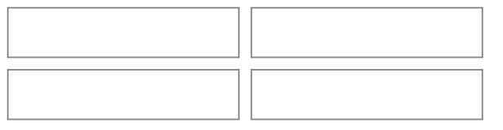
*Honest caveats: (1) Dreamer UI's `Calendar` hands `renderCell` only the date (a local-midnight `Date`) and no month-change callback, so each cell's meal chips come from a day-keyed lookup built up front, not a per-cell query. (2) A cell that holds up to three chips or pills plus a "+N" is taller than Dreamer UI's default square; like A-List's poster cells it needs `cellClassName` and `monthGridClassName` overrides. (3) Store logos come from a third-party logo service and can be missing, so every logo tile has a letter fallback.*

## Sitemap

```mermaid
%%{init: {'theme': 'base', 'themeVariables': {'primaryColor': 'transparent', 'clusterBkg': 'transparent', 'primaryBorderColor': '#888888', 'clusterBorder': '#888888', 'lineColor': '#888888', 'primaryTextColor': '#333333'}}}%%
flowchart TD
    A[First launch] --> D["Calendar, empty: zeros and two nudges 'Plan your first meal' · 'Add a recipe'"]
    subgraph Bar["Bottom bar"]
        D2["Calendar"]
        R["Recipes"]
        K["Kitchen"]
        SH["Shopping · count left to buy"]
    end
    D --> D2
    D2 ~~~ R ~~~ K ~~~ SH
    D2 -->|gear| SET["Settings sheet · nutrition switches"]
    D2 -->|switch view| VW["Month · Week · Day · Today button"]
    D2 -->|tap the stats row| BRK["Breakdown drawer · by day / by meal"]
    D2 -->|tap a day| DD["Day drawer"]
    D2 -.->|hover a day, desktop| PK["Day peek popover"]
    DD -->|+ Add| PM["Plan a meal subview · day, meal type, items with servings"]
    DD -->|tap a meal| PMD["Planned meal · swaps in place"]
    DD -->|Add this day's ingredients| AS
    PMD -->|Add to shopping list| AS
    PMD -->|Change items or servings| PM
    PMD --> SAV["Save as a meal · swaps in place"]
    PMD --> RM["Remove confirm"]
    R --> RL["Recipes list · pills: Recipes / Meals / Ideas"]
    RL -->|+ New| RS["Ways to start · a drawer on a phone, the subview's first page from sm · text, file, link or write it yourself"]
    D -->|Add a recipe| RS
    RS -->|text, file or link| RR["Reading screen · its own view, one way at a time"]
    RR -->|the reading fills the form| RF["Recipe subview · the form"]
    RR -->|Write it yourself instead| RF
    RS -->|write it yourself| RF
    RL -->|eye button| VO["View options · prices on, calories and macros off to start; each can be switched"]
    RL -->|Sources entry, once one exists| SO["Sources subview · each source with its recipe count"]
    SO -->|+ New source or tap a row| SOF["Source form sheet · name, delete"]
    RL -->|filter button, once a recipe has a source| SFL["Source filter · Any, each source with its count, No source"]
    RL -->|tap a recipe| RD["Recipe drawer · cost, nutrition, ingredients, steps"]
    RD -->|Modify| RF
    RD -->|Add to calendar| PM
    RD -->|Add to shopping list| AS["Add to shopping list sheet · servings, tick what you need"]
    AS -.->|toast View, unless a subview is open| SH
    RD -->|I cooked this| CT["Cook added · toast: Marked … as cooked · Undo"]
    RD -->|Cooking history, once cooked| CH["Cooking history sheet · newest first, + Add an earlier cook"]
    CH -->|tap a cook, or + Add| CE["Cook view · day, time, servings, trash · swaps in place, ‹ Back"]
    CE -->|trash| CD["Delete confirm · names the day"]
    RD -->|Add a note, or Edit on an entry| NS["Note sheet · a drawer on a phone, a modal from sm · your words, which cook it follows, trash"]
    CH -->|Add a note under a cook| NS
    CE -->|Add a note| NS
    NS -->|Update the recipe from this note| RF
    NS -->|trash| ND["Delete confirm"]
    PMD -->|Mark as cooked, today or a past day| CP["Cooked ✓ · Undo · in the row"]
    RL -->|Ideas pill| IL["Ideas list · still to try, then made into recipes"]
    IL -->|+ New idea| IA["Add sheet · a drawer on a phone, a modal from sm · link, photo or jot it down, each in the sheet's own view with a Back link"]
    IA -.->|a link already saved| ID2
    IL -->|tap an idea| ID2["Idea drawer · picture, title, note, Open site, Made into recipe"]
    ID2 -->|Modify| IE["Idea sheet · title, link or photo, note, delete"]
    ID2 -->|Turn it into a recipe| RF
    ID2 -->|Open the recipe, once made| RD
    RD -->|Start cooking, with steps| CK["Cooking mode subview · Steps and Ingredients, timers"]
    CK -->|Finish, then I cooked this| CT
    CK -->|I cooked this, then Add a note about it, typed in place| CKN["Note on the last screen · Save note, then the screen closes"]
    PMD -->|Start cooking, one recipe| CK
    PMD -->|Start cooking, several recipes| CKP["Which one? swaps in place · ‹ Back"]
    CKP --> CK
    RL -->|Meals pill| ML["Saved meals list"]
    ML -->|+ New or tap Modify| MF["Meal subview · same builder, no day"]
    ML -->|tap a meal| MD["Meal drawer"]
    MD -->|Plan it| PM
    MD -->|Add to shopping list| AS
    K --> KL["Ingredients list · Yours / All · search and filters"]
    KL -->|eye button| VO
    KL -->|+ New| IF["Ingredient form sheet · nutrition typed as the label prints it"]
    KL -->|tap an ingredient| ID["Ingredient drawer · nutrition per serving or per 100 g, products"]
    ID -->|Add a product| PF["Product form sheet · store picker"]
    KL --> ST["Stores subview"]
    ST -->|+ Add| SF["Store form sheet · pick from the list or add your own"]
    KL --> PR["Products subview · by store"]
    SH --> SL["Shopping list · what is left to buy by family, then Got it · search from 8 things"]
    SL -->|+ Add| SLA["Add sheet · search an ingredient"]
    SL -->|tap a row| SLR["Row sheet · how much and which unit, remove"]
    SL -->|Clear| SLC["Clear confirm · takes the Got it items off"]
    SL -->|help icon by the cost line| SLH["What the cost covers · amounts only, not packages"]
    PR -->|+ New product| PF
    RD -.->|nudge| FI["Fill-in sheet · prices and sizes"]
    KL -.->|nudge| FI
    D2 -.->|nudge| FI
    style Bar fill:transparent,stroke:#888888,stroke-width:1px;
```
*A nudge is a line, not a destination: wherever a number leaves something out, the line offers the same short fill-in sheet, and closing the line keeps it away for that ingredient. Every gap lives only in the screen where it changes a number.*

## Screens

*The persistent shell, shown once and left out of the screens below:*

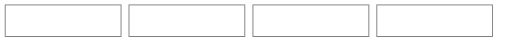
*Navigation is a floating pill at the bottom of a phone, as wide as its four tabs (never stretched edge to edge; each tab has a 64px minimum and a 55px height, so all four fit 320px on one line), and a rail on the left from `lg` up. The app opens to Calendar, the first tab; the active tab gets a soft peach fill and orange on its icon, the only orange in the bar. The Shopping tab (`?tab=shopping`) shows what is left to buy as a small dark badge on its icon, only above zero and as "99+" past 99. A later feature joins the tab it belongs to (stock and prepared servings to Kitchen).*

*From `lg` up the screens use the width: the month's cells become Google-Calendar-style pills that name each meal (its first item, `+N` for more) where a phone shows emoji chips, Week is seven columns where a phone has a vertical agenda, and Recipes, Kitchen and the Shopping list run in two columns. The phone layout is unchanged.*

**First launch — Calendar, empty** (no setup steps: Pinch is usable the moment it opens)

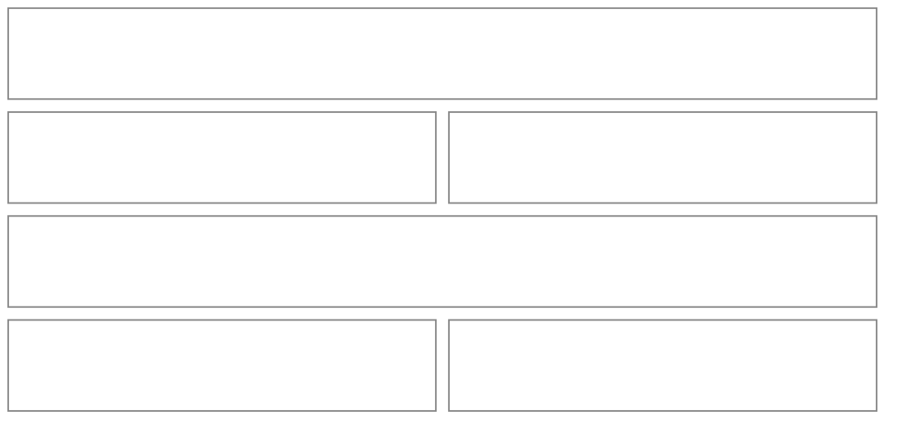
*Two nudges and nothing else: no setup modal, no required choices. "Add a recipe" opens the same list of ways to start as the Recipes tab's New (a drawer on a phone, the recipe subview's first page from `sm`). Nutrition stays off until the person turns it on in settings; the stats row's help link ("Want calories or protein here?") opens the same settings sheet.*

**Calendar** (home tab)

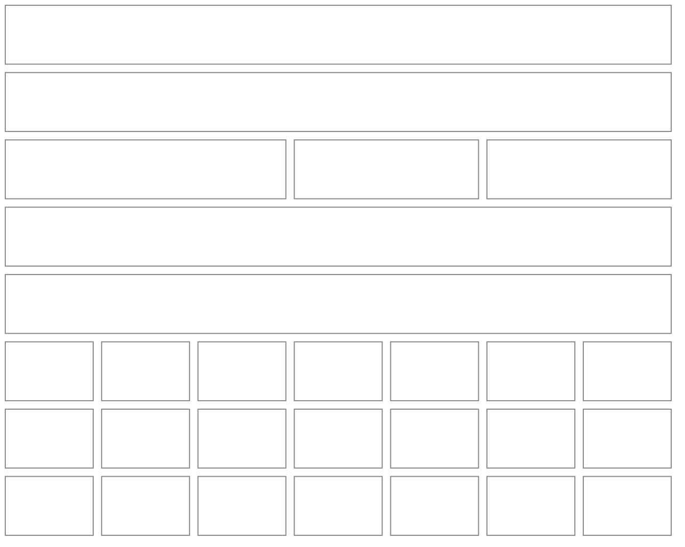
*Month view, the default (`?view=week|day` switches). The grid starts on Sunday because Dreamer UI's `Calendar` can't start a week on Monday, and the week view starts on Sunday to match. Under the header's gear and Add, the period row above the grid is Pinch's own (the Calendar's own header is hidden): arrows that step by the view's unit, the period's title, a thin Month / Week / Day switch, and a **Today** button that appears only while today is outside the period shown. Each planned meal is a chip on a soft tint of its meal-type colour (🍳 breakfast, 🥪 lunch, 🍝 dinner, 🍿 snack, 🍰 dessert, 🥤 drink); a phone's cell shows meal emoji chips, with a fourth meal becoming "+N", and from `lg` the chips become Google-Calendar-style pills with the meal's truncated title (its first item, "+N" for more). Today takes the orange dot on its number and the selected day a ring. Past days read exactly as they were that day. The stats row sits above the grid and describes the period shown ("Spent this week" in Week): Spent (with a warning icon in place of a "leaves out" line), Avg per meal and, when protein is on, Per g protein, then the calories and macros switched on as small emoji tiles labelled "Daily average this month" ("this week"; "Nutrition that day" in Day), at most one quiet nudge line ("2 ingredients need a price · Add prices"), and a "See the breakdown" link that opens the drawer. Tapping a day opens its drawer; on a computer, hovering a day opens a peek popover with the same content.*

| View | Phone (below `lg`) | From `lg` |
|---|---|---|
| Month | emoji chips on a soft tint, 3 at most, a fourth becomes "+N" | pills with the meal's truncated title (first item, "+N"), 3 at most then "+N more" |
| Week | a vertical agenda of 7 days, 6 meal rows a day then "Show N more" | 7 columns, 5 meals a day then "+N more" |
| Day | the day's meals grouped in meal order, each as a row | the same |

| Month cell contents | What `renderCell` draws |
|---|---|
| no meals | the date number only |
| 1–3 meals | one chip (or pill) per meal in meal-type order |
| 4+ meals | the first chips and a small "+N" |
| past day with a meal that was never marked made | shown the same; marking made arrives with stock tracking |

**Week** (phone agenda)

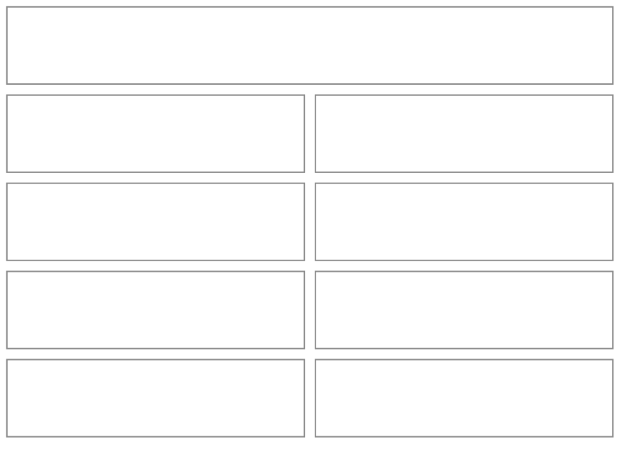
*A day with meals lists them as rows (the meal's emoji and title); a day with none is a quiet dash that still opens its drawer. Switching views keeps you on the selected day (or today), and Day shows that one day's meals with its own totals.*

**Day drawer** (tap a day; swaps in place to a planned meal)

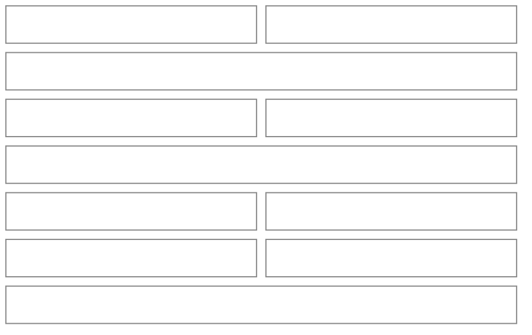
*Meals are grouped by meal type, each group under its emoji; a meal with several items lists them as flat rows beneath one heading, so a meal never looks like several separate meals. A day with no meals says so in one muted line with "+ Add to this day" in the header. On a past day the Cost tile carries "Fixed when the day passed" (and reads "Wasn't priced" when nothing was priced), and its warning adds that a price you add now counts from today on. A past meal opened from it has no Modify: a muted line says its meals keep the prices and numbers they had, and that removing one and adding it again uses today's; an item with no price reads "Wasn't priced" there. From today on, a block under the meals reads "Add this day's ingredients" ("Choose what you need for the day"); it closes the drawer and opens the Add to shopping list sheet with every item of the day. A day that has passed has no such block.*

**Planned meal** (tap a meal in the day drawer; swaps in place with "‹ Back")

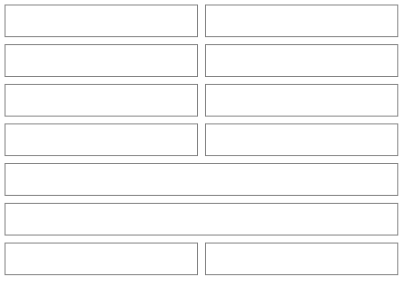
*A Cost tile (its warning icon says what the total leaves out) and, when nutrition is on, the plate's calories and macros as emoji tiles sit above the items. The footer holds Modify (secondary, left) beside the one primary, "Save as a meal"; Modify closes the drawer and opens the Plan a meal subview, and is absent on a past day. "Remove from this day" is the red row at the end of the body, with a confirm. Saving as a meal swaps the drawer in place to a single name field and a Save button. In the body, above Modify's footer, a tinted "Start cooking" row (only when a recipe in the meal has steps) and a tinted "Add to shopping list" row ("Choose what you need for this meal") sit together; neither is there once the day has passed. Add to shopping list closes the drawer and opens its sheet. Start cooking closes the drawer and opens Cooking mode at the servings planned for that recipe, or, when more than one recipe has steps, swaps the drawer in place to a short "Which one are you cooking?" list with a "‹ Back" link.*

*Cooked: on today or a day that has passed, each recipe in the meal has a tinted "Mark as cooked" row ("Adobo chicken · 2 servings") in the same block as Start cooking and Add to shopping list. Tapping it records the cook at the planned servings: now for today, noon of that day for a day that has passed (a passed day is when a person remembers). Then the row reads "Cooked ✓" with an Undo that deletes that cook. A meal that lists one recipe twice has one row with the servings added up, an ingredient has no row, a day still ahead has none, and marking a meal that is already marked says "Already marked" and changes nothing.*

**Plan a meal** (subview; also the editor for an already planned meal)

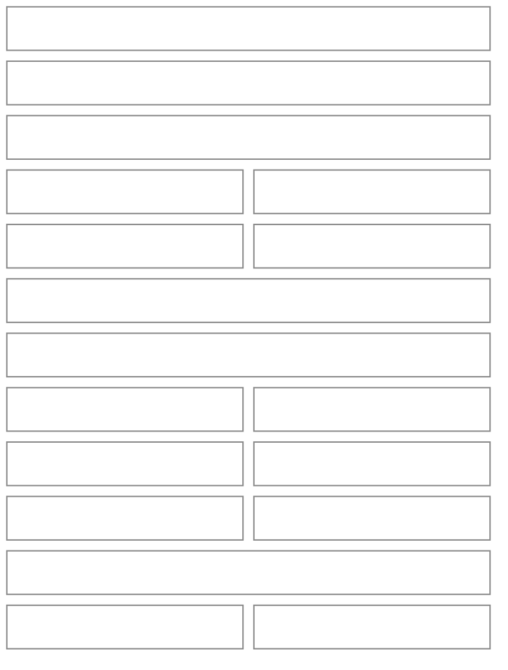
*Opens on the day and meal type it came from (pills under "Change"). "Start from a saved meal" is a captioned row of pills shown while the plate is empty (nothing preselected); picking one copies its items onto the day. The search finds recipes and ingredients in one list with a small kind label on each result; a picked one joins the plate with one serving. Each row has its name on its own line (it wraps, never truncates) and, beneath it, a compact `Stepper` for servings (halves allowed) with what one serving is ("servings · 1 serving = 28 g", "Recipe serves 4") and a remove control. The header carries the meal's name, or the first item and "+N" while a plate is being planned, and a tinted summary at the end shows the cost, a warning icon that says what it leaves out (a small help modal on a phone or touch screen, a tooltip with a mouse, never a fill-in sheet) and the plate's emoji macros when nutrition is on. The footer says "Add to today" when the day is today. When the meal has two or more items a "Save as a meal" switch appears above the footer and reveals a name field. Adding a one-item meal is the same screen with one row.*

**Recipes tab**

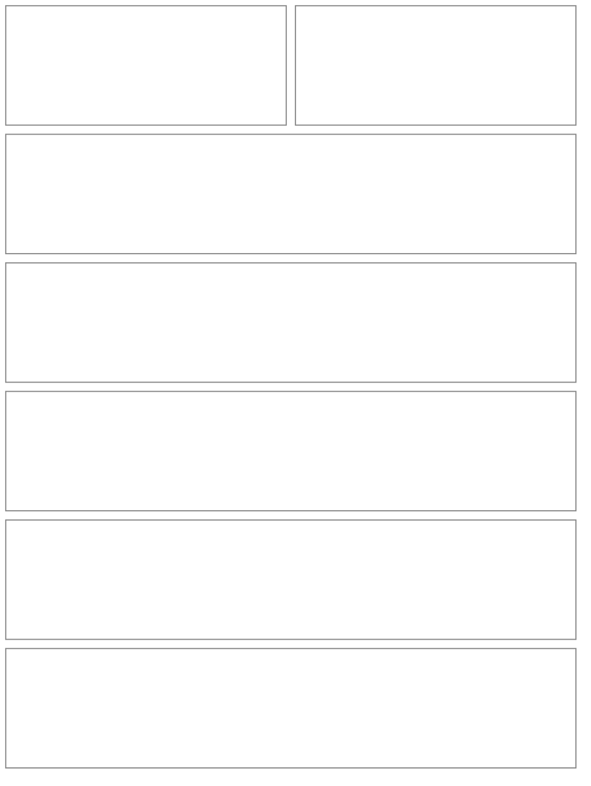
*Three thin pills switch between Recipes, Meals (saved meals) and Ideas (below); the header's title and button follow the pill (Recipes with "+ New" or, on Ideas, "Ideas" with "+ New idea"), and the eye button belongs to Recipes and Meals only. Until a recipe has a source, the View options eye button sits at the end of that row (it appears once the shown list has something in it, so an empty Recipes or Meals list has no eye) and the search field shows from 8 recipes. Once a recipe has a source, Recipes gains a search field with a filter button and the same eye beside it, and, once any source exists, a "Sources" entry row (Kitchen's entry-row look, with the count) under the pills; Meals keep the plain layout and show neither. A recipe row shows its cover (or a tinted emoji tile), its title, a muted line of servings and time, then a cost per serving line and calories and macros per serving as emoji figures, the last two only while shown (View options) and, for macros, switched on. A recipe with an unpriced ingredient shows the cost it can stand behind and says "leaves out 1" in the same line; one with no price at all says "No price yet". A meal row shows its item count, total (the same "leaves out" or "No price yet" wording), macros when shown, and its items as a comma line. In every row the cover or tile and the text share a top edge, and the chevron sits on the first line.*

**View options** (the eye button: a drawer on a phone, a popover from `sm`; Kitchen's ingredient list has the same one)

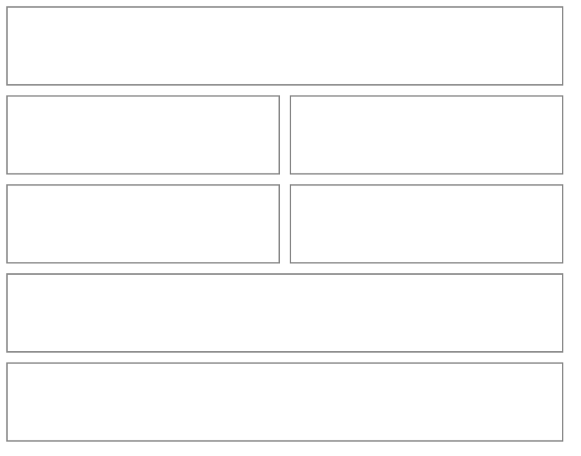
*The switches are `AppToggle`s and take effect at once: "Show prices" hides the cost on recipe and meal rows and the store, price and size line on ingredient rows, and "Show calories and macros" hides the emoji figures. "Show calories and macros" reads off and is disabled, with "Calories and macros are off. Turn them on from the Calendar's gear and they'll show here." under it, while no metric is on in Settings; the "Nutrition numbers" pills (Per serving / Per 100 g, for ingredient rows only) appear only when one is. Defaults are prices on, macros off and per 100 g, so a list starts short. A row is only as tall as the lines it shows: an ingredient with just its name is about 44px, with a price line about 60px, and recipe and meal rows are as tall as their cover or tile (about 72px) until a price or macro line makes them taller. Once a choice differs from its default the eye button takes a soft tint and "Reset" appears (in the phone drawer's footer beside Done, at the bottom of the popover). Each list's choice is remembered for this person on this device (`pinch:{uid}:view:{recipes|ingredients}`; Recipes and Meals share one), so it is not on another device. A hidden line is simply not drawn: a total, a drawer and a fill-in sheet are the same with or without it.*

**Sources and the Source filter** (the entry row on the Recipes tab; shown only once a source exists)

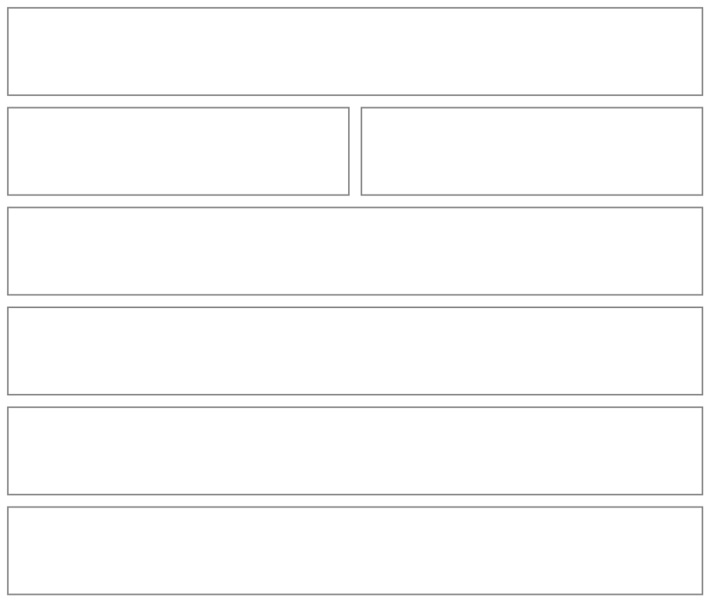
*A source is just a name for where a recipe came from. The Sources subview (a `Subview`, like Stores) lists them A to Z with how many of the listed recipes each has (a source with none shows no count), a "+ New source" action beside the title and a search from 8 sources. A row opens the Source sheet (a drawer on a phone, a modal from `sm`, titled "Source"): one Name field and, for an existing source, the trash at the bottom left, Cancel, and Save (Add for a new one). A name another source already has, ignoring case, disables Save and says so in the pinned footer ("You already have a source called “Serious Eats”."). Deleting asks first, over the sheet (a destructive confirm): "Serious Eats" is on 2 recipes. They stay, and only lose this label. When no recipe has it the confirm is the plain "Delete … This action cannot be undone." The Recipes tab's filter appears once at least one recipe has a source: a filter button beside the search field opens a drawer on a phone and a popover from `sm` with one question, Source, as pills: "Any", each source that at least one recipe has with its count ("Serious Eats · 3"), and "No source · n" only when some recipe has none (a search is added past 12 pills). A picked source shows as a chip under the search field ("From Serious Eats", with its ✕ and Clear); with nothing to show the list says "No recipes from Serious Eats yet." or "Nothing from Serious Eats matches “nachos” yet." with a "Clear filter" button. The filter and its chip leave when no recipe has a source any more, and Meals are never filtered.*

**Ideas** (the third pill on the Recipes tab)

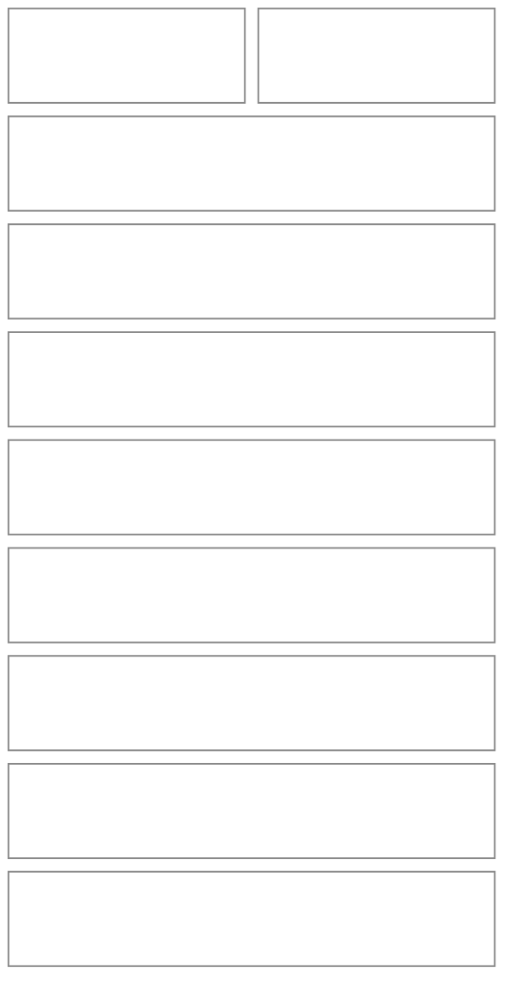
*An idea is something you'd like to make someday: a link, a photo, or a few words. The list is newest first. Once any idea has become a recipe, a hairline divider labelled "Still to try" separates the two groups, and "Made into recipes" (ideas whose recipe is still on your lists; a deleted or archived recipe puts the idea back among the ones still to try) comes after. A row is a 56px picture (a link's own picture, a photo, or a soft tile with 🔗, 📷 or 📝), a title of up to three lines, and one muted line: the site of a link, otherwise the first line of the note; the picture and the title share a top edge and the chevron sits on the first line, and a row is as tall as its lines, never shorter than its picture. From `lg` the rows run in two columns. An empty list is one warm line: "Saw something you'd like to cook someday? Keep it here." A search (title, site, note) shows from 8 ideas, with "Nothing matches “…” yet." when nothing does. At 200 ideas "+ New idea" gives way to "Your list holds up to 200 ideas. Delete one to add another." While the ideas load the list says "Loading your ideas…" and "+ New idea" is dimmed; if they can't be read, the list says "We couldn't load your ideas just now. Check your connection and try again." and the button stays dimmed; Recipes, Meals and Kitchen carry on.*

**New idea** (a drawer on a phone, a modal from `sm`: one sheet whose view changes in place)

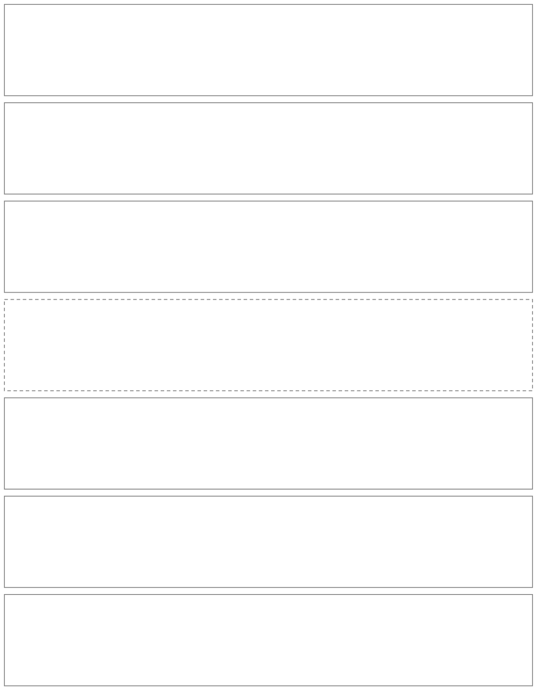
*The list of ways only picks (the shared `MethodPicker`, rows only, the manual way last and quieter); a way's own view takes its place in the same sheet with a "‹ Back" link to the list, so there is never a second overlay. Each way is titled "Idea", asks its one question, ends in Cancel and "Save idea" (disabled until valid), and has no required-field asterisks. **From a link**: one field (a web link; stray spaces are dropped, `https://` is added when missing, and anything that isn't an http or https address says "That doesn't look like a web link. Paste the address from your browser."; a paste with words around one link gives the link, and two links say "That looks like more than one link. Paste one at a time."). After a short pause the page is looked up ("Looking up the page…" while it runs, six seconds at most) and a preview appears: the page's picture, a "Looks like" title the person can change, and the site name. If the page can't be read or is slow, the title field is empty with the site's address as its placeholder and "Couldn't read that page. You can type your own title." Saving never waits: tapping "Save idea" at once keeps the site's address as the title. A link already on the list (however it was spelled: with or without `www.`, a trailing slash or tracking parameters) shows a tinted "That one's already in your ideas" with an "Open it" button, which opens that idea instead, and Save is off. **From a photo**: a 96px picture tile with "Choose a picture" (then "Choose another" and "Remove"; images only, up to 5 MB, resized before it is kept), a "Title" field that starts empty with "What is it?", and the footer says "Give it a title to save." once a picture is picked. A picture the browser can't read keeps the form and says "That picture couldn't be read. Try a JPG, PNG or WebP photo." and nothing is uploaded; a failed upload keeps the form and says why in plain words (a lost connection says to check it and try again). Any save failure, in a way or in the edit sheet, is one red line in the pinned footer beside the buttons, and it goes away as soon as anything in the form is changed. **Jot it down**: a title ("Something like Mom's lemon bars") and a note box shown from the start. On the link and photo ways the note is a quiet "+ Add a note" link that opens the box (focused) with a "Remove note" link under it. On a phone the link or title box is focused as the view opens. After a save the sheet closes and the new idea is the top row.*

**Idea details** (drawer on a phone, modal from `sm`) and **Idea** (form sheet)

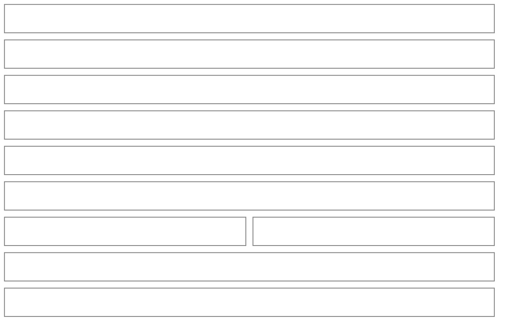
*The drawer shows the idea whole: the picture (a link's own picture, or the photo; an idea with neither, or one whose picture can't load, shows nothing in its place), the title, the note with its line breaks, for a link idea a quiet "Open <site>" row that opens the page in a new tab straight from the tap (with "Opens in a new tab" beneath), and, for an idea that became a recipe, a tinted "Made into <recipe>" row that opens the recipe's own drawer. The footer is Modify (secondary, left) beside the one primary, which takes the leftover width: "Turn it into a recipe", or "Open the recipe" once made. Modify closes the drawer and opens the Idea sheet (a drawer on a phone, a modal from `sm`): Title, the Link for a link idea (a changed link to another page drops the old picture and takes the new site's name; the same page spelled differently keeps both; another idea's page is refused with "That one's already in your ideas."), the picture with "Replace photo" for a photo idea (there is no way to remove it), and the Note. The footer is the trash at the bottom left, Cancel and Save. Deleting asks "Delete this idea?" over the sheet and names it; for an idea that became a recipe it adds "The recipe you made from it, Adobo chicken, stays."*

**From an idea to a recipe** (the Recipe subview's form, opened by "Turn it into a recipe")

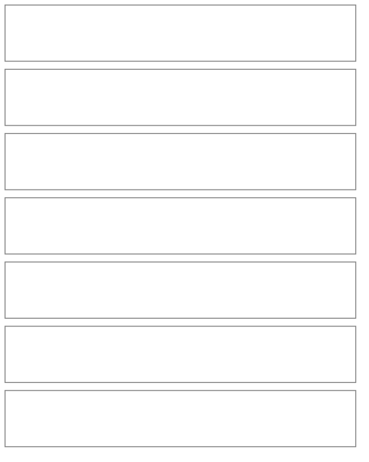
*The primary closes the drawer and opens the recipe form itself (not the list of ways) with what the idea knows: its title, its note as the description and, for a link, the link's website as "Where it's from" (the source already named for its address, such as "seriouseats.com", or "New source" with that address, which is created with the recipe). A muted "From your idea: …" line says why the form isn't blank, and nothing else is filled in: a photo stays with the idea. Nothing is saved until the person adds ingredients and saves, and leaving the form changes nothing (an untouched form closes without asking; one with typing asks Keep editing / Discard, like any new recipe). Saving creates the recipe, then marks the idea made in a write of its own, and the toast says "Recipe added: “…” moved to Made into recipes." and the idea moves to "Made into recipes". If the idea was deleted in the meantime (or can't be updated) the recipe still saves and the toast is just "Recipe added".*

**New recipe — how to start** (a drawer on a phone, the recipe subview's first page from `sm`; editing a recipe skips it)

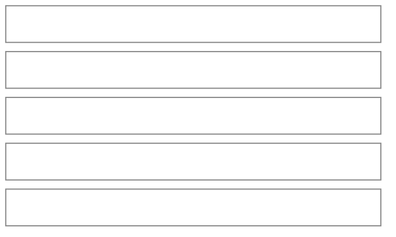
*Four ways in, in this order, with writing it yourself last and quieter (dashed), under "Start from something you already have, or write it yourself. You'll look it over before anything is saved." The list is rows only: picking one only picks. On a phone, the Recipes tab's New and the Calendar's "Add a recipe" open it in a drawer titled "New recipe" (one drawer, kept at the top of the app, so a way's back button can raise it again); picking a way closes the drawer and opens the recipe subview already on that way's screen. From `sm` up it is the subview's first page, with the header's back button closing the subview. Each way finishes on its own screen, never revealed under the list (below), and the header names it ("From text", "From a file", "From a link"). Back (the header's button, Escape or the phone's back gesture) raises the drawer again when the way was picked in it, and returns to the list when the subview opened on it. Each AI reading fills the real form and says so ("Filled in from {your text, the file's name or the page's website}. Take a look before you save." plus "We couldn't read: …"); nothing is saved until the form is. Link reading opens the page on our server (never the person's device) and sends its text and any recipe data to the reader. The form's header names the recipe as it is typed ("New recipe" until then).*

**From a file** (one of the three reading screens; the text and link screens have the same shape)

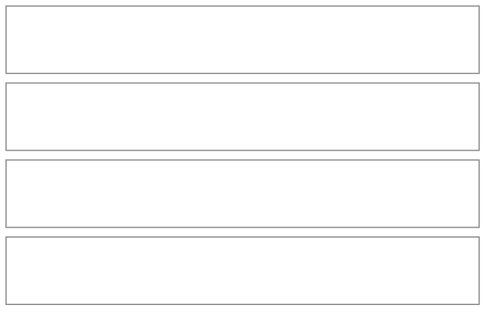
*Each screen has one plain line saying what will happen, above its input (the paste box, the address field, the file box) so it is read before anything is sent, and always ends with a link to "Write it yourself instead" (disabled while a reading runs). **From text** is "An AI reads it and fills in the form. It isn't saved.", a paste box (up to 20,000 characters) and a "Fill in the recipe" button. **From a link** is "We open the page and an AI reads the recipe from it.", an address field and "Fill in the recipe" (Enter does it too); an address with no `https://` gets one. **From a file** takes a photo, screenshot or PDF by "Choose a file", or dropped on the box (the "or drop it here" hint is hidden on a phone).*

| Reading state | What you see |
|---|---|
| reading | "Reading {your text, the file's name or the page's website}…" under the input, with the button busy |
| failed | one warm sentence under the input ("We couldn't open that link. Check the address, or paste the recipe's text instead."), details logged, never the service's message |
| not a link | "That doesn't look like a web link. Check it and try again." before anything is sent |
| too big | "That file is too big to read. Try a photo or a PDF under 10 MB." |
| no recipe found | "We couldn't find a recipe in that. Try a clearer photo or paste the text." |

**Recipe** (subview — create and edit)

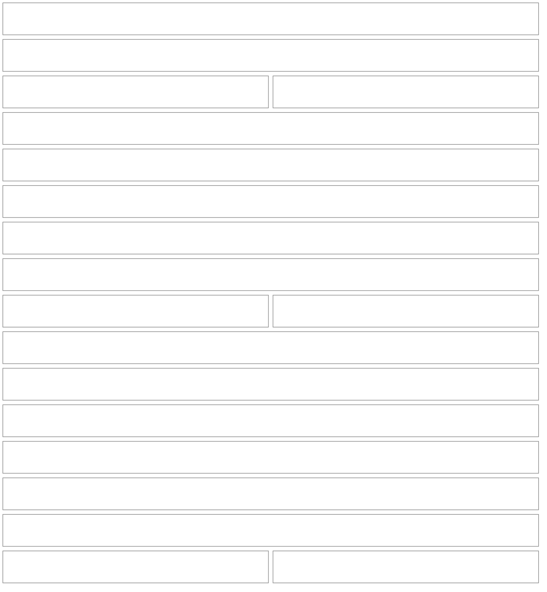
*A recipe needs a title and at least one ingredient. Everything a recipe normally has is part of the flow, not a button at the bottom: servings and times, a photo, a description, where it's from, the ingredients, the steps and the nutrition. The basics are summary rows, not boxes: Title, Prep and cook and Description each show a small caption, the value (the description cut off after two lines; "Add a title", "Add prep and cook time" and "Add a line about this dish" in muted text while empty) and a chevron, and Servings stays the stepper. Tapping a row opens its editor: on a phone (or a screen under 600px tall) a drawer over the form titled with the plain noun ("Title", "Prep and cook", "Description"), one text box or two ("Prep time" and "Cook time", each with a visible "min"), the cursor in the first, ending in a full-width Done; from `sm` up a popover under the row with the same fields and Done. Enter in a one-line field closes the editor and never saves the recipe, and Escape or the back gesture closes only the editor. A bad value (minutes that aren't whole, text over its limit) shows in red under the row's summary and in the editor, and the footer note says what to fix. A recipe written from scratch opens its title editor by itself once, so typing starts at once; a recipe filled in from a reading, and any existing recipe, opens with every row closed, and the form opens with no text box on screen at 390px once a source exists (before that, "Where it's from" shows its one name field). "Where it's from" is optional and always visible after the description: the person's sources as pills with a dashed "New source" first (nothing preselected for a hand-written recipe; a typed new name is added together with the recipe when it is saved, and a name that matches a source already there, ignoring case, reuses it; a "Remove source" link shows while one is chosen), a plain text field in their place until the first source exists, and the line "Optional. It shows on the recipe, and you can filter by it." A recipe read from a link starts on its site's source (the one already named for the site, with or without its "www.") or on "New source" with the site's name filled in, which the person can change like any answer; text and files start with none. While the sources couldn't be loaded the section is left out and the recipe keeps the source it had. Ingredients and steps are one-line summaries; the one being edited is the only one open. Removing an ingredient or a step (the ✕, the trash, or "Remove" in its drawer) takes it out at once and shows "Removed Salt" (or "Removed step 3") with "Undo · 6" counting down to 1 above the pinned footer; Undo puts it back in its place, a second removal replaces the first, and the removal stands when the count ends. On a phone each row editor is a drawer that never leaves the form: an ingredient (search, then amount, unit and a note, then "Add another" or Done, and "Remove from this recipe" for an existing one), a step (one text box titled "Step 3", which takes the cursor about a third of a second after the drawer opens, once it has slid in; Done, "Add another" only while adding, "Remove step" for an existing one, and a step left blank is dropped when the drawer closes) and the nutrition numbers (four compact fields, Done, and "Reset to what we calculated", which refills the fields and keeps the drawer open). From `sm` up a row opens its fields in place. A name the reader found that no ingredient matches arrives as "Add as new ingredient" / "Choose another". Nutrition shows what we added up from the ingredients as small emoji tiles, per serving, with a warning icon when some ingredients have no nutrition info (a small modal on a phone or touch screen, a tooltip with a mouse); Edit opens the four numbers (the drawer on a phone, inputs in place with Done from `sm`), any number changed becomes the person's own and "Reset to what we calculated" brings back the calculated ones. This is a page-sized form, so it is a Subview; the drawers on top of it are the allowed exception to "no overlay on a subview" because they are the form's own row editors, one level deep. Leaving the form while it holds typed or read-in work (the header's back, Cancel, Escape or the phone's back gesture) asks "Discard this recipe?" with "Keep editing" and "Discard" (a destructive confirm); an untouched form closes at once, and saving never asks.*

*Changing a recipe you've cooked records the change: below Nutrition a one-line "What changed and why?" (placeholder "Less vinegar, it was too sharp"; Enter doesn't save the recipe) says that saving adds a note with today's date and what changed, and the save writes that Tweak note in the same step as the recipe, so a note exists exactly when the recipe changed. The line is there only while the recipe has a cook and its notes have room (at 300 notes it says this change won't be noted and to delete an older one); a recipe you haven't cooked, a new recipe and a save that changes nothing you could see (a new cover picture) add no note, and nothing about notes shows if they couldn't load. Opened from a note ("Update the recipe from this note"), the form starts with that note quoted in a tinted block above the title ("Updating from your note", four lines and "More") and the line already holds the note's words; the note itself is never changed.*

**Recipe details** (drawer — tap a recipe in the list)

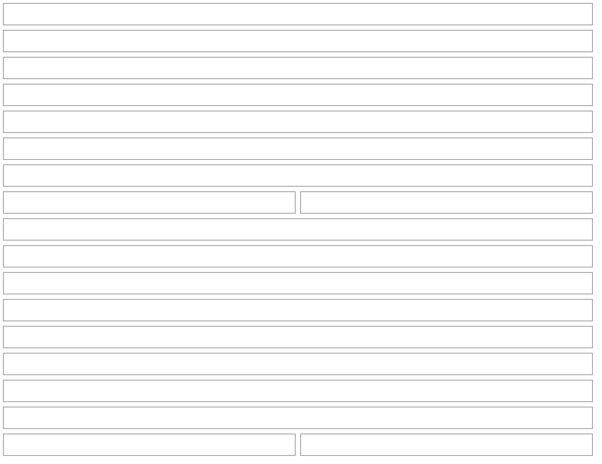
*The front matter is one plain line of emoji and text for servings, times and, when the recipe has a source that still exists, "📖 From {source}" (a long name wraps inside the line; never chips or pills), then a Cost tile whose warning icon says what the total leaves out (a small modal on a phone or touch screen, a tooltip with a mouse), calories and macros as emoji tiles per serving when they are switched on, and the nudge line where a gap meets a number (✕ closes it for these ingredients). The footer holds both actions together: Modify beside the one primary, "Add to calendar", which is the widest control and closes the drawer to open Plan a meal with this recipe on the plate. Delete is the trash in the recipe form's footer, and removing a recipe that planned days use takes it off the lists, not out of those days, and says so in the confirm. A tinted "Start cooking" row ("Steps one at a time, with a timer", only when the recipe has a step) and a tinted "Add to shopping list" row ("Choose what you need for this recipe") sit together under the ingredients; Start cooking closes the drawer and opens Cooking mode at the recipe's own servings, and Add to shopping list closes it and opens the sheet, which starts at the recipe's own servings.*

*Cooked: once a recipe has been cooked, a quiet muted line under the front matter says "🍳 Cooked 3 times · last Oct 12" ("Cooked once · Oct 12" for one), the day in local time. A tinted "I cooked this" row ("Keeps a record. You can change the date later.") sits with Start cooking and Add to shopping list; one tap adds a cook at the recipe's own servings, now, and a toast says "Marked Adobo chicken as cooked" with Undo, which takes back exactly that cook (the toast stack sits above the drawer so it can be tapped). The drawer stays open and the line above updates. A second tap is a second cook. A "Cooking history" row, only once there is a cook, closes the drawer and opens the history sheet (a recipe never cooked keeps its action block at three rows, so it has no history row: mark it, then change the date there). The "I cooked this" row is disabled until its write settles. While the history loads the row says so and is disabled, at 500 cooks it says the history is full, and if the history can't load neither row nor line appears.*

*Notes: under the steps, with no notes the section is one tinted row, "Add a note" ("Something to remember next time"); with notes it is the header "NOTES 12", that row (so adding never waits at the end of a long list), then the entries newest first. An entry is a 40px header band with the day (a year when it isn't this one) and, for a recorded change, a small "Tweak" tag, with **Edit** on the right, then "After cooking on Oct 11" when it follows a cook that still exists, a tweak's "You changed:" list (one plain line per change, such as "Garlic 4 → 6 each" or "Step 2 now reads: …") and the text, pre-wrapped and clamped at four lines with "More" (and "Less") only when it overflows. A note written before the recipe's latest tweak says "Written before your Oct 6 tweak" in muted text, so it is clear which version of the recipe it was about; a tweak never carries the label. Five entries show, then "Show N more" in pages of fifty, only when more than three would be hidden (so eight entries show all eight), with "Show fewer" once everything is open. "✏️ Last tweaked Oct 6" joins the facts line only when there is a tweak. Add a note and Edit close the drawer and open the note sheet; if the notes can't load the section says "Your notes couldn't load just now." and offers nothing to add, and while they load the row says so and is disabled.*

**Saved meals** (the Meals pill) and **Meal details** (drawer) share the recipe patterns: a list of meal rows, and a drawer with a Cost tile (warning icon when it leaves something out), the plate's calories and macros as emoji tiles when on, the items with servings and cost, and in the footer Modify beside the one primary "Plan it", which closes the drawer and opens Plan a meal on a chosen day. Modify opens the same Meal subview used for planning, without a day. The builder's header carries the meal's name (or the plate's first item while planning), its rows are a title with a compact servings stepper beneath (40px hit areas from a pseudo-element), and a tinted summary shows the cost, its warning icon and the plate's emoji macros. Adding stays the search field in the form. Removing an item from the plate shows "Removed Taco shells · Undo · 6" above the footer, and Undo puts it back in its place with its servings. The meal drawer has the same "Add to shopping list" row ("Choose what you need for this meal") under its items.

**Cooking history** (sheet — the recipe drawer's row; a drawer on a phone, a modal from `sm`)

```mermaid
%%{init: {'theme': 'base', 'themeVariables': {'primaryColor': 'transparent', 'primaryBorderColor': '#888888', 'primaryTextColor': '#333333', 'lineColor': '#888888'}}}%%
block-beta
  columns 2
  H1["Cooking history"]:2
  H2["Adobo chicken"]:2
  H3["+ Add an earlier cook"]:2
  H4["Oct 11 · 4 servings  ›"]:2
  H5["From your plan for Sun, Oct 11"]:2
  H6["Oct 5 · 2 servings  ›"]:2
  H7["Sep 27 · 6 servings  ›"]:2
  H8["Show 4 more (from 12 cooks)"]:2
  E1["‹ Back"]:2
  E2["Day · Time"]:2
  E3["Servings  – 4 +"]:2
  E4["🗑  Cancel  Save"]:2
  style H1 fill:transparent,stroke:#888888,stroke-width:1px;
  style H2 fill:transparent,stroke:#888888,stroke-width:1px;
  style H3 fill:transparent,stroke:#888888,stroke-width:1px;
  style H4 fill:transparent,stroke:#888888,stroke-width:1px;
  style H5 fill:transparent,stroke:#888888,stroke-width:1px;
  style H6 fill:transparent,stroke:#888888,stroke-width:1px;
  style H7 fill:transparent,stroke:#888888,stroke-width:1px;
  style H8 fill:transparent,stroke:#888888,stroke-width:1px;
  style E1 fill:transparent,stroke:#888888,stroke-width:1px;
  style E2 fill:transparent,stroke:#888888,stroke-width:1px;
  style E3 fill:transparent,stroke:#888888,stroke-width:1px;
  style E4 fill:transparent,stroke:#888888,stroke-width:1px;
```
*The title is the plain noun "Cooking history", with the recipe's name and "+ Add an earlier cook" fixed above the one list that scrolls. A row is the day and the servings ("Oct 11 · 4 servings"), with "From your plan for Sun, Oct 11" under a cook marked from a planned meal, and the first eight show; "Show N more" appears only when more than three would be hidden (11 cooks show all of them, 12 show eight and "Show 4 more") and "Show fewer" folds it back. A row, or the add link, swaps the sheet's content in place for the cook's own view (a "Back" link, never a second overlay): a Day and a Time (stacked below 304px, so "10/08/2026" is never clipped), a Servings stepper in halves, Cancel and Save, and for an existing cook the trash on the footer's left, whose confirm ("Delete this cook?") names the day and time. Save waits for a change and a time that has already passed. "+ Add an earlier cook" opens the same view with today, now and the recipe's servings. A full history (500 cooks) says so in place of the add link, and a history that can't load says that and offers no add.*

**Note** (sheet — "Add a note" and an entry's Edit, a drawer on a phone, a modal from `sm`)

```mermaid
%%{init: {'theme': 'base', 'themeVariables': {'primaryColor': 'transparent', 'primaryBorderColor': '#888888', 'primaryTextColor': '#333333', 'lineColor': '#888888'}}}%%
block-beta
  columns 2
  W1["Note"]:2
  W2["Your note · a text box, focused once the sheet has settled"]:2
  W3["Is this about a time you cooked it?"]:2
  W4["No, just a note · Oct 11 · Oct 5 · Sep 27 · Sep 20"]:2
  W5["Write a note to save."]:2
  W6["Cancel"]:1
  W7["Save"]:1
  E1["Editing: Note from October 14 at 2:15 AM · after cooking on Oct 5"]:2
  E2["Your note (the words only) · Update the recipe from this note"]:2
  E3["🗑  Cancel  Save"]:2
  style W1 fill:transparent,stroke:#888888,stroke-width:1px;
  style W2 fill:transparent,stroke:#888888,stroke-width:1px;
  style W3 fill:transparent,stroke:#888888,stroke-width:1px;
  style W4 fill:transparent,stroke:#888888,stroke-width:1px;
  style W5 fill:transparent,stroke:#888888,stroke-width:1px;
  style W6 fill:transparent,stroke:#888888,stroke-width:1px;
  style W7 fill:transparent,stroke:#888888,stroke-width:1px;
  style E1 fill:transparent,stroke:#888888,stroke-width:1px;
  style E2 fill:transparent,stroke:#888888,stroke-width:1px;
  style E3 fill:transparent,stroke:#888888,stroke-width:1px;
```
*The title is the plain noun "Note". A new note is one text box and, only for a recipe that has been cooked, the visible question "Is this about a time you cooked it?" with "No, just a note" (the default) and the latest four cooks as pills, each a day ("Oct 11"), or a day and time when two cooks share a day; opened from a cook's "Add a note" that cook is already picked, and an older cook that was preselected still appears. A recipe never cooked, or whose cooks can't load, shows no question. Save is disabled until there is a character (a blank paste stays disabled) and the footer says "Write a note to save."; saving closes the sheet and a toast says "Added a note to Adobo chicken". Editing shows only the words: the day and time and "after cooking on Oct 5" are a muted line above them, a tweak's "You changed:" list is there to read and not to change (its box is "Why you changed it" and may be emptied), and saving is disabled until the words differ. The icon-only trash asks "Delete this note?" first (for a tweak: the record of the change comes off the notes, and the recipe stays as it is). A saved note has "Update the recipe from this note" ("Opens the recipe with this note above it"), which says "Save your changes first" and is disabled while its words are edited. Opened from the cooking history the same form swaps in place under a "‹ Back" link, never a second sheet; Escape over the trash's confirm closes the confirm and the sheet, as it does in the cooking history.*

*A note under each time in the cooking history ("Add a note", a quiet row with a small icon, under "From your plan for …") and an "Add a note" row in a cook's own view (disabled with "Save your changes first" while its day or servings are edited) open this form on that cook. The recipe form, opened from a note, shows the note in a tinted, hairline-edged block at the top ("Updating from your note", four lines and "More"), and its "What changed and why?" line starts with the note's words.*

**Kitchen tab**

```mermaid
%%{init: {'theme': 'base', 'themeVariables': {'primaryColor': 'transparent', 'primaryBorderColor': '#888888', 'primaryTextColor': '#333333', 'lineColor': '#888888'}}}%%
block-beta
  columns 2
  K1["Kitchen"]:2
  K2["🏪 Stores  ·  6"]:1
  K3["🛒 Products  ·  14"]:1
  K4["INGREDIENTS  42"]:1
  K5["+ New"]:1
  K6["🔍 Search   ⧩ 2   👁"]:2
  K6b["[ Yours ]   All"]:2
  K7["Needs a price · in Yours  ✕   Clear"]:2
  K8["— Chicken —"]:2
  K9["Chicken breast<br/>Walmart · $9.48 / 3 lb<br/>🔥 165 · 💪 31g per 100 g"]:2
  K11["Chicken thighs<br/>No price yet<br/>🔥 209 · 💪 26g per 100 g"]:2
  K13["— Rice —"]:2
  K14["Jasmine rice<br/>Costco · $14.99 / 20 lb<br/>🔥 360 · 💪 7g per 100 g"]:2
  style K1 fill:transparent,stroke:#888888,stroke-width:1px;
  style K2 fill:transparent,stroke:#888888,stroke-width:1px;
  style K3 fill:transparent,stroke:#888888,stroke-width:1px;
  style K4 fill:transparent,stroke:#888888,stroke-width:1px;
  style K5 fill:transparent,stroke:#888888,stroke-width:1px;
  style K6 fill:transparent,stroke:#888888,stroke-width:1px;
  style K6b fill:transparent,stroke:#888888,stroke-width:1px;
  style K7 fill:transparent,stroke:#888888,stroke-width:1px;
  style K8 fill:transparent,stroke:#888888,stroke-width:1px;
  style K9 fill:transparent,stroke:#888888,stroke-width:1px;
  style K11 fill:transparent,stroke:#888888,stroke-width:1px;
  style K13 fill:transparent,stroke:#888888,stroke-width:1px;
  style K14 fill:transparent,stroke:#888888,stroke-width:1px;
```
*The screen is titled Kitchen, with the subtitle "Your ingredients, products and stores."; Stores and Products are entry rows that open subviews (later Kitchen entries, Stock and Prepared servings, join them), then an "Ingredients" eyebrow with its count and **+ New** beside it. The search field ("Search" on a phone, "Search ingredients" from `sm`) has the filter icon (a count badge when filters are on) and the View options eye button at its end, with the Yours / All pills under it; on a phone the filters open in a drawer, whose button shows the count ("Show 12 ingredients", shortened to "Show 12" at 360px and under), and from `sm` in a popover, and each active filter also shows as a dismissible chip with "Clear" (the price one reads "Needs a price · in Yours"). The filters are Price (Any / Needs a price / Has a price), Show only (Missing nutrition, Custom only) and Family. Yours is the default and holds the ingredients you added, the ones with a product, and the ones your recipes, saved meals and planned days that aren't frozen yet use; All is the full catalog. **Both price filters only ever look through Yours**, even with All picked, and the Price section says so under its pills; while one is on, the count beside "Ingredients" reads "N of M" with M counting Yours. Families are `SectionDivider` groups. A row is its name and then, each on its own line, the default product's store, price and size (a muted "No price yet" for an ingredient something uses but that has no product) and, when nutrition is on, its calories and macros as emoji figures with what they are per ("per 100 g", or "per serving (5 oz)" when the list's View options say so and the serving can be weighed). Prices and macros hide independently, rows carry no icon, and the chevron sits on the name's line however many lines follow (a product row in the Products subview keeps its price there too). When the filters hide everything the empty state names the filters that are hiding things and offers "Clear filters" and, only when All would find something, "Look through everything"; "Needs a price" alone with nothing left says "Nothing is waiting on a price."*

**Ingredient details** (drawer)

```mermaid
%%{init: {'theme': 'base', 'themeVariables': {'primaryColor': 'transparent', 'primaryBorderColor': '#888888', 'primaryTextColor': '#333333', 'lineColor': '#888888'}}}%%
block-beta
  columns 2
  I1["Chicken breast"]:1
  I2["Chicken · ✏️ Adjusted by you · 🍽️ 1 serving = 5 oz"]:1
  I3["Per 1 serving (5 oz)      [ Per serving ]  Per 100 g<br/>🔥 234 · 💪 44g · 🌾 0g · 🥑 5g"]:2
  I4["Products"]:2
  I5["⭐ Walmart · Great Value 3 lb"]:1
  I6["$9.48"]:1
  I7["Costco · 6.5 lb"]:1
  I8["$19.99"]:1
  I9["Adjust"]:1
  I11["+ Add a product"]:1
  style I1 fill:transparent,stroke:#888888,stroke-width:1px;
  style I2 fill:transparent,stroke:#888888,stroke-width:1px;
  style I3 fill:transparent,stroke:#888888,stroke-width:1px;
  style I4 fill:transparent,stroke:#888888,stroke-width:1px;
  style I5 fill:transparent,stroke:#888888,stroke-width:1px;
  style I6 fill:transparent,stroke:#888888,stroke-width:1px;
  style I7 fill:transparent,stroke:#888888,stroke-width:1px;
  style I8 fill:transparent,stroke:#888888,stroke-width:1px;
  style I9 fill:transparent,stroke:#888888,stroke-width:1px;
  style I11 fill:transparent,stroke:#888888,stroke-width:1px;
```
*The front matter is one plain line (the family's name in medium weight, then "✏️ One you added" or "✏️ Adjusted by you" and "🍽️ 1 serving = 5 oz"), never chips, and the footer holds Adjust (Modify for your own ingredient) beside the primary "+ Add a product", which closes the drawer and opens the product form sheet already tied to this ingredient. Tapping the star changes the default product (a quiet icon action; there is no hidden gesture). When a metric is switched on, nutrition shows as emoji `MacroStats` tiles, per 100 g to start and per serving ("Per 1 serving (5 oz)") once that is picked, with a thin Per serving / Per 100 g switch beside the caption; the switch is left out, and the numbers are per 100 g, when one serving is exactly 100 g or can't be weighed. The switch is the same setting as the "Nutrition numbers" pills in the Kitchen list's View options, not a copy of it, so a row and its drawer always agree and a change in one shows in the other. Numbers are adjusted in Adjust / Modify. There is no "Used in" line in the drawer yet. Removing a custom ingredient that is in use takes it off the lists and the confirm says what still uses it; a catalog ingredient can only be reset to its built-in values. The default-product star has no label of its own yet.*

**Ingredient** (form sheet)

```mermaid
%%{init: {'theme': 'base', 'themeVariables': {'primaryColor': 'transparent', 'primaryBorderColor': '#888888', 'primaryTextColor': '#333333', 'lineColor': '#888888'}}}%%
block-beta
  columns 2
  IF1["Ingredient"]:2
  IF2["Name<br/>Doritos nacho cheese"]:2
  IF3["Which family does it join?"]:2
  IF4["+ New family"]:1
  IF5["Chips"]:1
  IF6["Nutrition per 28 g"]:2
  IF7["Per [ 28 ]   g   oz   serving"]:2
  IF8["Calories<br/>130"]:1
  IF9["Protein (g)<br/>2"]:1
  IF10["Carbs (g)<br/>18"]:1
  IF11["Fat (g)<br/>6"]:1
  IF12["Saved as per 100 g: 🔥 464 · 💪 7g · 🌾 64g · 🥑 21g"]:2
  IF13["+ Serving size"]:2
  IF14["Cancel  ·  Add"]:2
  style IF1 fill:transparent,stroke:#888888,stroke-width:1px;
  style IF2 fill:transparent,stroke:#888888,stroke-width:1px;
  style IF3 fill:transparent,stroke:#888888,stroke-width:1px;
  style IF4 fill:transparent,stroke:#888888,stroke-width:1px;
  style IF5 fill:transparent,stroke:#888888,stroke-width:1px;
  style IF6 fill:transparent,stroke:#888888,stroke-width:1px;
  style IF7 fill:transparent,stroke:#888888,stroke-width:1px;
  style IF8 fill:transparent,stroke:#888888,stroke-width:1px;
  style IF9 fill:transparent,stroke:#888888,stroke-width:1px;
  style IF10 fill:transparent,stroke:#888888,stroke-width:1px;
  style IF11 fill:transparent,stroke:#888888,stroke-width:1px;
  style IF12 fill:transparent,stroke:#888888,stroke-width:1px;
  style IF13 fill:transparent,stroke:#888888,stroke-width:1px;
  style IF14 fill:transparent,stroke:#888888,stroke-width:1px;
```
*Name and family are the essentials ("Not sure? Skip it and the ingredient stands on its own."); a serving size and nutrition are "+ Add X" chips on a new ingredient, and a built-in ingredient opens with both showing under "Built in. Change what you like and it stays yours." Nutrition is typed the way the label prints it: "Per [amount] [g | oz | serving]" sits above four compact fields, starting at 100 g, and the section's heading follows ("Nutrition per 28 g"). Pinch stores it per 100 g and shows what it saved ("Saved as per 100 g: …") whenever the basis isn't exactly 100 g. The serving pill is disabled until the serving size converts to grams, with "To type it per serving, set the serving size in grams or ounces first." and an "Add serving size" link (or "…set one serving in grams or ounces above." when the size is on but can't be weighed, say a cup of something with no density). A blank amount ("Add the amount these numbers are for.") or a number over 100,000 per 100 g ("Those numbers look too big. Check them against the label.") shows one line in red and keeps Save off. Picking g, oz or serving before any number has been typed converts the numbers already there to that unit (the per 100 g value stays the same); once something has been typed, picking another unit only changes what the typed numbers are for, and "Saved as per 100 g" shows the result. An existing ingredient reopens in per 100 g, since that is what it holds. The footer has Cancel and the primary, with the trash beside them when there is something to delete (or, for a built-in ingredient, to reset to its built-in values).*

**Product** (form sheet)

```mermaid
%%{init: {'theme': 'base', 'themeVariables': {'primaryColor': 'transparent', 'primaryBorderColor': '#888888', 'primaryTextColor': '#333333', 'lineColor': '#888888'}}}%%
block-beta
  columns 2
  PR1["Chicken breast · Walmart"]:2
  PR3["Where do you buy it?"]:2
  PR4["+ New store"]:1
  PR5["Walmart"]:1
  PR6["Costco"]:1
  PR7["Show all"]:1
  PR8["Price<br/>$9.48"]:1
  PR9["Package size<br/>3 lb"]:1
  PR10["+ Label   + Link"]:2
  PR11["Make this the default"]:2
  PR12["🗑"]:1
  PR13["Cancel  ·  Save"]:1
  style PR1 fill:transparent,stroke:#888888,stroke-width:1px;
  style PR3 fill:transparent,stroke:#888888,stroke-width:1px;
  style PR4 fill:transparent,stroke:#888888,stroke-width:1px;
  style PR5 fill:transparent,stroke:#888888,stroke-width:1px;
  style PR6 fill:transparent,stroke:#888888,stroke-width:1px;
  style PR7 fill:transparent,stroke:#888888,stroke-width:1px;
  style PR8 fill:transparent,stroke:#888888,stroke-width:1px;
  style PR9 fill:transparent,stroke:#888888,stroke-width:1px;
  style PR10 fill:transparent,stroke:#888888,stroke-width:1px;
  style PR11 fill:transparent,stroke:#888888,stroke-width:1px;
  style PR12 fill:transparent,stroke:#888888,stroke-width:1px;
  style PR13 fill:transparent,stroke:#888888,stroke-width:1px;
```
*The sheet's title names what it is about ("{Ingredient} · {store or label}", "{Ingredient} · new product"), so there is no separate "For" block. The store question comes first because the price and size are about that shop. The store row is a `PickOrCreate`: a dashed "New store" pill first, then your stores as logo pills, with "Show all" opening the well-known list inside the same row (capped height, a search past 12). A well-known store joins "your stores" the first time a product uses it. Price and size are two short fields side by side; the size field takes an amount and a unit. Label ("Great Value") and a link are "+ Add X" chips. The first product on an ingredient is made the default without asking, and "Make this the default" appears from the second.*

**Stores** (subview) and **Store** (form sheet)

```mermaid
%%{init: {'theme': 'base', 'themeVariables': {'primaryColor': 'transparent', 'primaryBorderColor': '#888888', 'primaryTextColor': '#333333', 'lineColor': '#888888'}}}%%
block-beta
  columns 2
  S1["‹ Stores"]:2
  S2["6 stores"]:1
  S3["+ Add"]:1
  S4["[W] Walmart"]:1
  S5["9 products"]:1
  S6["[C] Costco"]:1
  S7["5 products"]:1
  S8["[G] Green Market (your own)"]:1
  S9["2 products"]:1
  style S1 fill:transparent,stroke:#888888,stroke-width:1px;
  style S2 fill:transparent,stroke:#888888,stroke-width:1px;
  style S3 fill:transparent,stroke:#888888,stroke-width:1px;
  style S4 fill:transparent,stroke:#888888,stroke-width:1px;
  style S5 fill:transparent,stroke:#888888,stroke-width:1px;
  style S6 fill:transparent,stroke:#888888,stroke-width:1px;
  style S7 fill:transparent,stroke:#888888,stroke-width:1px;
  style S8 fill:transparent,stroke:#888888,stroke-width:1px;
  style S9 fill:transparent,stroke:#888888,stroke-width:1px;
```
```mermaid
%%{init: {'theme': 'base', 'themeVariables': {'primaryColor': 'transparent', 'primaryBorderColor': '#888888', 'primaryTextColor': '#333333', 'lineColor': '#888888'}}}%%
block-beta
  columns 2
  SF1["Store"]:2
  SF2["🔍 Search well-known stores"]:2
  SF3["[W] Walmart"]:1
  SF4["[T] Trader Joe's"]:1
  SF5["[K] Kroger"]:1
  SF6["[A] Aldi"]:1
  SF7["Can't find it? Add your own"]:2
  SF8["Name<br/>Green Market"]:2
  SF9["Image: Upload or take a photo"]:2
  SF10["🗑"]:1
  SF11["Cancel  ·  Save"]:1
  style SF1 fill:transparent,stroke:#888888,stroke-width:1px;
  style SF2 fill:transparent,stroke:#888888,stroke-width:1px;
  style SF3 fill:transparent,stroke:#888888,stroke-width:1px;
  style SF4 fill:transparent,stroke:#888888,stroke-width:1px;
  style SF5 fill:transparent,stroke:#888888,stroke-width:1px;
  style SF6 fill:transparent,stroke:#888888,stroke-width:1px;
  style SF7 fill:transparent,stroke:#888888,stroke-width:1px;
  style SF8 fill:transparent,stroke:#888888,stroke-width:1px;
  style SF9 fill:transparent,stroke:#888888,stroke-width:1px;
  style SF10 fill:transparent,stroke:#888888,stroke-width:1px;
  style SF11 fill:transparent,stroke:#888888,stroke-width:1px;
```
*The list shows each store's logo in a round tile with a letter tile as the fallback. A well-known store is picked from the list; "Can't find it? Add your own" reveals a name and an image field (`PhotoPicker`), and a store with no image gets a letter tile in a soft tint. Removing a store that has products asks first and keeps those products, with their store shown as "Removed store". The Products subview lists every product with its ingredient, price and size and has **+ New product** beside its title (pick the ingredient first, then the product sheet). From 8 products it shows a search and the filter and sort controls: filters are Store, Family and Default only / Not the default; sort is by store (grouped, the default), ingredient, price or date added. Rows are capped at 60 with "Show 60 more", and an ingredient's default star shows only when it has several products.*

**Shopping tab** and **Add to shopping list** (sheet)

```mermaid
%%{init: {'theme': 'base', 'themeVariables': {'primaryColor': 'transparent', 'primaryBorderColor': '#888888', 'primaryTextColor': '#333333', 'lineColor': '#888888'}}}%%
block-beta
  columns 2
  L1["Shopping list"]:1
  L3["+ Add"]:1
  L2["7 to buy"]:2
  L4["Amounts on your list: about $12.40 ⚠"]:2
  L4b["🔍 Search your list  (from 8 things)"]:2
  L5["— Chicken —"]:2
  L6["☐ Chicken breast ›<br/>1 lb"]:2
  L7["☐ Chicken thigh ›<br/>2 lb"]:2
  L8["— Sauces & condiments —"]:2
  L9["☐ Soy sauce ›<br/>0.25 cup"]:2
  L10["Got it · 2  ⌄"]:1
  L11["Clear"]:1
  style L1 fill:transparent,stroke:#888888,stroke-width:1px;
  style L2 fill:transparent,stroke:#888888,stroke-width:1px;
  style L3 fill:transparent,stroke:#888888,stroke-width:1px;
  style L4 fill:transparent,stroke:#888888,stroke-width:1px;
  style L4b fill:transparent,stroke:#888888,stroke-width:1px;
  style L5 fill:transparent,stroke:#888888,stroke-width:1px;
  style L6 fill:transparent,stroke:#888888,stroke-width:1px;
  style L7 fill:transparent,stroke:#888888,stroke-width:1px;
  style L8 fill:transparent,stroke:#888888,stroke-width:1px;
  style L9 fill:transparent,stroke:#888888,stroke-width:1px;
  style L10 fill:transparent,stroke:#888888,stroke-width:1px;
  style L11 fill:transparent,stroke:#888888,stroke-width:1px;
```
```mermaid
%%{init: {'theme': 'base', 'themeVariables': {'primaryColor': 'transparent', 'primaryBorderColor': '#888888', 'primaryTextColor': '#333333', 'lineColor': '#888888'}}}%%
block-beta
  columns 2
  A1["Add to shopping list"]:2
  A2["Adobo chicken"]:2
  A3["For  − 4 +  servings"]:2
  A4["3 of 6"]:1
  A5["Tick all"]:1
  A6["☐ Chicken thigh · 2 lb<br/>On your list · 2 lb"]:2
  A7["☑ White vinegar · 0.25 cup"]:2
  A8["Cancel"]:1
  A9["Add 3"]:1
  style A1 fill:transparent,stroke:#888888,stroke-width:1px;
  style A2 fill:transparent,stroke:#888888,stroke-width:1px;
  style A3 fill:transparent,stroke:#888888,stroke-width:1px;
  style A4 fill:transparent,stroke:#888888,stroke-width:1px;
  style A5 fill:transparent,stroke:#888888,stroke-width:1px;
  style A6 fill:transparent,stroke:#888888,stroke-width:1px;
  style A7 fill:transparent,stroke:#888888,stroke-width:1px;
  style A8 fill:transparent,stroke:#888888,stroke-width:1px;
  style A9 fill:transparent,stroke:#888888,stroke-width:1px;
```
*The Shopping list is the fourth tab, with no back button (it is reached from the nav, or from the add toast's "View"). The header is "Shopping list" with its subtitle "7 to buy" (or "Got everything") and the one "+ Add" beside it; a first-run kitchen with nothing on its list sees one warm muted line ("Nothing on your list. Add a recipe's ingredients from its page, or add one here.") under that header. Under the header a line says "Amounts on your list: about $12.40", always followed by a help icon (`HelpTip`, a modal on a phone or touch screen and a tooltip with a mouse): "This prices just the amounts on your list, from each ingredient's default product. Stores sell whole packages, so what you pay at the till is usually more." The icon turns into a warning when something is left out and then also names it, with where to fix it ("No price yet: Chicken thigh. Add a price from the ingredient in Kitchen." and "Can't compare the amount with the package size: …"); the line says "No prices yet" when none could be priced. From 8 things on a search field ("Search your list") sits above the groups and filters them and "Got it" by name as you type, and says "Nothing on your list matches “milk”." when nothing does. What is left is grouped by ingredient family under `SectionDivider`s in Kitchen's family order, with "Other" last for ingredients that have no family, in two columns from `lg`. A row is a checkbox on the first line, the ingredient's name and a muted amount line ("2 lb"), and a chevron; ticking writes in the background and moves the row to "Got it", which stays collapsed and carries "Clear". Clear asks first ("Take the 3 items you've got off your list? This action cannot be undone.") and then a toast says how many it cleared (fewer than were ticked when another device un-ticked one, and it says so). A group draws 100 rows and then "Show N more" (nothing is hidden for 103 or fewer), and the first three groups draw at once while the rest mount as they near the screen. With 300 things the Add button goes and a line says the list is full. While the first snapshot hasn't landed the body says "Loading your list…", and when the shopping listener fails it says it couldn't load the list and offers no Add. The row and add sheets open over the tab like any other sheet, with a destructive confirm allowed on top; Escape closes one sheet and leaves the tab.*

*Tapping a row opens its sheet (a drawer on a phone, titled with the ingredient): "How much" with the amount and a unit select, the trash at the bottom left (a destructive confirm), Cancel and Save. Another unit is another item, so Save moves the amount to that unit (a ticked line stays ticked), and the footer says "You already have 1 lb on your list. This adds to it." when that item is already there open, or "You already got 4 oz. This puts it back on your list at 32 oz." when it is there ticked. "+ Add" opens a drawer with one search over the catalog and the person's ingredients (the same search the meal builder uses, results capped to a scrolling list under the field) and "New ingredient" when nothing has the typed name; a pick goes on the list at the ingredient's serving size, closes the sheet and says "Added Cheddar cheese". The field takes focus once the drawer has settled (on a phone the drawer holds focus while it slides in). While the write is in flight the results are locked and a quiet "Adding…" shows; while the list is still loading, or failed to load, they are locked with "Loading your list…" or "Your list couldn't load, so adding is paused."; and a list at 300 says it is full when a new ingredient is picked.*

*The Add to shopping list sheet is a `FormSheet` (a tall drawer on a phone, a modal from `sm`). It opens from the recipe, meal, planned meal and day drawers, which close first. It names what it is for (the recipe's title, the meal's name, "Dinner on Wed, Oct 14", or the day), a recipe gets a "For [stepper] servings" row that starts at the recipe's own servings and scales every line, and a count with "Tick all" / "Untick all" sits above the lines (one scrolling list, header and footer fixed). Each line is a checkbox, the name and its amount; a line already on the list starts unticked and says "On your list · 2 lb", since ticking it adds more, and one already got is treated as new (adding starts it again). "Add 3" is the one primary; a note beside it says why it can't be pressed (nothing ticked, more than 200 things, the list would pass 300). Until the shopping list has loaded (or when it failed to load) Add, "Tick all" and the checkboxes are off and the note says "Loading your list…" or "Your list couldn't load, so adding is paused."; the full-list notes point to the Shopping tab. Afterwards a toast says "Added 5 to your shopping list" with a "View" button that switches to the Shopping tab, unless a full-page screen such as a recipe form is open by then, when it only closes the toast.*


**Cooking mode** (subview from a recipe or a planned meal; Steps and Ingredients are one thin `PillGroup` apart)

```mermaid
%%{init: {'theme': 'base', 'themeVariables': {'primaryColor': 'transparent', 'primaryBorderColor': '#888888', 'primaryTextColor': '#333333', 'lineColor': '#888888'}}}%%
block-beta
  columns 2
  K1["‹ Adobo chicken"]:2
  K2["Steps"]:1
  K3["Ingredients"]:1
  K4["Step 2 of 3  ▬ ● ○"]:2
  K5["Simmer everything with the bay leaves and pepper, covered, for 25 minutes."]:2
  K6["⏲️ Start 25 min timer"]:2
  K7["12:41 · Step 1      ⏸  ✕"]:2
  K8["Back"]:1
  K9["Next"]:1
  style K1 fill:transparent,stroke:#888888,stroke-width:1px;
  style K2 fill:transparent,stroke:#888888,stroke-width:1px;
  style K3 fill:transparent,stroke:#888888,stroke-width:1px;
  style K4 fill:transparent,stroke:#888888,stroke-width:1px;
  style K5 fill:transparent,stroke:#888888,stroke-width:1px;
  style K6 fill:transparent,stroke:#888888,stroke-width:1px;
  style K7 fill:transparent,stroke:#888888,stroke-width:1px;
  style K8 fill:transparent,stroke:#888888,stroke-width:1px;
  style K9 fill:transparent,stroke:#888888,stroke-width:1px;
```
```mermaid
%%{init: {'theme': 'base', 'themeVariables': {'primaryColor': 'transparent', 'primaryBorderColor': '#888888', 'primaryTextColor': '#333333', 'lineColor': '#888888'}}}%%
block-beta
  columns 2
  I1["‹ Adobo chicken"]:2
  I2["Steps"]:1
  I3["Ingredients"]:1
  I4["Making 6 servings"]:1
  I5["− 6 +"]:1
  I6["Tick what you've got out"]:1
  I7["Reset"]:1
  I8["☑ Chicken thigh  3 lb"]:2
  I9["☐ Soy sauce  0.38 cup"]:2
  I10["Back to the steps"]:2
  style I1 fill:transparent,stroke:#888888,stroke-width:1px;
  style I2 fill:transparent,stroke:#888888,stroke-width:1px;
  style I3 fill:transparent,stroke:#888888,stroke-width:1px;
  style I4 fill:transparent,stroke:#888888,stroke-width:1px;
  style I5 fill:transparent,stroke:#888888,stroke-width:1px;
  style I6 fill:transparent,stroke:#888888,stroke-width:1px;
  style I7 fill:transparent,stroke:#888888,stroke-width:1px;
  style I8 fill:transparent,stroke:#888888,stroke-width:1px;
  style I9 fill:transparent,stroke:#888888,stroke-width:1px;
  style I10 fill:transparent,stroke:#888888,stroke-width:1px;
```
*Cooking mode is an overlay `Subview` titled with the recipe's name, so its header holds only the back button and the title; the header's back, Escape and the phone's back gesture all do the same thing: leave at once, or, while a timer is running or paused, ask "Stop timers and leave?" ("2 timers are still going. Timers only run while this screen is open, so leaving stops them.", with Stay, the safe answer, above a red Leave); a finished or dismissed timer doesn't count, and nothing is stored unless "I cooked this" on the last panel is tapped, so there is nothing else to confirm. One Escape or back gesture over that question closes only the question. It opens on Steps. The step is the one big thing on the screen (`text-2xl`, `text-xl` for a long step or a short landscape screen), under "Step 2 of 3" and a dot per step (the count alone past twelve steps). Back and Next are 56px tall and pinned at the bottom with the timer strip above them (Next is the wide one and reads Finish on the last step, which opens the final panel); swipe left or right, or the arrow keys, change step, and a long step scrolls between the fixed header and the buttons. Under the step, a dashed chip starts a timer for each length of time the text mentions ("⏲️ Start 25 min timer"; a range like 10-15 minutes uses its longer end); the chip is gone once that timer is running, and with four timers going (running or paused; a finished one waits for Dismiss and doesn't count) the chips are disabled with a line that says why ("4 timers are going. Dismiss or finish one to start another."). A time written with a comma ("1,5 hours", "2,500 seconds") gets no chip, since it could mean two things. Each running timer is a pill in the strip with its countdown, "Step 1", Pause (Resume once paused) and a close button, each 40×40; when one ends its pill turns peach with "Step 3 · 30 sec is done" and Dismiss, and a toast, a buzz and a beep go with it where the device allows. The first time a timer starts, a muted line says "Timers only run while this screen is open." The step and the ticks stay put when the person switches between Steps and Ingredients and back, and a recipe that is edited, archived or deleted on another device doesn't end the screen: it carries on with what it last had and one muted line says "This recipe was changed or removed elsewhere." Ingredients says "Making 6 servings" once, beside the servings stepper (it starts at the recipe's own servings, or the planned ones), with a muted line when the servings differ ("Scaled from 4 servings. Amounts written in the steps stay as they are."), then one checkbox row per ingredient (name and note on the left, the scaled amount on the right) with "Reset" once something is ticked; the footer is one "Back to the steps" button. When the screen can't keep the display on, one muted line above the footer says "Your screen may turn off while you cook." On a phone held sideways the header, the step and the one-row footer all stay on screen.*

*The final panel: Finish on the last step swaps the screen's content, in place and inside the same overlay, for "Nice work. Mark it as cooked?" (`text-2xl`, centered) with the servings being cooked in medium weight ("4 servings", whatever the Ingredients stepper says) and "Keeps a record. You can change the date later." under it. The Steps / Ingredients switch is hidden there and the footer becomes "Not now" (secondary, compact) beside the wide primary "I cooked this" (the timer strip stays above them); a quiet "Back to the last step" link sits in the panel and ArrowLeft does the same. "I cooked this" writes the cook, ends any timers and swaps the panel in place to "Marked as cooked" with the servings, "Saved to your cooking history." and a quiet underlined "Add a note about it", the footer becoming one wide **Done** (a toast above says "Marked Adobo chicken as cooked" with Undo, and an Undo puts the question back). "Add a note about it" opens a text box right there, in the panel (no sheet or drawer over the screen), focused, with "Cancel" and "Save note" in the footer; saving writes a note on that cook, toasts "Added a note to Adobo chicken" and closes the screen, and Cancel returns to Done. Cancel, Escape, the header's back and the back gesture with a typed, unsaved note ask "Discard this note?" (Keep editing / Discard); with nothing typed they return to Done or close the screen. While the note is saving they never ask, since the save carries on and its toast arrives, and after an Undo they don't ask about a box that is no longer on screen. While a timer is running or paused "I cooked this" first asks "Stop timers and leave?" like every other way out, and Stay keeps the panel and writes nothing. "Not now", the header's back, Escape and the back gesture before the cook write nothing. A full history (500 cooks) says so and disables the primary; if the cooks listener failed or hasn't loaded, Finish just leaves as it did, and if the notes listener failed or the recipe's notes are full there is no "Add a note about it", so a screen never offers what it can't do.*

*Entry: a tinted "Start cooking" row ("Steps one at a time, with a timer") above "Add to shopping list" in the recipe drawer, shown only when the recipe has a step, and the same row in a planned meal's view when a recipe in it has steps (never on a day that has passed). With one such recipe it opens that recipe at the planned servings; with several the drawer swaps in place to "Which one are you cooking?" with each recipe and its servings as a row and a "‹ Back" link.*

**Nudge and fill-in** (the quiet line, and the sheet it opens)

```mermaid
%%{init: {'theme': 'base', 'themeVariables': {'primaryColor': 'transparent', 'primaryBorderColor': '#888888', 'primaryTextColor': '#333333', 'lineColor': '#888888'}}}%%
block-beta
  columns 2
  G1["$12.80 total · $3.20 / serving"]:2
  G2["2 ingredients need a price · Add prices   ✕"]:2
  G3["Add prices"]:2
  G4["Soy sauce · where do you buy it?"]:2
  G5["Price<br/>$3.49"]:1
  G6["Size<br/>15 fl oz"]:1
  G7["Rice vinegar · where do you buy it?"]:2
  G8["Price<br/>—"]:1
  G9["Size<br/>—"]:1
  G10["Skip for now  ·  Save"]:2
  style G1 fill:transparent,stroke:#888888,stroke-width:1px;
  style G2 fill:transparent,stroke:#888888,stroke-width:1px;
  style G3 fill:transparent,stroke:#888888,stroke-width:1px;
  style G4 fill:transparent,stroke:#888888,stroke-width:1px;
  style G5 fill:transparent,stroke:#888888,stroke-width:1px;
  style G6 fill:transparent,stroke:#888888,stroke-width:1px;
  style G7 fill:transparent,stroke:#888888,stroke-width:1px;
  style G8 fill:transparent,stroke:#888888,stroke-width:1px;
  style G9 fill:transparent,stroke:#888888,stroke-width:1px;
  style G10 fill:transparent,stroke:#888888,stroke-width:1px;
```
*One sheet handles every kind of gap: a price, a package size, a nutrition value, or a missing conversion, one row per ingredient, with just the fields that gap needs. Rows left blank stay as they were, "Skip" moves on without saving, "Save" turns on once the row is filled in, and ✕ on the nudge hides that line for those ingredients. The same line appears in the recipe, saved meal, day and planned-meal views and the calendar stats row. The meal builder is a full-screen subview, so it states the cost and what it leaves out in text and opens nothing over itself; a frozen day has no line, since a new price can't change it.*

| Where the gap shows | Nudge wording | What the fill-in sheet asks |
|---|---|---|
| a recipe, meal or day cost | "2 ingredients need a price · Add prices" | price and package size for each |
| a cost that can't be compared | "Rice vinegar can't be compared with its package size · Add a size" | the package size in a comparable unit, for the ingredient's default product |
| a nutrition metric that is on | "3 ingredients have no protein · Add values" | the missing metric for each |
| the stats row | a warning icon on Spent that names what it leaves out, and the nudge line under the tiles | the same sheet, covering the period shown |

**Settings** (form sheet from the Calendar gear)

```mermaid
%%{init: {'theme': 'base', 'themeVariables': {'primaryColor': 'transparent', 'primaryBorderColor': '#888888', 'primaryTextColor': '#333333', 'lineColor': '#888888'}}}%%
block-beta
  columns 2
  ST1["Settings"]:2
  ST2["Show nutrition"]:2
  ST3["Calories"]:1
  ST4["◯ off"]:1
  ST5["Protein"]:1
  ST6["◯ off"]:1
  ST7["Carbs"]:1
  ST8["◯ off"]:1
  ST9["Fat"]:1
  ST10["◯ off"]:1
  ST11["Each switch applies at once. Turning on protein also shows your price per gram of protein."]:2
  style ST1 fill:transparent,stroke:#888888,stroke-width:1px;
  style ST2 fill:transparent,stroke:#888888,stroke-width:1px;
  style ST3 fill:transparent,stroke:#888888,stroke-width:1px;
  style ST4 fill:transparent,stroke:#888888,stroke-width:1px;
  style ST5 fill:transparent,stroke:#888888,stroke-width:1px;
  style ST6 fill:transparent,stroke:#888888,stroke-width:1px;
  style ST7 fill:transparent,stroke:#888888,stroke-width:1px;
  style ST8 fill:transparent,stroke:#888888,stroke-width:1px;
  style ST9 fill:transparent,stroke:#888888,stroke-width:1px;
  style ST10 fill:transparent,stroke:#888888,stroke-width:1px;
  style ST11 fill:transparent,stroke:#888888,stroke-width:1px;
```
*Switches take effect immediately, so they are `AppToggle`s, not checkboxes. Nutrition is always stored; the switches only choose what is shown.*

**Breakdown** (drawer from the calendar stats row)

```mermaid
%%{init: {'theme': 'base', 'themeVariables': {'primaryColor': 'transparent', 'primaryBorderColor': '#888888', 'primaryTextColor': '#333333', 'lineColor': '#888888'}}}%%
block-beta
  columns 2
  BK1["October · $412.60"]:2
  BK2["[ By day ]   By meal"]:2
  BK3["Tue 13"]:1
  BK4["$18.40"]:1
  BK5["Wed 14"]:1
  BK6["$7.20"]:1
  BK7["Thu 15"]:1
  BK8["—"]:1
  style BK1 fill:transparent,stroke:#888888,stroke-width:1px;
  style BK2 fill:transparent,stroke:#888888,stroke-width:1px;
  style BK3 fill:transparent,stroke:#888888,stroke-width:1px;
  style BK4 fill:transparent,stroke:#888888,stroke-width:1px;
  style BK5 fill:transparent,stroke:#888888,stroke-width:1px;
  style BK6 fill:transparent,stroke:#888888,stroke-width:1px;
  style BK7 fill:transparent,stroke:#888888,stroke-width:1px;
  style BK8 fill:transparent,stroke:#888888,stroke-width:1px;
```
*The title names the period shown (a month, a week or a day). The two thin pills switch between days and meal types; rows show spend and, for each nutrition metric that is on, its total. It is a single scrolling list under a fixed header.*

## Reusable Components

| Component | Used in | Purpose |
|---|---|---|
| DayCell | Month view's `renderCell` | up to three meal chips (a soft tint of the meal's colour, its emoji) on a phone or pills with the truncated title from `lg`, and a "+N"; date number, today dot, selected ring |
| MonthView, WeekView, DayView, MealRow, MealChip | Calendar | the three views: the grid, a 7-day agenda (7 columns from `lg`) and one day's meals grouped in meal order |
| PeriodSwitcher | Calendar (shared) | arrows by the view's unit, the period title, a thin view switch and a Today button shown only while today is out of sight |
| StatsRow | Calendar | the shown period's Spent (warning icon), Avg per meal, Per g protein when on, then calories and macros as small `MacroStats` tiles; one nudge line; "See the breakdown" opens the drawer. A tile's number steps down a size on a phone as it gets longer (and again at 360px and under), and the tile keeps room for its help icon, so a long total never runs under it |
| MacroStats | rows and summaries everywhere (shared) | 🔥 calories (whole numbers), 💪 protein, 🌾 carbs, 🥑 fat in grams for the metrics switched on: inline in a row, tiles in a summary |
| GapNudge | recipe, meal, day and planned-meal drawers, stats row | the one quiet line (muted text + link + ✕) that offers the fill-in sheet; renders only when there is a gap |
| FillInSheet | behind every nudge | a `FormSheet` with one row per ingredient and only the fields that gap needs |
| DayDrawer / DayPeek | Calendar | the same content as a `DetailSheet` on phones and a hover `Popover` from `sm` up (`max-sm:hidden`) |
| PlannedMealView | Day drawer | items with servings, totals, grouped actions, swapped in place |
| MealBuilder | Plan a meal, Meal subview (renders its own `Subview`) | day and type pills, a pill row of saved meals while the plate is empty, one item search, rows with a compact `Stepper` for servings, a tinted summary with cost, warning icon and emoji macros (no nudge: the fill-in sheet never opens over this subview), Save-as-meal switch |
| ItemSearch | MealBuilder, Recipe form, Products, Shopping list add sheet | one search over recipes, meals and ingredients with kind labels; also offers "New ingredient" |
| Stepper | MealBuilder, Recipe form (shared) | half-step stepper, `isCompact` for rows, 40px targets |
| RecipeStart, RecipeStartDrawer | Recipes tab and Calendar (phone drawer, rendered once at the top of Pinch and raised by New, "Add a recipe" and a way's back button), Recipe subview (first page from `sm`) | the four ways to begin a recipe as rows through the shared `MethodPicker` (rows only; each way's `onPick` opens its own screen) |
| RecipeReader | Recipe subview | the text, file and link screens of a way in: its own disclosure line above its input, a "Fill in the recipe" button (text and link), a reading state and failure line, and "Write it yourself instead"; link reading calls `fetchPageContent` through `recipePageQueryOptions` |
| RecipeForm | Recipe subview | all sections visible via `FormSection` and `Field`: servings and times, photo, description, where it's from (`PickOrCreate`), `RecipeIngredients`, `RecipeSteps` and `NutritionReview` (each a drawer on a phone, rows open in place from `sm`) |
| SourcesSubview, SourceFormSheet | Recipes tab's Sources entry | the list of sources with their recipe counts and the one-field Source sheet (rename, add, delete); a `Subview` and a `FormSheet`, mirroring Stores |
| EntryRow | Kitchen (Stores, Products), Recipes (Sources) | the tinted-icon entry tile with its count and chevron (the icon hides at 360px and under, the chevron at 400px and under); a `className` lets one span both columns |
| ShoppingScreen, ShoppingRow, ShoppingItemSheet, ShoppingAddSheet, ShoppingTabBadge | the Shopping tab | the list by family with a checkbox on each row's first line, "Got it" and "Clear", the cost line with its warning icon, the row sheet (amount, unit, remove) and the add sheet (an `ItemSearch`); groups after the first three mount near the viewport |
| CookingSubview, CookStepView, CookIngredientsView, CookTimerStrip | recipe drawer and planned meal view's Start cooking | the overlay `Subview` with its Steps / Ingredients `PillGroup`, the big step with dots and swipe, the scaled and tickable ingredients, and the pinned timer strip, the "Stop timers and leave?" question and the final "Nice work. Mark it as cooked?" panel, which becomes "Marked as cooked" with "Add a note about it" and Done; all state lives in the session and nothing is stored unless "I cooked this" (or a note after it) is tapped |
| StartCookingRow | recipe drawer, planned meal view | the tinted entry row ("Start cooking", "Steps one at a time, with a timer"), shown only when there is a step to cook and not on a day that has passed |
| ActionRow (shared) | recipe drawer ("I cooked this", "Cooking history", "Add a note"), note sheet ("Update the recipe from this note"), cook view ("Add a note"), planned meal view ("Mark as cooked") | the tinted drawer row: an icon, what it does and a line on what to expect, with no app words (`StartCookingRow` and `AddToShoppingRow` are thin wrappers over it that supply an icon and their words) |
| PlannedCookRow | planned meal view, on today or a day that has passed | one recipe of the meal: "Mark as cooked" until its cook exists, then "Cooked ✓" with an Undo; re-renders with any cook change, which costs nothing for the few rows of a meal |
| CookingHistorySheet, CookEditView | recipe drawer's "Cooking history" row | a `FormSheet` whose list (8 rows, "Show N more", fixed header, an "Add a note" under each) and one cook's view (day, time, servings, trash, "Add a note") swap in place with a Back link |
| RecipeNotes, NoteEntry, ClampedText, ChangeList | recipe drawer | the "Notes" section: the "Add a note" row, the entries (a date band with Edit, "After cooking on …", "You changed:", text clamped at four lines, "Written before your … tweak") and "Show N more"; the quote on the recipe form reuses `ClampedText` |
| NoteSheet, NoteForm, NoteTextField | recipe drawer's notes, the cooking history (in place) | the "Note" `FormSheet` and its form: the text box, the cook question (`PillGroup`), the trash, "Update the recipe from this note"; `NoteTextField` is also typed in place on cooking mode's last screen |

| AddToShoppingSheet, AddToShoppingRow | recipe, meal, planned meal and day drawers | the tinted row that closes the drawer and opens the `FormSheet` where a recipe's, meal's or day's lines are ticked (a servings `Stepper` for a recipe) and added in one write |
| RecipeRow, MealRow | Recipes tab | cover or emoji tile, title, muted details, then the cost and macro lines when shown; the tile and text share a top edge and the chevron sits on the first line |
| IngredientRow, FamilyGroup | Kitchen | name, a price line and a macro line (each can be hidden), the chevron on the name's line; `SectionDivider` groups |
| FilterBar | Kitchen ingredients, Products, and Recipes once a recipe has a source (shared) | search plus a filter icon with a count badge (a drawer on phones, a popover from `sm`) and an optional trailing button (Kitchen's eye), dismissible chips and "Clear"; the drawer's button shows the count and can take a shorter label for 360px and under ("Show 12 ingredients" / "Show 12") |
| SummaryEditor | Recipe form: Title, Prep and cook, Description (shared) | a one-line summary row (caption, value, chevron, red problem line) whose editor is a drawer on a phone and a popover under the row from `sm`, each ending in Done; the title's editor opens by itself on a blank hand-written recipe |
| UndoSnackbar, useUndoRemoval | Recipe form (ingredients, steps), meal builder plate (shared) | "Removed X · Undo · 6" floating above the pinned footer, counting 6 to 1, one pending removal at a time |
| ViewOptions, ListViewControls | Kitchen and Recipes filter bars (`trailing`), or beside the Recipes / Meals pills (only while that list has rows and no recipe has a source) | the eye button (a drawer on a phone, a popover from `sm`, tinted once something differs, with Reset): Show prices, Show calories and macros (reads off, with a line saying where to turn them on, while no metric is on) and, for ingredients, the nutrition basis, which the ingredient drawer's switch shares; `ViewOptions` is shared, `ListViewControls` is Pinch's contents; kept per person and list on the device (`useListViewOptions`) |
| HelpTip | cost warnings, stats help (shared) | a help or warning icon: a small modal (with a hairline border) on a phone or any touch screen, whatever its width; with a mouse a tooltip that opens on hover or keyboard focus, stays open on a click, places itself above or below and inside the screen (and re-measures while a drawer is still sliding in), its arrow on the icon. Escape closes a tooltip and still reaches a drawer under it; in a modal it closes only the modal |
| Subview | Recipe, Meal, Stores and Products screens (shared) | the round "Back" button and title; the header's back, Escape (overlay subviews) and the phone's back gesture all do the same thing: the screen's own step back (the recipe's reading screens, its "Discard this recipe?" question) or, without one, close; a drawer or modal opened above it takes Escape and the gesture first and the subview stays |
| PillGroup | everywhere options are picked (shared) | choosing never reorders visible options: a chosen option that was hidden behind "Show all" takes the last visible slot, and the fully open list keeps its original order; a pick-one group shows no "1 selected" count |
| AddFieldChips | Ingredient and Product forms (shared) | rounded "+ Add X" chips for optional fields, at least 36px tall, a long label wraps instead of clipping |
| ProductForm, ProductRow | Ingredient drawer, Products subview | titled by ingredient and store, store question first, price and size side by side, chips for label and link |
| StorePicker | Product form | `PickOrCreate` of your stores plus "Show all" for the well-known list |
| StoreLogo | pickers, rows, subview | the logo tile with a letter fallback; app-aware, so it stays in the app |
| StoreForm | Stores subview | search of well-known stores, or name plus `PhotoPicker` image |
| CoverImage | recipe rows and drawer | `FallbackImage` with a tinted emoji tile as its `fallback` |
| IdeasView, IdeaRow, IdeaThumbnail | Recipes tab's Ideas pill | the two groups ("Still to try", "Made into recipes") with `SectionDivider`, a `SearchInput` from 8 ideas, rows in chunks of twenty that mount near the viewport; a row is a 56px thumbnail (the link's own picture or the photo through `FallbackImage`, else a soft tile with 🔗, 📷 or 📝), a title of up to three lines, one muted line and a first-line chevron |
| IdeaAddSheet, IdeaWays, IdeaNoteField | New idea | one `FormSheet` for the `MethodPicker` of three ways and each way's own view (link, photo, text) with a "Back" link; "+ Add a note" reveals the note box |
| IdeaDrawer, IdeaFormSheet | tapping an idea; its Modify | the details drawer (picture, title, note, Open site, Made into recipe row, Modify beside the one primary) and the Idea sheet (title, link or photo, note, trash, Cancel, Save) |
| `SectionHeader`, `Subview`, `FormSheet`, `DetailSheet`, `ModalFooterActions`, `DeleteIconButton`, `PickOrCreate`, `SearchInput`, `SectionDivider`, `MoneyInput`, `AppToggle`, `StatTile`, `MethodPicker`, `FormSection`, `Field` | everywhere | the shared pieces in `src/components` and `src/ui`; Pinch builds only what is app-specific. `Field` has an `isCompact` form for a grid of short fields (small captions, a 40px input whose typed text stays 16px) and wraps its control in a native label, so no `Select` goes inside one |
| Empty state | every list and the empty Calendar | an icon, one muted line, and the call to action in the header |

## User Journeys

**First launch: plan something**

```mermaid
%%{init: {'theme': 'base', 'themeVariables': {'primaryColor': 'transparent', 'clusterBkg': 'transparent', 'primaryBorderColor': '#888888', 'clusterBorder': '#888888', 'lineColor': '#888888', 'primaryTextColor': '#333333'}}}%%
flowchart LR
    A[Open Pinch] --> B["Calendar, empty"] --> C{"What now?"}
    C -->|Plan your first meal| D["Plan a meal subview"] --> E["Search 'chicken breast'"] --> F["Pick an ingredient from the catalog"] --> G["Add to today"] --> H["Calendar shows a chip for it; cost line says 'No price yet'"]
    C -->|Add a recipe| I["Ways to start a recipe"]
```

**Add a recipe from a photo or PDF**

```mermaid
%%{init: {'theme': 'base', 'themeVariables': {'primaryColor': 'transparent', 'clusterBkg': 'transparent', 'primaryBorderColor': '#888888', 'clusterBorder': '#888888', 'lineColor': '#888888', 'primaryTextColor': '#333333'}}}%%
flowchart LR
    A[Recipes] --> B[+ New] --> C["Ways to start: From a file"] --> C2["File screen: Choose a file"] --> D["Reading…"] --> E["Form filled in; 'We couldn't read: cook time'"]
    E --> F{"Unknown ingredient?"}
    F -->|Yes| G["'Add as new ingredient' on its row"] --> H[Review and edit]
    F -->|No| H
    H --> I[Save] --> J["Recipe drawer with its cost and a price nudge"]
```

**Say where a recipe came from, then find it again**

```mermaid
%%{init: {'theme': 'base', 'themeVariables': {'primaryColor': 'transparent', 'clusterBkg': 'transparent', 'primaryBorderColor': '#888888', 'clusterBorder': '#888888', 'lineColor': '#888888', 'primaryTextColor': '#333333'}}}%%
flowchart LR
    A["Recipe form: Where it's from"] --> B{"Which one?"}
    B -->|Pick a source pill| D[Save]
    B -->|New source: type a name| D
    B -->|Leave it| D
    D --> E["Recipe drawer: 📖 From Serious Eats"]
    D --> F["Recipes: Sources entry and a filter appear"]
    F --> G["Filter by Serious Eats · 3"] --> H["Chip: From Serious Eats ✕"]
    F --> I["Sources subview: rename or delete"] --> J["Delete: the recipes stay and lose the label"]
```

**Keep an idea, then make it**

```mermaid
%%{init: {'theme': 'base', 'themeVariables': {'primaryColor': 'transparent', 'clusterBkg': 'transparent', 'primaryBorderColor': '#888888', 'clusterBorder': '#888888', 'lineColor': '#888888', 'primaryTextColor': '#333333'}}}%%
flowchart LR
    A["Recipes · Ideas pill"] --> B["+ New idea"] --> C{"How?"}
    C -->|From a link| D["Paste · 'Looking up the page…' · Looks like: title · site"] --> G["Save idea"]
    C -->|From a photo| E["Choose a picture · title"] --> G
    C -->|Jot it down| F["A few words"] --> G
    G --> H["Top of Still to try"] --> I["Tap it: idea drawer"] --> J["Turn it into a recipe"] --> K["Recipe form, prefilled · add ingredients"] --> L["Add"]
    L --> M["Idea moves to Made into recipes"] --> N["Open the recipe"]
    I -->|Open the site| O["Page opens in a new tab"]
    D -.->|page can't be read| P["Host as the title · type your own"] -.-> G
    D -.->|already saved| Q["That one's already in your ideas · Open it"]
```

**Plan a meal, tweak a day, keep it**

```mermaid
%%{init: {'theme': 'base', 'themeVariables': {'primaryColor': 'transparent', 'clusterBkg': 'transparent', 'primaryBorderColor': '#888888', 'clusterBorder': '#888888', 'lineColor': '#888888', 'primaryTextColor': '#333333'}}}%%
flowchart LR
    A[Tap a day] --> B[+ Add] --> C["Pick 'Taco night' from Start from a saved meal"] --> D["Items copied onto this day"]
    D --> E["Skip the peppers, double the rice"] --> F[Add to today]
    F --> G["Calendar chip appears"] --> H["Open it: Save as a meal"] --> I["Saved with a new name; Taco night is unchanged"]
```

**Shop for what you planned**

```mermaid
%%{init: {'theme': 'base', 'themeVariables': {'primaryColor': 'transparent', 'clusterBkg': 'transparent', 'primaryBorderColor': '#888888', 'clusterBorder': '#888888', 'lineColor': '#888888', 'primaryTextColor': '#333333'}}}%%
flowchart LR
    A[Tap a day] --> B["Add this day's ingredients"] --> C["Sheet: tick what you need"] --> D[Add 12]
    D --> E["Toast: Added 12 to your shopping list · View"] --> F["Shopping tab, by family"]
    F --> G["At the store: tick what is in the cart"] --> H["Got it moves down"] --> I[Clear]
    A2[Open a recipe] --> B2["Add to shopping list · for 6 servings"] --> C
```


**Cook a recipe, with a timer**

```mermaid
%%{init: {'theme': 'base', 'themeVariables': {'primaryColor': 'transparent', 'clusterBkg': 'transparent', 'primaryBorderColor': '#888888', 'clusterBorder': '#888888', 'lineColor': '#888888', 'primaryTextColor': '#333333'}}}%%
flowchart LR
    A["Open a recipe, or tonight's meal on the calendar"] --> B[Start cooking]
    B --> C["Several recipes in the meal? Pick one"] --> D["Ingredients: servings, tick what is out"]
    B --> D
    D --> E["Back to the steps"] --> F["Next, Next"]
    F --> G["A step says 25 minutes: Start 25 min timer"] --> H["Timer runs above the buttons; keep cooking"]
    H --> I["Done: the strip lights up, a toast and a beep"] --> J[Dismiss] --> K[Finish]
    K --> L["Nice work. Mark it as cooked?"] --> M["I cooked this: toast with Undo, the panel stays open as Marked as cooked · Done closes it"]
    L --> N["Not now: closes, nothing saved"]
    H --> L["Leave with a timer going"] --> M["Stop timers and leave? Stay or Leave"]
```

**Mark a recipe cooked, and fix the record later**

```mermaid
%%{init: {'theme': 'base', 'themeVariables': {'primaryColor': 'transparent', 'clusterBkg': 'transparent', 'primaryBorderColor': '#888888', 'clusterBorder': '#888888', 'lineColor': '#888888', 'primaryTextColor': '#333333'}}}%%
flowchart LR
    A["Open a recipe"] --> B["I cooked this"] --> C["Toast: Marked Adobo chicken as cooked · Undo"]
    C -->|Undo| D["That cook is gone"]
    C --> E["Line: Cooked 4 times · last today"]
    F["Last night's dinner on the calendar"] --> G["Mark as cooked"] --> H["Cooked ✓ · Undo"]
    E --> I["Cooking history"] --> J["Tap a cook: change the day or servings, or delete"]
    I --> K["+ Add an earlier cook: last Sunday's dinner"]
```


**Write down what to change, then change it**

```mermaid
%%{init: {'theme': 'base', 'themeVariables': {'primaryColor': 'transparent', 'clusterBkg': 'transparent', 'primaryBorderColor': '#888888', 'clusterBorder': '#888888', 'lineColor': '#888888', 'primaryTextColor': '#333333'}}}%%
flowchart LR
    A["Cooking mode: Finish"] --> B["I cooked this"] --> C["Marked as cooked"] --> D["Add a note about it: less vinegar next time"]
    D --> E["Saved on that cook · screen closes"]
    F["Open the recipe"] --> G["Notes: After cooking on Oct 11 · less vinegar"]
    G --> H["Edit · Update the recipe from this note"]
    H --> I["Recipe form · the note quoted at the top"]
    I --> J["Change the vinegar · What changed and why? · Save"]
    J --> K["A Tweak entry: White vinegar 0.5 → 0.25 cup · Last tweaked today"]
    K --> L["Older notes read: Written before your Oct 20 tweak"]
```

**Add a product with a store**

```mermaid
%%{init: {'theme': 'base', 'themeVariables': {'primaryColor': 'transparent', 'clusterBkg': 'transparent', 'primaryBorderColor': '#888888', 'clusterBorder': '#888888', 'lineColor': '#888888', 'primaryTextColor': '#333333'}}}%%
flowchart LR
    A[Kitchen] --> B[Tap Chicken breast] --> C[Add a product] --> D{"Where do you buy it?"}
    D -->|Pick a logo pill| G[Price and size]
    D -->|Show all| E["Search well-known stores"] --> G
    D -->|New store| F["Name and optional image"] --> G
    G --> H[Save] --> I["Ingredient shows the product; recipe costs update"]
```

**Fill in what's missing, in context**

```mermaid
%%{init: {'theme': 'base', 'themeVariables': {'primaryColor': 'transparent', 'clusterBkg': 'transparent', 'primaryBorderColor': '#888888', 'clusterBorder': '#888888', 'lineColor': '#888888', 'primaryTextColor': '#333333'}}}%%
flowchart LR
    A["Recipe drawer: '2 ingredients need a price'"] --> B[Add prices] --> C["Fill-in sheet: one row each"] --> D{"Fill them all?"}
    D -->|Some| E[Save] --> F["Cost updates; its warning icon now says it leaves out 1"]
    D -->|None| G[Skip for now] --> H["Line stays; ✕ hides it for these ingredients"]
```

**Bring a recipe in from a chat or a web page**

```mermaid
%%{init: {'theme': 'base', 'themeVariables': {'primaryColor': 'transparent', 'clusterBkg': 'transparent', 'primaryBorderColor': '#888888', 'clusterBorder': '#888888', 'lineColor': '#888888', 'primaryTextColor': '#333333'}}}%%
flowchart LR
    A[Copy a recipe from any AI chat] --> B[Recipes + New] --> C{"How to start?"}
    C -->|From text| D["Text screen: paste it, Fill in the recipe"]
    C -->|From a link| E["Link screen: paste the page's address, Fill in the recipe"]
    D --> F["Form filled in for review"]
    E --> F
    F --> G[Save]
```

**Type nutrition off a label**

```mermaid
%%{init: {'theme': 'base', 'themeVariables': {'primaryColor': 'transparent', 'clusterBkg': 'transparent', 'primaryBorderColor': '#888888', 'clusterBorder': '#888888', 'lineColor': '#888888', 'primaryTextColor': '#333333'}}}%%
flowchart LR
    A[Kitchen + New] --> B["Name it; pick a family or skip"] --> C["+ Nutrition"] --> D{"What does the label say?"}
    D -->|Per 28 g| E["Per 28 g, then the four numbers"]
    D -->|Per serving| F["Add the serving size first, then Per serving"]
    E --> G["'Saved as per 100 g: 🔥 464 …'"]
    F --> G
    G --> H[Add] --> I["Drawer shows the numbers; with a serving size set, per serving and per 100 g are one tap apart"]
```

## Form Field Organization

*"Grouping: none" means one flat form — still Dreamer UI's `Form`, just without a `Disclosure` or steps wrapper.*

| Entity | Initial (create) | Later (edit only) | Later-set entry point | Grouping | "Other" option? |
|---|---|---|---|---|---|
| Recipe | how to start (text, file, link or by hand; each way its own screen), then title and ingredients (ingredient + amount + unit) | everything else is a visible section of the same form: servings, times, photo, description, where it's from, steps, own nutrition | the recipe drawer's Modify | none; `FormSection`s, no chips | none |
| Source | name | — | the Sources subview row; "New source" in the recipe form's "Where it's from" | none | none |
| Idea | how to start (a link, a photo or a few words; each way its own view in the sheet), then one thing: a link, a picture with a title, or a title | the note (a "+ Add a note" link on the link and photo ways, shown from the start when jotting down), and in the edit sheet the title, link, picture and note | the Idea drawer's Modify; "Turn it into a recipe" fills a new recipe form from it | none | none |
| Ingredient | name, family (`PickOrCreate`: existing family, new family, or none) | serving size and nutrition (typed per an amount of g, oz or servings as the label prints it, stored per 100 g), unit conversions (Next Steps) | the ingredient drawer's Modify; the fill-in sheet for a missing nutrition value | none; chips for serving size and nutrition | family: "New family" is the dashed first pill |
| Product | store (`PickOrCreate`), price, package size | label, link, default flag | the ingredient drawer's product rows; the fill-in sheet for a missing price or size | none | store: "New store" is the dashed first pill |
| Store | pick from the well-known list, or name | image | the Stores subview row | none | "Can't find it? Add your own" reveals the name and image fields |
| Meal (saved) | name, items (recipe or ingredient + servings) | — | Meal subview's Modify; "Save as a meal" on a planned meal | none | none |
| Planned meal | day and meal type (prefilled from where it started), items with servings | — | the planned meal's "Change items or servings" | none | none |
| Settings | four nutrition switches (all off) | — | the Calendar gear; the stats row's help link | none | none |

**Flagged for the TDD** (none of these change the screens above, but each shapes the data):
- **Copy-on-plan** — a planned meal stores its own item list and a `sourceMealId`; editing the saved meal later leaves planned days alone, and the id leaves room for a future "update N upcoming days?" prompt.
- **Live recipes, frozen past** — planned items point at recipes, so edits reach upcoming days; once a day has passed its cost and nutrition are snapshotted so history never moves.
- **Archive, don't delete, what is in use** — a recipe, custom ingredient or store that planned days, saved meals, recipes or products depend on is archived and hidden from pickers, never removed.
- **Comparable amounts** — a recipe's amount and a product's package size must share a dimension (mass, volume, count) or have a catalog-known conversion; anything else is excluded from the total and named in a nudge.
- **Nudge dismissals** — "✕ hides it for those ingredients" needs a small per-gap dismissal record on the user's settings document.
- **Unknown stock vs zero stock** — when stock tracking arrives, "not tracked" is its own state, separate from 0.
- **Recipe from a link** — a server function fetches the page (signed-in only, public http/https only), so the person's device never contacts the site to read it; its text and any recipe data go to the AI reader, which writes the draft for the form to review.
- **An idea's link** — the same function is asked for the page's title, site name and picture address only, and no AI reads anything; the idea keeps those three, and the person's browser requests the picture from the site when the idea is shown (through `FallbackImage`). A link's picture must be https, and the link itself http or https and nothing else.
- **An idea points at its recipe, once** — `Idea.recipeId` is written by its own write right after the recipe has committed (a failure there never loses the recipe); a deleted or archived recipe leaves the idea reading as not made yet, nothing is cascaded either way, and a photo is not copied to the recipe.
- **Store logos** — the well-known list is a constant of names and domains, logos load in the browser from a logo service, and a letter tile covers every failure; the service and its terms are to be settled.
- **Week** — Sunday to Saturday, to match the month grid; the week view shows those seven days and its stats describe them.
- **Money** — integer cents everywhere; nutrition stored per 100 g (typed on a label's basis and converted on save, shown per serving only as a display) with servings computed from the recipe's own amounts.
- **View options** — which lines a list's rows show is a per-person, per-device choice in the browser, not a field, so no rule or listener is involved and nothing syncs.
- **A source is a label, not a field of the recipe's story** — `Recipe.sourceId` points at a `Source` (an id and a label); it is not `Recipe.source`, which only says how a draft was made. A missing key, `null` and an id with no source all read as no source, and deleting a source clears the pointer on its recipes.
- **One document per ingredient and unit** — a shopping item's id is `{ingredientId}__{unit}`, so adding the same thing again merges into it in one transaction, and units are never converted; the list is its own data, not a view of the calendar, so editing a meal later changes nothing on it.
- **A well-known store joins "your stores" on first use** — so a product always points at a store document of the person's own.
