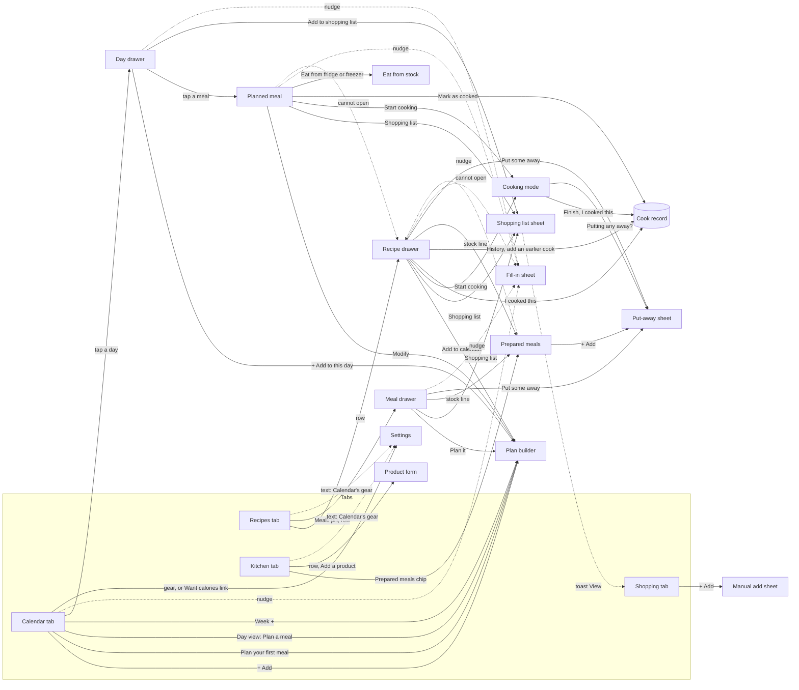
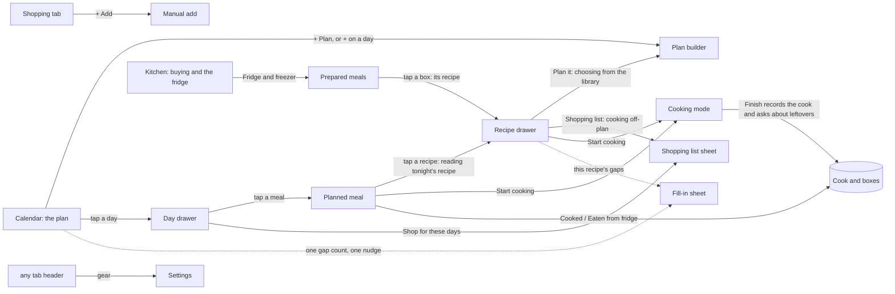

# I1 — Inventory of entry points and insights

Read-only audit of Pinch at the tip of the stack (`the audit build`, served at http://127.0.0.1:5240), 2026-10-15 (a Thursday), America/Los_Angeles. I walked it in Chromium at 390×844 first and 1280×900 second, signed in as **Alex** (the seeded returning user, read only: nothing was written), **Jamie** (the empty kitchen, read only) and **Taylor** (the scale kitchen, read only). Screenshots are in `audit/I1-shots/` (cited below as `I1-shots/<name>.png`). Every count of taps, entry points and insights below was taken in the browser or read from the code at the cited `file:line`. Paths under `components/`, `hooks/`, `utils/` and `constants.ts` are relative to `src/apps/pinch/`.

This report is the **fact base** for the other audits: (a) a surface map, (b) an entry-point matrix, (c) an insight inventory, (d) a concept list and (e) a tap-count table. Proposals are kept to one-line "smells" per section, plus a short list of what the facts imply.

**Headline numbers**

- **About 120 distinct surfaces:** 4 tabs, 8 kinds of full-page subview, 7 detail drawers, 16 form sheets, 13 in-place "‹ Back" views inside drawers and sheets, 8 form-editor drawers, 10 help or warning tips, 20 confirm dialogs and 22 kinds of toast.
- **Starts get the doors, looking things up doesn't.** Planning a meal can start from 7 places, creating an ingredient from 6, adding to the shopping list from 5, the add-prices nudge from 5 surfaces (7 placements), and nutrition display has 5 controls. Opening a recipe, the app's central noun, works from 2 places.
- **The same fact on many surfaces.**
  - An unpriced ingredient is reported on 14 surfaces, and only 5 of them can fix it.
  - Stock in the fridge or freezer shows on 10 surfaces, cost on about 17, "eat soon" on 9.
  - Five different gap counts for one kitchen appear on neighbouring screens: 13, 15, 10, 9 and 5.
- **First-view insight surfaces at 390×844, Alex:**
  - Kitchen 16
  - Recipes 11
  - Calendar Week and Day 10 each
  - Meal drawer 9
  - Calendar Month 8
  - Prepared meals 8
  - Shopping 6
  - Ideas 1

  Jamie, first run: Calendar 4, every other tab 0.

- **Words that mean more than one thing:**
  - "meal" has 4 meanings
  - "list" has 5
  - "Got it" has 3
  - "note" has 4
  - "made" has 2

  Six lines of copy tell the person to go to another screen instead of giving them a way there.

---

## 1. Who and when

A home cook, phone in one hand. Three moments recur in the data:

- **On the sofa on Sunday,** planning the week: the Calendar, Recipes and the shopping list.
- **In the shop,** ticking things off: Shopping, with bad signal.
- **At the stove,** with wet hands: cooking mode, then putting leftovers away.

Between those, there are quick looks: what's for dinner, what's in the freezer, what a recipe says. On their mind are dinner tonight, the budget, what's already cooked in the fridge, and not having to keep a database.

For this inventory, the question in every row is: **when the person wants X, how many places offer it, how many taps does it take, and what does the app tell them on the way that they didn't ask for?**

## 2. Goals and outcomes

The 30 tasks counted in §3/(e) are the job stories. Grouped by how often they happen:

| Job story ("When ___, I want to ___, so I can ___")                                                     | Outcome that means success            | How often      | Matters    | Without the app                 |
| ------------------------------------------------------------------------------------------------------- | ------------------------------------- | -------------- | ---------- | ------------------------------- |
| When it's 5 pm, I want to see tonight's plan, so I can start                                            | Dinner named in one look              | daily          | core       | memory, a note on the fridge    |
| When I start cooking, I want the recipe step by step with timers, so I can cook with my hands full      | Steps and timers on screen            | daily–weekly   | core       | a phone browser tab, a cookbook |
| When I'm in the shop, I want to tick things off, so I don't forget or double-buy                        | One tap per item, list shrinks        | weekly         | core       | paper list, Notes app           |
| When I plan the week, I want to put meals on days, so I know what to buy                                | 5–7 dinners planned                   | weekly         | core       | a whiteboard                    |
| When the plan is set, I want its ingredients on the list, so I can shop once                            | The week's list                       | weekly         | core       | copying by hand                 |
| When I've cooked a batch, I want to note what's in the fridge or freezer, so I eat it in time           | Boxes with eat-by dates               | weekly         | supporting | masking tape on the box         |
| When I'm hungry and lazy, I want to know what's already cooked, so I eat that first                     | "Fridge: Adobo, eat by tomorrow"      | daily          | supporting | opening the fridge              |
| When I find a recipe online or in a chat, I want it in my library, so I can plan with it                | A saved, reviewed recipe              | weekly–monthly | core       | screenshots, bookmarks          |
| When I wonder what the week costs, I want a number I trust, so I can stay on budget                     | A total, honest about gaps            | weekly         | supporting | receipts                        |
| When I cooked something, I want to remember what to change, so next time is better                      | A note shown next time                | monthly        | supporting | scribbles in the margin         |
| When I want calories or protein, I want to switch them on once, so I see them everywhere                | Numbers on rows and drawers           | once           | rare       | a tracking app                  |
| When a price changes or a day has passed, I want past totals to stay honest, so history means something | Frozen days, repriced only when asked | rare           | rare       | —                               |

## 3. Current journeys, as walked

The full tap counts are in section (e) below. These are the first views each count starts from: the screens the person sees most, with what was measured.

| Screen (Alex, 390×844)     | Where the first content row starts                                         | What sits above it                                                                                        | Shot                              |
| -------------------------- | -------------------------------------------------------------------------- | --------------------------------------------------------------------------------------------------------- | --------------------------------- |
| Calendar · Month (landing) | grid at y=415 (49% of the screen)                                          | header with gear and Add, Month/Week/Day, period row, Cost and Avg tiles, nudge line, "See the breakdown" | `I1-shots/a01-calendar-month.png` |
| Calendar · Week            | first day at y=417                                                         | the same stats block                                                                                      | `a02-calendar-week.png`           |
| Recipes                    | first recipe at y=304                                                      | header and New, 3 pills, search, filter and eye, "Sources 3" chip                                         | `b01-recipes.png`                 |
| Kitchen                    | first ingredient at y=342                                                  | header and New ingredient, subtitle, search, filter and eye, Yours/All with count, 3 chips                | `c01-kitchen.png`                 |
| Shopping                   | first line at y=268                                                        | header, "4 to buy", To buy/Got it switch, cost line with ⚠                                                | `d01-shopping.png`                |
| Prepared meals             | first box at y=288                                                         | header with back and Add, summary, 3-way switch, "4 containers · 10 servings" with Clear out              | `c05-prepared-fridge.png`         |
| Recipe drawer (Adobo)      | Ingredients at y=677 of a 629 px window; content is 1,772 px (2.8 screens) | 5 facts, cooked line, 2 stock lines, 5 chips in 3 rows, Cost tile, nudge, description                     | `b06-recipe-drawer-adobo*.png`    |
| Jamie · Calendar           | grid at y=501                                                              | $0.00 tile, "—" tile, help icon, "Want calories or protein here?", the empty box with 2 buttons           | `j01-calendar.png`                |

Scale (Taylor, `t01`–`t04`):

- Calendar's stats block grows to 10 surfaces: Cost $7,895 ⚠, Avg $24.83 ?, Per g protein $0.41, "Daily average this month 🔥 13475 💪 621.3g", "175 ingredients need details · Add details", the breakdown link, "+10" in a cell and the badge "64".
- Shopping shows "64 to buy", "To buy · 64", "Got it · 16" and the badge 64.
- Kitchen chips read "Prepared meals 301", "Stores 12" and "Products 150".

Wide (1280, `w01`–`w04`):

- The calendar shows titled pills.
- Hovering a day opens a read-only peek.
- The stats tile label grows to "Cost this month".
- The recipe start is the subview's first page instead of a drawer.

Error or offline states: none reachable without writes or network tricks a person wouldn't use. The headless browser has no wake lock, so cooking mode shows its fallback line, "This phone may turn the screen off…". That line is caused by the test environment, not a finding.

Things I could not see without writing:

- the toasts
- the Finish panel after "I cooked this"
- the put-away question
- the fill-in sheet's end state

I list these from the code below, and cite J5 and J6 for how they look.

---

## (a) Surface map

How each surface opens, closes, and what it is. "Overlay" subviews (recipe, plan, meal, cook) leave the tabs mounted underneath. "In-flow" subviews (stores, products, sources, containers) hide them (`Pinch.tsx:199-209`). There is one subview at a time (`hooks/usePinchOverlay.ts`). Deep links exist only for `?tab=recipes|kitchen|shopping` (`Pinch.tsx:90-92`) and `?view=week|day` (`components/calendar/CalendarScreen.tsx:109-112`). No link opens a recipe, a day or a container, and Pinch has no notifications.

### Tabs and shell

| Surface                                   | Kind          | File                                                    | Ways to open                                                                                   |
| ----------------------------------------- | ------------- | ------------------------------------------------------- | ---------------------------------------------------------------------------------------------- |
| Calendar                                  | tab (default) | `components/calendar/CalendarScreen.tsx`                | nav pill (phone) / rail (lg); landing                                                          |
| Recipes (Recipes / Meals / Ideas pills)   | tab           | `components/recipes/RecipesScreen.tsx`                  | nav; `?tab=recipes`                                                                            |
| Kitchen                                   | tab           | `components/kitchen/KitchenScreen.tsx`                  | nav; `?tab=kitchen`                                                                            |
| Shopping                                  | tab           | `components/shopping/ShoppingScreen.tsx`                | nav; `?tab=shopping`; toast "View" after an add (`hooks/usePinchOverlay.ts` `showShoppingTab`) |
| Nav pill or rail, with the Shopping badge | shell         | `components/shell/PinchNav.tsx`, `ShoppingTabBadge.tsx` | always                                                                                         |

### Full-page subviews (8 kinds)

| Surface                                                                      | Kind            | File                                                                                                                            | Ways to open (each)                                                                                                                                                                                                                                                                                                                                                                                                                                     |
| ---------------------------------------------------------------------------- | --------------- | ------------------------------------------------------------------------------------------------------------------------------- | ------------------------------------------------------------------------------------------------------------------------------------------------------------------------------------------------------------------------------------------------------------------------------------------------------------------------------------------------------------------------------------------------------------------------------------------------------- |
| Plan builder ("Plan a meal")                                                 | overlay subview | `components/plan/PlanMealSubview.tsx` → `MealBuilder.tsx` (mode plan)                                                           | Calendar header "+ Add" (`CalendarScreen.tsx:178-187`); empty box "Plan your first meal" (`:225-233`); Day view empty "Plan a meal" (`DayView.tsx:41`); Week "+" per day (`WeekView.tsx:121-129` lg, `:151-160` phone); Day drawer "+ Add to this day" (`DayDrawer.tsx:108-117`); Planned meal "Modify" (`PlannedMealView.tsx:248-256`); Recipe drawer "Add to calendar" (`RecipeDrawer.tsx:234-240`); Meal drawer "Plan it" (`MealDrawer.tsx:120-126`) |
| Saved-meal builder                                                           | overlay subview | `components/recipes/MealSubview.tsx` → `MealBuilder.tsx` (mode meal)                                                            | Recipes › Meals › "New" (`RecipesScreen.tsx:446-448`); Meal drawer "Modify"                                                                                                                                                                                                                                                                                                                                                                             |
| Recipe: start list (≥sm), reading screens (text, file, link), form           | overlay subview | `components/recipes/RecipeSubview.tsx`, `RecipeStart.tsx`, `RecipeReader.tsx`, `RecipeForm.tsx`                                 | Recipes "New" (≥sm; phone goes via the start drawer); start drawer pick (`Pinch.tsx:147-160`); Calendar empty box "Add a recipe" (≥sm, `CalendarScreen.tsx:240-248`); Recipe drawer "Modify"; Note sheet "Update the recipe from this note" (`RecipesScreen.tsx:633-637`); Idea drawer "Turn it into a recipe" (`IdeasView.tsx:204`)                                                                                                                    |
| Cooking mode (Steps / Ingredients, timers, Finish panel, note box, put-away) | overlay subview | `components/cooking/CookingSubview.tsx` (+ `CookStepView`, `CookIngredientsView`, `CookTimerStrip`, `CookNotes`, `CookPutAway`) | Recipe drawer chip "Start cooking" (`RecipeDrawer.tsx:154-163`); Planned meal chip "Start cooking", directly or via "Which one are you cooking?" (`PlannedMealView.tsx:188-198`, `DayDrawer.tsx:131-139`)                                                                                                                                                                                                                                               |
| Prepared meals (Fridge / Freezer / Finished)                                 | in-flow subview | `components/containers/ContainersSubview.tsx`                                                                                   | Kitchen chip "Prepared meals" (`PreparedEntry.tsx`); Recipe drawer stock line, scoped "Only Adobo chicken" (`RecipeDrawer.tsx:277-280` → `RecipesScreen.tsx:607-610`); Meal drawer stock line, scoped (`MealDrawer.tsx:132-135`)                                                                                                                                                                                                                        |
| Stores                                                                       | in-flow subview | `components/kitchen/StoresSubview.tsx`                                                                                          | Kitchen chip "Stores N" (`KitchenScreen.tsx:339-346`), only once a store exists                                                                                                                                                                                                                                                                                                                                                                         |
| Products                                                                     | in-flow subview | `components/kitchen/ProductsSubview.tsx`                                                                                        | Kitchen chip "Products N" (`KitchenScreen.tsx:347-354`), only once a product exists                                                                                                                                                                                                                                                                                                                                                                     |
| Sources                                                                      | in-flow subview | `components/recipes/SourcesSubview.tsx`                                                                                         | Recipes chip "Sources N" (`RecipesScreen.tsx:563-572`), only once a source exists, Recipes pill only                                                                                                                                                                                                                                                                                                                                                    |

### Detail drawers (DetailSheet)

| Surface                           | File                                                                                                                                                                                                                           | Ways to open                                                                                               | In-place views ("‹ Back")                                                                                                                                  |
| --------------------------------- | ------------------------------------------------------------------------------------------------------------------------------------------------------------------------------------------------------------------------------ | ---------------------------------------------------------------------------------------------------------- | ---------------------------------------------------------------------------------------------------------------------------------------------------------- |
| Day drawer                        | `components/calendar/DayDrawer.tsx`                                                                                                                                                                                            | Month cell; Week meal row (opens on that meal); Week "Show N more"; Day view meal row (opens on that meal) | Planned meal (`PlannedMealView.tsx`); "Which one are you cooking?"; "Name this meal" (Save as a meal); "Eat from your fridge/freezer" (`EatFromStock.tsx`) |
| Day peek (lg, hover, read only)   | `components/calendar/DayPeek.tsx` via `DayCell.tsx:144` (Popover)                                                                                                                                                              | hover a month cell                                                                                         | —                                                                                                                                                          |
| Breakdown (By day / By meal)      | `components/calendar/BreakdownDrawer.tsx`                                                                                                                                                                                      | "See the breakdown" (`StatsRow.tsx:190-200`), only while something is planned                              | — (rows lead nowhere)                                                                                                                                      |
| Recipe drawer                     | `components/recipes/RecipeDrawer.tsx`                                                                                                                                                                                          | Recipes row; Idea drawer "Open the recipe" (`IdeasView` `onOpenRecipe`)                                    | —                                                                                                                                                          |
| Meal drawer (saved meal)          | `components/recipes/MealDrawer.tsx`                                                                                                                                                                                            | Meals row                                                                                                  | —                                                                                                                                                          |
| Idea drawer                       | `components/ideas/IdeaDrawer.tsx`                                                                                                                                                                                              | Ideas row                                                                                                  | —                                                                                                                                                          |
| Ingredient drawer                 | `components/kitchen/IngredientDrawer.tsx`                                                                                                                                                                                      | Kitchen row only                                                                                           | —                                                                                                                                                          |
| New recipe start (phone)          | `components/recipes/RecipeStart.tsx` (`RecipeStartDrawer`)                                                                                                                                                                     | Recipes "New" (phone); Calendar empty box "Add a recipe" (phone); Back from a reading screen               | —                                                                                                                                                          |
| Form editors over the recipe form | `RecipeBasics.tsx` (Title, Prep and cook, Description via `SummaryEditor`), `RecipeCareField.tsx` (Keeping it), `RecipeIngredients.tsx:367-383` (ingredient line), `RecipeSteps.tsx` (step), `NutritionReview.tsx` (nutrition) | rows of the recipe form; Title opens itself once for a blank recipe                                        | —                                                                                                                                                          |

### Form sheets (FormSheet: a drawer on a phone, a modal from sm)

| Surface                                              | File                                                   | Ways to open                                                                                                                                         |
| ---------------------------------------------------- | ------------------------------------------------------ | ---------------------------------------------------------------------------------------------------------------------------------------------------- |
| Settings (4 nutrition switches, About)               | `components/settings/SettingsSheet.tsx`                | Calendar gear (`CalendarScreen.tsx:168-177`); "Want calories or protein here?" (`StatsRow.tsx:180-189`, only with no metric on and no nudge showing) |
| Prices and sizes (fill-in, "1 of 13")                | `components/shared/FillInSheet.tsx`                    | the nudge's "Add prices/details/values/a size" on: Calendar stats (Month, Week, Day), Day drawer, Planned meal, Recipe drawer, Meal drawer           |
| Shopping list (add from a recipe, meal, plan or day) | `components/shared/AddToShoppingSheet.tsx`             | Recipe drawer chip; Meal drawer chip; Planned meal chip; Day drawer row (not past)                                                                   |
| Shopping list (manual add)                           | `components/shopping/ShoppingAddSheet.tsx`             | Shopping "+ Add"                                                                                                                                     |
| Shopping row sheet                                   | `components/shopping/ShoppingItemSheet.tsx`            | tap a shopping row                                                                                                                                   |
| Ingredient form                                      | `components/kitchen/IngredientFormSheet.tsx`           | Kitchen "New ingredient"; Ingredient drawer "Modify"/"Adjust"                                                                                        |
| Product form                                         | `components/kitchen/ProductFormSheet.tsx`              | Ingredient drawer "Add a product" or a product row; Products "New product" (after a pick-an-ingredient sheet) or a row                               |
| Store form                                           | `components/kitchen/StoreFormSheet.tsx`                | Stores "Add" or a row (a new store can also be named inline in `StorePicker`)                                                                        |
| Source form                                          | `components/recipes/SourceFormSheet.tsx`               | Sources "New source" or a row                                                                                                                        |
| Container (put away)                                 | `components/containers/ContainerFormSheet.tsx`         | Recipe drawer "Put some away"; Meal drawer "Put some away"; Prepared meals "+ Add"                                                                   |
| Container (one box)                                  | `components/containers/ContainerSheet.tsx`             | Prepared meals row. In-place views: Ate some…, Change the eat-by date, Correct the count, move (Put in the freezer / Thaw)                           |
| Cooking history                                      | `components/recipes/CookingHistorySheet.tsx`           | Recipe drawer "History" chip, only once cooked. In place: one cook (`CookEditView.tsx`), its note                                                    |
| Note                                                 | `components/notes/NoteSheet.tsx`                       | Recipe drawer Notes "Add a note" / "Edit"                                                                                                            |
| New idea (link / photo / jot it down)                | `components/ideas/IdeaAddSheet.tsx` (+ `IdeaWays.tsx`) | Ideas "New idea"                                                                                                                                     |
| Idea (edit)                                          | `components/ideas/IdeaFormSheet.tsx`                   | Idea drawer "Modify"                                                                                                                                 |

### Popovers, tips, dialogs, toasts

- **Popovers and dropdowns:**
  - filter panels on Recipes, Meals, Kitchen and Products (a drawer on a phone)
  - View options on Recipes/Meals (one shared store) and on Kitchen (`ListViewControls.tsx`)
  - a sort control on Products
  - SummaryEditor popovers from sm
  - the Day peek
- **Help and warning tips (10 placements):**
  - Calendar Cost ⚠ and Avg ? (`StatsRow.tsx:114, 145`)
  - Day drawer ⚠ (`DayDrawer.tsx:165`)
  - Planned meal ⚠ (`PlannedMealView.tsx:393`)
  - Recipe drawer ⚠ (`RecipeDrawer.tsx:312`)
  - Meal drawer ⚠ (`MealDrawer.tsx:156`)
  - Builder ⚠ (`MealBuilder.tsx:524`)
  - recipe form nutrition ⚠ (`NutritionReview.tsx:109`)
  - Reprice ? (`RepriceDayRow.tsx:134`)
  - Shopping cost ?/⚠ (`ShoppingScreen.tsx:468`)
- **Confirm dialogs (20):**
  - Remove from this day
  - Delete this cook? (×2)
  - Use today's prices for {day}?
  - Stop timers and leave?
  - Delete this note?
  - Delete this idea?
  - Delete source
  - Delete meal
  - Remove/Delete recipe
  - Discard this recipe?
  - Delete this container?
  - Threw it out?
  - Remove from your list
  - Clear what you got
  - Remove/Delete store (×2)
  - Delete product
  - Delete/Reset ingredient
  - Clear out the {place}?
- **Toasts (22 kinds):** listed in (c).

**Smells (a):**

- Four detail drawers (Day, Planned meal, Recipe, Meal) each carry a full action set, and the Day drawer hosts four in-place views. The drawer is where the app keeps its features, not only where a person looks something up.
- No deep link exists below tab level, so a toast or a text pointer can only send the person to a tab.

---

## (b) Entry-point matrix

**C** marks an in-context shortcut: a door inside a journey. The matrix names the journey. **H** marks the feature's home: where a person would only find it by looking. "—" means none. Counts are distinct places a person can start the action from, at 390, with Alex's data, plus the conditional ones noted.

### Grid: which kinds of place each feature can be reached from

| Feature                            | Tab / home          | Header action                        | Empty-state button                             | Row tap                                  | Drawer chip, footer or row                                                             | In-place view                                                                                                                                        | Nudge line                                                                              | Entry chip                 | Filter                                                   | Toast               | Cooking mode                                              | Text pointer only                                                                 |
| ---------------------------------- | ------------------- | ------------------------------------ | ---------------------------------------------- | ---------------------------------------- | -------------------------------------------------------------------------------------- | ---------------------------------------------------------------------------------------------------------------------------------------------------- | --------------------------------------------------------------------------------------- | -------------------------- | -------------------------------------------------------- | ------------------- | --------------------------------------------------------- | --------------------------------------------------------------------------------- |
| Recipe: view                       | Recipes (H)         | —                                    | —                                              | Recipes row                              | Idea drawer "Open the recipe"                                                          | —                                                                                                                                                    | —                                                                                       | —                          | —                                                        | —                   | —                                                         | —                                                                                 |
| Recipe: create                     | Recipes (H)         | "New"                                | Calendar "Add a recipe" (no recipes yet)       | —                                        | Idea "Turn it into a recipe"                                                           | —                                                                                                                                                    | —                                                                                       | —                          | —                                                        | —                   | —                                                         | —                                                                                 |
| Recipe: edit                       | —                   | —                                    | —                                              | —                                        | Recipe drawer "Modify"                                                                 | Note sheet "Update the recipe from this note"                                                                                                        | —                                                                                       | —                          | —                                                        | —                   | —                                                         | —                                                                                 |
| Saved meal: view                   | Recipes › Meals (H) | —                                    | —                                              | Meals row                                | —                                                                                      | —                                                                                                                                                    | —                                                                                       | —                          | —                                                        | —                   | —                                                         | —                                                                                 |
| Saved meal: create                 | Meals (H)           | "New" (Meals pill)                   | —                                              | —                                        | Planned meal footer "Save as a meal" (primary)                                         | Builder "Save as a meal" switch (plan mode, 2+ items)                                                                                                | —                                                                                       | —                          | —                                                        | —                   | —                                                         | —                                                                                 |
| Planned meal: create               | Calendar (H)        | "+ Add"                              | "Plan your first meal"; Day view "Plan a meal" | —                                        | Day drawer "+ Add to this day"; Recipe drawer "Add to calendar"; Meal drawer "Plan it" | —                                                                                                                                                    | —                                                                                       | —                          | —                                                        | —                   | —                                                         | —                                                                                 |
| Planned meal: view                 | Calendar (H)        | —                                    | —                                              | Month cell → day; Week row; Day view row | —                                                                                      | Day drawer list → meal                                                                                                                               | —                                                                                       | —                          | —                                                        | —                   | —                                                         | —                                                                                 |
| Planned meal: change, move, remove | —                   | —                                    | —                                              | —                                        | Planned meal "Modify" (not past), "Remove from this day"                               | Builder "Change" (date, meal type)                                                                                                                   | —                                                                                       | —                          | —                                                        | —                   | —                                                         | —                                                                                 |
| Idea                               | Recipes › Ideas (H) | "New idea"                           | —                                              | Ideas row                                | —                                                                                      | —                                                                                                                                                    | —                                                                                       | —                          | —                                                        | —                   | —                                                         | —                                                                                 |
| Source (list, rename)              | —                   | —                                    | —                                              | —                                        | —                                                                                      | —                                                                                                                                                    | —                                                                                       | "Sources N" (Recipes)      | Source filter (Recipes)                                  | —                   | —                                                         | —                                                                                 |
| Source: create                     | —                   | Sources "New source"                 | —                                              | —                                        | —                                                                                      | Recipe form "Where it's from" → "New source"                                                                                                         | —                                                                                       | —                          | —                                                        | —                   | —                                                         | —                                                                                 |
| Ingredient: view                   | Kitchen (H)         | —                                    | —                                              | Kitchen row                              | —                                                                                      | —                                                                                                                                                    | —                                                                                       | —                          | —                                                        | —                   | —                                                         | —                                                                                 |
| Ingredient: create                 | Kitchen (H)         | "New ingredient"                     | —                                              | —                                        | —                                                                                      | "New ingredient 'X'" in the plan builder, saved-meal builder, recipe form ingredient drawer and Shopping add; reading review "Add as new ingredient" | —                                                                                       | —                          | —                                                        | —                   | —                                                         | —                                                                                 |
| Product: create or price           | —                   | Products "New product"               | —                                              | —                                        | Ingredient drawer "Add a product" (under its "No product yet…" line)                   | Fill-in sheet (a price makes a product)                                                                                                              | via fill-in                                                                             | —                          | Kitchen "Needs a price" (finds the backlog)              | —                   | —                                                         | Shopping ⚠: "Add a price from the ingredient in Kitchen"                          |
| Products list                      | —                   | —                                    | —                                              | —                                        | —                                                                                      | —                                                                                                                                                    | —                                                                                       | "Products N" (Kitchen)     | —                                                        | —                   | —                                                         | —                                                                                 |
| Store                              | —                   | Stores "Add"                         | —                                              | —                                        | —                                                                                      | Product form and fill-in "New store" pill                                                                                                            | —                                                                                       | "Stores N" (Kitchen)       | —                                                        | —                   | —                                                         | —                                                                                 |
| Shopping list: add                 | Shopping (H)        | Shopping "+ Add"                     | —                                              | —                                        | Recipe chip; Meal chip; Planned meal chip; Day drawer row                              | —                                                                                                                                                    | —                                                                                       | —                          | —                                                        | "View" after an add | —                                                         | —                                                                                 |
| Cooking mode                       | —                   | —                                    | —                                              | —                                        | Recipe chip "Start cooking"; Planned meal chip "Start cooking"                         | "Which one are you cooking?"                                                                                                                         | —                                                                                       | —                          | —                                                        | —                   | —                                                         | —                                                                                 |
| Cook record: create                | —                   | —                                    | —                                              | —                                        | Recipe chip "I cooked this"; Planned item "Mark as cooked"                             | History "+ Add an earlier cook"                                                                                                                      | —                                                                                       | —                          | —                                                        | Undo                | Finish → "I cooked this"                                  | —                                                                                 |
| Cooking history                    | —                   | —                                    | —                                              | —                                        | Recipe chip "History" (once cooked)                                                    | —                                                                                                                                                    | —                                                                                       | —                          | —                                                        | —                   | —                                                         | —                                                                                 |
| Note: create or edit               | —                   | —                                    | —                                              | —                                        | Recipe drawer "Add a note" / "Edit"                                                    | History "Add a note" under each cook; cook view "Add a note"                                                                                         | —                                                                                       | —                          | —                                                        | —                   | Finish → "Add a note about it"; "Your latest note" (read) | —                                                                                 |
| Care ("Keeping it"): edit          | —                   | —                                    | —                                              | —                                        | —                                                                                      | Recipe form "Keeping it" row                                                                                                                         | —                                                                                       | —                          | —                                                        | —                   | (shown at Finish)                                         | —                                                                                 |
| Prepared meals: list               | Kitchen chip (H)    | —                                    | —                                              | —                                        | Recipe drawer stock line; Meal drawer stock line (both scoped)                         | —                                                                                                                                                    | —                                                                                       | "Prepared meals N" (+ dot) | Recipes/Meals "In stock" (filters recipes, doesn't open) | —                   | —                                                         | Undo failure: "You can change it from Prepared meals."                            |
| Prepared meals: put away           | —                   | Prepared meals "+ Add"               | —                                              | —                                        | Recipe chip "Put some away"; Meal chip "Put some away"                                 | —                                                                                                                                                    | —                                                                                       | —                          | —                                                        | Undo                | Finish → "Putting any away?" / "Put some away"            | —                                                                                 |
| Prepared meals: eat                | —                   | —                                    | —                                              | Prepared meals row → sheet               | Planned meal "Eat from fridge/freezer" (today or past)                                 | Eat from stock                                                                                                                                       | —                                                                                       | —                          | —                                                        | Undo                | —                                                         | —                                                                                 |
| Re-price a past day                | —                   | —                                    | —                                              | —                                        | Day drawer row; Planned meal row (same day)                                            | —                                                                                                                                                    | —                                                                                       | —                          | —                                                        | —                   | —                                                         | Calendar ⚠: "To count it on one, open that day."                                  |
| View options                       | —                   | eye on Recipes/Meals; eye on Kitchen | —                                              | —                                        | —                                                                                      | —                                                                                                                                                    | —                                                                                       | —                          | —                                                        | —                   | —                                                         | —                                                                                 |
| Settings                           | Calendar only       | gear                                 | "Want calories or protein here?" (conditional) | —                                        | —                                                                                      | —                                                                                                                                                    | —                                                                                       | —                          | —                                                        | —                   | —                                                         | View options: "Turn them on from the Calendar's gear" (`ListViewControls.tsx:53`) |
| Nutrition display                  | Settings (H)        | —                                    | —                                              | —                                        | Ingredient drawer per serving / per 100 g                                              | —                                                                                                                                                    | nutrition nudges (when on)                                                              | —                          | View options switch ×2 lists, basis pills (Kitchen)      | —                   | —                                                         | —                                                                                 |
| Add-prices fill-in                 | —                   | —                                    | —                                              | —                                        | —                                                                                      | —                                                                                                                                                    | Calendar stats (Month, Week, Day), Day drawer, Planned meal, Recipe drawer, Meal drawer | —                          | —                                                        | —                   | —                                                         | Builder ⚠ ("from the meal once it's saved")                                       |
| Breakdown                          | —                   | —                                    | —                                              | —                                        | "See the breakdown"                                                                    | —                                                                                                                                                    | —                                                                                       | —                          | —                                                        | —                   | —                                                         | —                                                                                 |

### Counts: entry points per feature

| Feature                        | Entry points                 | Home (H)                                          | In-context (C), with the journey that needs it                                                                                                                                                                                                     | Found only by looking | Notes                                                                                                                                                                |
| ------------------------------ | ---------------------------- | ------------------------------------------------- | -------------------------------------------------------------------------------------------------------------------------------------------------------------------------------------------------------------------------------------------------- | --------------------- | -------------------------------------------------------------------------------------------------------------------------------------------------------------------- |
| **Planned meal: create**       | **7**                        | Calendar "+ Add"                                  | Day drawer "+ Add to this day" (looking at a day); Week "+" (planning the week); Recipe drawer "Add to calendar" and Meal drawer "Plan it" (choosing from the library); empty-box "Plan your first meal" and Day view "Plan a meal" (empty states) | —                     | The empty-box and Day-view buttons repeat the header's Add on the same screen (`j01c-day.png`: two empty boxes plus the header). 7 labels for one act (J3-F9 agrees) |
| **Ingredient: create**         | **6**                        | Kitchen "New ingredient"                          | "New ingredient 'X'" inside 4 search hosts (plan builder, saved-meal builder, recipe ingredient drawer, Shopping add), reading review "Add as new ingredient"                                                                                      | —                     | Each in-search create writes at once (J1-F1)                                                                                                                         |
| **Shopping list: add**         | **5** (+ toast path)         | Shopping "+ Add"                                  | Recipe chip (cooking off-plan); Day drawer row (the day's shop); Planned meal chip (one meal of the day); Meal drawer chip (a saved meal)                                                                                                          | —                     | Day and Planned meal are nested in the same drawer, and a saved meal is planned before it is shopped. J4-P11 drops 2                                                 |
| **Add-prices fill-in**         | **5 surfaces, 7 placements** | —                                                 | every drawer showing a cost, plus Calendar stats in 3 views                                                                                                                                                                                        | —                     | No home: the manual route is Kitchen → ingredient → "Add a product"                                                                                                  |
| **Nutrition display controls** | **5**                        | Settings (4 switches)                             | View options "Show calories and macros" on Recipes and on Kitchen (both off and disabled until Settings is on), Kitchen basis pills, Ingredient drawer per serving / per 100 g                                                                     | —                     | Turning calories on for both lists takes 11 taps (T27). J1-F6 agrees                                                                                                 |
| **Cook record: create**        | **4**                        | —                                                 | Recipe drawer "I cooked this"; Planned item "Mark as cooked"; Finish → "I cooked this"; History "+ Add an earlier cook"                                                                                                                            | —                     | Three doors for "I cooked it tonight" (J5-P5 merges)                                                                                                                 |
| **Note: create**               | **4**                        | Recipe drawer Notes (bottom, about 1,300 px down) | History, per cook; cook view; Finish "Add a note about it"                                                                                                                                                                                         | —                     | Reading notes: drawer (bottom) and cooking mode's "Your latest note" block                                                                                           |
| **Prepared meals: put away**   | **4**                        | Prepared meals "+ Add"                            | Recipe chip; Meal chip; Finish "Putting any away?"                                                                                                                                                                                                 | —                     |                                                                                                                                                                      |
| **Prepared meals: list**       | **3**                        | Kitchen chip (only once a box exists)             | Recipe stock line, Meal stock line (scoped "Only …")                                                                                                                                                                                               | —                     | Stock is _shown_ on 10 surfaces (see c)                                                                                                                              |
| **Recipe: create**             | **3**                        | Recipes "New"                                     | Idea "Turn it into a recipe"; Calendar "Add a recipe" (before any recipe)                                                                                                                                                                          | —                     | "New" changes target with the pill: start drawer, saved-meal builder or idea sheet (J2-H9)                                                                           |
| **Saved meal: create**         | **3**                        | Meals "New"                                       | Planned meal "Save as a meal" (the footer primary on every planned meal, past or ahead); builder switch                                                                                                                                            | —                     | J3-P8 and J1-P7 trim 1 or 2                                                                                                                                          |
| **Product: create**            | **3**                        | Products "New product"                            | Ingredient drawer "Add a product"; fill-in sheet                                                                                                                                                                                                   | —                     |                                                                                                                                                                      |
| **Store: create**              | **3**                        | Stores "Add"                                      | Product form and fill-in "New store" pill                                                                                                                                                                                                          | —                     |                                                                                                                                                                      |
| **Recipe: view**               | **2**                        | Recipes row                                       | Idea "Open the recipe"                                                                                                                                                                                                                             | —                     | **Not openable** from 5 surfaces that name a recipe: planned meal item, Day drawer row, saved-meal plate, container row or sheet, cooking history (J2-H10 agrees)    |
| **Cooking mode**               | **2**                        | —                                                 | Recipe chip; Planned meal chip                                                                                                                                                                                                                     | —                     | No home: fine, since it is a moment                                                                                                                                  |
| **Re-price a day**             | **2**                        | —                                                 | Day drawer row; Planned meal row                                                                                                                                                                                                                   | —                     | Both are inside the same Day drawer, one view apart (`a05`, `a12`)                                                                                                   |
| **Settings**                   | **2**                        | Calendar gear                                     | "Want calories or protein here?"                                                                                                                                                                                                                   | —                     | Missing from Recipes, Kitchen and Shopping, which point to it in text                                                                                                |
| **View options**               | **2**                        | eyes on Recipes/Meals and Kitchen                 | —                                                                                                                                                                                                                                                  | —                     | Recipes and Meals share one stored choice                                                                                                                            |
| **Recipe: edit**               | **2**                        | Recipe drawer "Modify"                            | Note "Update the recipe from this note"                                                                                                                                                                                                            | —                     |                                                                                                                                                                      |
| **Planned meal: view**         | **3** (+ lg peek)            | Month cell → Day drawer                           | Week row; Day view row                                                                                                                                                                                                                             | —                     | The phone Week view can't open a day except meal → "‹ Back" (J4-9 agrees)                                                                                            |
| **Idea: create**               | **1**                        | Ideas "New idea"                                  | —                                                                                                                                                                                                                                                  | —                     | Capture forks between "New" (recipe) and "New idea" (J2-H1)                                                                                                          |
| **Sources list**               | **1**                        | Recipes chip                                      | —                                                                                                                                                                                                                                                  | —                     | The recipe's "📖 From X" is not tappable                                                                                                                             |
| **Care: edit**                 | **1**                        | Recipe form "Keeping it"                          | —                                                                                                                                                                                                                                                  | —                     | Shown in 3 places: drawer section, Finish "Leftovers keep…", put-away "Your call. Taken from the fridge time in your recipe."                                        |
| **Breakdown**                  | **1**                        | Calendar                                          | —                                                                                                                                                                                                                                                  | —                     | Its rows don't open their day (J7-10)                                                                                                                                |

**Smells (b):**

- Doors cluster on **start and log** actions (plan 7, ingredient 6, shop 5, prices 5, nutrition 5, cooked 4, note 4, put away 4).
- **Look-up** actions get 1 or 2 (recipe 2, ingredient 1, sources 1). That is the opposite of where a person needs them: a planned dinner, a saved meal's plate and a box in the freezer all name a recipe and can't open it.
- Three features have **no home** a person would look in: the add-prices fill-in, cooking mode and re-pricing a day. They exist only as in-context doors.

---

## (c) Insight inventory

Classes:

- **DECISION:** changes what the person does next.
- **STATUS:** confirms something they did.
- **REFERENCE:** they asked for it by opening the screen.
- **NOISE:** none of those.

"Act here?" means the person can act on it where it appears. Counts are distinct volunteered items visible on the **first view at 390×844** without scrolling. Core content is not counted: names, servings and the plan's chips. The Shopping tab badge is counted once per screen where it is visible.

### Per screen, Alex (seeded returning user)

| Screen (shot)                            | Volunteered items on the first view (class · act here? · repeats elsewhere?)                                                                                                                                                                                                                                                                                                                                                          | Count                                    |
| ---------------------------------------- | ------------------------------------------------------------------------------------------------------------------------------------------------------------------------------------------------------------------------------------------------------------------------------------------------------------------------------------------------------------------------------------------------------------------------------------- | ---------------------------------------- |
| **Calendar · Month** (`a01`)             | Cost $5.20 (REFERENCE, partial · no · Week/Day/drawers) · ⚠ on Cost (STATUS · opens a text that mentions frozen days · Day drawer, Planned meal) · Avg per meal $0.29 (NOISE · no · Week/Day) · ? on Avg (REFERENCE) · "13 ingredients need a price · Add prices ✕" (DECISION backlog · yes · 4 more surfaces) · "See the breakdown" (REFERENCE · yes) · "+3", "+8" cell overflow (REFERENCE) · Shopping badge 4 (STATUS · every tab) | **8**                                    |
| **Calendar · Week** (`a02`)              | the 6 stats items · row prices "Wasn't priced" ×2, "$0.15" (REFERENCE/NOISE · no · Day drawer) · badge                                                                                                                                                                                                                                                                                                                                | **10**                                   |
| **Calendar · Day** (`a03`)               | the 6 stats items (nudge now **10**) · row prices "No price yet", "$0.15" (a 2-recipe plate shown as one price, though Adobo is unpriced), "$0.53" · badge                                                                                                                                                                                                                                                                            | **10**                                   |
| **Day drawer · today** (`a04`)           | Cost $0.68 · ⚠ · "10 ingredients need a price · Add prices ✕" · row prices ×4 ("No price yet" ×2, $0.15, $0.53)                                                                                                                                                                                                                                                                                                                       | **7**                                    |
| **Day drawer · past** (`a05`)            | "Wasn't priced" tile · "Fixed when the day passed" · rows "Wasn't priced" ×2 · "Price this day with today's prices" row + ? (DECISION)                                                                                                                                                                                                                                                                                                | **6** ("Wasn't priced" 3× on one drawer) |
| **Day drawer · ahead** (`a06`)           | Cost $3.03 · ⚠ · "8 ingredients need a price" · row prices ×4                                                                                                                                                                                                                                                                                                                                                                         | **7**                                    |
| **Planned meal · today** (`a11`)         | Cost $0.15 · ⚠ · "9 ingredients need a price ✕" · row prices ×2 · chips "Eat from fridge", "Eat from freezer" (DECISION · yes; counts only in aria: "3 containers match")                                                                                                                                                                                                                                                             | **7**                                    |
| **Planned meal · past, cooked** (`a12`)  | "Wasn't priced" tile · "Fixed when the day passed" · "✅ Cooked · Undo" (STATUS) · row "Wasn't priced" · "This day has passed, so its meals keep the prices and numbers they had." (NOISE: says the tile again) · Reprice row + ? · "Eat from fridge/freezer" chips on a past day                                                                                                                                                     | **8**                                    |
| **Planned meal · ahead** (`a13`)         | Cost $2.42 · ⚠ · "3 ingredients need a price" · row price                                                                                                                                                                                                                                                                                                                                                                             | **4**                                    |
| **Breakdown** (`a07`, asked for)         | "$5.20" · "The total leaves out 15 ingredients." · per day: meal count, "leaves out N", total (×5 visible)                                                                                                                                                                                                                                                                                                                            | REFERENCE screen                         |
| **Recipes** (`b01`)                      | "Sources 3" (REFERENCE) · "Cooked 4×", "Cooked 1×" (NOISE on a row · drawer has it) · "No price yet" · "$0.08 / serving · leaves out 4" · "$0.81 / serving · leaves out 3" (REFERENCE, partial) · stock "🧊 5 servings", "❄️ 5 servings", "🧊 3 servings" (DECISION · tap opens the drawer) · "Eat by tomorrow" (DECISION) · badge                                                                                                    | **11** (J2 counted 10 without the badge) |
| **Meals** (`b04`)                        | "2 items · $0.15 · leaves out 10", "2 items · $0.53 · leaves out 1" · stock 🧊 10, ❄️ 5 (servings include the meal's own recipes' boxes) · "Eat by tomorrow" · badge                                                                                                                                                                                                                                                                  | **7**                                    |
| **Ideas** (`b05`)                        | "Still to try" / "Made into recipes" groups (REFERENCE) · badge                                                                                                                                                                                                                                                                                                                                                                       | **1–2** (calm)                           |
| **Recipe drawer · Adobo** (`b06`)        | "✏️ Last tweaked Oct 7" · "✅ Cooked 4 times · last Oct 12" (REFERENCE) · "🧊 5 servings in your fridge" + "Eat by tomorrow" · "❄️ 5 servings in your freezer, eat by Jan 3, 2027" (DECISION · tap opens Prepared meals) · Cost "No prices yet" (NOISE) · "5 ingredients need a price ✕" (DECISION backlog)                                                                                                                           | **7** (Ingredients start at y=677)       |
| **Recipe drawer · Nachos** (`b07`)       | Cost $4.85 / "$0.81 per serving" · ⚠ · "3 ingredients need a price"                                                                                                                                                                                                                                                                                                                                                                   | **3**                                    |
| **Meal drawer** (`b08`)                  | "🧊 10 servings in your fridge" + "Eat by tomorrow" · "❄️ 5 servings in your freezer…" · "Adobo and rice 2 · Adobo chicken 10 · Cilantro lime rice 3" (sums fridge and freezer; mental maths) · Cost $0.15 + ⚠ + "For the plate" · "9 ingredients need a price" · row prices ×2                                                                                                                                                       | **9**                                    |
| **Idea drawer** (`b09`, `b10`)           | "Made into Adobo chicken" when made                                                                                                                                                                                                                                                                                                                                                                                                   | **0–1**                                  |
| **Kitchen** (`c01`)                      | "19 ingredients" · chip counts "Prepared meals 7" (+ orange dot), "Stores 3", "Products 5" · family counts ×4 · "No price yet" ×3 · price lines ×3 ("Walmart · $9.48 / 3 lb") · badge                                                                                                                                                                                                                                                 | **16**                                   |
| **Ingredient drawer** (`c04`, `c11`)     | unpriced: "No product yet. Add where you buy it and recipes can show what they cost." (DECISION · yes) · priced: "✏️ Adjusted by you", product prices                                                                                                                                                                                                                                                                                 | **1–3**                                  |
| **Prepared meals · Fridge** (`c05`)      | "25 servings in 7 containers" · "Fridge · 4", "Freezer · 3" · "4 containers · 10 servings" · "Eat soon" ×2 (DECISION) · "Made Oct 12", "Thawed · Made Sep 5"                                                                                                                                                                                                                                                                          | **8**                                    |
| **Container sheet** (`c08`)              | "2 servings left" · "Eat soon" · history ×3 · plus a subtitle under every one of 6 actions ("Leaves 1 serving", "Moves it to Finished", "Sets a new eat-by date", "Now tomorrow", "Fix how many are left", "Keeps it in Finished")                                                                                                                                                                                                    | **5** + 6 lines of explanation           |
| **Shopping** (`d01`)                     | "4 to buy" · "To buy · 4" · "Got it · 2" · "Amounts on your list: about $3.16" + ⚠ · badge "4"                                                                                                                                                                                                                                                                                                                                        | **6** (the number 4 three times)         |
| **Shopping list sheet · recipe** (`e03`) | "You already have 5 servings in the fridge, 5 in the freezer." (DECISION) · "3 of 6" · "On your list · 2 lb" ×3 (DECISION)                                                                                                                                                                                                                                                                                                            | **5**                                    |
| **Shopping list sheet · day** (`e20`)    | "You already have prepared servings of Cilantro lime rice and Adobo chicken." · "8 of 11" · "On your list" ×3                                                                                                                                                                                                                                                                                                                         | **5**                                    |
| **Plan builder** (`e01`, `e19`, `e14`)   | empty plate: 0 · search results: stock line and "Eat by tomorrow" per recipe (DECISION, the right place) · editing: "servings · Recipe serves 6", "Cost $2.42" ⚠                                                                                                                                                                                                                                                                      | **0 / 3 / 3**                            |
| **Cooking · step** (`e07`)               | "Your latest note (Oct 12): …" (DECISION, right moment) · "Step 1 of 3" + dots (STATUS) · "Timers in this step"                                                                                                                                                                                                                                                                                                                       | **3**                                    |
| **Cooking · Finish question** (`e09`)    | "4 servings" · "Keeps a record. You can change the date later." · "Leftovers keep 3 days in the fridge, 3 months in the freezer"                                                                                                                                                                                                                                                                                                      | **3**                                    |
| **Settings** (`a08`)                     | one line under the switches; About ×2                                                                                                                                                                                                                                                                                                                                                                                                 | REFERENCE                                |
| **Fill-in** (`a09`)                      | "1 of 13" · "Add a store, a price and a size to save this one."                                                                                                                                                                                                                                                                                                                                                                       | **2**                                    |

### Per screen, Jamie (first run) and Taylor (scale)

| Screen                                                                  | Items                                                                                                                                                                                               | Count           |
| ----------------------------------------------------------------------- | --------------------------------------------------------------------------------------------------------------------------------------------------------------------------------------------------- | --------------- |
| Jamie · Calendar Month (`j01`)                                          | $0.00 Cost (NOISE: reads as "free") · "—" Avg (NOISE) · ? (NOISE) · "Want calories or protein here?" (NOISE on day one) · plus the empty box, whose "Plan your first meal" repeats the header's Add | **4** + box     |
| Jamie · Calendar Day (`j01c`)                                           | the same 4 · the box · a **second** empty box, "Nothing planned for this day yet · Plan a meal"                                                                                                     | **4** + 2 boxes |
| Jamie · Recipes, Meals, Ideas, Kitchen, Shopping (`j02*`, `j03`, `j04`) | one muted line each (Kitchen adds "Browse every ingredient")                                                                                                                                        | **0** each      |
| Taylor · Calendar Month (`t01`)                                         | Cost $7,895 ⚠ · Avg $24.83 ? · Per g protein $0.41 · "Daily average this month 🔥 13475 💪 621.3g" · "175 ingredients need details · Add details" · breakdown · "+10" · badge 64                    | **10**          |

### The same fact, counted across surfaces (Alex)

| Fact                               | Surfaces where it is volunteered                                                                                                                                                                                                                                                                                                                                                             | Count                               | Where it can be acted on                                                                                                      |
| ---------------------------------- | -------------------------------------------------------------------------------------------------------------------------------------------------------------------------------------------------------------------------------------------------------------------------------------------------------------------------------------------------------------------------------------------- | ----------------------------------- | ----------------------------------------------------------------------------------------------------------------------------- |
| **An ingredient has no price**     | Calendar stats nudge and ⚠ (Month, Week, Day), Week rows, Day view rows, Breakdown rows, Day drawer, Planned meal, Recipes rows ("No price yet" / "leaves out 4"), Recipe drawer (tile and nudge), Meals rows ("leaves out 10"), Meal drawer, Builder ⚠, Kitchen rows ("No price yet"), Ingredient drawer ("No product yet…"), Shopping ⚠ ("No price yet: Chicken thigh, Garlic, Soy sauce") | **14**                              | 5 (nudges) + Ingredient drawer                                                                                                |
| **The count of those gaps**        | 13 (Calendar Month/Week nudge) · 15 (Calendar ⚠ and Breakdown header) · 10 (Day view, Day drawer today) · 9 (Planned meal, Meal drawer) · 5 (Recipe drawer) · 3 (Shopping)                                                                                                                                                                                                                   | **5 different numbers**             | The ⚠ even explains the gap: "The note asks about fewer: 2 are hidden or in a day that has passed." (`NudgeCountNote.tsx:30`) |
| **Cost**                           | Calendar Cost and Avg (+ Per g protein) in 3 views, Breakdown, Week rows, Day view rows, Day drawer, Planned meal, Recipes rows, Recipe drawer, Meals rows, Meal drawer, Builder, Kitchen rows, Ingredient drawer, Products, Shopping line, Reprice confirm                                                                                                                                  | **≈17**                             | —                                                                                                                             |
| **Stock in the fridge or freezer** | Recipes rows, Meals rows, Recipe drawer, Meal drawer (+ breakdown line), Builder search results, both Shopping list sheets, Planned meal "Eat from" chips, Kitchen chip (+ dot), "In stock" filter counts, Finish "Putting any away?"                                                                                                                                                        | **10** (+ home)                     | Drawer stock line (opens the list), Eat from (plan), Put some away                                                            |
| **Something to eat soon**          | Recipes row badge, Meals row, Recipe drawer, Meal drawer, Builder results, Kitchen chip dot, Prepared meals rows, Container sheet, Eat from stock                                                                                                                                                                                                                                            | **9**                               | Container sheet, Eat from                                                                                                     |
| **How often a recipe was cooked**  | Recipes row "Cooked 4×", Recipe drawer "✅ Cooked 4 times · last Oct 12", "History" chip, Planned item "✅ Cooked · Undo", Cooking history, container rows "Made Oct 12"                                                                                                                                                                                                                     | **6**                               | History                                                                                                                       |
| **A day has passed**               | "Fixed when the day passed", "Wasn't priced" (tile and rows), "This day has passed, so its meals keep…", the Calendar ⚠'s frozen-days paragraph, Reprice row help                                                                                                                                                                                                                            | **5** on 2 drawers + the Calendar ⚠ | Reprice row                                                                                                                   |
| **What's on the shopping list**    | badge, Shopping subtitle, switch counts, "On your list · 2 lb" in both sheets                                                                                                                                                                                                                                                                                                                | **4**                               | —                                                                                                                             |

### Toasts (from the code; none were raised in this read-only walk)

| Toast                                                                           | Raised by                                                | Action                                              | Class    |
| ------------------------------------------------------------------------------- | -------------------------------------------------------- | --------------------------------------------------- | -------- |
| "Added {n} to your shopping list" / "Added {item} to your shopping list"        | `AddToShoppingSheet.tsx:161`                             | **View** (goes to the tab unless a subview is open) | STATUS   |
| "Added {ingredient}"                                                            | `ShoppingAddSheet.tsx:87`                                | —                                                   | STATUS   |
| "Cleared {n} items" / "Nothing was left to clear"                               | `ShoppingScreen.tsx:294`                                 | —                                                   | STATUS   |
| "Couldn't update your list" / "Couldn't clear your list"                        | `ShoppingScreen.tsx:264, 304`                            | —                                                   | error    |
| "Added {X} to {day}" / "Saved {dinner} for {day}"                               | `MealBuilder.tsx:311`                                    | —                                                   | STATUS   |
| "Saved {meal}" (saved-meal builder)                                             | `MealBuilder.tsx:266`                                    | —                                                   | STATUS   |
| "Saved {meal} to your meals"                                                    | `PlannedMealView.tsx:155`                                | —                                                   | STATUS   |
| "Recipe added" (from an idea) / "Added {X} to your recipes" (from the Calendar) | `RecipeForm.tsx:624, 636`                                | —                                                   | STATUS   |
| "Added a note to {recipe}"                                                      | `NoteForm.tsx:254`, `useCookNote.ts:64`                  | —                                                   | STATUS   |
| "{Day} now uses today's prices" / "already uses"                                | `RepriceDayRow.tsx:107`                                  | —                                                   | STATUS   |
| "Marked {recipe} as cooked"                                                     | `useCookActions.ts:58, 90`                               | **Undo**                                            | STATUS   |
| "Already marked"                                                                | `useCookActions.ts:84`                                   | —                                                   | STATUS   |
| "Saved {n} servings in the fridge" (+ offline line)                             | `useContainerActions.ts:152`                             | **Undo**                                            | STATUS   |
| "Ate {n} servings" / "Finished {X}"                                             | `useContainerActions.ts:174`                             | **Undo**                                            | STATUS   |
| "Threw out {X}"                                                                 | `useContainerActions.ts:189`                             | **Undo**                                            | STATUS   |
| "Cleared out the {place}"                                                       | `useContainerActions.ts:243`                             | **Undo**                                            | STATUS   |
| "Put {n} containers back" / "Put {X} back in the fridge"                        | `useContainerActions.ts:226, 267`                        | —                                                   | STATUS   |
| "Couldn't undo that" / "That didn't save"                                       | `useCookActions.ts:38`, `useContainerActions.ts:73, 144` | —                                                   | error    |
| "Timer done · Step 2 · 25 min"                                                  | `useCookTimers.ts:98` (10 s, plus buzz and beep)         | —                                                   | DECISION |

That is 22 kinds: 5 with Undo, 1 with View, 0 auto-opening prompts. There are no push notifications, and no prompt opens itself. The nearest are the blank recipe's Title editor and, after "I cooked this", cooking mode's in-place "Putting any away?".

**Smells (c):**

- The busiest first views are the **reference lists** (Kitchen 16, Recipes 11). Each row there carries 2 to 4 volunteered lines.
- **Cost and gaps** are the most repeated insight: 14 to 17 surfaces, with 5 different counts.
- The calmest screens, Ideas and every Jamie tab except the Calendar, show that a calm Pinch screen already exists.

---

## (d) Concept list

These are the nouns the person meets, and whether each is named one way. "Inconsistent" means one word for several concepts, or several words for one concept on screens a person moves between.

| Concept                            | Names in the UI (where)                                                                                                                                                                                                                                                                                                                                        | Consistent?                                                                                               | Evidence (file:line)                                                                                                                                                                                                    |
| ---------------------------------- | -------------------------------------------------------------------------------------------------------------------------------------------------------------------------------------------------------------------------------------------------------------------------------------------------------------------------------------------------------------- | --------------------------------------------------------------------------------------------------------- | ----------------------------------------------------------------------------------------------------------------------------------------------------------------------------------------------------------------------- |
| **Saved meal** (a reusable plate)  | "Meals" (pill and header), "saved meal" (empty state, builder caption, container form), "meal" ("Save as a meal", "Saved X to your meals")                                                                                                                                                                                                                     | **No**                                                                                                    | `constants.ts:249`; `RecipesScreen.tsx:284`; `MealBuilder.tsx:437, 548`; `PlannedMealView.tsx:156, 262`; `ContainerFormSheet.tsx:254`                                                                                   |
| **Planned meal** (a slot on a day) | "meal" ("Plan your first meal", "Plan a meal", "Avg per meal"), the meal type ("Remove this dinner from Sat, Oct 17?"), "New meal" (builder title while empty)                                                                                                                                                                                                 | **No:** "meal" is also the saved kind                                                                     | `CalendarScreen.tsx:221-232`; `DayView.tsx:41`; `StatsRow.tsx:134`; `PlannedMealView.tsx:171`; `MealBuilder.tsx:167, 173` (both builders are titled "New meal")                                                         |
| **Meal type**                      | Breakfast … Drink; "By meal" (Breakdown); "Meal" (builder pill group)                                                                                                                                                                                                                                                                                          | yes, but "By meal" collides                                                                               | `BreakdownDrawer.tsx`; `MealBuilder.tsx:396`                                                                                                                                                                            |
| **Container / prepared meal**      | "Prepared meals" (chip, subview), "Container" (both sheet titles), "Put some away" / "Putting any away?" / "Put away", "in stock" (filter, view option), "in your fridge" (drawer) vs "in the fridge" (rows' screen-reader text, Shopping sheet), "Eat from fridge"                                                                                            | **No:** "meal" again, and 4 names                                                                         | `ContainersSubview.tsx:490`; `ContainerSheet.tsx:731`; `RecipesScreen.tsx:544`; `ListViewControls.tsx:62`; `StockRows.tsx:71` vs `StockLine.tsx:38-40`                                                                  |
| Aria labels                        | "Meal actions" names both the planned meal's and the saved meal's chip rows                                                                                                                                                                                                                                                                                    | No                                                                                                        | `PlannedMealView.tsx:378`, `MealDrawer.tsx:137`                                                                                                                                                                         |
| **Plate / item**                   | "What's on the plate?", "On the plate", "For the plate"; "2 items" (Meals row, Day view row)                                                                                                                                                                                                                                                                   | yes (builder and drawers only)                                                                            | `MealBuilder.tsx:448`; `MealDrawer.tsx:153, 189`; `PlannedMealView.tsx:418`                                                                                                                                             |
| **Shopping list**                  | tab "Shopping", header "Shopping list", **two different sheets both titled "Shopping list"** (pick from a recipe or day / search one item), chip "Shopping list", row "Add to shopping list", "your list"                                                                                                                                                      | mostly. Two sheets share one title                                                                        | `AddToShoppingSheet.tsx:181`; `ShoppingAddSheet.tsx:98`; `ShoppingScreen.tsx:425`                                                                                                                                       |
| **"list"**                         | the shopping list; the **Prepared meals list** ("This takes 9 containers … off your list", "Back on your list with 2 servings"); the **catalog of stores** ("You can add it again from the list", "Nothing matches … on the list"); the **catalog in search** ("add one that isn't in the list"); **pickers and archive** ("taken off your lists, not erased") | **No: 5 meanings**                                                                                        | `ShoppingScreen.tsx:281`; `utils/containers.ts:454`; `ContainerSheet.tsx:682`; `StoreFormSheet.tsx:83, 231, 257, 306`; `StorePicker.tsx:135`; `ItemSearch.tsx:130`; `RecipeForm.tsx:538`; `IngredientFormSheet.tsx:567` |
| **"Got it"**                       | the Shopping half ("Got it · 2"); the **help tip's dismiss button** ("Got it", on the Shopping cost help right next to the switch); the tick's name ("Got Chicken breast"); "Clear what you got"                                                                                                                                                               | **No: 3 meanings** on one screen (`d01`, `d03`)                                                           | `constants.ts:123`; shared `HelpTip`; `ShoppingRow` aria                                                                                                                                                                |
| **Cook record**                    | "I cooked this" (Recipe chip, Finish), "Mark as cooked" (planned item), "Marked as cooked", "✅ Cooked · Undo", "Cooked 4×" (row), "Cooked 4 times · last Oct 12" (drawer), "Cooking history" / "History", "cook" as a noun ("+ Add an earlier cook", "Delete this cook?"), "Made 4 servings" / "Made Oct 12" (containers)                                     | partly: 3 verb forms for one act, and **"made"** also means an idea became a recipe ("Made into recipes") | `RecipeDrawer.tsx:167`; `PlannedCookRow.tsx:88, 109`; `CookingSubview.tsx:314`; `RecipeRow.tsx:84`; `utils/cooks.ts:62-63`; `CookingHistorySheet.tsx:216`; `utils/containers.ts:599`; `IdeasView.tsx:158`               |
| **Note**                           | recipe journal "Notes", "Add a note", "Your latest note"; **the nudge** ("Hide this note" on its ✕; "The note asks about fewer"); an idea's "Note"; an ingredient line's "Note"                                                                                                                                                                                | **No: 4 meanings**                                                                                        | `RecipeNotes.tsx:44`; `GapNudge.tsx:125`; `NudgeCountNote.tsx:30`; `IdeaNoteField.tsx:43`; `RecipeIngredients.tsx:148`                                                                                                  |
| **Tweak**                          | "Tweak" tag, "Changed on Oct 7", "Last tweaked Oct 7", "You changed:", "What changed and why?", "Written before your Oct 7 tweak"                                                                                                                                                                                                                              | yes (6 phrasings, one idea)                                                                               | `NoteEntry.tsx:36, 67`; `RecipeDrawer.tsx:214`; `NoteForm.tsx:148, 166`                                                                                                                                                 |
| **Care**                           | "Keeping it" (form, drawer), "Leftovers keep…" (Finish), "Your call. Taken from the fridge time in your recipe." (put away)                                                                                                                                                                                                                                    | yes                                                                                                       | `RecipeCareField.tsx:67`; `RecipeCareSection.tsx:31`; `utils/recipeCare.ts:135`; `utils/containers.ts:158`                                                                                                              |
| **Price gap**                      | "N ingredients need a price · Add prices", "need details · Add details", "have no calories · Add values", "can't be compared with their package size · Add a size", "leaves out N", "No price yet" (rows) vs "No prices yet" (tiles) vs "$0.00" (empty Calendar), "What's left out", "Prices and sizes" (sheet) vs "Add a product" (Kitchen)                   | **No:** 4 actions and 3 empty words                                                                       | `GapNudge.tsx:51-93`; `StatsRow.tsx:111`; `RecipeDrawer.tsx:302`; J7-23 agrees                                                                                                                                          |
| **A day that has passed**          | "Fixed when the day passed", "Wasn't priced", "Still no price", "This day has passed, so its meals keep the prices and numbers they had.", "Price this day with today's prices", "Priced with today's prices on …"                                                                                                                                             | yes, but heavy (6 phrases)                                                                                | `utils/mealFormat.ts` `getFixedNote`; `PlannedMealView.tsx:466-471`; `RepriceDayRow.tsx`                                                                                                                                |
| **Recipe**                         | tab "Recipes", header "Recipes", pill "Recipes": the nav button and the pill share the accessible name "Recipes"                                                                                                                                                                                                                                               | yes, but ambiguous for a screen reader (Playwright had to pick between two "Recipes" buttons)             | `PinchNav.tsx`; `RecipesScreen.tsx:479-489`                                                                                                                                                                             |
| **Idea**                           | "Ideas", "New idea", "Still to try", "Made into recipes", "Turn it into a recipe", "Open the recipe"                                                                                                                                                                                                                                                           | yes                                                                                                       | `IdeasView.tsx:151-158`; `IdeaDrawer.tsx`                                                                                                                                                                               |
| **Source**                         | chip "Sources", form "Where it's from", drawer "📖 From X", filter "Source", "No source"                                                                                                                                                                                                                                                                       | yes (one idea, plain names)                                                                               | `RecipeForm.tsx:378`; `RecipeDrawer.tsx:211`                                                                                                                                                                            |
| **Ingredient / family / Yours**    | Kitchen's subtitle is "Your ingredients." while it also hosts Prepared meals, Stores and Products; "Yours" / "All"; family only as dividers and a filter; "✏️ Adjusted by you"                                                                                                                                                                                 | partly: the subtitle undersells the tab                                                                   | `KitchenScreen.tsx:234`                                                                                                                                                                                                 |
| **Product / store**                | "Products", "Add a product", "No product yet", default star, "Where do you buy it?", "New store"                                                                                                                                                                                                                                                               | yes                                                                                                       | `IngredientDrawer.tsx`; `ProductFormSheet.tsx`                                                                                                                                                                          |
| **Edit verbs**                     | "Modify" (recipe, saved meal, planned meal, idea, custom ingredient), "Adjust" (catalog ingredient), "Edit" (note, nutrition), "Change" (builder slot), "Correct the count" / "Change eat-by date", or a plain row tap (product, store, source, container, shopping row)                                                                                       | **No: 4 verbs, plus none**                                                                                | `IngredientDrawer.tsx:95`; `NoteEntry.tsx:53`; `NutritionReview.tsx:142`; `MealBuilder.tsx:390`                                                                                                                         |
| **Create verbs**                   | "New" (Recipes), "New idea", "New ingredient", "New product", "New source", "New store" vs "Add" (Calendar, Shopping, Stores, Prepared meals)                                                                                                                                                                                                                  | **No**                                                                                                    | headers of each screen                                                                                                                                                                                                  |
| **Remove verbs**                   | "Remove from this day", "Remove from your list" (the confirm says "Take X off your shopping list?"), "Remove recipe/store" (in use) vs "Delete recipe/store", "Clear what you got", "Clear out the fridge", "Threw it out", "Delete this container"                                                                                                            | partly (the in-use rule is deliberate)                                                                    | confirm titles in (a)                                                                                                                                                                                                   |
| **Two components, one name**       | `IngredientDrawer` (Kitchen's details drawer) and a local `IngredientDrawer` (the recipe form's line editor)                                                                                                                                                                                                                                                   | code smell                                                                                                | `components/kitchen/IngredientDrawer.tsx`; `components/recipes/RecipeIngredients.tsx:383`                                                                                                                               |

**Nouns a person meets before they can use everything: about 45.** They are:

- **Recipes and meals (16):** recipe, saved meal, planned meal, meal type ×6, plate, item, serving, idea, source, ingredient, family
- **Buying (9):** product, store, price, package size, default product, Yours/All, shopping list, To buy, Got it
- **Cooking and keeping (9):** cook, cooking history, note, tweak, Keeping it, container, Prepared meals, fridge, freezer
- **Containers and stock (8):** eat-by, Eat soon, Past its date, Finished, cleared out, stock, put away, nudge
- **Days, totals and display (11):** fixed or passed day, reprice, breakdown, Avg per meal, Per g protein, daily average, View options, Settings, calories, protein, carbs, fat

J3 counted 20 on the planning path, J2 18 on Recipes and J6 22 in prepared meals. The overlap is "meal", which shows up in all three.

**Smells (d):** four words do two to five jobs each: **meal** (4), **list** (5), **note** (4) and **Got it** (3). Each collision happens on a screen where both meanings are visible:

- the Recipes tab shows the Meals pill beside Prepared meals stock lines
- the Shopping tab shows the "Got it" switch beside the "Got it" help button
- the Recipe drawer shows a nudge whose ✕ is named "Hide this note" above the Notes section

---

## (e) Tap-count table: 30 common tasks, from the Calendar tab

Counted in the browser with a click counter (`taps.mjs`, `taps2.mjs`), Alex, 390×844, starting on Calendar · Month each time. The final tap that would write is counted but **not** pressed. I only checked that it was there and enabled. Typing is counted separately: a field tap counts as a tap, the keystrokes don't. "Surfaces" are the screens and overlays passed through. Screenshots are `I1-shots/tap-T*.png`.

| #   | Task                                                 | How often    | Taps                                                | Typed     | Surfaces passed through                                     | Notes                                                                                                                 |
| --- | ---------------------------------------------------- | ------------ | --------------------------------------------------- | --------- | ----------------------------------------------------------- | --------------------------------------------------------------------------------------------------------------------- |
| T01 | What's for dinner tonight?                           | daily        | **1**                                               | 0         | Calendar › Day drawer                                       | The Month cell on a phone shows only emoji. Day view also takes 1                                                     |
| T02 | Plan tonight's dinner (a recipe, from the Calendar)  | weekly       | **4**                                               | 1         | Calendar › Plan builder                                     | Add, search field (**not focused**: focus lands on Back), result, "Add to today"                                      |
| T03 | Plan a recipe from its drawer                        | weekly       | **4**                                               | 0         | Calendar › Recipes › Recipe drawer › Plan builder           | Lands on today · Dinner whatever the hour                                                                             |
| T04 | Plan a saved meal for Saturday                       | weekly       | **7**                                               | 0         | Calendar › Plan builder                                     | Add, Change, native date box (about 2), Done, saved meal pill, "Add to Sat"                                           |
| T05 | See what this week costs                             | weekly       | **1**                                               | 0         | Calendar                                                    | Week. The tile is partial (⚠)                                                                                         |
| T06 | See the cost by day                                  | weekly       | **1**                                               | 0         | Calendar › Breakdown                                        | Its rows don't open their day                                                                                         |
| T07 | Add a recipe's ingredients to the list               | weekly       | **4**                                               | 0         | Calendar › Recipes › Recipe drawer › Shopping list sheet    | "Add 3" (3 already on the list start unticked)                                                                        |
| T08 | Add a day's ingredients to the list                  | weekly       | **3**                                               | 0         | Calendar › Day drawer › Shopping list sheet                 | ×7 days = 21 for a week (J3-F6)                                                                                       |
| T09 | Add tonight's planned dinner to the list             | weekly       | **4**                                               | 0         | Calendar › Day drawer › Planned meal › Shopping list sheet  | A subset of T08, one tap deeper                                                                                       |
| T10 | Add one thing to the list by hand                    | weekly       | **3**                                               | 1         | Calendar › Shopping › Add sheet                             | The search is focused (good). The pick writes at once. "milk" lists 2% milk, Almond milk… but not "Whole milk" (J4-3) |
| T11 | Tick one thing off in the shop                       | weekly       | **2**                                               | 0         | Calendar › Shopping                                         | +1 per item (40×40 box, J4-4)                                                                                         |
| T12 | Clear what you got                                   | weekly       | **4**                                               | 0         | Calendar › Shopping › confirm                               | Got it, Clear what you got, confirm                                                                                   |
| T13 | Start cooking tonight's dinner (2 recipes)           | daily        | **4**                                               | 0         | Calendar › Day drawer › Planned meal › Which one? › Cooking |                                                                                                                       |
| T14 | Start cooking a recipe from the library              | weekly       | **3**                                               | 0         | Calendar › Recipes › Recipe drawer › Cooking                |                                                                                                                       |
| T15 | Mark tonight's dinner cooked (from the plan)         | daily        | **3**                                               | 0         | Calendar › Day drawer › Planned meal                        | +1 per recipe on the plate                                                                                            |
| T16 | Mark a recipe cooked from its drawer                 | weekly       | **3**                                               | 0         | Calendar › Recipes › Recipe drawer                          | It doesn't attach to tonight's plan (J5-P5)                                                                           |
| T17 | Cook a 3-step recipe to the end and mark it cooked   | weekly       | **7**                                               | 0         | Calendar › Recipes › Recipe drawer › Cooking › Finish       | Next, Next, Finish, "I cooked this"                                                                                   |
| T18 | Put leftovers away (from the recipe drawer)          | weekly       | **4**                                               | 0         | Calendar › Recipes › Recipe drawer › Container sheet        | Defaults: 4 servings, eat-by from "Keeping it"                                                                        |
| T19 | Find what's in the freezer                           | daily–weekly | **3**                                               | 0         | Calendar › Kitchen › Prepared meals                         | Kitchen, chip, Freezer                                                                                                |
| T20 | Eat one serving from a fridge box                    | daily        | **4**                                               | 0         | Calendar › Kitchen › Prepared meals › Container sheet       |                                                                                                                       |
| T21 | Eat tonight's dinner from the fridge (from the plan) | weekly       | **4**                                               | 0         | Calendar › Day drawer › Planned meal › Eat from stock       |                                                                                                                       |
| T22 | Add a price for one ingredient (from Kitchen)        | rare         | **7**                                               | 2         | Calendar › Kitchen › Ingredient drawer › Product form       | Row, Add a product, store, price, size, Add                                                                           |
| T23 | Add prices through the nudge (13 gaps)               | rare         | **5** for the 1st, **4** for each next one          | 2 per row | Calendar › Fill-in sheet                                    | about 53 taps for 13. The store isn't carried over, and the size starts at lb (J7-1, J7-2)                            |
| T24 | Add a recipe from pasted text                        | monthly      | **6**                                               | 1         | Calendar › Recipes › Start drawer › Text screen › Form      | New, From text, field, "Fill in the recipe", (review), Save                                                           |
| T25 | Save an idea from a link                             | monthly      | **6**                                               | 1         | Calendar › Recipes › Idea sheet                             | Ideas, New idea, From a link, field, "Save idea". Save waits for the lookup (up to 6 s)                               |
| T26 | Add a note to a recipe                               | monthly      | **5** + a scroll of about 1,300 px                  | 1         | Calendar › Recipes › Recipe drawer › Note sheet             | "Add a note" is at the drawer's bottom                                                                                |
| T27 | Turn calories on and see them on recipe rows         | once         | **7** (Recipes only) / **11** (Recipes and Kitchen) | 0         | Calendar › Settings › Recipes › View options                | Gear, switch, Done, Recipes, eye, switch, Done. The list switch stays disabled until Settings is on                   |
| T28 | Find a recipe by name                                | weekly       | **3**                                               | 1         | Calendar › Recipes › Recipe drawer                          | Title only: "garlic" → "Nothing matches 'garlic' yet." (`b13`)                                                        |
| T29 | Price a past day with today's prices                 | rare         | **3**                                               | 0         | Calendar › Day drawer › confirm                             |                                                                                                                       |
| T30 | Change tonight's servings                            | weekly       | **5**                                               | 0         | Calendar › Day drawer › Planned meal › Plan builder         | Modify, +, Save                                                                                                       |

Ranked by frequency, the five rarest (T22, T23, T25, T27, T29) are the extras beyond the 25 most common.

**Smells (e):**

- Every daily task takes 1 to 4 taps, which is good.
- What costs taps is the **weekly batch**:
  - a week of shopping from the plan: 21
  - 13 prices: about 53
  - nutrition on two lists: 11
  - cooking to the end: 7
- Two daily tasks start from the **Kitchen** tab: the freezer (T19) and eating from a box (T20). Kitchen's subtitle says "Your ingredients."

---

## 4. Flow diagrams

### Current: where the most-entered features are reached from

Dashed arrows are nudges, text pointers, or ("cannot open") a recipe named on a surface that can't open it.

### What the facts point to: one home per feature, one door per journey (illustrative; the decisions sit with J1–J7, N1 and N2)

---

## 5. Findings

### (a) Small things

| id     | severity | where                                                                                                         | evidence                                                                                                                                                                                                                                                                                                                 | user goal it hurts                       |
| ------ | -------- | ------------------------------------------------------------------------------------------------------------- | ------------------------------------------------------------------------------------------------------------------------------------------------------------------------------------------------------------------------------------------------------------------------------------------------------------------------ | ---------------------------------------- |
| I1-S1  | minor    | Recipes tab: nav button and pill (`PinchNav.tsx`, `RecipesScreen.tsx:479-489`)                                | Both have the accessible name "Recipes". A screen reader hears two identical buttons, and the header reads "Recipes" too                                                                                                                                                                                                 | find a recipe (screen-reader users)      |
| I1-S2  | minor    | "Got it" (`constants.ts:123`; shared `HelpTip`)                                                               | The Shopping switch half "Got it · 2" sits 40 px above the cost help whose only button is "Got it" (`d01`, `d03`)                                                                                                                                                                                                        | shop (concepts)                          |
| I1-S3  | minor    | Two "Shopping list" sheets (`AddToShoppingSheet.tsx:181`, `ShoppingAddSheet.tsx:98`)                          | Same title for a pick-from-recipe sheet and a search-one-item sheet, under a tab header also titled "Shopping list"                                                                                                                                                                                                      | shop                                     |
| I1-S4  | minor    | Nudge called a "note" (`GapNudge.tsx:125`, `NudgeCountNote.tsx:30`)                                           | ✕ is "Hide this note". The ⚠ text says "The note asks about fewer". The recipe journal is "Notes" in the same drawer                                                                                                                                                                                                     | cost, remember what to change            |
| I1-S5  | minor    | "list" means Prepared meals (`utils/containers.ts:454`, `ContainerSheet.tsx:682`)                             | "takes 9 containers … off your list", "Back on your list with 2 servings": the person's "list" is the Shopping tab                                                                                                                                                                                                       | keep the fridge honest                   |
| I1-S6  | minor    | Day view row (`DayView.tsx`) vs Day drawer                                                                    | "Adobo chicken, Cilantro lime rice · $0.15" on Day view, while the drawer says Adobo "No price yet" (`a03` vs `a04`)                                                                                                                                                                                                     | know the cost (J7-9 agrees)              |
| I1-S7  | minor    | Empty-cost words (`StatsRow.tsx:111`, `RecipeDrawer.tsx:302`, rows)                                           | "$0.00" (Jamie's Calendar), "No prices yet" (tiles), "No price yet" (rows), "Wasn't priced" / "Still no price" (past)                                                                                                                                                                                                    | know the cost (J1-S5 agrees)             |
| I1-S8  | minor    | Meal drawer stock breakdown (`StockRows.tsx`)                                                                 | "10 servings in your fridge" then "Adobo and rice 2 · Adobo chicken 10 · Cilantro lime rice 3", where Adobo's 10 is fridge plus freezer (`b08`)                                                                                                                                                                          | eat what's cooked                        |
| I1-S9  | minor    | Past day still plans and saves (`DayDrawer.tsx:108-117`, `PlannedMealView.tsx:257-263`)                       | Oct 12's drawer primary is "+ Add to this day". The past planned meal's primary is "Save as a meal", with "Eat from fridge/freezer" chips on a day gone by (`a05`, `a12`)                                                                                                                                                | look back (J3-F4 agrees for the primary) |
| I1-S10 | polish   | Kitchen subtitle (`KitchenScreen.tsx:234`)                                                                    | "Your ingredients." above a chip row that opens Prepared meals (7 boxes), Stores and Products                                                                                                                                                                                                                            | find what's in the freezer               |
| I1-S11 | polish   | Edit verbs                                                                                                    | Modify / Adjust / Edit / Change / a plain row tap, for the same act on 5 kinds of record                                                                                                                                                                                                                                 | concepts                                 |
| I1-S12 | polish   | Create verbs                                                                                                  | "New", "New idea", "New ingredient", "New product", "New source" vs "Add" on Calendar, Shopping, Stores, Prepared meals                                                                                                                                                                                                  | concepts                                 |
| I1-S13 | polish   | Same count three times on Shopping                                                                            | badge "4", subtitle "4 to buy", switch "To buy · 4" (`d01`; J4-16 agrees)                                                                                                                                                                                                                                                | calm                                     |
| I1-S14 | polish   | Prepared meals counts                                                                                         | chip "7" (containers), header "25 servings in 7 containers", switch "Fridge · 4 / Freezer · 3" (containers), line "4 containers · 10 servings". Units change from line to line (`c05`)                                                                                                                                   | calm                                     |
| I1-S15 | polish   | "Meal actions" aria (`PlannedMealView.tsx:378`, `MealDrawer.tsx:137`)                                         | one name for two kinds of meal                                                                                                                                                                                                                                                                                           | concepts                                 |
| I1-S16 | polish   | Two components named `IngredientDrawer` (`kitchen/IngredientDrawer.tsx`, `recipes/RecipeIngredients.tsx:383`) | different jobs, same name, which is confusing in review                                                                                                                                                                                                                                                                  | maintainers                              |
| I1-S17 | polish   | Builder focus                                                                                                 | After "+ Add", focus sits on the Back button, so typing needs a tap first. Shopping's add sheet focuses its search (J1-S2 agrees)                                                                                                                                                                                        | plan                                     |
| I1-S18 | polish   | UX.md drift                                                                                                   | Describes surfaces that changed: the Kitchen nudge in the sitemap (`UX.md:136`, J7-26), the "Prepared meals row · a prompt while empty" (`:110`, `:1131`, now a chip hidden while empty), the planned meal's "tinted block" of rows (`:352`, now chips) and the meal drawer's "row under its items" (`:734`, now a chip) | the review agents that read UX.md        |

### (b) High-arching things

**I1-H1 · major · Doors cluster on starting and logging; looking things up is starved.** Where: the matrix in (b). Evidence:

- Planning has 7 entry points, creating an ingredient 6, shopping adds 5, the price nudge 5 surfaces (7 placements), nutrition controls 5, and marking cooked, writing a note and putting away 4 each.
- Opening a recipe, the noun everything else hangs off, has 2.
- Five surfaces name a recipe and can't open it: the planned meal item, the Day drawer row, the saved meal's plate, the container sheet and the cooking history.
- So the person who is about to cook tonight's planned dinner and wants its notes or its "Keeping it" goes Recipes tab → find it: 3 taps plus a search, after already being on the planned meal.

Goals hurt: cook tonight's plan, eat what's cooked. (J2-H10 makes the same point from Recipes.)

**I1-H2 · major · The same fact is volunteered on 9 to 17 surfaces, with different numbers.** Where: "The same fact" table in (c). Evidence:

- An unpriced ingredient is announced on 14 surfaces. Only 5 of them can fix it.
- Its count reads 13, 15, 10, 9, 5 and 3 on screens one tap apart.
- The Calendar ⚠ carries a sentence whose only job is to explain why the nudge below it shows a different number ("The note asks about fewer: 2 are hidden or in a day that has passed.").
- Cost is shown on about 17 surfaces, stock on 10, "eat soon" on 9.

Goals hurt: know the cost (trust drops when numbers disagree), calm. (J7-P3 trims the nudges, and N2 owns the budget. This is the count it starts from.)

**I1-H3 · major · One drawer stack carries every feature.** Where: Day drawer → Planned meal (`DayDrawer.tsx`, `PlannedMealView.tsx`). Evidence: the Day drawer and its in-place Planned meal together offer 12 actions, 13 counting the "Which one?" step:

- - Add to this day
- Add to shopping list (day)
- Price this day with today's prices (day)
- Start cooking
- Which one?
- Eat from fridge
- Eat from freezer
- Shopping list (meal)
- Mark as cooked (per recipe)
- Price this day with today's prices (again, on the meal)
- Modify
- Save as a meal
- Remove from this day

That is 4 in-place views, 2 add prices nudges (day and meal) and 2 cost tiles. The "shop" and "reprice" actions appear on both levels of the same drawer.

Goals hurt: what's for dinner tonight, calm. (J3-F4 and J3-F5 agree.)

**I1-H4 · major · Four words each mean several things on the same screens.** Where: (d). Evidence:

- **meal** means a saved plate, a planned slot, a meal type and a box in the fridge. "Prepared meals" holds "Chicken stock".
- **list** means the shopping list, the boxes in the fridge, the store catalog, the ingredient catalog and the pickers.
- **note** means the recipe journal, the price nudge, an idea's note and an ingredient line's note.
- **Got it** means a bought item, a dismiss button and a tick's name.

The collisions are visible together: the Meals pill and the stock lines on Recipes, the switch and the help button on Shopping, the nudge and the Notes in the Recipe drawer.

Goals hurt: every goal, through concepts. (J2-H8 and J3 agree on "meal", J6-P10 on "Prepared meals", J4-17 and J7-23 on "Got it".)

**I1-H5 · major · Six lines of copy send the person elsewhere instead of opening it.** Where:

- `ListViewControls.tsx:53` "Turn them on from the Calendar's gear" (on Recipes and Kitchen)
- `ShoppingScreen.tsx` ⚠ "Add a price from the ingredient in Kitchen"
- `StatsRow.tsx:126` "To count it on one, open that day."
- `MealBuilder.tsx:529-531` "Add prices from the meal once it's saved"
- `useContainerActions.ts:105, 114` "You can change it from Prepared meals."
- `AddToShoppingSheet.tsx:141` "…clear what you've got in the Shopping tab."

Evidence: each one stands where a door is missing or a feature sits in the wrong home. Settings is the clearest case: the gear exists only on the Calendar header, and two other tabs tell the person to go there.

Goals hurt: turn on nutrition (11 taps, T27), price from the shop.

**I1-H6 · minor · Insight density follows the reference lists, not the decisions.** Where: per-screen counts in (c). Evidence:

- Kitchen's first view carries 16 volunteered items and Recipes 11. Their rows each add 2 to 4 lines: price, "leaves out N", "Cooked N×", stock, eat-by.
- The screens where a decision is made carry 3: the cooking step, with "Your latest note", and the builder search, with stock in its results.
- Ideas carries 1. Jamie's tabs carry 0 except the Calendar.

The calm version exists in the app already.

Goals hurt: find a recipe, calm.

**I1-H7 · minor · The first run only speaks on the Calendar, and there it speaks about nothing.** Where: `j01`, `j01c`. Evidence:

- 4 volunteered items: $0.00, "—", the help icon and "Want calories or protein here?".
- An empty box whose "Plan your first meal" repeats the header's Add.
- In Day view, a second empty box.
- Recipes, Kitchen and Shopping are one line each, which is right.

Goals hurt: the first ten minutes. (J1-F4 and J1-S3 agree.)

**I1-H8 · minor · The phone's planner view has no day door.** Where: `WeekView.tsx:136-195`. Evidence: on a phone the Week agenda's day header holds only "+". Its day actions ("Add to shopping list", reprice) are reachable only through meal → "‹ Back", or through "Show N more" past 4 meals. T08 therefore starts from Month, not Week.

Goals hurt: weekly shop from the plan. (J4-9 and J3-P6 agree.)

---

## 6. Proposals

My roster entry asks for facts, not proposals. These are the moves the counts imply. Each is short and points to the report that owns the decision.

| id    | type      | goal                | what changes                                                                                                                                                                                  | justification (from the counts)                                                                          | cost / risk                                          | size |
| ----- | --------- | ------------------- | --------------------------------------------------------------------------------------------------------------------------------------------------------------------------------------------- | -------------------------------------------------------------------------------------------------------- | ---------------------------------------------------- | ---- |
| I1-P1 | FILL      | cook tonight's plan | A recipe item opens its recipe wherever it is named: planned meal item, Day drawer row, saved meal plate, container sheet (in place, "‹ Back", never a second overlay)                        | Recipe view goes from 2 doors to 6, all in context. This is the one place the app has too few doors (H1) | a third in-place view in the Day drawer (J2-P10)     | M    |
| I1-P2 | MERGE     | know the cost       | One gap count per scope, the same number everywhere it appears. Drop the "The note asks about fewer" sentence                                                                                 | 5 numbers become 1 per scope (H2). Supports J7-P3 (fewer nudges)                                         | the "hidden or passed" logic moves into the count    | S–M  |
| I1-P3 | TRIM      | calm                | Pick one level for "shop" and "reprice" in the Day drawer stack: the day, not the meal inside it                                                                                              | 12 actions become 10, and two duplicated rows go (H3)                                                    | a person who wants one meal's lines unticks the rest | S    |
| I1-P4 | REARRANGE | concepts            | A glossary in `.claude/rules/pinch.md`, one word per concept. Suggested: "meal" = a planned slot, "Saved meals", "Fridge & freezer", "Bought" for the Shopping half, "Hide" for the nudge's ✕ | 4 words stop doing 2 to 5 jobs (H4)                                                                      | copy across README, UX.md and the rules pair         | S    |
| I1-P5 | FILL      | turn on nutrition   | Settings reachable from every tab (the shell or each header), and the View options' disabled line becomes a button that opens Settings                                                        | T27 drops from 11 to about 4 taps, and one text pointer goes (H5; J1-P8 agrees)                          | one more icon per header                             | S    |
| I1-P6 | FILL      | weekly shop         | The phone Week view's day header opens the Day drawer                                                                                                                                         | T08 works from the planner view (H8; J3-P6)                                                              | —                                                    | S    |
| K1    | KEEP      | calm                | **Ideas list** (1 insight), **Jamie's Recipes, Kitchen and Shopping** (0 each), **the Kitchen and Recipes chip rows shown only once something is behind them**                                | They prove the target is reachable without new design                                                    | —                                                    | —    |
| K2    | KEEP      | daily tasks         | **The 1–4-tap daily paths**: T01, T13–T16, T19–T21                                                                                                                                            | Short already; protect them in any reshuffle                                                             | —                                                    | —    |
| K3    | KEEP      | plan                | **Stock in the builder's search results** and **"On your list · 2 lb"** in the add sheets                                                                                                     | Insights shown where the decision is made, once (J3-K3 agrees)                                           | —                                                    | —    |
| K4    | KEEP      | cook                | **"Your latest note" in cooking mode**                                                                                                                                                        | The one note surface shown at the moment it matters (J5-K2)                                              | —                                                    | —    |
| K5    | KEEP      | shop                | **Shopping's manual add with its search focused** and the **tab badge**                                                                                                                       | Both are acted on. The badge is the one global count                                                     | —                                                    | —    |

## 7. Rule candidates

1. **An entry-point budget.** Every feature has one home. Every extra door names, in the PR body, the journey it serves ("from tonight's planned meal, to read the recipe"). A start action with more than 3 doors, or a look-up with fewer than the surfaces that name the thing, is a finding. → `CLAUDE.md` Design & UX. Also add it to the product review agent's checklist in `.claude/skills/pr-wrap-up/references/review-agents.md`.
2. **One fact, one number.** A count or total shown on more than one surface is the same number wherever its scope is the same. Where the scope differs, the label names the scope. A sentence that only explains why two numbers differ means the numbers are wrong. → `CLAUDE.md` Product.
3. **One word, one concept.** Pinch keeps a short glossary in its rules pair. A UI word used for one concept (meal, list, note, Got it, made) is not reused for another, and a help tip's dismiss button never repeats a label on the same screen. → `.claude/rules/pinch.md`. The design review checklist greps new copy against it.
4. **Copy that says "go to X" is a missing door.** Text pointing to another tab or screen ("from the Calendar's gear", "from the ingredient in Kitchen") is replaced by a button that opens it, or by moving the feature to where it is needed. → `CLAUDE.md` Design & UX.
5. **A name on screen opens its thing.** A row or line that names a recipe, ingredient or day opens it (in place inside a drawer), unless a stated reason says why not. → `.claude/rules/pinch.md`.
6. **PRs report first-view counts.** A PR that adds or changes a tab, drawer or row type records its first-view insight count at 390×844 for Alex and Jamie, before and after. → `.claude/skills/pr-wrap-up/references/review-agents.md` (design checklist).
7. **UX.md tracks entry points.** A PR that adds, removes or moves a door updates `UX.md`'s sitemap edge in the same PR, and the technical review checks the sitemap against the code. → `CLAUDE.md` Validation (it already asks for docs greps; name the sitemap).

## 8. Open questions for the owner

1. **Should every surface that names a recipe open it** (planned meal item, Day drawer row, saved meal plate, a fridge box)? _Recommendation:_ yes. It is the one place where Pinch has too few doors, and each door is in context (I1-P1, J2-P10).
2. **Which concept keeps the word "meal"?** _Recommendation:_ the slot on a day keeps "meal". The pill becomes "Saved meals", and the fridge list becomes "Fridge & freezer" (agrees with J2-P11 and J6-P10).
3. **Where does Settings live?** It holds 4 switches and an About, and today it hangs off the Calendar. _Recommendation:_ a gear on every tab header, or the switches folded into View options with Settings kept for About (J1-P8). Decide with N1.
4. **Is a gap count per period (13) or per everything the period touches (15)?** _Recommendation:_ one number, the one the nudge would fix. Show the hidden or passed remainder only inside the ⚠ text, not as a second count (I1-P2).
5. **Should the shopping and reprice actions live on the day or on the meal?** _Recommendation:_ the day, for both. A planned meal keeps cook, eat and change (I1-P3, J4-P11).

---

_Method notes._ Scripts were throwaway Playwright files in `scratchpad/I1/` (deleted after the run). They used the pw.mjs pattern with the base at :5240, `timezoneId: 'America/Los_Angeles'`, toasts hidden, and no writes: final buttons were located and checked, never pressed. I made one Settings check (`switch` "Show calories" `aria-checked=false` after the tap-count run) to confirm nothing changed. Other agents were walking the same emulator, and none of my counts depend on their data, since I read only Alex's seeded kitchen.
