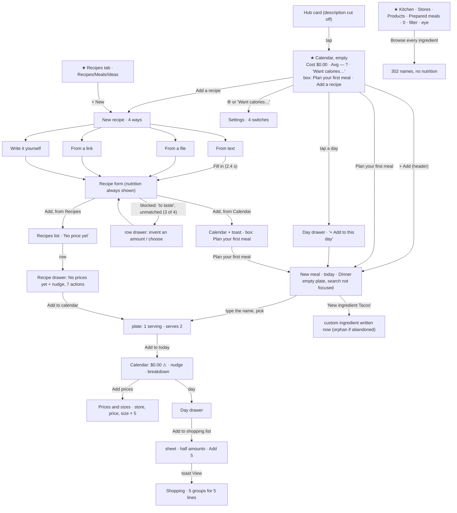
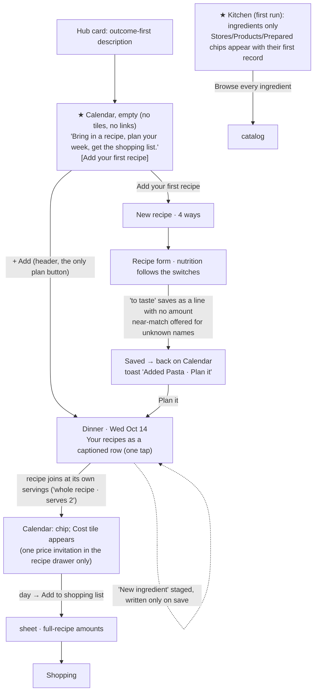

# J1 — First run and setup

Fixture: **Jamie** (no Pinch data at the start: `apps/pinch/kitchens/seed-worth-the-wait-two` had no document and no subcollections). Walked at 390×844 first, then 1280×900, America/Los_Angeles (the app's "today" was Wed Oct 14). The app at http://127.0.0.1:5240, tree read from `the audit build` (HEAD `e74fd9fb`).

Screenshots: `j1/shots/` (written below as `shots/NN-name.png`).

What I created in Jamie's kitchen and then deleted through REST (`Authorization: Bearer owner`), all confirmed gone (no subcollections, kitchen document 404 again): 3 recipes ("J1 Garlic butter pasta" twice, "J1 Overnight oats"), 1 planned meal, 1 store (Walmart), 1 product, 2 ingredient records (`cat-spaghetti`, and an orphan custom "Tacos", see J1-F1), 5 shopping items, and the kitchen settings document (it was created when I switched nutrition on and off). Nothing went to Storage. Nothing was written to Alex's or Taylor's kitchens, and there were no "J1 " leftovers from an earlier walk.

**Environment notes.** The AI readings were **real**, not stubbed: the Gemini calls went through the proxy. Text read in 2.4 s and a PNG recipe card about as fast, so I saw real results. A link reading **could not be tested**: the functions emulator can't resolve outside hosts, so every link answers "We couldn't open that link. Check the address, or paste the recipe's text instead." (`shots/37d-link-result.png`). Store logos never load (no outside network), so every store shows its letter tile. The site shell logs `Failed to load app catalog: FirebaseError … false for 'list'` on several loads. That comes from outside Pinch and I left it alone.

---

## 1. Who and when

**Jamie, day one.** A friend mentioned Pinch, or Jamie found it on the Moondreams hub. Jamie is on the sofa with a phone, probably with a recipe from an AI chat or a screenshot in another app, and is half thinking about tonight's dinner. Jamie has no idea what "products", "families", "prepared meals" or "saved meals" are, and doesn't want to set anything up. Jamie will give the app about ten minutes. If nothing in that time makes the week easier (a recipe that reads well, a plan, a list for the shop), the app gets closed and forgotten.

What else is on Jamie's mind: "Will this make me type in prices?" "Do I have to enter everything before it's useful?" "Where do I start?"

## 2. Goals and outcomes (first ten minutes)

| # | Job story | Outcome that means success | How often | Matters | Without the app |
|---|---|---|---|---|---|
| G1 | When I open a new app, I want to know in one glance what it does for me and where to start, so I can decide if it's worth my time. | Within one screen, Jamie can say what Pinch is for and taps a first action with confidence. | Once | Core (first run) | Reads the App Store blurb, or gives up |
| G2 | When I have a recipe in a chat, a screenshot or my head, I want to get it into the app without retyping, so I can see whether the app is useful before investing in it. | A recipe saved in under a minute, with no invented data. | Once, then weekly | Core | Keeps it in the chat or Notes, screenshots |
| G3 | When I know what I'll eat tonight or this week, I want to put it on a day quickly, so I can see my week. | A planned meal on the right day at the right amount. | Weekly | Core | Notes app, a paper list, memory |
| G4 | When I've planned something, I want a shopping list with the right amounts, so I can shop without working it out. | A list whose amounts match what I'll actually cook. | Weekly | Core | Writes the list by hand |
| G5 | When the app asks about prices, I want to give one or two without a chore, so I can see roughly what a meal costs. | A first cost appears with little effort, and the app doesn't keep nagging about the rest. | Occasional | Supporting | Doesn't know, or guesses |
| G6 | When I care about calories or protein, I want to switch them on once, so I can see them where I look. | One switch shows nutrition on my recipes and my week. | Once | Supporting | A separate tracker app |
| G7 | When I'm exploring, I want to try things without leaving junk behind, so I can trust the app with my real data. | Abandoning a screen leaves nothing behind. | Day one | Supporting (trust) | n/a |

## 3. Current journeys, as walked

### J-A. Landing (G1)

| Step | Surface | Action | Taps | What the app volunteers | Friction |
|---|---|---|---|---|---|
| 1 | Hub (`/`) | tap the Pinch card | 1 | Card text cut off mid-sentence: "…with what everything costs and,…" (`shots/00-home.png`) | The description leads with "keeps your ingredients" (bookkeeping), not what Jamie gets |
| 2 | Calendar tab, empty month (`shots/01-calendar-first.png`) | read | 0 | **Cost $0.00**, **Avg per meal —** with a ? help icon, the link **"Want calories or protein here?"**, a box "Nothing planned yet. Plan your first meal, or add a recipe to plan from." with **Plan your first meal** / **Add a recipe**, plus the header's **⚙** and **+ Add**, and 42 empty day cells | No line says what Pinch is. Two of the three things above the fold are zero-value numbers. "+ Add" and "Plan your first meal" do the same thing (both open "New meal", today, Dinner: `shots/05-header-add.png`, `shots/06-plan-first-meal.png`) |
| (2b) | Day view (`shots/10-day.png`) | tap "Day" | 1 | The same box **plus** a second box, "Nothing planned for this day yet. Plan a meal" | Two empty states stacked, and three buttons that do the same job |
| (2c) | Week view (`shots/09b-week-full.png`) | tap "Week" | 1 | The box, plus seven "Nothing planned" rows each with a "+" | Nine ways to plan on one screen |

Signed out, `/pinch` only says "Sign in required. Please sign in to use Pinch." (`shots/67-signed-out-pinch.png`): no sentence about the app.

**Expected vs found.** I expected a calendar to be the "home" for a returning cook, and it is. For Jamie, though, it is a month of empty cells with a $0.00 cost tile. The real first job, getting a recipe in (the README's Story is literally "bring a recipe in from any chat"), is the *second* button in a grey box.

**Insight count on the first view (390×844, first run).** 4 volunteered items, all NOISE on an empty kitchen: Cost $0.00, Avg per meal —, the Avg help icon (its text: "Cost divided by the meals that have a price.", `shots/02-help-avg.png`), and "Want calories or protein here?". 1 DECISION: the empty-state box. The Day view adds a 5th: the second empty box.

### J-B. The other tabs, empty

| Tab | First view | Volunteered | Notes |
|---|---|---|---|
| Recipes (`shots/11-recipes-empty.png`) | "Recipes · + New", pills **Recipes / Meals / Ideas**, one line "Add the recipes you cook, from text, a file, a link or by hand, and they'll be here, ready to plan." | 0 | Good empty state. Three concepts shown on day one (Meals, Ideas). Meals: "No saved meals yet. Put a few items together once and plan them again in a tap." Ideas: "Saw something you'd like to cook someday? Keep it here." (`shots/13-ideas-empty.png`) |
| Kitchen (`shots/14-kitchen-first.png`) | subtitle, **Stores**, **Products**, **Prepared meals** ("Keep track of what is in your fridge and freezer"), "INGREDIENTS 0 · + New", search + **filter** + **eye**, Yours / All, "Ingredients you add or adjust will show up here." + **Browse every ingredient** | 4 NOISE (three entry tiles with nothing behind them, plus the "0") and 2 dead controls (the filter offers "Show 0 ingredients", `shots/22-kitchen-filter.png`; the eye's macros row is disabled, `shots/21-kitchen-viewopts.png`) | Stores: "Add the shops you buy from…". Products: "Add a product for an ingredient…". Prepared meals: "Nothing in the fridge or freezer right now…" (`shots/18…20`). Opening the filter drawer logs a React warning, `Invalid prop className supplied to React.Fragment` (source not located) |
| Kitchen → All (`shots/16-kitchen-all.png`) | 302 catalog ingredients grouped by family, **names only** | 0 | The catalog is the app's day-one asset ("a stocked kitchen, each with its nutrition"), but rows show no price (none yet) and no nutrition (off). The drawer shows family, serving, aliases and "No product yet. Add where you buy it and recipes can show what they cost." **No nutrition section**, because every metric is off (`shots/17-ingredient-drawer.png`) |
| Shopping (`shots/15-shopping-empty.png`) | "Shopping list · + Add", "Nothing on your list. Add what you need from a recipe, a meal or a day, or add one here." | 0 | Good |
| Settings (⚙ on Calendar only, `shots/03-want-calories.png`) | "SHOW NUTRITION": 🔥 Calories, 💪 Protein, 🌾 Carbs, 🥑 Fat switches (all off), one explanatory line, "ABOUT" (USDA, Logo.dev), Done | — | Small and calm. Nothing here a first-timer must touch. The only way in is the Calendar's gear (or the empty calendar's link), and Kitchen's View options sends the person there in words: "Turn them on from the Calendar's gear" |

Nouns visible on the four first views without a single tap: **20** (calendar, month, week, day, cost, meal, calories, protein, recipe, saved meal ("Meals"), idea, kitchen, ingredient, product, store, prepared meal, fridge, freezer, Yours/All, shopping list).

### J-C. First recipe (G2): four ways, phone

Path from the empty Calendar: **Add a recipe** → drawer "New recipe": "Start from something you already have, or write it yourself. You'll look it over before anything is saved." with 📝 From text · 📎 From a file · 🔗 From a link · ✍️ Write it yourself (`shots/07-add-a-recipe.png`). Each way opens its own screen with a disclosure line ("An AI reads it and fills in the form. It isn't saved."), "Fill in the recipe", and "Write it yourself instead" (`shots/26-from-text.png`, `shots/36-from-file.png`, `shots/37-from-link.png`). Back from a way raises the list again (`shots/36b-back-from-file.png`).

| Step | Surface | Action | Taps | Volunteered | Friction |
|---|---|---|---|---|---|
| 1 | Calendar box | Add a recipe | 1 | — | — |
| 2 | Ways drawer | From text | 2 | the disclosure line | — |
| 3 | From text | paste (long-press, Paste) and tap "Fill in the recipe" | 3 (+2 for the paste) | "Reading your text…" (`shots/28-from-text-reading.png`), **2.4 s** measured | — |
| 4 | Recipe form (subview) | review | 0 | banner "Filled in from your text. Take a look before you save." The form shows **🔥 530 · 💪 18 g · 🌾 76.7 g · 🥑 16.4 g per serving although every nutrition switch is off** (`shots/29-from-text-result.png`) | see below |
| 5 | fix what blocks Save | tap the row, type, Done | **+0 to +6** | footer: "Check the ingredient amounts to save." / "Add or choose the “New” ingredient to save." | **Blocked in 3 of 4 real readings:** "Salt to taste" needs an amount (`shots/32-salt-drawer.png`), "salt and pepper to taste" + "handful of fresh parsley" (an unmatched combined line plus two missing amounts, `shots/74-shakshuka-form.png`), "shredded lettuce" unmatched although the catalog has Romaine and Iceberg lettuce (`shots/64-unmatched-drawer.png`). One reading also came back as "parmisan" and didn't match (`shots/33-after-salt.png`). Only "Overnight oats" saved straight away |
| 6 | Form footer | Add | 4 (best) / 6–10 (typical) | — | — |
| 7a | (started from Calendar) back on Calendar | — | — | toast "Added J1 Overnight oats to your recipes"; the box now reads "Nothing planned yet. Plan your first meal." (`shots/85-calendar-after-first-recipe.png`) | The recipe isn't visible on the screen it returns to (the toast is the confirmation, by design) |
| 7b | (started from Recipes) back on the list | — | — | the row: "2 servings · **No price yet**" (`shots/34-after-save.png`) | The first thing the app says about my first recipe is that it lacks a price |

**Write it yourself** (`shots/38b-write-yourself-titled.png`): the title editor opens on its own, which is good. "+ Add ingredient" opens the "Ingredient" drawer, but **its search field never gets the cursor**: `document.activeElement` is still the drawer `DIV` 2.5 s after opening, so typed letters go nowhere until the field is tapped (`shots/38d-search-bread.png`, then `shots/38f-search-bread-tapped.png` after tapping). Leaving with typed work asks "Discard this recipe?" with Keep editing / Discard (`shots/38e-discard.png`).

**From a link**: the environment blocked it (see the top). The copy blames the address ("Check the address") for what was a server-side reach failure. That's tolerable for a DNS miss but worth knowing.

**1280**: "Add a recipe" opens a full-page subview with the same four rows (`shots/81-desktop-add-recipe.png`). The calendar, Kitchen and Shopping empty states look the same as on the phone, just wider (`shots/80`, `82–84-desktop-*.png`).

### J-D. First plan (G3)

| Path | Steps (taps) | Volunteered | Friction |
|---|---|---|---|
| From the Calendar box after the first recipe | **Plan your first meal** (1) → "New meal · Wed, Oct 14 · 🍝 Dinner · Change", an empty plate, **search not focused** (`shots/86-plan-first-meal-with-recipe.png`) → tap the search (2) → type the recipe's name → tap the result (3) → **Add to today** (4) | the plate's "No prices yet" summary | **The recipe I just added isn't offered.** I have to type the name of the one recipe I own. The meal type is always Dinner by default (`MealBuilder.tsx:120`), so overnight oats becomes dinner. The "Added … to your recipes" toast sits over the subview's back button and title while it shows |
| From the recipe drawer | Recipes tab (1) → row (2) → **Add to calendar** (3) → **Add to today** (4) (`shots/40-plan-from-recipe.png`) | toast "Added J1 Garlic butter pasta to today" (no View) | **The plate starts at "1 serving · Recipe serves 2"** (`MealBuilder.tsx:134`) |
| Calendar day cell | tap a day (1) → drawer "Nothing planned for this day yet." → **+ Add to this day** (2) → search… (`shots/08-tap-day.png`) | — | — |
| A dish I haven't written down ("Tacos") | search "Tacos" → only "New ingredient 'Tacos'" → tap it | — | **This writes a custom ingredient called "Tacos" at once**, before the plan is saved. I abandoned the screen and "Tacos" still sat in Kitchen → Yours under "On their own" (`shots/88-first-plan-new-ingredient-tacos.png`, `shots/89-kitchen-orphan-tacos.png`; code `ItemSearch.tsx:83-109`, `saveIngredient` awaited on pick). Searching "pasta" finds only Marinara sauce (through its alias) and offers "New ingredient 'pasta'", although 8 pastas sit in the "Pasta & noodles" family: family names aren't searched (`shots/87-first-plan-search-chicken.png` shows a search) |

After the first plan the Calendar shows (`shots/43-calendar-one-plan.png`): **Cost $0.00 ⚠**, Avg per meal —, ?, **"5 ingredients need a price · Add prices ✕"**, **"See the breakdown ›"**, and a 🍝 chip on the 14th. The ⚠ text on day one: "Leaves out 4 ingredients with no price yet. **A price you add now counts from today on: days that have passed keep the prices they had. To count it on one, open that day.**" (`shots/71-cal-cost-warning.png`). That explains frozen past days to someone with one meal and no past. The nutrition link has gone: it shows only when there is no nudge (`StatsRow.tsx:180`), so it appears on the empty month, where it is useless, and disappears once there's a meal it could describe.

Day drawer (`shots/49-day-drawer.png`): Cost tile $0.33 ⚠, nudge, the meal row, "Add to shopping list", "+ Add to this day". Planned meal (`shots/50-planned-meal.png`): Back, Cost ⚠, nudge, the item, Start cooking / Mark as cooked / Add to shopping list, Remove, and a footer of **Modify + "Save as a meal" as the primary**, on a one-recipe plate (`PlannedMealView.tsx:206-212`). The builder only offers "Save as a meal" from two items up.

### J-E. First price (G5)

| Step | Surface | Taps | Volunteered | Friction |
|---|---|---|---|---|
| 1 | "Add prices" on any nudge | 1 | sheet "Prices and sizes · Spaghetti · 1 of 5": a card of **30 well-known stores** with a search, "Or name a store of your own", Price ($ 9.48), Package size (3 lb) (`shots/44-fill-in-sheet.png`) | Store first: a decision Jamie didn't come for. The own-store placeholder is clipped at 390 px ("…of your owr") |
| 2–5 | store, price, size, Save and next | 5 per ingredient | "2 of 5", with Walmart now a pill but **not preselected** (`shots/47-fill-2of5.png`) | Pricing all five is ~25 taps and 10 typed fields |
| 6 | close | 1 | Calendar: **$0.33 ⚠ / $0.33 ? / "4 ingredients need a price"** (`shots/48-calendar-after-price.png`) | With one meal, "Avg per meal" equals "Cost" (two tiles, one number) |

After one price, Kitchen → Yours lists 5 ingredients, 4 of them "No price yet" (`shots/54-kitchen-after-first.png`), and Stores 1 and Products 1 appear. The recipe row reads "$0.33 / serving · leaves out 4" (`shots/55-recipes-after-price.png`).

**The price gap, counted 10 minutes in: 7 screens, 12 surfaces.** Recipe row ("leaves out 4"), recipe drawer (tile + nudge, `shots/35-recipe-drawer.png`), calendar (⚠ + nudge), day drawer (⚠ + nudge), planned meal (⚠ + nudge), shopping cost line (⚠, which says "Add a price from the ingredient in Kitchen", a different route from "Add prices", `shots/72-shop-cost-warning.png`), and Kitchen rows ("No price yet" × 4).

### J-F. First shopping list (G4)

Today's cell (1) → **Add to shopping list** (2) → sheet "Shopping list · Wed, Oct 14 · 5 of 5 · Untick all" with every line ticked (3: **Add 5**) → toast "Added 5 to your shopping list · View" (4: View) → Shopping (`shots/51-add-to-list-day.png`, `shots/53-shopping-first.png`).

**The amounts are half the recipe:** Spaghetti 100 g, Garlic 1.5 each, Butter 1 tbsp, Parmesan 0.13 cup, Salt 0.5 tsp. The plan defaulted to 1 serving of a recipe that serves 2 (J-D), and the list scales by the plan. The list shows "5 to buy", "Amounts on your list: about $0.33 ⚠", and **5 family dividers for 5 lines**. Salt goes on ticked. The tab badge shows 5. Of everything in the first ten minutes this is the most consequential miss: the first list is wrong for anyone cooking the recipe as written.

### J-G. Nutrition preferences (G6)

The recipe form showed calories and macros before I had switched anything on (`NutritionReview.tsx:148` renders all four, ignoring the switches). After saving they vanish from the drawer (`shots/35-recipe-drawer.png`). Turning calories on, counted from the Recipes tab: eye (1, the macros row is disabled: "Turn them on from the Calendar's gear") → Done (2) → Calendar tab (3) → ⚙ (4) → Calories (5) → Done (6) → Recipes tab (7): **still no calories on the rows** (`shots/58-recipes-nutrition-on.png`) → eye (8) → macros switch (9) → Done (10) → 🔥 on the row (`shots/70-recipes-calories-shown.png`). **That's 10 taps, or 8 without the discovery detour, across two tabs and two switches for one wish.** On the Calendar, switching on calories and protein added "Per g protein $0.02" and "Daily average this month 🔥 530 · 💪 18 g" straight away (`shots/57-calendar-nutrition-on.png`).

### J-H. The first "this is useful" moment

The strongest moment I met is **cooking mode on the first recipe** (`shots/73-cooking-first.png`): "Step 1 of 3 · Boil the spaghetti for 10 minutes. · ⏲️ Start 10 min timer", with big Back and Next. It is calm and obviously useful, and the timer came from the pasted text. Shortest path from landing:

- **To a recipe in cooking mode:** Add a recipe (1) → From text (2) → paste (+2) → Fill in the recipe (3) → [fix 0–6] → Add (4) → Recipes tab (5) → row (6) → Start cooking (7). **7 taps plus a paste at best; about 9–13 with a typical pasted recipe.**
- **To a shopping list:** the above to Add (4) → Plan your first meal (5) → search (6) → result (7) → Add to today (8) → the day (9) → Add to shopping list (10) → Add 5 (11) → View (12). **12 taps at best, and the list comes out at half quantities.**

## 4. Flow diagrams

**Current first run (phone).** Entry points are marked ★.

**Proposed first run.** Every change is justified in §6.

## 5. Findings

### (a) Small things

| id | sev | where | evidence | goal hurt |
|---|---|---|---|---|
| J1-S1 | minor | Recipe form → "+ Add ingredient" drawer, `components/recipes/RecipeIngredients.tsx:453-458` (`autoFocus` on `ItemSearch` inside `DetailSheet`) | `activeElement` was the drawer `DIV` at 0.4, 0.8, 1.5 and 2.5 s; typed letters were lost until a tap (`shots/38d…`, `38f…`) | G2: an extra tap for every ingredient added by hand. CLAUDE.md already says a drawer's one text box is focused once the drawer has settled, because `autoFocus` loses |
| J1-S2 | polish | New meal subview search (`PlanMealSubview`/`MealBuilder`) | focus on the header back `BUTTON` after opening (`shots/86…`) | G3: an extra tap on the screen whose only question is "what's on the plate?" |
| J1-S3 | minor | Calendar Day view, `components/calendar/CalendarScreen.tsx:217-255` + `DayView.tsx:33-41` | two empty boxes stacked; "Plan your first meal", "Plan a meal" and the header's "+ Add" all plan (`shots/10-day.png`) | G1: a screen should show one empty state |
| J1-S4 | minor | Empty calendar box vs the header's + Add (`CalendarScreen.tsx:178-187` and `:225-233`) | both open "New meal · today · Dinner" (`shots/05`, `06`) | G1: two buttons for one action on the first screen |
| J1-S5 | minor | Calendar Cost tile, `StatsRow.tsx:109-131` | shows **$0.00** while nothing is priced (and $0.00 ⚠ after a plan), where the recipe drawer and the plate say "No prices yet" (`shots/43`, `35`) | G5: $0.00 reads as "free". The same state has two names |
| J1-S6 | minor | Calendar Cost warning text, `StatsRow.tsx:124-128` | the frozen-past-days paragraph shows on day one with no past day (`shots/71…`) | G5: a concept that does no work yet |
| J1-S7 | polish | Avg per meal tile and "See the breakdown" (`StatsRow.tsx:133-149`, `:190-200`) | with one meal, Avg = Cost ($0.33 / $0.33); "See the breakdown" opens a breakdown of one meal (`shots/48…`). The breakdown link sits centred, not on the row's edges | G1/G5: two tiles carrying one number |
| J1-S8 | minor | "Want calories or protein here?", `StatsRow.tsx:180` (`!hasAnyMetricOn && !hasNudge`) | visible only on an empty or fully priced calendar, gone the moment a meal with a price gap exists (`shots/01` vs `43`) | G6: it's offered when there's nothing to show and hidden when there is |
| J1-S9 | polish | Fill-in sheet store picker, `components/kitchen/StorePicker.tsx:165` | placeholder "Or name a store of your own" clipped at 390 px (`shots/44…`) | G5 |
| J1-S10 | minor | Fill-in sheet "N of 5" stepping (`FillInSheet`) | the store picked on row 1 isn't preselected on row 2, so five rows take five store taps (`shots/47…`) | G5: a repeated answer re-asked |
| J1-S11 | polish | Unmatched-row drawer, `RecipeIngredients.tsx` | "Choose another" when nothing was chosen. "shredded lettuce" isn't matched to the catalog's Romaine or Iceberg lettuce and no near match is suggested (`shots/64…`) | G2 |
| J1-S12 | minor | Catalog search (`searchIngredients`, used by `ItemSearch`) | "pasta" finds only Marinara sauce and offers "New ingredient 'pasta'", while 8 pastas sit in "Pasta & noodles". Family names aren't searched | G2/G3/G7: the stocked catalog is invisible to the most natural words, and a near-duplicate is offered instead |
| J1-S13 | polish | "New meal" title on two different builders, `components/plan/MealBuilder.tsx:167,173` | the calendar's plan builder and the Meals tab's saved-meal builder are both titled "New meal" (`shots/05`, `65`) | G3: "meal" means both a day's plate and a reusable template |
| J1-S14 | polish | Default meal type, `MealBuilder.tsx:120` (`?? 'DINNER'`) | "Overnight oats" and "Plan your first meal" both land on 🍝 Dinner at any hour | G3 |
| J1-S15 | polish | Site toast over an overlay subview's header | "Added … to your recipes" covers New meal's back button and title for its lifetime (`shots/86…`) | G3 |
| J1-S16 | polish | Kitchen with an empty Yours: filter and eye always rendered (`KitchenScreen.tsx:260-288`) | filter offers "Show 0 ingredients" and the eye's macros row is disabled (`shots/21`, `22`) | G1: dead controls on day one (CLAUDE.md: no view-options control on an empty list) |
| J1-S17 | polish | Kitchen View options copy, `components/shared/ListViewControls.tsx:50` | "Turn them on from the Calendar's gear and they'll show here." points to another tab instead of opening Settings | G6 |
| J1-S18 | polish | Hub card / `APP_REGISTRY` description | cut off mid-clause; leads with "keeps your ingredients" (`shots/00…`). The signed-out page says only "Please sign in to use Pinch." | G1 |
| J1-S19 | polish | Shopping list with 5 lines | 5 family dividers for 5 lines; pantry salt goes on ticked (`shots/53…`) | G4: structure that only pays off with a long list |
| J1-S20 | polish | Link reading failure copy | "Check the address" for an address that was fine (a server-side reach failure here) | G2 |

### (b) High-arching things

| id | sev | where | evidence | goal hurt |
|---|---|---|---|---|
| J1-F1 | **major** | `components/plan/ItemSearch.tsx:83-109` (used by the plan builder, the recipe form's ingredient drawer and Shopping's add) | Tapping "New ingredient 'X'" awaits `saveIngredient` **at pick time**. Abandoning the plan left a custom ingredient "Tacos" in Kitchen → Yours (`shots/88`, `89`). A first-timer's most natural first plan ("Tacos tonight") becomes an *ingredient*, and exploring leaves junk behind. CLAUDE.md: a record created only because another record names it is written in the same batch as that record, so a failed or abandoned save leaves no orphan | G7 (trust), G3 |
| J1-F2 | **major** | Plan from a recipe (`MealBuilder.tsx:134`, `servings: 1`) feeding the shopping list (`utils/shopping.ts`) | A recipe that serves 2 lands at "1 serving", so the day's list asks for 100 g spaghetti, 1.5 garlic, 0.13 cup parmesan (`shots/40`, `51`, `53`). The app never says what a planned serving means (I eat one? we cook one?) | G4 (the first list is wrong), G3 |
| J1-F3 | **major** | Recipe lines require an amount (`types.ts:390` `amount: number`; `RecipeForm.tsx:262-264`; rules: `amount > 0`) | 3 of 4 real readings were blocked at Save: "salt to taste", "handful of parsley", plus unmatched "salt and pepper" / "shredded lettuce". The person must invent a number (the drawer even preselects "tsp") or delete the line (`shots/32`, `74`, `64`) | G2: the first recipe, the app's first proof of value, costs 2–6 extra taps and a made-up number |
| J1-F4 | major | First screen (Calendar empty) | It never says what Pinch does. Above the fold: two zero-value tiles, a help icon, a nutrition prompt, and a box whose first button duplicates the header (`shots/01`). The app's Story (bring a recipe in from a chat) is the second button | G1 |
| J1-F5 | major | Cost on day one: 12 surfaces on 7 screens within 10 minutes (§3 J-E) | before Jamie has ever thought about prices, every surface reports the gap ("No price yet", "leaves out 4", ⚠, nudges ×4, "No price yet" ×4 in Kitchen), and the shopping warning names a third route ("from the ingredient in Kitchen") | G5, G1: the README promises "Zero pressure… a missing price just means a number is left out", and the first ten minutes read as a to-do list |
| J1-F6 | major | Nutrition: Settings (Calendar ⚙ only) × per-list View options (default macros off) × a recipe form that ignores both | the form shows 🔥/💪/🌾/🥑 with everything off; the drawer and rows then hide them; switching calories on takes 8–10 taps across 2 tabs and 2 switches (§3 J-G). Caused by the rule "A list starts with prices on and calories and macros off… a choice already stored is kept" (`.claude/rules/pinch.md`) combined with the global opt-in | G6 |
| J1-F7 | major | Day-one surfaces with nothing behind them | Kitchen's Stores, Products and Prepared meals (with its "Keep track…" pitch), "Ingredients 0", filter and eye; Recipes' Meals and Ideas pills; the recipe drawer's "Put some away" on a never-cooked recipe (`shots/14`, `11`, `35`). Sources already follows the better rule (hidden until one exists) | G1: 20 nouns before a single tap; concepts arrive before their data |
| J1-F8 | minor | "Plan your first meal" right after the first recipe (`shots/86`) | the plate opens empty and the person types the name of the only recipe they own. "Start from a saved meal" pills exist for saved meals, but nothing like it for recipes | G3: the loop's second step forgets the first |
| J1-F9 | minor | Planned meal footer: "Save as a meal" is the primary on a one-item plate (`PlannedMealView.tsx:206-212`) | the builder offers "Save as a meal" only from 2 items; the planned view promotes it for 1 (`shots/50`) | G3: pushes a concept (saved meal) that does no work for one recipe |
| J1-F10 | minor | The stocked catalog on day one | 302 rows of names. Nutrition, the catalog's selling point, is hidden in the ingredient drawer while the switches are off (`shots/16`, `17`) | G1: day one's ready-made value is invisible |

## 6. Proposals

| id | type | goal | what changes | justification | cost / risk | size |
|---|---|---|---|---|---|---|
| P1 | REARRANGE + TRIM | G1 | **Empty Calendar = one start card.** While nothing is planned in the shown period, hide the stats row (Cost, Avg, help, nutrition link, breakdown). The box becomes one line saying what Pinch does ("Bring in a recipe from a chat, a photo or a link, plan your week, and get the shopping list.") and **one** button, "Add your first recipe" (later "Add a recipe"). The header's "+ Add" stays the one plan action, and the box's "Plan your first meal" goes | Removes 4 NOISE surfaces and a duplicate button from the first screen. Leads with the step that makes everything else work (a planned ingredient is a weak first act). Returning users viewing an empty future month lose a $0.00 tile they'd never act on | Height jump when the first meal arrives (check it). UX.md "First launch" and the journey diagram need updating | M |
| P2 | TRIM | G1 | Day view: drop the second empty box when the first is showing (or the reverse); one empty state per screen | One message, one button | none | S |
| P3 | FILL | G2 | **A recipe line may have no amount.** "to taste", "a handful": `amount: number \| null`, shown as its note, left out of cost and nutrition with the usual "leaves out" caveat, and put on a shopping list without an amount. The reader keeps "to taste" as a note instead of failing the row, and splits "salt and pepper" into two lines | Removes the most common reason a first reading can't be saved (3 of 4 here) without asking anyone to invent a number | Data model, rules (`amount` shape), cost and nutrition math, shopping merge (a null-amount line merges as "no amount"), `scaleAmount`, `check:pinch-math`. Legacy docs are unaffected (they all have amounts) | L |
| P3b | FILL | G2 | The unmatched-row drawer offers the catalog's nearest names ("Romaine lettuce · Iceberg lettuce") above "Add as new ingredient", and "Choose another" becomes "Pick from your ingredients" | One tap instead of a search, and fewer near-duplicate custom ingredients | match scoring | M |
| P4 | FILL | G7 | **"New ingredient 'X'" is staged, not written:** `ItemSearch` hands back a draft and the form that names it writes it in its own batch (plan, recipe, shopping add) | No orphans from abandoned forms. Matches CLAUDE.md's same-batch rule | 3 callers' save thunks gain an optional new-ingredient draft; rules unchanged | M |
| P5 | FILL | G3/G4 | **A recipe joins a plate at its own servings** when it comes from its drawer or the "Your recipes" row, and the stepper says what that means ("Whole recipe · serves 2"; "1 of 2 servings" when lowered) | The first list then matches the recipe as written. "Servings" stops being a hidden concept | Daily nutrition averages become per household rather than per person (see Q2). Changes existing defaults for Alex-type users too | S (code), L (concept) |
| P6 | FILL | G3 | **"Your recipes" on an empty plate:** a captioned pill row of the newest few recipes (like "Start from a saved meal"), and the "Added X to your recipes" toast gains **Plan it** | The second step of the loop remembers the first: one tap instead of searching for a name I just typed | a row on the builder (hidden once the plate has an item) | M |
| P7 | TRIM | G3 | Planned meal footer: "Save as a meal" only from 2 items (the builder's own rule). A one-recipe plate's primary is Start cooking when it has steps and the day hasn't passed; otherwise Modify stands alone | Stops promoting a concept that does no work, and puts the next step of the loop (cook) under the thumb | none | S |
| P8 | MERGE | G6 | **One nutrition choice.** Turning a metric on in Settings shows it on the lists too (the list's macros line follows Settings by default; View options can still hide it). View options' disabled row becomes a "Turn on in Settings" button that opens the Settings sheet in place. The recipe form's Nutrition shows only the metrics switched on, with one quiet line "Calories and macros are off · Turn on" when none are | 10 taps to 4 (⚙, switch, Done, look). The form stops showing what the drawer then hides | Challenges the rule "a list starts with calories and macros off" (keep it for people who haven't opted in). Stored per-list choices still win | S–M |
| P9 | TRIM (quiet) | G5 | **Before the first price exists, cost is one invitation.** In a kitchen with no product at all, drop the gap surfaces (calendar ⚠ and nudge, day and planned-meal nudges, "No price yet" on recipe and Kitchen rows, the shopping ⚠) and show one line in the recipe drawer: "See what this costs: add prices (5)". The current system turns on with the first price | Day one stops reading as a to-do list, which is what the README promises ("Zero pressure") | Discoverability of cost rests on one line plus "Add a product" in the ingredient drawer. Owner decision (Q1) | M |
| P10 | TRIM | G5 | Cost tile says "No prices yet" (not $0.00) when nothing is priced; the frozen-days paragraph shows only when the period holds a passed day with meals; Avg per meal shows from 2 priced meals; "See the breakdown" from 2 meals | Each removes a line with no decision behind it | none | S |
| P11 | REARRANGE | G5 | Fill-in sheet: the store picked on one row is preselected (and visible as the selected pill) on the next; fix the clipped placeholder ("Or add your own store") | 5 taps to 1 for five rows. The answer is the person's own, so it's not a guess | An exception to "PickOrCreate: nothing preselected", scoped to a stepping sheet | S |
| P12 | TRIM | G1 | **Kitchen on day one shows only ingredients.** The entry chips (known fix #1) appear only with something behind them: Stores and Products once a product exists, Prepared meals once a container exists. The filter, eye and Yours/All appear once Yours has a row, and "Browse every ingredient" stays | The first Kitchen is one sentence and one button instead of 3 empty doors, a 0 and 2 dead controls. Products, stores and containers are met where the journey needs them (Add a product, Prices and sizes, Put some away) | Someone wanting to set up stores first goes ingredient → Add a product → store picker. Known fix #1's chip row is the right direction, and this is the missing "when" | S |
| P13 | TRIM | G1 | Recipes on day one: hide the **Meals** pill until there are 2 recipes or a saved meal, and the **Ideas** pill until an idea exists. Add a quiet last row to New recipe, "Not now? Keep it as an idea", which opens the idea sheet. The recipe drawer's "Put some away" shows after a cook or for a bulk recipe (`isBulkMeal`) | Two concepts and one action arrive when they mean something. A link or photo has one start, with "later" as a choice inside it | Coordinate with J2 (Ideas as a peer). A person who wants to save an idea on day one finds it inside New | M |
| P14 | FILL | G1/G2 | Catalog search also matches family names ("pasta" lists the Pasta & noodles family's members first) | The stocked catalog answers the words people use, and fewer duplicate custom ingredients get made | search ranking | S–M |
| P15 | REARRANGE | G1 | Outcome-first registry description (e.g. "Bring in recipes from a chat, a photo or a link, plan your week and get a shopping list, with what it costs."), updated in `APP_REGISTRY` and the root README's "Current apps" | The hub card is the true first screen, and today it is cut off mid-clause | README sync | S |
| P16 | FILL | G2/G3 | Focus fixes: the ingredient drawer's search after it settles (J1-S1), the plan builder's search (J1-S2) | One tap saved on every add | none | S |
| P17 | REARRANGE | G3 | Distinct builder titles: the plan builder is titled by its slot ("Dinner · Wed, Oct 14", then the first item's name), the Meals one "New saved meal" | "Meal" stops meaning two things on day one | UX.md copy | S |
| K1 | KEEP | G1 | **No setup wizard, no required choices.** The app is usable at once, and Settings is four switches and an About | It's the right baseline; every proposal above removes, it doesn't add a setup step | — | — |
| K2 | KEEP | G1 | **Each empty state is one warm line with the CTA in the header** (Recipes, Meals, Ideas, Shopping, Stores, Products, Prepared meals) | Teaches without a manual | — | — |
| K3 | KEEP | G2 | **The four ways:** a list that only picks, a disclosure line on each way, "Write it yourself instead", fast readings (2.4 s) that land in the real form with "Take a look before you save", a footer that names the one thing blocking Save, and Discard asking first | The best-made part of the first ten minutes | — | — |
| K4 | KEEP | G2 | **Cooking mode on the first recipe:** one step, a timer chip from the text, big Back and Next | The first clear "this is useful" moment; protect it | — | — |
| K5 | KEEP | G1 | **Sources hidden until one exists; Cooking history, "Cooked 3×", "Last tweaked" only after data** | The precedent P12 and P13 extend | — | — |
| K6 | KEEP | G2/G3 | "Add a recipe" from the Calendar returning to the Calendar with "Added X to your recipes", and the box updating to "Plan your first meal" | The loop is right; P6 finishes it | — | — |
| K7 | KEEP | G4 | Shopping add toast with "View", and the tab badge | A status that confirms, with a path; both are acted on | — | — |
| K8 | KEEP | G5 | The ingredient drawer's "No product yet. Add where you buy it and recipes can show what they cost." | Says why, with the action beside it: the tone P9 wants for day one | — | — |

**On the known fixes in flight.** #1 (Kitchen and Recipes chip rows, "New" in the header) is the right direction but incomplete for a first run: the chips should also wait for their first record (P12). #3 (drawer chip row) helps. On a never-cooked recipe the row would still carry "Put some away"; drop it there (P13). #2, #4, #5 and #6 don't touch the first ten minutes.

## 7. Rule candidates

1. **A first run volunteers nothing about data the person doesn't have.** A tile, count, help icon, prompt, filter or entry with nothing behind it is not rendered. Each feature's surface appears with the first record that makes it useful (Pinch's Sources is the reference). → `CLAUDE.md` Design & UX.
2. **A screen shows one empty state, never two stacked, and no button in it repeats the header's action.** → `CLAUDE.md` Design & UX.
3. **A search picker never writes.** "New X" stages a draft that the form saving the record writes in the same batch, so an abandoned form leaves nothing. → `CLAUDE.md` State, data, and performance (atomic writes), plus the technical review checklist.
4. **A global display choice sets every surface's default; a per-list option only narrows it.** A person who switched calories on sees them where they look, without a second switch. → `CLAUDE.md` Product (and update the conflicting bullet in `.claude/rules/pinch.md` "Rows can hide their numbers").
5. **An action on a recipe defaults to the whole recipe** (its own servings), and a stepper says what its unit means. → `.claude/rules/pinch.md`.
6. **A total with nothing priced says "No prices yet", never $0.00, and a caveat about frozen days appears only when a frozen day is in view.** → `.claude/rules/pinch.md`.
7. **A stepping sheet carries the previous row's answer to the same question as the next row's default.** It's the person's own answer, so it's an exception to "nothing preselected". → `CLAUDE.md` Design & UX.
8. **Review as Jamie.** Every PR that adds a surface opens it on an empty kitchen and lists what appears with no data. Anything that counts, warns or prompts about nothing is a finding. → `.claude/skills/pr-wrap-up/references/review-agents.md` (product and design checklists).

## 8. Open questions for the owner

1. **Is cost on from the first minute, or from the first price?** README says "Cost is always on". *Recommendation:* from the first price. Before that, one invitation in the recipe drawer (P9).
2. **What is a planned serving: what we cook, or what one person eats?** It drives the shopping list, the cost and the daily nutrition average. *Recommendation:* what we cook (a recipe defaults to its own servings, P5). Add "how many eat" later if per-person nutrition matters.
3. **May a recipe line have no amount?** *Recommendation:* yes (P3). It's the single biggest blocker to a first saved recipe.
4. **Should Meals and Ideas be peers of Recipes on day one?** *Recommendation:* no. Meals appears with the 2nd recipe or 1st saved meal; Ideas appears with the 1st idea and is reachable from New recipe meanwhile (P13). Decide together with J2.
5. **Does the recipe form obey the nutrition switches?** *Recommendation:* yes, with one quiet "Turn on" line (P8). Nutrition stays opt-in everywhere, consistently.
6. **Does a first price need a store?** *Recommendation:* allow "any store" for a first price and ask the store later. Leave the decision to J7, whose scope it is.
7. **Should the landing tab change for an empty kitchen?** *Recommendation:* no. Keep Calendar first so the tab order never moves, and change only its empty state (P1).
