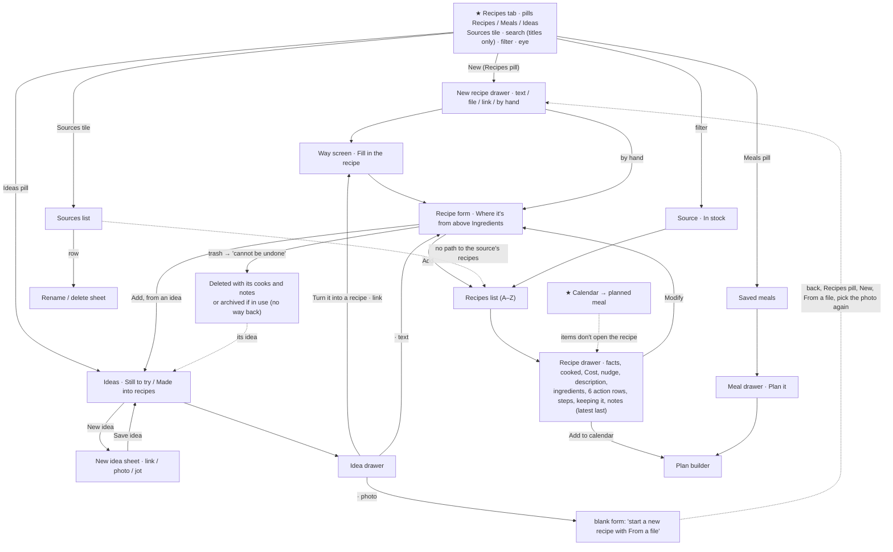
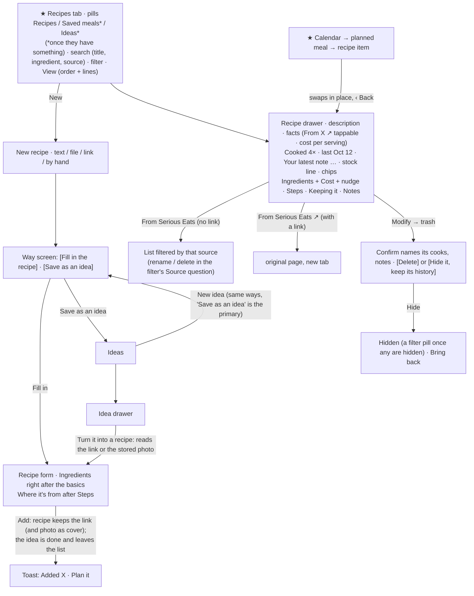

# J2 — Capture, curate and find recipes

Walked on the app at http://127.0.0.1:5240 (checkout `the audit build`, tip `e74fd9fb`), on 2026-10-14 in the app's time (America/Los_Angeles), at 390×844 with touch first and 1280×900 second. Fixtures: **Alex** (seeded, kitchen `seed-worth-the-wait-one`: 3 listed recipes plus one retired, 2 saved meals, 6 ideas, 3 sources) and **Taylor** (scale, read-only: 200 recipes, 60 saved meals, 80 ideas, 12 sources, nutrition on).

Screenshots: `j2/shots/` (cited below by file name, e.g. `08-adobo-drawer-0.png`).

**Throwaway data, created and then deleted through the app.** In Alex's kitchen: recipes "J2 Shakshuka for Sunday" (from an idea; marked cooked once to see the delete confirm) and "Red lentil dal" (a text reading; on that run the AI dropped the "J2 " I had typed into the pasted title, so I matched it by its id and its `AI_TEXT` source, created at 06:01 UTC); ideas "J2 Shakshuka for Sunday" (link), "J2 Lemon tart from the bakery" (photo), "J2 Something with leeks" (jotted), "J2 Offline idea at the market" and "J2 Offline close test" (both saved offline); sources "bbcgoodfood.com" (made by the idea's recipe) and "J2 Grandma binder". The recipe deletes also removed the one cook. A REST check afterwards (`Bearer owner`) found nothing left in recipes, ideas, sources, cooks, notes, ingredients, products, stores, containers, shopping items, plans or meals, and no Pinch objects in Storage. Counts are back to Alex's baseline, plus what the J4, J5 and J6 agents had added at the time.

**Environment notes.**
- **Link readings and link lookups can't reach outside hosts here.** An idea's link lookup said "Couldn't read that page. You can type your own title." and the recipe link way said "We couldn't open that link. Check the address, or write it yourself below." (`31-idea-link-reading-failed.png`). I walked the fallbacks, not a successful link reading.
- **Text readings are real** (Gemini through the proxy), taking 2.8 s, 5.2 s and 2.2 s on three runs. The three readings of the same paste came back different: the title with and without my "J2 " prefix, "Cook 26 min" on one and no time on another, a description on one and none on another (`44-from-text-form.png`).
- **Other agents' recipes appeared during the walk** (J4 Lemon rice, J5 Weeknight chili, J6 Freezer chili; `50-desk-recipes.png`). I didn't touch them.
- **No outside images load**, so link ideas show their 🔗 tile.

---

## 1. Who and when

A home cook who collects recipes from everywhere and cooks from a small rotation. There are four moments:

- **On the sofa, scrolling** (phone, one hand, half paying attention). A friend sends a link in a group chat, an AI chat gives a recipe, or Instagram shows a dish. The cook wants it kept **now**, in two taps, without deciding anything. They may never make it.
- **Planning the weekend or the week** (sofa or desk, unhurried). The cook goes through what they kept and turns one or two into real recipes they'll cook. This is when they'll accept a review step.
- **At 5 pm: "what do we make tonight?"** (kitchen, phone in hand, maybe a pack of chicken thighs on the counter). They want to find a recipe by what it is, what's in it, how long it takes, or "the one from Grandma's binder", read what they said last time, and get going.
- **After cooking, or months later** (anywhere). They fine-tune an amount, or retire a recipe the family didn't like without losing what they learned.

What else is on their mind: dinner and time, mostly. They do not think in the app's nouns (idea, source, saved meal). They think "that shakshuka link Sam sent", "Mom's adobo", "something quick with chicken".

## 2. Goals and outcomes

| # | Job story | Success looks like | How often | Weight | Without the app |
|---|---|---|---|---|---|
| G1 | When a recipe reaches me (chat, photo, link, my head), I want to get it in without retyping, so I can cook from it later. | A reviewed recipe saved in about a minute, or kept for later in seconds. | Weekly | Core | Screenshots, browser tabs, a Notes page |
| G2 | When I see something I might make someday, I want to keep it with no effort, so I don't lose it, and turn it into a recipe only when I decide to cook it. | Kept in 2–3 taps. Later it becomes a recipe with nothing re-entered. | Weekly, bursty | Supporting | Saved posts, bookmarks |
| G3 | When I look at a recipe, I want to know where it came from and go back there, so I can re-read the original, see the photos, or credit Mom. | "From Serious Eats ↗" opens the page. "From Mom's cards" is one tap from her other recipes. | Monthly | Supporting | The browser history |
| G4 | When I've cooked something and want it different next time, I want to change the recipe quickly, so the next cook is better. | An amount changed in under 10 taps, with the change remembered. | Monthly per recipe | Supporting | A pencil note in the margin |
| G5 | When it's time to decide dinner, I want to find the recipe I want by name, ingredient, time or source, and see what I said last time, so I can start cooking. | The right recipe open in 2–4 taps, with my last note visible. | Daily | Core | Memory, scrolling screenshots |
| G6 | When I know which dishes I combine, I want to plan the combination again in one go. | A saved combination planned in 2–3 taps. | Weekly | Supporting | Memory |
| G7 | When a recipe no longer earns its place, I want to retire it without losing what I learned, so the list stays short. | It's off my list. Its history is kept or deleted, by my choice and knowingly. | Rare | Rare | Delete the screenshot |

## 3. Current journeys, as walked

Taps were counted in the browser at 390×844. "+type" means a field the person types into, and "+paste" a long-press and Paste.

### J-A. A recipe from a chat (G1): From text, Alex

| Step | Surface | Action | Taps | What the app volunteers | Friction |
|---|---|---|---|---|---|
| 1 | Recipes tab | tab | 1 | 10 row insights (§3 insight count) | — |
| 2 | header **New** → drawer "New recipe", 4 ways (`16-new-recipe-drawer.png`) | New | 2 | "Start from something you already have… You'll look it over before anything is saved." | Nothing to keep it for later from here |
| 3 | "From text" screen (`17-from-text.png`) | From text, paste | 3 +paste | "An AI reads it and fills in the form. It isn't saved." | — |
| 4 | reading → Recipe form (subview) | Fill in the recipe | 4 | "Filled in from your text. Take a look before you save." 2.2–5.2 s | The form opens on Title, Servings, Prep, Photo, Description and **Where it's from**. Ingredients start at y≈723, below the fold (`44-from-text-form.png`) |
| 5 | fix the blocker | scroll, tap "grated ginger" row → "Choose another" → search → "Fresh ginger" → Done | 9 +type | footer "Choose the ingredient marked “Choose” to save." | The note doesn't take you to the row. "grated ginger" isn't matched to "Fresh ginger" (`45-unmatched-drawer.png`, `46-ginger-search.png`) (J1-S11 reproduced) |
| 6 | Form footer | Add | **10** | back on the list, the row is the confirmation | — |

The reading also filled "Keeping it" from "keeps 4 days in the fridge and freezes for 3 months". That's good. Source: none for text, as designed.

### J-B. Keep something for later (G2): New idea, Alex

| Way | Path | Taps | Notes |
|---|---|---|---|
| Link from a chat | Recipes (1) → **Ideas** pill (2) → **New idea** (3) → From a link (4) → +paste "Saw this in the group chat: https://www.bbcgoodfood.com/… try it!" → lookup (≤6 s; failed here) → +type a title → **Save idea** (5) | **5** +paste (+title) | The link was pulled out of the words (good). The field keeps showing the whole paste, though (`27-idea-link-titled.png`). The new row tops the list (`28-idea-saved.png`) |
| Photo | Ideas (2) → New idea (3) → From a photo (4) → Choose a picture (5) → +type title → Save (6) | 6 | `61-idea-photo-way.png`, `62-idea-photo-filled.png` |
| A few words | Ideas (2) → New idea (3) → Jot it down (4) → +type → Save (5) | 5 | Title focused on open (good) (`63-idea-jot.png`) |
| **Offline** (in a shop) | as "a few words", offline | 5, then stuck | The idea appears in the list behind at once, but the sheet keeps a spinning Save with **Cancel disabled** for as long as the phone is offline (12 s+ observed). Only the ✕ gets out. Nothing says the idea is safe. It synced when the connection came back (`68-offline-save-12s.png`, `69-back-online.png`, `80-offline-closed.png`) |

**Expected vs found.** I expected one "New" that lets me save now and decide later. Instead there are **two start pickers**: "New recipe" (From text · From a file · From a link · Write it yourself) on the Recipes pill, and "New idea" (From a link · From a photo · Jot it down) on the Ideas pill (`16-…`, `14-new-idea.png`). The link and the picture are offered by both. The person has to decide "idea or recipe?" before pasting, and then find the right pill.

### J-C. From an idea to a recipe (G2 → G1)

| Idea kind | Path | Taps | What happens |
|---|---|---|---|
| **Link** (reading unavailable here) | Ideas (1) → the idea (2) → **Turn it into a recipe** (3) → link way with the address filled in, "From your idea: …" (`30-…`) → Fill in the recipe (4) → failed → **Write it yourself instead** (5) → form with the title and source "bbcgoodfood.com" carried over (`32-idea-form.png`) → Add ingredient (6) → search (7) → Egg (8) → amount (9) → Add another (10) → search (11) → Tomato (12) → Done (13) → Add (14) | **14** | Toast "Recipe added · 'J2 Shakshuka for Sunday' moved to Made into recipes." You land on the **Ideas** list, with the recipe out of sight and no "Open" or "Plan it" (`38-after-add.png`). The title shows 3 times at the top of the form (header, "From your idea:", Title row). "Add ingredient", the one required step, sits under the pinned footer at y=746 |
| **Photo** | the idea (`65-idea-photo-drawer.png`) → Turn it into a recipe → a **blank form** whose top line says "Its photo stays with the idea. To have an AI read a picture, start a new recipe with 'From a file'." (`66-photo-idea-to-form.png`) | 3, then a restart | To get the photo read, the person backs out, switches pills, taps New → From a file and **picks the same picture again** from the phone's gallery: about 7 more taps. A recipe made that way isn't linked to the idea (`fromIdeaId` is set only on the idea's route, `RecipeSubview.tsx:40-41`), so the idea stays in "Still to try" for good |
| Text | Turn it into a recipe → form with the title and the note as the description | 3 | Fine |

### J-D. Where it came from (G3)

| Task | Path | Taps | Found |
|---|---|---|---|
| Give a recipe a new source | drawer → Modify → "New source" pill → +type → Save | 4 | Works (`55-form-new-source.png`). The old auto-made "bbcgoodfood.com" source **stayed behind with no recipe**: Sources went 4 → 5 |
| Find recipes from a source | Recipes (1) → filter (2) → source pill (3) → "Show 1 recipe" (4) → row (5) | 5 | Good: counts on pills, an active chip "From J2 Grandma binder × · Clear" (`56-…`, `57-filtered.png`) |
| …the way a person tries first | Recipes → **Sources** tile (2) → "Serious Eats · 1 recipe" (3) | 3, dead end | The row opens a **rename sheet** (Name, trash, Cancel, Save), not its recipes (`06-sources.png`, `07-source-sheet.png`) |
| …from the recipe itself | drawer fact "📖 From Mom's recipe cards" | — | Not tappable |
| Go back to the original page | — | impossible | `Recipe` has no address field (`types.ts:402-424`), and a source is only a label. A recipe read from a link keeps the site's *name*, never the page. Only an idea keeps the URL, so a link that went through an idea has its address on the idea (in "Made into recipes"), and a link read straight into a recipe has none |
| Unused sources | Sources list | — | "NYT Cooking" (only on a retired recipe) shows **no count** and still offers itself as a pill in every recipe form (`18-form-adobo-0.png`, `06-sources.png`) |

From code: a link's source is matched to an existing source by host (`utils/sources.ts:28-37`, `getHostSource`), so a recipe read from seriouseats.com starts on a new "seriouseats.com" source beside the person's typed "Serious Eats". The same site ends up under two names.

### J-E. Fine-tune a recipe (G4)

Recipes (1) → row (2) → **Modify** (3) → the Egg row opens its drawer (4) → amount (5) +type → Done (6) → Save (7): **7 taps**, calm, and the edit lands (`41-edit-egg-drawer.png`). The form is summary rows (`18-form-adobo-0…2.png`): one text box is visible at 390 when it opens. The Keeping it and nutrition editors are tidy (`78-care-editor.png`, `79-nutrition-editor.png`). On a cooked recipe, "What changed and why?" sits at the end with a clear line saying a dated note will be added. The one ordering problem: **"Where it's from" (4 pills, "Remove source", a help line, about 190 px) sits above Ingredients**, so the most edited section starts at y≈660 on a phone.

### J-F. Find tonight's recipe (G5)

| Question | Path | Taps | Found |
|---|---|---|---|
| "The adobo" | Recipes (1) → search +type (2) → row (3) | 3 | Works |
| "Something with garlic" / "chicken" | search "garlic" | — | **"Nothing matches 'garlic' yet."** The Adobo uses 6 cloves (`60-search-garlic.png`). Search looks at titles only (`RecipesScreen.tsx:196`). In Taylor's 200 recipes "chicken" finds nothing (`24-taylor-search-chicken.png`). "Serious" doesn't find the Serious Eats recipes either |
| "Something quick" / "not had lately" | — | — | No sort. Recipes are A–Z (`selectors.ts:179`). Time and "Cooked 4×" are printed on every row but can't order anything |
| "Something already made" | filter → Fridge · 2 → Show | 4 | Works. "Fridge · 2" counts recipes while the rows count servings |
| "What did I say last time?" | open the drawer, scroll ~1,400 px to Notes | 2 + 3 screens | The latest note, "Next time double the garlic…", is the **last** thing in a 1,951 px drawer (`08-adobo-drawer-3.png`) |
| "Tonight's planned dinner: show me the recipe" | Calendar → today → the dinner | — | The planned meal's items **don't open the recipe** (`PlannedMealView.tsx`, no handler on item rows), and neither do a saved meal's plate items (`MealDrawer.tsx:147-170`) or a container. The recipe drawer is reachable only from the Recipes list and from an idea's "Open the recipe" |
| Tab hop | Ideas pill → Calendar tab → back to Recipes | — | Comes back on the **Recipes** pill with search and filter cleared. The tab unmounts (`Pinch.tsx:133`), and the pill is local state (`RecipesScreen.tsx:122`) |

**Scale (Taylor).** The Recipes tab opened in 0.9 s (unthrottled, not a performance audit). The first screen shows 6 rows under 4 controls (`20-taylor-recipes.png`). The Source filter collapses 13 pills to 4, plus "Show all 14" and a search, which is fine (`21-taylor-filter.png`). **115 of 200 recipes carry a freezer line and 95 a fridge line**, so at scale the stock lines are on most rows and stop standing out. The In stock filter is what makes them useful.

### J-G. Retire a recipe (G7)

Recipes (1) → row (2) → Modify (3) → trash (4) → Delete (5). The confirm for a recipe I had just marked cooked reads **"Delete 'J2 Shakshuka for Sunday'? This action cannot be undone."** (`71-delete-confirm.png`). It doesn't say the cooking history and notes go too (`RecipeForm.tsx:535-542`; README: "Deleting a recipe outright deletes its history with it"). A recipe that planned days or saved meals use is "Removed" (archived) instead, with no list of removed recipes and no way back (Alex's "Retired chili" is invisible; only its orphan source hints at it). After the delete, the recipe's idea **came back to "Still to try"** (`73-ideas-after-recipe-delete.png`), as if the cook had never tried it. "Retire" here means "I tried it and it's not for us".

### Saved meals (G6), as walked

The Meals pill shows two rows: "Adobo and rice · 2 items · $0.15 · leaves out 10", stock lines, and the item names (`02-meals.png`). The meal drawer has a Cost tile ⚠, a nudge, "On the plate" (rows **not tappable**), a stock row "Adobo and rice 2 · Adobo chicken 10 · Cilantro lime rice 3", Put some away, Add to shopping list, and **Modify + "Plan it"** (`10-meal-drawer-0.png`). The recipe drawer's same action is called **"Add to calendar"**. "New" on the Meals pill opens a builder titled **"New meal"** (`58-new-saved-meal.png`), the same title as the calendar's plan builder (J1-S13). With 2 meals the Meals pill already shows a search, a filter (one question: In stock) and an eye.

### Wide screen (1280)

Recipes runs in two columns, and the drawer becomes a centred modal (`50-desk-recipes.png`, `51-desk-drawer.png`). **New** on Recipes opens a full-page subview whose first page is the 4 ways in a narrow column (`52-desk-new.png`), while **New idea** opens a modal (`54-desk-new-idea.png`): two pickers in two kinds of container.

### Insight surfaces on first view (390, Alex)

| Screen | Volunteered items | Class |
|---|---|---|
| Recipes tab (`01-recipes-first.png`) | **10** on 3 rows: Sources "3"; "Cooked 4×", "Cooked 1×"; "No price yet"; "$0.08 / serving · leaves out 4", "$0.81 / serving · leaves out 3"; 🧊 5 servings, ❄️ 5 servings, 🧊 3 servings; "Eat by Oct 16" | DECISION 4 (stock lines and eat-by when choosing what to eat) · NOISE or REFERENCE 6 (source count, cooked counts nothing can sort by, cost lines J7 calls misleading) |
| Chrome above the first row | New, 3 pills, Sources tile, search, filter, eye: **8 controls, about 250 px** before the first recipe | — |
| Recipe drawer, before Ingredients (`08-adobo-drawer-0.png`) | "✏️ Last tweaked Oct 7", "✅ Cooked 4 times · last Oct 12", Cost tile "No prices yet", "5 ingredients need a price · Add prices ✕" | REFERENCE 2 · NOISE 1 (a tile that says nothing is priced) · DECISION-ish 1 (a backlog, J7) |
| Recipe drawer, whole | 1,951 px of content in a 629 px window (3.1 screens). Ingredients at ~480, the 6-row action block at 633–990, Steps ~1,000, Keeping it ~1,190, Notes ~1,400 | — |
| Meal drawer | Cost ⚠, "For the plate", nudge, "No price yet" per item, the 3-number stock row | STATUS 1 · NOISE 2 · DECISION 1 (hard to read) |
| Ideas (`03-ideas.png`) | 0 beyond site names and two dividers | calm (KEEP) |

**Nouns met on the Recipes tab and its drawers:** recipe, saved meal ("Meals"), idea, "Still to try", "Made into recipes", source, cook ("Cooked 4×"), tweak ("Last tweaked"), note, "Keeping it", fridge, freezer, "Put some away", plate ("For the plate", "On the plate", "What's on the plate?"), item, serving, price/"leaves out". That's **18**.

## 4. Flow diagrams

**Current (phone).** ★ marks an entry point. A dashed edge is a dead end or a missing path.

**Proposed.** Every change is justified in §6.

## 5. Findings

### (a) Small things

| id | sev | where | evidence | goal hurt |
|---|---|---|---|---|
| J2-S1 | minor | Recipe form, "Where it's from" (`RecipeForm.tsx:378`) above Ingredients | Editing: Ingredients start at y≈660 at 390. New from an idea: "Add ingredient", the one required action, sits at y=746 under the pinned footer (`32-idea-form.png`). After a reading, the unmatched row that blocks Save is 2 screens down, and the footer note doesn't jump to it (`44-…`) | G1, G4 |
| J2-S2 | polish | Recipe form opened from an idea | The title shows 3 times: header, "From your idea: J2 Shakshuka for Sunday", Title row (`32-…`) | G1 |
| J2-S3 | polish | Ingredient drawer (`RecipeIngredients.tsx:451` plus `ItemSearch`) | Two help lines say the same thing ("Search your ingredients, or type a new one." / "Type a name to find it, or add one that isn't in the list."). The search isn't focused when the drawer opens (`activeElement` = DIV) (J1-S1 reproduced) (`33-ing-drawer.png`) | G1 |
| J2-S4 | polish | New idea → From a link | After a paste with words around the link, the field keeps showing the whole sentence, though the saved idea uses the extracted link (`27-…`) | G2 |
| J2-S5 | minor | Recipe drawer fact "📖 From X" | Not tappable: no way from a recipe to its source's other recipes, or to the page | G3 |
| J2-S6 | minor | Sources subview and the form's source pills | A source with no listed recipe shows a blank count ("NYT Cooking") and is still offered in every recipe form. Changing a recipe's source leaves the old auto-made one behind (bbcgoodfood.com, 4 → 5 sources) (`06-…`, `18-form-adobo-0.png`) | G3 |
| J2-S7 | minor | Recipe drawer "Add to calendar" (`RecipeDrawer.tsx:174`) vs meal drawer "Plan it" (`MealDrawer.tsx:97`) | One act, two names | concepts |
| J2-S8 | polish | New at sm+ | New recipe is a full-page subview (`52-…`), New idea a modal (`54-…`). Both are a list of ways | concepts |
| J2-S9 | polish | Filter "In stock" pills | "Fridge · 2" counts recipes while every row counts servings ("🧊 5 servings") (`04-filter-drawer.png`) | G5 |
| J2-S10 | minor | Toast after making a recipe from an idea (`RecipeForm.tsx:624-631`) | "Recipe added · '…' moved to Made into recipes." It reports the idea's move, not the new recipe, and offers no next step, while the person stands on the Ideas list (`38-…`) | G1, G6 |
| J2-S11 | minor | Delete-recipe confirm (`RecipeForm.tsx:535-542`) | "Delete 'X'? This action cannot be undone." on a cooked recipe. Its cooks and notes are deleted too, unsaid (`71-…`) | G7 |
| J2-S12 | minor | Deleting a recipe made from an idea | The idea returns to "Still to try" (`73-…`) | G2, G7 |
| J2-S13 | minor | Meal drawer "On the plate" (`MealDrawer.tsx:147-170`) | Rows aren't tappable, so a saved meal can't open its recipes | G5, G6 |
| J2-S14 | polish | Meal drawer stock row | "Adobo and rice 2 · Adobo chicken 10 · Cilantro lime rice 3" mixes the meal's own containers with its recipes', while the list row groups by place ("🧊 10 servings · ❄️ 5") (`10-…`, `02-…`) (J6 territory) | G5 |
| J2-S15 | polish | Meals pill with 2 meals | Search, filter (one question) and eye on a 2-row list (`02-…`) | calm |
| J2-S16 | polish | Recipe rows "Cooked 4×" | Printed on every cooked row, but nothing sorts or filters by it. On Taylor's list nearly every row has one (`20-…`) | calm |
| J2-S17 | minor | Offline idea save (`IdeaAddSheet`) | Save spins with Cancel disabled while offline. The idea is already in the list behind, but nothing says so, and only ✕ exits (`68-…`, `80-…`) | G2 (in a shop) |
| J2-S18 | polish | Filter drawer | React warning `Invalid prop className supplied to React.Fragment` each time it opens (also seen by J1). Likely the fragment children of the done button at `src/components/FilterBar.tsx:121` | — |
| J2-S19 | polish | Text reading | The same paste read three times gave three different forms (title, times, description) | G1 (trust in "read it again") |

### (b) High-arching things

**J2-H1 · major · Capture forks before the person knows which fork they want.** There are two start pickers with overlapping ways: New recipe (text · file · link · by hand) and New idea (link · photo · jot), each behind its own pill (`16-…`, `14-…`). The person holding a link must first decide "is this a recipe or an idea?", then switch pills to reach the right picker. The decision costs nothing to defer: what differs is only the **end** of the flow (review now vs keep for later). On day one J1 found Ideas is a concept arriving before its data (J1-F7). Here, with data, it's a split that makes the same input go two ways. Hurts G1 and G2.

**J2-H2 · major · A photo idea can't become a read recipe without picking the photo again, and then the idea is orphaned.** "Turn it into a recipe" on a photo idea opens a blank form that tells the person to start over with "From a file" (`RecipeForm.tsx:665-670`, `66-…`). The app holds the picture, yet asks for it again through a different door (about 7 extra taps and a gallery hunt). A recipe made that way isn't linked to the idea, so the idea stays "Still to try" for good. This breaks CLAUDE.md "A suggested action is checked for what it costs the person… if it means re-entering what they typed, the form should do the switch itself." The New idea sheet even invites "a screenshot of a … recipe" into this dead end. Hurts G2.

**J2-H3 · major · A recipe forgets the page it came from.** `Recipe` has no address (`types.ts:402-424`), and a `Source` is a label. A recipe read from a link keeps "seriouseats.com" and loses the page. The link survives only on an idea, which is why every made idea is kept forever in a "Made into recipes" group: a second copy of recipes, in a list whose 200 cap counts those copies (`RecipesScreen.tsx:119,458`, `ideaActions.ts:104`). Host-matched sources (`utils/sources.ts:28-37`) also split one site into a typed "Serious Eats" and an auto "seriouseats.com". The goal "remember where it came from" is met as a label, not as a way back. Hurts G3, and G2 at scale.

**J2-H4 · major · Finding tonight's recipe works only by exact title.** Search matches titles only (`RecipesScreen.tsx:196`): "garlic", "chicken" and "Serious" find nothing in lists that contain them (`60-…`, `24-…`). The list is A–Z only, while the row prints the two facts a cook sorts by at 5 pm (total time, last cooked) without letting them order anything. Filters cover Source and In stock only. At Taylor's 200 recipes this leaves scrolling. The person's real questions (what's in it, how long, not had lately, the one from Grandma) are answered by data the app already holds. Hurts G5, the most frequent goal in this audit.

**J2-H5 · major · The recipe drawer is in the order the app was built, not the order a cook reads.** The Adobo drawer is 1,951 px (3.1 screens). Before the ingredients come facts (5), a cooked line, a Cost tile that says "No prices yet", a price nudge, and only then the description of what the dish is. The person's own advice ("Next time double the garlic") is the **last** element, ~1,400 px down (`08-adobo-drawer-0…3.png`). "Last tweaked" and "Cooked 4 times" are two separate history lines. Known fix 3 turns the 6-row block into chips and stock into a muted line (–300 px), which is the right direction, but the order of what remains (cost above description, notes last) is unchanged. Hurts G5 and G4.

**J2-H6 · minor · Sources is a destination that doesn't find anything.** The tile (with a count) opens a list whose rows open a rename sheet (`SourcesSubview.tsx:89`, `07-…`). Finding by source happens in the filter, and the recipe's "From X" leads nowhere. Orphan sources accumulate with blank counts and stay in the form's pills (J2-S6). J7-17 found the same shape in Stores (a row opens an editor, not its products). The pattern is "a management list where a person expects a browse list". Hurts G3, and calm (a tile and a subview for a rare chore).

**J2-H7 · major · Retiring a recipe is either a silent purge or an invisible archive.** An unused recipe is hard-deleted with its cooks and notes, under a confirm that names neither (`71-…`). A used one is archived with no list and no way back. Either way its idea is resurrected as "Still to try". The person who retires a dish to keep the list short, but would like to remember "we made this, it was too sharp", has no option for it. Hurts G7, and trust in G4 (notes are the payoff of fine-tuning, and they vanish unannounced).

**J2-H8 · minor · "Meal" means three things, and the Meals pill hides which one.** "Meals" (pill and header) holds saved combinations. "New meal" titles both the saved-meal builder and the day's plan builder. The calendar's meals are breakfast, lunch and dinner. "Save as a meal" turns a day's plate into the pill's kind. The list rows look like recipes (tile, title, a count), and the drawer's plate items are dead ends. Saved meals earn their place for G6 (the plan builder's "Start from a saved meal" uses them), but the word doesn't say what they are. Hurts concepts and G6.

**J2-H9 · minor · Three lists under one header, each with its own chrome, and the tab forgets where you were.** Recipes has a Sources tile, search, filter and eye. Meals has search, filter and eye. Ideas has search from 8 only. The header title and "New" change meaning with the pill (New = recipe picker, saved-meal builder, or idea sheet). A tab switch resets pill, search and filter (`Pinch.tsx:133`, `RecipesScreen.tsx:122`), against Pinch's own rule "State the person expects back after switching views lives in the session". Hurts G5 in a planning session that hops between Calendar and Recipes.

**J2-H10 · minor · The recipe's home is reachable from too few places where a journey needs it.** Recipes list and idea only. Tonight's planned dinner (Calendar → day → planned meal), a saved meal's plate, and a container in the fridge all name a recipe but can't open it. This is the opposite of the owner's "too many entry points" worry, and it's justified by a journey: cooking what you planned (J3/J5) means reading the recipe's notes and keeping-it from the plan. Hurts G5.

## 6. Proposals

| id | type | goal | what changes | justification | cost / risk | size |
|---|---|---|---|---|---|---|
| P1 | MERGE | G1, G2 | **One capture flow, with "later" as an ending, not a fork.** Recipes' New keeps its 4 ways. Each reading screen (text, file, link) gets a quiet second button under "Fill in the recipe": **"Save as an idea"** (keeps the text, picture or link with a title, no AI call). "Jot it down" becomes the by-hand way's "Save as an idea". The Ideas pill's "New idea" opens the same ways with "Save as an idea" as the primary. The separate idea picker (`IdeaWays`, `IdeaAddSheet`'s list) goes | One picker to learn instead of two. The person pastes first and decides after, when they can see what they have. Removes 1 sheet and 3 duplicated ways | Ideas then also accept text (a pasted chat recipe kept for later), which is a gain. `ideas` gets a TEXT body (the note can hold it, up to 1,000 characters). README, UX.md and pinch.md "A recipe idea is…" need updating. Coordinate with J1 P13, whose "Not now? Keep it as an idea" row I'd place here, after the input, rather than as a 5th way in the list | M |
| P2 | FILL | G2 | **A photo idea is read from the photo it holds.** "Turn it into a recipe" on a photo idea opens the file way already holding the stored picture, with the usual disclosure line, nothing sent until "Fill in the recipe", and "Write it yourself instead". The picture can become the recipe's cover (one checkbox-like pill, "Use the photo as the cover", on by default) | Removes ~7 taps, the gallery hunt, and the orphaned idea. Follows CLAUDE.md's "the form should do the switch itself" | Reading from a Storage path needs the reader to accept an existing image. A cover copy is a Storage copy, or a shared path with care on delete | M |
| P3 | FILL + TRIM | G3, G2 | **A recipe keeps its link, and a made idea is done.** Add `Recipe.sourceUrl: string \| null` (https only), written by link readings and by an idea's route. The drawer's fact reads "📖 From Serious Eats ↗" and opens the page in a new tab. On save from an idea, the idea is deleted (or marked done and left out of the list and the cap) in the follow-up write. The "Made into recipes" group goes | "Where it came from" becomes a way back. The Ideas list holds only what's still to try, so the 200 cap means 200 *ideas*. One copy of each thing | New field, rules (`sourceUrl` shape, `get` default for legacy), the idea↔recipe back-link logic simplifies. Deleting the recipe no longer resurrects an idea (J2-S12 disappears). Owner decision (Q2) | M |
| P4 | FILL | G3 | **Match a link's site to the person's own source by name too:** when a source's label equals the page's site name ("Serious Eats" from `og:site_name`), or the source carries that host once P3 lands, pick it instead of making "seriouseats.com" | One site, one source | Needs the site name from the reading (the idea lookup already gets `siteName`) | S |
| P5 | ADD | G5 | **Search what the app already knows, and let the list order itself.** Search matches title, ingredient names, source label and description (local data, no index). The eye becomes **View**: "Order: A to Z · Quickest · Not cooked lately · Most cooked" above the existing show-lines switches, so sort costs no new icon. The row's "Cooked 4×" becomes "last Oct 12" and shows only when the order is about cooking | "Something with garlic", "quick", "not had lately" become 2–3 taps. A row loses a number nobody acted on (J2-S16) | A search over ~200 recipes × ~10 lines is cheap, but keep it memoized. CLAUDE.md says sort is a `SortControl` icon beside the search, so this needs a rule change ("sort and show-options share one View control when both exist") | M |
| P6 | REARRANGE | G5, G4 | **Recipe drawer in the cook's order** (on top of known fix 3): title and cover → **description** → facts line (servings, prep, cook, **cost per serving with its ⚠**, "From X" tappable) → one muted line "Cooked 4× · last Oct 12 · changed Oct 7" → **"Your latest note (Oct 12): …" in two lines, tapping scrolls to Notes** (the same block cooking mode already shows) → the stock line and chip row from fix 3 → Ingredients, with the Cost tile's total and the price nudge **under the ingredient list**, where unpriced lines can be marked (J7 P13) → Steps → Keeping it → Notes | The decision items (what it is, how long, my last advice, some already made) sit on the first screen. Cost sits beside what it's made of. About 120 px less front matter on top of fix 3's 300 px. Two history lines become one | Moves the Cost tile out of the first view. The per-serving cost stays visible in the facts. Coordinate with J7 P1/P3 (the nudge stays in this drawer) | M |
| P7 | REARRANGE | G1, G4 | **Recipe form: "Where it's from" moves after Steps, next to Keeping it.** The form becomes basics → photo → Ingredients → Steps → Where it's from → Keeping it → Nutrition. The footer's blocker note ("Add or choose the ingredient marked…") scrolls to that row when tapped | The section every recipe needs (and every reading must fix) is on the first or second screen instead of below 190 px of optional pills. Challenges the pinch.md bullet "a visible PickOrCreate after the description" | UX.md recipe form diagram, pinch.md bullet | S |
| P8 | TRIM + MERGE | G3, calm | **Sources stop being a destination.** Remove the Sources tile from Recipes (so known fix 1's chip row on Recipes has nothing in it). Tapping "📖 From Mom's recipe cards" (no link) opens the list filtered to that source. Rename and delete move into the filter's Source question as a quiet "Edit sources" link opening today's Sources subview. Unused sources are hidden from the form's pills (they stay in the Sources list as "Not on any recipe", deletable), and a source left with no recipe after a reassignment is offered for deletion in that list | One fewer tile and entry point. Finding by source happens from the recipe or the filter, where people look. The chore (renaming) stays one level deeper, where a rare action belongs | The subview stays, behind one more tap. README "a Sources list where you can rename…" changes | S–M |
| P9 | FILL | G7 | **Retire knowingly.** The delete confirm names what goes ("Its 4 cooks and 3 notes go with it.") and, when a recipe has cooks or notes, offers a second choice, **"Hide it, keep its history"**, which archives it (the same mechanism as "in use"). A "Hidden · 2" pill appears in the filter only when some are hidden, with "Bring back" in their drawer. P3 makes the idea question moot | The person chooses between a clean slate and a memory, and nothing disappears unsaid. Archive already exists, so this only gives it a door | A filter value and an un-archive action. Cooks of a hidden recipe stay (as they do for in-use archives today). README and UX.md delete copy | M |
| P10 | FILL | G5 | **A recipe item opens the recipe where a journey names it:** in a planned meal (swaps in place inside the day drawer with "‹ Back", never a second overlay), on a saved meal's plate, and in a container sheet that names one | Cooking tonight's plan can read the recipe's notes and keeping-it without leaving for another tab and searching. Each entry is in context and justified by a journey | A third "swap in place" view in the day drawer. Keep it one level | M |
| P11 | REARRANGE | G6, concepts | **Name saved meals as saved meals.** Pill and header "Saved meals" (fits 320 with the other two thin pills; check it). The builder from that pill is titled "Saved meal". The meal drawer's primary reads "Add to calendar" like the recipe's. Plate rows open their recipe (P10). With J1 P13, the pill appears once a saved meal exists or there are 2 recipes | One word per thing ("meal" stays the calendar's breakfast, lunch and dinner). One name for one act | Copy across README, UX.md, pinch.md | S |
| P12 | FILL | G5 | **The Recipes tab remembers its pill, search and filter for the session** (lifted above the tab switch, like `CookingSession`) | A Calendar ↔ Recipes hop during planning doesn't lose the place. Pinch's own rule asks for it | Small | S |
| P13 | FILL | G1, G6 | **After a recipe is made (from New or from an idea), the toast says "Added X to your recipes" with "Plan it"** (J1 P6). From an idea, the person returns to the Recipes list with the row visible, not to Ideas | The confirmation is about the thing made, and the next step of the loop is one tap | Toast action rules (no navigation over a subview) already exist | S |
| P14 | FILL | G2 | **An idea saves locally and closes** (link without a lookup or text), like containers. Offline, the row shows "Saves when you're back online". A photo idea says the photo uploads later, or keeps its spinner with a line saying why | The shop-with-bad-signal moment works. Matches the containers precedent ("never holds the screen waiting for the server") | Same-write guarantees as today | S |
| P15 | TRIM | calm | Small trims: one help line in the ingredient drawer and focus its search (J1 P16); the link field shows the extracted link after a paste; drop the repeated "From your idea: <title>" when the title row already shows it (keep the line only for a photo's note); "In the fridge · 2 recipes" on the stock pills; Meals shows search and filter from 8 meals, not from the first container | Each removes a duplicate or an ambiguity | Copy only | S |
| K1 | KEEP | G1 | **The four ways and their screens.** A list that only picks, a disclosure line on each, "Write it yourself instead", fast readings that land in the real form with "Take a look before you save", "Keeping it" filled from the source, Discard asking first | The best-made part of capture. P1 adds an ending, not a step (agrees with J1 K3) | — | — |
| K2 | KEEP | G2 | **Pulling the link out of a chat message** ("Saw this in the group chat: https://… try it!" → bbcgoodfood.com), the "Couldn't read that page. You can type your own title." fallback, and the new row on top as the confirmation | Exactly right for the sofa moment | — | — |
| K3 | KEEP | G2 | **A link idea becomes a recipe with the address filled in, nothing sent until the tap**, and a failed reading falls back to the form with the title and site carried over | The model P2 should copy for photos | — | — |
| K4 | KEEP | G4 | **Fine-tuning: summary rows, one row's drawer, 7 taps to change an amount**, "What changed and why?" only on cooked recipes, the Keeping it and nutrition editors | Calm and fast. The one change is P7's order | — | — |
| K5 | KEEP | G3 | **The Source filter:** values with counts, "No source · n" only when relevant, a collapsing pill group with a search at 13 sources, an active chip with ✕ and Clear | It's the real finding tool and scales (`21-taylor-filter.png`). P8 points everything at it | — | — |
| K6 | KEEP | G5 | **The "In stock" filter and the stock line on rows** | At Taylor's scale (stock on most rows) the filter is what turns stock into a decision ("what's already made?"). Keep the line on rows, but see the note on fix 6 below | — | — |
| K7 | KEEP | G2 | **The Ideas list's calm:** no prices, counts or nudges, just picture, title and site | Proof that a list here can be quiet | — | — |
| K8 | KEEP | G6 | **Saved meals as a concept** | They feed "Start from a saved meal" in the planner and plan or shop a whole plate in one go. The fix is the name (P11), not the feature | — | — |

**On the known fixes in flight.**
- **Fix 1 (search under the header, entry tiles as a chip row).** Right for Kitchen. On Recipes, the only tile is Sources, and P8 removes it, so Recipes needs no chip row at all.
- **Fix 3 (drawer action rows as chips, stock as a muted line).** Right, and the biggest single gain in the drawer. It's incomplete without P6's order (description first, latest note near the top, cost beside the ingredients). On a never-cooked recipe, also drop "Put some away" from the chips (J1 P13).
- **Fix 6 (a View option "Show what's in stock").** I'd **not** add it. On the Recipes list the stock line is the one row insight a person acts on when choosing dinner (DECISION). The noise is "Cooked N×" and the cost lines with "leaves out N". A third switch per list also turns View options into a settings page (J7 makes the same point). Spend the slot on Order (P5) instead.

## 7. Rule candidates

1. **Capture first, decide later.** When something can be kept as a draft or turned into a record, the choice is the flow's ending (two buttons after the input), never two separate start pickers. → CLAUDE.md *Product* (next to "A new record asks how to start").
2. **Never ask for what the app already holds.** An action that needs a picture, link or text the app has stored opens with it already loaded. A line telling the person to start over elsewhere is a bug. → CLAUDE.md *Design & UX* (sharpens "A suggested action is checked for what it costs the person").
3. **A row that names a record opens it where a journey needs it.** A recipe named in a plan, a saved meal or a container opens the recipe, swapped in place inside the open drawer. → CLAUDE.md *Design & UX*; review-agents checklist ("every place a record is named: can it be opened, and should it?").
4. **A label that groups records is a way in to them.** A source, store or family shown on a record opens the list filtered to it. A management list's row doesn't open an editor where people expect a browse list, and editing labels sits one level deeper. → CLAUDE.md *Design & UX* (also covers J7-17).
5. **Where it came from is a way back.** A record made from a link keeps the link and shows it as a link. → `.claude/rules/pinch.md` (replaces "a source is an id and a label" as the whole story).
6. **A details drawer reads in the person's order:** what it is, how long, the person's own last word on it, what's already made, then actions, then the full content. Numbers about the content sit beside the content. → `.claude/rules/pinch.md` "A details drawer keeps its actions together".
7. **Search covers every name a person would type** (title, ingredients, source), and a list long enough to search offers an order when its rows print a sortable fact. → CLAUDE.md *Design & UX* ("A list that can grow gets a search from 8 rows").
8. **A destructive confirm names everything that goes with the record** (history, notes, photos), and offers to hide instead when hiding keeps something the person made. → CLAUDE.md *Forms and CRUD conventions*.
9. **A form puts the section every record needs before the optional ones.** Ingredients come before where-it's-from, and a blocker note takes you to its row. → CLAUDE.md *Forms and CRUD conventions*.
10. **One act, one name across drawers** ("Add to calendar" everywhere), and one meaning per noun ("meal" is not also a saved combination). → review-agents checklist (product).

## 8. Open questions for the owner

1. **One "New" with "Save as an idea" as an ending (P1), or keep Ideas' own picker?** *Recommendation:* one picker. Ideas stay a list, with the Ideas pill shown once one exists (J1 P13).
2. **When an idea becomes a recipe, does the idea disappear?** It's no longer needed once the recipe carries the link (P3). *Recommendation:* yes, delete it in the follow-up write. If you like the sense of progress, show "4 ideas made into recipes" as one muted line instead of a group.
3. **Should a recipe store the page address (P3)?** *Recommendation:* yes, https only, shown as "From Serious Eats ↗". It's the only way the "where it came from" goal is actually met.
4. **Is "hide, keep its history" worth a second button in the delete confirm (P9)?** *Recommendation:* yes, only for recipes with cooks or notes. Always name what a delete takes.
5. **Sort inside View options (P5), against the current `SortControl` rule?** *Recommendation:* yes for Recipes. Three icon buttons beside a search at 390 squeeze the field, and order is part of "how the list looks".
6. **Rename "Meals" to "Saved meals" (P11)?** *Recommendation:* yes, and keep "meal" for breakfast, lunch and dinner on the calendar.
7. **Should the recipe drawer be reachable from a planned meal (P10)?** This adds entry points, against the owner's general worry. *Recommendation:* yes, because cooking tonight's plan is a journey that needs the recipe in context, and each new entry is a row that already names the recipe, not a new button.
