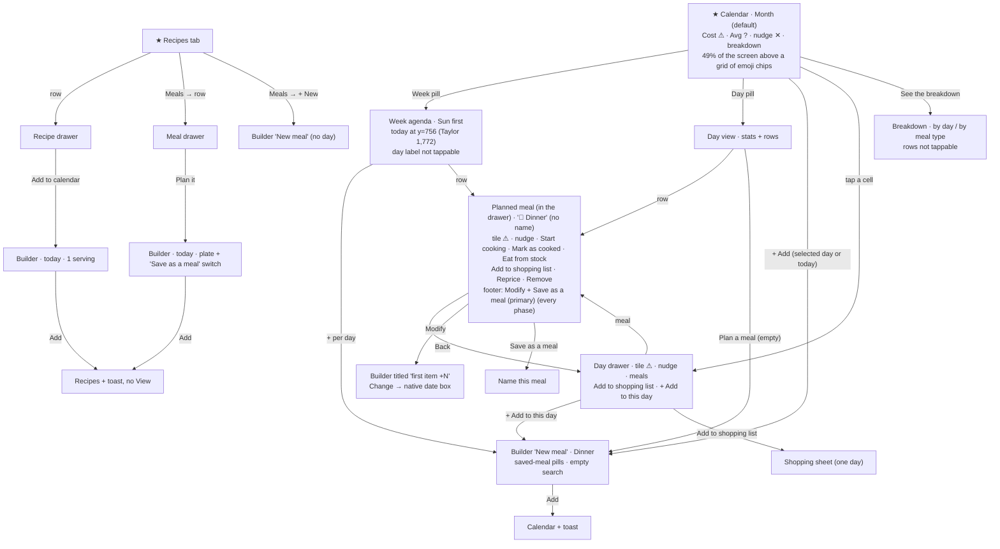
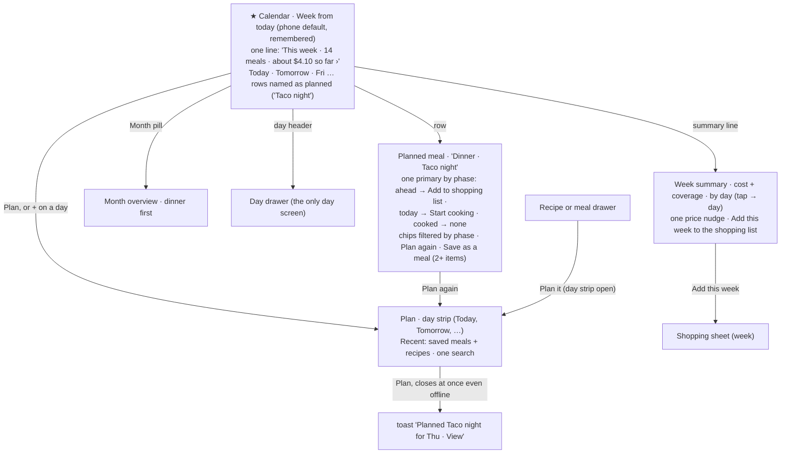

# J3 — Plan and review the week

Audit of Pinch at http://127.0.0.1:5240 (checkout `the audit build`, tip `e74fd9fb`), walked on 2026-10-15 between 05:45 and 06:10 UTC, so the app's "today" in America/Los_Angeles was **Wed Oct 14**. Phone first at 390×844 (touch), then 1280×900. Fixtures: Alex (returning user, throwaway "J3 " data), Taylor (scale kitchen: 1,092 planned meals at 12 a day, 60 saved meals, 200 recipes, calories and protein switched on; read-only).

Screenshots: `J3-shots/`, cited below as `shots/NN-name.png`.

**What I created and deleted.** In Alex's kitchen: saved meals "J3 Taco Tuesday" and "J3 Tweaked tacos", and four planned dinners in the week of Nov 1–7, kept out of October so other agents' October counts stayed the same. One was made from the calendar, one from the recipe drawer, one from the meal drawer and one while offline. One was tweaked, one was moved and one was removed with the app's own Remove. I deleted all of them through the app (Remove from this day ×3, then Meal → Modify → trash ×2). A REST check afterwards found no J3 meal, planned meal, ingredient or shopping line. I never used "New ingredient" and closed every shopping sheet without adding.

**Fixture notes for the coordinator.**
1. The seed was run while UTC was already Oct 15, so Alex's seeded "today" meals sit on Thu Oct 15 and the app's today (Oct 14) only holds meals other agents added (J5 Weeknight chili, J6 Freezer chili). I used those, read-only, to see a "today" planned meal.
2. **Opening Taylor's Pinch in the browser is not read-only.** Pinch freezes past meals when it loads (`hooks/useFreezePastDays.ts`). Before my visit Taylor had 0 snapshots. Afterwards all 528 past meals (Aug 31 – Oct 13) had one. That is the app's own behaviour on open, the same for any person, but Taylor's kitchen is no longer the pristine seed.
3. Other agents were writing while I walked, so the counts on Alex's calendar moved between my screenshots: the nudge read "13 ingredients need a price", then "20", then "23 ingredients need a price or a size", and the Shopping badge went 4 → 6 → 7. The counts below are as seen at each moment.

---

## 1. Who and when

**The household planner.** A home cook for two to four people, phone in hand. There are three moments:

- **Sunday evening on the sofa.** Unhurried, but not willing to type much. They want the coming week's dinners (and some lunches) filled from things the household already eats, then one shop. On their mind: who's home which night, what's still in the fridge, roughly what it will cost, the shop tomorrow.
- **5 pm on a weekday, in the kitchen.** One hand free. "What's for dinner?" They want tonight's answer in one glance, and if nothing is planned, a quick decision ("the adobo from the fridge", "that rice recipe"). On their mind: time, defrosting, what's left over.
- **Plans change.** Eating out Thursday, leftovers instead of cooking, a friend over Saturday. They move, swap or drop a meal and expect the plan and the list to follow.

Looking back ("what did we eat last week, what did it cost, what did we like?") happens rarely, as a by-product.

## 2. Goals and outcomes

| # | Job story | Outcome that means success | How often | Matters | Without the app |
|---|---|---|---|---|---|
| G1 | When someone asks "what's for dinner?", I want to see tonight's plan at a glance, so I can start cooking or defrost something. | Tonight's meal visible on opening, named the way I named it. | Daily | Core | Memory, a whiteboard, a text |
| G2 | When I sit down to plan the week, I want to fill the coming days from things we already eat, so I can shop once. | 5–7 meals planned in a couple of minutes, without typing names. | Weekly | Core | A notes app or paper list |
| G3 | When I've decided on a recipe (I'm looking at it), I want to put it on today or another day, so the plan stays true. | 2–3 taps, on the right day, at the amount I'll cook. | Several times a week | Core | Memory |
| G4 | When plans change, I want to move, copy or drop a meal, so the plan and the list stay right. | A move or repeat in a few taps, nothing retyped. | Weekly | Supporting | Cross it out |
| G5 | When one day's version differs (double the rice), I want to adjust that day without touching my saved meal, so my favourites stay clean. | The day changes, the saved meal doesn't, and I still recognise the meal by its name. | Weekly | Supporting | n/a |
| G6 | When the week is planned, I want a rough cost, so I know whether it fits the budget. | One trustworthy week figure, one glance (J7 owns trust). | Weekly | Supporting | The receipt afterwards |
| G7 | When I care about eating well, I want to see whether the week is balanced, so I can swap something. | A per-person signal I can compare against. | Weekly, for some | Supporting / rare | A tracker app |
| G8 | When the week is planned, I want everything for it on the shopping list in one go, so I shop once. | ≤3 taps for the week. | Weekly | Core (bridge to J4) | Write the list by hand |
| G9 | When I look back, I want a light record of what we actually ate, so I can repeat a good week. | Last week's meals with what was cooked; plan one again in a tap. | Monthly | Rare | Photos, memory |

## 3. Current journeys, as walked

All taps were counted in the browser at 390×844, from the screen named in the first row.

### J3-A. "What's for dinner tonight?" (G1): open the app

| Step | Surface | Action | Taps | What the app volunteers | Friction |
|---|---|---|---|---|---|
| 1 | Calendar, **Month** (always the default on open; `?view=` is kept only within a visit) | open | 0 | **Cost $5.20 ⚠**, **Avg per meal $0.29 ?**, "13 ingredients need a price · Add prices ✕", "See the breakdown ›", then the grid (`shots/01-cal-month-first.png`) | **49% of the screen sits above the grid** (weekday header at y=415 of 844, measured). Cells hold 18-px emoji chips: 🍝 says "a dinner", not *which* dinner. 3.5 of 6 weeks are visible before the nav pill. Taylor: header at y=481 (57%) (`shots/30-taylor-month.png`) |
| 2 | Day drawer | tap today's cell | **1** | Cost tile ± ⚠, nudge, meals grouped by type, "Add to shopping list", "+ Add to this day" (`shots/97-today-drawer-with-meals.png`) | Works: 1 tap. The meal rows have no chevron, so a two-item dinner reads as a static list (`shots/11-daydrawer-oct15.png`) |
| alt | **Week** view | tap Week | 1 + a swipe | same stats row, then **Sun, Mon, Tue first** (`shots/02-cal-week-first.png`) | **Today is not on the first view.** Wed Oct 14 starts at y=756, the nav pill's top edge (760). Tomorrow is at y=921. For Taylor, today is at y=1,772: two screens down. Today's only mark is an 8-px orange dot (`WeekView.tsx:147-153`) |
| alt | **Day** view | tap Day | 1 | an empty today shows **$0.00 · — · ? · "Want calories or protein here?"** above "Nothing planned for this day yet · Plan a meal" (`shots/03-cal-day-first.png`) | Four volunteered items about nothing |

**Expected vs found.** I expected the planner's home to answer "what are we eating?" first. It answers "what did the month cost?" first. On a phone, the plan itself is a grid of anonymous emoji that needs a tap per day.

### J3-B. Plan a meal (G2, G3): every way in, counted

Entry points to the plan builder (`MealBuilder`, mode `plan`): **7, with 7 different labels.** They are the header's **"+ Add"**, the empty calendar's "Plan your first meal" (first run), the day drawer's **"+ Add to this day"**, Week's **"+"** per day (aria "Add to Mon, Nov 2"), the empty Day view's **"Plan a meal"**, the recipe drawer's **"Add to calendar"** and the meal drawer's **"Plan it"**. The planned meal's **Modify** reopens it to edit. The Meals tab's "+ New" opens the same builder in saved-meal mode, also titled "New meal".

| Path (start screen) | Taps | Volunteered on the way | Friction |
|---|---|---|---|
| **Saved meal, today**, Calendar: + Add → pill → "Add to today" | **3** | saved-meal pills, plate cost ⚠ | The search isn't focused (J1-S2). Default type is Dinner (J1-S14) |
| **Saved meal, a day this week**, Week: "+" on the day → pill → "Add to Mon, Nov 2" | **3** (+3 "Next week" taps to reach Nov 1–7: 8 from the Calendar tab, measured) | toast "Added J3 Taco Tuesday to Mon, Nov 2" (`shots/47-week-after-plan.png`) | — |
| **A recipe I know**, Calendar: + Add → search → type → pick → Add | **4 + typing** | the search lists **nothing until you type** ("Type a name to find it, or add one that isn't in the list.", `shots/20-builder-from-header.png`). Results carry stock ("🧊 5 servings · Eat by Oct 16", `shots/22-builder-search-ad.png`) | My 5 recipes and recent plans aren't offered. Typing "ad" also lists Avocado, Bread flour, Breadcrumbs, Pita, Radish |
| **From the recipe drawer, another day**, Recipes tab → row → Add to calendar → Change → date field (+ OS picker ≈2) → Add | **6 + picker ≈ 8** | the builder opens on **today, 🍝 Dinner, 1 serving · "Recipe serves 4"** (`shots/52-builder-from-recipe.png`) | The day is the question here, yet it hides behind "Change" and a native date box (`shots/54-builder-change-nov3.png`). After Add the app **stays on Recipes** with a toast that has **no View** (`shots/55-after-plan-from-recipe.png`). Seeing the plan takes Calendar → Week → 3× next |
| **From the meal drawer, another day**, Meals → row → Plan it → Change → date → Add | **6 + picker ≈ 8** | the plate is copied, and **"Save as a meal" is offered again for a plate that already is one** (`shots/58-builder-from-meal.png`) | The same today-first default and the same missing View |
| **Taylor (scale)**: + Add | — | **two search fields stacked**: "Search start from a saved meal" (sic) above 5 pills + "Show all 60", then "Search recipes, ingredients" (`shots/35-taylor-builder.png`) | Saved meals and recipes are found in different boxes, and only while the plate is empty. The item search never finds saved meals (`ItemSearch.tsx:58-77`), though UX.md's component table says it searches "recipes, meals and ingredients" |

**Planning a week of five dinners from recipes I know**, from the Calendar tab: Week (1) + 5 × (+, search, pick, Add) = **21 taps and 5 typed searches**. With saved meals: **16 taps**. From recipe drawers: 5 × ≈8 = **≈40 taps**, plus 5 trips back to check.

**Hidden state.** After tapping a day in Month and closing its drawer, the cell keeps its ring and the header's "+ Add" plans onto **that** day, not today (`shots/93-month-selected-17.png`, `shots/94-builder-after-select-17.png`; `CalendarScreen.tsx:120-124`). Nothing on the button says so.

### J3-C. Change the plan (G4, G5)

| Task | Path (from Week) | Taps | Friction |
|---|---|---|---|
| **Tweak a day** (rice 1 → 1.5) | row → Modify → + → Save | **4** | Works, and the saved meal stayed at 1 serving (REST-checked). But the builder is now titled **"Cilantro lime rice +1"**, not "J3 Taco Tuesday", and offers "Save as a meal" again (`shots/62-builder-modify-nov2.png`) |
| **Save the tweaked day as a new meal** | row → **Save as a meal** (the footer's primary) → name → Save | **4 + typing** | Toast "Saved J3 Tweaked tacos to your meals". The planned view then offers **"Save as a meal" again as its primary**, with nothing to show it's saved (`shots/66-after-save-as-meal.png`) |
| **Move** a dinner to another day | row → Modify → Change → date field (+ picker ≈2) → Save | **5 + picker ≈ 7** | No move action outside the full editor. No drag on the 1280 week columns |
| **Repeat** a meal on another day ("leftovers tomorrow", "same lunch all week") | not supported: Save as a meal (4 + a name) then + → pill → Add (3) | **7 + typing**, and it leaves a saved meal behind | — |
| **Remove** | row → Remove from this day → Remove | **3** | Confirm copy is good: "Remove this dinner from Wed, Nov 4? Your recipes stay as they are." (`shots/68-remove-confirm.png`) |

**The meal's name disappears once it is on a day.** I planned "J3 Taco Tuesday" and the toast said so. The Week row then read **"Cilantro lime rice +1"** (`shots/47-week-after-plan.png`), the planned meal's header read **"🍝 Dinner"** (`shots/61-planned-nov2.png`), and Modify's title read "Cilantro lime rice +1". The seeded "Adobo and rice" (`seed-pinch-planned-7`, `name: "Adobo and rice"` in Firestore) shows as **"Adobo chicken +1"** on the phone week and "Adobo chicke…" on the 1280 month (`shots/02b-cal-week-full.png`, `shots/80-desktop-month.png`). The name is stored (`PlannedMeal.name`) but no screen reads it: `CalendarScreen.tsx:85-92` and `DayView.tsx:66-70` build titles from the items. `PlannedMealView.tsx:323-326` shows only the meal type.

### J3-D. The day drawer and the planned meal: how many jobs (G1, G3, G8)

**Day drawer (a future day, Oct 15)**, `shots/11-daydrawer-oct15.png`: Cost tile ⚠, nudge "10 ingredients need a price · Add prices ✕", meals by type with a price phrase per item, "Add to shopping list", "+ Add to this day". **4 jobs** (cost, look, shop, plan) and **7 volunteered items**. It is reasonable.

**Planned meal**, swapped in place inside the day drawer. Its body and footer change with the meal's phase, but the footer's primary never does: **"Save as a meal"** in every phase (`PlannedMealView.tsx:197-214`).

| Phase | What it offers (seen) | Tappables | Shot |
|---|---|---|---|
| Ahead (Nov 5, one recipe) | Cost ⚠, nudge, item, **Start cooking**, **Add to shopping list**, Remove, Modify + **Save as a meal** | 7 | `shots/96-planned-single-recipe.png` |
| Today, already cooked (J5's chili) | Cost, nudge, item, **Start cooking**, **Cooked ✓ · Undo**, **Eat from your freezer · 1 container matches**, **Add to shopping list**, Remove, Modify + **Save as a meal** | 10 | `shots/98-today-planned-dinner.png` |
| Past, cooked (Oct 12) | "Wasn't priced · Fixed when the day passed", item "Wasn't priced", paragraph "This day has passed, so its meals keep the prices and numbers they had.", **Cooked ✓ · Undo**, **Price this day with today's prices ?**, **Eat from your fridge · 2 containers**, **Eat from your freezer · 1 container**, Remove + **Save as a meal** | 8 | `shots/14-planned-oct12-dinner.png`, `shots/14b-…-bottom.png` |

What doesn't fit the moment:
- After **Cooked ✓**, it still offers Start cooking and Add to shopping list.
- On the past dinner that **made** those containers, it offers to eat from them.
- It says "frozen" three times on one past meal: the tile's detail, the row's "Wasn't priced" and a paragraph.
- **Save as a meal** is the primary even for a one-recipe plate, a plate that is already a saved meal, and one saved a moment ago.

That's up to **7 jobs** on one sheet: plan (Modify, Remove), save, cook, mark cooked, eat from stock, shop, reprice, plus cost (tile, ⚠, nudge).

**Day view and day drawer are the same day twice.** Day view = stats row + meals grouped by type. Tapping a meal there opens the **day drawer** titled with the same day, straight on the planned meal, whose **Back** shows the day's list that is already on screen behind it (`shots/85-desktop-day-oct15-dinner.png`: two Cost tiles and two nudges visible at once, $0.68 / 10 ingredients behind and $0.15 / 9 in front). For Taylor's Oct 14, the Day view says "**56 ingredients need details**" (`shots/34-taylor-day.png`) and the day drawer says "**47 ingredients need a price**" (`shots/31-taylor-daydrawer-today.png`). J7-24 explains why (the drawer passes price gaps only). To the person it's one day giving two answers.

**Week on a phone can't open a day.** The day label is a `SectionDivider`. Measured: 0 "Open <day>" buttons in the phone week, against 7 at 1280. So the day's total and "Add to shopping list · Choose what you need for the day" can't be reached from the planner view unless a day has more than 6 meals ("Show N more"). UX.md says an empty day's dash "still opens its drawer". In the code it is plain text.

### J3-E. Plan, then shop for it (G8)

Per day, from Month: cell → Add to shopping list → Add N = **3 taps**. Three days took 9 taps (`shots/95-add-to-shopping-day-sheet.png`), and a week takes **21**. Each day's sheet re-lists lines already added from the day before ("Chicken thigh · On your list · 2 lb", "Garlic · On your list · 6 each"). Amounts come from 1-serving plans of 4-serving recipes ("Cilantro 0.13 cup", "Black pepper 0.5 tsp"; J1-F2). There's **no "this week" step**: the Week view has no list action, and its days can't be opened (above). The day sheet opens with "You already have prepared servings of Adobo chicken and Cilantro lime rice." but still ticks all their ingredients, because the plan doesn't know tonight comes out of the fridge.

### J3-F. "What does the week cost? Is it balanced?" (G6, G7)

- Week pill (1): **$4.10 ⚠ · $0.51 avg** for 14 meals. The ⚠ (2) opens 3 paragraphs: "Leaves out 23 ingredients… The note asks about fewer: 2 are hidden or in a day that has passed. A price you add now counts from today on…" (`shots/70-cost-warning.png`). "See the breakdown" (2) gives by day / **by meal type** ("🍝 Dinner · 9 meals · leaves out 22 ingredients · $3.19"), with a caveat on every row and rows that can't be tapped (`shots/72-…`, `73-breakdown-meal.png`; J7-10). The breakdown's title says **$7,894.50** where the tile says **$7,895** (Taylor, `shots/32-…` vs `30-…`).
- **Balanced?** Only with nutrition on (Taylor). Then the calendar shows "Daily average this month **🔥 13,475 · 💪 621.3 g**" and the day drawer "For the day 🔥 13,962" (`shots/30-taylor-month.png`, `31-…`). These are **household sums of every planned serving**, shown where a person expects a diet figure, with no number of eaters and no reference. Nobody can act on 13,475 kcal. "Per g protein $0.41" is the third tile. The goal "is the week balanced?" can't be answered.

### J3-G. The past (G9)

Past days read "Wasn't priced · Fixed when the day passed", with "Price this day with today's prices ?" when today's prices would change them (`shots/13-daydrawer-oct12-past.png`). The past day's one primary is still **"+ Add to this day"**: planning onto a past day is allowed and freezes at once (`plannedMealActions.ts:55-58`), which works as "log what we ate". Looking back, though, **planned and cooked look identical** in Month and Week. "Cooked ✓" lives only inside the planned meal, so the calendar can't answer "what did we actually eat?". J7-H6 and J7-P7 cover the freeze machinery. I agree with J7, and add that its explanations stack up on one sheet (above).

### J3-H. Offline (a phone in a flaky kitchen)

Offline (Playwright `setOffline`), Week → "+" Fri Nov 6 → pill → Add: the builder **stays open with a spinner on the primary and Cancel disabled** after 3 s and after 8 s, under the red "You're offline" bar (`shots/91-offline-plan-8s.png`). Only when the network returned did it close with "Added J3 Taco Tuesday to Fri, Nov 6" (`shots/92-online-again.png`). The cause: `MealBuilder.tsx:287-301` awaits the server acknowledgement of `setDoc`, which Firestore holds while offline, though the local cache had already taken the write. Modify, Remove and Save as a meal follow the same await pattern (`PlannedMealView.tsx:136-173`).

### J3-I. Scale (Taylor) and wide screens

- **Month on a phone at 12 meals a day: every cell reads "🍳🍳 +10"** (`shots/30-taylor-month.png`). Chips follow meal-type order (`selectors.ts:429-436`, breakfast first), so **dinner, the meal most people plan, is never shown**. The 1280 month is the same: three breakfast/lunch pills, then "+9 more" (`shots/87-desktop-taylor-month.png`).
- Taylor's Week agenda on a phone: today at y=1,772.
- At 1280 the week is 7 columns with titled pills and a "+" per column (`shots/83-desktop-week.png`), and the month has titled pills plus a hover peek per day (`shots/81-desktop-peek-oct15.png`). Good use of width, with the same name loss ("Adobo chicken +1").
- Load: Taylor's calendar reached its heading 8.9 s after navigation in the dev build, no throttle (rough figure; N2/I1 own performance).

### Insight surfaces on each screen's first view (390×844)

| Screen | Count | Items (class) |
|---|---|---|
| Calendar Month (Alex) | 6 + nav badge | Cost (REFERENCE, misleading per J7-H1), ⚠ (STATUS), Avg per meal (NOISE), its ? (REFERENCE), nudge + ✕ (DECISION, repeated on 5 surfaces), "See the breakdown" (REFERENCE) |
| Calendar Month (Taylor) | 9 + badge | the same, plus Per g protein (NOISE), Daily average 🔥 and 💪 (NOISE: household sums) |
| Week (Alex) | 6 + 14 row price phrases | stats as above, plus "$0.15", "No price yet", "Wasn't priced" on every row (REFERENCE/NOISE: partial without saying so, J7-9) |
| Day view, empty day | 4 | $0.00, —, ?, "Want calories or protein here?" (all NOISE) |
| Day drawer, future | 7 | tile, ⚠, nudge, 4 row prices |
| Day drawer, past | 6 | "Wasn't priced", "Fixed when the day passed", 2× "Wasn't priced", reprice row + ? |
| Planned meal, ahead | 5 | tile, ⚠, nudge, item prices |
| Planned meal, past cooked | 9 | listed in J3-D |
| Builder (plate) | 2–3 | "Cost $0.08 ⚠", serving captions, stock lines in search results (DECISION: the right place for it) |

### Nouns on the planning path (20)

calendar · month · week · day · meal (= a planned slot: "Remove this dinner") · **meal (= a saved template: "Meals", "Save as a meal")** · "New meal" (both builders) · plate ("What's on the plate?", "For the plate") · item · serving / "Recipe serves 4" · meal type (6) · recipe · ingredient · cost · avg per meal · per g protein · daily average · breakdown · "Fixed when the day passed" / "Wasn't priced" / "Price this day with today's prices" · cooked · fridge / freezer containers. "Meal" means two things on the same screen.

## 4. Flow diagrams

**Current (phone).** ★ marks entry points.

**Proposed (phone).** Every change is justified in §6.

## 5. Findings

### (a) Small things

| id | sev | where | evidence | goal hurt |
|---|---|---|---|---|
| J3-S1 | minor | Plan toast after planning from a recipe or meal drawer, `MealBuilder.tsx:302-308` | "Added Cilantro lime rice to Tue, Nov 3" with no View, and the app stays on Recipes (`shots/55-…`). Seeing the plan took Calendar → Week → 3× next | G3 |
| J3-S2 | minor | Recipe drawer → builder day (`RecipesScreen.tsx:574-583` always passes today) | another day needs Change, then a native date box and the OS picker (`shots/53`, `54`), ≈ +4 taps | G3, G2 |
| J3-S3 | minor | "Save as a meal" switch in the builder (`MealBuilder.tsx:535-556`) | offered on a plate copied from a saved meal (`shots/46`, `58`) and on Modify of one (`shots/62`) | G5 (pushes a concept that does no work) |
| J3-S4 | minor | Planned meal after "Save as a meal" | still offers "Save as a meal" as the primary, with no sign it's saved (`shots/66-…`) | G5 |
| J3-S5 | minor | Header "+ Add" targets the last tapped day (`CalendarScreen.tsx:120-124`) | after tapping Oct 17 and closing the drawer, + Add opened "Sat, Oct 17 · Dinner" (`shots/93`, `94`) | G3 |
| J3-S6 | polish | Calendar nudge at 390 px | "23 ingredients need a price or a size" wraps and leaves "**· Add details**" starting line 2 (`shots/93-…`), against CLAUDE.md's rule that a separator only separates items on the same line | calm |
| J3-S7 | minor | Week on a phone: day label not tappable (`WeekView.tsx:143-166`) | 0 "Open <day>" buttons measured (7 at 1280). The day total and the day's "Add to shopping list" can't be reached from Week. UX.md:287 says an empty day's dash opens its drawer, but the code renders plain text | G8, G6 |
| J3-S8 | minor | Builder at scale: two search fields (`MealBuilder.tsx:418-454`; `PillGroup` adds the first) | "Search start from a saved meal" (ungrammatical, built from the label) stacked over "Search recipes, ingredients" (`shots/35-…`) | G2 |
| J3-S9 | polish | Item search never finds saved meals (`ItemSearch.tsx:58-77`) | typing a saved meal's name finds nothing, and the pills vanish once the plate has an item. UX.md's component table claims "recipes, meals and ingredients" | G2 |
| J3-S10 | polish | Builder meal type when planning onto a day that already has a dinner (`WeekView` `onAdd` → `mealType: null` → `?? 'DINNER'`, `MealBuilder.tsx:120`) | the "+" on Oct 15 (which has a dinner) defaults to a second Dinner. Extends J1-S14 | G2 |
| J3-S11 | polish | Breakdown title vs tile (`BreakdownDrawer.tsx:61` vs `StatsRow.tsx:46-49`) | "$7,894.50" vs "$7,895" (`shots/32`, `30`) | G6 |
| J3-S12 | polish | Day drawer meal rows | a tappable two-item meal has no chevron and reads as static rows (`shots/11-…`) | G1 |
| J3-S13 | minor | Planned meal phase mismatches (`PlannedMealView.tsx:411-462`) | after Cooked ✓: Start cooking and Add to shopping list still offered (`shots/98`). On the past dinner that produced the containers: "Eat from your fridge · 2 containers match" (`shots/14`) | G1 |
| J3-S14 | polish | Past planned meal | "frozen" said three times: tile detail, row, paragraph (`PlannedMealView.tsx:404-410`) (`shots/14-…`) | calm |
| J3-S15 | polish | Day view vs day drawer counts for one day | Taylor Oct 14: "56 ingredients need details" vs "47 ingredients need a price" (`shots/34`, `31`). Cause in J7-24 | G6, calm |
| J3-S16 | polish | Week on a phone: today's mark | an 8-px dot next to the label, and no scroll to today | G1 |

### (b) High-arching things

**J3-F1 · major · The calendar's first view is a cost report sitting on a planner the phone can't read.** Measured at 390×844:
- 49% of the screen (Alex) and 57% (Taylor) comes before the plan.
- 6 to 9 volunteered surfaces sit above it, and at most one is a DECISION.
- The Month default shows anonymous 18-px emoji.
- The Week agenda starts with days already gone and puts today under the nav pill (y=756) or two screens down (Taylor, y=1,772).

The same tiles repeat on every view, including an empty day ("$0.00 · — · ?"). Who reads them: Cost is REFERENCE but misleading (J7-H1), Avg per meal is NOISE (no decision changes), Per g protein is NOISE at the period level, the daily nutrition average is NOISE (J3-F7), and By meal type in the breakdown is NOISE. Hurts G1 and G2, every day.

**J3-F2 · major · The name the person gave a meal is dropped once it is planned.** "Taco night" goes on Monday as "Cilantro lime rice +1". The calendar, the day drawer, the planned meal ("🍝 Dinner") and the editor all build titles from the first item, though `PlannedMealView`'s data carries `name` (evidence in J3-C). Saved meals exist so a person can plan "the usual" by name. On the calendar they read as a side dish plus a count. Hurts G1, G2 and G5, and makes saved meals look pointless.

**J3-F3 · major · Planning is one meal at a time, from a blank search.** Each plan starts on an empty search with no recent recipes; at scale saved meals sit in a second search box; the day defaults to today and changing it means a native date box; nothing repeats or copies a meal; and planning from a recipe never shows where it landed. Measured:
- Five dinners: 21 taps and 5 typed names from Week; ≈40 taps from recipe drawers.
- A repeat: 7 taps plus inventing a saved-meal name.
- A move: ≈7 taps.

Hurts G2, G3 and G4, the weekly core.

**J3-F4 · major · The planned meal carries seven jobs, and its one primary is "Save as a meal" whatever the phase.** Covered in J3-D. CLAUDE.md says a drawer's one primary is the next step in the person's loop. For a planned meal that step depends on time:
- ahead: buy it;
- today: cook it;
- cooked: nothing (maybe a note);
- past: look.

"Save as a meal" is the next step in none of these. J1-F9 caught the one-item case; it holds for every plate. Hurts G1 and calm.

**J3-F5 · major · Day view repeats the day drawer.** It's one day shown twice. From Day view a meal opens the day drawer over it, with a Back to the list already behind. The two show different gap counts for the same day. On first run the Day view also stacks two empty boxes (J1-S3). Meanwhile the Week view on a phone, the real planner, can't open a day at all (J3-S7). Hurts G1, G8 and the "one home" lens.

**J3-F6 · major · There's no week step from plan to shopping list.** The weekly loop is plan Sunday, shop Monday. Today it costs 3 taps per day (21 a week), each sheet re-lists yesterday's lines, and the planner view (Week) offers no list action and can't open its days. Hurts G8. Coordinate with J4.

**J3-F7 · minor · "Is the week balanced?" isn't answerable.** Nutrition is off until the person finds the Calendar gear (J1-F6, J7-H7). Turned on, it shows household sums of every planned serving as "Daily average this month 🔥 13,475 · 💪 621 g", with no eaters and no reference, plus "Per g protein". Nothing on the calendar helps a person swap a meal for balance. Turning more switches on, as J1-P8 and J7-P8 propose, would spread a meaningless number further unless the basis changes. Hurts G7.

**J3-F8 · major (phone first) · Offline, planning locks the screen.** Covered in J3-H. Firestore accepts the write locally, but the builder waits for the server and disables Cancel. In a kitchen with bad Wi-Fi the person can't plan, and can't even back out without the back arrow. Hurts G2, G3 and G4.

**J3-F9 · minor · Too many words for one act, and two features that are one.**
- Planning has 7 labels for one action ("Add", "Plan your first meal", "+ Add to this day", "+", "Plan a meal", "Add to calendar", "Plan it").
- Saving a meal has 3 routes (Meals → New, the builder switch, the planned meal's primary).
- The Breakdown and the stats tiles are one feature split in two: the tiles summarise the period, and the breakdown (one tap below) says the same per day with a caveat on every row and no tap-through (J7-10).

Hurts the Concepts lens and G2.

**J3-F10 · minor · At scale the month hides dinner.** Chips and pills follow meal-type order, so a busy day shows its breakfasts and "+10", on a phone and at 1280 (J3-I). The overview hides the meal people plan. Hurts G1 and G2 for big households.

**J3-F11 · minor · Looking back can't tell planned from eaten.** "Cooked ✓" exists per planned meal, but Month and Week show past meals the same either way (UX.md even lists "marking made arrives with stock tracking"). Hurts G9.

## 6. Proposals

Ordered by value. Sizes: S = a label or a line, M = a screen or component, L = a flow or a concept.

| id | type | goal | what changes | justification | cost / risk | size |
|---|---|---|---|---|---|---|
| P1 | REARRANGE + TRIM + MERGE | G1, G6, calm | **The stats row becomes one summary line** above the plan: "This week · 14 meals · about $4.10 so far ⚠ ›" (J7-P1's coverage wording lives here). It opens a **Week summary** sheet that replaces the Breakdown drawer: the cost with its coverage; days as rows that open their day drawer (fixes J7-10); Avg per meal, Per g protein and, when on, nutrition as small reference lines; the **one** price nudge for the period; and "Add this week to the shopping list" (P6). "By meal type" is dropped. The line is absent on an empty period (J1-P1) | 6–9 first-view surfaces become 1. The plan moves up ≈170 px (Month: weekday header from y=415 to ≈245; Week: today's row on the first screen with P2). Nothing is lost: every figure is one tap away, where people go when they want a number. The tiles and breakdown become one feature | Removes the ✕-able nudge from the first view: price invitations go to the summary and the recipe drawer (slightly further than J7-P3, which kept it on the stats row). Copy in UX.md (Calendar, Breakdown), the `pinch.md` calendar bullet, README "Stats row" | M |
| P2 | REARRANGE | G1, G2 | **On a phone the calendar opens on Week, starting today**: "Today, Tomorrow, Fri 16 …" for 7 days, with the week's passed days folded under one "Earlier this week" row (or one ‹ away). The view choice is remembered on the device. Month stays one pill away as the overview. From `lg` the Sun–Sat columns and the Month default can stay | G1 becomes 0 taps: tonight is the first row under the header. Sunday planning starts on the days still to plan. The month grid on a phone, a poor reader of names, stops being the front door | Breaks the "week runs Sunday to Saturday" line in README/UX.md for the phone agenda (the month grid keeps Sunday). `getPeriodRange` gains a rolling-week mode. Check 320 px and the 1,092-meal fixture | M |
| P3 | FILL | G1, G2, G5 | **Show the planned meal's name everywhere**: calendar chip/pill/row titles use `meal.name ?? first item +N`; the planned meal heads "🍝 Dinner · Taco night"; Modify keeps the name as the title. A tweaked day keeps the name (it's still Taco night) | The person recognises their own plan. Saved meals start paying off on the calendar | One helper (`getMealTitle`) used by `CalendarScreen`, `DayView`, `DayPeek`, `PlannedMealView`, `MealBuilder`. The data already exists (`PlannedMeal.name`), so no migration | S |
| P4 | REARRANGE + TRIM | G1, calm | **The planned meal's primary follows its phase** (builds on known fix #3): ahead → "Add to shopping list"; today and not cooked → "Start cooking" (or "Eat from your fridge" when the meal was planned from stock); cooked → no primary, a "Cooked ✓ · Undo" status line; past → no primary. **Chips are filtered by phase**: no Start cooking or Add to shopping list once cooked; no Eat from stock for containers this meal's own cook made; Mark as cooked only today or past. **Save as a meal** becomes a quiet chip, shown only for 2+ items that differ from the saved meal they came from; the builder's switch goes (P8). The past paragraph goes; the tile's "Fixed when the day passed" says it once | The sheet's thumb button is always the next step, and the 10-tappable "today, cooked" sheet drops to about 5. Extends J1-P7 from one item to every plate | Rules for "phase" live in one helper; `pinch.md`'s "details drawer" bullet changes (the primary is no longer fixed per drawer type) | M |
| P5 | FILL | G2, G3 | **The plan builder starts with the person's own things**: before any typing, a captioned "Recent" pill row of saved meals and the recipes most recently planned or cooked (6–8; the full list behind `PillGroup`'s own "Show all"), and **one** search over saved meals, recipes and ingredients (the two fields at scale merge). Picking a saved meal on an empty plate copies it as today; on a plate with items it appends them. (J1-P6 asked for this on day one; it matters more for a returning user and at scale) | "A recipe I know" goes from 4 taps + typing to 3 taps, no typing. Five dinners from 21 taps + 5 searches to ≈16. One box to look in | Ranking needs a recency source (planned meals and cooks are already loaded). UX.md Plan a meal and the `ItemSearch` description | M |
| P6 | ADD | G8 | **"Add this week to the shopping list"** in the Week summary (P1), and the day header in the phone Week opens the day drawer, which keeps its own day add. It opens the existing `AddToShoppingSheet` with every item of the shown period's days from today on | The weekly loop's last step is 2–3 taps instead of 21, and each line is asked once. It's the moment the shopping list was made for | Coordinate with J4: the sheet needs a "week" label and the 200-lines-per-add cap. No new data. A period that reaches the past adds only today on, like the day rule | S–M |
| P7 | REARRANGE | G2, G3, G4 | **Pick a day with a strip, not a date box**: "Change" shows day pills (Today, Tomorrow, then the next five weekday names), with "Other day…" opening the date input. The recipe and meal drawers' "Plan it" opens with the strip already showing, because the day is the question there. The meal type defaults to the first type not yet planned that day, nearest the time of day (before 10 breakfast, before 3 pm lunch, else dinner) | A move or a plan for Thursday drops ≈4 taps and the OS picker. It fixes J1-S14 and J3-S10 together | `PillGroup` handles 7 pills at 320 px. Keep the date input for far dates | S–M |
| P8 | TRIM | G5, concepts | **Remove the builder's "Save as a meal" switch** in plan mode. Saving lives on the planned meal (P4's chip) and in Meals → New | 3 routes become 2. The plate screen loses a toggle and a field that, as walked, was offered on plates that already are saved meals | Someone who wanted plan-and-save at once now does it in two steps (Plan, then the chip) | S |
| P9 | TRIM | G1, concepts | **Drop the Day view**; Month and Week are the views, and a day is its drawer. Today's drawer opens from the Week row's day header or the Month cell | One day, one screen. The two-Cost-tiles and two-counts states and the double empty boxes (J1-S3) go away, and so does the "Back to the list behind" | People who used Day as "today" get it from P2's Week-from-today. Remove `DayView.tsx`; `?view=day` falls back to Week | S |
| P10 | FILL | G2, G3, G4 | **Offline-safe planning**: plan, Modify, Remove and Save as a meal close as soon as Firestore has the write locally (don't await the server ack). A pending write shows the existing offline bar plus a toast "Saved on this phone · it syncs when you're back online" | Planning works in a flaky kitchen, and Cancel is never trapped. CLAUDE.md already accepts queued offline writes (the continuation rule); this applies it to the most frequent write | A failed write (rules) must still surface. Use `onSnapshot` metadata or a `.catch` toast. The pattern touches 5 thunks | M |
| P11 | FILL | G4 | **"Plan again…" chip on the planned meal**: opens the builder with the same plate, and the day strip (P7) asks which day | Repeat a lunch or "leftovers tomorrow" in 3–4 taps instead of 7 plus a throwaway saved meal | One chip and a builder input (`fromPlannedMealId`) | S–M |
| P12 | REARRANGE | G1 | **Plan toast says where it landed, with View**: "Planned Taco night for Thu · View" opens the Calendar's Week on that day (only when no subview is open, like Shopping's View) | The person sees their plan without 4 taps of navigation | Mirrors `showShoppingTab`'s guard | S |
| P13 | REARRANGE | G1, G2 | **One verb for one act**: "Plan" on the header button, "Plan on this day" in the day drawer's footer, "Plan it" in the recipe and meal drawers ("Add to calendar" goes), and the Week "+" (aria "Plan on Thu, Oct 15"). "Plan a meal" goes with the Day view (P9), "Plan your first meal" with J1-P1 | 7 labels become 2, one verb | Copy only: UX.md, README "Plan your days" | S |
| P14 | REARRANGE | G1, G2 | **Month chips put dinner first** (dinner, lunch, breakfast, then the rest) on a phone and at 1280; the day drawer and Week keep meal-time order | At scale the overview shows the meal people plan, and the "+N" hides breakfasts and snacks | One sort key for the cell only | S |
| P15 | TRIM (owner decision) | G7, calm | **Take the daily nutrition average off the calendar** until there's a per-person basis ("how many eat" on a plan, see Q4). Keep "For the plate" / "For the day" per serving in drawers when metrics are on. Per g protein moves into the Week summary (P1) | Removes a figure nobody can act on (13,475 kcal) from the first view, and stops J1-P8 / J7-P8 from spreading it | Someone who reads the daily sum loses it from the front view (it stays in the summary as a reference line) | S |
| P16 | FILL | G9 | **Past meals show what was cooked**: Week rows and day-drawer rows of a past day carry "✅" when the meal has its cook. The month cell stays the same | Looking back answers "what did we actually eat?" from data that already exists. A STATUS the person created, shown where they look back | Week rows read the cook map (a deterministic id per planned meal and recipe). Keep it off future days | S |
| K1 | KEEP | G5 | **Each day has its own copy of a meal.** Tweaking Nov 2 left "J3 Taco Tuesday" at 1 serving (REST-checked), and the delete confirm says "Days you've already planned it on keep their own copy." | The right model: a template never breaks history. P3 only adds the name back | — | — |
| K2 | KEEP | G2 | **"Start from a saved meal" pills on an empty plate, and the Week "+" per day** | The two fastest planning paths (3 taps). P5 widens the pills to recent recipes | — | — |
| K3 | KEEP | G2 | **Stock in the item search results** ("🧊 5 servings · Eat by Oct 16") | The one insight on the planning path that changes the decision, shown where the decision is made | — | — |
| K4 | KEEP | G4 | **Remove from this day** with a confirm that names the day and says recipes stay | Clear, safe, 3 taps | — | — |
| K5 | KEEP | G1 | **The 1280 layouts**: titled pills in Month, seven columns with "+" in Week, the hover peek | They use the width well. P3 fixes their titles | — | — |
| K6 | KEEP | G6 | **Day drawer as the day's one home** (cost tile, meals by type, the day's shopping add, + Add), and **planning onto a past day** as a quiet way to log | It does 4 jobs that belong to a day. P9 makes it the only day screen | — | — |
| K7 | KEEP | G3 | **Plan toasts that name what and where** ("Added J3 Taco Tuesday to Mon, Nov 2") | STATUS the person acted for. P12 adds View | — | — |
| K8 | KEEP | G1 | **The builder's plate summary with a ⚠ and no fill-in sheet** | Calm: the plate screen is for building, not bookkeeping (the rule in `pinch.md` holds) | — | — |

**Tap counts, current → proposed** (current measured; proposed estimated from the proposals):

| Task | Now | With P1–P13 |
|---|---|---|
| See tonight's dinner on opening | 1 (Month cell) | 0 |
| Plan tonight from a saved meal | 3 | 3 |
| Plan tonight from a recipe I know | 4 + typing | 3 |
| Plan Thursday from a recipe drawer | ≈8 (with the OS picker) | 3–4 |
| Plan five dinners for the coming week | 21 + 5 typed | ≈16, no typing |
| Move a dinner to another day | ≈7 | 5 |
| Repeat a meal on another day | 7 + a made-up name | 3–4 |
| Put the week on the shopping list | 21 | 2–3 |
| See what the week costs | 1–2 | 0 (the line) / 1 (the summary) |

**On the known fixes in flight.** #3 (drawer chip rows, footer Modify + the primary) is the right direction for the planned meal, but incomplete: the primary must follow the phase, chips must be filtered by phase, and the sheet needs the meal's name (P3, P4). If #3 ships with "Save as a meal" as the planned meal's fixed primary, it bakes in J3-F4. #1, #2, #4 and #5 don't touch planning. #6 adds another per-list switch; like J7, I'd rather lists follow one choice.

**Where I agree or differ with J1 and J7.**
- Agree with J1-P1 (empty calendar), J1-P5 (a recipe joins at its own servings; it also fixes this audit's 0.13-cup shopping lines), J1-P6 (recipes on the plate: P5 extends it), J1-P7 (P4 generalises it), J1-P17 (distinct builder titles; P3 adds the name back on Modify).
- Agree with J7-P1 (partial totals say so: it lives in P1's line), J7-P3 (nudges off the meal, day and planned-meal drawers), J7-P7 (freeze prices, not holes: it removes the reprice row from most past days) and J7-P12/Q5. I go further than Q5: the breakdown merges into the Week summary and "By meal" goes.
- I differ slightly from J7-P3, which keeps the price nudge on the calendar stats row. A planner's first view shouldn't carry a bookkeeping backlog, so it moves into the summary sheet.
- I add a caution to J1-P8 / J7-P8 (one nutrition switch): fix the basis first (P15, Q4), or the switch spreads a household daily sum.

## 7. Rule candidates

1. **A name the person gave stays on the thing everywhere it appears.** A saved meal planned on a day keeps its name on the calendar, the drawer and the editor, and a tweak doesn't remove it. → `CLAUDE.md` Product.
2. **A record's one primary follows its phase, and an action the new state makes pointless disappears** (no "Start cooking" or "Add to shopping list" after Cooked ✓, no "Save as a meal" on a plate that already is one). → `CLAUDE.md` Design & UX (extends "A drawer's one primary button is the next step in the person's loop"); `.claude/rules/pinch.md` "A details drawer keeps its actions together".
3. **A schedule on a phone opens on today.** An agenda never puts days already gone above today on the first view: it starts at today or scrolls there. → `CLAUDE.md` Design & UX.
4. **One subject, one screen.** A "view" that repeats a drawer's content isn't added, and a drawer never opens with a Back to the list already behind it. → `CLAUDE.md` Design & UX.
5. **A picker shows the person's own recent things before they type, in one list with one search.** → `CLAUDE.md` Design & UX.
6. **Picking a near day is a strip of day pills (today and the next six), with a full date picker behind "Other day".** → `CLAUDE.md` Design & UX (next to the range-calendar rule).
7. **A write Firestore can queue offline closes its form at once and says it will sync; Cancel is never disabled waiting for a server.** → `CLAUDE.md` State, data, and performance (complements the queued-write continuation rule).
8. **A planning screen's first view volunteers at most one summary line and no backlog. Its tiles live one tap behind the line.** → `.claude/rules/pinch.md` (the calendar bullet) and N2's insight budget.
9. **A nutrition total appears only on a basis a person can compare against** (per serving, per person). A household's summed day isn't shown as a diet figure. → `.claude/rules/pinch.md`.
10. **Review checklist:** count the labels for each action across its entry points (one act, one verb), open each drawer in every phase (ahead, today, done, past) and list the actions that no longer make sense, and open new calendar surfaces on Taylor at 390 px and 1280. → `.claude/skills/pr-wrap-up/references/review-agents.md` (product and design agents).

## 8. Open questions for the owner

1. **What is the calendar's first job on a phone: planner or overview?** *Recommendation:* planner. Open on Week starting today (P2), keep Month as the overview pill, and remember the choice.
2. **Drop the Day view?** *Recommendation:* yes (P9). The day drawer is the day.
3. **Collapse the stats into one line with a Week summary that absorbs the Breakdown, and drop "By meal type"?** *Recommendation:* yes (P1). Keep Avg per meal and Per g protein as reference lines inside the summary, or drop them if nobody misses them in a month.
4. **What does a planned serving mean, and should the calendar show nutrition for the household?** (J1-Q2 asked the serving half.) *Recommendation:* a plan's servings are what you cook (J1-P5). Until there's a "how many eat" figure, the calendar shows no daily nutrition average (P15) and drawers show per serving.
5. **A week-level "Add to shopping list"?** *Recommendation:* yes (P6), decided together with J4.
6. **Should "Save as a meal" stay a primary anywhere?** *Recommendation:* no. It's a chip on 2+ item plates that differ from their source (P4, P8).
7. **Repeat and move as their own actions ("Plan again…", a day strip), or keep everything inside Modify?** *Recommendation:* add "Plan again…" (P11) and the day strip (P7); keep Modify for the rest.
8. **Should past meals show ✅ when cooked?** *Recommendation:* yes, quietly, on past days only (P16). It costs no input and turns the calendar into the light food diary the README promises.
