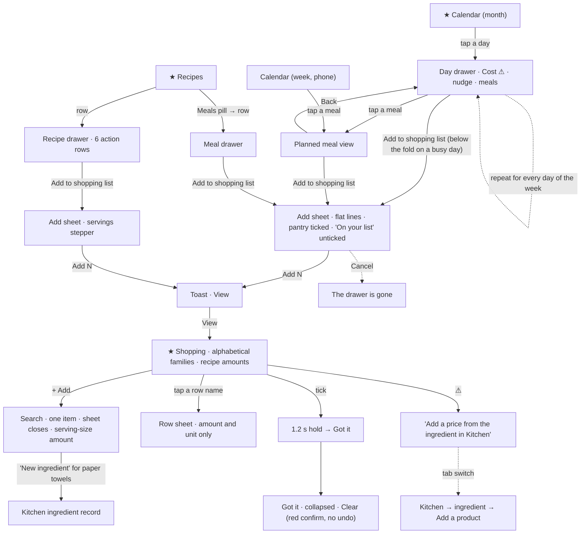
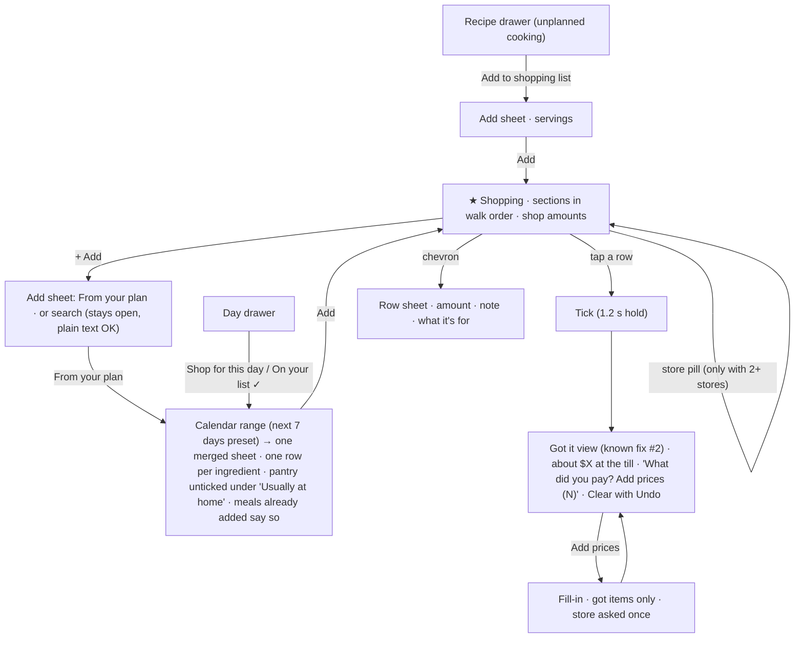

# J4 — Shop

Audit of Pinch at http://127.0.0.1:5240 (checkout `the audit build`, tip `e74fd9fb`), walked on 2026-10-14 (the app's "today" in America/Los_Angeles) at 390×844 with touch, then 1280×900. Fixtures: Alex (seeded returning user), Taylor (scale kitchen, read-only). Screenshots are in `j4/shots/`. Below they are cited by file name.

**What I created and deleted.** I wrote these through REST (`Bearer owner`) in Alex's kitchen: three custom ingredients ("J4 Lemons" in Citrus, "J4 Basmati" in Rice, "J4 Paneer" in Cheese), one product ("J4 bag", $8.99 for 5 lb at Walmart), a recipe "J4 Lemon rice", a saved meal "J4 Lemon plate" and a planned dinner on Fri Oct 23. Through the app I made four shopping lines and the custom ingredient "J4 Paper towels" (created by the Shopping add sheet). I took "J4 Paper towels" off the list through the app (row → trash → Remove). Then I deleted every one of these documents through REST. A sweep of all 12 kitchen collections afterwards found no J4 document, and the list is back to its baseline of six lines.

**What I could not do, and why.** Any add that touches a line I didn't create was off limits: a seeded recipe or day lands on shared lines (Chicken thigh, Garlic…). So the **weekly shop over Alex's real plan** (Thu–Sat) was walked to each sheet, read, and cancelled. Its tap count comes from each sheet's default ticks, not from submitting it. I never pressed **Clear**: it clears every ticked line, including seeded ones. I opened its confirm and cancelled. Taylor's list (80 lines) uses synthetic families ("Wild beans 1", "Aged berries 3"), so it shows scale but not realistic grouping.

---

## 1. Who and when

A home cook with a phone. Three moments matter:

- **On the sofa, Sunday evening** (two hands, unhurried). The week is planned on the Calendar. They want *one* list for the days until the next shop, with amounts they can actually buy. Their mind is also on "do I have rice?", "is there chili in the freezer?" and roughly what the shop will cost.
- **In the shop** (one hand, a basket or a toddler in the other, bad signal by the dairy fridges). They walk the store front to back: produce first, then meat, dairy, bakery, pantry aisles, frozen. They tick items as they go, and remember mid-aisle "we're out of milk… and paper towels". Prices are on the shelf, and later on the receipt.
- **Mid-week, at the counter** ("we're out of eggs"). A two-second add, or it goes on the whiteboard or in Notes instead.

The person's real question is never "which ingredient family is this?". It is "what do I need to grab here, and how much?"

## 2. Goals and outcomes

| # | Job story | Success looks like | How often | Weight | Without the app |
|---|---|---|---|---|---|
| G1 | When I've planned the next few days, I want one list of everything they need, so I can shop once. | One action over a range of days. Shared ingredients summed, nothing I already have, nothing missing. | Weekly | Core | Re-reading each recipe and writing a list by hand |
| G2 | When I'm in the shop, I want to walk the aisles and tick things off one-handed, so I don't miss anything or double back. | The list is in the order the shop is walked. A tick is a big, sure target. It keeps working with bad signal. | Weekly | Core | Paper list, Notes app |
| G3 | When I run out of something (milk, eggs, paper towels), I want it on the list in seconds, so this is my *one* list. | 2–3 taps per item, any item (food or not), with no follow-up edit. | Several times a week | Core | Whiteboard, Notes, a voice assistant |
| G4 | When I decide to cook a recipe I didn't plan, I want its ingredients on the list at the amount I'll cook, so I can buy for it. | From the recipe, 2–3 taps, amounts right for the servings. | Occasionally | Supporting | Reading the recipe in the shop |
| G5 | When I have things at home already (pantry staples, leftovers in the freezer), I want them kept off the list, so I don't overbuy. | Salt, pepper and oil don't show up as "0.13 tsp" to buy every time. Stock is mentioned where it changes the plan. | Every list | Supporting | Memory, checking the cupboard |
| G6 | When I plan a shop, I want a rough idea of what it will cost, so I stay on budget. | "About $X at the till", or an honest "not enough prices yet". | Weekly | Supporting | A guess |
| G7 | When I've bought things, I want the app to learn the prices without a chore, so the costs stay true. | Prices captured from the shop or the receipt in a few taps, store asked once (feeds J7). | Weekly | Supporting | Nothing |
| G8 | When I shop at two stores, I want to see what to get where, so I can split the trip. | Filter the list by the store I'm in. | Occasionally | Rare–supporting | Two paper lists |

## 3. Current journeys, as walked

Taps were counted in the browser at 390×844. "Typing" means a field typed into. The app has **five places that put things on the list**: four drawers with a tinted "Add to shopping list" row (recipe `RecipeDrawer.tsx:329`, saved meal `MealDrawer.tsx:176`, day `DayDrawer.tsx:269`, planned meal `PlannedMealView.tsx:448`) and the Shopping tab's "+ Add" (one ingredient at a time, `ShoppingAddSheet.tsx`). There is **no week or range add**, and the Shopping tab (the feature's home) **cannot pull from the plan**.

### J4-A. The Shopping tab, first view (returning user)

`01-shopping-first-view.png`: header "Shopping list · 4 to buy · + Add", "Amounts on your list: about **$3.16** ⚠", four lines under three family dividers (Chicken, Onions & garlic, Sauces & condiments), "Got it · 2 ⌄ · Clear", and the nav badge "4".

| Insight surface | Class | Note |
|---|---|---|
| "4 to buy" subtitle | STATUS | |
| Tab badge "4" | STATUS | The same number as the subtitle, on the same screen |
| "about $3.16" | NOISE (misleading) | 3 of the 4 open lines have no price. $3.16 is 1 lb of chicken breast |
| ⚠ → "About this price" (`02-cost-help.png`) | STATUS → points away | "No price yet: Chicken thigh, Garlic, Soy sauce. **Add a price from the ingredient in Kitchen.**" Its button is also labelled "Got it" |
| "Got it · 2" | STATUS | |

**5 volunteered surfaces, 2 of them duplicates or misleading.** At scale (Taylor, `80-taylor-shopping-first.png`): "64 to buy", "about $554.77 ⚠", 20 groups, **6 screen-heights** of list, and "Got it · 16 · Clear" at the very bottom (`81b-taylor-shopping-bottom.png`). The tab switch took 142 ms on 80 lines, so performance is fine.

**Order of the groups.** The order is **alphabetical by family name** (`selectors.ts:95` sorts every family by name, and `utils/shopping.ts:189` follows it). After my J4 add the list read Cheese → Chicken → Citrus → Onions & garlic → Rice → Sauces & condiments (`24-j4-after-view.png`): **7 lines under 6 dividers**. Across the 41 catalog families, produce is split over 10 families scattered from B to V (Berries, Citrus, Fresh herbs, Fruit, Leafy greens, Onions & garlic, Peppers, Potatoes, Tomatoes, Vegetables). Dairy is split over 5 (Butter & ghee, Cheese, Eggs, Milk, Yogurt & cream). A shopper standing in produce scrolls the whole list to collect it.

### J4-B. A recipe to the list (G4)

| Step | Surface | Action | Taps | Volunteered | Friction |
|---|---|---|---|---|---|
| 1 | Recipes tab | tab | 1 | rows with cost and stock lines | — |
| 2 | Recipe drawer | tap the row | 1 | facts, Cost tile, "5 ingredients need a price · Add prices", 6 tinted action rows (`11b-adobo-drawer-actions.png`) | "Add to shopping list" is the 5th of 6 rows, below the fold. Known fix #3 addresses this |
| 3 | Add sheet "Shopping list" | Add to shopping list (the drawer closes) | 1 | "For [4] servings", "You already have 5 servings in the fridge, 5 in the freezer.", "3 of 6 · Tick all", lines with "On your list · 2 lb" (`12-adobo-add-sheet.png`) | Defaults: White vinegar, Bay leaves and Black pepper ticked (pantry). The three already on the list start **unticked** |
| 4 | | Add 3 | 1 | toast "Added 3 to your shopping list · View" (`23-j4-toast.png`) | — |
| 5 | Shopping tab | View | 1 | the list (`24-j4-after-view.png`) | "J4 Lemons **2.5 each**", "J4 Basmati **1.88 cup**" after one tap on the stepper (4 → 5 servings, `22-j4-add-sheet-6.png`) |

**4 taps to add, 5 to see it.** Cancel on the sheet does *not* go back to the drawer the person was reading. It lands on the Recipes list (`13-after-cancel.png`).

### J4-C. A saved meal, a planned meal, a day (G1)

| Path | Taps to "Add" | What the sheet asks | Notes |
|---|---|---|---|
| Saved meal: Recipes → Meals → row → Add to shopping list → Add | 5 (+1 View) | no stepper. Lines at the meal's servings (`32-j4-meal-add-sheet.png`) | When every line is already on the list: "0 of 3 · Tick all · Tick at least one to add it." |
| Day: Calendar month → day cell → Add to shopping list → Add | 3 (+1 View) | lines for every meal of the day, summed (`39-daysheet-ThuOct15.png`) | On a busy day (Sat Oct 17, 5 meals) the row sits **below the fold** (measured: row top at 844px) |
| Planned meal: day cell → meal row → Add to shopping list → Add | 4 (+1 View) | title "Dinner on Fri, Oct 23" (`37-planned-add-sheet.png`) | The same lines as the day when the day has one meal |
| Week view (phone) | — | — | No way to open a day drawer except tapping a meal and then "Back" (`WeekView.tsx:150-195`). No week add (`40b-week-view-full.png`) |

### J4-D. The weekly shop, Thu–Sat on Alex's real plan (G1), walked to each sheet and cancelled

| Day | Sheet default (`39-daysheet-*.png`) | What a careful person must change | Taps |
|---|---|---|---|
| Thu Oct 15 | "10 of 13". Chicken thigh, Soy sauce and Garlic start **unticked** ("On your list"). Ticked: White vinegar 0.13 cup, Bay leaves 1 each, Black pepper 0.5 tsp, Salt 0.25 tsp, Olive oil 0.5 tbsp, Doritos 28 g | Decide whether the 2 lb of chicken thigh already on the list is for Thursday (the list can't say). Untick about 5 pantry lines | cell 1 + row 1 + ~5–8 + Add 1 ≈ **8–11** |
| Fri Oct 16 | "8 of 11". After Thursday's add, rice, cilantro and lime juice are now "On your list", so they start **unticked**. So do chicken thigh, soy sauce and garlic | Tick about 6 shared lines back on (or "Tick all" and untick pantry), untick about 5 pantry lines | cell 1 + row 1 + ~6–11 + Add 1 ≈ **9–14** |
| Sat Oct 17 | "11 of 11". **Salt 0.13 tsp, Cilantro 0.06 cup, Olive oil 0.25 tbsp, Lime juice 0.5 tbsp**. Doritos appears **twice** (4.5 oz and 28 g) | Tick the shared lines back on, untick pantry, scroll the drawer to reach the row | cell 1 + scroll + row 1 + ~5 + Add 1 ≈ **8–9** |

**About 25–34 taps for three days, with a judgement on every row**, and the default is wrong in both directions. Pantry is added every time: 15 of the 35 lines across these sheets are spices, oils, vinegar or sauces. **Shared ingredients are under-bought:** a line already on the list starts unticked whatever put it there (`AddToShoppingSheet.tsx:117-118`), so Friday's adobo adds nothing for chicken thigh unless the person ticks it. A seven-day week is roughly twice this. After the adds, the day drawer still reads "Add to shopping list · Choose what you need for the day" (`34-day-drawer-oct23.png`): nothing says the day is already on the list.

### J4-E. Something you ran out of (G3)

| Step | Surface | Action | Taps | Volunteered | Friction |
|---|---|---|---|---|---|
| 1 | Shopping | tab | 1 | — | — |
| 2 | Add sheet | + Add | 1 | "What do you need? It goes on the list at a typical serving, and a tap on its row changes how much." The search field is focused (good) (`60-manual-add-sheet.png`) | — |
| 3 | | type "milk" | typing | 2% milk, Almond, Buttermilk, Coconut, Evaporated, Oat, Skim, Soy milk, New ingredient "milk" (`61-manual-add-milk.png`) | **Whole milk (alias "milk") is missing**: results are capped at 8 (`ItemSearch.tsx:23`) and ranked by name-starts-with then A–Z (`catalogSearch.ts:46-51`) |
| 4 | | pick | 1 | toast "Added Egg"; **the sheet closes** (`ShoppingAddSheet.tsx:86`) | A second item means "+ Add" again |
| 5 | List | the line reads the serving size | — | Whole milk **1 cup**, White bread **1 each** (a slice), Olive oil **1 tbsp**, Rice **0.25 cup**; anything new **100 g** (`constants.ts:102`) | To fix it: row (1) → type → unit (2) → Save (1) |
| alt | | type "paper towels" | typing | only "New ingredient 'paper towels'" (`62-manual-add-paper-towels.png`) | It creates a **Kitchen ingredient**. The list shows "J4 Paper towels · 100 g" under "Other" (`64-after-new-ingredient-add.png`). Its Kitchen drawer says "🍽️ 1 serving = 100 g · No product yet. Add where you buy it and **recipes can show what they cost**." (`105-paper-towels-drawer.png`) |

**3 taps and typing per item, and 6–7 more to make the amount true.** Five things you ran out of take about 15 taps without fixing amounts, or about 35 with. Non-food goes into the food catalog.

### J4-F. In the shop (G2)

- **Tick** (`51-tick-held-250ms.png`, `52-tick-moved-1600ms.png`): one tap. The row strikes through and holds 1.2 s, the badge and "to buy" change at once, and the row then moves to "Got it". A second quick tick lands where you aimed. This works well.
- **Tap target:** the checkbox's hit area is 40×40 at the left edge. The rest of the row (326×56, measured) is a button that **opens the row sheet** (`ShoppingRow.tsx:31-63`). A thumb aiming at "Garlic" opens an amount editor instead of ticking. Ticking is the main thing a person does in the shop, and its target is the smaller one.
- **Row sheet** (`04-row-sheet.png`): "How much [2] [lb]", trash, Cancel, Save. Nothing else: no note ("the big tub"), no what-it's-for, no price. The units list ends in "pinch" and "each" (`56-row-sheet-unit-open.png`). Escape with the unit menu open closes the whole sheet and loses the typed amount (`57-row-sheet-after-esc.png`; keyboard only).
- **Take one off:** row (1) → trash (2) → "Remove from your list · Take J4 Paper towels off your shopping list?" → Remove (3) (`111-remove-confirm.png`). That is a destructive confirm for a shopping line.
- **Done shopping:** "Got it · 4 ⌄" and **Clear** → "Clear what you got · Take the 4 items you've got off your list? **This action cannot be undone.**" in red (`54-clear-confirm.png`). At Taylor's scale Clear is six screens down. Known fix #2 moves it into the Got it view.
- **Bad signal** (`ctx.setOffline(true)`): the red "You're offline" banner shows. A **tick works offline** and synced when back online (`71-offline-ticked.png` → `74-back-online.png`). A **manual add** shows "Adding…" for about 10 s, then "Check your connection and try again." (`73-offline-manual-add-12s.png`). Every add (`shoppingActions.ts:109`) and Clear (`:260`) is a `runTransaction`, which needs the server. The person remembering milk by the fridges can't add it.
- **After the shop:** the cost line is shown only while something is left to buy, and it never prices "Got it" (`ShoppingScreen.tsx:420`, `selectors.ts:373-381`). So the shop ends with no "you spent about".

### J4-G. Prices and stores, seen from the list (G6, G7, G8)

- **Stores and products never appear on the list.** A product's store and package size feed only the hidden cost. The one "by store" view in the app is Kitchen → Products, grouped by store with prices (`102-products-subview.png`). That is a catalog, not the list. ISSUES.md Issue 21 already plans "a 'By store' grouping next to the family one, from each ingredient's default product".
- **The price is never asked where it is in view.** The cost help points to Kitchen (`ShoppingScreen.tsx:445-449`), and the row sheet has no price field. To price chicken thigh mid-shop: Kitchen tab, search, row, Add a product, store, price, size, unit, Add, back to Shopping, which J7 counted at **about 11 taps and 2 tab switches** (J7-C). I confirm it from the list side.
- **The cost line prices amounts, not packages**, and its help says so ("what you pay at the till is usually more"). With 1 of 4 open lines priced it reads "about $3.16 ⚠".

### J4-H. Wide screen (1280)

The list runs in two columns (`90-desktop-shopping.png`). The add sheet is a modal with the stepper and lines (`94-desktop-add-sheet.png`): fine. The width doesn't help the shop moment, which is phone-only, and nothing here differs in substance.

### Counts

- **Entry points to "add to the list": 5.** Four drawers push one recipe, meal or day each, and the tab adds one ingredient. Two of them serve distinct moments: the day (shop for what's planned) and the recipe (cook something unplanned). The saved meal (you'd plan it first) and the planned meal (one tap from its day, inside the same drawer) do not.
- **Entry points to "record a price": 7, and none on the Shopping tab** (J7).
- **Nouns on the shopping path: 12.** Shopping list, line/item, Got it, tick/untick, Clear, family (19 possible divider names), typical serving, "On your list", default product (in the help), amounts vs packages, prepared servings/stock, Kitchen. Plus a naming clash: **a tick means "I need it" in the add sheet** ("10 of 13 · Tick all") and **"I have it" on the list**. The sheet never says "untick what you have", although the README does.

## 4. Flow diagrams

**Current: getting from a plan to a basket**

**Proposed: one shop action from the list's home, a list in shop order, prices at the till**

## 5. Findings

### (a) Small things

| ID | Sev | Where | Evidence | Goal hurt |
|---|---|---|---|---|
| J4-1 | minor | Manual add amount (`ShoppingAddSheet.tsx:60`, `constants.ts:102`) | Lines go on at the catalog serving: milk 1 cup, bread 1 slice ("1 each"), olive oil 1 tbsp, rice 0.25 cup, a new item 100 g (`64-after-new-ingredient-add.png`). Every manual add needs a 3–4-tap edit, or the amount and the cost are wrong | G3, G6 |
| J4-2 | minor | Manual add closes after one pick (`ShoppingAddSheet.tsx:86`) | Five items take five round trips of "+ Add", type, pick | G3 |
| J4-3 | minor | Search ranking (`ItemSearch.tsx:23`, `catalogSearch.ts:46-51`) | "milk" lists 8 other milks and "New ingredient 'milk'", but not **Whole milk**, whose alias is "milk" (`61-manual-add-milk.png`). It invites a duplicate custom "milk". Complements J1-S12 (family names not searched) | G3 |
| J4-4 | minor | Shopping row (`ShoppingRow.tsx:31-63`) | Tick hit area 40×40. The row's 326×56 button opens the row sheet (measured). In the shop the big target does the rare action | G2 |
| J4-5 | minor | Add sheet wording (`AddToShoppingSheet.tsx:201-222`) | "10 of 13 · Tick all": a tick means "need" here and "have" on the list one tap away. The sheet never says "untick what you already have" | G1, concepts |
| J4-6 | minor | Add sheet Cancel | Lands on the tab's list. The drawer the person came from is gone (`13-after-cancel.png`). This is the same pattern as J7-4 for the fill-in sheet | G4 |
| J4-7 | minor | Day drawer after an add | Unchanged "Add to shopping list · Choose what you need for the day" (`34`). Nothing says the day is on the list | G1 |
| J4-8 | minor | Busy day drawer | On Sat Oct 17 (5 meals) the add row starts below the fold (top at 844px, measured) | G1 |
| J4-9 | polish | Week view, phone (`WeekView.tsx:150-195`) | No way into a day drawer except meal → Back. So no day add from the view a weekly planner uses | G1 |
| J4-10 | minor | Same ingredient on two rows (`getShoppingItemId` = ingredient + unit) | "Doritos nacho cheese 4.5 oz" and "Doritos nacho cheese 28 g" on Saturday's sheet (`39-daysheet-SatOct17.png`): oz and g are both weights | G2 |
| J4-11 | minor | Fractions on a list (`scaleAmount`, `utils/shopping.ts:100`) | "Lemons 2.5 each", "Garlic 4.5 each", "Rice 1.88 cup", "Salt 0.13 tsp", "Cilantro 0.06 cup", "Olive oil 0.25 tbsp" (`22`, `39-*`) | G2 |
| J4-12 | minor | Pantry ticked by default | 15 of 35 lines in the Thu–Sat sheets are spices, oils, vinegar or sauces. The person unticks the same staples every time | G5, G1 |
| J4-13 | polish | Remove one line | 3 taps and a destructive confirm (`111-remove-confirm.png`). Clear: red "cannot be undone" for things already bought (`54`) | calm |
| J4-14 | polish | Row sheet unit menu | Escape with the menu open closes the sheet and drops the typed amount (`56` → `57`; keyboard only). "pinch" is offered as a shopping unit | — |
| J4-15 | minor | Cost after the shop (`ShoppingScreen.tsx:420`, `selectors.ts:373-381`) | The line hides when everything is got, and "Got it" is never priced. The shop ends with no total | G6 |
| J4-16 | polish | Badge vs subtitle | On the Shopping tab the badge "4" repeats "4 to buy" right above it (`01`) | calm |
| J4-17 | polish | Copy | Toast "Added Egg" (manual) vs "Added 3 to your shopping list" (sheets). The cost help's button is "Got it", which is also the name of the bought group (J7-23 agrees) | — |
| J4-18 | polish | Custom non-food ingredient | "J4 Paper towels · 🍽️ 1 serving = 100 g · … recipes can show what they cost" (`105`) | G3 |

### (b) High-arching things

**J4-H1 · major · The weekly shop has no action, and the list's home can't pull from the plan.** The job a shopping list exists for is "the next few days, in one go" (G1). The app offers it one day at a time, from a drawer, on the Calendar's month or day view only. Three days took about 25–34 taps with a judgement on every row (§3 J4-D), and a week is roughly double. Meanwhile the Shopping tab's own "+ Add" only finds single ingredients. Four drawers push, and the tab can't pull. Hurts G1, and makes "Add to shopping list" feel repeated everywhere (the owner's "too many entry points") while the one entry that matters is missing.

**J4-H2 · major · The list is ordered alphabetically by 41 cooking families, not by how a shop is walked.** `selectIngredientFamilies` sorts by name (`selectors.ts:95`), so groups go Baking, Beans, Beef, Berries, Bread… Vegetables, Vinegar, Yogurt. Produce sits in 10 families between B and V, and dairy in 5. Seven lines drew 6 dividers (`24`), and Jamie's first list drew 5 dividers for 5 lines (J1-S19, agreed). Families are the right taxonomy for Kitchen and a wrong one for an aisle. Hurts G2 with every scroll and backtrack.

**J4-H3 · major · The list speaks in recipe amounts, not in things you buy.** "Salt 0.13 tsp", "Cilantro 0.06 cup", "2.5 each" lemons, "1.88 cup" rice, two rows for one bag of Doritos, and manual adds at one serving ("1 cup" of milk, "1 each" of bread). Products already hold what the person buys (a 5 lb bag, a 3 lb pack), but the list never uses them to say "1 bag". The cost line then has to explain that it prices amounts and not packages. Hurts G2, G5 and G6, and makes every line a small translation job in the aisle.

**J4-H4 · major · The list doesn't remember why a line is there, so its defaults guess.** Items are `{ingredientId, unit, amount, isChecked}` (`types.ts:275-287`). The add sheet protects against a double add by starting any open line unticked (`AddToShoppingSheet.tsx:117-118`). For the weekly shop that is the *wrong* guess: Friday's adobo, Saturday's rice and anything shared start unticked, and the list under-buys unless the person re-ticks. The same gap means the day drawer can't say "already on your list" (J4-7), the row sheet can't say what a line is for, and "Chicken thigh · On your list · 2 lb" can't be judged ("is that Thursday's?"). Hurts G1 (correctness) and the trust that the list is complete.

**J4-H5 · major · It isn't the person's one list.** Only catalog or custom ingredients can be listed. "Paper towels" becomes a Kitchen ingredient with a 100 g serving and copy about recipe costs (`62`, `64`, `105`). There's no plain line and no note ("the big tub", "for Sam's lunch"), and adds can't happen offline (J4-H6). A person who needs a second app for non-food and notes will stop opening this one in the shop. Hurts G3, and G2 by extension. J1-F1 (ItemSearch writes at pick time) is the same root seen from the first run.

**J4-H6 · major · Bad signal breaks the moments that happen in the shop.** Ticks queue offline (good). But every add (manual or sheet) and Clear are transactions: offline, a manual add hangs about 10 s on "Adding…" and fails (`73`). The shop, the context the list is for, is exactly where signal drops. Hurts G2 and G3.

**J4-H7 · minor · Stores and products do no visible work on the list.** The person records "chicken breast at Costco $19.99 / 6.5 lb", and the list neither groups, filters nor labels by store. The only by-store view is Kitchen → Products (`102`). Issue 21 already plans "By store". Hurts G8, and is a missed payoff for the bookkeeping J7 describes.

**J4-H8 · minor · The price moment is the till, and the Got it group has no job but Clear.** J7-H3 shows prices can't be entered from the list. I agree, and add that per-item entry mid-aisle (one hand, basket) is itself effort. The calm moment is just after the shop, receipt in hand, when "Got it" holds exactly the items whose prices are in view. Today that group is a collapsed count plus a red Clear. Hurts G7, and so the cost numbers J7 and J3 rely on.

**J4-H9 · minor · Two of the four drawer rows serve no moment of their own.** The saved meal row is for buying for a meal you haven't planned, but a saved meal is planned before it's cooked. The planned meal row sits one "Back" away from its day's row, in the same drawer. They add a row (or a chip after known fix #3) to two drawers and a concept to learn, and each one asks the same question.

## 6. Proposals

Ordered by value to the person. S = a label or a line; M = a screen or component; L = a flow or a concept.

| ID | Kind | Goal | What changes | Why it's better | Cost / risk | Size |
|---|---|---|---|---|---|---|
| P1 | ADD | G1 | **"From your plan" on the Shopping tab's "+ Add".** One sheet: Dreamer UI's `Calendar mode='range'` with the next 7 days preselected (CLAUDE.md "show a calendar, not two date boxes"), a line under it ("Thu, Oct 15 – Wed, Oct 21 · 9 meals"), then one merged list of lines for every planned meal in the range, summed per ingredient → Add. The day drawer's row opens the same sheet with that day picked. | About 3–5 taps instead of 25–34 for three days, and the weekly job lives in the list's home. Shared ingredients are summed by the app, not by the person's re-ticking. | A new sheet over `getItemsLines` (which already merges). Past days are excluded. Docs: README "Shopping List, In Detail", UX journey "Shop for what you planned". | L |
| P2 | REARRANGE | G2 | **Group the list in shop-walk sections, not families.** A static map in `constants.ts` from the 41 catalog families to about 9 sections in walk order: Produce (Fruit, Citrus, Berries, Vegetables, Leafy greens, Onions & garlic, Peppers, Tomatoes, Potatoes, Fresh herbs), Meat & fish, Dairy & eggs, Bakery, Pantry (Rice, Grains, Pasta, Beans, Flour, Baking, Sugar, Broth, Pickles, Sauces), Spices & oils (Spices, Oils, Vinegar), Snacks & drinks, Frozen, Other. A custom family takes the section of the catalog family it joined; otherwise Other. Kitchen keeps families. | One scroll from produce to the till. Alex's 7 lines go from 6 dividers to 4, and Jamie's 5 lines from 5 dividers to 4 (3 once salt is pantry, P4). "Design for the place it's used." | Custom families in a kitchen like Taylor's land in Other unless they pick a section (a later field). UX.md and README copy. | M |
| P3 | FILL | G2, G5 | **Shop amounts.** On the list and in the add sheets: "each" rounds up to a whole number (2.5 lemons → 3). Lines from the Spices & oils section and sub-tablespoon amounts show the name and "for Adobo" instead of "0.13 tsp". One row per ingredient: same-dimension units are combined for display ("Doritos · 5.5 oz"), and a tick ticks every unit item behind it. With a default product: "1 lb · a 3 lb pack". | Every line reads as something to pick up. No fractions, no teaspoons, no duplicates. | Display-only (stored items keep ingredient + unit, so merging and rules don't change). `check:pinch-math` gains rounding cases. | M |
| P4 | FILL | G5 | **Pantry starts unticked.** In every add sheet, Spices & oils lines (and Salt, Water) start unticked under a caption "Usually at home: tick what you're out of". | In the Thu–Sat walk it pre-unticks 12 of the 15 pantry lines (the other 3, soy sauce and salsa, are sauces, which stay ticked in Pantry). Nothing is hidden: the lines are still there. | Someone out of pepper must tick it (one visible tap). Later, learning from unticks could refine it. | S |
| P5 | FILL | G1 | **The list remembers what filled it.** Each item gains `sources: string[]` (planned meal ids, or `recipe:<id>`), written with `arrayUnion` in the add transaction. Then the add sheet starts a line unticked only when *this* meal already added it ("Already on your list for Thu dinner"). The day drawer shows "On your list ✓" (still tappable to add again), and the row sheet says "For Adobo chicken (Thu), Cilantro lime rice (Fri)". | Defaults become right in both directions (no double add, no under-buy). The person can judge a line and see the week is covered. | Data model and rules (new list field, `get('sources', [])` for legacy items), the merge transaction, docs. A Clear forgets the sources. | M–L |
| P6 | REARRANGE | G2 | **Tapping a row ticks it. The chevron (a 40×40 button) opens the row sheet.** | The big target does the common action, one-handed. The 1.2 s hold already makes a mis-tap a one-tap undo. | Re-measure alignment. A11y labels stay. | S |
| P7 | MERGE + TRIM | G7, calm | **Give the Got it view (known fix #2) a job.** At the top: "About $X at the till" (package-priced where a default product exists). Then "What did you pay? Add prices (N)", which opens the fill-in step-through for the got items with no price, store asked once and carried over (J7-P4, J1-P11). Then **Clear, with an Undo toast instead of the red confirm**. The cost help's "Add a price from the ingredient in Kitchen" becomes "Add prices from Got it after you shop". | Prices arrive at the one calm moment they're all in view (the receipt), in a few taps, and the backlog J7 measures shrinks every week. Clear stops being a scary act. | Reuses `FillInSheet` scoped to got items. Undo needs the cleared items kept in memory for a few seconds. Receipt photo reading (Next Steps) becomes the L follow-up on this same spot. | M |
| P8 | ADD | G3 | **Plain lines and notes.** The add search offers "Add 'paper towels' to the list" (a plain line: `ingredientId: null`, `label`, no Kitchen record) beside "New ingredient". The row sheet gets an optional note. A plain or manual line may have **no amount** (shown as the name only). The add sheet **stays open** after a pick ("Added Whole milk ✓", with Done). | The list becomes the one list. Five run-out items take 7 taps instead of about 15–35, and nothing pollutes Kitchen. | Data model and rules (`ingredientId` nullable, `amount` nullable, label length), cost and grouping skip plain lines (they go in Other), docs. Fixes J1-F1's shopping half. Owner decision (Q1). | M |
| P9 | FILL | G2, G3 | **Adds and Clear work offline.** An add to a missing or open line writes `amount: increment(x)` with `set(…, {merge: true})`. A ticked line restarts from its known local state. Clear deletes what is ticked locally in a batch (the "un-ticked on another device" race is rare and is stated in TECHNICAL.md). | Milk can be added by the dairy fridge. The only loss is a rare two-device race, against a certain failure today. | Changes the "one transaction, never lose an amount" guarantee in the README's Under the Hood; it needs the owner's nod and a technical review. | M |
| P10 | ADD | G8 | **Store pills on the list**, only when the open lines' default products span 2+ stores: "Costco · 3", "Walmart · 2", "Anywhere · 5" (thin filter pills with counts, docs/conventions/product.md "A filter lists only values present"). | In the shop, one tap shows what to grab here. It uses data the person already entered (Issue 21's "By store", as a filter rather than a second layout). | Ingredients without a product are "Anywhere". | M |
| P11 | TRIM | calm, G1 | **Drop "Add to shopping list" from the saved meal drawer and the planned meal view.** Keep the recipe drawer's row (unplanned cooking, with its servings stepper) and the day drawer's row (which opens P1 for that day). Entry points go from 5 to 3: the tab, the day and the recipe. | Fewer rows or chips on two drawers (known fix #3's chip row gets shorter), and each remaining entry serves a named moment. | Someone who adds a saved meal without planning it plans it first (2 taps), or adds its recipes. | S |
| P12 | FILL | G1 | **Add sheet copy:** "Untick what you already have" under the title, and the count as "Adding 10 of 13". | It removes the tick/need vs tick/have clash where it bites. | Copy only. | S |
| P13 | FILL | G3 | **Search ranks exact name and alias matches first** ("milk" → Whole milk at the top), and keeps the 8-result cap. | The most common item is found by its common word, and fewer duplicate custom ingredients get made. | A ranking tweak in `searchIngredients`. Pairs with J1-P14 (family names). | S |
| P14 | FILL | G4 | **Cancel on an add sheet reopens the drawer it came from** (and so does the last step of the fill-in, per J7-P4). | The person keeps their place, with no overlay stacked. | The overlay state remembers its opener. | S |
| P15 | TRIM | calm | **Taking one line off:** trash → gone with "Removed Garlic · Undo" (no confirm). Drop the badge on the active Shopping tab, since the subtitle carries the number. | 1–2 taps fewer, calmer. | The repo rule "deletes go through a destructive confirm" needs a carve-out for list lines (see §7). | S |
| P16 | REARRANGE | G6 | **Until P3 or P7 price packages, the cost line says what it covers:** "about $3.16 for 1 of 4 things", or "Not enough prices yet" below half (J7-P1's threshold). | The number stops implying a shop total. | Copy. Coordinate with J7-P1. | S |
| K1 | KEEP | G2 | **The 1.2 s tick hold** (struck through in place, then moves). The badge and "to buy" update at once, and timers are per row. | It is exactly right for fast ticking, and measured smooth on 80 lines. | — | — |
| K2 | KEEP | G2 | **Ticks are field-scoped writes that work offline**, with no sheet-wide lock. | The core shop action survives bad signal. P9 extends this to adds. | — | — |
| K3 | KEEP | G1, G4 | **One line per ingredient and unit, merged on add**, and the hint "On your list · 2 lb" in the sheets. | The data shape is sound. P5 only makes its default smarter, and P3 only changes how it reads. | — | — |
| K4 | KEEP | G4 | **The recipe sheet's servings stepper starting at the recipe's own servings.** | The one add that asks the right question at the right time. J1-F2's half-amount problem comes from the plan's default, not from this sheet. | — | — |
| K5 | KEEP | G5 | **The stock sentence in the add sheet** ("You already have 5 servings in the fridge, 5 in the freezer."). | A decision-grade fact (maybe don't cook, maybe don't buy) at the moment of deciding, said once. | — | — |
| K6 | KEEP | G1 | **Toast "Added 3 to your shopping list · View"** and the tab badge on the other tabs. | A confirmation with a path, and a reminder that is acted on. | — | — |
| K7 | KEEP | G2 | **The list is a snapshot, not a live view of the calendar.** | Editing Friday's dinner never silently rewrites what's in the basket. P5's sources keep it a snapshot. | — | — |
| K8 | KEEP | G2 | **Search from 8 lines, lazy groups, "Show N more" past 100.** | It scales: a 142 ms tab switch on Taylor's 80 lines. | — | — |

**The weekly shop after these changes:** Shopping → + Add → From your plan (next 7 days preset) → glance (pantry already unticked, shared lines summed, "Already on your list for Thu dinner" where true) → Add: **4 taps**. In the shop: rows in walk order with buyable amounts, tap a row to tick, a store pill if you shop at two places. At home: Got it → "What did you pay? Add prices (6)" with the receipt → Clear, with Undo.

**On the known fixes in flight:**
- **#2 (To buy / Got it switch, Clear in Got it)** is the right direction. At Taylor's scale it moves Clear from six screens down to one tap. It is incomplete until Got it has a job (P7) and Clear loses its red "cannot be undone" in favour of an Undo.
- **#3 (drawer chip rows)** quiets the drawers but keeps four "Add to shopping list" entry points. Take P11 with it, so the chip rows on the saved meal and planned meal drawers are one chip shorter.

**Where I agree and disagree with J1 and J7:**
- I agree with J1-F2 (a plan's default servings halve the first list), J1-S19 (dividers for a tiny list, salt goes on ticked: P2 and P4 are the fix), J1-F1 (ItemSearch writes at pick time: P8 removes the shopping half), J7-H1 (partial totals: the shopping line is one, P16), and J7-H3 (no price where it's in view).
- I partly disagree with **J7-P2's row-sheet price with "a size prefilled from the list's amount and unit"**. The list's amount is a recipe amount ("0.13 cup" of soy sauce, "6 each" garlic cloves), not a package. Prefilling it would mis-price exactly the way J7-1 and J7-H9 warn about. And a per-item price form mid-aisle competes with the basket for the free hand. I'd make the **after-shop Got it step (P7) the primary price moment** and keep a row-sheet price field as an optional secondary with an empty size.

## 7. Rule candidates

1. **A list a person shops from speaks in things to buy.** "Each" rounds up, pantry-sized amounts show no number, one ingredient is one row, and a default product turns an amount into packages. → `.claude/rules/pinch.md` (shopping bullet), CLAUDE.md *Product*.
2. **A list is ordered the way the place it's used is walked** (a shop: produce first), never alphabetically by a data taxonomy. The taxonomy can group the catalog. → CLAUDE.md *Design & UX*.
3. **A periodic job gets one action over the period, in the feature's home.** Per-item entry points elsewhere exist only for an in-context exception, and each one names its moment. → CLAUDE.md *Design & UX* (with "Intentional"), review-agents' product checklist.
4. **The common action of a row is its biggest target.** On a list you tick from, tapping the row ticks it, and a visible chevron opens the details. → CLAUDE.md *Design & UX*.
5. **A checkbox means one thing per app.** A picker sheet whose tick means something else says so in words ("Untick what you already have"). → CLAUDE.md *Design & UX*.
6. **A default that guards against a repeat needs to know what was done, not guess from the result.** Store what filled a record when a later default depends on it. → `.claude/rules/pinch.md`.
7. **What a person does where the signal drops works offline.** In the shop that means ticking, adding and clearing. A transaction is used only where losing a rare race is worse than failing offline, and TECHNICAL.md states the race. → CLAUDE.md *State, data, and performance*.
8. **Low-stakes list actions are undone, not confirmed.** Taking a line off, clearing what you've bought: Undo toast. A whole record keeps its confirm. → CLAUDE.md *Forms and CRUD conventions* (refines "Deletes go through confirm").
9. **Ask for a value at the calm moment it's in view.** For prices that is just after the shop, scoped to what was bought, with the store asked once. → CLAUDE.md *Product* (pairs with J7's "Ask for data where it is in view").
10. **Review checklist: walk the weekly shop.** On the seeded plan, add three days to the list and count the taps, then read every amount aloud: would someone pick that up in a shop? → the reviewer agents in `.claude/agents/` (product agent).

## 8. Open questions for the owner

1. **Is the shopping list the person's one list?** That means plain lines (paper towels) with no Kitchen record, a note per line, and amount-less lines. *Recommendation:* yes (P8). Otherwise people keep a second list and stop opening this one in the shop.
2. **Should the weekly shop be the primary add**, with the saved meal and planned meal rows removed? *Recommendation:* yes (P1, P11). Keep the recipe drawer's row for unplanned cooking and the day row as a shortcut into P1.
3. **Shop sections instead of families on the list** (a fixed map, about 9 sections in walk order), and store pills when products span two stores? *Recommendation:* yes to both (P2, P10). Store grouping as a filter, not a second layout. This delivers Issue 21's "By store" cheaply.
4. **Trade the "never lose an amount" transaction for offline adds?** *Recommendation:* yes (P9). A rare two-device race beats a certain failure in the shop. Say the race plainly in TECHNICAL.md.
5. **Where do prices come from: the aisle or the till?** *Recommendation:* the till first (P7, Got it → "What did you pay?"), the row sheet optional. Receipt reading (Next Steps) lands on the same spot later.
6. **What does a planned serving mean for shopping?** (J1-Q2.) With 2 of 4 servings planned, Thursday's list buys half the adobo. *Recommendation:* "what we cook". The day/plan sheet could offer "Buy for the whole recipe" on a part-planned recipe, but decide J1-Q2 first.
7. **Will a household share one list?** README: "Nothing on it is shared." *Recommendation:* not now. Note that it's the most common reason people pick another list app, and that P5's sources would make a shared list easier to reason about later.
