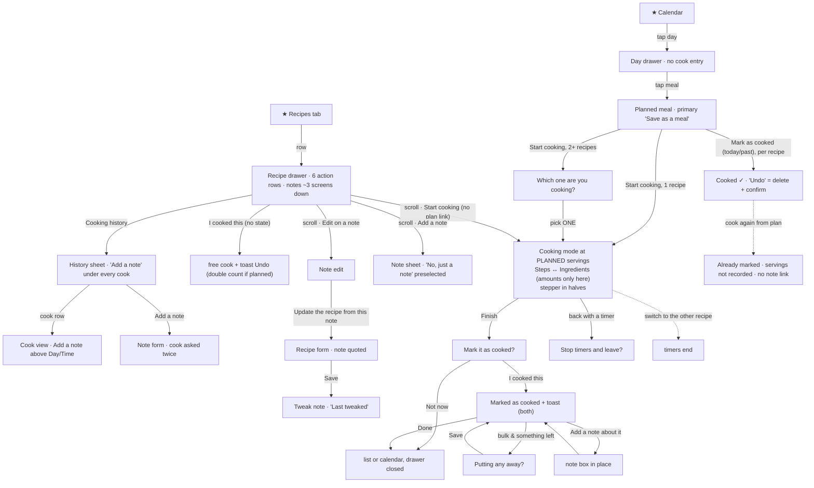
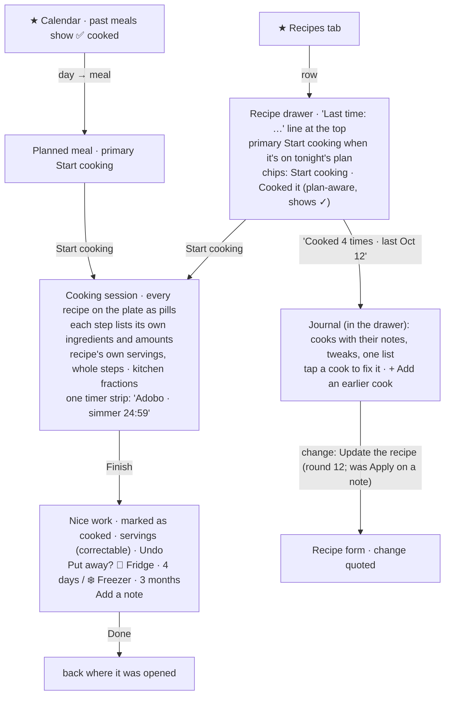

# J5 — Cook

Fixture: **Alex** (seeded returning cook), with **Taylor**'s scale kitchen read-only for size. Walked at 390×844 (touch) first, then 1280×900, in America/Los_Angeles. The app's "today" was **Wed Oct 14, about 10:45 PM** (the seed's "day 0" plans landed on Thu Oct 15, so "tonight" in the seed is tomorrow for this viewer; I planned my own throwaway dinner on Oct 14 to walk "tonight"). App at http://127.0.0.1:5240, tree read from `the audit build` (HEAD `e74fd9fb`).

Screenshots: `J5-shots/` (cited below as `shots/NN-name.png`).

**What I created and deleted.** In Alex's kitchen: the recipe "J5 Weeknight chili" (read from pasted text by the real AI reader in about 10 s), one planned dinner on Oct 14, cook records (the planned dinner's cook, which I removed with its row's "Undo" and marked again while offline; a cook from cooking mode at 6 servings; a second cook from the drawer's "I cooked this", taken back with the toast's Undo), three notes (a note, a tweak, a note after a cook), and one freezer container. I deleted them through the app: the container from Prepared meals, the plan with "Remove from this day", and the recipe from its form's trash, which removed its cooks and notes. A REST check afterwards returned 404 for every document I created, and found no reference to the recipe in recipes, cooks, notes, containers, planned meals or the shopping list. I wrote nothing to Taylor's or Jamie's kitchens and changed no settings.

**Environment notes.** Headless Chromium refuses the wake lock, so every cooking screen shows "This phone may turn the screen off…". A phone over HTTPS would normally not see that line. In this run the site shell's seeded reminders from other apps ("Lunch at Salt Creek", "Previews time") floated over Pinch when toasts were shown (`shots/70-recipes-after-cook.png`) and covered the cooking screen's header; the seed no longer writes them. Other agents were adding recipes at the same time (J2, J4, J6 rows appear in some shots), and the calendar's nudge count moved from 13 to 22 while I walked.

---

## 1. Who and when

**Alex at the stove, about 6:30 PM on a weeknight.** The phone leans against the backsplash or sits on the counter. One hand holds a wooden spoon and the other is wet or oily. Alex glances at the screen from half a metre away, taps with a knuckle, and wants it to stay awake. Dinner is usually a plate of two things (adobo and rice, the seed's own Thursday dinner). On Sunday Alex cooks a double batch so some can go in the freezer. Afterwards, standing at the sink, Alex might jot "double the garlic next time", and only if it takes seconds.

What else is on Alex's mind: the rice timing against the chicken, the kids asking when dinner is, whether there's enough for lunch tomorrow, and not wanting to do bookkeeping for an app.

**Alex on the sofa, a week later**, opening the same recipe to cook it again. The question is "what did I say last time?", and maybe "when did we last have this?".

## 2. Goals and outcomes

| # | Job story | Outcome that means success | How often | Matters | Without the app |
|---|---|---|---|---|---|
| G1 | When I'm at the stove with messy hands, I want to see the step I'm on, what goes into it and how long it takes, so I can cook without scrolling or losing my place. | One big step on screen, its amounts in view, one large button to move on, and a screen that stays on. | 3–5 times a week | Core | A recipe site with ads and a screen that dims, or a printout |
| G2 | When the recipe serves 4 and I'm making 8 (or 2), I want the amounts to change, so I don't do maths with flour on my hands. | Correct amounts at the scale I'm cooking, written as a cook writes them (⅓ cup, 5 tbsp). | Weekly | Core | Mental maths |
| G3 | When a step says "simmer 25 minutes", I want a timer from that step, so I don't need a second app and I know which timer is which. | One tap starts it, it rings, and I can tell "the beef" from "the beans". | Several per cook | Core | The oven or phone timer |
| G4 | When dinner is two recipes, I want to follow both and keep both timers, so the rice and the chicken are ready together. | Both recipes in one cooking screen, timers surviving a switch between them. | Weekly for a planner (a meal is "a composition" by design) | Core | Two tabs, or memory |
| G5 | When I've finished, I want to note what I'd change, in seconds, so next time is better. | One line typed, nothing else asked. | About 1 cook in 4 | Supporting | A margin note, or forgetting |
| G6 | When I cook it again, I want last time's advice in front of me, or already applied, so I don't repeat the mistake. | The note is seen before shopping and at the stove, and turns into a recipe change in one tap. | Each repeat cook | **Core payoff of G5** | Hoping to remember |
| G7 | When there are leftovers, I want to know how long they keep and put them away with a date in seconds, so they get eaten. | One tap for fridge or freezer, the date already filled in. | Weekly for batch cooks | Supporting (J6 owns the container side) | Masking tape and a marker |
| G8 | When I look back, or choose what to cook, I want to know what I made and when, so I can rotate favourites and avoid repeats. | "Last made Oct 12" where I choose, and the calendar shows what we actually ate. | Weekly glance | Rare to supporting | Memory |
| G9 | When I improve a recipe, I want the recipe itself to change and to know which version an old note was about. | Edits recorded without effort, and old notes labelled. | Occasional | Supporting | Crossing out the printout |

## 3. Current journeys, as walked

Taps are counted in the browser at 390×844. A "scroll" is a swipe inside a drawer, not a tap.

### 3A. Cook a recipe from its drawer (G1–G3), returning user

| Step | Surface | Action | Taps | What the app volunteers | Friction |
|---|---|---|---|---|---|
| 1 | Recipes tab | tap tab | 1 | rows: "4 servings · 45 min · Cooked 4×", "No price yet", 🧊/❄️ stock lines with "Eat by Oct 16" (`shots/01-recipes.png`) | — |
| 2 | Recipe drawer (Adobo) | tap row | 2 | facts line + "📖 From Mom's recipe cards" + "✏️ Last tweaked Oct 7", "✅ Cooked 4 times · last Oct 12", Cost "No prices yet", "5 ingredients need a price · Add prices ✕" (`shots/02-adobo-drawer-top.png`) | **Start cooking is below the fold**: it sits at 633 px in a 629 px drawer body (measured), so it needs a scroll. Taylor's 3-ingredient recipe has it at 565 px, only just above the fold, so any recipe with more than about 4 ingredients hides it |
| 3 | drawer body | scroll, then **Start cooking** (first of 6 action rows: Start cooking, I cooked this, In your fridge and freezer, Put some away, Add to shopping list, Cooking history; `shots/02-adobo-drawer-1.png`) | 3 | — | — |
| 4 | Cooking mode, Steps | read | 0 | "Your latest note (Oct 12): Much better with less vinegar. The kids had seconds. Next…" (two lines), "Step 1 of 3" + dots, the step at 24 px, the chip "⏲️ Start 30 min timer", Back / Next 56 px tall and pinned (`shots/10-cook-step1.png`) | The step names soy sauce, vinegar and garlic, but **no amounts are on this screen**. They are one tab away. The note is clamped just before its actionable half ("Next time double the garlic…") |
| 5 | Ingredients | tap "Ingredients" | 4 | "Making 4 servings" with a stepper, "Tick what you've got out" (`shots/12-cook-ingredients.png`) | — |
| 6 | Ingredients | + twice | 6 | "Making 5 servings · Scaled from 4 servings. Amounts written in the steps stay as they are." The amounts read **0.31 cup soy sauce, 7.5 each garlic, 2.5 each bay leaves, 1.25 tsp pepper** (`shots/13-cook-ingredients-scaled.png`) | **The stepper moves in halves** (`Stepper.tsx` defaults to `step = 0.5`, and `CookIngredientsView.tsx:115-121` passes no step), so two taps add one serving. Decimals of cups and half cloves are not how a cook measures |
| 7 | Steps | "Back to the steps", Next, "⏲️ Start 25 min timer" | 9 | the timer strip "24:59 · Step 2" with Pause and ✕ (`shots/15-cook-timer-running.png`) | The timer is named "Step 2", not "the simmer" |
| 8 | Finish | Next, Finish | 11 | "Nice work. Mark it as cooked? · 5 servings · Keeps a record. You can change the date later. · Leftovers keep 3 days in the fridge, 3 months in the freezer · Back to the last step", footer "Not now" + "I cooked this" (`shots/17-cook-finish-panel.png`) | A question that Finish has just answered |
| 9 | leaving with a timer | "Not now", or the header back | 12 | "Stop timers and leave? 1 timer is still going…" Stay / Leave (`shots/18-cook-notnow-timers.png`) | Good guard |
| 10 | after leaving | Leave | 13 | the Recipes **list**, with the drawer closed (`shots/19b-after-leave.png`) | To look at the recipe again, tap the row again |

**From the Calendar tab to the first step: 3 taps + 1 scroll. A whole 3-step cook to "Done": 5 more (Next, Next, Finish, I cooked this, Done), plus any timers and servings.**

### 3B. Cook tonight's plan (G1, G4): a two-recipe dinner

| Step | Surface | Action | Taps | Volunteered | Friction |
|---|---|---|---|---|---|
| 1 | Calendar month | tap Thu 15 | 1 | day drawer: Cost $0.68 ⚠, "10 ingredients need a price · Add prices ✕", three meal groups, each item with a price or "No price yet", "Add to shopping list", "+ Add to this day" (`shots/20-day-oct15.png`) | Meal rows carry no chevron, and the day has **no cook entry**, so the person must know to tap the meal |
| 2 | Planned meal (swaps in place) | tap "Adobo chicken" | 2 | Cost $0.15 ⚠, "9 ingredients need a price", items, Start cooking / Add to shopping list, "Remove from this day", footer **Modify + "Save as a meal" (primary)** (`shots/21-planned-oct15.png`) | The primary is "Save as a meal", not cooking |
| 3 | chooser | Start cooking | 3 | "Which one are you cooking? It opens with the servings you planned." (`shots/22-which-one.png`) | **One recipe at a time** |
| 4 | Cooking mode (rice) | tap "Cilantro lime rice" | 4 | "Your latest note (Oct 9): Rinse the rice twice…", Ingredients "Making 2 servings · Scaled from 4" (`shots/24-cook-rice-ingredients.png`) | **Opens at the planned 2 servings, half the recipe** |
| 5 | to cook the adobo too | back (+ "Stop timers and leave?" → Leave if a timer runs), day, meal, Start cooking, pick | +5 to 6 | the Calendar, drawer closed (`shots/25-after-leave-plan.png`) | **The rice's timers end when you switch** (by design: "leaving cooking mode ends them"). A plate is the app's own unit ("Meals are compositions"), yet cooking holds one recipe |

**A two-recipe dinner costs 9–10 taps to get both recipes open, one after the other, and the first one's timers are lost.**

### 3C. Cook a planned batch, then put some away (G2, G7): the default path

I planned "J5 Weeknight chili" (serves 6) the way the drawer offers: Recipes (1) → row (2) → **Add to calendar** (3) → **Add to today** (4). The builder showed "1 serving · Recipe serves 6" (`shots/53-j5-plan-builder.png`), as J1 found.

| Step | Surface | Action | Taps | Volunteered | Friction |
|---|---|---|---|---|---|
| 1 | Calendar → today → the chili → Start cooking | 3 taps from the Calendar (one recipe, so no chooser) | 3 | planned meal: Start cooking, **Mark as cooked · J5 Weeknight chili · 1 serving**, Add to shopping list (`shots/56-j5-planned-today.png`) | — |
| 2 | Ingredients | tap | 4 | **"Making 1 serving · Scaled from 6": 0.17 lb ground beef, 0.17 each yellow onion, 0.5 each garlic, 0.33 tbsp chili powder, 0.17 tsp cumin** (`shots/58-j5-cook-ingredients-from-plan.png`) | Cooking mode follows the *planned* servings (`CookingSubview.tsx:41-44` via `PlannedMealView.tsx:421-424`). Nobody cooks a sixth of a chili |
| 3 | Finish → I cooked this | Next ×3, Finish, I cooked this | 9 | "Marked as cooked · **1 serving** · Saved to your cooking history. · Leftovers keep 4 days…, 3 months… · Put some away · Add a note about it · Done", and a toast "Marked J5 Weeknight chili as cooked · Undo" **over the header and back button** (`shots/60-j5-marked.png`) | **No "Putting any away?" question**: 1 cooked − 1 eaten = nothing left (`usePutAway.ts:78`). The leftovers loop never starts on the default path, and the record says 1 serving |
| 4 | the same plan, cooked again at the real size | Start cooking, Ingredients, + ×5, Finish | — | "Making **3.5** servings" after five taps (`shots/62-j5-cook-6-servings.png`), then "**Already marked as cooked** · It's in your cooking history, so nothing more is saved." + "Putting any away?" (`shots/63-j5-already-marked.png`) | Going from 1 to 6 servings takes **10 taps** in halves. The real servings are **not recorded**: the history keeps "1 serving". **No "Add a note about it"** on this panel |
| 5 | Put away | "In the freezer" → Save → Done | 3 | "Servings 2 · 2 left after the 1 you're eating tonight", eat-by 01/12/2027 "Your call. Taken from the freezer time in your recipe." (`shots/64b-j5-putaway-details-full.png`), then the toast and the panel line "Saved 2 servings in the freezer, eat by Jan 12, 2027" (`shots/65-j5-putaway-saved.png`) | The panel says "nothing more is saved" right above a save. The history now reads "**Oct 14 · 1 serving · Put away 2 servings**" (`shots/109-j5-history.png`) |

**The good path exists**, when cooking starts from the recipe drawer at the recipe's own servings: Finish → I cooked this → "Putting any away?" (`shots/105-bulk-marked-panel.png`) → In the freezer → Save → Done is 5 taps. But a planner, who is the person the calendar is built for, lands on the bad default.

### 3D. "I cooked this" from the drawer, the same evening (G8)

With tonight's planned chili already marked "Cooked ✓", I opened the recipe from Recipes and tapped **I cooked this** (the row has no state; it offers a fresh cook every time). The drawer then read "**✅ Cooked 2 times · last Oct 14**" for one dinner (`shots/72-j5-drawer-cooked-twice.png`). The toast's Undo took it back (`shots/73-j5-drawer-after-undo.png`). The code double-counts the same way when cooking mode is started from the recipe drawer on a planned evening: `RecipeDrawer.tsx:309` opens `{ kind: 'cook', recipeId }` with no `plannedMealId`, and `useCookActions.ts:46-65` writes a free cook. The plan's "Mark as cooked" then adds another.

The five names for one record, all seen on screen: "I cooked this", "Mark as cooked", "Cooked ✓", "Marked as cooked", "Already marked as cooked", plus "Cooked 4×" and "Cooked 4 times". Two different "Undo"s: the toast's is instant, while the planned row's "Undo" opens "**Delete this cook?** … This can't be undone." (`shots/100-planned-undo-confirm.png`, `PlannedCookRow.tsx:63-73, 113-121`).

### 3E. Notes, history and tweaks (G5, G6, G9)

| Task | Path (taps) | Volunteered | Friction |
|---|---|---|---|
| Read last time's note before cooking again | Recipes (1) → row (2) → scroll about 3 screens | The notes start at **1,406 px** of a 1,951 px drawer body (629 px visible), under Steps (1,003) and Keeping it (1,191) (`shots/02-adobo-drawer-2.png`, `-3.png`) | The most decision-relevant text in the drawer comes last. In cooking mode the same note leads the screen, which is right (`shots/11-cook-notes-open.png`) |
| Note right after cooking | on the Marked panel: "Add a note about it" (1) → type → "Save note" (2) | the box opens in place, the question hides while it's open, "Note saved." afterwards (`shots/106-bulk-note-open.png`, `107`) | Good. On the "Already marked" panel there is no note link |
| Note later from the drawer | Recipes (1) → row (2) → scroll → "Add a note" (3) → type → Save (4) | "Is this about a time you cooked it?" with **"No, just a note" preselected**, though the only cook was 2 minutes earlier (`shots/74-j5-note-sheet.png`, `NoteForm.tsx:90-93`) | The likely answer has to be picked by hand |
| Note from the history | Cooking history (3) → "Add a note" under a cook (4) | the heading "A note about the cook from Oct 12" **and** the pill question with Oct 12 preselected (`shots/32-history-note.png`) | The question is asked twice, once as a heading and once as pills |
| See the history | Recipes (1) → row (2) → scroll → Cooking history (3) | "Oct 12 · 4 servings / From your plan for Mon, Oct 12 / 🍱 Put away 4 servings / Add a note", four rows, **"Add a note" under every row** (`shots/30-history.png`). Taylor: 8 rows and 8 "Add a note" links, "3.5 servings" cooks (`shots/43-taylor-history.png`) | The Oct 12 cook already *has* a note ("After cooking on Oct 12…"), but the history doesn't show it and offers "Add a note" again. **Cooks and notes are two lists of the same evenings** |
| Fix a cook's date | history row (4) → change Day/Time → Save (5) | the cook view puts "**Add a note · About this cook**" above Day, Time and Servings (`shots/31-history-edit.png`) | The note row sits above the fields the person came to change |
| Turn "double the garlic" into the recipe | Recipes (1) → row (2) → scroll → **Edit** on the note (3) → "Update the recipe from this note" (4) → recipe form with the note quoted at the top (`shots/35-update-from-note.png`) → scroll to Garlic, tap (5) → amount → Done (6) → Save (7) | "Updating from your note", and "What changed and why?" prefilled with the note's words at the very bottom (`shots/36-update-from-note-why.png`) | 7 taps and 2 scrolls, behind a button called **Edit**. Leaving without changes asked nothing (good, `shots/38-after-discard.png`) |
| Edit a cooked recipe (automatic tweak) | Modify → change cumin 1 → 2 tsp → optional "What changed and why?" → Save | the drawer gains "✏️ Last tweaked Oct 14" and a "Changed on Oct 14 · **Tweak** · You changed: Cumin 1 → 2 tsp", and the older note gets "Written before your Oct 14 tweak" (`shots/81-j5-drawer-notes.png`) | Free and accurate. But cooking mode's note block then shows **the tweak** ("Changed on Oct 14: Cumin 1 → 2 tsp…", `shots/96-two-timers-step3.png`), which the recipe already reflects, and hides the open advice ("a longer simmer") |

### 3F. Timers (G3)

Two timers (8 min on step 1, 1 min on step 2) sit as two pills, "7:57 · Step 1" and "0:59 · Step 2", above Back and Next (`shots/96-two-timers-step3.png`). When the 1-minute timer ended, its pill turned peach ("Step 2 · 1 min is done · Dismiss") **and** a toast "Timer done · Step 2 · 1 min" covered the header and back button (`shots/97-timer-done.png`). The strip and the beep already carry the news. A label of "Step 1" means nothing to a cook juggling the beef and the beans.

### 3G. Error / offline-ish state

I went offline in the planned meal and tapped "Mark as cooked". The row greyed out with **no message for 4 s** (`shots/102-planned-mark-offline.png`). Back online, it finished as "Cooked ✓" (`shots/103-planned-online-again.png`). Nothing was lost, and nothing was explained while it waited. The same planned meal then offered "**❄️ Eat from your freezer · 1 container matches this meal**" for the batch I had just cooked from that very meal (J6's ground; noted for them).

### 3H. Wide screen (1280)

Cooking mode is a 656 px column in a 1280 px window, with Steps and Ingredients still behind a switch and about 400 px of blank under the step (`shots/91-desktop-cook-step1.png`, `93-desktop-finish.png`). For a laptop or tablet propped on the counter, the ingredients could sit beside the step. Pinch's own rule says "Wide screens use the width, not a stretched phone."

### 3I. First use

A never-cooked recipe's drawer offers Start cooking, I cooked this ("Keeps a record. You can change the date later."), **Put some away** and Add to shopping list. There is no history row, and Notes is a single "Add a note" row (`shots/52-j5-drawer-new.png`). J1 already found the first cooking-mode visit to be the first "this is useful" moment, and I agree.

### Counts

**Insight surfaces on the first view (390, Alex):**

| Screen | # | Items (class) |
|---|---|---|
| Recipe drawer (Adobo) | 6 | facts line (REFERENCE), 📖 source (REFERENCE), ✏️ Last tweaked (NOISE), ✅ Cooked 4 times · last Oct 12 (REFERENCE, rarely acted on), Cost tile "No prices yet" (STATUS), price nudge + ✕ (DECISION). Below the fold: stock row (DECISION), Keeping it (REFERENCE), Notes (DECISION at the next cook), "Written before your tweak" (REFERENCE) |
| Cooking mode, a step | 4 | latest-note block (DECISION), step counter + dots (REFERENCE), timer chip (DECISION), wake-lock line (STATUS, environment) |
| Finish, the question | 3 | servings (STATUS), "Keeps a record. You can change the date later." (NOISE), leftovers line (REFERENCE) |
| Finish, marked (bulk) | 6 | servings (STATUS), "Saved to your cooking history." (STATUS, duplicate), leftovers line (REFERENCE), "Putting any away?" (DECISION), note link, toast + Undo (STATUS, duplicate) |
| Planned meal, today, after cooking | 5 | Cost tile, nudge, item "No price yet", Cooked ✓ row, "Eat from your freezer · 1 container matches" |
| Cooking history (Adobo) | 4 rows | each 1–3 lines of reference, plus 4 "Add a note" links |

**Entry points:**

| Act | # | Where | In-context need? |
|---|---|---|---|
| Start cooking | 2 | recipe drawer, planned meal view | both justified: "cook this recipe" vs "cook tonight's plan" |
| Create a cook record | 4 | drawer "I cooked this", planned "Mark as cooked" (one row per recipe), cooking mode Finish, history "+ Add an earlier cook" | the first two don't know about each other |
| Create a note | 4 | drawer "Add a note", history row "Add a note" (×N), cook view "Add a note", cooking mode "Add a note about it". Tweaks add a fifth path through the form's "What changed and why?" | the journal and the finish panel would cover it |
| Read notes | 2 | drawer bottom, cooking mode top | the drawer's is in the wrong place |
| Note → recipe change | 1 | inside the note's Edit sheet | hidden |
| Care shown | 3 | drawer section, finish line, eat-by default | each one does work |

**Nouns met on this journey: 15.** Step, timer, servings ("Making N servings"), got out, cook, cooking history, earlier cook, note, tweak, last tweaked, written before your tweak, keeping it / leftovers, put away, container, eat by. On top of those come **7 different strings for the cook record** (above).

## 4. Flow diagrams

**Current (phone).** ★ marks an entry point.

**Proposed.** Every change is justified in §6.

## 5. Findings

### (a) Small things

| id | sev | where | evidence | goal hurt |
|---|---|---|---|---|
| J5-S1 | minor | Cooking mode servings stepper (`CookIngredientsView.tsx:115-121`, `Stepper.tsx` default `step = 0.5`) | "Making 3.5 servings" after 5 taps; 10 taps from 1 to 6 (`shots/62`) | G2 |
| J5-S2 | minor | Scaled amounts (`CookIngredientsView.tsx:98-101`, `formatSize(scaleAmount(…))`) | 0.31 cup, 7.5 each garlic, 0.17 each onion, 0.33 tbsp, 0.17 tsp (`shots/13`, `58`) | G2 |
| J5-S3 | polish | Timer pills labelled by step number (`CookTimerStrip.tsx:60, 94`) | "7:57 · Step 1", "0:59 · Step 2" (`shots/96`) | G3 |
| J5-S4 | minor | "Timer done" toast in cooking mode | covers the header and back button while the strip already lights up and beeps (`shots/97`) | G1 |
| J5-S5 | minor | Cook toast over the cooking header | "Marked … as cooked · Undo" sits over the back button (`shots/60`). Known fix #5 moves the Undo into the panel; the timer toast (S4) remains | G1 |
| J5-S6 | minor | Latest-note block chooses the newest entry (`CookNotes.tsx:46`, `getNoteSummary(notes[0])`) | after a tweak it shows the tweak, which the recipe already reflects, and hides the open advice (`shots/96`). It also clamps before the actionable half (`shots/10`) | G6 |
| J5-S7 | minor | Recipe drawer: notes placed last | notes start at 1,406 px of 1,951 px, after Steps and Keeping it (measured; `shots/02-…-2/3`) | G6 |
| J5-S8 | polish | Drawer facts: "✏️ Last tweaked Oct 7" (`RecipeDrawer.tsx:147-150`) | a date nobody acts on, in the front matter | calm |
| J5-S9 | minor | Start cooking below the fold in the recipe drawer | 633 px in a 629 px body (Adobo, 6 ingredients). 565 px, only just above the fold, with 3 ingredients (Taylor) | G1 |
| J5-S10 | minor | Leaving cooking mode drops the person on the list or calendar with the drawer closed (`CookingSubview.tsx:100-106`, and the drawer closes on start at `RecipeDrawer.tsx:308`) | `shots/19b`, `25` | G1, G4 |
| J5-S11 | minor | "Already marked as cooked · … nothing more is saved." followed by a container save on the same panel (`CookingSubview.tsx:393-404`) | `shots/63`, `65` | trust |
| J5-S12 | minor | "Already marked" path ignores the servings cooked and offers no note | history says "1 serving · Put away 2 servings" (`shots/109`); no "Add a note about it" (`shots/63`; the note needs `isCooked`, line 376) | G5, G8 |
| J5-S13 | minor | Planned row "Undo" is a destructive delete (`PlannedCookRow.tsx:63-73, 113-121`) | "Delete this cook? … This can't be undone." (`shots/100`) | naming |
| J5-S14 | polish | Note sheet from the drawer defaults "No, just a note" (`NoteForm.tsx:90-93`) | cooked 2 minutes earlier, still unselected (`shots/74`) | G5 |
| J5-S15 | polish | Note from a cook repeats the cook as heading **and** pills (`NoteForm.tsx:179-199`) | `shots/32` | G5 |
| J5-S16 | polish | History: "Add a note" under every cook, including one that has a note (`CookingHistorySheet.tsx:264-276`) | 4 of 4 rows (Alex), 8 of 8 (Taylor) (`shots/30`, `43`) | calm |
| J5-S17 | polish | Cook view puts "Add a note · About this cook" above Day/Time (`CookEditView.tsx:206-207`) | `shots/31` | G8 |
| J5-S18 | minor | Recipe delete confirm (`RecipeForm.tsx:536-539`) | "Delete 'J5 Weeknight chili'? This action cannot be undone." It doesn't say its 2 cooks and 3 notes go too (the container confirm names its history) | trust |
| J5-S19 | polish | Finish copy "Keeps a record. You can change the date later." | explains bookkeeping at the moment of triumph (`shots/17`) | calm |
| J5-S20 | polish | Offline "Mark as cooked" greys out silently | no "Waiting for a connection" for 4+ s (`shots/102`) | trust |
| J5-S21 | minor | Day drawer and week rows don't show cooked; past rows show "Wasn't priced" instead | `shots/111`, `112` | G8 |
| J5-S22 | polish | Planned meal footer primary "Save as a meal" on tonight's dinner | `shots/21`, `56` (J1-F9 too) | G1 |

### (b) High-arching things

**J5-H1 · major · A planned serving count silently decides how much you cook, how much you record and whether leftovers exist.** Cooking mode opens at the plan's servings (`CookingSubview.tsx:41-44` ← `PlannedMealView.tsx:421-424`). A recipe planned from its drawer defaults to 1 serving (`MealBuilder.tsx:134`), so the chili opens at "0.17 lb ground beef, 0.17 each onion" (`shots/58`). The cook is recorded as 1 serving, and the put-away question never appears because nothing is "left" (`usePutAway.ts:78`), so **the leftovers loop doesn't start on the planner's default path**. Fixing it costs 10 taps in halves, and if the plan was already marked, the corrected servings are thrown away (S12). I agree with J1-F2 (the shopping list at half amounts) and extend it: the same number corrupts cooking, the record and prepared meals. Hurts G2, G7, G8.

**J5-H2 · major · A dinner is a plate, but cooking holds one recipe.** "Which one are you cooking?" (`shots/22`) makes the person pick one. Switching to the other recipe means leaving, which ends every timer, then 4–5 taps back in. The seed's own Thursday dinner (adobo + rice) can't be cooked in the app the way a person cooks it, both at once. The README sells "Meals are compositions, not recipes", and cooking mode undoes it at the stove. Hurts G4 and G3.

**J5-H3 · major · Two ways to say "cooked" that don't know about each other.** The drawer's "I cooked this" and cooking mode started from the drawer write free cooks. The planned meal's "Mark as cooked" and cooking mode started from the plan write the plan's cook. Neither checks the other, so one dinner became "Cooked 2 times" (`shots/72`). The record goes by 7 names and has 2 Undo semantics (S13). Its payoff is a count ("Cooked 4×") that nothing uses to help choose: no sort, no filter, and it is absent from the calendar, where a person looks back (S21). Hurts G8, and trust in every count.

**J5-H4 · major · Cooking history and notes are two lists of the same evenings.** The history is a separate sheet behind its own action row. It shows dates, servings and put-away, and an "Add a note" under every row, but not the notes. The Notes section shows "After cooking on Oct 12" but not that cook's servings or put-away. A note can be started from 4 places, and the which-cook question is asked twice when it's already known (S15). Merged, it is one journal and one place to look. Hurts G5, G6 and calm (an extra sheet and N extra links).

**J5-H5 · major · The note's value is "next time", and next time it is hard to see and hard to apply.** Cooking mode shows the latest note first (right). The recipe drawer shows it last, about 3 screens down (S7), and nothing shows it when planning or adding to the shopping list, the moment "double the garlic" changes what to buy. Turning the note into a recipe change is 7 taps behind a button called "Edit" (§3E). A tweak then displaces the open advice in cooking mode (S6). The feature works backwards from its payoff: easy to write, weak at the moment it pays. Hurts G6.

**J5-H6 · major · At the stove, the amounts live on the other tab.** Step 1 says "Marinate the chicken in the soy sauce, vinegar and garlic for 30 minutes" with no amounts. They are on Ingredients, one switch away, and scaling them prints "Amounts written in the steps stay as they are." The recipe already knows which ingredients exist, so each step could list the ones it names, scaled. Hurts G1 and G2, the core cooking goals.

**J5-H7 · minor · The finish is three stages, with each confirmation said twice.** Finish → "Mark it as cooked?" → "Marked as cooked" + toast → (put-away question → details → saved line + toast) → (note) → Done. The question asks what Finish already said. "Saved to your cooking history." repeats the toast, and so does "Saved 2 servings in the freezer…" (`shots/65`). Known fix #5 (Undo inside the panel, framed cards) solves the doubles. It leaves the question stage, the lost servings (S12) and the "nothing more is saved" contradiction (S11). Hurts G5, G7 and calm.

**J5-H8 · minor · Cooking mode is a stretched phone on a wide screen.** A 656 px column with a switch at 1280 (`shots/91`), against Pinch's own "Wide screens use the width". Hurts G1 for a tablet or laptop on the counter.

**J5-H9 · polish · Tweaks are free to record but add a concept to the front matter.** "Last tweaked" (S8), the "Tweak" tag and "Written before your … tweak" are accurate and cost nothing to keep. Only "Last tweaked" and the cooking-mode displacement (S6) are noise. Hurts calm, mildly.

**Answering the roster's questions.**
- *Do cooks, notes, tweaks, history and care add up?* Care and notes do real work: care fills eat-by dates, and notes are the "next time" advice. Tweaks are free. Cook records plus their history are the weak link: four ways in, a separate sheet, frequent wrong counts and servings, and a payoff that is only a number. They should become a by-product of cooking, shown inside one journal, not a feature with its own row and sheet.
- *The moment of highest value* is **the next cook**, more than the end of this one: the screen at the stove at the right scale, with last time's advice already in front of you. The app serves the first half well (cooking mode, the note block) and the second half poorly (the drawer, shopping, applying the note).
- *Is the Finish panel too many things?* It's too many stages rather than too many items. One panel with the cook already recorded (Undo inside), a correctable servings count, put-away pills that carry the keep times, and an optional note is the whole job.
- *Could "I cooked this" and "Mark as cooked" be one idea?* Yes. They are the same record, and today they double-count each other.

## 6. Proposals

| id | type | goal | what changes | justification | cost / risk | size |
|---|---|---|---|---|---|---|
| P1 | FILL | G2, G7, G8 | **Cooking mode starts at the recipe's own servings**, with whole-serving steps (`step = 1`; halves only below 1). From a plan it adds one line, "You planned 1 for tonight · the rest can be put away", and the put-away math keeps "eating tonight" from the plan. "Already marked" updates the cook's servings to what was cooked | Puts the right amounts on screen by default, makes the leftovers question appear for a batch, and records what happened. 10 taps → 0 | Pairs with J1-P5 (recipe joins a plate at its own servings) and owner question Q1. A person who truly halves a recipe taps − a few times | S (code) / M (concept) |
| P2 | FILL | G1, G2 | **Each step lists the ingredients it names**, scaled, under the step ("Soy sauce ¼ cup · White vinegar ¼ cup · Garlic 6"), matched by ingredient name and alias in the step text. Ingredients stays for ticking things out. "Amounts written in the steps stay as they are" shows only when a step has a number the match didn't cover | Most Steps↔Ingredients switching goes away (with wet hands, every switch counts) | Matching heuristics. A step that mentions nothing shows nothing. No data change | M |
| P3 | FILL | G2 | **Kitchen measures for scaled amounts**: ¼ ⅓ ½ ⅔ ¾ fractions, cups under ¼ shown in tbsp, tbsp under 1 in tsp, "each" rounded to whole or ½ with "about" | "5 tbsp" instead of "0.31 cup", "about 8 cloves" instead of "7.5 each" | Formatting only, in cooking mode first. Consider the shopping list later; it shares `scaleAmount` | S–M |
| P4 | ADD | G4, G3 | **Cook the plate**: Start cooking on a planned meal with several cookable recipes opens one session holding all of them (recipe pills under the header, each keeping its own step, ticks and servings). One timer strip labels each timer with recipe and step ("Adobo · simmer 24:59"). Finish marks each recipe's cook. Replaces the "Which one are you cooking?" chooser | Matches how dinner is cooked: no lost timers and no 5-tap re-entry | Session state per recipe, timer keys, the Finish for several recipes. The one-recipe path is unchanged | L |
| P5 | MERGE | G8 | **One "cooked" act, plan-aware.** The drawer's row (and cooking mode started from the drawer) attaches to today's planned meal when this recipe is on it, and shows its state ("Cooked tonight ✓"), so it can't double. Use one verb everywhere (recommend "Cooked it" on the action and "Cooked ✓" for the state). "Undo" only for the instant toast; the planned row's delete becomes "Not cooked" (with its confirm) | Removes the double count and 5 of 7 names. One concept instead of two | `useCookActions` needs a plan lookup for today (`selectPlannedMeals` by date + recipe). Copy across README, UX and pinch.md | M |
| P6 | MERGE + TRIM | G5, G8 | **One journal per recipe**, in the drawer: cooks, notes and tweaks in one dated list. A cook entry reads "Cooked · 6 servings · put away 2" with its note nested beneath it ("Add a note" only when it has none). Tapping a cook opens its day, time and servings in place, and "+ Add an earlier cook" sits at the journal's foot. **Remove** the Cooking history sheet, its action row, the per-row "Add a note" links and the note form's cook question when opened from a cook | One place to look back. The drawer loses an action row (consistent with known fix #3) and the person loses a sheet to learn | Re-homes `CookingHistorySheet`/`CookEditView` content into the drawer's journal (a swap-in-place view). Long histories need the existing "Show N more". Docs | M–L |
| P7 | REARRANGE | G6 | **Last time's note at the top of the drawer**: one quiet line under the facts ("🗒️ Last time (Oct 12): … double the garlic"), replacing "✏️ Last tweaked". It taps through to the journal. Cooking mode's block shows the latest **note** (not a tweak), adding "· you've changed the recipe since" when a tweak followed it | The advice is seen when choosing, before shopping, as well as at the stove. Drops one NOISE fact | One line in the front matter, clamped to two lines | S |
| P8 | FILL | G6, G9 | **"Apply to the recipe"** right on a note entry (journal and cooking mode's open notes), opening the form with the note quoted (the flow exists). Drop "Update the recipe from this note" from inside Edit | 7 taps → about 4, and the action is visible where the note is read | Copy and placement only | S  *(Round 12: a note has no Apply any more. A planned change has "Update the recipe", which turns that same entry into the tweak, so no second entry is written.)* |
| P9 | TRIM | G5, G7 | **Finish records the cook.** The panel becomes "Nice work · Marked as cooked · 6 servings (−/+) · Undo" with the put-away pills ("🧊 Fridge · keeps 4 days", "❄️ Freezer · 3 months") and "Add a note". **Remove** the "Mark it as cooked?" question, "Not now" (Undo covers it; header back before Finish still writes nothing), "Keeps a record…", "Saved to your cooking history." and the stacked toasts | 1 tap and 1 decision fewer, 3 lines fewer, and one panel instead of three stages. Builds on known fix #5 | A person who reads to the end without cooking gets a cook and has to tap Undo. Mitigation: Undo stays in the panel until Done. Owner question Q4 | M |
| P10 | TRIM | G1, G3 | **No "Timer done" toast inside cooking mode** (the strip, buzz and beep stay). Timer pills are named by the step's first words ("Brown the beef · 7:57") | The back button is never covered, and two timers are told apart by what's cooking | Copy and state only | S |
| P11 | REARRANGE | G8 | **The calendar shows what happened**: a past meal row (day drawer, week agenda) shows "✅ Cooked" when its cook exists and drops "Wasn't priced" (J7's noise). The month chips are unchanged | Looking back happens on the calendar, so the record finally pays there. Swaps a bookkeeping label for a fact the person cares about | Coordinate with J3, J7-P7 and N2. One selector lookup per row (`selectCooksById` by `{plannedMealId}__{recipeId}`) | S |
| P12 | REARRANGE | G1 | **The recipe drawer's primary is "Start cooking" when the recipe is on today's plan** (otherwise "Add to calendar"), and the planned meal's primary is Start cooking on today or ahead (agreeing with J1-P7) | The next step in the loop is under the thumb at 6 PM, with no scroll past ingredients | A context rule for the drawer footer. Update CLAUDE.md's "a recipe's is 'Add to calendar'" example | S |
| P13 | FILL | G1, G4 | **Leaving cooking mode returns to where it opened** (the recipe drawer or the planned meal view) | The second recipe or the leftovers are one tap away, not four | Reopen the closed overlay on leave. Never over a subview | S |
| P14 | FILL | G1 | **Two columns from `lg`**: Ingredients beside Steps, no switch | Uses the width (Pinch's own rule) for a tablet on the counter | Layout only | S |
| P15 | FILL | trust | **Recipe delete names what goes with it** ("Its 2 cooks and 3 notes are deleted too."). "Already marked" says "This dinner is already in your history" and drops "nothing more is saved" | Destructive copy says what is lost, and no copy contradicts the next action | Copy only | S |
| P16 | REARRANGE | G5 | Note sheet: preselect a cook from today ("After tonight's cook"). No cook question when opened from a cook. Cook view: the note row moves below Day/Time/Servings | One answer fewer for the common case | Copy and order | S |
| P17 | TRIM (quiet) | calm | Drop "Cooked 4×" from Recipes list rows; keep "✅ Cooked 4 times · last Oct 12" in the drawer, where it opens the journal | Rows already carry up to 5 lines (time, price, two stock lines). The count is REFERENCE nobody sorts by | People who like seeing favourites lose a glance. Owner question Q5 | S |
| K1 | KEEP | G1, G3 | **Cooking mode's core**: one step at a time in 24 px type, 56 px Back/Next pinned at the bottom, swipe and arrow keys, timer chips taken from the step text (ranges use the longer end), up to 4 timers with Pause and Dismiss, "Stop timers and leave?" with Stay as the safe answer, and ticks, step and servings surviving the Steps↔Ingredients switch | The best-made part of the journey and the app's first "this is useful" moment (J1-K4). Protect it while doing P1–P4 | — | — |
| K2 | KEEP | G6 | **The latest-note block in cooking mode** | It shows the advice at the right moment, and P7 only changes which entry it picks | — | — |
| K3 | KEEP | G7 | **Care ("Keeping it")**: filled by the reader when the source says so, one row in the form, one drawer section, one line at Finish, and the source of the eat-by default ("Your call. Taken from the freezer time in your recipe.") | Small effort, real work. P9 only moves the line into the pills | — | — |
| K4 | KEEP | G7 | **"Putting any away?" only for a bulk cook**, with "2 left after the 1 you're eating tonight" worked out | The right question, asked only when it applies. P1 makes it actually appear for planned batches | — | — |
| K5 | KEEP | G9 | **Automatic tweaks** with the change list and "Written before your … tweak" | Zero effort and accurate. P7 drops only the "Last tweaked" fact | — | — |
| K6 | KEEP | trust | **Back never writes; typed notes ask Keep editing / Discard; leaving an "Update from note" form with no changes asks nothing; an offline mark waits and completes** | Safe defaults, all verified in the walk | — | — |

**On the known fixes in flight.** #3 (drawer chip row): right direction. With P5 and P6 the chips become **Start cooking · Cooked it (with state) · Shopping list · Put some away** (the last only after a cook or for a bulk recipe, as J1-P13 says). "Cooking history" leaves the row for the "Cooked N times" line. #5 (Finish cards, Undo inside the panel): right, but incomplete. It should also drop the question stage, record the corrected servings and fix the "nothing more is saved" copy (P9, P15). #6 (hide stock on rows) shows View options growing per list; P17 trims a row line without adding a switch. #1, #2 and #4 don't touch this journey.

**Where I agree or differ with J1 and J7.** I agree with J1-F2/P5 and extend them (H1, P1): the planned-serving default breaks cooking and leftovers too, not only the list. I agree with J1-P7 and widen it to the recipe drawer (P12), and with J1-P13 ("Put some away" waits for a cook) and J1-K4 (cooking mode is the first "this is useful" moment). From J7 I take H6 (the price freeze) as a reason for P11: past days should show what happened (cooked), not "Wasn't priced". I found nothing in either report to disagree with on this journey, but one thing is incomplete. J1-P5 on its own (a recipe joins a plate at its own servings) fixes new plans only. Plans that already exist, a person who lowers the plate's servings for who's eating, and the "Already marked" path all still reach cooking mode at the wrong count. So cooking mode needs P1 itself. One thing to protect while J1-P8 and J7-P8 make nutrition easier to switch on: cooking mode shows no cost or nutrition at all, and it should stay that way. No numbers at the stove.

## 7. Rule candidates

1. **A count the person cooks with starts at the recipe as written.** A plan's servings say who eats tonight, not how much is cooked, and cooking mode, the cook record and the put-away math read them that way. → `.claude/rules/pinch.md` (cooking mode and cooks bullets).
2. **One act, one record, one name.** Two entry points that record the same thing know about each other (one is plan-aware), share a verb, show the recorded state instead of offering it again, and a second tap never makes a second record of the same event. → `CLAUDE.md` Design & UX.
3. **"Undo" means instant reversal.** A control that deletes with a confirm is named for what it does ("Not cooked", "Remove"), never "Undo". → `CLAUDE.md` Design & UX (next to "An action is named by its outcome").
4. **Records about one thing live in one timeline.** Cooks, notes and changes of a recipe are one dated list where the recipe is read, not a separate sheet per kind. → `.claude/rules/pinch.md`.
5. **Advice is shown where it will be used.** A "next time" note appears where the next time starts (choosing, shopping, the stove), near the top, and can be applied in one tap. → `CLAUDE.md` Product.
6. **At the stove, the amount sits next to the step that uses it**, and scaled amounts read as kitchen measures (fractions, tbsp, whole items), never decimals of a cup or half an egg. → `.claude/rules/pinch.md` (cooking mode).
7. **A screen with a live process doesn't toast what its own surface already shows**, and no toast ever covers that screen's back control. → `CLAUDE.md` Design & UX (toasts).
8. **A destructive confirm names everything that goes with the target** (its history, its notes). → review agents' checklist (the reviewer agents in `.claude/agents/`, design and product).
9. **Review walk: cook a planned two-recipe dinner end to end.** Plan, shop, cook both, put away, look back on the calendar, and check that every recorded number (servings cooked, servings put away, times cooked) matches what happened. → review agents' checklist (product).

## 8. Open questions for the owner

1. **Cooking mode: the plan's servings or the recipe's?** *Recommendation:* the recipe's (what you cook), with the plan's as "eating tonight" (P1). Decide together with J1's Q2 so the list, the stove and the freezer agree.
2. **Should a planned plate cook as one session (P4)?** It is the biggest build here (L). *Recommendation:* yes. It is the gap between how Pinch models dinner and how people cook it. If it waits, at least keep timers alive when switching between the plate's recipes.
3. **Keep cook records as their own feature?** *Recommendation:* keep the record but stop promoting it. It becomes a by-product of Finish and of one plan-aware "Cooked it" (P5), shown in one journal (P6) and on the calendar (P11), with no separate history sheet.
4. **Should Finish record without asking (P9)?** *Recommendation:* yes, with Undo inside the panel until Done. The question costs every cook a tap to guard against a rare preview.
5. **"Cooked 4×" on list rows (P17)?** *Recommendation:* drop it from rows and keep it in the drawer. Revisit only if a "Not made in a while" sort is ever wanted.
6. **Drop "Last tweaked" from the facts line (P7)?** *Recommendation:* yes. Show last time's note there instead; the tweak stays in the journal.
