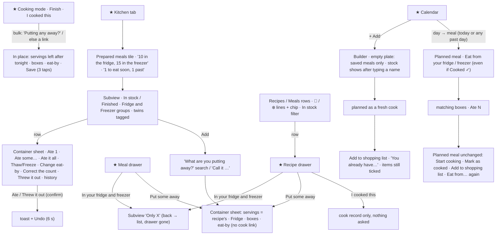
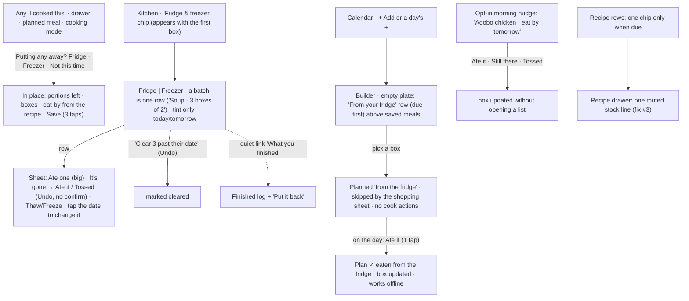

# J6 — Prepared meals and leftovers

Audit of Pinch at http://127.0.0.1:5240 (checkout `the audit build`, tip `e74fd9fb`). I walked it on the evening of Wed Oct 14, 2026 (America/Los_Angeles; the app's "today" was Oct 14 the whole time) at 390×844 with touch first, then at 1280×900. Fixtures: **Alex** (seeded returning user: 7 containers in stock, 2 finished), **Taylor** (scale kitchen, read-only: 301 in stock, 260 finished) and **Jamie** (empty, read-only).

Screenshots: `J6-shots/`, cited below by file name.

**What I created and deleted.** In Alex's kitchen, through the app: containers "J6 Soup" ×3 (one walked to Finished), "J6 Offline stew" and "J6 Freezer chili"; a recipe "J6 Freezer chili" (read from text by the real AI reader, which also wrote 2 cook records); and one planned meal of it on Oct 14. I deleted all of them through the app: each container with the trash on its sheet (Finished one included), the planned meal with "Remove from this day", and the recipe with Modify → Delete (which removes its cooks). A REST check afterwards found no J6 document in any collection. I never tapped an action on a seeded container (I only viewed Eat from your fridge on Alex's Oct 12 dinner).

**Environment notes.** Other agents were writing in Alex's kitchen at the same time (J2, J3, J4, J5 items such as "J5 Weeknight chili" with 2 servings in the freezer), so counts in some later screenshots differ from the seeded 7. Two seeded instants sit in Los Angeles's future because the seed ran on UTC's Oct 15: the thawed Adobo's history says "Thawed in the fridge on Oct 15 · 1:00 AM", and Taylor's Finished rows read "Oct 15" (`04`, `64`). That is a fixture artefact and changes no finding. The toast region also carried other apps' seeded reminders (Waypoint, A-List; the seed no longer writes them), which stacked over Pinch toasts (`24`).

---

## 1. Who and when

A home cook who makes a big pot on Sunday or a double batch on a weeknight. There are four moments:

- **At the stove, just after cooking** (hot pans, wet hands, boxes on the counter). They know exactly what went where. This is the cheapest moment to record anything, and the only one where the app is probably already open (cooking mode).
- **At the open fridge, at lunch or dinner** (one hand on the box, hungry). They can *see* the truth. Here the app competes with the fridge door itself. Recording "I ate one" is pure bookkeeping, with no payoff in that moment.
- **On the sofa or in the shop, planning** ("what's for dinner this week? do we need to buy for chili?"). The fridge isn't in view. This is where a remembered list is worth something: eat what's there first, and don't buy for a dish already in the freezer.
- **Sunday clean-out** (the fridge is full of old boxes). They want the list to match the shelf again in one go.

Without the app: masking tape and a marker on the lid, a glance at the door, memory, and a freezer full of mystery bricks. The app's real edge over the fridge door is narrow: **(1) the freezer**, which is opaque and long-lived and where things get forgotten; **(2) dates the person won't remember**; and **(3) knowing what's there while away from the fridge, at plan time.** Every design choice should be judged by whether it serves those three without costing more effort than tape and a marker.

What else is on their mind: not wasting food, not cooking or buying twice, "is this still OK?", and above all not being made to do chores for an app.

## 2. Goals and outcomes

| # | Job story | Success looks like | How often | Weight | Without the app |
|---|---|---|---|---|---|
| G1 | When I've cooked more than we'll eat tonight, I want to note what went in the fridge or freezer in seconds, so I don't have to remember it. | Recorded in 3 taps or fewer at the stove, with the date chosen for me. | 1–3× a week | Core (it creates the data) | Tape and a marker |
| G2 | When I'm deciding what we eat (tonight or this week), I want to see the leftovers that need eating first, so we eat them instead of cooking or buying again. | The due leftovers are in front of me while I choose, and picking one plans it. | Daily to weekly | **Core (the payoff)** | Open the fridge, or forget the freezer |
| G3 | When I take a portion out and eat it, I want the app to know with almost no effort, so the list stays true. | 1 tap, or none (answering a prompt I'd see anyway). | 4–8× a week | **Core (honesty)** | n/a: the fridge is the truth |
| G4 | When something is about to turn, I want to hear about it the day before, so I can eat it or freeze it. | Told once, early enough to act, where I'll see it. | Weekly | Supporting | Smell test |
| G5 | When I clean out the fridge, I want to clear what's gone in one go, so the list matches the shelf again. | One action for the batch, undoable. | Weekly to monthly | Supporting (recovery from drift) | Bin it |
| G6 | When I thaw a freezer portion, I want the date reset sensibly. | 2 taps, with the new date filled in. | Occasional | Supporting | Guess |
| G7 | When I shop for a dish, I want to know I already have it frozen, so I don't buy for it. | The list for that meal skips what I'll eat from stock. | Weekly | Supporting | Memory |
| G8 | When I look back, I want to know how much we threw out. | A number, if anything. | Rare | Rare | Nothing |

## 3. Current journeys, as walked

### 3.1 Where prepared stock shows up today (Alex)

The same physical box is described on up to **seven surfaces**, and the feature can be started from **five**.

| Surface | What it says | File | Can act there? |
|---|---|---|---|
| Kitchen "Prepared meals" tile | "10 servings in the fridge, 15 in the freezer" + tinted "1 to eat soon, 1 past its date" (`01`) | `containers/PreparedEntry.tsx` | Opens the list |
| Prepared meals subview | groups by place, each row with servings, eat-by, Eat soon / Past its date, Thawed, Made Oct 12 (`02`) | `ContainersSubview.tsx` | Yes |
| Container sheet | place, servings left, eat-by, thaw/freeze line, 7 actions, history (`03`, `04`, `05`) | `ContainerSheet.tsx` | Yes |
| Recipes rows | "🧊 5 servings [Eat by Oct 16]" / "❄️ 5 servings" on up to 2 extra lines (`07`) | `RecipeRow.tsx:105` | No (opens the drawer) |
| Meals rows | "🧊 10 servings [Eat by Oct 16] / ❄️ 5 servings", rolled up from the meal and its recipes (`10`) | `MealRow.tsx:104` | No |
| Recipe drawer | "In your fridge and freezer · 5 servings in the fridge, 5 in the freezer, eat by Oct 16" + "Put some away" (`16`) | `RecipeDrawer.tsx:323` | Opens a scoped list / the form |
| Meal drawer | "In your fridge and freezer · Adobo and rice 2 · Adobo chicken 10 · Cilantro lime rice 3" + "Put some away" (`11`) | `MealDrawer.tsx:170` | Same |
| Recipes / Meals filter | "IN STOCK · 🧊 Fridge · 2 · ❄️ Freezer · 1" (`08`) | `RecipesScreen.tsx:548` | Filters |
| Plan builder search | the stock line under a matching recipe (`18`) | `ItemSearch.tsx:156` | Pick the recipe (not the box) |
| Add to shopping sheet | "You already have 5 servings in the fridge, 5 in the freezer." with the ingredients still ticked (`17`) | `AddToShoppingSheet.tsx:116` | No |
| Planned meal (today or any past day) | "Eat from your fridge · 2 containers match this meal" (`14`) | `PlannedMealView.tsx:120, 444` | Yes: Ate N |
| Cooking history | "🍱 Put away 6 servings" under a cook (`55`) | `CookingHistorySheet.tsx` | No |
| Cooking mode, last screen | "Leftovers keep 4 days in the fridge, 3 months in the freezer" + "Putting any away?" (`44`) | `CookPutAway.tsx` | Yes |

Put-away entry points: cooking mode's question or link, the recipe drawer, the meal drawer, Kitchen → Add, and the "Already marked as cooked" panel. Eat entry points: the container sheet and the planned meal. **The plan builder's empty plate, where "what's for dinner?" is answered, has none.**

### 3.2 Journeys, counted in the browser (390×844)

**J6-A. Put away after cooking (G1), the best path.** Cooking mode on "J6 Freezer chili" (8 servings, "Keeps 4 days in the fridge… 3 months in the freezer").

| Step | Surface | Action | Taps | Volunteered | Friction |
|---|---|---|---|---|---|
| 1 | Finish panel | I cooked this | 1 | toast "Marked … as cooked · Undo" over the subview header (`44`) | (fix #5 in flight) |
| 2 | same panel | "Putting any away?" → ❄️ In the freezer | 1 | "6 left after about 2 for tonight" (`45`); eat-by 01/12/2027 "Your call. Taken from the freezer time in your recipe." | Defaults to **1 container**. Portions in boxes cost +2–4 taps |
| 3 | same | Save | 1 | second toast stacked (`46`); the panel says "Saved 6 servings in the freezer, eat by Jan 12, 2027", "Put another away" | "Put another away" stays after everything is put away. It opens at 1 serving with "Nothing left after about 2 for tonight and the 6 already put away" (`47`) |
| 4 | | Done | 1 | | |

**3 taps** (+Done). It costs little, comes at the right moment, and the arithmetic is shown. This is the feature at its best.

**J6-B. Put away without cooking mode (G1).** Most people cook a known recipe without the step-by-step screen.

| Path | Taps | Defaults | Friction |
|---|---|---|---|
| Recipes → row → "Put some away" → Put away (`49`) | **4** | servings = the recipe's 8 (not what's left), Fridge, 1 box | Not linked to any cook (`ContainerFormSheet.tsx:232` writes `cookId: null`), so the history never says "Put away N". "I cooked this" two rows above writes a cook and asks nothing |
| Kitchen → Prepared meals → Add → type → pick a recipe → Put away | **5 + typing** | servings = recipe's | — |
| Kitchen → … → Add → type → "Call it J6 Soup" → +×5 → Freezer → boxes +×2 → Put away (`20`–`23`) | **13 + typing** | 1 serving, Fridge; Freezer switches the date to 3 months | The subtitle under the name says "Typed name" (`21`). Three identical rows result (`23b`) |

**J6-C. Eat a portion (G3), the honesty tax.**

| Path | Steps | Taps | What happens after | Friction |
|---|---|---|---|---|
| From Kitchen | Kitchen → Prepared meals → row → **Ate 1** → Done | **5** | toast "Ate 1 serving · J6 Soup · Undo", which covers the sheet's own "1 serving left" line (`24`); the sheet stays open | Done is an extra tap after the most common action |
| Ate it all | Kitchen → Prepared → row → Ate it all | **4** | sheet closes, toast "Finished J6 Soup · Undo" | — |
| From the plan | Calendar → day → meal → **Eat from your freezer** → Ate 1 | **5** (today or past only) | Back on the meal, **unchanged**: Start cooking, Mark as cooked, Add to shopping list and Eat from your freezer still offered (`52` → `54`) | The plan never learns it was eaten |
| From a recipe | Recipes → row → "In your freezer" → row → Ate 1 → Done | **6** | Back goes to the Recipes list, not the drawer (`56` → `57`) | — |

**J6-D. Toss and clean out (G5).**

| Path | Taps | Friction |
|---|---|---|
| One box: Kitchen → Prepared → row → Threw it out → confirm "Threw it out? … You can undo it for a few seconds." | **5** | A confirm *and* an Undo for a recoverable act (`31`, `31b`) |
| Clean-out of k boxes | 2 + 3k | Taylor has **18 past their date**: 56 taps. Her first screen is 13 consecutive pink "Past its date" rows (`61`) |
| Undo a mistaken "Ate it all" after 6 s | impossible | The Finished sheet has only history, Done and the trash (`06b`, `34`). The fix is to Add it again |

**J6-E. Thaw (G6).** Kitchen → Prepared → row → Thaw in the fridge → (date prefilled "10/16/2026", "Your call. Once thawed, this starts at 2 days.") → Thaw in the fridge → Done = **6 taps** (`25`, `25b`). The new line "Thawed in the fridge on Oct 14" and the history are honest and useful.

**J6-F. Plan with leftovers (G2, G7).** Calendar → + Add → the empty plate offers "START FROM A SAVED MEAL" pills and a search box. Stock appears **only after typing a matching name** ("adobo" → "🧊 5 servings [Eat by Oct 16] ❄️ 5 servings", `18`). Picking it plans a fresh cook at 1 serving. Then "Add to shopping list" for that recipe says "You already have 5 servings in the fridge, 5 in the freezer." and still pre-ticks 3 of 6 ingredients (`17`). *I expected the payoff of keeping a fridge list to be here, at "what's for dinner". It isn't. The app shows the list's value only on surfaces the person visits for other reasons.*

**J6-G. Look back (G8).** Prepared meals → Finished: "What you've eaten or thrown out." Rows read "Threw out 2 servings · Oct 7" and "Ate 4 servings · Sep 24" (`06`), newest first, with no total or month. One finished container whose count I corrected 1 → 3 and from which I ate 4 still reads "Ate 2 servings" (`33`, `34`).

**J6-H. Bad signal (offline-ish).** With the browser offline: **Put away works** ("Saved on this phone, it will sync when you're online", `36`, synced on reconnect). **Ate 1 fails**: nothing for ~9 s, then "Check your connection and try again." inside the sheet, and the count is unchanged (`35-offline-ate1-10000.png`). Eat, toss, move, eat-by and count are all `runTransaction` (`store/actions/containerActions.ts:45, 98`), and transactions need the server. The most frequent upkeep act is the one that breaks in a work kitchen or by a basement freezer.

**J6-I. First run (Jamie, read-only).** Kitchen shows the tile "Prepared meals · Keep track of what is in your fridge and freezer" (`65`). The subview shows an In stock / Finished switch over nothing, an "Add" floating with no subtitle, and "Nothing in the fridge or freezer right now. When you make extra, put some away and it shows up here." (`66`). The copy is good. The switch and Finished are dead controls on day one (J1-F7 counted the tile among day-one noise; I agree).

**J6-J. Scale (Taylor, read-only).** The tile reads "631 servings in the fridge, 780 in the freezer · 50 to eat soon, 18 past their date" (`60`). The subview opens in **218 ms**, draws 68 rows (20 per place, with "Show 20 more" twice) and is about 3,000 px tall, and its search finds "chili" at once (`61`–`63`). Finished pages 25 at a time (`64`). Performance is fine. The *content* is the problem: 50 of the 301 boxes are tinted "Eat soon" (and 18 "Past its date"), so the tint means nothing.

**J6-K. 1280.** The subview is a centred 672 px column that hides the rail, and the sheet is a modal with nothing hidden (`71`, `72`). Nothing differs in kind from the phone.

### 3.3 The weekly cost of keeping it honest

A household that batch-cooks twice a week, eats leftovers six times and bins one box:

- put away 2 × 3–4 taps = ~8 (only if they use cooking mode or the drawer)
- eat 6 × 5 taps = 30, in 6 separate app visits made only for bookkeeping
- toss 1 × 5 = 5

That is **about 43 taps over about 9 visits a week**, and 30 of those taps happen at the open fridge, where the person can see the truth without the app. **My prediction is that after a week the eats stop being logged.** The Recipes rows then claim "🧊 5 servings" of food that's gone, the "past its date" pile grows (Taylor's fixture shows that end state), and the person learns not to trust the list. Fix #4's "Clear out" is, in effect, the reset button for that drift.

### 3.4 Insight surfaces about stock, first view at 390×844 (Alex)

| Screen | Count | Items (class) |
|---|---|---|
| Kitchen | 2 | servings summary (REFERENCE, NOISE for someone who came for ingredients), due pill (DECISION, acted on one tap away) |
| Prepared meals subview | 14 | "25 servings in 7 containers" (NOISE), place counts 4 / 3 in *containers* (NOISE: a third unit), 7 eat-by phrases (REFERENCE), Eat soon ×1 and Past its date ×1 (DECISION), "Made Oct 12", "Thawed · Made Sep 5" (REFERENCE) |
| Container sheet | 3 + 7 actions + history | REFERENCE; the sheet scrolls (799 px of content in 701 px, `03b`) |
| Recipes list | 5 on 2 rows | 4 stock fragments (REFERENCE), 1 tinted chip (DECISION) (`07`) |
| Meals list | 3 on 1 row | "10 servings" mixing plates and parts (NOISE, misleading) (`10`) |
| Recipe / meal drawer | 1 line each + a "Put some away" row | REFERENCE |
| Planned meal (past or today) | 1–2 rows | DECISION only if the meal wasn't cooked (`14`) |
| Plan builder | 1 line per matching result | DECISION, but only after typing (`18`) |
| Add to shopping sheet | 1 line | STATUS (it changes no default) (`17`) |

### 3.5 Nouns the person meets in this feature (22)

prepared meal, container, serving, fridge, freezer, eat by, eat soon, past its date, thawed, frozen twice, made, in stock, finished, put away, put another away, ate some, ate it all, correct the count, threw it out, delete (≠ threw it out), history, "your call". The same thing goes by **"Prepared meals"** (tile, title, search placeholder), **"Container"** (sheet title), **"In your fridge and freezer"** (drawer), **"In stock"** (switch, filter), **"Leftovers"** (cooking mode) and **"Put some away"** (actions). "Meal" now means a saved meal, a planned meal *and* a prepared meal, and a "prepared meal" is usually just a recipe's leftovers.

## 4. Flow diagrams

**Current** (entry points ★)

**Proposed** (each change is justified in §6)

## 5. Findings

### (a) Small things

| ID | Sev | Where | Evidence | Goal hurt |
|---|---|---|---|---|
| J6-S1 | polish | Container sheet after "Ate 1" (`ContainerSheet.tsx:585-604`, toast in `useContainerActions.ts:126-138`) | The toast "Ate 1 serving · J6 Soup · Undo" covers the sheet's name and "1 serving left", the confirmation the person wants, and doesn't itself say what's left (`24`). The sheet stays open, so Done is a fifth tap | G3 |
| J6-S2 | minor | Subview rows for a split batch (`ContainersSubview.tsx:182-190`) | Three identical rows "J6 Soup · 2 servings · Eat by Jan 12, 2027 · Made Oct 14" (`23b`). The twin tag is the same on all three, so it tells nothing apart, and the list grows by boxes when the person thinks "6 portions of soup" | G2, calm |
| J6-S3 | minor | Planned meal → Eat from your fridge (`EatFromStock.tsx:145-176`) | Two "Adobo chicken" rows with no "Thawed" or "Made" tag to tell them apart (`15`), while the subview tags the same two | G3 |
| J6-S4 | minor | Put-away defaults differ by door | Cooking mode: what's left after tonight (6, `45`). Recipe drawer: the recipe's full servings (8) whatever was cooked (`49`). Saved meal and typed name: 1 (`21`; `ContainerFormSheet.tsx:190-197`) | G1 |
| J6-S5 | minor | Drawer put-away isn't tied to the cook (`ContainerFormSheet.tsx:232` `cookId: null`) | The cooking history shows "🍱 Put away 6 servings" only for cooking-mode put-aways (`55`) | G1 |
| J6-S6 | polish | Cooking mode's "Put another away" (`CookPutAway.tsx:72-79`) | Still offered after all 6 were put away; opens at 1 serving with "Nothing left after about 2 for tonight and the 6 already put away" (`47`) | G1 |
| J6-S7 | polish | Put-away form subtitle (`ContainerFormSheet.tsx:250-256`) | "Typed name" / "Recipe" / "Saved meal" under the title (`21`, `49`): system words with no job | concepts |
| J6-S8 | minor | Toss (`ContainerSheet.tsx:512-519`) | Confirm "Threw it out? … You can undo it for a few seconds." *and* a 6 s Undo toast (`31`, `31b`): two safety nets for one recoverable act, +1 tap per toss | G5 |
| J6-S9 | polish | Finished summary (`utils/containers.ts:585-595`) | "Ate 2 servings" for a box that went in at 2, was corrected to 3, and had 4 eaten (`33`, `34`) | G8 |
| J6-S10 | minor | Finished sheet | No "Put it back": a mis-tapped "Ate it all" can't be reversed once the 6 s Undo is gone (`06b`, `34`) | G3 |
| J6-S11 | polish | Empty subview (`ContainersSubview.tsx:389-399`) | In stock / Finished switch over nothing, and "Add" floating alone where the subtitle would be (`66`) | first run |
| J6-S12 | polish | Scoped list from a drawer | The phone back from "Only J6 Freezer chili" lands on the Recipes list, not the drawer it came from (`56` → `57`) | G2 |
| J6-S13 | minor | Place emoji (`constants.ts:394`) | 🧊 is the fridge and ❄️ the freezer: both read "frozen". On a Recipes row "🧊 5 servings" above "❄️ 5 servings" only the emoji says which is which (the words are screen-reader only, `StockLine.tsx:39-43`) (`07`) | G2 |
| J6-S14 | polish | One state, three wordings | Kitchen "1 to eat soon", container row "Eat by Oct 16 [Eat soon]", recipe and meal rows a tinted "Eat by Oct 16" (`01`, `02`, `07`) | concepts |
| J6-S15 | polish | Subview subtitle and dividers | "25 servings in 7 containers" (a fridge + freezer total nobody acts on), dividers counting *containers* (4, 3), and the Kitchen tile counting *servings*: three counts in two units over two screens (`01`, `02`) | calm |
| J6-S16 | polish | Freezer rows | Each leads with "Eat by Jan 3, 2027". For a freezer, age ("frozen 10 days ago") is what people think in. The date matters only when past (`02`) | G2 |
| J6-S17 | polish | Finished view header | "Add" on the Finished view adds an in-stock box (`06`) | — |
| J6-S18 | polish | Seed | Seeded instants in LA's future: "Thawed … Oct 15 · 1:00 AM" on Oct 14, and Taylor's Finished "Oct 15" (`04`, `64`) | fixture |

### (b) High-arching things

**J6-H1 · major · Keeping the list true costs more than it pays, so it will drift.** Recording an eat is 5 taps from anywhere (Kitchen, the plan, a recipe), a toss 5, a thaw 6. Only putting away is cheap (3 taps in cooking mode). At a realistic week that is about 43 taps over about 9 visits (§3.3), and 30 of them happen at the open fridge, where the person already sees the truth. The data the rest of the app leans on (stock lines, the In stock filter, "Eat soon", the shopping line) is only as good as that upkeep. Evidence of the end state: Taylor's first screen is 13 consecutive "Past its date" rows, and clearing her 18 costs 56 taps (`61`). Hurts G3, and so G2, G4 and G7.

**J6-H2 · major · Eating from the plan doesn't close the plan; the plan and the fridge don't know each other.**
- **The plan keeps offering cooking and shopping.** After "Eat from your freezer → Ate 1" the planned meal still offers Start cooking, Mark as cooked, Add to shopping list and Eat from your freezer again (`54`), and a second tap ate a second serving.
- **It is offered on meals already cooked, including their own leftovers.** "Eat from your fridge" shows on Alex's Oct 12 dinner, which reads "Cooked ✓". One of the two boxes it offers was *made by that very cook* (`cookId seed-pinch-planned-1__…`, `14`, `15`).
- **It never stops.** It shows on every past day without limit (`PlannedMealView.tsx:120` `canEatFromStock = meal.date <= today`, `:444`; no cook check).

Tapping it records a false eat that drains real stock. Hurts G3 and trust.

**J6-H3 · major · Leftovers aren't offered where the eat-or-cook decision is made.** The plan builder's empty plate offers saved meals. Stock appears only after typing a matching name (`18`), and picking it plans a fresh cook. The shopping sheet's "You already have 5 servings…" arrives after the decision and changes no tick (`17`). The pinch rule "no Calendar or Overview surface" keeps the feature's payoff away from planning, the one moment the fridge isn't in view. Hurts G2 and G7, the reasons to keep the list at all.

**J6-H4 · major · Stock is shown on 12 surfaces, 7 for one box, in three wordings, and is missing from the one surface that decides.** See §3.1. Recipe rows grow to 5 lines (`07`), meal rows to 4 (`10`), and the drawers repeat the rows. This is the "insight everywhere" pattern J7-H2 found for prices, applied to stock. Most of these are REFERENCE shown unasked. Only the due chip, the planned-meal row and the builder line are DECISION. Hurts calm.

**J6-H5 · major · A meal's "servings" mixes plates and parts.** "Adobo and rice · 🧊 10 servings" is 2 boxed plates of the meal + 5 Adobo + 3 rice (`10`, `11`; `getMealStockMap`, `utils/containers.ts:787`). You can't eat 10 "Adobo and rice". The same boxes also count on the Adobo row and the rice row. The drawer's "Adobo chicken 10" drops the fridge/freezer split. Hurts G2 (a wrong picture of what's there).

**J6-H6 · minor · The container sheet is a 7-action menu for a 1-action moment.** At 390 the sheet scrolls (799/701 px, `03b`). Three rows end a box (Ate it all, Threw it out, and the trash, whose confirm has to point at "Ate it all", `58`). Two change the count (Ate some…, Correct the count). The two acts people do weekly (one portion eaten, the box is gone) sit among five they do rarely. Hurts G3.

**J6-H7 · minor · "Eat soon" covers most of a fridge box's life, so it stops meaning "act now".** The window is today plus 2 days (`CONTAINER_EAT_SOON_DAYS = 2`, `utils/containers.ts:93-97`). That tints a box for 3 of its 4 days with a 3-day recipe, 3 of 5 days with the 4-day default, and its whole life after a thaw (2 days). Taylor has 50 "eat soon". Hurts G4.

**J6-H8 · major · The most frequent upkeep act fails offline; the rarest works.** Put away is a queued batch ("Saved on this phone…", `36`). Eat, toss and move are transactions that fail after ~9 s with "Check your connection and try again." (`35-offline-ate1-10000.png`; `containerActions.ts:45, 98`). The person standing at a work fridge or a garage freezer with no signal can add but can't take out. Hurts G3.

**J6-H9 · minor · Names make the person learn a concept that does no work.** "Prepared meals" and "Container" are the app's words. The person's words are "leftovers" and "what's in the freezer", and the drawer already says "In your fridge and freezer". "Meal" collides with the Meals pill (saved meals) on the next tab. 22 nouns for a fridge list (§3.5). Hurts G1 and G2 (findability: would someone look for leftovers under "Prepared meals" in *Kitchen*, next to Stores and Products?).

**J6-H10 · minor · One moment, two unlinked rows.** In the recipe drawer "I cooked this" writes a cook and asks nothing, and "Put some away" two rows down writes boxes with no cook (`RecipeDrawer.tsx:313-328`). The planned meal's "Mark as cooked" offers no put-away at all (`52`). Only cooking mode joins them (`44`), and most people won't open step-by-step mode for a dish they know. Hurts G1 (the cheapest moment to record is wasted unless the person used cooking mode).

**J6-H11 · minor · Finished answers no question.** It is a raw log, newest first, with no total, no month and no "wasted" figure (`06`). The sheet holds only history. Fix #4 promotes it to a peer of Fridge and Freezer. Hurts calm. G8 is rare.

## 6. Proposals

Ordered by value to the person. Sizes: S = a label or a line; M = a screen or component; L = a flow or concept.

| ID | Kind | Goal | What changes | Why it's better | Cost / risk | Size |
|---|---|---|---|---|---|---|
| P1 | FILL | G3 | **Eating from the plan closes the plan.** "Eat from your fridge → Ate 2" marks the planned meal "Eaten from your fridge ✓ · Undo" (like "Cooked ✓"), and hides Start cooking, Mark as cooked, Add to shopping list and Eat from… for it. Eat from… is never shown on a meal that is Cooked ✓, never offers a box whose `cookId` is this meal's cook, and shows only for today and yesterday | One dinner is one answer. No false eats, and a past day stops offering something that happened weeks ago | A field on the planned meal (or a cook-like record with a source), rules, and a `getMissing…` backfill for legacy docs | M |
| P2 | ADD (merges three surfaces) | G2, G7 | **"From your fridge" on the empty plate.** The plan builder's empty plate shows a captioned row of boxes due within a few days, soonest first ("🧊 Adobo chicken · eat by Fri"), above "Start from a saved meal". Picking one plans that dish **from the fridge**: the shopping sheet skips its ingredients, and on the day the meal shows one "Ate it" (P1). The builder's search stock line stays; the shopping sheet's "You already have…" line goes | The stored list finally pays off where the person decides, away from the fridge door. Leftovers get eaten because they are offered, not because the person remembered to look in Kitchen. It answers G7 by doing, not by telling | A planned-item flag (a `containerId` or source on the item), shopping logic, rules. It challenges the pinch rule "no Calendar surface" (it's the builder, one captioned row, shown only when something is due). Coordinate with J1-P6's "Your recipes" row: one row, fridge first | L |
| P3 | TRIM | calm, G2 | **Stock on list rows only when it's due.** A Recipes or Meals row shows one chip, "🧊 Eat by Fri" or "Past its date", only when a box is due. Otherwise the row says nothing about stock, and the In stock filter answers "what have I got". A meal row counts only boxes of that meal ("1 plate"), never its parts. Drop the subview's "N servings in M containers" subtitle. This **replaces** fix #6's per-list "Show what's in stock" switch | Rows go from 5 lines to 3 (`07`). The unit mix (H5) disappears. The chip that remains is a DECISION | Someone who liked seeing all stock on rows loses it (the filter keeps it one tap away). Update the pinch rule "Stock shows as StockLine on a recipe or meal row…" | S |
| P4 | MERGE | G3, G5 | **The container sheet asks two things.** Big "Ate one" (one tap, closes the sheet, toast "Ate 1 · 4 left · Undo"); "It's gone" (swaps in place to Ate it / Tossed, no confirm, Undo); Thaw or Freeze stays; tapping the date line edits it. "Ate some…" and "Correct the count" become one "How many are left?" stepper (lower = eaten, higher = corrected, the history records which). Delete stays as the footer trash | 7 rows become 3 plus a tappable line, and the sheet stops scrolling. "Ate one" drops from 5 taps to 4. A toss stays at 5, with Undo instead of a confirm. Three near-synonyms for "remove" become one question | History wording ("Count 1 → 3") stays. CLAUDE.md's confirm rule covers deletes, not an undoable toss (state it) | M |
| P5 | MERGE | G2, calm | **A batch is one row.** Boxes put away together (same title, place, eat-by, moment) show as one row: "J6 Soup · 3 boxes of 2 · eat by Jan 12". Its sheet's "Ate one" becomes "Took a box out". The data stays one document per box (K7) | The list matches how people think ("6 portions of soup"). Twin tags that are identical on every row go | Display grouping only. A box moved alone (one thawed) leaves the group | M |
| P6 | FILL | G4 | **"Eat soon" = due today or tomorrow** (and for a thawed box, its last day). The Kitchen pill says "2 to eat by tomorrow" | The tint becomes rare, so it is read. Taylor's 50 drop to 33 (13 due today, 20 tomorrow, counted by REST) | One constant and its copy | S |
| P7 | FILL | G3 | **Eating works offline**, like putting away: an eat or toss is queued with the same "Saved on this phone" promise, and a conflict (eaten on two devices) resolves to the lower count on sync. Rare corrections may stay transactions | The weekly act stops failing at the fridge with bad signal | Rules walk history by index (10-event cap), so a queued `arrayUnion` needs care; technical design needed | M |
| P8 | ADD (owner decision) | G4, G3 | **An opt-in morning nudge, answerable.** Offered once after the first fridge put-away ("Want a nudge the morning a box is due?"). At most one push a day, only for fridge boxes due today or tomorrow, linking to the box, with "Ate it" / "Still there" / "Tossed" | The reminder *is* the upkeep: answering keeps the list true without opening a list. It turns G4 from "notice a tint in Kitchen" into "hear about it in time" | Challenges "no push for an eat-by date". A stale list makes it nag about phantom food, so ship after P1/P4/P7. `scheduleReminder` exists (Waypoint, Nine Lives, A-List) and needs a `link` | M |
| P9 | MERGE | G1 | **Every "I cooked this" asks "Putting any away?"** in place (the recipe drawer's row swaps in place; the planned meal's "Mark as cooked" too), using cooking mode's defaults ("6 left after about 2 for tonight") and the cook id. **Remove the drawers' separate "Put some away" row**; Kitchen → Add stays for food with no recipe | The cheapest moment to record is used whether or not cooking mode was. One default, one link to the cook, one fewer row in two drawers (with fix #3 it would otherwise be a chip on every recipe, cooked or not) | Coordinate with J5 (cook moments) and J1-P13 (no put-away on never-cooked recipes, which this answers) | M |
| P10 | REARRANGE | findability | **Rename "Prepared meals" to "Fridge & freezer"** (Kitchen chip, subview title, search placeholder), title the sheet with the dish, say "leftovers" in copy, drop "Typed name / Recipe / Saved meal" | One name, the person's own, matching the drawer row. "Meal" stops meaning three things | README, UX.md, pinch.md vocabulary | S |
| P11 | REARRANGE | calm, G3 | **Finished is a quiet link**, "What you finished", under the list, not a peer pill. Its sheet gains "Put it back" (restores the last count) | The main switch holds only places with food. Mis-taps become fixable | Fix #4's Fridge / Freezer / **Finished** switch should drop Finished as a peer | S |
| P12 | REARRANGE | G5 | **Fix #4's "Clear out" is scoped to what's past its date** ("Clear 3 past their date · Undo"), logged as *cleared* (neither eaten nor tossed, since the app doesn't know), and offered only when something is past | Matches the real drift case (old boxes gone). It never wipes a freezer of good food in one tap, and never invents waste numbers | One more history word ("Cleared"). Emptying a whole place is rare and stays one box at a time; don't build a one-tap version of it | S |
| P13 | TRIM | calm | **Freezer rows show age** ("Frozen Oct 5"), and the eat-by only when past or within a week. Fridge rows keep "Eat by" | One line shorter per freezer row, and in the words people use for a freezer | Copy only | S |
| P14 | FILL | polish | Small fixes: tags on Eat-from rows (S3); hide "Put another away" when nothing is left (S6); Finished summary counts what was eaten (S9); empty subview shows no switch (S11); back from a scoped list returns to its drawer (S12) | Each removes a stumble | — | S |
| K1 | KEEP | G1 | **Cooking mode's "Putting any away?"** with its worked-out default ("6 left after about 2 for tonight"), eat-by from the recipe, 3 taps, Save never waits on the server | The best-made moment in the feature, and the model for P9 | — | — |
| K2 | KEEP | G6 | **Thaw resets the date and says why** ("Your call. Once thawed, this starts at 2 days."; "It's been frozen twice before."; a past date stays past) and **never claims food is safe** | Real help at a moment people forget, and honest | — | — |
| K3 | KEEP | G1 | **Eat-by from the recipe's "Keeping it"**. The text reader filled "Keeps 4 days in the fridge and up to 3 months in the freezer" into Fridge 4 days, freezer 3 months with no typing (`40`) | The date costs nothing to set | — | — |
| K4 | KEEP | G3 | **Undo on every put-away, eat and toss, with the double-tap guard** | Makes one-tap actions safe (and lets P4 drop the toss confirm) | — | — |
| K5 | KEEP | navigation | **No fifth tab; the list's home stays under Kitchen** | The list is a reference you open on purpose. Its *in-context* doors should be the cook moment (P9) and the plan builder (P2), not more rows | — | — |
| K6 | KEEP | scale | **The list at scale:** 301 boxes in 218 ms, 20 per place with "Show 20 more", search from 8, soonest first | Performance and order are right; the content rules (P3, P5, P6) are what to change | — | — |
| K7 | KEEP | data | **One document per physical box** | It is what you take out of the freezer. P5 groups only on display | — | — |
| K8 | KEEP | G2 | **The In stock filter** on Recipes and Meals ("Fridge · 2, Freezer · 1", only what's there) | A REFERENCE the person asks for; it's what lets P3 drop stock from rows | — | — |

**The smallest version of this feature that would still be used.** (1) Put away at any "I cooked this" in 3 taps (K1 + P9). (2) A Fridge & freezer list: dish, portions, date, one row per batch (P5, P10). (3) One-tap "Ate one" and "It's gone" from the list, and "Ate it" from the plan, closing the plan (P1, P4), working offline (P7). (4) Due leftovers offered when planning dinner (P2). (5) Optionally a nudge you can answer (P8).

**What it can do without:**
- the history list in the sheet (keep the events for Undo and the refreeze line)
- Finished as a view
- Correct the count as its own action
- twin tags
- stock lines on every row
- the shopping-sheet line
- the meal roll-up
- the drawers' Put some away rows

**Where it belongs.** It lives under Kitchen, as a list you open on purpose. It is *born* at the cook moment and *paid off* in the plan builder. Those are the two in-context entries the journeys need, and every other surface can go quiet.

**On the fixes in flight.**
- **#4 (Fridge / Freezer / Finished switch, "Clear out").** The place switch is right at scale (Taylor), but drop Finished as a peer (P11) and scope Clear out to past-dated boxes, logged as cleared (P12). Like J7-H5's warning about the hidden bulk ✕, a bulk end must name its scope and offer Undo.
- **#3 (drawer chip row, stock as a muted line).** Agree. Better still, remove "Put some away" from the drawers (P9) instead of making it a chip.
- **#6 (a View option to hide stock lines).** Disagree with adding another per-list switch. Make the default quiet (P3). J7 reached the same conclusion for nutrition (opt in once, lists follow).
- **#5 (Finish panel cards, Undo inside).** Agree. It also fixes the toast stack over the cooking header (`44`, `46`).

**Where I agree and disagree with J1 and J7.**
- **J1-P12** (Prepared meals chip only with its first box): agree. P9 gives the feature its birth moment.
- **J1-P13** (no Put some away on a never-cooked recipe): agree, and go further: drop the row (P9).
- **J1-F2** (a recipe joins the plate at 1 serving): it leaks here too. Eat from the freezer prefills "Ate" from the *planned* servings ("Ate 4" on Alex's Oct 12 dinner, `15b`), so a wrong plan default eats the wrong amount.
- **J7-H2** (one backlog, nine numbers): the same pattern holds for stock (H4).
- **J7 rule 3** ("ask for data where it is in view"): it maps directly onto leftovers. Ask at the plan's day or in a nudge, not on a page in Kitchen.

## 7. Rule candidates

1. **A record the person must keep true is updated where the truth is already in their hands, in one tap: at the moment it happens (cooking, eating a planned meal) or by answering a prompt they'd see anyway, never only on a page they have to go and find.** → `CLAUDE.md` Product.
2. **Two records of one event settle each other.** Eating a planned meal from the fridge closes the plan's cook and shop actions, and a record never offers to consume what it produced. → `CLAUDE.md` Product.
3. **An attention tint covers only the last stretch (today or tomorrow).** A state that lasts most of an item's life is not a warning. → `CLAUDE.md` Design & UX.
4. **A list row shows a status only when it changes what the person does next.** The rest lives behind a filter or on the item's own page. → `.claude/rules/pinch.md` (replaces "Stock shows as `StockLine` on a recipe or meal row…").
5. **A count never mixes units.** A saved meal's stock counts its own plates, never its recipes' portions. → `.claude/rules/pinch.md`.
6. **Things made together show as one row with a count**, not N rows told apart by a tag that is the same on all of them. → `CLAUDE.md` Design & UX.
7. **The frequent action works offline like the action that created the record.** Taking a portion out is queued like putting one away, and transactions are for rare corrections. → `CLAUDE.md` State, data, and performance.
8. **An action with an Undo toast asks no confirm.** Confirms are for what can't be undone. → `CLAUDE.md` Design & UX (a note under the deletes rule).
9. **Challenge "no Calendar or Overview surface and no push for an eat-by date"** → "Prepared meals live under Kitchen. The plan builder may offer what's due in one captioned row, and an eat-by nudge is opt-in, once a day, and answerable." → `.claude/rules/pinch.md`.
10. **Review check for record-keeping features:** count the taps to keep the data true for a week at real frequency, and walk the "a week later, nothing was logged" state (stale stock, past-dated pile) before calling it done. → the reviewer agents in `.claude/agents/` (product agent).

## 8. Open questions for the owner

1. **Should Pinch nudge about eat-by dates?** *Recommendation:* yes, opt-in, at most once a day, only for fridge boxes due today or tomorrow, with answers in the notification (P8), after P1, P4 and P7 make the list trustworthy.
2. **Is "plan from the fridge" a real kind of planned item?** *Recommendation:* yes (P2). It's the one change that turns the stored list into a decision and stops the shopping list buying for food already cooked. It is the largest change here.
3. **Is waste tracking a goal?** *Recommendation:* no, not now. Keep the events, demote Finished to a link (P11), and add a "thrown out this month" line only if you want that number.
4. **Should a cooked planned meal ever offer "Eat from your fridge"?** *Recommendation:* no (P1).
5. **What should fix #4's Clear out clear, and what does it record?** *Recommendation:* past-dated boxes only, recorded as "cleared", with Undo (P12).
6. **Rename "Prepared meals" to "Fridge & freezer"?** *Recommendation:* yes (P10). It's the person's word and frees "meal" for saved and planned meals.
7. **Should the drawers keep "Put some away"?** *Recommendation:* no. Ask it after every "I cooked this" instead (P9). Decide with J5.
