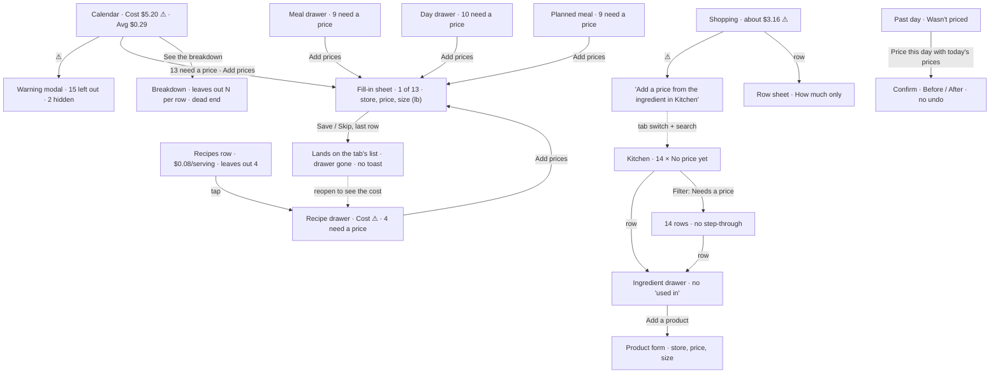
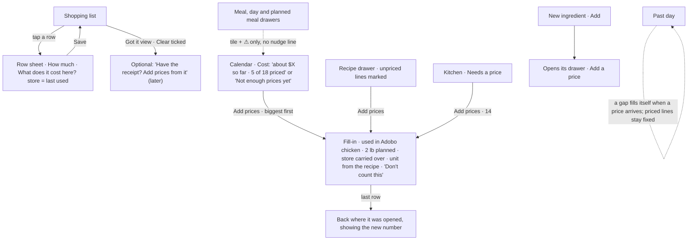

# J7 — Costs, prices, nutrition and the catalog

Audit of Pinch at http://127.0.0.1:5240 (checkout `the audit build`, tip `e74fd9fb`), walked on 2026-10-14 (the app's "today" in America/Los_Angeles) at 390×844 (touch) and 1280×900. Fixture: Alex (seeded returning user). Screenshots: `J7-shots/` (cited below by file name).

**What I could not do, and why.** Taylor's "Big Kitchen" fixture is not loaded in the shared emulator (Taylor's Pinch kitchen is empty: `50-taylor-calendar.png`, `51-firstrun-kitchen.png`; `pinchScale.ts` seeds only on `npm run seed:pinch-scale`, which I must not run), so there is no scale walk and no fixture with nutrition switched on. Alex's nutrition switches are all off and are not throwaway data, so I did not flip them. Every nutrition-on statement below comes from reading the code and is marked _(code)_. I wrote throwaway data in Alex's kitchen (ingredient "J7 Saffron", recipe "J7 Saffron rice", store "J7 Corner shop" and its product), walked the price flow with it, and deleted all four through the app; a REST check afterwards found no `J7 ` document and the baseline counts (5 products, 3 stores).

---

## 1. Who and when

A home cook who wants Pinch's promise from the README: "every recipe, meal, and week knows what it costs. Nutrition is there too." In practice there are three moments:

- **On the sofa, planning the week** (phone, unhurried). They look at the Calendar or a recipe and want a rough number: "is this a cheap week?", "is the nachos night pricey?", "roughly how much protein?". They will not sit through a data-entry session. They are also thinking about what to cook and what to buy.
- **In the shop** (one hand, a basket, bad signal). Price tags are in front of them, and so is the receipt later. This is the only moment the true price is in view without effort. Their mind is on the list, not on a database.
- **At the counter with a package** (a new bag of chips, a sauce). The label's nutrition and price are in their hand, and they are adding a new ingredient.

What else is on their mind: time, money, not being nagged. The README promises "Zero pressure… a missing price just means a number is left out." The person's real question is never "which ingredients lack a product?". It is "can I trust this number enough to decide?"

## 2. Goals and outcomes

| #   | Job story                                                                                                                                    | Success looks like                                                                       | How often                          | Weight                    | Without the app                               |
| --- | -------------------------------------------------------------------------------------------------------------------------------------------- | ---------------------------------------------------------------------------------------- | ---------------------------------- | ------------------------- | --------------------------------------------- |
| G1  | When I plan a week, I want a rough cost I can trust, so I can see whether it fits the budget.                                                | A week total that is "about right" (within roughly 20%), and says plainly when it isn't. | Weekly                             | Core                      | A guess, or the receipt total after the fact. |
| G2  | When I pick a recipe, I want to know roughly what one serving costs, so I can choose between dishes.                                         | A per-serving figure I believe, or an honest "not enough prices yet".                    | Several times a week               | Core                      | No idea, or a vague "chicken is cheap".       |
| G3  | When I'm in the shop or have the receipt, I want to record what things cost with almost no effort, so the numbers stay true without a chore. | A price saved in about 2 taps from the list I'm already holding.                         | Each shop (weekly)                 | Core (it feeds G1 and G2) | Nothing. Prices live in memory.               |
| G4  | When the app says a number is incomplete, I want to fix only what matters, so I can stop thinking about it.                                  | The two or three big ingredients priced. Salt, pepper and water stop being asked about.  | Once per recipe, then rarely       | Supporting                | —                                             |
| G5  | When I care about nutrition, I want calories and protein on what I eat, so I can keep an eye on them.                                        | One switch, and the numbers appear on recipes, meals, days and lists.                    | Once to set up, then daily glances | Supporting (opt-in)       | A tracking app, or the label.                 |
| G6  | When I add a packaged food, I want to type its label as printed, so it counts correctly.                                                     | Label basis (per 28 g, per serving) accepted, converted for me.                          | Occasionally                       | Supporting                | —                                             |
| G7  | When I look back, I want last month's cost to reflect what I actually paid.                                                                  | Past days keep their prices, and prices I add later fill the gaps.                       | Monthly, if ever                   | Rare                      | The bank statement.                           |
| G8  | When I have several places to buy something, I want to see which is cheaper, so I buy well and costs use the price I pay.                    | A unit price ($/lb) beside each place, and the default being the one I use.              | Occasionally                       | Rare                      | Shelf tags.                                   |

## 3. Current journeys, as walked

All taps were counted in the browser at 390×844. "Typing" means a field the person types into.

### J7-A: "What does this week, or this recipe, cost?" (G1, G2), returning user (Alex)

| Step | Surface                | Action                           | Taps | What the app volunteers                                                                                                                                                                                | Friction                                                                                                                                                                                |
| ---- | ---------------------- | -------------------------------- | ---- | ------------------------------------------------------------------------------------------------------------------------------------------------------------------------------------------------------ | --------------------------------------------------------------------------------------------------------------------------------------------------------------------------------------- |
| 1    | Calendar, Month (home) | open the app                     | 0    | **Cost $5.20** tile with ⚠, **Avg per meal $0.29** with ⓘ, "13 ingredients need a price · Add prices ✕", "See the breakdown" (`01-calendar-first-view.png`)                                            | $5.20 for a month with dinners on six days, and $0.29 a meal, are not believable. Nothing on the tile says it is a fraction of the real cost.                                           |
| 2    | Cost warning (modal)   | tap ⚠                            | 1    | "Leaves out **15** ingredients with no price yet." "The note asks about fewer: 2 are hidden or in a day that has passed." "A price you add now counts from today on…" (`02-calendar-cost-warning.png`) | Three counts for one idea (13 in the line, 15 here, "2 hidden"), and a sentence that explains the app's own bookkeeping.                                                                |
| 3    | Week                   | tap Week                         | 1    | $4.10 ⚠, $0.51 avg, the same "13 ingredients need a price", and rows priced "$0.15", "$0.08", "Wasn't priced", "No price yet" (`64-week-phone.png`)                                                    | "Adobo chicken +1 · Dinner · $0.15" leaves out 9 ingredients and still shows as a plain price.                                                                                          |
| 4    | Breakdown              | "See the breakdown"              | 1    | "The total leaves out 15 ingredients", then every day row with "leaves out N ingredients" (`61-desktop-breakdown.png`)                                                                                 | 6 rows, 6 caveats. The rows are not tappable (`BreakdownDrawer.tsx` has no `onClick`), so "Oct 15 · leaves out 11" is a dead end.                                                       |
| 5    | Recipes list           | Recipes tab                      | 1    | "Cilantro lime rice · $0.08 / serving · leaves out 4", "Game night nachos · $0.81 / serving · leaves out 3", "Adobo chicken · No price yet" (`04-recipes-list.png`)                                    | An 8-cent serving of rice reads as a fact. Per serving it is roughly a third of the real figure.                                                                                        |
| 6    | Recipe drawer          | tap the rice                     | 1    | Cost $0.30 ⚠ · $0.08 per serving · "4 ingredients need a price · Add prices ✕" (`05-recipe-drawer-rice.png`)                                                                                           | The ingredient list doesn't mark which 4 have no price (`RecipeDrawer.tsx:54-58` labels only "can't compare"), so the person can't tell whether the gap is salt or the main ingredient. |
| 7    | Meals → meal drawer    | Meals pill, tap "Adobo and rice" | 2    | Row: "$0.15 · leaves out **10**". Drawer: "$0.15 ⚠", "**9** ingredients need a price", and the warning says 10 plus "one is hidden or in a day that has passed" (`08-meals-list.png`, `09`, `10`)      | A saved meal has no days, yet its copy mentions "a day that has passed".                                                                                                                |

Result: 5 to 7 taps to see five cost figures that are all far too low, and none of them is presented as a lower bound. **G1 and G2 are not met for a returning user with 5 of 19 ingredients priced.** That is the normal state of an app whose principle is "details come later".

### J7-B: "Make the number trustworthy" (G4): fill in the gaps

**From the Calendar line ("13 ingredients need a price · Add prices")** → the `Prices and sizes` step-through sheet, "Banana · 1 of 13" (`03-fillin-from-stats.png`). Skipping through listed the order: Banana, Chicken thigh, Soy sauce, Garlic, Bay leaves, Black pepper, Cilantro, Lime juice, **Salt**, Olive oil, Cheddar cheese, Jalapeño, Salsa. Each row asks for a store pill, a price, a package size and a unit (the unit defaults to **lb** for every row). The rows are in no order of importance, and nothing says which recipe or how much of it is planned. Clearing the backlog takes about 13 × (store 1 + unit 0–2 + "Save and next" 1) = **26–52 taps and 26 typed fields**. Skipping all of them takes 13 taps.

**From a recipe drawer (with a J7 throwaway recipe)**, walked to a save:

| Step | Surface                             | Action                      | Taps       | Volunteered                                                                                                    | Friction                                                                                                                                                         |
| ---- | ----------------------------------- | --------------------------- | ---------- | -------------------------------------------------------------------------------------------------------------- | ---------------------------------------------------------------------------------------------------------------------------------------------------------------- |
| 1    | Recipes                             | tab                         | 1          | row "$0.08 / serving · leaves out 1"                                                                           | —                                                                                                                                                                |
| 2    | Recipe drawer                       | tap row                     | 1          | Cost $0.30 ⚠, "J7 Saffron needs a price · Add a price" (`41-j7-recipe-drawer.png`)                             | —                                                                                                                                                                |
| 3    | Fill-in sheet (drawer closes first) | "Add a price"               | 1          | store pills, Price, Package size [lb]                                                                          | No context: which recipe, how much.                                                                                                                              |
| 4    | inline "New store"                  | New store, type a name, Add | 2 + typing | the well-known list and "Or name a store of your owr…" (placeholder clipped at 390: `42-fillin-new-store.png`) | It works without stacking overlays (good).                                                                                                                       |
| 5    |                                     | price, size                 | typing ×2  |                                                                                                                | **Save turns on with "2 lb"** (`44-fillin-filled-lb.png`): leaving the default unit would price 0.5 g of saffron at a fraction of a cent.                        |
| 6    | unit select                         | lb → g                      | 2          | 12 units (`45-unit-select-open.png`)                                                                           |                                                                                                                                                                  |
| 7    |                                     | Save                        | 1          | the sheet closes, with no toast                                                                                | **It lands on the Recipes list, not back in the drawer** (`46-after-fillin-save.png`, also `07-after-fillin-from-recipe.png`). To see the new cost: reopen (+1). |

Total: **8 taps and 2–3 typed fields** for one price, plus 1 tap to see the result.

**From Kitchen** (the feature's home): Kitchen tab (1), find the row (scroll or search typing), row (1), "Add a product" (1), store (1), price and size (typing), unit (0–2), Add (1) = **5–7 taps and 2–3 typed fields** (`22-ingredient-drawer-unpriced.png`, `23-product-form-new.png`). The same act is "Add a product" here and "Add a price" in the drawers. Kitchen's "Needs a price" filter lists the 14 (`29-kitchen-needs-price.png`) but offers no step-through sheet: each one is row → drawer → form.

### J7-C: "I'm in the shop, the price is right there" (G3)

| Step | Surface   | Action                                                                                     | Taps          | Volunteered                                                                                                                                                       | Friction                                                         |
| ---- | --------- | ------------------------------------------------------------------------------------------ | ------------- | ----------------------------------------------------------------------------------------------------------------------------------------------------------------- | ---------------------------------------------------------------- |
| 1    | Shopping  | tab                                                                                        | 1             | "Amounts on your list: about $3.16 ⚠" (`17-shopping.png`)                                                                                                         |                                                                  |
| 2    | Cost help | tap ⚠                                                                                      | 1             | "This leaves out 3 ingredients. No price yet: Chicken thigh, Garlic, Soy sauce. **Add a price from the ingredient in Kitchen.**" (`18-shopping-cost-warning.png`) | It sends the person to another tab, mid-shop.                    |
| 3    | Row sheet | tap "Chicken thigh"                                                                        | 1             | "How much [2] [lb]" only (`19-shopping-row-sheet.png`)                                                                                                            | **No price field on the one screen where the price is in view.** |
| 4–11 | Kitchen   | Kitchen tab, search, type, row, Add a product, store, price, size, unit, Add, Shopping tab | ~9 + 3 typing |                                                                                                                                                                   | Two tab switches and the search field, in a shop, one-handed.    |

Result: **about 11 taps, 3 typed fields and 2 tab switches** for a price that could be 2 taps from the row. G3 is not served at all.

### J7-D: "Add a new packaged food with its label" (G6), walked with "J7 Saffron"

Kitchen → New (1) → the Ingredient sheet: a name, then "Which family does it join?" with a family search, 9 pills and "Show all 42" (`31-ingredient-form-new.png`). The "Nutrition" chip reveals "Per [100] [g | oz | serving]" and four fields; I typed per 1 g and it showed "Saved as per 100 g: 🔥 310 · 💪 11g…" (`33-ingredient-form-label-basis.png`). This works well. Then Add: **the sheet closes silently** (no toast; `IngredientFormSheet.tsx` has none), and the new row is out of sight below the fold in Spices (`34-after-ingredient-add.png`). The price, the reason most people add a packaged food, is a second trip: find the row, open it, "Add a product". The drawer then states "🍽️ 1 serving = 100 g" for saffron, a default nobody chose (`48-j7-ingredient-drawer.png`). The family pill row shows "1 selected" on a pick-one group (`32`).

### J7-E: "Show me calories" (G5) _(UI seen, settings write not executed)_

Calendar gear (1) → Settings: four switches 🔥💪🌾🥑 and About (`30-settings.png`) → Calories on (1) → Done (1). The recipe and meal drawers and the stats row now show calories _(code)_. Kitchen rows still show nothing: their View options macro switch defaults off (`useListViewOptions.ts:12-16`). Before that switch can be used it is disabled with "Turn them on from the Calendar's gear" (`27-kitchen-view-options.png`). So it is Kitchen (1) → eye (1) → switch (1) → Done (1), and the same again on Recipes. That makes **about 11 taps over 3 tabs and 3 separate switches** for "I want to see calories". Meanwhile the **recipe form always shows a full Nutrition section** with four tiles, even with every metric off (`39-recipe-form-filled.png`; `NutritionReview.tsx` never reads `selectShowNutrition`).

### J7-F: "What did last Monday cost?" (G7)

Oct 12 shows "Wasn't priced · Fixed when the day passed", each row "Wasn't priced", and a tinted "Price this day with today's prices" row with ⓘ (`12-day-drawer-past.png`). Tapping it shows an honest preview, "Before: Wasn't priced · After: about $0.66 · 6 ingredients still have no price · You can't undo it" (`13-reprice-confirm.png`; I cancelled). That is 3 taps per past day, one day at a time. Because the app invites prices _later_ ("Details come later"), almost every day planned before the person priced things will read "Wasn't priced" until they reprice it by hand.

### First run (Taylor's empty kitchen, read-only)

Kitchen opens with three entry tiles for empty things (Stores, Products, Prepared meals), a filter button and an eye button over an empty list, and "Ingredients you add or adjust will show up here." (`51-firstrun-kitchen.png`). Nothing says that adding where you buy something makes recipes show their cost, the app's central promise. The eye is drawn on an empty list, against CLAUDE.md's "a view-options control is not rendered on an empty list".

### Wide screen (1280)

Calendar cost tiles stretch across 900px with the ⚠ beside the label (`60-desktop-calendar.png`). The recipe drawer's hover tooltip sits over the Cost figure it explains, hiding "$4.85" (`63-desktop-recipe-drawer-tooltip.png`). Kitchen is two columns of mostly "No price yet" (`62-desktop-kitchen.png`).

### The same fact, counted on each surface (all at the same moment, Alex)

| Surface                                                                                                    | "Needs a price" number shown    |
| ---------------------------------------------------------------------------------------------------------- | ------------------------------- |
| Calendar month nudge / Week nudge                                                                          | 13 / 13                         |
| Calendar month warning / Breakdown header                                                                  | 15 / 15                         |
| Kitchen "Needs a price" filter                                                                             | 14                              |
| Meal row "Adobo and rice" / its drawer nudge / its drawer warning / the builder warning for the same plate | 10 / 9 / 10 / 10                |
| Planned meal (Oct 15 dinner) nudge                                                                         | 9                               |
| Day drawer Oct 15 nudge                                                                                    | 10                              |
| Recipe rows                                                                                                | 4, 3, (5 behind "No price yet") |
| Shopping help                                                                                              | 3                               |

Each number is scoped correctly in the code. To the person it is one backlog that changes size on every screen, and two surfaces (`NudgeCountNote`) spend a sentence explaining the difference.

### Insight surfaces about cost and nutrition, first view at 390 (Alex)

| Screen              | Count                            | Items (class)                                                                                                                                 |
| ------------------- | -------------------------------- | --------------------------------------------------------------------------------------------------------------------------------------------- |
| Calendar Month      | 5                                | Cost $5.20 (REFERENCE, misleading), ⚠ (STATUS), Avg $0.29 (NOISE: an average over partial prices), ⓘ on avg (REFERENCE), nudge + ✕ (DECISION) |
| Week                | 5 + a price on every row         | the same, and row prices that are partial without saying so (NOISE)                                                                           |
| Breakdown           | 1 + 2 per row                    | header caveat, then "leaves out N" on every row (NOISE after the first)                                                                       |
| Recipes list        | 1 per row                        | cost line, 2 of 3 with "leaves out N" (STATUS/REFERENCE)                                                                                      |
| Recipe drawer       | 4                                | Cost tile, per serving, ⚠, nudge (DECISION)                                                                                                   |
| Meal drawer         | 5                                | tile, ⚠, nudge, 2 item prices                                                                                                                 |
| Day drawer (future) | 7                                | tile, ⚠, nudge, 4 item prices                                                                                                                 |
| Day drawer (past)   | 6                                | "Wasn't priced", "Fixed when the day passed", 2× "Wasn't priced", reprice row + ⓘ                                                             |
| Planned meal        | 5                                | tile, ⚠, nudge, 2 item prices                                                                                                                 |
| Meal builder        | 2                                | "Cost $0.15", ⚠                                                                                                                               |
| Shopping            | 2                                | cost line, ⚠/ⓘ                                                                                                                                |
| Kitchen (Yours)     | 14 of 19 rows say "No price yet" | REFERENCE, a backlog shown as a list                                                                                                          |

**Entry points to "add a price"**: the nudge on 5 surfaces (Calendar stats, Recipe drawer, Meal drawer, Day drawer, Planned meal), the ingredient drawer's "Add a product", Products → "New product", and the shopping help's text pointer. That is 7 places that open a price form, 2 different forms (fill-in sheet, product form) and 2 names ("Add a price", "Add a product"). None of them is in the shop.

**Nouns the person meets on this path (17):** ingredient, family, product, store, default product (★), package size, serving size, per 100 g / per serving, Yours / All, "Needs a price" / "Has a price", nudge ("Hide this note"), "Prices and sizes", "can't be compared", "leaves out", "Wasn't priced" / "Fixed when the day passed" / "Still no price", "Price this day with today's prices", View options (eye) vs Settings (gear).

## 4. Flow diagrams

**Current: getting to a trustworthy number**

**Proposed: price where the price is, count once, return to the number**

## 5. Findings

### (a) Small things

| ID    | Sev    | Where                                            | Evidence                                                                                                                                                                                                                                                                      | Goal hurt |
| ----- | ------ | ------------------------------------------------ | ----------------------------------------------------------------------------------------------------------------------------------------------------------------------------------------------------------------------------------------------------------------------------- | --------- |
| J7-1  | minor  | Fill-in sheet: size unit                         | Every row starts at **lb** (`FillInSheet.tsx:63-69`). Save turns on with "2 lb" for saffron, soy sauce or salt, which silently mis-prices by orders of magnitude (`44-fillin-filled-lb.png`).                                                                                 | G1, G4    |
| J7-2  | minor  | Fill-in sheet: store                             | Each row's store starts empty (`FillInSheet.tsx:65`), so 13 rows bought at one shop take 13 identical store taps.                                                                                                                                                             | G4        |
| J7-3  | minor  | Fill-in sheet: context                           | A row shows only the ingredient's name and "1 of 13": not which recipe or plan uses it, nor how much (`03-fillin-from-stats.png`). The person can't judge whether Salt is worth the effort.                                                                                   | G4        |
| J7-4  | major  | Fill-in sheet: where it ends                     | After the last Save or Skip the sheet closes onto the tab's list, not the drawer it came from, and nothing confirms (`07`, `46`; `FillInSheet.tsx:150-157`). The person must reopen the recipe to see the number they were fixing.                                            | G2, G4    |
| J7-5  | minor  | Fill-in: nutrition rows                          | They ask "What's in 100 g of X?" (`FillInSheet.tsx:221`). This contradicts the rule that a label is typed on its own basis (CLAUDE.md Product; `pinch.md` "Nutrition is entered on the label's basis"), which the ingredient form honours. _(code)_                           | G5, G6    |
| J7-6  | minor  | Fill-in: unweighable unit                        | A nutrition gap caused by a recipe unit with no weight shows only a sentence ("A unit with a weight… will fix it"), no field, and Save stays off (`FillInSheet.tsx:137-147, 219-220`). The row can only be skipped, and it doesn't say which recipe line to change. _(code)_  | G5        |
| J7-7  | minor  | Recipe, meal, day and planned meal warnings      | They say "because there's no price for them yet" for every gap, including a priced product whose size "can't be compared" (`RecipeDrawer.tsx:232-236`, `MealDrawer.tsx:119-121`, `DayDrawer.tsx:172-176`, `PlannedMealView.tsx:346-349`). The stats row tells the two apart.  | G4        |
| J7-8  | minor  | Recipe drawer: ingredient list                   | Unpriced lines aren't marked; only "can't compare" is labelled (`RecipeDrawer.tsx:54-58`, `05`).                                                                                                                                                                              | G2, G4    |
| J7-9  | minor  | Week rows, Day drawer and Planned meal item rows | A partial price shows as a plain price ("Adobo chicken +1 · $0.15", missing 9 ingredients; `64`, `11`). Recipe and meal rows say "leaves out N". This breaks CLAUDE.md "a list row says it in one phrase".                                                                    | G1        |
| J7-10 | minor  | Breakdown rows                                   | Not tappable (`BreakdownDrawer.tsx`, no handler). "Oct 15 · leaves out 11" leads nowhere.                                                                                                                                                                                     | G1        |
| J7-11 | minor  | Meal builder warning                             | "Add prices from the meal once it's saved" is shown while modifying an already planned meal, where the fix is the planned meal's own drawer (`MealBuilder.tsx:519-521`, `16`).                                                                                                | G4        |
| J7-12 | polish | Meal drawer warning                              | "one is hidden or in a day that has passed" appears on a saved meal, which has no days (`10`).                                                                                                                                                                                | —         |
| J7-13 | minor  | New ingredient                                   | Add closes silently. The row is below the fold, and the price (the next step) isn't offered (`34`).                                                                                                                                                                           | G3, G6    |
| J7-14 | polish | Ingredient drawer                                | "🍽️ 1 serving = 100 g" is shown as a fact for a custom ingredient whose serving nobody set (`48`).                                                                                                                                                                            | G5        |
| J7-15 | minor  | Ingredient drawer                                | No "used in" line (UX.md admits it), so the person can't tell whether pricing it matters (`22`).                                                                                                                                                                              | G4        |
| J7-16 | minor  | Products subview, ingredient drawer              | No unit price. Costco $19.99 / 6.5 lb vs Walmart $9.48 / 3 lb (★ default) needs mental maths, and the pricier one is the default that feeds every recipe (`24`).                                                                                                              | G8, G1    |
| J7-17 | polish | Stores subview                                   | A row "Green Market · 2 products" opens a name/photo editor, not its products (`25`, `26`).                                                                                                                                                                                   | G8        |
| J7-18 | polish | Inline new store                                 | The placeholder "Or name a store of your own" is clipped at 390 (`42`).                                                                                                                                                                                                       | —         |
| J7-19 | polish | Ingredient form family                           | A pick-one group shows "1 selected" (`32`), against the shared `PillGroup` rule.                                                                                                                                                                                              | —         |
| J7-20 | polish | Kitchen search                                   | Typing switches the scope to the whole catalog ("1 of 306") while the "Yours" pill stays selected (`47`).                                                                                                                                                                     | —         |
| J7-21 | polish | Kitchen first run                                | The filter and eye buttons are drawn over an empty list (`51`).                                                                                                                                                                                                               | —         |
| J7-22 | polish | 1280 recipe drawer                               | The ⚠ tooltip covers the Cost figure it explains (`63`).                                                                                                                                                                                                                      | —         |
| J7-23 | polish | Naming                                           | "Add a product" (Kitchen) vs "Add a price" (nudges) vs "Prices and sizes" (sheet title) vs "Chicken thigh · new product" for one act. "/ serving" on rows vs "per serving" in drawers. The HelpTip's "Got it" button shares its name with the Shopping "Got it" group.        | concepts  |
| J7-24 | minor  | Day drawer, planned meal                         | Nutrition gaps never reach their nudge (`DayDrawer.tsx:200-204` and `PlannedMealView.tsx:376` pass price gaps only), while the stats row, recipe drawer and meal drawer include them. UX.md's table says all five do. _(code)_                                                | G5        |
| J7-25 | minor  | Deleting a custom ingredient                     | It removes the record but not its products (`ingredientActions.ts:164-215`). They stay in Products as "Removed ingredient" and in the count (`ProductsSubview.tsx:177`), and the confirm doesn't mention them. _(code; I deleted my product first, so I didn't reproduce it)_ | G8        |
| J7-26 | polish | UX.md sitemap                                    | It shows a nudge from the Kitchen list to the fill-in sheet (`KL -.->                                                                                                                                                                                                         | nudge     | FI`). Kitchen has none. | docs |

### (b) High-arching things

**J7-H1 · blocker · Partial totals are presented as totals, everywhere.** With 5 of 19 used ingredients priced, the Calendar says "Cost $5.20" and "Avg per meal $0.29" for a month of meals, a rice serving is "$0.08", and a dinner is "$0.15" (`01`, `04`, `64`). The only caveat is a 16px ⚠ that opens a modal. The app's own principle is "every number shown is one the app can stand behind" (README), and these are lower bounds by an unknown factor. The person's decision (is this week cheap?) is made _worse_ by a confident wrong number than by no number. Hurts G1 and G2 for every user in the normal state ("details come later" means most users are always partly priced).

**J7-H2 · major · One backlog, nine numbers, five nudges.** "N ingredients need a price" appears as a nudge on 5 surfaces, as a warning on 8 (`StatsRow`, `RecipeDrawer`, `MealDrawer`, `DayDrawer`, `PlannedMealView`, `MealBuilder`, `ShoppingScreen`, `NutritionReview`), and as row phrases on 5. The counts differ by scope (table above: 3, 9, 10, 13, 14, 15). The app then adds `NudgeCountNote` on 4 surfaces to explain its own discrepancy ("The note asks about fewer: 2 are hidden or in a day that has passed"). The meal, day and planned meal drawers nag about the same ingredients the recipes already name. Hurts calm and G4, and is the "too much insight everywhere" the owner names.

**J7-H3 · major · The cheapest moment to know a price, the shop, has no way in.** The Shopping cost help names the unpriced items and says "Add a price from the ingredient in Kitchen" (`ShoppingScreen.tsx:445-449`). The row sheet asks only "How much" (`19`). Getting there takes about 11 taps, 3 typed fields and 2 tab switches mid-shop, against a possible 2 taps. The README's Next Steps already plan receipt reading. Prices today come only from a database chore (Kitchen) or a nag (nudges). Hurts G3, and so G1 and G2 over time.

**J7-H4 · major · Every ingredient counts the same, so trust never arrives.** Salt, black pepper, bay leaves, garlic and olive oil sit in the same backlog as chicken thigh, in no order (`03`). Water is a catalog ingredient that needs a product to be "priced". The only way to stop being asked is ✕, which hides the line but keeps the warning counting it ("2 are hidden"). For a person who wants "about right", the two or three heavy ingredients matter and the pinch-level ones never do, but the app has no "don't count this" and no ranking. The number is "incomplete" forever.

**J7-H5 · major · ✕ is a hidden bulk action with no undo and no way back.** The ✕ on the Calendar line dismisses all 13 ingredients at once, for every recipe, meal and day, permanently (`GapNudge.tsx:96-103`: every open key, no toast, no Undo). There is no list of hidden nudges anywhere. The only thing that brings one back is adding a price. One small tap on the home screen silences the app's main invitation, and the warning then grows a sentence about it. _(code; not tapped, since it writes Alex's settings)_ Hurts G4 and breaks CLAUDE.md "a control never hides an action".

**J7-H6 · major · The price freeze fights the "add prices later" principle.** Prices are invited lazily, so most past days were planned before their ingredients were priced, and they read "Wasn't priced · Fixed when the day passed" until the person reprices each day by hand, one confirm at a time and with no undo (`12`, `13`). The freeze protects _priced_ lines from later price changes, which is fair. Applied to _unpriced_ lines it preserves only a hole. It adds a row, a help icon, a confirm, three labels ("Wasn't priced", "Still no price", "Priced with today's prices on…") and a paragraph in the stats warning. Hurts G7, and calm on every past day.

**J7-H7 · major · Nutrition visibility is three layers in two places.** Four metric switches live behind the Calendar's unlabeled gear. The Kitchen and Recipes lists each have a second "Show calories and macros" switch that starts off even after the person opted in, and points back to the gear while disabled (`27`). The per serving / per 100 g basis is a third control. Meanwhile the recipe form shows nutrition tiles even with every metric off (`39`). One wish takes about 11 taps over 3 tabs. The cause is a rule (CLAUDE.md "Lists show the least by default… calories and macros off"), applied after the person has already said yes. Hurts G5.

**J7-H8 · minor · The three layers leak into the words, not the help.** Family helps: it groups Kitchen and Shopping, and choosing one is optional. "Product" is the app's noun for what the person calls "the price of chicken at Costco" (a "Products" tile, "Add a product", ★ "default product"), while the nudges say "price". The store is required on every price, even in the 13-row fill-in. The person must learn ingredient vs product to do the one thing they want: tell the app what something costs. Hurts G3 and G4 (concepts).

**J7-H9 · minor · "Each" is a trap for a trustworthy number.** Garlic's catalog "each" is a clove (`gramsEach: 3`), so a product entered as "3 each, $1.98" (three heads) prices the adobo's "6 each" cloves at about 10× the truth. Cilantro is bought by the bunch, but the unit list has no bunch and the catalog has no `gramsEach`, so it is "can't be compared" until the person types a weight they don't know (`unitCost.ts`, catalog). The README's "Set your own conversions" is still in Next Steps. _(code and catalog; not reproduced with a save)_ Hurts G1.

## 6. Proposals

Ordered by value to the person. Sizes: S = a label or a line; M = a screen or component; L = a flow or a concept.

| ID  | Kind                       | Goal     | What changes                                                                                                                                                                                                                                                                                                                                                                                                                                      | Why it's better                                                                                                                                                                                                            | Cost / risk                                                                                                                                                         | Size |
| --- | -------------------------- | -------- | ------------------------------------------------------------------------------------------------------------------------------------------------------------------------------------------------------------------------------------------------------------------------------------------------------------------------------------------------------------------------------------------------------------------------------------------------- | -------------------------------------------------------------------------------------------------------------------------------------------------------------------------------------------------------------------------- | ------------------------------------------------------------------------------------------------------------------------------------------------------------------- | ---- |
| P1  | REARRANGE                  | G1, G2   | **Say a partial total is partial, in the number itself.** A tile with gaps reads "**$5.20 so far**", with coverage beneath ("5 of 18 ingredients priced"). Below a coverage threshold (say under half the planned ingredient lines priced) the Cost tile reads "Not enough prices yet" and **Avg per meal hides**. Rows say "$0.08+ / serving" or keep "leaves out N" and add it to Week, Day and Planned meal rows (J7-9).                       | The number stops misleading, and the ⚠ modal is no longer the only honest surface. A first-week user sees "Not enough prices yet · Add prices" instead of $0.29 a meal.                                                    | Copy across 6 tiles. The rule "a total says what it leaves out" stays but moves into the figure. Pick the threshold with the owner.                                 | M    |
| P2  | ADD                        | G3       | **Price it in the shop.** The Shopping row sheet gains "What does it cost here?": store (prefilled with the last store used), price, and a size prefilled from the list's amount and unit, saving the default product. The cost help's "Add a price from the ingredient in Kitchen" becomes "Tap an item to add its price".                                                                                                                       | 2 taps + 2 typed fields instead of about 11 taps and 2 tab switches. Prices arrive in the one moment they cost no effort. Over a few shops the backlog empties itself.                                                     | One section in `ShoppingItemSheet`. Mind the one-handed layout and the soft cap of one sheet. Receipt reading (Next Steps) is the L follow-up on the "Got it" view. | M    |
| P3  | MERGE + TRIM               | G4, calm | **One count, two nudges.** Keep the nudge line on the Calendar stats row (the period backlog) and the Recipe drawer (one recipe). Remove it from the Meal drawer, Day drawer and Planned meal, which keep the tile and ⚠ only. Drop the number from the line and name the biggest item instead ("Chicken thigh and 12 more need a price · Add prices"). **Delete `NudgeCountNote`.**                                                              | The person meets the backlog where they plan and where they choose, not on every sub-drawer of the same content. The meta-sentence explaining two counts disappears. Insight on those three drawers drops from 5–7 to 3–5. | Someone in a Day drawer who wants to fill prices uses the Calendar line one swipe away (which covers that day). Update the `pinch.md` nudge bullet.                 | S–M  |
| P4  | FILL                       | G4       | **Make the fill-in sheet worth sitting through:** rows ordered biggest-first (by planned weight, after converting units), each with "Used in Adobo chicken · 2 lb planned". The store carries over from the previous row. The size unit starts from the recipe amount's dimension (lb for chicken, fl oz for soy sauce, each for garlic). The last row returns to the drawer or tile it came from, showing the new number (J7-1 to J7-4).         | The first 2–3 rows fix most of the cost, and the person can stop there. Wrong-unit mis-pricing goes away, and the result is the confirmation.                                                                              | Return-to-origin needs the overlay to remember its opener. Ordering needs a cheap weight estimate.                                                                  | M    |
| P5  | ADD (replaces ✕'s meaning) | G4       | **"Don't count this"**, per ingredient, on a fill-in row ("It's a pinch: leave it out of costs"), for salt, pepper, water, bay leaves. It removes the ingredient from gaps _and_ from the warning everywhere, can be undone (toast), and shows in Kitchen's filter ("Not counted") so it can be taken back. The nudge ✕ becomes "Not now" for this session only.                                                                                  | Trust becomes reachable: the backlog shrinks to what matters, and nothing is hidden by a stray tap on the home screen (J7-H5).                                                                                             | A per-ingredient flag on the settings document (`dismissedNudges` already exists; reuse it with a visible home). Rules: no shape change if stored there.            | M    |
| P6  | FILL                       | G4       | **Kitchen's "Needs a price" gets "Add prices · 14"**, the same step-through (biggest first).                                                                                                                                                                                                                                                                                                                                                      | The feature's home finally holds the batch flow. P3 can drop drawer nudges without losing a batch path.                                                                                                                    | Small.                                                                                                                                                              | S    |
| P7  | REARRANGE                  | G7, calm | **Freeze prices, not holes.** When a past day's line had no price, a price added later fills it automatically. A line that had a price stays fixed. "Price this day with today's prices" remains only for overwriting a priced past line (rare).                                                                                                                                                                                                  | Late-arriving prices count without a per-day chore. "Wasn't priced" becomes rare. The reprice row, its help and the stats paragraph disappear for the common case.                                                         | It changes a product rule and `useFreezePastDays`/snapshot reading (the snapshot already stores `lines[].costCents` with null for gaps). Owner decision (Q2).       | M–L  |
| P8  | MERGE                      | G5       | **One nutrition switch.** Turning a metric on in Settings shows it on list rows too (drop the per-list default-off once opted in). View options keeps "Show prices", "Show calories and macros" (now on after opt-in) and the basis. Also give Settings a home people find: the avatar menu or each tab's header, not only the Calendar gear. Hide the recipe form's Nutrition section (or collapse it to one summary row) while no metric is on. | About 3 taps instead of about 11. Nutrition-off people stop seeing nutrition tiles in the form.                                                                                                                            | Challenges a CLAUDE.md rule (see §7). Docs in README/UX/pinch.md.                                                                                                   | S–M  |
| P9  | FILL                       | G3, G6   | **New ingredient ends at its drawer** (or a toast "Added Doritos · Add a price"), and the drawer gets "Used in 3 recipes" (J7-13, J7-15).                                                                                                                                                                                                                                                                                                         | The next step is offered where the person is, and pricing priorities become visible.                                                                                                                                       | Small. A usage selector exists (`selectUsedIngredientIds`).                                                                                                         | S    |
| P10 | REARRANGE                  | concepts | **Say "price", not "product", in the UI.** Kitchen tile "Prices · 5", drawer section "Where you buy it", button "Add a price", sheet title "Chicken thigh · price at Costco". Keep `Product` in code.                                                                                                                                                                                                                                             | One verb for one act, matching the nudges and the person's words.                                                                                                                                                          | Copy-only, but it touches README/UX vocabulary.                                                                                                                     | S    |
| P11 | ADD                        | G8, G1   | **Unit price beside each place** ("$3.08 / lb") in the ingredient drawer and Products. In the product form, echo the price in the recipe's own unit ("That's about $0.66 a clove") as a sanity check.                                                                                                                                                                                                                                             | It catches the "each" 10× trap (J7-H9) and the wrong-unit trap at the moment of entry, and makes choosing the default meaningful.                                                                                          | Formatting only. A per-recipe-unit echo needs the ingredient's main recipe unit.                                                                                    | S–M  |
| P12 | FILL                       | G1       | **Breakdown rows open their day** (or the breakdown loses its per-row "leaves out N" and keeps one line at the top).                                                                                                                                                                                                                                                                                                                              | No dead end. 6 caveats become 1.                                                                                                                                                                                           | Small. Coordinate with J3/N2 on whether the breakdown stays at all.                                                                                                 | S    |
| P13 | FILL                       | G2, G4   | **Recipe drawer marks unpriced lines** with a muted "no price", which also fixes J7-7's copy.                                                                                                                                                                                                                                                                                                                                                     | The person sees at a glance that the gap is salt, not chicken, and can decide to skip it.                                                                                                                                  | 1 line per unpriced ingredient. Quiet text.                                                                                                                         | S    |
| P14 | TRIM                       | calm     | **Stores subview folds into Products** (Products already filters and groups by store). Store name and logo editing moves to a tap on the store's group header. The Kitchen tile count drops by one.                                                                                                                                                                                                                                               | One fewer entry tile and one fewer subview, with nothing lost (J7-17).                                                                                                                                                     | Store editing moves. Coordinate with the in-flight chip-row change (known fix 1).                                                                                   | M    |
| P15 | KEEP                       | G6       | **Label-basis nutrition in the ingredient form** ("Per [28] [g/oz/serving]" → "Saved as per 100 g: …").                                                                                                                                                                                                                                                                                                                                           | It worked first time, the converted values are shown, and it is what packaged-food entry needs. Extend it to the fill-in's nutrition rows (J7-5).                                                                          | —                                                                                                                                                                   | —    |
| P16 | KEEP                       | trust    | **The ⚠ on a total, as one surface per total; the reprice confirm's Before / After preview; the Shopping help's "amounts, not packages" honesty; the inline "New store" inside the fill-in (no stacked overlay).**                                                                                                                                                                                                                                | These are the honest, well-built parts. P1 changes what the tile's number says, not the existence of the warning.                                                                                                          | —                                                                                                                                                                   | —    |
| P17 | KEEP                       | concepts | **Recipes name only the ingredient; family as grouping (optional when creating).**                                                                                                                                                                                                                                                                                                                                                                | Family earns its place: Kitchen and Shopping are grouped by it, and choosing one is skippable. The ingredient/product split stays in the data. Only its words change (P10).                                                | Consider prefilling the family for a custom variant ("Chicken feet" → Chicken).                                                                                     | —    |
| P18 | KEEP                       | G4       | **The step-through shape of the fill-in ("1 of 13", Skip for now, Save and next).**                                                                                                                                                                                                                                                                                                                                                               | It is the right container for a backlog. P4 improves what is inside it.                                                                                                                                                    | —                                                                                                                                                                   | —    |

**Minimum effort path to a trustworthy number, after these changes:** shop once with the list → tap the 3–5 items that matter as they go into the basket (P2, about 2 taps each) → open the Calendar: "about $48 so far · 15 of 18 priced" (P1) → "Add prices" walks chicken first (P4) → "Don't count this" on salt and pepper (P5) → the number is trusted, and past days filled themselves (P7). Today the same outcome is about 13 rows × 4 interactions in a sheet, plus a manual reprice per past day.

**On the in-flight fixes:** fix 1 (Kitchen chips under the search bar) is the right direction, and the chip row should not grow a "Stores" chip if P14 is taken. Fix 6 (hide stock lines) shows that View options is turning into a settings page per list. Prefer the P8 direction (opt-in once, then lists follow) over adding more per-list switches.

## 7. Rule candidates

1. **A partial total is shown as partial in its figure, not only behind an icon** ("$5.20 so far", "Not enough prices yet" below a coverage threshold), and an average is not shown over partial totals. → CLAUDE.md _Product_ (refines "Say what the app can't know").
2. **One backlog, one count.** The same set of gaps is counted once per screen family, a nudge line names its biggest item rather than a number, and copy never explains a discrepancy the app itself created. → CLAUDE.md _Design & UX_; review-agents checklist ("count the same fact across surfaces").
3. **Ask for data where it is in view.** A value the person sees during a journey (a price at the shelf, a label in hand) gets a field on that screen, and a hint pointing to another tab ("Add it from Kitchen") is a bug to fix, not copy. → CLAUDE.md _Product_.
4. **A step-through sheet returns to where it was opened and shows the result.** → CLAUDE.md _Design & UX_.
5. **A close button only quiets this view.** A dismissal that hides something everywhere or permanently is its own named action with Undo and a visible place to take it back. → CLAUDE.md _Design & UX_ (extends "A control never hides an action").
6. **An opt-in is asked once.** A setting the person switched on is not switched off again by a per-list default. View options hide only what was shown by default. → challenges CLAUDE.md "Lists show the least by default"; `.claude/rules/pinch.md` "Rows can hide their numbers".
7. **A frozen past keeps what it knew, not what it didn't.** A gap in a frozen day fills when the data arrives, and a recorded value stays. → `.claude/rules/pinch.md` (pricing a passed day) and CLAUDE.md _Product_ ("A caveat on a frozen number…").
8. **A default unit or store in a money form comes from context (the recipe's unit, the last store), never a fixed constant,** and a form that saves a price echoes it back in the unit the person cooks with. → `.claude/rules/pinch.md`.
9. **Review checklist:** for every cost or nutrition surface, open it with the seeded partly-priced kitchen and ask "would this number change a decision, and is it right within 20%?" → `.claude/skills/pr-wrap-up/references/review-agents.md` (product agent).

## 8. Open questions for the owner

1. **Should a partial total show a number at all?** Options: (a) "$5.20 so far" + coverage always; (b) hide the figure below a coverage threshold ("Not enough prices yet"); (c) as today. _Recommendation: (b) for tiles and averages, (a) for rows._
2. **Freeze holes or fill them?** Should a price added after a day passed fill that day's unpriced lines automatically? _Recommendation: yes (P7). Keep "Price this day with today's prices" only to overwrite a recorded price._
3. **Should Pinch ship estimated starting prices** ("about $3/lb chicken thigh", regional averages) so costs work on day one, with the person's own prices overriding them? It would turn bookkeeping into refinement, at the cost of data upkeep and an "estimate" label everywhere. _Recommendation: not now. Do P2 + P4 + P5 first and measure how quickly real prices fill in. Revisit if first-week coverage stays low._
4. **Is the store required on a price?** _Recommendation: keep it, but prefill the last-used store everywhere (P2, P4), so it costs no tap._
5. **Does the cost Breakdown stay?** It is a dead end today, with a caveat on every row. _Recommendation: keep By day with tap-through (P12), drop By meal unless the owner uses it. Coordinate with J3/N2._
6. **Fold Stores into Products (P14)?** _Recommendation: yes. Stores exist only to label prices._
7. **Where do Settings live?** Today they are only behind the Calendar gear, and hold only nutrition switches and About. _Recommendation: reach them from every tab (or the avatar menu), and move the nutrition opt-in next to where numbers show (P8)._
