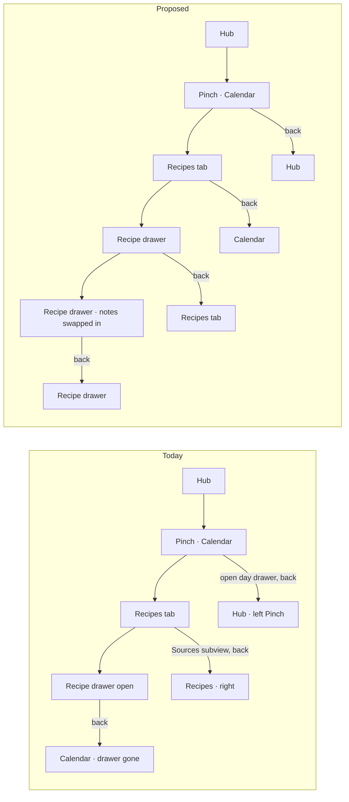
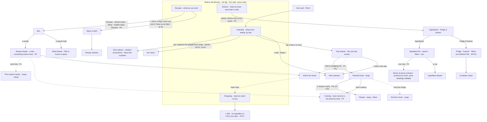

# N1 — Navigation and information architecture

Audit of Pinch at the tip of the stack (`the audit build`, app at http://127.0.0.1:5240), walked on 2026-10-15 in Chromium at 390×844 first, then 1280×900, 1024×800, 768×800 and 320×700, all in America/Los_Angeles. Fixtures: **Alex** (seeded returning user), **Jamie** (empty first run), **Taylor** (scale kitchen). Read-only on all three: nothing was written.

Screenshots cited as `N1-shots/<name>.png` live in `N1-shots/`. Every tap count below was counted in the browser unless it says "from code".

This report takes the cross-cutting view. Where J1–J7 already proposed a fix for one journey, I say whether the navigation evidence agrees and fold it into one sitemap instead of repeating it.

---

## 1. Who and when

A home cook who opens Pinch in four moods, often with one hand:

- **6 pm, at the counter, phone propped up:** "what's tonight, and how do I make it?" Needs to land on today in one or two taps, and to get back to the same place after peeking at a recipe or a timer.
- **Sunday, on the sofa, planning:** hops between Calendar, Recipes and Shopping a dozen times in ten minutes. Needs each tab to be where they left it, and the next step on a recipe (plan it, list it) without finding the recipe again.
- **In the shop, bad signal:** one tap to the list, ticks, nothing else.
- **At the fridge, a Tuesday:** "what's in the freezer?" Needs to guess the right tab the first time.

On their mind the whole time: not losing their place. A phone's back gesture is the most-used control they have, and they use it without thinking.

## 2. Goals and outcomes

| # | Job story | Outcome that means success | How often | Matters | Without the app |
|---|---|---|---|---|---|
| G1 | When it's dinner time, I want to get from opening the app to tonight's recipe on screen, so I can start cooking | Tonight's meal and its steps in ≤ 3 taps, no hunting | daily | core | a bookmark, a screenshot, a cookbook on the counter |
| G2 | When I want to check something (the freezer, my ideas, a price, a store), I want to guess the right tab first time, so I don't tour the app | First guess right; the tab's header confirms it | weekly | core | a fridge door, a notes app |
| G3 | When I peeked at something, I want back (gesture, button, Escape) to undo exactly one step, so I never lose my place | One back = one layer closed; never a different tab, never out of the app by surprise | every session | core | — |
| G4 | When I hop between tabs while planning, I want each tab as I left it, so I don't redo my search, pill or week | Pill, search, period and scroll survive a tab switch | weekly (in bursts) | supporting | paper list beside the laptop |
| G5 | When I'm looking at a recipe or a meal, I want its next steps (plan, list, cook, leftovers) from right there and to come back to it after each, so I don't re-find it | Each action returns to the record when it doesn't end the journey | several times a week | core | — |
| G6 | When I want calories (or to hide them), I want to switch it where I'm looking, so I don't learn where settings hide | One place, on the screen I'm on | once or twice | supporting | — |
| G7 | When I plan at a laptop, I want the width to show more, so planning is faster than on the phone | The wide layout shows more per glance, nothing stretched | weekly | supporting | — |
| G8 | When I open Pinch the first time, I want the four tabs to tell me what the app is for, so I know where to start | Each tab's name, icon and header say what's in it | once | core | — |

## 3. Current journeys, as walked

### 3.1 The shell: tabs, headers, home

**Tabs** (`components/shell/PinchNav.tsx`): a floating pill at the bottom of a phone (292×69 px at 390, `N1-shots/alex-p-01-calendar.png`), a floating island on the left from `lg` (`alex-w-01-calendar.png`). Order Calendar · Recipes · Kitchen · Shopping, Shopping with a count badge. The tab is in the URL (`?tab=`), the calendar view too (`?view=`); nothing else is.

**Site header:** theme switch, the dev account switcher, avatar. Home is the avatar menu's first row on a phone (`c-avatar-menu.png`, "Current location: Pinch") and a house icon from `sm`. No "Back home" inside Pinch. The site header slides away on scroll (`data-site-header="hidden"` measured after a 900 px scroll).

**Each tab's first screen at 390×844, Alex** (y in px; the nav pill's top is at 760, so 760 px is the usable height):

| Tab | Icon | Header title · subtitle | Header action | Then, in order | First content at | Controls before content |
|---|---|---|---|---|---|---|
| Calendar | `CalendarDays` | Calendar · — | ⚙ Settings, + Add | Month/Week/Day · ‹ October 2026 › · Cost tile ⚠ · Avg per meal tile ? · "13 ingredients need a price · Add prices ✕" · See the breakdown | grid at **452**; today's row at 636 | **13** |
| Recipes | `ChefHat` | Recipes / Meals / Ideas (follows the pill) · — | + New / + New idea | Recipes·Meals·Ideas · search, filter, eye · "Sources 3" chip | 304 | 8 |
| Kitchen | `ShoppingBasket` | Kitchen · "Your ingredients." | + New ingredient | search, filter, eye · Yours/All · "19 ingredients" · Prepared meals 7 • · Stores 3 · Products 5 | 332 (Taylor at 320 px: ~395 of 700, chips wrap to 2 rows, `i-320-kitchen.png`) | 9 |
| Shopping | `ListChecks` + badge | Shopping list · "4 to buy" | + Add | To buy · 4 / Got it · 2 · "Amounts on your list: about $3.16 ⚠" | 260 | 4 |

What I expected vs found: I expected four tabs whose names say what's behind them. Three do. **Kitchen** says "Your ingredients." and shows a shopping-basket icon, but holds the fridge and freezer, stores and prices too, behind chips that sit in the filter zone under "Yours · All" and look like filters (`alex-p-02-kitchen.png`). The basket is also the icon of every "Shopping list" action in the drawers (`RecipeDrawer.tsx:174`, `MealDrawer.tsx:83`, `PlannedMealView.tsx:212`, `AddToShoppingRow.tsx:13`), so the icon that means "send to the list" sits on the tab that isn't the list.

### 3.2 G1 — Tonight's dinner, from opening the app (Alex, Thu Oct 15, dinner = Adobo chicken + Cilantro lime rice)

| Step | Surface | Action | Taps | Volunteered on the way | Friction |
|---|---|---|---|---|---|
| 1 | Calendar tab, Month | find today (3rd row, emoji chips only) | 0 | Cost $5.20 ⚠, Avg $0.29 ?, price nudge, breakdown link, Shopping badge 4 | the plan starts 452 px down; at 390 a cell shows 🍳🥪🍝 emoji, not names |
| 2 | Day drawer | tap 15 | 1 | Cost tile ⚠, "10 ingredients need a price" | `b-e1-day.png` |
| 3 | Planned meal (swap in place) | "Open dinner" | 2 | Cost ⚠, nudge, 4 chips, "Mark as cooked" ×2 | the recipe names are not tappable (0 buttons named "Adobo chicken" in the sheet), so its notes, keeping-it and history are out of reach from the plan (`e-planned-meal.png`) |
| 4 | "Which one are you cooking?" (swap) | Start cooking | 3 | — | `h-cook-chooser.png` |
| 5 | Cooking subview | Adobo chicken | **4** | latest note block | `h-cooking.png` |
| 6 | back | leave cooking (no timers) | — | — | lands on the **Calendar with the drawer closed** |
| 7 | the rice | day → Open dinner → Start cooking → rice | **+4** | — | the second dish of the same dinner costs the full path again |

**Week view** (`e-week.png`) shows names, but starts on Sunday: on a Thursday, today is below the fold. **Day view** (`e-day.png`) repeats the day drawer.

### 3.3 G2 — "Where would I look?" (first guess vs truth)

| Thing | First guess a person makes | Where it is | Taps (from Calendar) | Guess right? |
|---|---|---|---|---|
| What's in the freezer | Kitchen | Kitchen → **Prepared meals** chip (third row, under the ingredient search) → Freezer pill | 3 | tab yes, then the header says "Your ingredients." and the word "freezer" appears nowhere on Kitchen's first screen (`alex-p-02-kitchen.png`) |
| Turn on calories | the eye on the list I'm looking at | Calendar header's ⚙ (the only gear in the app), then each list's eye again | **10** from Kitchen: eye → read "Turn them on from the Calendar's gear" → close → Calendar → ⚙ → Calories → Done → Kitchen → eye → Show calories and macros → Done | no |
| Who credits the nutrition data | — | Calendar ⚙ → About | 2 | the credits are about Kitchen's data and live on the Calendar |
| What I pay at Costco | Kitchen → Stores | Stores rows open the store's name/logo form; prices are in **Products** (grouped by the same stores) | 2–3 | half: two lists of one data set |
| My recipe ideas | Recipes | Recipes → Ideas pill | 2 | yes |
| Where a recipe came from | the recipe | Recipes → Sources chip → a list whose rows only rename (`d-p-sources.png`); finding by source is in the filter panel | 2 | the chip leads to management, not finding (agrees with J2-H6) |
| Tonight's recipe notes | tonight's plan | not reachable from the plan; Recipes → recipe → scroll ~3 screens (J2-H5: drawer 1,951 px) | 2 + scroll, and the plan context is gone | no |
| This week's cost | Calendar | Calendar → Week (tile) | 1 | yes |

### 3.4 G3 — Back, Escape and the close button, per surface (all tested at 390×844, Alex)

| Surface (examples) | Container | Back gesture / browser back | Escape | Evidence |
|---|---|---|---|---|
| Switching tabs | URL `?tab=` | each switch **pushes** a history entry (history.length 3→4→5→6 for C→R→K→S); back walks the tabs; **4 backs** to leave Pinch after visiting all four | — | s1 log |
| Calendar Month/Week/Day | URL `?view=` | replaced, not pushed | — | `CalendarScreen.tsx:158` |
| **Drawer or sheet over a tab**: recipe drawer, day drawer (+ planned meal swap), ingredient drawer, shopping row sheet, View options, Settings, recipe start drawer | `DetailSheet` / `FormSheet` (no history entry) | **does not close the drawer.** It switches to the previously visited tab, unmounting the drawer, or **leaves Pinch** when Pinch was just entered. 7 of 7 surfaces tested | closes it | recipe drawer → Calendar (`b-a3-recipe-drawer.png` → `b-a4-after-back.png`); day drawer on Calendar → **Kitchen** tab; fresh entry → day drawer → back → **the hub** (`c-fresh-back.png`) |
| Recipe start drawer (phone "New") | `DetailSheet` above the tabs | the tab changes behind it and **"New recipe" stays open over Kitchen** | closes it | s9 log |
| Subview: Sources, Stores, Products, Prepared meals, recipe form, plan, meal, cooking | `Subview` with its own entry | closes the subview, back to the tab | closes | `b-c1-sources.png` → Recipes |
| Sheet over a subview (container sheet over Prepared meals) | `FormSheet` | closes only the sheet; a second back closes the subview | closes the sheet | D2→D3→D4 in s2 log |
| Swap-in-place step inside a sheet over a subview (container → "Change eat-by date") | in-sheet view with "‹ Back" | closes the **whole sheet**, skipping the "‹ Back" step | — | `f-container-inner.png` |
| Swap-in-place inside a drawer over a tab (day → planned meal → "Which one?") | in-drawer view | leaves the tab (row above) | closes the whole drawer | — |

So the back gesture is reliable inside subviews and unreliable everywhere else, and "everywhere else" is where most of the app lives: the recipe drawer and the day drawer (which holds the planned meal) are its busiest surfaces.

### 3.5 G4 — Hopping between tabs

| Check | Result | Evidence |
|---|---|---|
| Recipes pill after Recipes → Calendar → Recipes | **forgotten** (Ideas → back on Recipes) | s3 log (agrees with J2-H9/P12) |
| Calendar period after Week, next week → Kitchen → Calendar | view kept (URL), **period forgotten** (Oct 18–24 → Oct 11–17) | s3 log |
| Scroll after Kitchen scrolled 4,000 px → Recipes | **Recipes opens 4,000 px down**, mid-list, no header, no search (Taylor) | `f-recipes-after-switch.png` |
| Scroll after the same → Calendar | Calendar opens scrolled past its header (366 px) | `f-calendar-after-switch.png` |
| Re-tapping the active tab while scrolled 6,000 px (Taylor's Kitchen is 20,217 px tall) | nothing happens (no scroll to top, no reset) | s6 log, `f-kitchen-deep.png` |
| Reload inside a subview (Stores) | back on the tab; subviews, pills and drawers aren't in the URL | s3 log |

Window scroll is shared by all four tabs because they render in one page (`Pinch.tsx:132-143` swaps the tab body; nothing resets `scrollY`). With Alex's short lists it hides; at Taylor's scale a tab switch lands the person in the middle of a list they didn't scroll.

### 3.6 G5 — The next step from a drawer

Exits from the **recipe drawer** (`RecipesScreen.tsx:574-619`): Start cooking, Shopping list, Put some away, History, Add prices, stock lines, Add a note / Edit, Modify, Add to calendar. **9 exits, 0 return to the drawer.** Each closes the drawer first (never overlay on overlay, which is right) and, when the person is done, they're on the Recipes list.

| Task | Path today | Taps |
|---|---|---|
| See this recipe's boxes, then carry on with the recipe | stock line → Prepared meals (scoped) → back → **Recipes list** (`d-p-after-scoped-back.png`) → re-open the recipe | 3, plus a re-find |
| Add a recipe's ingredients to the list, then plan it | open → Shopping list → Add → (drawer gone) → re-open → Add to calendar → day → Add | 7+, plus a re-find (a search at Taylor's 120 recipes) |
| Cook the rice after the adobo (3.2) | +4 | 4 |

### 3.7 Deep links and "View"

- In the URL: `?tab=` and `?view=` only. Unknown values fall back to Calendar.
- One toast takes you somewhere: "Added N to your shopping list · **View**" (`AddToShoppingSheet.tsx:167`), which pushes `?tab=shopping` unless a subview is open (`Pinch.tsx:57-64`). Right.
- No View on: "Added X to <day>" after planning from Recipes (the person stays on Recipes and never sees the plan), "Added X to your recipes" after saving from the Calendar's empty state. Agrees with J3-P12 and J1-P6.
- No reminders or pushes in Pinch, so no notification deep links today. If J6-P8 (an opt-in eat-by nudge) is adopted, it needs an addressable container (today a container can't be linked).

### 3.8 First run (Jamie)

Calendar: two zero tiles, "Want calories or protein here?", a box with "Plan your first meal" (same as + Add) and "Add a recipe" (`jamie-p-01-calendar.png`). Recipes: header, **Recipes · Meals · Ideas** pills, one line (`jamie-p-02-recipes.png`). Kitchen: search and one line, no chips (owner change #1 working, `jamie-p-02-kitchen.png`). Shopping: one line. On day one the four tabs read Calendar / Recipes / Kitchen ("Your ingredients.") / Shopping list; the fridge and freezer, stores and products can't be found from Kitchen until one exists, and are met where the journey needs them (Put some away, Add a product). That "when" is right.

### 3.9 Scale (Taylor)

Calendar: 3 tiles, 2 macro tiles, nudge, breakdown, then a grid of 🍳🍳 +10 in every cell (`taylor-p-01-calendar.png`). Kitchen at 320: chips wrap to a second row; the first ingredient starts at ~395 px of 700. The scroll carry-over (3.5) only shows here.

### 3.10 Wide (1280, 1024, 768)

- 1280: the rail is a 96 px island centred on the left; content is `max-w-4xl`. Calendar uses the width well (titled pills, `alex-w-01-calendar.png`). Recipes and Kitchen run in two columns; a recipe opens as a centred modal that hides the list (`d-w-recipe-drawer.png`). Prepared meals, Stores, Products and Sources are single 672 px columns (`d-w-prepared.png`) while the tabs beside them are two columns.
- 1024: the rail's right edge (16 + 96 = 112 px) touches the content's left edge (112 px): **0 px gutter** (`g-kitchen-1024.png`).
- 768: the bottom pill, content full width. Fine.

### 3.11 An error state: offline

Offline (`context.setOffline(true)`), tabs still switch (from cache) and the Prepared meals subview opens. Its **Finished** view says "Nothing is finished yet. What you eat, throw out or clear out is kept here." (`j-offline-finished.png`) while Alex has three finished containers online (`j-online-finished.png`). The read falls back to an empty cache and the view can't tell "none" from "not loaded" (`ContainersSubview.tsx:442-448`).

---

## 4. Flow diagrams

### 4.1 Current sitemap (phone)

Solid edges: the feature's home. Dashed edges: in-context shortcuts. ⟲ marks a drawer or sheet whose back gesture leaves the tab instead of closing.

```mermaid
flowchart TD
    HUB["Hub card · Pinch"] --> CAL
    subgraph NAV["Bottom pill (phone) · rail (lg)"]
        CAL["Calendar"]
        REC["Recipes"]
        KIT["Kitchen · 'Your ingredients.'"]
        SHOP["Shopping list · badge"]
    end
    CAL -->|gear| SET["Settings ⟲ · nutrition switches, About"]
    CAL -->|Month · Week · Day| CV["three views; Day repeats the day drawer"]
    CAL -->|tap a day| DD["Day drawer ⟲"]
    DD -->|Open dinner| PM["Planned meal · swap"]
    PM -->|Start cooking| WH["Which one? · swap"] --> COOK["Cooking subview"]
    PM -.->|Eat from fridge| EAT["Eat from stock · swap"]
    PM -.->|Shopping list chip| ASS["Add-to-list sheet ⟲"]
    DD -.->|Add to shopping list| ASS
    DD -->|+ Add to this day| PLAN["Plan subview"]
    CAL -->|+ Add · Week + · empty state| PLAN
    PM -->|Modify| PLAN
    CAL -.->|nudge| FILL["Fill-in sheet ⟲"]
    DD -.->|nudge| FILL
    PM -.->|nudge| FILL
    REC -->|pills| RV["Recipes · Meals · Ideas"]
    REC -->|Sources chip| SRC["Sources subview · rows only rename"]
    REC -->|+ New| START["Ways to start ⟲"] --> RFORM["Recipe subview"]
    RV -->|a recipe| RD["Recipe drawer ⟲ · 9 exits, 0 returns"]
    RD -.->|Start cooking| COOK
    RD -.->|Shopping list| ASS
    RD -.->|Put some away| CF["Container form ⟲"]
    RD -.->|History| HIST["Cooking history ⟲"]
    RD -.->|stock line| PREP
    RD -.->|Add to calendar| PLAN
    RD -->|Modify| RFORM
    RD -.->|nudge| FILL
    RV -->|a saved meal| MD["Meal drawer ⟲"]
    MD -.-> ASS
    MD -.-> CF
    MD -.-> PREP
    MD -.-> PLAN
    RV -->|an idea| IDD["Idea drawer ⟲"] -.->|Turn it into a recipe| START
    RV -->|+ New idea| IADD["New idea sheet ⟲ · a second picker"]
    KIT -->|chip| PREP["Prepared meals subview · Fridge · Freezer · Finished"]
    KIT -->|chip| STO["Stores subview · rows edit name/logo"]
    KIT -->|chip| PRO["Products subview · grouped by store"]
    KIT -->|a row| ING["Ingredient drawer ⟲"] --> PF["Product sheet"]
    PREP --> CS["Container sheet"]
    COOK -.->|Finish| PUT["Put away, in the panel"]
    SHOP --> SADD["+ Add sheet ⟲"]
    ASS -.->|toast View| SHOP
```

### 4.2 The back gesture: today and proposed

### 4.3 Proposed sitemap (phone)

Changes are named in the labels, with the proposal id.

---

## 5. Findings

### (a) Small things

| id | sev | where | evidence | goal hurt |
|---|---|---|---|---|
| N1-S1 | minor | Kitchen header, `components/kitchen/KitchenScreen.tsx:234` | subtitle "Your ingredients." on a tab that holds the fridge and freezer, stores and products (`alex-p-02-kitchen.png`). CLAUDE.md's own example subtitle is "Your ingredients, products and stores." | G2, G8 |
| N1-S2 | minor | Kitchen tab icon, `components/shell/PinchNav.tsx:24` | `ShoppingBasket` is Kitchen's tab icon **and** the icon of every "Shopping list" action (`RecipeDrawer.tsx:174`, `MealDrawer.tsx:83`, `PlannedMealView.tsx:212`, `AddToShoppingRow.tsx:13`); the Shopping tab itself is `ListChecks`. The icon a person just tapped to send things to the list points at the wrong tab | G2, G8 |
| N1-S3 | polish | `RecipeDrawer.tsx:166`, `PlannedCookRow.tsx:108` | "I cooked this" and "Mark as cooked" use `ChefHat`, the Recipes tab's icon. `pinch.md` says "cooked" is ✅ | G8 |
| N1-S4 | polish | Recipes header, `RecipesScreen.tsx:460` | the title follows the pill ("Meals", "Ideas") while the tab stays "Recipes"; every other tab keeps its title whatever its switch shows (Calendar's Month/Week/Day, Kitchen's Yours/All, Shopping's To buy/Got it). On the Recipes pill, "Recipes" appears three times at once (tab, header, pill) | G2 |
| N1-S5 | polish | Shopping header, `ShoppingScreen.tsx:425-426` | tab "Shopping", header "Shopping list"; the count "4" shows three times on one screen (badge, "4 to buy", "To buy · 4"; `alex-p-02-shopping.png`). Agrees with J4-P15 on the badge | G8 |
| N1-S6 | polish | header actions across tabs and subviews | "Add" (Calendar, Shopping, Prepared meals, Stores), "New" (Recipes, Meals), "New idea", "New ingredient", "New product" (Products), "New source" (Sources). The last two repeat the section's own noun (CLAUDE.md: "a section already titled Stays has 'Add', not 'Add stay'") | G8 |
| N1-S7 | minor | `PinchNav.tsx:46` | re-tapping the active tab does nothing; at 6,000 px down Taylor's 20,217 px Kitchen the only way up is scrolling (`f-kitchen-deep.png`) | G4 |
| N1-S8 | polish | container sheet's inner views (`ContainerSheet.tsx`, `BackLink`) | the back gesture from "Change eat-by date" closes the whole sheet instead of stepping back to it (`f-container-inner.png`) | G3 |
| N1-S9 | minor | `Pinch.tsx:147-161` (start drawer lives above the tabs) | back with the phone's "New recipe" drawer open switches the tab behind it and leaves the drawer open over Kitchen | G3 |
| N1-S10 | minor | leaving cooking mode (`CookingSubview`) | started from a planned meal, leaving lands on the Calendar with the drawer closed; the second dish of the same dinner is 4 more taps (§3.2). Agrees with J5-P13 | G1, G5 |
| N1-S11 | polish | scoped Prepared meals from a drawer | back returns to the Recipes list, not the drawer (`d-p-after-scoped-back.png`). Agrees with J6-S12 | G5 |
| N1-S12 | polish | 1024 px, `Pinch.tsx:210` (`lg:pl-28` vs the rail at `left-4`, 96 px wide) | 0 px between the rail and the content's left edge (`g-kitchen-1024.png`) | G7 |
| N1-S13 | minor | Prepared meals → Finished offline, `ContainersSubview.tsx:442-448` | says "Nothing is finished yet" while 3 exist (`j-offline-finished.png` vs `j-online-finished.png`) | G2 |
| N1-S14 | polish | `ListViewControls.tsx:53` | "Turn them on from the Calendar's gear" sends the person to another tab to do what the sheet they're in could do. Agrees with J1-S17 | G6 |
| N1-S15 | polish | `UX.md` Sitemap ("Prepared meals row · a prompt while empty") and the Prepared meals screen ("Kitchen's third entry, under Stores and Products and across the whole row") | both describe the layout before owner change #1 (now a chip that appears with the first container) | docs |
| N1-S16 | polish | Prepared meals → Finished header | "+ Add" stays in the header while the view lists finished containers | G2 |

### (b) High-arching things

**N1-H1 · major · The back gesture doesn't close drawers; it changes tab or leaves Pinch.** Every `DetailSheet` and `FormSheet` over a tab ignores the back gesture, because only `Subview` registers a history entry (`src/hooks/useSubviewHistory.ts`; `src/components/DetailSheet.tsx` has none). Back unmounts the tab and the drawer with it: a recipe drawer on Recipes → **Calendar**; a day drawer on Calendar → **Kitchen** (the tab visited before); a day drawer right after opening Pinch → **the hub**. 7 of 7 surfaces tested over a tab behave this way (§3.4), and they include the two busiest: the recipe drawer and the day drawer (with the planned meal inside it). Escape works, so a desktop tester never sees it. On a phone the back gesture is the reflex, so the person loses the record they were reading and lands somewhere they didn't choose. Hurts G3 for every journey.

**N1-H2 · major · Tabs share one scroll and keep no state, and back walks the tabs.** (1) Window scroll carries across tabs: at Taylor's scale Recipes opens 4,000 px down with no header or search in sight (`f-recipes-after-switch.png`). (2) The Recipes pill and the Calendar's period reset on every switch, while the Calendar's view is kept (it's in the URL), so the app remembers some things and not others with no visible rule. (3) Each tab switch pushes a history entry, so after a planning session back steps through tabs (4 backs to leave after one round). Combined with H1, the back gesture's result depends on the order the tabs were visited. Hurts G3, G4.

**N1-H3 · major · Kitchen is two things under a name and icon that describe neither.** The tab holds a reference catalog (ingredients, products, stores, used rarely, mostly from inside other flows: the recipe form's search, the fill-in sheet) and a live list (the fridge and freezer, J6's weekly upkeep). The first screen gives the rare thing the whole tab and the frequent thing a chip in the third row; the header says "Your ingredients."; the icon is the shopping basket (N1-S2); and the chips sit under "Yours · All · 19 ingredients", in the filter zone, where "Prepared meals 7" reads as a filter of the ingredient list (`alex-p-02-kitchen.png`). A person asking "what's in the freezer?" picks Kitchen and then sees nothing that says freezer. Hurts G2, G8.

**N1-H4 · major · The same kind of content uses three different containers.** A tab's secondary list is a **thin switch inside the tab** on Recipes (Meals, Ideas), a **subview behind a chip** on Kitchen (Prepared meals), and a **subview whose rows only rename** for Sources and Stores. Prepared meals is a list to browse, like Ideas, yet it takes over the screen, hides the tab bar and gets a history entry. Sources and Stores are destinations that do one management job (rename, logo) for data the person finds elsewhere (the Source filter; Products already grouped by store). Stores and Products are two lists of one data set. The person learns three navigation patterns for one idea ("another list in this tab"). Hurts G2, G4.

**N1-H5 · major · Drawers are dead ends, and the record a drawer names can't be opened from it.** 9 exits from the recipe drawer, none returns (§3.6); the planned meal names its recipes but they aren't tappable; a saved meal's plate and a container sheet name recipes too. So the Calendar and the Recipes tab don't connect: to read tonight's note or "Keeping it", the person leaves the plan for another tab and re-finds the recipe. Each journey audit found one instance (J2-H10, J4-P14, J5-P13, J6-S12); together they are one structural gap. Hurts G1, G5.

**N1-H6 · major · Entry points grew per feature, not per moment.** Counted from code and the walk:

| Feature | Entry points today | Where | Serve distinct moments? |
|---|---|---|---|
| Add to shopping list | **5** | recipe drawer, saved meal drawer, planned meal, day drawer, Shopping "+ Add" | planned meal and day drawer are one "‹ Back" apart, the same moment; the saved meal one serves buying for an unplanned meal (rare). J4-P11 |
| Plan a meal | **7** | Calendar "+ Add", empty-state "Plan your first meal", Week "+", Day view, day drawer "+ Add to this day", recipe drawer "Add to calendar", meal drawer "Plan it" | 5 serve distinct moments (any day, this day ×2, this recipe, this meal); the empty-state button and Day view repeat others (J1-P1, J3-P9). 4 different labels (J3-P13) |
| Start a new recipe | 3 + a parallel picker | Recipes "+ New", Calendar empty "Add a recipe", idea "Turn it into a recipe"; "+ New idea" is a second way-picker with overlapping ways | the fork asks "recipe or idea?" before the person knows (J2-H1, J2-P1) |
| Mark cooked | 3, writing 2 kinds of record | recipe drawer, planned meal item, cooking Finish | one moment (J5-H3, J5-P5) |
| Prepared meals list | 3 | Kitchen chip, recipe drawer stock line, meal drawer stock line | the drawer lines serve "this recipe's boxes"; opening a full-screen subview for it costs the drawer (N1-H5) |
| Put away | 4 | recipe drawer, meal drawer, cooking Finish, Prepared "+ Add" | born at the cook moment (J6-P9) |
| Stock shown | 7 surfaces | recipe rows, meal rows, plan search results, shopping sheet, recipe drawer, meal drawer, Kitchen chip dot | J6-H4 |
| Enter a price | 7 | 5 nudges (stats row, day, planned meal, recipe, meal), ingredient drawer "Add a product", Products "+ New product" | J7-H2, J7-P3 |
| Nutrition display | 2 places, 4 controls | Calendar ⚙, eye on Recipes, Meals and Kitchen, plus the stats link | one choice (J1-F6, J7-H7) |
| Sources | 3 | Sources chip → subview, filter, recipe form | the chip duplicates the filter (J2-P8) |
| Stores / products | 2 chips → 2 subviews, plus the store picker and the ingredient drawer | — | one data set |
| Cooking mode | 2 | recipe drawer, planned meal | yes: KEEP |

The owner's "too many entry points" is accurate and measurable: about 50 doors for 12 features. Roughly a third serve a second moment; the rest repeat a door one level away. Hurts G2 and calm.

**N1-H7 · minor · Settings lives on the Calendar but governs Recipes and Kitchen.** The only ⚙ in the app is on the Calendar header (`CalendarScreen.tsx:168-177`). It holds four nutrition switches, which change Recipes, Meals, Kitchen and the drawers, and an About that credits Kitchen's data (USDA nutrition, Logo.dev logos). The eye on each list then needs a second switch. 10 taps across 2 tabs from Kitchen (§3.3). The person never learns "settings are on the Calendar" from anything they do. Hurts G6.

**N1-H8 · major (J3's, confirmed from the navigation side) · The Calendar's first screen leads with the period's cost, not the day the person is in.** 13 controls before the grid, the grid at 452 px, today on the third row as emoji, Week starting Sunday with today below the fold, and Day view duplicating the drawer. The tab's job is "what are we eating", and "tonight" is never the first thing. Agrees with J3-F1, J3-P1, J3-P2, J3-P9. Hurts G1.

**N1-H9 · minor · The wide layout widens lists but never shows two things at once.** At 1280 a recipe opens as a centred modal over a two-column list, Prepared meals and the management subviews drop to one 672 px column, and cooking is a stretched phone (J5-H8). The rail is right (KEEP); only the content layouts don't use the width. Hurts G7.

---

## 6. Proposals

### Decision: four tabs is right

| Tab | One-line job | Verdict |
|---|---|---|
| **Calendar** | What we're eating, by day: plan ahead, see tonight, look back | KEEP as the first tab; its first screen should lead with today (J3-P1/P2) |
| **Recipes** | What we can cook: recipes, saved meals and ideas to try | KEEP; fewer doors inside it (P8, J2-P1, J2-P8) |
| **Kitchen** | What we have and what it costs: the fridge and freezer, ingredients, stores and prices | KEEP, re-framed (P3, P4); it is also where ingredient stock lands later (README Next Steps) |
| **Shopping** | What we need to buy | KEEP: the in-shop moment needs a one-tap target with a badge |

Considered and rejected:
- **A "Tonight" or "Today" tab.** It would duplicate Calendar's today. The fix is Calendar's first screen leading with today (J3-P2), which serves G1 without a fifth door.
- **A fifth "Fridge" tab.** Upkeep is weekly and J6 found its value is in context (the cook moment, the plan builder); `pinch.md` forbids it; J6-K5 agrees. It becomes a view of Kitchen instead (P3).
- **Shopping inside Kitchen.** The shop is the one-handed, bad-signal moment; burying the list one level down costs a tap every time.
- **Recipes inside Calendar.** Browsing the library is its own moment (the sofa, a new idea), and Calendar is already the busiest tab.
- **Reordering.** The order follows the loop (plan, choose, have, buy) and every tab sits within a thumb's reach on a 292 px pill. Moving tabs would cost the habit of existing users for no measured gain.

### What gets removed from where

| From | What goes | Replaced by | Proposal |
|---|---|---|---|
| Calendar header | ⚙ Settings | the eye (View options), the same control as on the lists | P6 |
| Calendar | Day pill and view | the day drawer | J3-P9 |
| Calendar empty state | "Plan your first meal" (same as + Add) | — | J1-P1 |
| Recipes header | title switching to Meals / Ideas | fixed "Recipes"; the pill says which list | P8 |
| Recipes | Sources chip and subview as a destination | rename/delete inside the Source filter; "From X" opens the filtered list | J2-P8 |
| Recipes | "+ New idea" as a second picker | "Save as an idea" as an ending of New's ways | J2-P1 |
| Saved meal drawer, planned meal | Shopping list chip | the recipe drawer's and the day drawer's | J4-P11 |
| Recipe and meal drawers | stock line that opens a full-screen subview | the recipe's or meal's boxes swapped in place | P3 |
| Kitchen | Prepared meals chip and subview | a "Fridge & freezer" view of Kitchen | P3 |
| Kitchen | Stores chip and subview, Products chip and subview | one "Stores & prices" chip and subview | P4 |
| Kitchen header | "Your ingredients." | "Your fridge and freezer, ingredients and prices." | P3 |
| Each list's View options | "Show calories and macros" disabled with "Turn them on from the Calendar's gear" | the nutrition switches themselves, in the same sheet | P6 |
| Shopping | badge on the active tab; "4 to buy" while the switch says "To buy · 4" | the switch's count | J4-P15, N1-S5 |

### Proposals

| id | type | goal | what changes | justification | cost / risk | size |
|---|---|---|---|---|---|---|
| **N1-P1** | FILL | G3 | **Back closes the top layer, everywhere.** On phones and touch screens a `DetailSheet` or `FormSheet` opened over a tab takes a history entry while open (the `useSubviewHistory` mechanism, already proven for subviews), so the back gesture closes it, and a swap-in-place step inside a drawer or sheet ("‹ Back" views: planned meal, "Which one?", Eat from stock, container views, New idea's ways) steps back one level first. Closing by ✕, swipe or Escape pops the entry so history stays clean | Fixes the most frequent navigation failure in the app (7 of 7 surfaces). The person's reflex starts working in the three busiest surfaces | Central components (`src/components/DetailSheet.tsx`, `FormSheet.tsx`) reach every mini-app: needs the regression table across apps; must not double-pop when a drawer closes itself and opens a subview (the drawer's entry is replaced, not popped then pushed); Strict Mode remount (the hook already handles it) | M |
| **N1-P2** | REARRANGE | G3 | **Calendar-first back.** A tab switch from Calendar pushes; a switch between the other tabs replaces. So back from any tab returns to Calendar, and back from Calendar leaves Pinch. A toast's "View" still pushes (it's a jump the person didn't choose from the bar) | Leaving takes 2 backs at most, whatever the visiting order (today 4 after one round). The result of back no longer depends on history the person can't see | Changes `setActiveTab` in `Pinch.tsx:94-102` only. People who use browser back to revisit the previous tab on desktop lose that (rare; the rail is one click) | S |
| **N1-P3** | REARRANGE + MERGE | G2, G8, G5 | **Kitchen = what we have and what it costs.** A thin switch under the header, **Ingredients · Fridge & freezer**, appears with the first container (Jamie's Kitchen is unchanged). Ingredients stays the shown view until the person picks, and the last pick is remembered on the device. The Fridge & freezer view is today's Prepared meals list inside the tab (Fridge · Freezer switch, search, "Put away" in the header, "What you finished" as a link per J6-P11). Header subtitle: "Your fridge and freezer, ingredients and prices." Tab icon: `Refrigerator`. A recipe's or saved meal's stock line opens **its boxes in place in the drawer** ("‹ Back"), reusing the planned meal's Eat-from-stock view, instead of opening a full-screen subview. Name it "Fridge & freezer" everywhere (J6-P10) | The tab says what it holds; "freezer" is on Kitchen's first screen; the same kind of content (a secondary list) uses the same container as Recipes' Meals and Ideas; the tab bar stays visible over the fridge list (one tap to Shopping when something has run out); the drawer keeps its place (N1-H5). Taps to "what's in the freezer": 3 → 2–3 (2 once remembered) | ContainersSubview becomes a tab body; the scoped "Only Adobo chicken ×" chip is replaced by the in-drawer list; the subview's own history entry goes. README, UX.md, `pinch.md` ("Prepared meals live under Kitchen") change. A cheaper first step if the owner prefers: rename the chip "Fridge & freezer", fix the subtitle and icon (S), and keep the subview | M–L |
| **N1-P4** | MERGE | G2 | **"Stores & prices" replaces Stores and Products.** One chip, one subview: today's Products list (already grouped by store, with its Store filter), where each store heading opens the store's name and logo, a store with no products shows as a heading with "No prices yet", and "+ Add" offers "A price" or "A store". The ingredient drawer's "Add a product" and the fill-in sheet stay as the in-context doors | One data set, one list; the chip uses the person's word ("prices", which every nudge already says) instead of the app's ("products", J7-H8). Kitchen's chip row fits one line at 320 | StoresSubview's 135 lines fold into ProductsSubview; empty stores need a group; copy in README/UX.md | M |
| **N1-P5** | FILL | G5, G1 | **A drawer is a hub: what it opens comes back to it.** When a sheet or subview opened from a drawer closes without finishing the journey (Cancel, back, Done on a reference view such as History, "Leave" from cooking, a stock list), the drawer reopens on the same record and view. Modify's save returns to the drawer showing the saved record. An action that ends somewhere else (toast View, a delete) doesn't. Implement once, as an "opener" remembered in the overlay context | Folds J4-P14, J5-P13 and J6-S12 into one rule. Cooking the rice after the adobo: 4 → 2 taps; "list it, then plan it": no re-find (at Taylor's scale, a search) | "Never overlay on overlay" still holds (close, then reopen). Each opener must check the record still exists (deleted elsewhere → stay on the list) | M |
| **N1-P6** | MERGE | G6 | **One "what you see" control on every tab.** The eye on Recipes, Meals and Kitchen, and an eye on the Calendar header in place of the ⚙, open one View options sheet: a top section "Nutrition, everywhere" with the four metric switches (global, as Settings is today), then the list's own row switches (prices, calories and macros on rows, stock, the basis). The stats row's "Want calories or protein here?" opens the same sheet. "About the numbers" (USDA, Logo.dev) becomes the sheet's last line. The word "Settings" leaves Pinch | 10 taps across 2 tabs → 3 on the same tab. The control is where its effect is seen. Keeps the repo rule that rows start with macros off (the row switch stays), while removing the second place to look (J1-P8, J7-H7 agree on the problem; this keeps the row default the rule wants) | `SettingsSheet` folds into `ListViewControls`/`ViewOptions` (a Pinch section above the shared rows); attribution must stay reachable (it is, from every tab); docs | S–M |
| **N1-P7** | FILL | G4 | **Each tab owns its scroll and its state.** A tab opens at its own last scroll position (top on first visit), never the previous tab's; re-tapping the active tab scrolls to the top (and, a second time, resets its switch and search). The Recipes pill, search and filters, Kitchen's switch and filters, and the Calendar's period live above the tab switch for the session, like `CookingSession` (J2-P12 for Recipes) | Removes the Taylor-scale disorientation (Recipes at 4,000 px) and the "it forgot my week" moments; matches the app's own rule "State the person expects back after switching views lives in the session" (`pinch.md`) | Small state lift in `Pinch.tsx`; a per-tab scroll map; the memoised tabs stay as they are | S |
| **N1-P8** | REARRANGE | G2, G8 | **Every tab's header is the tab's name.** Recipes keeps "Recipes" whatever the pill (the button follows the pill: New / New meal / New idea until J2-P1 makes it one New); Shopping's header reads "Shopping" (or the tab reads "List"; pick one word for both); subviews' header actions say only the verb ("New", not "New product" or "New source"). Tab icons: Kitchen `Refrigerator`, Shopping `ShoppingBasket` (the icon its drawer actions already use), cooked actions `CircleCheck` (✅) | "Where am I?" is answered by the same word in the bar and the header; an icon means one destination | Copy and three icons; UX.md shell diagram | S |
| **N1-P9** | FILL | G1, G5 | **A record named in a drawer opens in place.** A recipe's name in a planned meal, on a saved meal's plate and in a container sheet swaps the drawer to the recipe (notes, Keeping it, steps) with "‹ Back". Agrees with J2-P10 | Tonight's notes from the plan: impossible → 3 taps, without leaving the Calendar | The recipe view must render inside the day drawer (it already renders in a `DetailSheet`); its own exits follow P5 | M |
| **N1-P10** | TRIM | calm, G2 | **An entry-point budget, applied now.** Adopt the removals in the table above that other audits proposed (J1-P1, J2-P1, J2-P8, J3-P9, J4-P11, J5-P5, J6-P9, J7-P3) as one coherent pass, because each is small but together they take the doors from ~50 to ~30 and make the remaining ones serve distinct moments | The owner's "too many entry points", measured and cut | Each proposal's own cost; doing them together avoids three rounds of doc churn | L (as a set) |
| **N1-P11** | FILL | G1 | **Toasts that confirm something added out of sight offer View.** "Added Taco night to Thu, Oct 15 · View" opens the Calendar on that day; "Added Cucumber salad to your recipes · Plan it" (J1-P6, J3-P12) | The person sees the result of the action without navigating | Same guard as `showShoppingTab` (no jump while a subview is open) | S |
| **N1-P12** | FILL | G7 | **Small wide-screen fixes:** a gutter between the rail and the content from `lg` to ~1150 px (N1-S12); the Fridge & freezer list (P3) and Stores & prices (P4) use two columns from `lg` like the tabs beside them; cooking's two columns per J5-P14 | The rail stays; content stops being a stretched phone in the places it still is | Layout only | S |
| **N1-P13** | FILL | G2 | **A read that can't reach the server says so.** Finished (and any on-demand read) shows "Couldn't load what you finished · you're offline" when the read came only from an empty cache, instead of "Nothing is finished yet" (N1-S13) | An empty state is never false | Check `metadata.fromCache` on the query result | S |
| **N1-K1** | KEEP | G8 | **Four tabs in this order, a floating pill on phones and a rail from `lg`**, the Shopping badge on the other tabs | Measured: 292 px pill fits 320; the loop order reads naturally; the badge is acted on (J4-K6) | — | — |
| **N1-K2** | KEEP | G3 | **Subviews with their own history entry, and a sheet over a subview taking back and Escape first** (D2→D3→D4 in §3.4) | The model P1 extends to drawers over tabs | — | — |
| **N1-K3** | KEEP | G3 | **Never overlay on overlay; "‹ Back" swaps inside a drawer** (planned meal, "Which one?", Eat from stock) | Calm, one layer at a time; P1 only teaches back to step through them | — | — |
| **N1-K4** | KEEP | G2, G8 | **Doors that appear with their data**: Kitchen's chips only once something is behind them; Sources only once a source exists; Jamie's Kitchen is the search and one line | The "when" is right; P3 and P4 change "what" and "where", not "when" | — | — |
| **N1-K5** | KEEP | G1 | **The shopping toast's View, guarded against replacing an open subview** (`Pinch.tsx:57-64`) | The model for P11 | — | — |
| **N1-K6** | KEEP | G8 | **Home in the site header (icon from `sm`, avatar menu on phones), no "Back home" in Pinch** | Consistent with every other mini-app | — | — |
| **N1-K7** | KEEP | G1 | **The day drawer as the day's home**, with the planned meal swapping in place | J3-K6 agrees; P9 makes it reach the recipe | — | — |
| **N1-K8** | KEEP | G4 | **The tab and the calendar view in the URL** (`?tab=`, `?view=`) | A reload or a shared link keeps the place; P7 adds the rest for the session, without putting secrets or ids in the URL | — | — |

### Tap counts, today → proposed

| Task (from Calendar unless noted) | Today (counted) | Proposed | By |
|---|---|---|---|
| Tonight's dinner (2 recipes) to cooking | 4 | 3 (Week row → Start cooking → pick); 2 with J5-P4 | J3-P2, J3-P9 |
| The second dish of the same dinner, after the first | 4 | 2 | P5 |
| What's in the freezer | 3 | 2–3 | P3 |
| Tonight's recipe notes from the plan | not possible from the plan (2 + scroll via Recipes) | 3, without leaving the Calendar | P9 |
| Turn calories on, while in Kitchen | 10, across 2 tabs | 3, on the same tab | P6 |
| Leave Pinch with back after visiting all four tabs | 4 | 2 | P2 |
| Close a recipe drawer with the back gesture | not possible (changes tab or leaves) | 1 | P1 |
| See this recipe's boxes and carry on with the recipe | 3 + a re-find | 2, in place | P3, P5 |
| Find "where I pay what at Costco" | 2–3, in one of two lists | 2, one list | P4 |

---

## 7. Rule candidates

1. **Back closes the top layer first, everywhere.** A drawer, sheet or swapped-in view over a tab takes the back gesture, one layer per press, exactly as over a subview; a back press never changes tab or leaves the app while an overlay is open. → `CLAUDE.md` Design & UX (beside "A drawer or modal over a subview takes Escape and the back gesture…").
2. **A tab owns its scroll and its state.** A tab opens where the person left it (top on first visit), never at another tab's scroll; re-tapping the active tab scrolls to the top; its switch, search and period survive a tab switch for the session. → `CLAUDE.md` Design & UX.
3. **Same kind of content, same container.** A secondary list of a tab is a thin switch inside the tab; a task or sequence is a subview; a record is a drawer. A list whose rows only rename or relabel is not a destination: manage it where the thing is used (a filter, a picker). → `CLAUDE.md` "Pick the container by the content".
4. **Navigation never looks like filtering.** A chip that opens another screen doesn't sit among a list's filters and scope pills; filters narrow the list under them, doors go elsewhere and look it. → `CLAUDE.md` Design & UX.
5. **A tab's header names everything the tab holds, in the tab's own word, and a tab's icon is never reused for an action that goes somewhere else.** → `CLAUDE.md` Design & UX (and the icon map in `.claude/rules/pinch.md`).
6. **A drawer is a hub, not a dead end.** What it opens returns to it when closed without finishing the journey, and every record it names opens in place. → `CLAUDE.md` Design & UX ("Never stack an overlay on an overlay" gains its other half).
7. **An entry point needs a moment.** A feature has one home; each extra door names the journey that needs it in context, and a PR adding a door lists the feature's doors with that journey for each. Two doors one "‹ Back" apart serve the same moment, so one goes. → `.claude/skills/pr-wrap-up/references/review-agents.md` (product checklist).
8. **A display choice lives on the screens it changes.** No app setting sits in one tab's header when it changes others; it's in the View options of every screen it affects. → `CLAUDE.md` Product.
9. **Review the back gesture as a phone user.** For every new drawer, sheet or swap view: open it over a tab and over a subview, press back once, and list what is open and which tab shows. → review-agents.md (design checklist).

## 8. Open questions for the owner

1. **Fridge & freezer: a view of Kitchen (a switch) or a subview behind a chip?** *Recommendation:* a view (P3). If that's too big for now, ship the S version (rename to "Fridge & freezer", subtitle, icon) and decide after J6's trims.
2. **Back across tabs: Calendar-first, or every tab switch in history?** *Recommendation:* Calendar-first (P2), together with P1. Browser-style tab history makes back unpredictable on a phone.
3. **Drop the Calendar's ⚙ for an eye that holds the nutrition switches on every tab?** *Recommendation:* yes (P6). "Settings" in Pinch only ever meant "what numbers to show".
4. **Merge Stores and Products into "Stores & prices"?** *Recommendation:* yes (P4).
5. **The central drawer change (P1) reaches every mini-app.** Do it once in `DetailSheet`/`FormSheet` for all apps, or Pinch-only first? *Recommendation:* central, with a cross-app regression pass, because Waypoint and A-List drawers have the same back-gesture gap.
6. **Wide screens: a list beside its record (master-detail) for Recipes and Kitchen at ≥1280?** *Recommendation:* not now. Do the trims first; revisit if laptop planning becomes a common moment.
7. **Saved meals and Ideas on day one?** (J1-P13, J2-P11) *Recommendation:* Ideas appears with the first idea; the Meals pill reads "Saved meals". Both keep their place as pills in Recipes.

---

## Where I agree or differ with J1–J7

- **Agree, and widen into one rule:** J4-P14 (Cancel reopens the drawer), J5-P13 (leaving cooking returns to its opener) and J6-S12 (back from scoped stock returns to the drawer) are instances of P5. J2-P10 (a recipe opens where it's named) is P9.
- **Agree:** J1-P1 and J3-P9 (one empty state, no Day view), J2-P1 (one capture flow), J2-P8 (Sources stop being a destination), J2-P11 (Saved meals), J2-P12 (Recipes remembers its pill; P7 extends it to every tab and to scroll), J3-P1/P2 (Calendar leads with today), J3-P12 and J1-P6 (View on plan and recipe toasts), J4-P11 (5 shopping doors → 3), J4-P15 (no badge on the active tab), J5-P5 (one cooked act), J6-P10 and J6-P11 ("Fridge & freezer"; Finished as a link), J7-P3 (2 nudges).
- **Differ, mildly, with J6-K5** ("the list's home stays under Kitchen, a list you open on purpose"): I agree it stays under Kitchen and is opened on purpose, but as a view of the tab rather than a full-screen subview, because it is a list to browse (like Ideas), not a task, and the drawers' scoped door works better in place.
- **Differ with J1-P8 on one point:** J1 makes the list's macros line follow Settings by default. That contradicts the repo rule that rows start with the fewest numbers. P6 reaches the same tap count (3) by putting the global switches in the list's own sheet, and leaves the row default alone.
- **New here, not in J1–J7:** the back gesture over tabs (H1), scroll and history across tabs (H2), Kitchen's name, icon and chip placement (H3, N1-S2), Stores + Products as one list (P4), Settings on the wrong tab (H7, P6), and the offline Finished empty state (N1-S13).
