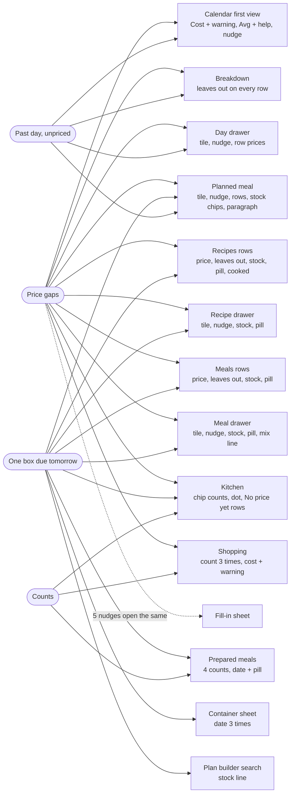
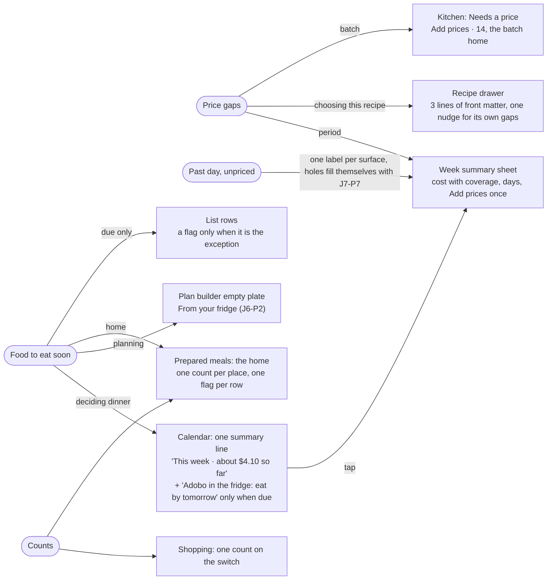

# N2: Insight budget and noise

**Prefix:** N2 · **Fixtures:** Alex (seeded, returning), Jamie (empty, first run), Taylor ("Big Kitchen", scale). All three read-only: no writes, no settings changed, every sheet cancelled. Cooking mode was left through "Not now", which writes nothing. **App:** http://127.0.0.1:5240, tip of the stack (`the audit build`, `e4caf1fd`), on 2026-10-15 in America/Los_Angeles. **Viewports:** 390×844 first, then 1280×900.
**Screenshots:** `N2-shots/` (cited below as `N2-shots/<name>.png`).

**How I counted.** A *volunteered item* is anything on screen that reports a number, a state or an explanation that the person didn't type and that isn't the screen's subject. That covers count chips, badges, tiles, caveat phrases ("leaves out 4", "No price yet"), status lines (cooked, tweaked, fixed), stock lines and eat-by pills, nudge lines, help and warning icons, explanatory subtitles under controls, and toasts. Titles, nav labels and action buttons are not counted. Neither is the subject's own content: ingredients, steps, a meal's items, a recipe's servings and time on its row. A recipe drawer's facts line counts as one item. Counts are for the **first view**: the area above the floating nav pill (y < ~760) on a tab, and the first screen of a drawer.

Each item is put in a class:
- **D (decision):** it changes what the person does next.
- **S (status):** it confirms something they did.
- **R (reference):** they opened the screen to see it.
- **N (noise):** none of those.

I read the screenshots for every count. The text dumps only located elements.

**Caveats.**
- Headless Chromium refuses the wake lock, so every cooking screen shows "This phone may turn the screen off…". A phone over HTTPS would not show that line, so I don't count it against the app.
- In this run the shell's seeded reminders from *other* apps (no longer seeded) toasted over Pinch on load (`N2-shots/alex-t00-calendar-with-toasts.png`). I report them once (S20) and otherwise ignore them.
- I couldn't see toasts fire without writing. Their inventory comes from the code (§3.6).

---

## 1. Who and when

A home cook, usually on a phone, who opens Pinch in short bursts many times a day and rarely for long:
- **Morning, kitchen or commute:** "what's tonight, do I need to thaw something?"
- **Late afternoon, sofa or bus:** "what can I make?"
- **At the shop:** list in one hand, basket in the other.
- **At the stove:** wet hands, one step at a time.
- **Sunday, on the sofa:** the week, roughly, and roughly what it costs.

On their mind: the kids' timetable, not wasting the leftovers, the budget in round numbers, and whether this app is going to turn into homework. They forgive a missing number. They don't forgive being nagged about it on every screen. Calm matters because the same person sees the same first screen several times a day: anything shown there is seen thirty times a week.

## 2. Goals and outcomes (the insight side of the app)

| # | Job story | Success looks like | How often | Matters | Without the app |
|---|---|---|---|---|---|
| G1 | When I open the app, I want to see tonight and anything that needs me today, so I can get on with dinner | Tonight's plan and at most one "do this" on the first screen | several times a day | core | memory, the fridge door |
| G2 | When I'm choosing what to cook, I want the one or two facts that change my choice (leftovers to use up, last time's note, about what it costs), so I can pick without opening five screens | Those facts on the row or the first screen of its drawer, nothing else | daily | core | look in the fridge, ask the family |
| G3 | When I've done something (cooked, added, put away), I want one clear confirmation and a way to take it back, so I trust it saved | One acknowledgement per act, with Undo where it matters | daily | supporting | n/a |
| G4 | When a number looks off, I want to know why and fix it in one place, so I can trust it next time | One explanation, one place to fix, no meta-explanations | weekly | supporting | a spreadsheet, or a shrug |
| G5 | When I'm new, I want the app to ask for nothing and point to one first step, so it doesn't feel like homework | Zero volunteered numbers before there is data | once | core (adoption) | n/a |
| G6 | When my kitchen grows (hundreds of recipes, a full freezer), I want flags to stay rare, so a flag still means "look at this" | A row flag marks the exception, never every row | ongoing | supporting | n/a |
| G7 | When I want depth (the week's cost, nutrition, history), I want it one tap away and complete, so I look when I choose | Depth behind one tap, not on the front | weekly | supporting | n/a |

---

## 3. Current journeys, as walked (the insight walk)

### 3.1 Four everyday journeys, with what the app volunteers on the way (Alex, 390×844)

Taps were counted in the browser. "Vol." is the volunteered items on each step's first view, and "D" is how many of those are decisions *for this journey*.

**A. "What's tonight? Then cook it."** Start: open Pinch, the Calendar. 8 taps to "I cooked this".

| Step | Surface | Action | Taps | Vol. | D | What it volunteered |
|---|---|---|---|---|---|---|
| 1 | Calendar · Month (tab) | open | 0 | 7 (+2 other-app toasts) | 0 | Cost $5.20 + ⚠, Avg $0.29 + ⓘ, "13 ingredients need a price · Add prices ✕", "See the breakdown", badge 4. Tonight is three 18-px emoji in a cell (`alex-p-01-calendar.png`) |
| 2 | Day drawer, Thu Oct 15 | tap the day | 1 | 8 | 0 | Cost $0.68 + ⚠, "10 ingredients need a price ✕", 4 row prices (2× "No price yet"), "Choose what you need for the day" (`alex-c10-day-today.png`) |
| 3 | Planned meal · Dinner (swaps in place) | tap Dinner | 2 | 7 | 2 | "Eat from fridge" / "Eat from freezer" chips (D), Cost $0.15 + ⚠, "9 ingredients need a price ✕", 2 row prices (`alex-c11-planned-today-1.png`) |
| 4 | "Which one are you cooking?" | Start cooking | 3 | 1 | 0 | "It opens with the servings you planned." (`alex-j01-which.png`) |
| 5 | Cooking mode · step 1 (subview) | Adobo chicken | 4 | 3 | 1 | **"Your latest note (Oct 12): … Next time double the garlic"** (D), "Step 1 of 3" + dots, "Timers in this step" (`alex-j02-cook-from-plan.png`) |
| 6 | Finish panel | Next, Next, Finish | 7 | 3 | 1 | "2 servings", "Keeps a record. You can change the date later.", "Leftovers keep 3 days in the fridge, 3 months in the freezer" (D) (`alex-j03-finish-from-plan.png`) |
| 7 | I cooked this | tap | 8 | — | — | the panel confirms in place (from a plan: no toast) |

**Totals: 29 volunteered items, 4 of them decisions for this journey.** The price backlog was met three times in two taps (Calendar 13, day 10, dinner 9), all about overlapping ingredients. None of the three is about dinner.

**B. "What can I make tonight?"** Start: Calendar. 3 taps to the plan builder.

| Step | Surface | Taps | Vol. | D | What it volunteered |
|---|---|---|---|---|---|
| 1 | Recipes (tab) | 1 | 13 | 1 | "Sources 3"; Adobo: "Cooked 4×", "No price yet", 🧊 5 servings + **"Eat by tomorrow"** (D), ❄️ 5 servings; Rice: "Cooked 1×", "$0.08 / serving · leaves out 4", 🧊 3 servings; Nachos: "$0.81 / serving · leaves out 3"; badge (`alex-p-02-recipes.png`) |
| 2 | Recipe drawer · Adobo | 2 | 8 | 2 | facts, "From Mom's recipe cards", "Last tweaked Oct 7", "Cooked 4 times · last Oct 12", 🧊 + "Eat by tomorrow" (D), ❄️ line, Cost tile **"No prices yet"**, "5 ingredients need a price ✕" (D, backlog). Ingredients start at y=677 of 844 (`alex-r1-adobo.png`) |
| 3 | Plan builder (subview) | 3 | 3 | 0 | "4 servings · The whole recipe", "No prices yet", "Type a name to find it, or add one that isn't in the list." (`alex-f30-builder.png`) |

**Totals: 24 volunteered, 3 decisions.** "Eat by tomorrow" on Adobo is the one fact that matters here, and it says *don't cook this, eat the leftovers*. The screen it appears on is a recipe library, where the only next step is to cook.

**C. "What's in the fridge?"** Start: Calendar. 3 taps to one box.

| Step | Surface | Taps | Vol. | D | What it volunteered |
|---|---|---|---|---|---|
| 1 | Kitchen (tab) | 1 | 17 | 1 | "Your ingredients.", "19 ingredients", chips "Prepared meals 7 •" / "Stores 3" / "Products 5", an orange dot with no words (D, unreadable), 4 family counts, 3× "No price yet", 3 priced rows, badge (`alex-p-03-kitchen.png`) |
| 2 | Prepared meals · Fridge (subview) | 2 | 12 | 2 | "25 servings in 7 containers", "Fridge · 4", "Freezer · 3", "4 containers · 10 servings", 4 eat-by texts, **2× "Eat soon"** (D) beside "Eat by tomorrow" / "Eat by Oct 17", "Made Oct 12", "Thawed · Made Sep 5" (`alex-k20-prepared.png`) |
| 3 | Container sheet | 3 | 12 | 1 | "2 servings left", "Eat by tomorrow" + "Eat soon" + "Change eat-by date · **Now tomorrow**" (one date, three times), 6 subtitles under 6 actions, 3 history rows. Scrolls 742/701 px (`alex-k21-container.png`) |

**Totals: 41 volunteered, 4 decisions.** One box's due date is shown 3 times on the last screen.

**D. "I'm at the shop."** Start: Calendar. 1 tap.

| Step | Surface | Taps | Vol. | D | What it volunteered |
|---|---|---|---|---|---|
| 1 | Shopping (tab) | 1 | 6 | 0 | **"4 to buy" + "To buy · 4" + the tab badge "4"** (one number, three places in one view), "Got it · 2", "Amounts on your list: about $3.16" + ⚠ (`alex-p-04-shopping.png`) |

The calmest tab. The duplicate count is the only noise.

### 3.2 Every screen's first view, counted and classified (390×844)

Under **Repeats**: "→ X" means the same fact also shows on X.

| Screen | Fixture | Vol. | D | S | R | N | Items (class) | Repeats | Shot |
|---|---|---|---|---|---|---|---|---|---|
| Calendar · Month | Alex | 7 | 1 | 2 | 2 | 2 | Cost tile (R, partial: J7-H1), ⚠ (S), Avg per meal (N), its ⓘ (N), nudge + ✕ (D, backlog), "See the breakdown" (R), tab badge (S). The plan starts at y=415 (49%) | Cost tile → 4 drawers, cost lines → rows, builder, shopping; nudge → 4 drawers | `alex-p-01-calendar` |
| Calendar · Month | Taylor | 10 | 1 | 2 | 2 | 5 | + "Per g protein" (N), "Daily average this month 🔥13475 💪621.3g" (N: household sums), nudge "175 ingredients need details". The plan starts at y=481 (57%) | — | `taylor-p-01-calendar` |
| Calendar · Month | **Jamie (first run)** | **4** | 0 | 0 | 0 | **4** | "$0.00" Cost (N, reads as free), "—" Avg (N), ⓘ (N), "Want calories or protein here?" (N: nothing to show). Below them, an empty box whose first button repeats the header's Add | — | `jamie-p-01-calendar` |
| Calendar · Week | Alex | 10 | 1 | 2 | 3 | 4 | the 7 above + row prices "Wasn't priced" ×2, "$0.15". Today's row is below the nav pill (y≈842) | rows → day drawer, planned meal | `alex-c04-week` |
| Calendar · Week | Jamie | 4 + 8 empties | 0 | 0 | 0 | 4 | the 4 above, plus "Nothing planned yet…" box **and 7× "Nothing planned"** | — | `jamie-c-week` |
| Calendar · Day | Alex / Jamie | 10 / 4 | | | | | the same tiles for one day, plus "See the breakdown" for a single day. Jamie: **two empty boxes stacked** | repeats the day drawer | `alex-c05-day`, `jamie-c-day` |
| Breakdown drawer | Alex | 14 | 0 | 0 | 7 | 7 | title total, "The total leaves out 15 ingredients.", then on 6 rows a total and **"leaves out N ingredients"**. Rows aren't tappable | cost tile | `alex-c03-breakdown` |
| Cost ⚠ modal | Alex | 3 sentences | | | | 1 | "Leaves out 15…", **"The note asks about fewer: 2 are hidden or in a day that has passed."** (N: explains the app's own mismatch), a paragraph about frozen days | 5 copies (NudgeCountNote) | `alex-c01-cost-warning` |
| Day drawer · today | Alex | 8 | 1 | 1 | 3 | 3 | tile (R), ⚠ (S), nudge (D), 2 priced rows (R), 2× "No price yet" (N), "Choose what you need for the day" (N) | nudge → Calendar, planned meal | `alex-c10-day-today` |
| Day drawer · future | Alex | 9 | 1 | 1 | 4 | 3 | the same with 5 rows | | `alex-c10-day-future` |
| Day drawer · **past** | Alex | 6 | 1 | 0 | 1 | 4 | "**Wasn't priced**" tile (N), "Fixed when the day passed" (R), 2× "Wasn't priced" rows (N), reprice row (D) + its ⓘ (N) | → planned meal ×4 | `alex-c10-day-past` |
| Day drawer · empty | Alex | **0** | | | | | "Nothing planned for this day yet." + one button | — | `alex-c10-day-empty` |
| Planned meal · today dinner | Alex | 7 | 3 | 1 | 2 | 1 | Eat from fridge / freezer (D), tile (R), ⚠ (S), nudge (D, a subset of the day's), priced row (R), "No price yet" (N) | nudge → day drawer | `alex-c11-planned-today-1` |
| Planned meal · **past, cooked** dinner | Alex | 9 | 1 | 1 | 1 | 6 | Eat from fridge / freezer (N: this dinner *made* those boxes), "Wasn't priced" tile (N), "Fixed when the day passed" (R), row "Wasn't priced" (N), "✅ Cooked · Undo" (S), paragraph "This day has passed, so its meals keep the prices…" (N), reprice row (D) + ⓘ (N) | "fixed / unpriced" said 4 ways in one view | `alex-c11-planned-past-1` |
| Planned meal · future breakfast | Alex | 3 | 1 | 0 | 0 | 2 | **one unpriced banana said 3 times**: tile "No prices yet", "Banana needs a price · Add a price", row "No price yet" | | `alex-c11-planned-future-0` |
| Recipes list | Alex | 13 | 1 | 1 | 5 | 6 | see journey B (each "leaves out N" counted as its own N) | stock → drawer, Meals, Prepared, Kitchen dot; cooked → drawer | `alex-p-02-recipes` |
| Recipes list | Taylor | 25 | 0 | 1 | 9 | 15 | "Sources 12", and on **7 of 7 rows** "Cooked N×" and "$x / serving · **leaves out N**"; 2 stock lines | | `taylor-p-02-recipes` |
| Meals list | Alex | 8 | 1 | 1 | 3 | 3 | "2 items · $0.15 · leaves out 10", "🧊 10 servings" (N: plates plus parts, J6-H5) + "Eat by tomorrow" (D), "❄️ 5 servings", "2 items · $0.53 · leaves out 1", badge | → meal drawer, recipe rows | `alex-r20-meals` |
| Ideas list / idea drawer | Alex | **1 / 0** | | 1 | | | the badge only | — | `alex-r30-ideas`, `alex-r3-link` |
| Recipe drawer · Adobo | Alex | 8 | 2 | 0 | 4 | 2 | see journey B. "No prices yet" occupies a whole tile to report nothing, and the nudge under it says the same | 6 lines of front matter before the actions | `alex-r1-adobo` |
| Recipe drawer · Rice | Alex | 8 | 1 | 1 | 6 | 0 | facts, source, "Cooked once · Oct 9", 🧊 line, $0.30 + "$0.08 per serving" + ⚠, nudge | | `alex-r1-rice` |
| Recipe drawer · Cozy chili 1 | Taylor | 11 | 1 | 1 | 7 | 2 | + "Last tweaked", "Per serving 🔥726 💪46.8g" tiles, "5 ingredients need details". Ingredients at y=711 | | `taylor-r01-drawer` |
| Meal drawer · Adobo and rice | Alex | 9 | 2 | 1 | 4 | 2 | 🧊 + "Eat by tomorrow" (D), ❄️ line, "Adobo and rice 2 · Adobo chicken 10 · Cilantro lime rice 3" (N), tile + ⚠ + "For the plate", nudge (D), "No price yet" (N), "$0.15" | → Recipes, Meals rows, Prepared | `alex-r2-adoborice` |
| Kitchen | Alex | 17 | 1 | 1 | 4 | 11 | journey C | "No price yet" → Needs a price filter | `alex-p-03-kitchen` |
| Kitchen | Taylor | 13 | 1 | 1 | 2 | 9 | chips "301 •" / "12" / "150", "300 ingredients", "Beans 8", **7 of 7 rows "No price yet"** | | `taylor-p-03-kitchen` |
| Kitchen | **Jamie** | **0** | | | | | a search field, one line, "Browse every ingredient" (known fix 1 works) | — | `jamie-p-03-kitchen` |
| Ingredient drawer · Chicken thigh | Alex | 1 | 1 | | | | "No product yet. Add where you buy it and recipes can show what they cost." (D, beside its button) | — | `alex-k1-thigh` |
| Prepared meals · Fridge | Alex | 12 | 2 | 0 | 8 | 2 | journey C (4 counts in 2 units, a date and a pill for one fact) | → Kitchen chip, recipe/meal rows and drawers | `alex-k20-prepared` |
| Prepared meals · Fridge | Taylor | 4 counts + 7 rows | 7 | | | | "**Past its date**" pill on 7 of 7 rows | | `taylor-k01-prepared` |
| Container sheet | Alex | 12 | 1 | 0 | 9 | 2 | journey C ("Now tomorrow" and "Fix how many are left" are the N) | | `alex-k21-container` |
| Shopping · To buy | Alex / Taylor | 6 | 0 | 2 | 3 | 1 | journey D. Taylor: "64" three times, "about $554.77" + ⚠ | badge on every tab | `alex-p-04-shopping`, `taylor-p-04-shopping` |
| Shopping cost help | Alex | 3 sentences | | | | | "…till is usually more", "leaves out 3", "Add a price from the ingredient in Kitchen" (points to another tab) | | `alex-s01-costhelp` |
| Add to shopping sheet | Alex | 5 | 4 | 1 | | | "You already have 5 servings in the fridge, 5 in the freezer." (D), "3 of 6" (S), 3× "On your list · 2 lb" (D: says why a row starts unticked) | stock → 8 surfaces | `alex-f10-addshop` |
| Cooking step / Finish | Alex | 3 / 3 | 1 / 1 | | | | the latest note (D); leftovers line (D) | | `alex-f01-cook-step1`, `alex-f03-cook-finish` |
| Settings / View options / Kitchen filter | Alex | — | | | | | each carries a paragraph; View options' macros line points to "the Calendar's gear"; the Kitchen filter has a 3-line scope note | | `alex-c06-settings`, `alex-r02-view`, `alex-k01-filter` |

**At 1280** (`alex-w-0*.png`) the same items appear in the same order with the width used well. No extra insight surfaces; the stats row is just wider. Wide adds nothing I'd count against the app.

**Summary of the first-view counts.**
- **Calmest (KEEP):** Ideas (0), the idea drawer (0), the ingredient drawer (1, a decision), an empty day (0), Jamie's Recipes, Kitchen and Shopping (0 each).
- **Loudest:** Kitchen (17), Recipes (13; 25 at scale), the container sheet (12), Prepared meals (12), and the Calendar at scale (10).
- **Least favourable decision ratio:** the past planned dinner (1 decision in 9) and the Calendar (1 in 7, a backlog that isn't about any meal).

### 3.3 The same fact, counted on each surface (Alex, at one moment)

This is the cross-cutting view the journey audits each saw part of.

| Fact | Where it shows | Surfaces | Most in one view | Notes |
|---|---|---|---|---|
| **Some ingredients have no price** | Calendar nudge + ⚠ + modal; breakdown header + every row; day drawer tile/⚠/nudge/rows; planned meal tile/⚠/nudge/rows; recipe rows, drawer tile, nudge, ingredient lines; meal rows, drawer, nudge; builder; shopping line + help; Kitchen rows; Kitchen filter | **13** (J7 counted 5 nudges and 8 warnings) | 3 (future breakfast: tile, nudge, row) | **9 phrasings for the state, plus 3 verbs**, counted as occurrences in the code: "leaves out" 9, "No prices yet" 6, "Still no price" 6, "Wasn't priced" 5, "can't be compared" 5, "No price yet" 3, "need(s) a price" 3, "need(s) details" 2, "with no price yet" 2 (grep of `src/apps/pinch`); verbs "Add a price", "Add prices", "Add details". Counts differ by scope: 3, 9, 10, 13, 14, 15 (J7 table) |
| **Adobo's fridge box is due tomorrow** | Recipes row pill, recipe drawer pill, Meals row pill (Adobo and rice includes its recipes' stock), meal drawer pill, Prepared row ("Eat by tomorrow" + "Eat soon"), container sheet (3×), Kitchen chip dot, plan builder search line, planned meal "Eat from fridge" chip (today and past days), shopping sheet ("You already have 5 servings in the fridge") | **10** (8 show the due state) | 3 (container sheet) | **None on the Calendar**, the screen where the eat-or-cook decision starts: `pinch.md` forbids a Calendar surface |
| **Oct 12 is past and unpriced** | Week rows ×2; day drawer tile value + tile detail + 2 rows + reprice row; planned meal tile value + detail + row + paragraph + reprice row + ⓘ; the stats warning's frozen paragraph; breakdown row "—" + "leaves out 7" | **5** surfaces, ~15 mentions | **4** (past planned dinner) | J7-H6: the freeze preserves a hole |
| **Adobo cooked 4 times** | Recipes row "Cooked 4×", drawer "✅ Cooked 4 times · last Oct 12", the History chip's presence, History sheet, planned meal "✅ Cooked", note heading "After cooking on Oct 12" | 6 | 2 | The count drives no decision. "Last made" would (J2-P5) |
| **4 things to buy** | tab badge (every tab), Shopping subtitle, "To buy · 4" | 3 | **3** | |
| **What's in the fridge** | Kitchen chip "7" (containers), header "25 servings in 7 containers", "Fridge · 4" (containers), "4 containers · 10 servings", rows in servings, meal row "10 servings" (plates + parts) | 6 | **4** | two units (containers and servings) on one screen |
| **Cost of the period** | Month tile, breakdown title ($7,894.50 vs $7,895 at scale, J3-S11), Week tile, Day tile, day drawer tile, the Day view repeating the drawer | 6 | 2 | |
| **Nothing here (first run)** | Jamie Week: box + 7× "Nothing planned"; Day: 2 boxes | — | **8** | J1-S3 |

### 3.4 First run (Jamie): does an empty app already shout?

Only the first screen does.
- **Calendar:** 4 volunteered items, all noise, about data that doesn't exist: "$0.00", "—", ⓘ ("Cost divided by the meals that have a price", when there are no meals), and "Want calories or protein here?" (`jamie-p-01-calendar.png`, `jamie-c-avghelp.png`). Week adds 8 "nothing" messages; Day stacks two empty boxes.
- **Recipes, Kitchen and Shopping:** one line each, no counts, no controls on nothing (`jamie-p-02/03/04`). Known fix 1 made Kitchen right.
- **Later:** J1-F5 measured 12 cost surfaces on 7 screens within the first ten minutes, once a first recipe exists. I didn't repeat that (no writes in Jamie's kitchen). My Jamie walk agrees with its start.

### 3.5 Scale (Taylor): flags stop being exceptions

| Surface | Flag | Share of visible rows |
|---|---|---|
| Recipes | "leaves out N" | 7 / 7 |
| Recipes | "Cooked N×" | 7 / 7 |
| Kitchen | "No price yet" | 7 / 7 |
| Prepared meals · Fridge | "Past its date" pill | 7 / 7 (31 past, 52 "eat soon" in the chip's label) |
| Calendar | 10 items above the plan, two of them household sums ("🔥 13475" a day) | — |
| Day drawer | "For the day 🔥 15869 · 💪 631.1g" | — |
| Shopping | "64" three times; "about $554.77" + ⚠ | — |

A flag on every row reads as decoration, not a signal (G6). Taylor's case isn't exotic: anyone who prices lazily, as the README invites ("details come later"), lives in it permanently.

### 3.6 Toasts (from the code; none fired, by design of this read-only walk)

About 20 distinct toasts:
- **Adds:** shopping add + View; manual add; plan (no View); recipe added (2 wordings); note added.
- **Cook:** marked + Undo, "Already marked".
- **Containers:** put away + Undo, ate + Undo, finished + Undo, threw out + Undo, cleared + Undo, put back.
- **Other:** reprice; save as meal; "Timer done"; and error toasts for each.

| Class | Toasts | Verdict |
|---|---|---|
| S + Undo | cook, put away, eat, toss, clear | KEEP: they make one-tap acts safe (J6-K4) |
| S + View | add to shopping | KEEP |
| S only | plan, recipe added, note, save as meal, reprice | fine when the result is off screen. The plan toast should get View (J3-P12) |
| **Duplicate** | **cooking mode started from a recipe:** the panel says "Marked as cooked" *and* `markRecipeCooked` toasts with Undo (`hooks/useCookActions.ts:58-63`, called at `components/cooking/CookingSubview.tsx:235`). The same panel started from a plan raises none (`isToasted = false`). **"Timer done"** toasts for 10 s (`hooks/useCookTimers.ts:98-103`) while the strip lights, buzzes and beeps | N: two confirmations for one act, and inconsistent between two entries to the same screen (J5-H7, J5-S4) |
| Other apps' reminders | "Lunch at Salt Creek", "Previews time" stack over Pinch's title, gear and Add on load (`alex-t00-calendar-with-toasts.png`) | out of Pinch's scope (hub) |

### 3.7 Explanatory text under controls

About 20 explainer lines across the first views walked. They fall into three kinds:
- **The design needs a sentence to be understood.** NudgeCountNote's "The note asks about fewer…" (5 sites). The Kitchen filter's 3-line scope note. View options' "Turn them on from the Calendar's gear". The shopping help's "Add a price from the ingredient in Kitchen".
- **A subtitle restates its title.** Container sheet: "Correct the count · Fix how many are left", "Change eat-by date · Now tomorrow" (the date is already above); `ContainerSheet.tsx:590-666`, 6 of 6 rows. "Add to shopping list · Choose what you need for the day" (`DayDrawer.tsx:270`).
- **An explanation sits on a NOISE number.** "Avg per meal ⓘ Cost divided by the meals that have a price" (`StatsRow.tsx:144-148`).

Behind several of these is the CLAUDE.md rule "An action is named by its outcome, **with a one-line subtitle**". Applied to every row of a menu, it doubles the words.

### 3.8 Help and warning icons

There are 10 `HelpTip` sites:
- ⚠ on 8 totals: Calendar, recipe drawer, meal drawer, day drawer, planned meal, builder, `NutritionReview`, and the shopping line (⚠ or ⓘ).
- ⓘ on "Avg per meal".
- ⓘ on the reprice row.

The ⚠ beside a total earns its place: it is the one honest surface for a partial number (keep it, J7-P16). The two ⓘ do not. One explains a number nobody acts on. The other sits on a row whose confirm already previews Before and After.

---

## 4. Flow diagrams

**Current: one fact, many surfaces** (Alex, today). Each edge is a place the same fact is volunteered without being asked.

**Proposed: each fact has one home, plus one door where a named journey needs it.**

**Journey A, now and proposed** (taps and items volunteered on the way).

```mermaid
flowchart TD
  subgraph Now["Now: 8 taps, 29 volunteered, 4 decisions"]
    A1["Calendar · 7 vol, 0 for dinner"] -->|tap the day| A2["Day drawer · 8 vol, 0"]
    A2 -->|tap Dinner| A3["Planned meal · 7 vol, 2"]
    A3 -->|Start cooking| A4["Which one? · 1"]
    A4 -->|Adobo| A5["Cooking · 3 vol, 1: latest note"]
    A5 -->|Next, Next, Finish| A6["Finish · 3 vol, 1: leftovers line"]
  end
  subgraph Proposed["Proposed: 7 taps, about 10 volunteered, 4 decisions"]
    B1["Calendar · today first (J3-P2)<br/>summary line + 'Adobo: eat by tomorrow'"] -->|tap Dinner| B3["Planned meal · tile + warning, stock chip<br/>no nudge, no subtitle"]
    B3 -->|Start cooking| B4["Which one?"]
    B4 -->|Adobo| B5["Cooking · latest note"]
    B5 -->|Next, Next, Finish| B6["Finish · leftovers line"]
  end
```

---

## 5. Findings

### (a) Small things

| id | sev | where | evidence | goal hurt |
|---|---|---|---|---|
| N2-S1 | minor | Shopping header (`components/shopping/ShoppingScreen.tsx:426` subtitle; switch labels) | "4 to buy", "To buy · 4" and the tab badge "4" in one view; Taylor "64" ×3 (`alex-p-04-shopping`, `taylor-p-04-shopping`) | calm, G1 |
| N2-S2 | minor | Prepared meals (`components/containers/ContainersSubview.tsx:244-248`, `:386-388`) | "25 servings in 7 containers", "Fridge · 4", "Freezer · 3", "4 containers · 10 servings": 4 counts in 2 units above 4 rows (`alex-k20-prepared`) | G1, calm |
| N2-S3 | polish | Container row (`components/containers/ContainerRow.tsx:58-62`) vs `StockLine` | the row prints "Eat by tomorrow" and an "Eat soon" pill side by side; recipe and meal rows put the date inside the pill ("Eat by tomorrow"). Two styles for one flag | G6 |
| N2-S4 | minor | Container sheet (`components/containers/ContainerSheet.tsx:561`, `:590-666`) | one date three times ("Eat by tomorrow", "Eat soon", "Now tomorrow"), 6 subtitles under 6 actions, the sheet scrolls 742/701 px (`alex-k21-container`) | G1 |
| N2-S5 | minor | Kitchen's Prepared meals chip (`components/containers/PreparedEntry.tsx:42-47`) | an orange dot whose meaning ("2 to eat soon, 1 past its date") exists only in an `aria-label`. A sighted person can't tell what it asks (`alex-p-03-kitchen`) | G1, G2 |
| N2-S6 | minor | Past planned meal (`components/calendar/PlannedMealView.tsx:381-415`, `:455-459`, `:466-472`) | "Wasn't priced" (tile), "Fixed when the day passed", "Wasn't priced" (row), "This day has passed, so its meals keep the prices…", then the reprice row with its own subtitle and ⓘ (`alex-c11-planned-past-1`). Agrees with J3-S14 | calm |
| N2-S7 | minor | Past cooked dinner (`PlannedMealView.tsx:124`, `:199-209`: `canEatFromStock = meal.date <= today`, no cooked check) | offers "Eat from fridge / freezer" for the boxes this very dinner produced, 3 days later. Agrees with J3-S13 and J6-P1 | G1 |
| N2-S8 | polish | Future planned breakfast | one unpriced banana said 3 times: "No prices yet", "Banana needs a price · Add a price", "No price yet" (`alex-c11-planned-future-0`) | calm |
| N2-S9 | minor | Recipe drawer (`components/recipes/RecipeDrawer.tsx:298-304`) | a full Cost tile reading "No prices yet", with the nudge under it saying it again (`alex-r1-adobo`) | G2 |
| N2-S10 | polish | Day view (`components/calendar/StatsRow.tsx:190`) | "See the breakdown" for one day opens a one-row breakdown | calm |
| N2-S11 | minor | Cost warnings, 5 sites (`components/shared/NudgeCountNote.tsx:28-33`) | "The note asks about fewer: 2 are hidden or in a day that has passed.": a sentence about the app's own two counts (`alex-c01-cost-warning`) | G4 |
| N2-S12 | polish | `StatsRow.tsx:180` | "Want calories or protein here?" shows on an empty calendar (Jamie) and hides as soon as a priced gap exists (Alex). Agrees with J1-S8 | G5 |
| N2-S13 | minor | Cooking mode from a recipe (`hooks/useCookActions.ts:58-63`, `components/cooking/CookingSubview.tsx:235`) | panel "Marked as cooked" + a toast with Undo, while the same screen started from a plan raises none | G3 |
| N2-S14 | polish | `hooks/useCookTimers.ts:98-103` | "Timer done" toast for 10 s on top of the lit strip, the buzz and the beep. Agrees with J5-S4 | calm |
| N2-S15 | polish | `FormSection` `detail` counts (`RecipeDrawer.tsx:353`, `MealDrawer.tsx:189`, `notes/RecipeNotes.tsx:82`), Kitchen family dividers | "INGREDIENTS 6", "NOTES 3", "ON THE PLATE 2", "Cheese 1" beside lists fully on screen | calm |
| N2-S16 | minor | Day drawer nutrition (`components/calendar/DayDrawer.tsx:188-199`) | Taylor "For the day 🔥 15869 · 💪 631.1g": a household sum presented as a day's nutrition (`taylor-c03-day-today`). Same cause as J3-F7 | G7 |
| N2-S17 | polish | Kitchen subtitle (`components/kitchen/KitchenScreen.tsx:234`) | "Your ingredients." directly above the "Yours" pill that says the same | calm |
| N2-S18 | polish | `components/shared/GapNudge.tsx:53-61` | with nutrition on, the Calendar says "175 ingredients need details" while that day's drawer says "36 ingredients need a price": vaguer words and a different count for overlapping gaps (J7-24 is the cause) | G4 |
| N2-S19 | polish | Jamie's Week (`components/calendar/WeekView.tsx`) | the box "Nothing planned yet…" plus 7× "Nothing planned" (`jamie-c-week`) | G5 |
| N2-S20 | polish (hub) | site toasts | two other apps' reminders stack over Pinch's title, gear and Add on load (`alex-t00-calendar-with-toasts`) | calm |

### (b) High-arching things

**N2-H1 · major · On the way to cooking tonight's dinner, the app volunteers 29 items and 4 of them help.** Journey A, §3.1. The price backlog is met three times in the first two taps (13, 10, 9 ingredients, overlapping), and none of the three is about tonight. Journey C ("what's in the fridge?") volunteers 41 items for 4 decisions, and journey B 24 for 3. The owner's "too much insight everywhere" is measurable: on the screens a person opens daily, between 1 and 2 items in 10 help them decide. Hurts G1, G2 and calm.

**N2-H2 · major · Every fact has many homes, because the rules attach a fact to every surface that touches it.** See the matrix in §3.3:
- price gaps on 13 surfaces;
- one box's due date on 8;
- a past unpriced day on 5, said 4 ways in one view;
- "4 to buy" 3 times in one view;
- the fridge counted 4 times in 2 units.

The duplicates are faithful applications of written rules, not lapses:
- CLAUDE.md Product: "A total says what it leaves out **wherever it appears** … a list row says it in one phrase".
- `pinch.md`: "The recipe, saved meal, day and planned meal views carry 'Add prices'".
- `pinch.md`: "Stock shows as `StockLine` on a recipe or meal row and `StockRows` in its drawer".
- `pinch.md`: "A frozen day … its warning, tile and rows say so".

Each rule is right about one surface. Together they guarantee repetition. Nothing in the rules asks "where else does this already show?" Hurts calm, G4, and the owner's "intentional".

**N2-H3 · major · Caveats scale with data, not with decisions.** At Taylor's size, 7 of 7 visible recipe rows say "leaves out", 7 of 7 Kitchen rows say "No price yet", and 7 of 7 fridge rows say "Past its date" (§3.5). A flag only works as the exception. When most rows carry it, it is wallpaper, and the one row that matters can't be found. The "normal" Pinch user, who prices lazily as the README invites, is in this state permanently, not only at scale. Hurts G6 and G2.

**N2-H4 · major · The first screen is a report sitting on a plan, and on day one it reports nothing.** It shows 7 (Alex) to 10 (Taylor) volunteered items above the plan, 2 to 5 of them noise:
- Avg per meal and its ⓘ;
- Per g protein;
- daily household sums of calories and protein.

The plan starts at 49–57% of the screen. On a first run the same strip shows "$0.00", "—", an ⓘ explaining an average of no meals, and a nutrition prompt: 4 noise items before the person has done anything (§3.4). Agrees with J3-F1 and J1-F4, which proposed the fix (J3-P1, J1-P1), and adds the measure: the screen seen most often carries the worst ratio of noise to decision. Hurts G1 and G5.

**N2-H5 · major · Quiet is the person's job, not the default.** There are only two ways to quiet the app:
- **The nudge's ✕.** It silences every open gap behind that line, everywhere, permanently, with no Undo and no list to bring it back (`GapNudge.tsx:96-103`; J7-H5).
- **View options switches**, one per list, which grow with every new line a row learns to show: prices, then calories and macros, now stock (known fix 6).

Each new kind of row line arrives on by default and gets a switch to turn it off. Over time the eye button becomes a settings page per list (J7 noticed the same). A calm app picks quiet defaults and lets the person turn depth *on*. Hurts calm and G7.

**N2-H6 · minor · References are over-surfaced while the few decisions are under-surfaced.**
- "Eat soon" is barred from the Calendar by rule (`pinch.md`: "no Calendar or Overview surface"), so it spreads to 8 secondary surfaces and is missing from the one opened every morning.
- The latest note is the best insight in the app at the stove, but sits last in the recipe drawer (J5-H5).
- "What did we actually eat" (✅) isn't on the calendar (J3-P16).

A budget must *move* items to where the decision is made, not only cut them. Hurts G1 and G2.

**N2-H7 · minor · Explanations multiply instead of designs changing.** About 20 explainer lines on first views (§3.7). The worst are sentences that explain the app's own inconsistency (NudgeCountNote, 5 sites) or point to another tab (View options → "the Calendar's gear"; shopping help → "the ingredient in Kitchen"). When a screen needs a sentence to be understood, the sentence is the symptom: the fix is one count, one place, or a button. Hurts G4.

**N2-H8 · minor · Twelve phrasings for "we don't know the price".** "leaves out", "No price yet", "No prices yet", "Wasn't priced", "Still no price", "can't be compared", "needs a price", "need details", "with no price yet", "Add a price", "Add prices", "Add details" (§3.3). Each is right in its spot. Together they make one simple state, "not priced yet", into a vocabulary. Hurts the concepts lens.

---

## 6. Proposals

### 6.1 The insight budget (the umbrella proposal)

**N2-P1 · ADD (a rule) that REMOVES content · size M (rule) / L (applied).** Adopt an explicit budget per screen type and judge every screen against it.
- Today's counts are measured (§3.2). The "after" column is what P2–P14 produce.
- "Vol." counts screen-level items. Row-level flags are governed by the row budget.
- **NOISE is always 0.**

| Screen type | Budget (first view) | Per row | Help icons | Also | Today (worst measured) | After P2–P14 |
|---|---|---|---|---|---|---|
| **Tab, first run** | **0 volunteered**: one sentence, one primary action | — | 0 | no tiles, counts, prompts or controls for data that doesn't exist | Calendar 4 (all N) | 0 |
| **Tab, returning user** | **≤ 2**: one summary line + one attention line (the most urgent decision), plus the tab badge | ≤ 1 detail line + ≤ 1 flag, and the flag only when it is a decision for that row | ≤ 1 | the content (plan, list) starts in the top 40% of the screen; no backlog counts on a tab's front | Calendar 7 / 10, Kitchen 17, Recipes 13 | Calendar 1–2, Kitchen ≈7, Recipes ≈6 |
| **Details drawer** (before its subject: ingredients, items) | **≤ 4**: one facts line, one status line (cooked, stock, eat-by merged), one total tile with its ⚠, and one nudge only if this drawer is the gap's home | — | ≤ 1 (the total's ⚠) | the subject starts on the first screen (≤ 60% down) | Adobo 8 (ingredients at 80%), meal 9, past dinner 9 | 4, 4, 3–4 |
| **Working surface** (builder, sheets, cooking, fill-in) | **only what changes the current action**, ≤ 2 screen-level | row flags that explain a default ("On your list · 2 lb") | 0 | — | builder 3 (1 N), container sheet 12 | 2, ≈7 |
| **Subview list** (Prepared meals, Products, Stores, Sources) | **≤ 1 count per fact**, on the switch or the header, not both | ≤ 1 detail + ≤ 1 flag | 0 | — | Prepared 4 counts | 1 count per place |
| **Toasts** | **≤ 1 per user act**, only when the result isn't visible where the person is, or it carries Undo or View | — | — | never alongside an in-place confirmation; never stacked; a timer's own strip is its own alert | 2 for one cook (S13), timer double (S14) | 1 |
| **Explanations** | a subtitle only for a consequence the title can't carry; a menu doesn't subtitle every row; no sentence explains the app's own inconsistency | — | — | a help modal ≤ 2 sentences, and it never points to another tab without a button | container sheet 6/6, NudgeCountNote ×5 | 2/6, 0 |

**Justification.** The owner's worry isn't any one surface. It is the sum: 29 items to cook dinner, 41 to check the fridge. A budget turns "calm" into something a reviewer can count. **Cost:** every screen is reviewed against it once, and the proposals below are the changes. **Risk:** a budget can starve a real decision. That's why it keeps one attention line per tab, puts no cap on decisions inside working surfaces, and moves items (P7) as well as cutting them.

### 6.2 The changes that bring each screen under budget

Ordered by value. I say where I agree or differ with the journey audits.

| id | type | goal | what changes | justification | cost / risk | size |
|---|---|---|---|---|---|---|
| **N2-P2** | MERGE + TRIM | G1, G5, G7 | **The Calendar's front is one summary line** ("This week · about $4.10 so far ⚠ ›"), absent on an empty period. It opens a Week summary sheet that absorbs the Breakdown. Avg per meal + ⓘ, Per g protein, the daily nutrition average, the price nudge and "See the breakdown" move into that sheet. "Want calories or protein here?" goes; Settings carries it | 7 → 1 (Alex), 10 → 1 (Taylor), 4 → 0 (Jamie). The plan moves up about 170 px. Every figure stays one tap away. **Agree with J3-P1 and J1-P1.** **Differ with J7-P3** in the same way J3 does: no backlog on a planner's front | Copy in UX.md, README "Stats row", `pinch.md` calendar bullet. Someone who glanced at the average daily loses it from the front | M |
| **N2-P3** | TRIM + MERGE | G4, calm | **The price nudge lives in its homes, not in every drawer.** It stays in the recipe drawer (choosing this recipe), the Week summary (P2, the period) and Kitchen's "Needs a price" filter as "Add prices · 14" (the batch home, J7-P6). It leaves the day drawer, planned meal and meal drawer (they keep tile + ⚠). **Delete `NudgeCountNote`** (5 sites). The line names the biggest gap instead of a count ("Chicken thigh and 4 more need a price"). The ✕ becomes "Not now" (session only), and "Don't count this" lives on the fill-in row (J7-P5) | Journey A meets the backlog 0 times instead of 3. The meta-sentence disappears. **Agree with J7-P3 and J7-P5.** I add the Kitchen batch home as the place a person goes *on purpose*, so the drawers can let go | Someone used to fixing prices from a day drawer goes one swipe to the Week summary. Update the `pinch.md` nudge bullet and UX.md's nudge table | M |
| **N2-P4** | QUIET | G6, G2 | **A caveat shared by most rows is said once; a row flags only the exception.** • Recipe and meal rows: "$0.08+ / serving", no "leaves out N" (J7-P1's row wording). • Kitchen rows: no "No price yet". An empty price line already says it, and the Needs a price filter lists them with a count. • Week, day and planned-meal item rows: "—" instead of "No price yet" / "Wasn't priced". • Breakdown rows: no "leaves out N" (J7-P12) | Taylor: 7 of 7 caveat phrases → 0. Alex Kitchen: 3 → 0. The future breakfast's banana is said once (the tile), not 3 times. The "+" carries partialness in one character | Refines a CLAUDE.md Product rule (§7, R3). The ⚠ on totals stays the honest explanation | S–M |
| **N2-P5** | MERGE | calm, G7 | **A past day says "not priced" once per surface.** • Day drawer and planned meal: the tile reads "Not priced", detail "Fixed when the day passed"; rows show "—". • The planned meal's paragraph goes (`PlannedMealView.tsx:466-472`). • The reprice row's ⓘ goes: its confirm already previews Before / After. • The stats warning's frozen paragraph shows only when the period holds a frozen day with a gap (J1-P10) | Past dinner: 9 → 4. Day drawer past: 6 → 3. **Agree with J7-P7** (fill holes automatically). If the owner takes it, "Not priced" becomes rare and the reprice row mostly disappears | Copy and two deletions; the rule bullet on pricing a passed day | S |
| **N2-P6** | TRIM | calm | **One number once per view.** • Shopping: drop the subtitle "4 to buy" while the switch shows (it stays for the empty or error state). • Prepared meals: drop "25 servings in 7 containers" and "4 containers · 10 servings"; the switch says "Fridge · 10 servings" (the person's unit). • Container row: one eat-by item, the pill with the date when due (as `StockLine` does), plain text otherwise. • Container sheet: the date once (drop "Now tomorrow" and the duplicate pill) | Shopping 6 → 5. Prepared: 4 counts → 2 (one per place). The sheet stops saying one date three times. **Agree with J6-P3** (drop the header subtitle) | Copy only; the container count still shows on the Kitchen chip if kept (P9) | S |
| **N2-P7** | REARRANGE (moves a decision) | G1, G2 | **"Eat soon" shows where dinner is decided, and is quiet elsewhere.** • The Calendar's summary area gets one line *only when something is due* ("🧊 Adobo chicken in the fridge · eat by tomorrow", "and 1 more"), opening Prepared meals scoped to what's due. This challenges `pinch.md` "no Calendar or Overview surface". • The Kitchen chip's unlabeled dot becomes words ("Prepared meals · 2 to eat soon") or goes. • Recipe and meal rows show stock **only when due** (**agree with J6-P3**). That makes known fix 6's "Show what's in stock" switch unnecessary by default. • The planned meal's "Eat from…" shows only today and never after Cooked ✓ (**agree with J6-P1 and J3-P4**). • The plan builder's empty plate offers due boxes (**agree with J6-P2**) | The one fact that saves food reaches the screen opened every morning, and 5 secondary pills become 1 line plus the home list. Net surfaces: 8 → 3 (Calendar line, builder row, Prepared meals) | It reverses a written Pinch rule and adds one conditional line to the Calendar (it fits inside P2's budget of 2). Known fix 6 stays available if the owner wants full stock lines back | M |
| **N2-P8** | TRIM + REARRANGE | G2 | **Recipe drawer front matter: 6 lines → 3.** • Facts + source on one line. • One status line merging cooked and due stock ("✅ Last made Oct 12 · 🧊 eat by tomorrow"). • "Last tweaked" moves into the Notes heading, where the tweak entry already says "Changed on Oct 7". • No tile while nothing is priced: the nudge line alone speaks ("See what it costs: 5 ingredients need a price · Add prices") | Adobo: 8 → 4, ingredients from y=677 to about y=480. **Agree with J2-P6** (cook's order, description up), **J5-S8** ("Last tweaked" is noise) and **J1-P9** (before a price exists, one invitation) | Copy and layout in `RecipeDrawer.tsx`; `pinch.md` "A details drawer keeps its actions together" | S–M |
| **N2-P9** | TRIM | calm | **No count where presence already says it.** • Entry chips appear only once something is behind them (known fix 1), so "Sources 3", "Stores 3", "Products 5" lose their numbers. • Section counts ("INGREDIENTS 6", "NOTES 3", "ON THE PLATE 2", "Cheese 1") show only on a collapsed group or past about 10 items | Kitchen: 17 → about 8; a recipe drawer loses 2–3 numbers. Nothing a person acts on is lost | Shared `EntryChip` / `FormSection` props. `IconBadge` counts elsewhere in the repo are unaffected | S |
| **N2-P10** | QUIET | G3, G4 | **Subtitles only for consequences.** • Container sheet: 6 → 2 ("Sets a new eat-by date" on freeze or thaw; "Keeps it in Finished" on Threw it out). **J6-P4 rebuilds this sheet anyway**; this is the rule it should follow. • Day drawer: "Choose what you need for the day" goes. • Builder: its help line becomes the placeholder. • Kitchen filter: its 3-line note becomes "Price filters look at Yours". | Fewer words per screen. Each remaining subtitle says something the title can't | Refines a CLAUDE.md rule (R7) | S |
| **N2-P11** | TRIM | G3 | **One confirmation per act.** • Cooking mode started from a recipe stops toasting when its panel confirms. Pass a no-toast flag as the planned path already does, and put the Undo in the panel (known fix 5 did this for the put-away). • "Timer done" stops toasting inside cooking mode (the strip, buzz and beep stay). • The plan toast gains View (**agree with J3-P12**). • Undo toasts stay | The cooking screen's header and back button are no longer covered by a duplicate (J5-S5). Two entries to one screen behave the same | Small changes to `useCookActions`, `useCookTimers` and `MealBuilder` | S |
| **N2-P12** | TRIM | G5 | **First run volunteers nothing.** • Empty Calendar: no tiles, no ⓘ, no nutrition prompt; one sentence and one button (**J1-P1**). • Empty Week: the box only, no "Nothing planned" ×7. • Day: one box (J1-P2), or no Day view (J3-P9) | Jamie's first screen: 4 noise → 0, Week 12 → 1 | Height jump when the first meal lands (check it) | S |
| **N2-P13** | TRIM | G4 | **Help icons only beside a number that stays.** • The Avg ⓘ goes with its tile (P2); the reprice ⓘ goes (P5). • Help text is at most 2 sentences. • The shopping help's "Add a price from the ingredient in Kitchen" becomes a button, or the row sheet's price field (**J7-P2**) | Each remaining icon explains something the person can act on | — | S |
| **N2-P14** | MERGE (copy) | concepts | **One vocabulary for "not priced"**: "no price yet" (now), "not priced" (a past day), "+" on partial amounts, and "Add prices" as the one verb. "Need details" names its parts ("need a price or nutrition"). 12 phrasings → 4 | One state, one word, across 13 surfaces | Copy across components; README, UX.md | S |
| **N2-P15** | TRIM | G7 | **No household sum shown as a day's nutrition**: the Calendar's daily average (J3-P15) and the day drawer's "For the day" go until there is a per-person basis. "Per serving" in recipe drawers stays | Removes "🔥 15869 a day" from two places | Owner decision with J3-Q4 | S |

### 6.3 KEEP (looked at, earns its place, don't touch)

| id | what | why |
|---|---|---|
| N2-K1 | **Ideas list and idea drawer** (0 volunteered) | The calm reference the rest of the app should match |
| N2-K2 | **Jamie's empty Recipes, Kitchen and Shopping** (one line each, no controls on nothing), and the **empty day drawer** | Known fix 1 got Kitchen right. This is the first-run standard |
| N2-K3 | **The ingredient drawer's "No product yet. Add where you buy it and recipes can show what they cost."** | A gap stated once, with its reason, beside the button that fixes it: the shape every nudge should have |
| N2-K4 | **Cooking mode's "Your latest note (Oct 12): …"** | The most decision-changing insight in the app, at the moment it matters (double the garlic, now). Protect it |
| N2-K5 | **The add-to-shopping sheet's "On your list · 2 lb"** and the **plan builder's stock line in results** (J3-K3) | Row flags that explain a default or change a pick, where the pick happens |
| N2-K6 | **⚠ beside a total, one per total** | The honest surface for a partial number. P4 and J7-P1 make the figure honest too, so the ⚠ explains rather than rescues |
| N2-K7 | **Undo toasts** (cook, put away, eat, toss, clear) and **add-to-shopping's toast with View** | Make one-tap acts safe and lead somewhere |
| N2-K8 | **The Shopping tab badge** | A status that matters in the shop. Keep it; only stop repeating its number in the screen's subtitle (P6) |
| N2-K9 | **"✅ Cooked · Undo" on a planned item** | Status where the act happened |
| N2-K10 | **The Finish panel's leftovers line** | One line, right when the person decides what to do with the pot |
| N2-K11 | **The 1280 layouts** | Wider, not louder: no insight surfaces added on desktop |

**Before / after, first views (Alex unless noted).**

| Screen | Now | After | Mostly from |
|---|---|---|---|
| Calendar Month (Alex / Taylor / Jamie) | 7 / 10 / 4 | 1–2 / 1–2 / 0 | P2, P7, P12 |
| Recipes list | 13 | about 6 | P4, P7, P9 |
| Recipe drawer · Adobo | 8 | 4 | P8 |
| Meal drawer | 9 | 4 | P3, P4, P7 |
| Day drawer · today / past | 8 / 6 | 5 / 3 | P3, P4, P5, P10 |
| Planned meal · past dinner | 9 | 3–4 | P5, P7 |
| Kitchen | 17 | about 7 | P4, P7, P9 |
| Prepared meals / container sheet | 12 / 12 | 8 / 7 | P6, P10 |
| Shopping | 6 | 5 | P6 |
| Journey A total | 29 (4 decisions) | about 10 (4 decisions) | all |

---

## 7. Rule candidates

| # | Rule (one or two lines) | Where |
|---|---|---|
| R1 | **An insight budget per screen type:** first run 0; a tab's front ≤ 2 plus its badge; a drawer ≤ 4 before its subject; a row ≤ 1 detail + ≤ 1 decision flag; NOISE always 0. Count it at 390 with the seeded, empty and scale fixtures | CLAUDE.md *Design & UX* (new bullet); `.claude/rules/pinch.md` points to it |
| R2 | **One fact, one home per moment.** Before adding a number, flag or nudge, list where the same fact already shows; a second surface needs a named journey, and two in one view never happen | CLAUDE.md *Design & UX*; review checklist |
| R3 | **A caveat shared by most rows is said once** (in the total or the list's header); a row flags only the exception | refines CLAUDE.md *Product* "Say what the app can't know… a list row says it in one phrase" |
| R4 | **No count where presence says it.** A chip that appears only when non-empty carries no number; a group count shows only for a collapsed group or past about 10 | CLAUDE.md *Design & UX* ("Indicators") |
| R5 | **A flag is a word, never a bare dot.** A colour or dot whose meaning lives only in an `aria-label` is a bug | CLAUDE.md *Design & UX* |
| R6 | **Before explaining a number, ask whether it should exist.** A help icon sits only beside a number someone acts on, says it in ≤ 2 sentences, and never explains a mismatch the app itself created | refines CLAUDE.md *Product* "Explain any number the person can't derive" |
| R7 | **A subtitle under an action says a consequence the title can't carry**; a menu of rows doesn't subtitle every row | refines CLAUDE.md *Design & UX* "An action is named by its outcome, with a one-line subtitle" |
| R8 | **One confirmation per act.** A panel that confirms in place raises no toast; a toast never repeats a state already on screen (a timer's own strip); two entries to one screen confirm the same way | CLAUDE.md *Design & UX* (toasts) |
| R9 | **Quiet is the default; depth is opt-in.** A new kind of row line starts off unless it is a decision for that row; a View option exists for preference, not to tame a loud default | `.claude/rules/pinch.md` "Rows can hide their numbers"; CLAUDE.md *Product* "Lists show the least by default" |
| R10 | **Pinch: food to eat soon shows where dinner is decided** (one Calendar line when due, the plan builder's empty plate), and rows show stock only when due | `.claude/rules/pinch.md` (replaces "no Calendar or Overview surface") |
| R11 | **A missing price is said once per surface**, in one vocabulary ("no price yet", "not priced", "+"), and the nudge sits only where the gap is owned: the recipe, the period summary, Kitchen's batch | `.claude/rules/pinch.md` ("Missing details appear only as in-context nudge lines", "The nudge lives on the drawers") |
| R12 | **Review checklist: count what a screen volunteers.** For each touched screen, list the volunteered items at 390×844 for the seeded, empty and scale fixtures, classify each (decision / status / reference / noise), and fail on any noise, anything over budget, or one fact shown twice in one view | the reviewer agents in `.claude/agents/` (design and product agents) |

---

## 8. Open questions for the owner

1. **Make the insight budget (P1 / R1) a hard rule with a review check?** *Recommendation:* yes. It is the only thing that stops the next feature from adding its line to every surface again.
2. **Collapse the Calendar's stats to one line, with the tiles, averages, nudge and breakdown one tap away (P2)?** *Recommendation:* yes. This is the biggest single drop, on the most-seen screen. It is decided together with J3-Q3.
3. **Allow one "eat soon" line on the Calendar, against the current Pinch rule (P7)?** *Recommendation:* yes, only when something is due, and remove the row pills and the Kitchen dot in exchange.
4. **Known fix 6 ("Show what's in stock"): keep the switch, or make rows show stock only when due?** *Recommendation:* rows show only due stock by default (J6-P3). Keep the switch only if you want full stock lines available.
5. **Where does the price backlog live?** Options: (a) the Calendar front (J7-P3), (b) the Week summary sheet plus the recipe drawer plus Kitchen's batch (P3, J3). *Recommendation:* (b), with the ✕ becoming "Not now" and "Don't count this" per ingredient (J7-P5).
6. **Drop the numbers on entry chips and short section headers (P9)?** *Recommendation:* yes. None of them changes what anyone does.
7. **Should other apps' reminders toast inside Pinch, two at a time over its header?** This is a hub decision. *Recommendation:* one at a time, as CLAUDE.md already says for toasts with an action. Flag it to whoever owns the reminder shell.
